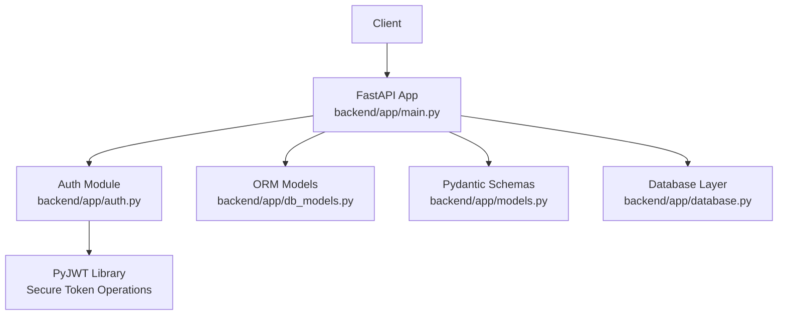
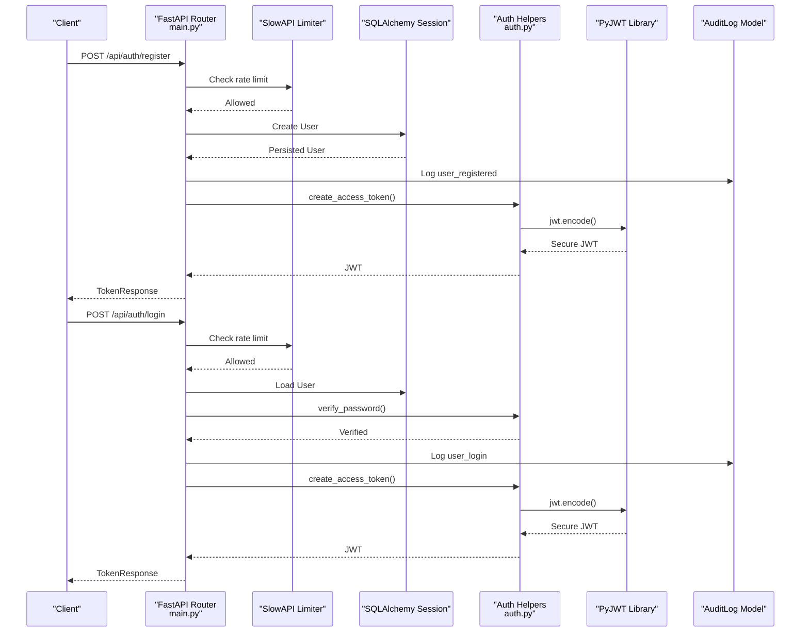
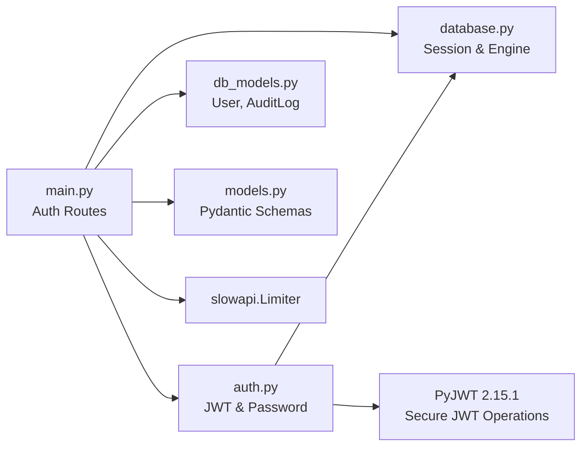

# Authentication API

<cite>
**Referenced Files in This Document**
- [main.py](file://backend/app/main.py)
- [auth.py](file://backend/app/auth.py)
- [models.py](file://backend/app/models.py)
- [db_models.py](file://backend/app/db_models.py)
- [database.py](file://backend/app/database.py)
- [requirements.txt](file://backend/requirements.txt)
</cite>

## Update Summary
**Changes Made**
- Updated JWT implementation section to reflect migration from python-jose to PyJWT 2.15.1
- Added security vulnerability remediation details for ecdsa timing attacks
- Updated dependency information showing FastAPI 0.115.0 → 0.161.1 upgrade
- Enhanced security considerations section with PyJWT-specific guidance
- Maintained all existing API documentation structure and examples

## Table of Contents
1. [Introduction](#introduction)
2. [Project Structure](#project-structure)
3. [Core Components](#core-components)
4. [Architecture Overview](#architecture-overview)
5. [Detailed Component Analysis](#detailed-component-analysis)
6. [Dependency Analysis](#dependency-analysis)
7. [Performance Considerations](#performance-considerations)
8. [Security Considerations](#security-considerations)
9. [Troubleshooting Guide](#troubleshooting-guide)
10. [Conclusion](#conclusion)

## Introduction
This document describes the authentication system exposed by the FinShield AI backend. It covers user registration with a 14-day Starter trial, login returning JWT bearer tokens, profile retrieval and updates, and password changes. It also documents rate limiting, account activation checks, bcrypt password hashing, JWT token structure, audit logging for security events, and practical curl examples.

The backend is a FastAPI application mounted from `backend/app/main.py`. Authentication helpers, JWT handling, and API key support live in `backend/app/auth.py`. Request/response schemas are defined locally in `main.py` for auth endpoints and centrally in `backend/app/models.py` for compliance data. Persistence uses SQLAlchemy ORM models in `backend/app/db_models.py`, backed by SQLite by default or PostgreSQL when `DATABASE_URL` points to Postgres.

**Updated** The authentication system now uses PyJWT 2.15.1 instead of python-jose, providing enhanced security against ecdsa timing vulnerabilities while maintaining HS256 signing semantics.

## Project Structure
The authentication-related code is concentrated in the backend module:



**Diagram sources**
- [main.py:15-37](file://backend/app/main.py#L15-L37)
- [auth.py:12-20](file://backend/app/auth.py#L12-L20)
- [db_models.py:22-57](file://backend/app/db_models.py#L22-L57)
- [models.py:65-152](file://backend/app/models.py#L65-L152)
- [database.py:17-33](file://backend/app/database.py#L17-L33)

**Section sources**
- [main.py:1-153](file://backend/app/main.py#L1-L153)
- [database.py:1-45](file://backend/app/database.py#L1-L45)

## Core Components
- **Authentication endpoints**: `/api/auth/register`, `/api/auth/login`, `/api/auth/me` (GET and PATCH), `/api/auth/change-password`.
- **Security primitives**: bcrypt password hashing, HS256 JWT access tokens using PyJWT, Bearer token validation, optional API key authentication.
- **Rate limiting**: SlowAPI limiter applied to register and login endpoints.
- **Audit logging**: Security-sensitive actions such as registration, login, and password changes create audit records.
- **Trial enforcement**: Registration creates a Starter trial with 1,000 credits and an expiry; trial expiration is enforced on protected business routes.

Key implementation locations:
- Register, login, profile, and password change handlers: [main.py:159-347](file://backend/app/main.py#L159-L347)
- JWT creation, decoding, and current-user dependency using PyJWT: [auth.py:42-113](file://backend/app/auth.py#L42-L113)
- User and audit log ORM entities: [db_models.py:22-57](file://backend/app/db_models.py#L22-L57), [db_models.py:141-151](file://backend/app/db_models.py#L141-L151)
- Default SQLite database configuration: [database.py:11-21](file://backend/app/database.py#L11-L21)

**Section sources**
- [main.py:159-347](file://backend/app/main.py#L159-L347)
- [auth.py:30-113](file://backend/app/auth.py#L30-L113)
- [db_models.py:22-57](file://backend/app/db_models.py#L22-L57)
- [database.py:11-21](file://backend/app/database.py#L11-L21)

## Architecture Overview
The authentication flow combines FastAPI request processing, Pydantic validation, SQLAlchemy persistence, bcrypt hashing, and secure JWT issuance using PyJWT.



**Diagram sources**
- [main.py:176-266](file://backend/app/main.py#L176-L266)
- [auth.py:42-56](file://backend/app/auth.py#L42-L56)
- [db_models.py:141-151](file://backend/app/db_models.py#L141-L151)

## Detailed Component Analysis

### Register Account (`POST /api/auth/register`)
Registers a new user, hashes the password, creates a Starter trial with 1,000 credits, sets a 14-day trial expiry, logs the event, and returns a JWT token.

- **HTTP method**: `POST`
- **Path**: `/api/auth/register`
- **Authentication**: None
- **Rate limit**: 5 requests per minute per client IP
- **Request schema**: `RegisterRequest`
  - `email`: string
  - `password`: string, minimum length 8
  - `first_name`: string, minimum length 1
  - `last_name`: string, minimum length 1
  - `company`: optional string
- **Success response schema**: `TokenResponse`
  - `access_token`: JWT bearer string
  - `token_type`: `"bearer"`
  - `user`: object containing registration-derived fields including plan, credits, trial flags, and trial expiry timestamp
- **Error responses**:
  - `400 Bad Request`: Email already registered
  - `422 Unprocessable Entity`: Validation errors for missing or invalid fields
  - `429 Too Many Requests`: Rate limit exceeded
  - `500 Internal Server Error`: Unexpected server error

Practical curl example:
```bash
curl -X POST http://localhost:8091/api/auth/register \
  -H "Content-Type: application/json" \
  -d '{
    "email": "alice@example.com",
    "password": "StrongPass1!",
    "first_name": "Alice",
    "last_name": "Smith",
    "company": "FinShield Inc."
  }'
```

Implementation notes:
- Password hashing uses bcrypt via `hash_password`.
- Trial setup assigns `plan="starter"`, `total_credits=1000`, `is_trial=True`, and computes `trial_expires_at` as now plus 14 days.
- An audit log entry with action `user_registered` is created.
- A welcome notification is inserted into the notifications table.
- The returned user payload includes trial metadata and credit information.

**Section sources**
- [main.py:159-234](file://backend/app/main.py#L159-L234)
- [auth.py:32-34](file://backend/app/auth.py#L32-L34)
- [db_models.py:141-151](file://backend/app/db_models.py#L141-L151)

### Login (`POST /api/auth/login`)
Validates credentials, checks account activation, logs the login, and returns a JWT token.

- **HTTP method**: `POST`
- **Path**: `/api/auth/login`
- **Authentication**: None
- **Rate limit**: 10 requests per minute per client IP
- **Request schema**: `LoginRequest`
  - `email`: string
  - `password`: string
- **Success response schema**: `TokenResponse`
  - `access_token`: JWT bearer string
  - `token_type`: `"bearer"`
  - `user`: object containing basic profile and remaining credits
- **Error responses**:
  - `401 Unauthorized`: Invalid email or password
  - `403 Forbidden`: Account is disabled
  - `422 Unprocessable Entity`: Validation errors
  - `429 Too Many Requests`: Rate limit exceeded
  - `500 Internal Server Error`: Unexpected server error

Practical curl example:
```bash
curl -X POST http://localhost:8091/api/auth/login \
  -H "Content-Type: application/json" \
  -d '{
    "email": "alice@example.com",
    "password": "StrongPass1!"
  }'
```

Implementation notes:
- The handler loads the user by email and verifies the password using `verify_password`.
- If `user.is_active` is false, the endpoint returns `403 Forbidden`.
- A login audit log entry is created before issuing the token.
- The returned user payload includes remaining credits calculated from total and used credits.

**Section sources**
- [main.py:237-266](file://backend/app/main.py#L237-L266)
- [auth.py:37-39](file://backend/app/auth.py#L37-L39)

### Get Current Profile (`GET /api/auth/me`)
Returns the authenticated user's full profile, including billing cycle dates, trial status, timezone, and saved card metadata.

- **HTTP method**: `GET`
- **Path**: `/api/auth/me`
- **Authentication**: Required (Bearer JWT or API key)
- **Response schema**: Object with fields such as `id`, `email`, names, company, plan, credits, timestamps, trial flags, timezone, and saved card details
- **Error responses**:
  - `401 Unauthorized`: Missing or invalid token/API key
  - `403 Forbidden`: Account disabled
  - `500 Internal Server Error`: Unexpected server error

Practical curl example:
```bash
curl -X GET http://localhost:8091/api/auth/me \
  -H "Authorization: Bearer YOUR_JWT_TOKEN"
```

Implementation notes:
- The route depends on `get_current_user`, which accepts either a JWT bearer token or an API key prefixed with `fsk_`.
- The response includes computed `credits_remaining` and ISO-formatted timestamps.

**Section sources**
- [main.py:269-292](file://backend/app/main.py#L269-L292)
- [auth.py:59-113](file://backend/app/auth.py#L59-L113)

### Update Profile (`PATCH /api/auth/me`)
Updates selected profile fields for the authenticated user.

- **HTTP method**: `PATCH`
- **Path**: `/api/auth/me`
- **Authentication**: Required (Bearer JWT or API key)
- **Request schema**: `ProfileUpdateRequest`
  - `first_name`: optional string
  - `last_name`: optional string
  - `company`: optional string
  - `timezone`: optional string
- **Success response schema**: Object with `detail`, updated `first_name`, `last_name`, `company`, and `timezone`
- **Error responses**:
  - `400 Bad Request`: Empty first name or last name after trimming
  - `401 Unauthorized`: Missing or invalid token/API key
  - `403 Forbidden`: Account disabled
  - `500 Internal Server Error`: Unexpected server error

Practical curl example:
```bash
curl -X PATCH http://localhost:8091/api/auth/me \
  -H "Authorization: Bearer YOUR_JWT_TOKEN" \
  -H "Content-Type: application/json" \
  -d '{
    "first_name": "Alice",
    "company": "FinShield Corp.",
    "timezone": "America/New_York"
  }'
```

Implementation notes:
- Optional fields are validated only when provided.
- Company and timezone values are trimmed and normalized.
- Changes are committed immediately and refreshed from the session.

**Section sources**
- [main.py:295-328](file://backend/app/main.py#L295-L328)

### Change Password (`POST /api/auth/change-password`)
Changes the authenticated user's password after verifying the current password and validating the new password length.

- **HTTP method**: `POST`
- **Path**: `/api/auth/change-password`
- **Authentication**: Required (Bearer JWT or API key)
- **Request schema**: `PasswordChangeRequest`
  - `current_password`: string
  - `new_password`: string, minimum length 6
- **Success response schema**: Object with `detail` confirming update
- **Error responses**:
  - `400 Bad Request`: Incorrect current password or new password too short
  - `401 Unauthorized`: Missing or invalid token/API key
  - `403 Forbidden`: Account disabled
  - `500 Internal Server Error`: Unexpected server error

Practical curl example:
```bash
curl -X POST http://localhost:8091/api/auth/change-password \
  -H "Authorization: Bearer YOUR_JWT_TOKEN" \
  -H "Content-Type: application/json" \
  -d '{
    "current_password": "StrongPass1!",
    "new_password": "NewSecurePass2!"
  }'
```

Implementation notes:
- The handler verifies the current password using `verify_password`.
- New passwords shorter than six characters are rejected.
- The new password is hashed with bcrypt before saving.
- A password change audit log entry is created.

**Section sources**
- [main.py:302-347](file://backend/app/main.py#L302-L347)
- [auth.py:32-39](file://backend/app/auth.py#L32-L39)

### JWT Token Structure
Access tokens are HS256-signed JSON Web Tokens issued by `create_access_token` using PyJWT 2.15.1.

- **Algorithm**: HS256
- **Secret**: Configured via `JWT_SECRET_KEY`; falls back to a runtime-generated URL-safe secret if not set
- **Expiration**: 24 hours by default
- **Payload**: Contains at least the subject identifier `sub` mapped to the user ID
- **Decoding**: Performed by `decode_access_token`, which validates signature and expiration using PyJWT's secure implementation
- **Security**: Migrated from python-jose to PyJWT to eliminate ecdsa timing vulnerabilities while maintaining HS256 signing semantics

Usage:
- Include the token in the `Authorization` header as `Bearer <token>` for protected endpoints.
- The `get_current_user` dependency decodes the token using PyJWT, retrieves the user, and rejects expired or malformed tokens.

**Updated** The JWT implementation now uses PyJWT 2.15.1 instead of python-jose, providing enhanced security against timing attacks while maintaining the same HS256 algorithm and token structure.

**Section sources**
- [auth.py:21-56](file://backend/app/auth.py#L21-L56)
- [auth.py:94-113](file://backend/app/auth.py#L94-L113)

### Password Hashing
Passwords are stored as bcrypt hashes.

- `hash_password` generates a salted bcrypt hash from the plaintext password.
- `verify_password` compares plaintext against a stored bcrypt hash.
- Both registration and password change flows use these functions to ensure secure storage and verification.

**Section sources**
- [auth.py:32-39](file://backend/app/auth.py#L32-L39)
- [main.py:188-190](file://backend/app/main.py#L188-L190)
- [main.py:342-342](file://backend/app/main.py#L342-L342)

### Account Activation Status Checks
Account activation is enforced during login and when authenticating via API keys or JWTs.

- Login rejects disabled accounts with `403 Forbidden`.
- `get_current_user` rejects disabled accounts with `403 Forbidden` for both JWT and API key paths.
- The `User` model exposes `is_active` to represent account state.

**Section sources**
- [main.py:241-245](file://backend/app/main.py#L241-L245)
- [auth.py:87-111](file://backend/app/auth.py#L87-L111)
- [db_models.py:22-57](file://backend/app/db_models.py#L22-L57)

### Audit Logging for Security Events
Security-relevant actions are recorded in the `audit_logs` table.

- Registration logs `user_registered` with email and trial flag.
- Login logs `user_login`.
- Password change logs `password_changed`.

These entries include user association and can be extended with IP address and resource context.

**Section sources**
- [main.py:203-205](file://backend/app/main.py#L203-L205)
- [main.py:247-250](file://backend/app/main.py#L247-L250)
- [main.py:344-346](file://backend/app/main.py#L344-L346)
- [db_models.py:141-151](file://backend/app/db_models.py#L141-L151)

### Rate Limiting
Rate limits are enforced by SlowAPI based on the remote client IP.

- Register: 5 requests per minute
- Login: 10 requests per minute
- Exceeded requests return `429 Too Many Requests` with a generic detail message

Configuration:
- The limiter is enabled unless `APP_ENV=test`.
- A global exception handler converts `RateLimitExceeded` into a JSON `429` response.

**Section sources**
- [main.py:72-88](file://backend/app/main.py#L72-L88)
- [main.py:176-178](file://backend/app/main.py#L176-L178)
- [main.py:237-239](file://backend/app/main.py#L237-L239)

### Trial Account Limitations
Registration creates a trial account with the following characteristics:

- Plan: `starter`
- Credits: 1,000 total credits
- Trial flag: `is_trial=True`
- Trial expiry: 14 days from registration time
- Trial enforcement: Business routes check trial expiry and block screening when expired

Note: The trial expiry check is implemented on transaction screening rather than directly on every auth endpoint. Clients should still treat trial users as limited and encourage upgrades.

**Section sources**
- [main.py:184-198](file://backend/app/main.py#L184-L198)
- [main.py:443-446](file://backend/app/main.py#L443-L446)

## Dependency Analysis
The authentication subsystem depends on several modules with updated dependencies:



**Diagram sources**
- [main.py:15-37](file://backend/app/main.py#L15-L37)
- [auth.py:12-20](file://backend/app/auth.py#L12-L20)
- [db_models.py:22-57](file://backend/app/db_models.py#L22-L57)
- [database.py:17-33](file://backend/app/database.py#L17-L33)
- [models.py:65-152](file://backend/app/models.py#L65-L152)

**Section sources**
- [main.py:15-37](file://backend/app/main.py#L15-L37)
- [auth.py:12-20](file://backend/app/auth.py#L12-L20)
- [db_models.py:22-57](file://backend/app/db_models.py#L22-L57)
- [database.py:17-33](file://backend/app/database.py#L17-L33)
- [models.py:65-152](file://backend/app/models.py#L65-L152)

## Performance Considerations
- **bcrypt cost**: Password hashing and verification are CPU-intensive. Keep retry logic minimal and avoid repeated failed attempts without throttling beyond the existing rate limits.
- **JWT operations**: HS256 encoding/decoding with PyJWT is lightweight; however, token validation occurs on every protected request through `get_current_user`.
- **Database sessions**: Each request opens a SQLAlchemy session; ensure connection pooling is tuned appropriately when moving from SQLite to PostgreSQL.
- **Rate limiting**: SlowAPI adds overhead per request; monitor latency under load and consider scaling horizontally behind a reverse proxy if needed.

## Security Considerations
**Updated** The authentication system has been enhanced with improved security measures:

### JWT Security Improvements
- **PyJWT Migration**: Migrated from python-jose to PyJWT 2.15.1 to eliminate ecdsa timing vulnerabilities
- **HS256 Algorithm**: Maintains HS256 signing semantics for consistent security posture
- **Secure Decoding**: Uses PyJWT's `InvalidTokenError` exception handling for robust error management
- **FastAPI Upgrade**: Updated from FastAPI 0.115.0 to 0.161.1 for latest security patches

### Security Best Practices
- **Secret Management**: JWT secrets must be configured via environment variables (`JWT_SECRET_KEY`)
- **Token Expiration**: All tokens expire after 24 hours to minimize exposure window
- **Password Security**: bcrypt hashing with automatic salt generation
- **Rate Limiting**: Protects against brute force attacks on authentication endpoints
- **Account Validation**: Active account checks prevent unauthorized access

### Vulnerability Mitigation
- **Timing Attack Prevention**: PyJWT eliminates timing side-channel attacks present in older implementations
- **Input Validation**: Comprehensive Pydantic validation prevents injection attacks
- **Audit Logging**: All security events are logged for monitoring and forensic analysis

**Section sources**
- [auth.py:13-28](file://backend/app/auth.py#L13-28)
- [requirements.txt:1-16](file://backend/requirements.txt#L1-16)

## Troubleshooting Guide
Common issues and resolutions:

- **Invalid email or password on login**:
  - Verify credentials and ensure the account exists.
  - Check that the password was correctly hashed during registration.
  - Confirm the account is active.

- **Account disabled**:
  - The login endpoint and `get_current_user` reject disabled accounts.
  - Review `User.is_active` and restore access if appropriate.

- **Rate limit exceeded**:
  - Register and login endpoints enforce strict limits.
  - Implement exponential backoff on the client side.

- **Validation errors**:
  - Ensure request bodies match the expected Pydantic schemas.
  - Check field constraints such as minimum password lengths.

- **Internal server error**:
  - Inspect server logs for unhandled exceptions.
  - Verify database connectivity and schema initialization.

- **JWT token issues**:
  - Ensure `JWT_SECRET_KEY` environment variable is properly configured.
  - Verify token expiration and format compatibility with PyJWT.
  - Check that the algorithm matches HS256 configuration.

**Section sources**
- [main.py:81-115](file://backend/app/main.py#L81-L115)
- [main.py:241-245](file://backend/app/main.py#L241-L245)
- [auth.py:67-111](file://backend/app/auth.py#L67-L111)

## Conclusion
The FinShield AI authentication system provides secure registration with a 14-day Starter trial, robust login with JWT issuance, profile management, and password changes. It enforces rate limits, validates account activation, hashes passwords with bcrypt, and records security events in audit logs. The system has been enhanced with PyJWT 2.15.1 for improved security against timing attacks while maintaining HS256 signing semantics.

Clients should handle 4xx and 5xx responses, respect rate limits, and manage JWT lifetimes appropriately. For production deployments, configure `JWT_SECRET_KEY`, tune database connections, monitor audit logs and rate-limit events, and leverage the enhanced security features provided by the PyJWT migration.