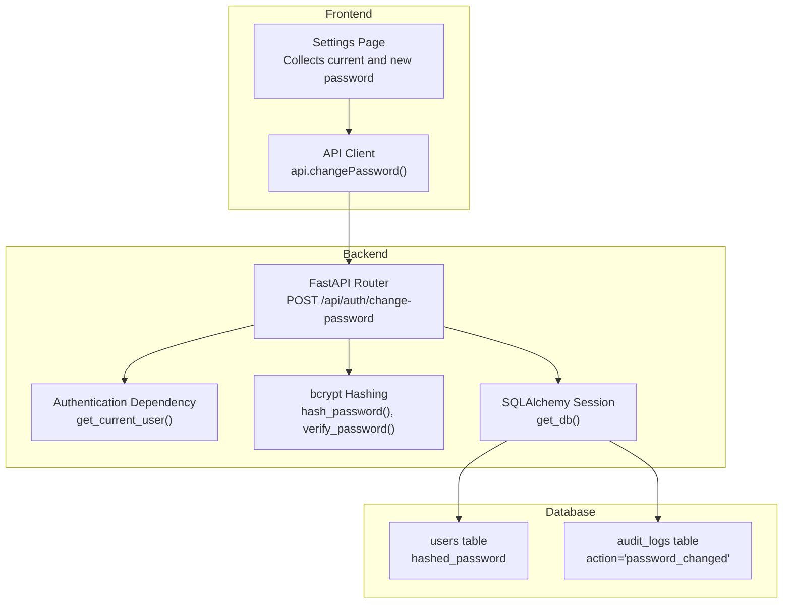
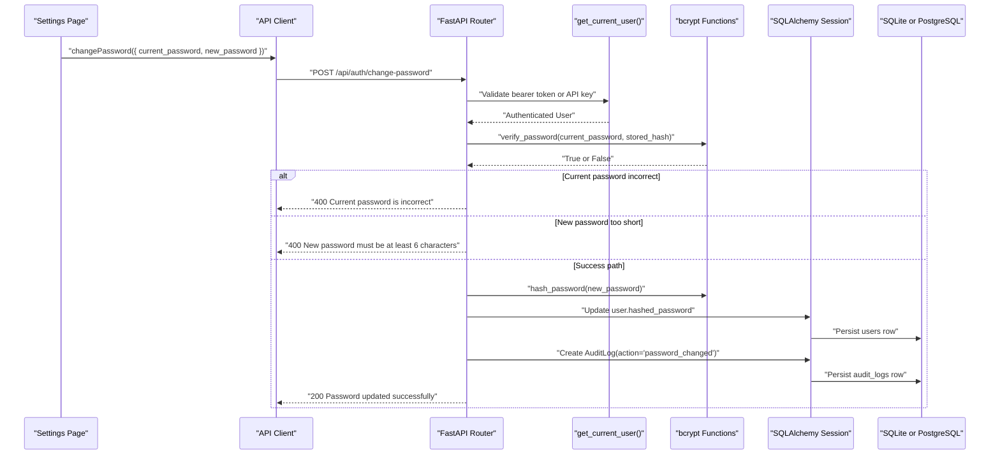
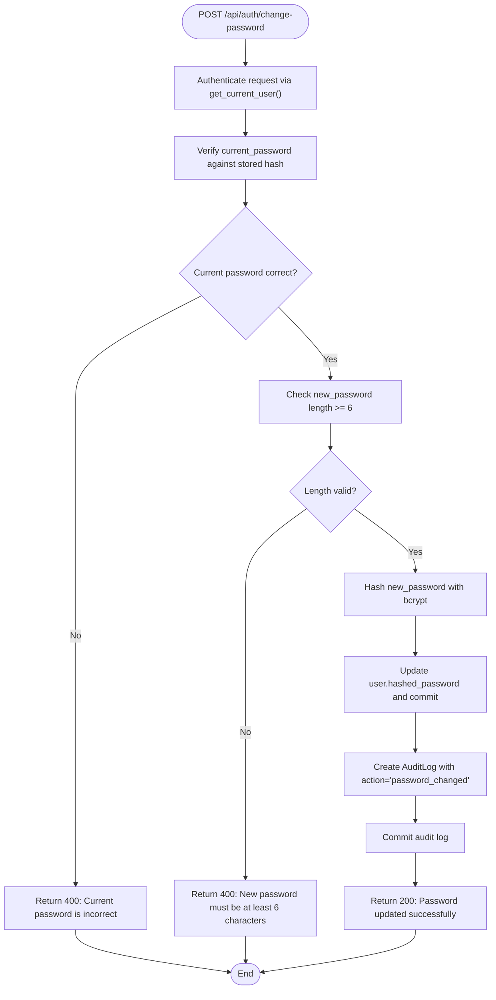
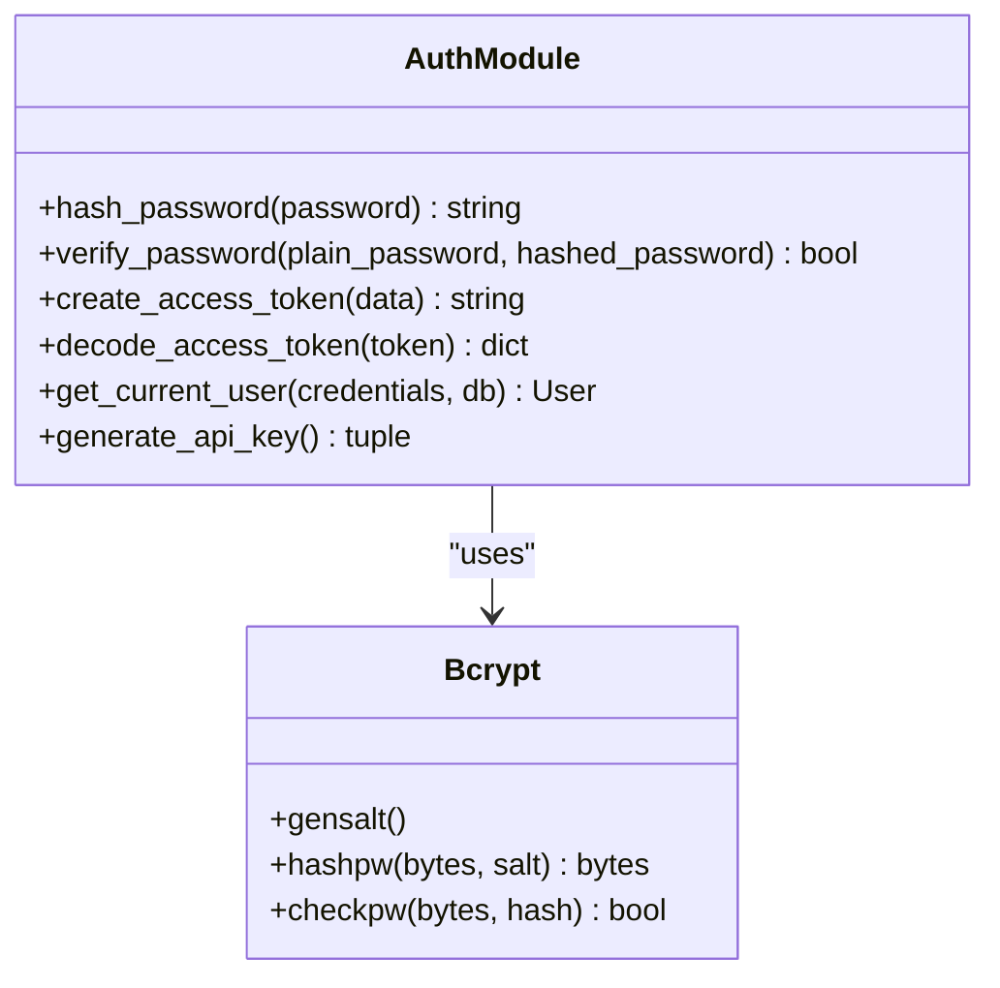
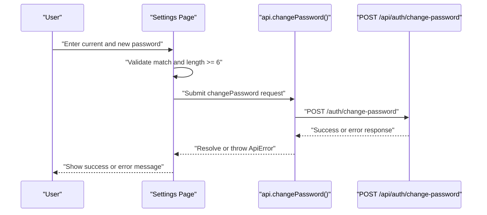
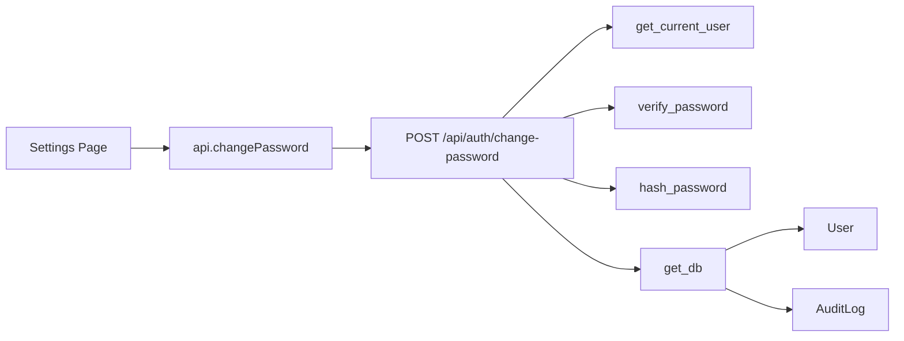

# Password Management

<cite>
**Referenced Files in This Document**
- [main.py](file://backend/app/main.py)
- [auth.py](file://backend/app/auth.py)
- [database.py](file://backend/app/database.py)
- [db_models.py](file://backend/app/db_models.py)
- [api.ts](file://platform-app/src/lib/api.ts)
- [settings page.tsx](file://platform-app/src/app/settings/page.tsx)
</cite>

## Table of Contents
1. [Introduction](#introduction)
2. [Project Structure](#project-structure)
3. [Core Components](#core-components)
4. [Architecture Overview](#architecture-overview)
5. [Detailed Component Analysis](#detailed-component-analysis)
6. [Dependency Analysis](#dependency-analysis)
7. [Performance Considerations](#performance-considerations)
8. [Troubleshooting Guide](#troubleshooting-guide)
9. [Conclusion](#conclusion)

## Introduction
This document explains the password change functionality exposed by the FinShield backend and consumed by the Next.js dashboard. The endpoint is `POST /api/auth/change-password`. It requires a valid authenticated request, verifies the current password, validates the new password length, hashes the new password with bcrypt, persists it, and records an audit log entry.

The implementation is part of the FastAPI backend (`backend/app/main.py`), uses bcrypt-based hashing from `backend/app/auth.py`, persists data through SQLAlchemy models defined in `backend/app/db_models.py`, and defaults to SQLite unless `DATABASE_URL` points to PostgreSQL. The frontend calls this endpoint through `platform-app/src/lib/api.ts` from the settings page.

## Project Structure
Password change flows span three layers:

- **Frontend**: The settings page collects the current and new passwords, performs client-side validation, and calls the API client.
- **Backend API**: The FastAPI route validates authentication, verifies the current password, enforces minimum new password length, hashes the new password, updates the user record, and writes an audit log.
- **Persistence**: SQLAlchemy ORM models define the `User` and `AuditLog` tables; database configuration selects SQLite by default and PostgreSQL when configured.

**Diagram sources**
- [settings page.tsx:232-245](file://platform-app/src/app/settings/page.tsx#L232-L245)
- [api.ts:528-532](file://platform-app/src/lib/api.ts#L528-L532)
- [main.py:302-347](file://backend/app/main.py#L302-L347)
- [auth.py:32-39](file://backend/app/auth.py#L32-L39)
- [database.py:27-33](file://backend/app/database.py#L27-L33)
- [db_models.py:22-57](file://backend/app/db_models.py#L22-L57)
- [db_models.py:141-151](file://backend/app/db_models.py#L141-L151)

**Section sources**
- [main.py:302-347](file://backend/app/main.py#L302-L347)
- [auth.py:32-39](file://backend/app/auth.py#L32-L39)
- [database.py:11-19](file://backend/app/database.py#L11-L19)
- [db_models.py:22-57](file://backend/app/db_models.py#L22-L57)
- [db_models.py:141-151](file://backend/app/db_models.py#L141-L151)
- [api.ts:528-532](file://platform-app/src/lib/api.ts#L528-L532)
- [settings page.tsx:232-245](file://platform-app/src/app/settings/page.tsx#L232-L245)

## Core Components
The password change feature consists of these core pieces:

| Component | Responsibility | Key Implementation Notes |
|---|---|---|
| `PasswordChangeRequest` | Defines the request body for password changes | Contains `current_password` and `new_password`; no Pydantic min-length validator is applied at schema level |
| `change_password` route | Handles `POST /api/auth/change-password` | Requires authentication, verifies current password, enforces minimum new password length, hashes and saves the new password, logs the action |
| `verify_password` | Compares plaintext password against stored hash | Uses `bcrypt.checkpw` |
| `hash_password` | Produces a bcrypt hash for storage | Uses `bcrypt.hashpw` with generated salt |
| `User` model | Stores the hashed password | Column `hashed_password` is required |
| `AuditLog` model | Records security-sensitive actions | Used to record `password_changed` |
| Frontend API client | Calls `/auth/change-password` | Sends JSON payload with `current_password` and `new_password` |
| Settings page | Collects input and triggers the change | Performs client-side checks before calling the backend |

**Section sources**
- [main.py:302-347](file://backend/app/main.py#L302-L347)
- [auth.py:32-39](file://backend/app/auth.py#L32-L39)
- [db_models.py:22-57](file://backend/app/db_models.py#L22-L57)
- [db_models.py:141-151](file://backend/app/db_models.py#L141-L151)
- [api.ts:528-532](file://platform-app/src/lib/api.ts#L528-L532)
- [settings page.tsx:232-245](file://platform-app/src/app/settings/page.tsx#L232-L245)

## Architecture Overview
The password change flow is a standard authenticated mutation:

**Diagram sources**
- [main.py:331-347](file://backend/app/main.py#L331-L347)
- [auth.py:59-113](file://backend/app/auth.py#L59-L113)
- [auth.py:32-39](file://backend/app/auth.py#L32-L39)
- [database.py:27-33](file://backend/app/database.py#L27-L33)
- [db_models.py:22-57](file://backend/app/db_models.py#L22-L57)
- [db_models.py:141-151](file://backend/app/db_models.py#L141-L151)

## Detailed Component Analysis

### POST /api/auth/change-password Endpoint
The endpoint is mounted under the auth routes and tagged as `Auth`. It accepts a `PasswordChangeRequest` body and requires an authenticated user through `get_current_user`.

#### Request Schema
| Field | Type | Required | Validation |
|---|---|---:|---|
| `current_password` | string | Yes | Verified against the stored bcrypt hash |
| `new_password` | string | Yes | Must have at least 6 characters |

The schema itself does not enforce the minimum length; the handler performs that check explicitly.

#### Authentication
The endpoint depends on `get_current_user`, which supports:
- Bearer JWT tokens
- Live API keys with the `fsk_` prefix

If neither is valid, the request fails before reaching password logic.

#### Processing Logic
1. Verify `current_password` against the stored `hashed_password`.
2. Validate that `new_password` has at least six characters.
3. Hash the new password using bcrypt.
4. Update the user’s `hashed_password`.
5. Commit the user update.
6. Create an `AuditLog` entry with `action="password_changed"`.
7. Commit the audit log.
8. Return a success response containing a detail message.

**Diagram sources**
- [main.py:331-347](file://backend/app/main.py#L331-L347)
- [auth.py:59-113](file://backend/app/auth.py#L59-L113)

**Section sources**
- [main.py:302-347](file://backend/app/main.py#L302-L347)

### Password Change Request Model
`PasswordChangeRequest` is defined locally in the main application module and contains two fields:

- `current_password`: used only for verification.
- `new_password`: used for validation and hashing.

There is no built-in Pydantic constraint enforcing a minimum length, so the handler implements the length rule directly.

**Section sources**
- [main.py:302-305](file://backend/app/main.py#L302-L305)

### bcrypt Hashing Implementation
Password hashing and verification are implemented in the authentication module:

- `hash_password` encodes the plaintext password to UTF-8 bytes, generates a bcrypt salt, and returns the decoded hash string.
- `verify_password` compares a plaintext password against a stored bcrypt hash using constant-time comparison.

These functions are reused for registration, login, API key hashing, and password changes.

**Diagram sources**
- [auth.py:32-39](file://backend/app/auth.py#L32-L39)
- [auth.py:42-56](file://backend/app/auth.py#L42-L56)
- [auth.py:59-113](file://backend/app/auth.py#L59-L113)
- [auth.py:116-121](file://backend/app/auth.py#L116-L121)

**Section sources**
- [auth.py:32-39](file://backend/app/auth.py#L32-L39)

### Database Models Involved
Two ORM models participate in the password change operation:

| Model | Purpose | Relevant Fields |
|---|---|---|
| `User` | Represents the account whose password is being changed | `id`, `email`, `hashed_password`, `is_active` |
| `AuditLog` | Records the security event | `user_id`, `action`, `details`, `created_at` |

The `User` model stores the bcrypt hash as a string column. The `AuditLog` model stores the action type and can store additional details as JSON.

**Section sources**
- [db_models.py:22-57](file://backend/app/db_models.py#L22-L57)
- [db_models.py:141-151](file://backend/app/db_models.py#L141-L151)

### Persistence Configuration
By default, the application uses SQLite with the file `finshield.db`. In tests, it switches to `test_finshield.db`. If `DATABASE_URL` is set, the application uses that connection string, which enables PostgreSQL usage.

For password change operations, this means:
- Default deployments write to SQLite.
- Environments with `DATABASE_URL` pointing to PostgreSQL will persist user and audit rows there.
- The RAG retrieval path specifically requires PostgreSQL, but password change itself does not depend on pgvector.

**Section sources**
- [database.py:11-19](file://backend/app/database.py#L11-L19)
- [database.py:27-33](file://backend/app/database.py#L27-L33)

### Frontend Integration
The Next.js settings page handles the user interaction:

1. Validates that the new password matches the confirmation field.
2. Validates that the new password is at least six characters.
3. Calls `api.changePassword` with `current_password` and `new_password`.
4. Clears the input fields on success.
5. Shows a flash message for success or failure.

The API client sends a `POST` request to `/auth/change-password` with a JSON body containing both password fields.

**Diagram sources**
- [settings page.tsx:232-245](file://platform-app/src/app/settings/page.tsx#L232-L245)
- [api.ts:528-532](file://platform-app/src/lib/api.ts#L528-L532)

**Section sources**
- [settings page.tsx:232-245](file://platform-app/src/app/settings/page.tsx#L232-L245)
- [api.ts:528-532](file://platform-app/src/lib/api.ts#L528-L532)

## Dependency Analysis
The password change endpoint has clear dependencies:

- **Authentication dependency**: `get_current_user` ensures the request is authorized via JWT or API key.
- **Password utilities**: `verify_password` and `hash_password` from the authentication module.
- **Database session**: `get_db` provides a SQLAlchemy session scoped to the request.
- **ORM models**: `User` and `AuditLog` from the database models module.
- **Frontend client**: `api.changePassword` in the Next.js app.

**Diagram sources**
- [settings page.tsx:232-245](file://platform-app/src/app/settings/page.tsx#L232-L245)
- [api.ts:528-532](file://platform-app/src/lib/api.ts#L528-L532)
- [main.py:331-347](file://backend/app/main.py#L331-L347)
- [auth.py:59-113](file://backend/app/auth.py#L59-L113)
- [auth.py:32-39](file://backend/app/auth.py#L32-L39)
- [database.py:27-33](file://backend/app/database.py#L27-L33)
- [db_models.py:22-57](file://backend/app/db_models.py#L22-L57)
- [db_models.py:141-151](file://backend/app/db_models.py#L141-L151)

**Section sources**
- [main.py:331-347](file://backend/app/main.py#L331-L347)
- [auth.py:32-39](file://backend/app/auth.py#L32-L39)
- [auth.py:59-113](file://backend/app/auth.py#L59-L113)
- [database.py:27-33](file://backend/app/database.py#L27-L33)
- [db_models.py:22-57](file://backend/app/db_models.py#L22-L57)
- [db_models.py:141-151](file://backend/app/db_models.py#L141-L151)
- [api.ts:528-532](file://platform-app/src/lib/api.ts#L528-L532)
- [settings page.tsx:232-245](file://platform-app/src/app/settings/page.tsx#L232-L245)

## Performance Considerations
- **bcrypt cost**: bcrypt hashing is intentionally slow to resist brute-force attacks. Each password change performs one verification and one hash operation.
- **Database writes**: A successful change performs two commits — one for the user password update and one for the audit log. This increases persistence overhead compared to a single-write operation.
- **Authentication overhead**: JWT decoding or API key lookup occurs before password processing.
- **Frontend validation**: Client-side validation reduces unnecessary network requests for obviously invalid inputs.

[No sources needed since this section provides general guidance]

## Troubleshooting Guide

### Common Failure Scenarios

| Scenario | Expected Behavior | Likely Cause | Resolution |
|---|---|---|---|
| Missing or invalid authentication header | 401 Unauthorized | No bearer token, expired JWT, or invalid API key | Re-authenticate or refresh the access token |
| Incorrect `current_password` | 400 with detail indicating the current password is incorrect | User entered the wrong existing password | Ask the user to re-enter the current password |
| `new_password` shorter than six characters | 400 with detail indicating the minimum length requirement | Frontend validation was bypassed or backend validation differs | Ensure the new password meets the minimum length policy |
| Network error during request | Frontend throws `ApiError` | Backend unavailable, CORS issue, or proxy problem | Check server status, CORS configuration, and API base URL |
| Successful response but old sessions remain active | User remains logged in after password change | Existing JWTs are still valid until expiration | Invalidate existing tokens or force re-login after password change |

### Security Implications
- **Plaintext password transmission**: The request body contains `current_password` and `new_password`. This should only be sent over TLS/HTTPS.
- **No password history enforcement**: The current implementation does not prevent reuse of recent passwords.
- **No complexity rules beyond length**: There is no requirement for uppercase letters, lowercase letters, digits, or special characters.
- **Audit logging exists but is minimal**: The audit log records `action="password_changed"` but does not include IP address, user agent, or timestamp enrichment in the handler itself.
- **Token lifecycle**: Changing a password does not automatically invalidate existing JWTs; clients may need to require re-authentication after a successful change.
- **Rate limiting**: The password change endpoint does not use the same per-endpoint rate limiter applied to registration and login.

**Section sources**
- [main.py:331-347](file://backend/app/main.py#L331-L347)
- [auth.py:59-113](file://backend/app/auth.py#L59-L113)
- [db_models.py:141-151](file://backend/app/db_models.py#L141-L151)

## Conclusion
The password change feature is a focused authentication mutation that verifies the current password, enforces a minimum new password length, hashes the new password with bcrypt, persists it, and records an audit log. The frontend integrates cleanly through the API client and settings page.

For production hardening, consider adding stronger password complexity rules, explicit audit metadata such as IP address and timestamp, token invalidation after password changes, and endpoint-specific rate limiting. These improvements would strengthen security without changing the existing endpoint contract.

[No sources needed since this section summarizes without analyzing specific files]