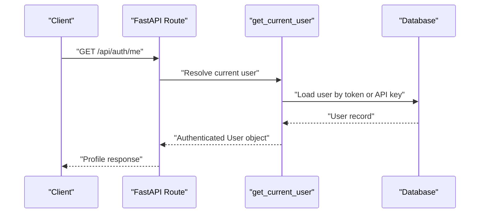
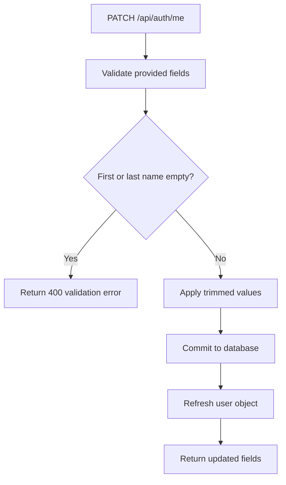
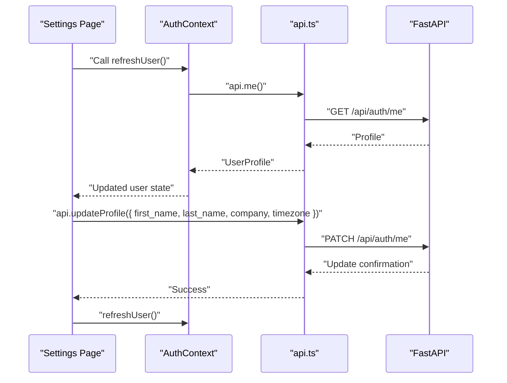
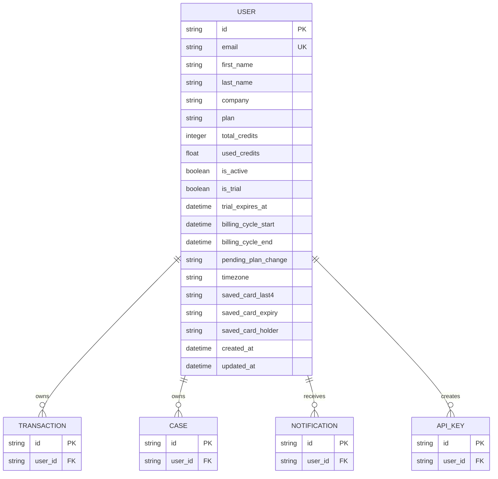

# Profile Management

<cite>
**Referenced Files in This Document**
- [main.py](file://backend/app/main.py)
- [auth.py](file://backend/app/auth.py)
- [db_models.py](file://backend/app/db_models.py)
- [api.ts](file://platform-app/src/lib/api.ts)
- [AuthContext.tsx](file://platform-app/src/contexts/AuthContext.tsx)
- [settings/page.tsx](file://platform-app/src/app/settings/page.tsx)
</cite>

## Table of Contents
1. [Introduction](#introduction)
2. [Endpoints Overview](#endpoints-overview)
3. [Authentication and User Context](#authentication-and-user-context)
4. [GET /api/auth/me — Retrieve Current Profile](#get-apiauthme--retrieve-current-profile)
5. [PATCH /api/auth/me — Update Profile](#patch-apiauthme--update-profile)
6. [Frontend Integration](#frontend-integration)
7. [Practical Examples](#practical-examples)
8. [Validation Rules](#validation-rules)
9. [Error Handling](#error-handling)
10. [Data Model Relationship](#data-model-relationship)
11. [Troubleshooting Guide](#troubleshooting-guide)
12. [Conclusion](#conclusion)

## Introduction
This document explains the profile management endpoints for FinShield’s backend API:

- `GET /api/auth/me` returns the authenticated user’s full profile, including identity fields, subscription plan, credit balance, billing cycle information, trial state, timezone, and saved payment method metadata.
- `PATCH /api/auth/me` performs partial updates to editable profile fields such as `first_name`, `last_name`, `company`, and `timezone`.

These endpoints are part of the FastAPI application mounted from `backend/app/main.py`, protected by JWT or API-key authentication implemented in `backend/app/auth.py`, and persisted through the SQLAlchemy ORM model defined in `backend/app/db_models.py`. The Next.js dashboard consumes them through `platform-app/src/lib/api.ts`, hydrates session state in `platform-app/src/contexts/AuthContext.tsx`, and exposes editing controls in `platform-app/src/app/settings/page.tsx`.

## Endpoints Overview

| Endpoint | Method | Authentication | Purpose | Request Body | Success Response |
|---|---|---|---|---|---|
| `/api/auth/me` | GET | Required | Retrieve current user profile | None | Full profile object |
| `/api/auth/me` | PATCH | Required | Partially update profile fields | Optional fields only | Updated fields and confirmation detail |

The profile response includes:

- Identity: `id`, `email`, `first_name`, `last_name`, `company`
- Subscription: `plan`, `is_trial`, `trial_expires_at`, `pending_plan_change`
- Credits: `total_credits`, `used_credits`, `credits_remaining`
- Billing cycle: `billing_cycle_start`, `billing_cycle_end`
- Preferences: `timezone`
- Payment metadata: `saved_card_last4`, `saved_card_expiry`, `saved_card_holder`
- Account lifecycle: `created_at`

**Section sources**
- [main.py:269-292](file://backend/app/main.py#L269-L292)
- [main.py:295-328](file://backend/app/main.py#L295-L328)

## Authentication and User Context
Both profile endpoints require an authenticated request. The backend accepts:

1. A JWT bearer token with a `sub` claim containing the user ID.
2. An API key prefixed with `fsk_`, hashed and stored per user.

When authentication succeeds, `get_current_user` loads the `User` ORM entity from the database and injects it into route handlers through FastAPI’s dependency system. If no token is present, the token is invalid, expired, or belongs to a disabled account, the endpoint returns an authentication or authorization error rather than a profile.

**Diagram sources**
- [auth.py:59-113](file://backend/app/auth.py#L59-L113)
- [main.py:269-292](file://backend/app/main.py#L269-L292)

**Section sources**
- [auth.py:21-27](file://backend/app/auth.py#L21-L27)
- [auth.py:59-113](file://backend/app/auth.py#L59-L113)
- [main.py:269-292](file://backend/app/main.py#L269-L292)

## GET /api/auth/me — Retrieve Current Profile

### Behavior
- Requires a valid JWT or API key.
- Returns the complete profile for the authenticated user.
- Does not modify any data.
- Includes computed credit balance as `total_credits - used_credits`.
- Serializes datetime fields as ISO strings; nullable date fields may be `null`.

### Response Fields

| Field | Type | Meaning |
|---|---|---|
| `id` | string | Internal user identifier |
| `email` | string | Account email |
| `first_name` | string | Display name first name |
| `last_name` | string | Display name last name |
| `company` | string or null | Optional company name |
| `plan` | string | Current subscription plan |
| `total_credits` | integer | Total credits allocated to the account |
| `used_credits` | integer | Rounded credits consumed so far |
| `credits_remaining` | integer | Remaining usable credits |
| `created_at` | string | Account creation timestamp |
| `billing_cycle_start` | string or null | Start of current billing period |
| `billing_cycle_end` | string or null | End of current billing period |
| `pending_plan_change` | string or null | Scheduled downgrade or plan change |
| `is_trial` | boolean | Whether the account is on trial |
| `trial_expires_at` | string or null | Trial expiration timestamp |
| `timezone` | string or null | Preferred timezone |
| `saved_card_last4` | string or null | Last four digits of saved card |
| `saved_card_expiry` | string or null | Saved card expiry |
| `saved_card_holder` | string or null | Saved cardholder name |

### Example: Retrieving the Profile
A successful call returns a JSON object containing all profile fields. In the frontend, this response is stored as the authenticated user context and refreshed after login, signup, and profile updates.

**Section sources**
- [main.py:269-292](file://backend/app/main.py#L269-L292)
- [api.ts:23-68](file://platform-app/src/lib/api.ts#L23-L68)
- [AuthContext.tsx:22-48](file://platform-app/src/contexts/AuthContext.tsx#L22-L48)

## PATCH /api/auth/me — Update Profile

### Behavior
- Requires a valid JWT or API key.
- Accepts partial updates: only provided fields are changed.
- Trims whitespace before validation and persistence.
- Commits changes to the database and refreshes the loaded user object.
- Returns a confirmation object with updated profile fields.

### Supported Fields

| Field | Required | Validation Rule | Stored Value |
|---|---:|---|---|
| `first_name` | Only if included | Must not be empty after trimming | Trimmed string |
| `last_name` | Only if included | Must not be empty after trimming | Trimmed string |
| `company` | Optional | Empty string becomes `null` | Trimmed string or `null` |
| `timezone` | Optional | Empty string becomes `null` | Trimmed string or `null` |

Fields omitted from the request body are left unchanged.

### Update Flow

**Diagram sources**
- [main.py:307-328](file://backend/app/main.py#L307-L328)

### Example: Partial Update
A client can send only the fields it wants to change. For example, updating only the timezone does not alter `first_name`, `last_name`, or `company`.

**Section sources**
- [main.py:295-328](file://backend/app/main.py#L295-L328)

## Frontend Integration
The Next.js dashboard integrates profile retrieval and updates through its API client and authentication context.

### Profile Retrieval
- `api.me()` calls `GET /api/auth/me`.
- `AuthContext` fetches the profile on app mount when a token exists.
- After login or signup, the context stores the token and immediately refreshes the full profile.
- `refreshUser()` is used after mutations to keep UI state consistent.

### Profile Editing
- The Settings page renders editable fields for first name, last name, company, and timezone.
- It validates that both first and last names are non-empty before calling the backend.
- It sends a partial update via `api.updateProfile()`.
- On success, it calls `refreshUser()` to reload the profile from the server.

**Diagram sources**
- [api.ts:434-434](file://platform-app/src/lib/api.ts#L434-L434)
- [api.ts:521-526](file://platform-app/src/lib/api.ts#L521-L526)
- [AuthContext.tsx:42-48](file://platform-app/src/contexts/AuthContext.tsx#L42-L48)
- [AuthContext.tsx:76-85](file://platform-app/src/contexts/AuthContext.tsx#L76-L85)
- [settings/page.tsx:98-113](file://platform-app/src/app/settings/page.tsx#L98-L113)

**Section sources**
- [api.ts:434-434](file://platform-app/src/lib/api.ts#L434-L434)
- [api.ts:521-526](file://platform-app/src/lib/api.ts#L521-L526)
- [AuthContext.tsx:22-48](file://platform-app/src/contexts/AuthContext.tsx#L22-L48)
- [AuthContext.tsx:76-85](file://platform-app/src/contexts/AuthContext.tsx#L76-L85)
- [settings/page.tsx:80-113](file://platform-app/src/app/settings/page.tsx#L80-L113)

## Practical Examples

### Example 1: Retrieve Current Profile
Use case: Load the authenticated user’s profile after login or when rendering protected pages.

- Method: `GET`
- Path: `/api/auth/me`
- Headers: `Authorization: Bearer <token>`
- Expected status: `200 OK`
- Response contains identity, plan, credits, billing cycle, trial state, timezone, and saved card metadata.

### Example 2: Update Timezone Only
Use case: Change the user’s preferred timezone without changing personal identity fields.

- Method: `PATCH`
- Path: `/api/auth/me`
- Headers: `Authorization: Bearer <token>`
- Body: `{ "timezone": "America/New_York" }`
- Expected status: `200 OK`
- Response includes updated `timezone` and other persisted profile fields.

### Example 3: Partial Update with Company
Use case: Add or update the company field while leaving names unchanged.

- Method: `PATCH`
- Path: `/api/auth/me`
- Headers: `Authorization: Bearer <token>`
- Body: `{ "company": "Acme Corp" }`
- Expected status: `200 OK`
- Response includes updated `company`.

### Example 4: Field Validation Failure
Use case: Submit an empty first name.

- Method: `PATCH`
- Path: `/api/auth/me`
- Headers: `Authorization: Bearer <token>`
- Body: `{ "first_name": "" }`
- Expected status: `400 Bad Request`
- Response indicates that the first name cannot be empty.

**Section sources**
- [main.py:269-292](file://backend/app/main.py#L269-L292)
- [main.py:307-328](file://backend/app/main.py#L307-L328)
- [settings/page.tsx:98-113](file://platform-app/src/app/settings/page.tsx#L98-L113)

## Validation Rules
The backend enforces these rules for profile updates:

| Field | Rule | Result |
|---|---|---|
| `first_name` | Present value must contain at least one non-whitespace character | Empty value raises `400` |
| `last_name` | Present value must contain at least one non-whitespace character | Empty value raises `400` |
| `company` | Optional; empty string is normalized to `null` | No validation failure |
| `timezone` | Optional; empty string is normalized to `null` | No validation failure |

The frontend adds an additional layer of validation: it refuses to submit the update unless both first and last names are non-empty. This prevents unnecessary round trips and gives immediate feedback to users.

**Section sources**
- [main.py:314-325](file://backend/app/main.py#L314-L325)
- [settings/page.tsx:98-105](file://platform-app/src/app/settings/page.tsx#L98-L105)

## Error Handling

| Scenario | Status Code | Behavior |
|---|---:|---|
| Missing authentication header | `401 Unauthorized` | `get_current_user` rejects the request |
| Invalid or expired JWT | `401 Unauthorized` | Token decoding fails |
| Invalid API key | `401 Unauthorized` | API key lookup or verification fails |
| Disabled account | `403 Forbidden` | User exists but `is_active` is false |
| Empty first name | `400 Bad Request` | Profile update validation fails |
| Empty last name | `400 Bad Request` | Profile update validation fails |
| General validation failure | `422 Unprocessable Entity` | FastAPI request validation error handler |
| Unexpected server error | `500 Internal Server Error` | Global exception handler |

The global exception handler logs unhandled exceptions and returns a generic error response, while HTTP and validation exceptions return structured details suitable for client-side error display.

**Section sources**
- [auth.py:67-113](file://backend/app/auth.py#L67-L113)
- [main.py:91-115](file://backend/app/main.py#L91-L115)
- [main.py:314-328](file://backend/app/main.py#L314-L328)

## Data Model Relationship
Profile data is stored in the `users` table and exposed through the `User` ORM model.

**Diagram sources**
- [db_models.py:22-57](file://backend/app/db_models.py#L22-L57)

The profile endpoints read and write directly to this model. Subscription-related fields such as `plan`, `total_credits`, `used_credits`, `is_trial`, `trial_expires_at`, `billing_cycle_start`, `billing_cycle_end`, and `pending_plan_change` represent the current account state. Credit usage is incremented elsewhere during transaction screening, while profile updates only touch identity and preference fields.

**Section sources**
- [db_models.py:22-57](file://backend/app/db_models.py#L22-L57)
- [main.py:269-292](file://backend/app/main.py#L269-L292)
- [main.py:307-328](file://backend/app/main.py#L307-L328)

## Troubleshooting Guide

### Problem: 401 Unauthorized on Profile Requests
**Likely causes:**
- No `Authorization` header.
- Expired JWT.
- Malformed bearer token.
- API key prefix mismatch or revoked key.

**Resolution:**
- Ensure the frontend attaches the stored token to every request.
- After login or signup, confirm that `api.me()` succeeds.
- If tokens expire, clear stale state and redirect to login.

**Section sources**
- [auth.py:67-113](file://backend/app/auth.py#L67-L113)
- [AuthContext.tsx:22-48](file://platform-app/src/contexts/AuthContext.tsx#L22-L48)

### Problem: Profile Update Fails with Empty Name Error
**Likely causes:**
- First name or last name is empty or whitespace-only.
- Frontend sent a trimmed empty string.

**Resolution:**
- Require both names before submitting.
- Use the Settings page validation behavior as a reference.

**Section sources**
- [main.py:314-321](file://backend/app/main.py#L314-L321)
- [settings/page.tsx:98-105](file://platform-app/src/app/settings/page.tsx#L98-L105)

### Problem: Profile Fields Not Updating
**Likely causes:**
- Client did not include the intended field.
- Client sent an empty string where `null` was expected.
- UI state was not refreshed after the update.

**Resolution:**
- Send only the fields that need changing.
- Call `refreshUser()` after a successful update.
- Verify the backend response includes the updated field.

**Section sources**
- [main.py:322-328](file://backend/app/main.py#L322-L328)
- [AuthContext.tsx:76-85](file://platform-app/src/contexts/AuthContext.tsx#L76-L85)
- [settings/page.tsx:104-113](file://platform-app/src/app/settings/page.tsx#L104-L113)

### Problem: Billing Cycle or Trial Dates Are Null
**Likely causes:**
- The account has not yet had a billing cycle assigned.
- The account is still in trial mode without an explicit cycle configured.
- Billing integration logic has not populated those fields.

**Resolution:**
- Treat nullable billing dates as “not yet set.”
- Do not assume a billing cycle exists until both start and end timestamps are present.

**Section sources**
- [main.py:283-287](file://backend/app/main.py#L283-L287)
- [db_models.py:36-42](file://backend/app/db_models.py#L36-L42)

## Conclusion
The FinShield profile management API provides a secure, minimal interface for reading and updating user profiles:

- `GET /api/auth/me` is the single source of truth for the authenticated user’s identity, subscription state, credit balance, billing cycle, trial status, timezone, and saved payment metadata.
- `PATCH /api/auth/me` supports safe partial updates with strict validation for required-looking fields and normalization for optional text fields.
- Authentication is enforced through JWT or API keys, and the authenticated user context flows from the backend through the Next.js API client into application state.
- Clients should treat billing cycle and trial dates as potentially nullable and always refresh the profile after mutations to maintain consistency.