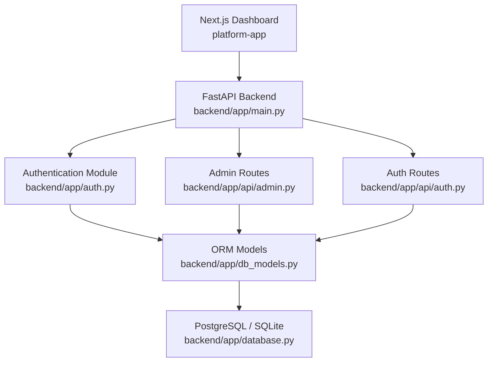
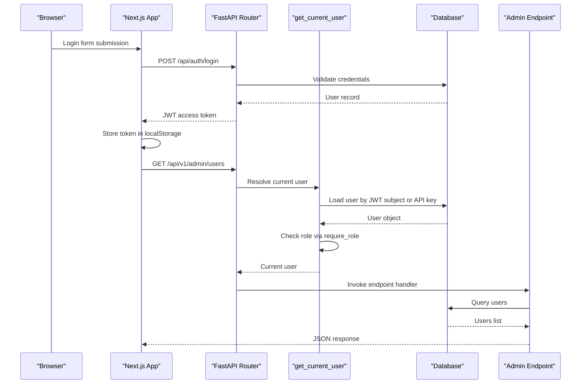
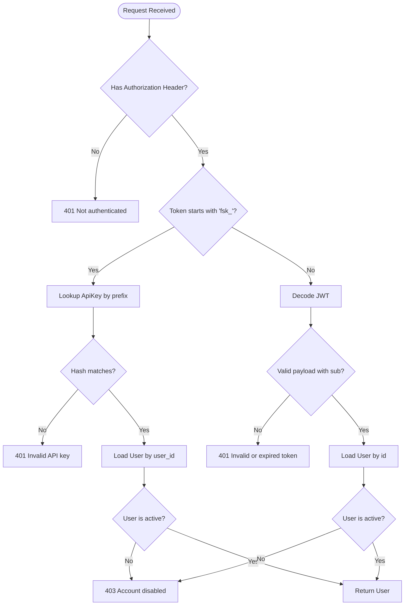
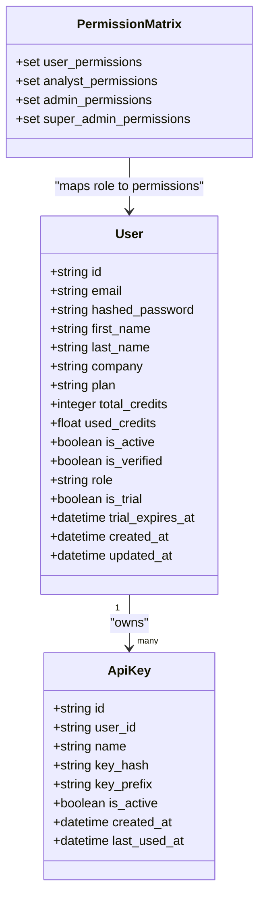
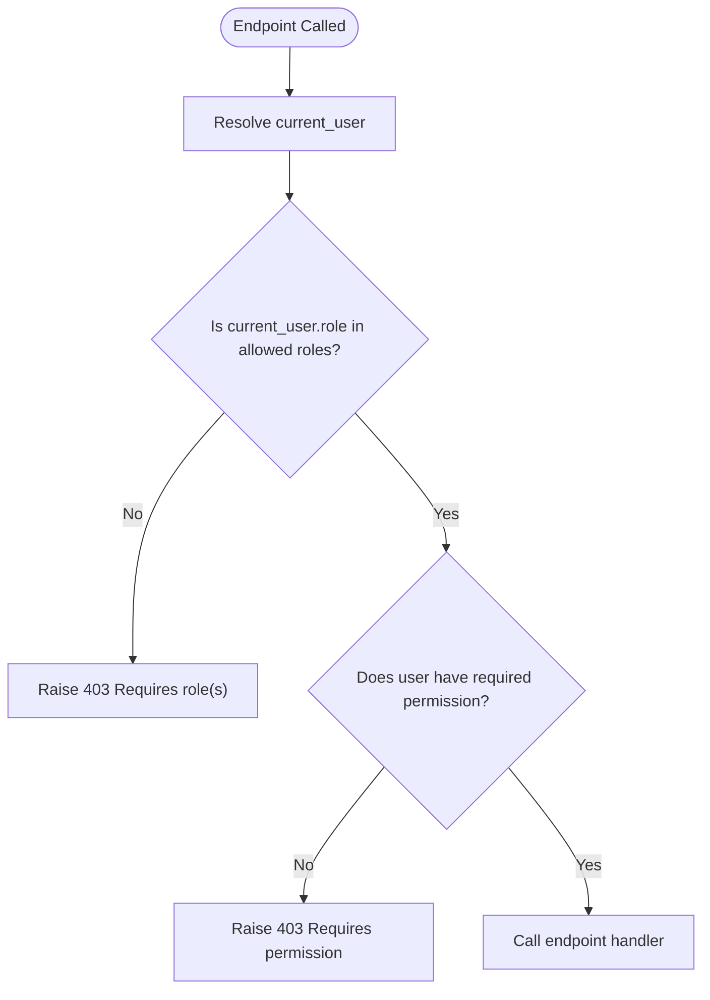
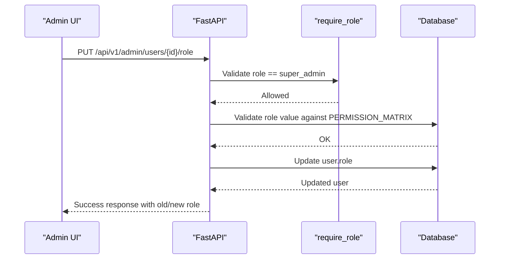
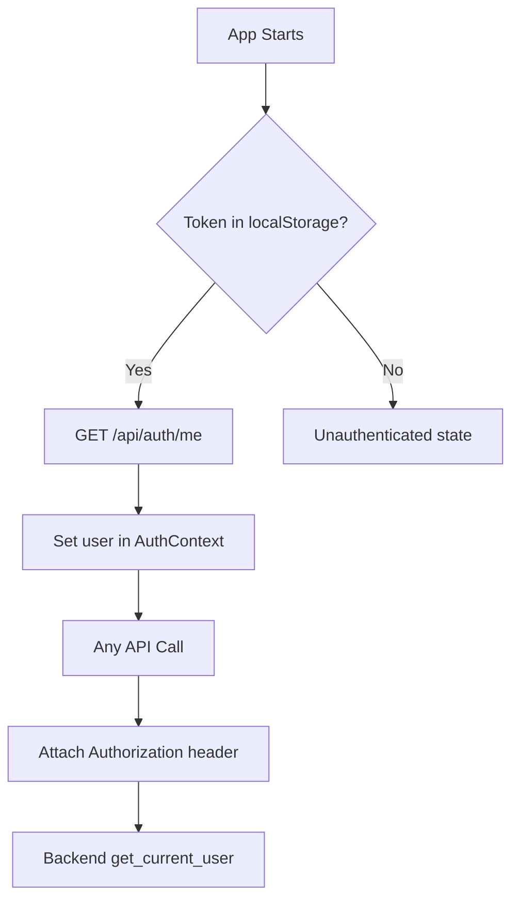
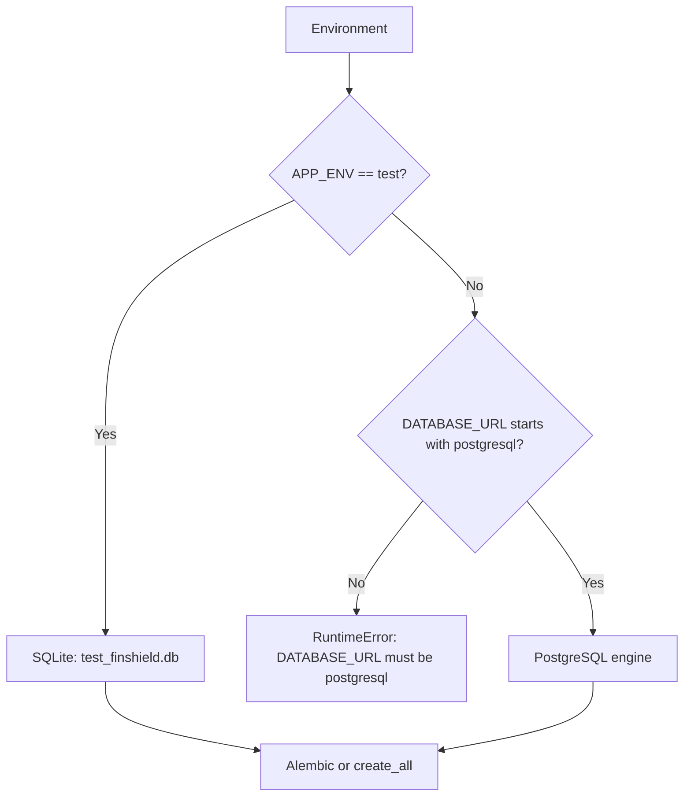
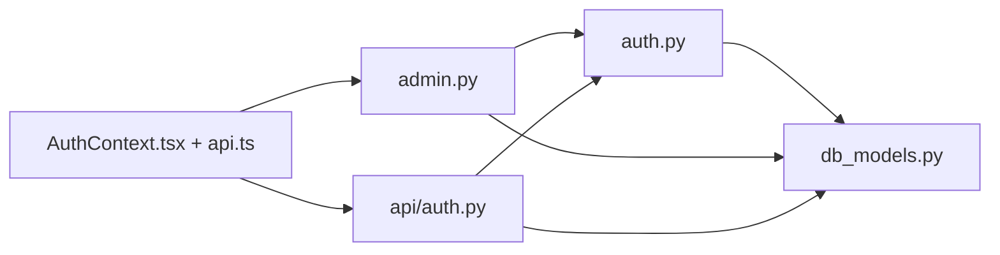

# Role-Based Access Control System

<cite>
**Referenced Files in This Document**
- [main.py](file://backend/app/main.py)
- [auth.py](file://backend/app/auth.py)
- [db_models.py](file://backend/app/db_models.py)
- [models.py](file://backend/app/models.py)
- [database.py](file://backend/app/database.py)
- [admin.py](file://backend/app/api/admin.py)
- [auth_routes.py](file://backend/app/api/auth.py)
- [compliance_engine.py](file://backend/app/compliance_engine.py)
- [AuthContext.tsx](file://platform-app/src/contexts/AuthContext.tsx)
- [api.ts](file://platform-app/src/lib/api.ts)
- [docker-compose.yml](file://docker-compose.yml)
- [8fa4ddee248c_add_user_role_column.py](file://backend/migrations/versions/8fa4ddee248c_add_user_role_column.py)
</cite>

## Table of Contents
1. [Introduction](#introduction)
2. [Project Structure](#project-structure)
3. [Core Components](#core-components)
4. [Architecture Overview](#architecture-overview)
5. [Detailed Component Analysis](#detailed-component-analysis)
6. [Dependency Analysis](#dependency-analysis)
7. [Performance Considerations](#performance-considerations)
8. [Troubleshooting Guide](#troubleshooting-guide)
9. [Conclusion](#conclusion)

## Introduction
This document describes the implemented role-based access control system for FinShield AI. It focuses on how authentication, authorization, roles, permissions, API keys, and JWT tokens are wired together in the backend, how they relate to the database schema, and how the Next.js dashboard consumes authenticated responses.

The shipped RBAC implementation provides:
- A `role` column on users with default value `user`.
- Four roles: `user`, `analyst`, `admin`, `super_admin`.
- A permission matrix mapping roles to fine-grained permissions.
- Two decorators: `require_role` for role checks and `require_permission` for permission checks.
- Admin endpoints for listing users, reading user details, updating roles (restricted to `super_admin`), activating/deactivating accounts, and exposing the permission matrix.
- Dual authentication paths: JWT bearer tokens from login/signup and hashed API keys prefixed with `fsk_`.

It does not yet implement every future-state feature described in design references such as OAuth/OIDC, SAML/SSO, per-tenant permission matrices, immutable audit chains, or privacy workflows; those remain roadmap items.

## Project Structure
RBAC-related code is concentrated in three layers:

| Layer | Responsibility | Key files |
|---|---|---|
| Backend entrypoint | FastAPI app setup, middleware, router registration | [main.py](file://backend/app/main.py) |
| Authentication & authorization | JWT/API key handling, password hashing, role/permission logic | [auth.py](file://backend/app/auth.py) |
| Data model | SQLAlchemy ORM entities including `User.role` | [db_models.py](file://backend/app/db_models.py) |
| API routes | Auth flows and admin RBAC endpoints | [auth_routes.py](file://backend/app/api/auth.py), [admin.py](file://backend/app/api/admin.py) |
| Frontend session state | Token storage, login/signup flow, profile refresh | [AuthContext.tsx](file://platform-app/src/contexts/AuthContext.tsx) |
| Frontend API client | HTTP calls, Authorization header injection | [api.ts](file://platform-app/src/lib/api.ts) |
| Database configuration | SQLite test-only vs PostgreSQL production selection | [database.py](file://backend/app/database.py) |
| Deployment | Compose services for Postgres, backend, frontend | [docker-compose.yml](file://docker-compose.yml) |
| Migration | Adds the `role` column to `users` | [8fa4ddee248c_add_user_role_column.py](file://backend/migrations/versions/8fa4ddee248c_add_user_role_column.py) |

**Diagram sources**
- [main.py:19-40](file://backend/app/main.py#L19-L40)
- [auth.py:18-20](file://backend/app/auth.py#L18-L20)
- [admin.py:6-8](file://backend/app/api/admin.py#L6-L8)
- [auth_routes.py:9-21](file://backend/app/api/auth.py#L9-L21)
- [db_models.py:22-59](file://backend/app/db_models.py#L22-L59)
- [database.py:15-40](file://backend/app/database.py#L15-L40)

**Section sources**
- [main.py:1-152](file://backend/app/main.py#L1-L152)
- [auth.py:1-257](file://backend/app/auth.py#L1-L257)
- [db_models.py:22-59](file://backend/app/db_models.py#L22-L59)
- [database.py:1-75](file://backend/app/database.py#L1-L75)
- [admin.py:1-171](file://backend/app/api/admin.py#L1-L171)
- [auth_routes.py:1-219](file://backend/app/api/auth.py#L1-L219)
- [AuthContext.tsx:1-107](file://platform-app/src/contexts/AuthContext.tsx#L1-L107)
- [api.ts:357-408](file://platform-app/src/lib/api.ts#L357-L408)
- [docker-compose.yml:1-78](file://docker-compose.yml#L1-L78)
- [8fa4ddee248c_add_user_role_column.py:19-21](file://backend/migrations/versions/8fa4ddee248c_add_user_role_column.py#L19-L21)

## Core Components
The RBAC system consists of five core components:

1. **User identity and role persistence**
   - The `User` ORM entity stores email, hashed password, account status, billing/trial fields, and the RBAC `role` field.
   - Default role is `user`; an Alembic migration adds the column with a server default.

2. **Authentication layer**
   - Accepts either a JWT bearer token or an API key starting with `fsk_`.
   - Validates JWT payload, looks up the user by subject, and rejects disabled accounts.
   - For API keys, it matches the prefix against stored keys and verifies the full key hash.

3. **Authorization layer**
   - Defines a static `PERMISSION_MATRIX` mapping roles to permission sets.
   - Provides `has_permission`, `require_role`, and `require_permission`.

4. **Admin API**
   - Exposes user listing, user detail retrieval, role updates, activation, deactivation, and permission matrix inspection.
   - Uses `require_role` to restrict access.

5. **Frontend integration**
   - Stores the JWT in `localStorage`.
   - Attaches `Authorization: Bearer <token>` to all backend requests.
   - Maintains session state through `AuthContext`.

**Section sources**
- [db_models.py:22-59](file://backend/app/db_models.py#L22-L59)
- [8fa4ddee248c_add_user_role_column.py:19-21](file://backend/migrations/versions/8fa4ddee248c_add_user_role_column.py#L19-L21)
- [auth.py:30-118](file://backend/app/auth.py#L30-L118)
- [auth.py:128-257](file://backend/app/auth.py#L128-L257)
- [admin.py:13-171](file://backend/app/api/admin.py#L13-L171)
- [AuthContext.tsx:22-48](file://platform-app/src/contexts/AuthContext.tsx#L22-L48)
- [api.ts:357-408](file://platform-app/src/lib/api.ts#L357-L408)

## Architecture Overview
At request time, the FastAPI application applies global exception handlers, CORS middleware, and request logging before routing to domain routers. Authentication is performed by `get_current_user`, which supports two credential types. Authorization is enforced by decorators that inspect the current user’s role or permissions.

**Diagram sources**
- [auth_routes.py:47-137](file://backend/app/api/auth.py#L47-L137)
- [auth.py:63-118](file://backend/app/auth.py#L63-L118)
- [admin.py:13-47](file://backend/app/api/admin.py#L13-L47)
- [api.ts:428-434](file://platform-app/src/lib/api.ts#L428-L434)
- [AuthContext.tsx:42-48](file://platform-app/src/contexts/AuthContext.tsx#L42-L48)

## Detailed Component Analysis

### Authentication Flow
The authentication flow supports two paths:

| Path | Input | Validation | Result |
|---|---|---|---|
| Login | Email + password | Hashed password verification | JWT token with `sub` set to user ID |
| API key | `Authorization: Bearer fsk_...` | Prefix match + bcrypt hash comparison | Resolved user if active |
| JWT bearer | `Authorization: Bearer <jwt>` | Decode + expiry check + user lookup | Resolved user if active |

**Diagram sources**
- [auth.py:63-118](file://backend/app/auth.py#L63-L118)

**Section sources**
- [auth.py:30-118](file://backend/app/auth.py#L30-L118)
- [auth_routes.py:47-137](file://backend/app/api/auth.py#L47-L137)
- [db_models.py:61-75](file://backend/app/db_models.py#L61-L75)

### Role and Permission Model
The role model is defined in the `User` ORM class and backed by a migration. Permissions are expressed as strings and grouped by role.

| Role | Intended Scope | Example Permissions |
|---|---|---|
| `user` | Basic self-service | Create transactions, read own transactions, create/read own cases |
| `analyst` | Investigation and review | Read/write cases, create/update filings, read lists |
| `admin` | Operational administration | Manage cases, filings, lists, settings, models, users |
| `super_admin` | Highest privilege | All admin permissions plus delete operations and system administration |

**Diagram sources**
- [db_models.py:22-75](file://backend/app/db_models.py#L22-L75)
- [auth.py:128-199](file://backend/app/auth.py#L128-L199)

**Section sources**
- [db_models.py:22-59](file://backend/app/db_models.py#L22-L59)
- [8fa4ddee248c_add_user_role_column.py:19-21](file://backend/migrations/versions/8fa4ddee248c_add_user_role_column.py#L19-L21)
- [auth.py:128-199](file://backend/app/auth.py#L128-L199)

### Authorization Decorators
Two decorator families enforce access control:

| Decorator | Purpose | Failure Behavior |
|---|---|---|
| `require_role(*roles)` | Ensures the current user’s role is one of the allowed roles | 403 Forbidden with required roles |
| `require_permission(permission)` | Ensures the current user has a specific permission string | 403 Forbidden with required permission |

**Diagram sources**
- [auth.py:202-257](file://backend/app/auth.py#L202-L257)

**Section sources**
- [auth.py:202-257](file://backend/app/auth.py#L202-L257)

### Admin Endpoints
The admin module implements role-gated user management:

| Endpoint | Method | Required Role | Behavior |
|---|---|---|---|
| `/api/v1/admin/users` | GET | `admin`, `super_admin` | Lists users with optional role filter |
| `/api/v1/admin/users/{user_id}` | GET | `admin`, `super_admin` | Returns user details |
| `/api/v1/admin/users/{user_id}/role` | PUT | `super_admin` | Updates user role after validating against the permission matrix |
| `/api/v1/admin/users/{user_id}/activate` | POST | `admin`, `super_admin` | Activates a user |
| `/api/v1/admin/users/{user_id}/deactivate` | POST | `admin`, `super_admin` | Deactivates a user, preventing self-deactivation |
| `/api/v1/admin/permissions` | GET | `admin`, `super_admin` | Returns available roles and their permissions |

**Diagram sources**
- [admin.py:80-106](file://backend/app/api/admin.py#L80-L106)
- [auth.py:209-231](file://backend/app/auth.py#L209-L231)

**Section sources**
- [admin.py:13-171](file://backend/app/api/admin.py#L13-L171)
- [auth.py:209-231](file://backend/app/auth.py#L209-L231)

### Frontend Session and Authorization Context
The frontend maintains authentication state independently of backend roles. It stores the JWT and attaches it to requests, but it does not currently display or enforce backend roles in the shared context shown here.

Key behaviors:
- On mount, the app retrieves the token and fetches the profile.
- Login and signup store the token and refresh the profile.
- Logout clears the token and navigates to `/login`.
- The API client injects `Authorization: Bearer <token>` when present.

**Diagram sources**
- [AuthContext.tsx:22-48](file://platform-app/src/contexts/AuthContext.tsx#L22-L48)
- [api.ts:357-408](file://platform-app/src/lib/api.ts#L357-L408)

**Section sources**
- [AuthContext.tsx:1-107](file://platform-app/src/contexts/AuthContext.tsx#L1-L107)
- [api.ts:357-408](file://platform-app/src/lib/api.ts#L357-L408)

### Persistence and Database Selection
The persistence model for RBAC is straightforward:
- `users.role` defaults to `user`.
- `users.is_active` controls whether authentication succeeds.
- `api_keys` stores hashed API keys and links them to users.

Database selection rules:
- In `APP_ENV=test`, SQLite is used unless `TEST_DATABASE_URL` points at PostgreSQL.
- Outside tests, `DATABASE_URL` must be a PostgreSQL URL.
- The compose stack runs PostgreSQL, the backend, and the Next.js frontend.

**Diagram sources**
- [database.py:15-38](file://backend/app/database.py#L15-L38)
- [docker-compose.yml:1-42](file://docker-compose.yml#L1-L42)

**Section sources**
- [database.py:1-75](file://backend/app/database.py#L1-L75)
- [docker-compose.yml:1-78](file://docker-compose.yml#L1-L78)

## Dependency Analysis
RBAC dependencies can be understood as a layered chain:

| Layer | Depends On | Notes |
|---|---|---|
| Admin routes | `get_current_user`, `require_role`, `PERMISSION_MATRIX`, `User` | Enforces role gates before querying users |
| Auth routes | `create_access_token`, `hash_password`, `verify_password`, `User`, `AuditLog` | Creates users, logs activity, returns JWT |
| Auth module | `User`, `ApiKey`, `bcrypt`, `jwt`, `get_db` | Centralizes authentication and authorization logic |
| ORM models | `Base`, SQLAlchemy types, pgvector types | Defines persisted entities including roles |
| Frontend | `AuthContext`, `api.ts` | Manages token lifecycle and HTTP headers |

**Diagram sources**
- [admin.py:6-8](file://backend/app/api/admin.py#L6-L8)
- [auth_routes.py:9-21](file://backend/app/api/auth.py#L9-L21)
- [auth.py:18-20](file://backend/app/auth.py#L18-L20)
- [db_models.py:22-75](file://backend/app/db_models.py#L22-L75)
- [AuthContext.tsx:1-107](file://platform-app/src/contexts/AuthContext.tsx#L1-L107)
- [api.ts:357-408](file://platform-app/src/lib/api.ts#L357-L408)

**Section sources**
- [admin.py:1-171](file://backend/app/api/admin.py#L1-L171)
- [auth_routes.py:1-219](file://backend/app/api/auth.py#L1-L219)
- [auth.py:1-257](file://backend/app/auth.py#L1-L257)
- [db_models.py:22-75](file://backend/app/db_models.py#L22-L75)
- [AuthContext.tsx:1-107](file://platform-app/src/contexts/AuthContext.tsx#L1-L107)
- [api.ts:357-408](file://platform-app/src/lib/api.ts#L357-L408)

## Performance Considerations
RBAC introduces minimal runtime overhead:
- JWT decoding is CPU-bound but fast for HS256 tokens.
- API key authentication performs a bcrypt comparison only when the token uses the `fsk_` prefix.
- Role checks are dictionary lookups over small static sets.
- Admin queries use pagination parameters (`limit`, `offset`) to avoid unbounded result sets.

Potential optimization opportunities include:
- Caching frequently accessed role/permission metadata if the permission matrix becomes dynamic.
- Adding database indexes on `users.role` and `users.is_active` where appropriate.
- Avoiding unnecessary profile refreshes in the frontend when token state is unchanged.

[No sources needed since this section provides general guidance]

## Troubleshooting Guide

### Common Issues

| Symptom | Likely Cause | Resolution |
|---|---|---|
| 401 Not authenticated | Missing or malformed `Authorization` header | Ensure the frontend sends a valid JWT or API key |
| 401 Invalid API key | Wrong key, inactive key, or mismatched hash | Regenerate the API key and verify it is active |
| 403 Account disabled | `users.is_active` is false | Activate the account using the admin endpoint |
| 403 Requires role | Caller lacks one of the required roles | Assign a permitted role via the admin role update endpoint |
| 400 Invalid role | Role value not in `PERMISSION_MATRIX` | Use one of the documented roles: `user`, `analyst`, `admin`, `super_admin` |
| Cannot deactivate own account | Self-deactivation guard | Use another admin/super_admin account to deactivate |
| Startup fails without JWT secret | Non-test environment missing `JWT_SECRET_KEY` | Set `JWT_SECRET_KEY` in the deployment environment |
| Tests fail due to database type | Production mode requires PostgreSQL | Run tests with `APP_ENV=test` or configure `TEST_DATABASE_URL` |

**Section sources**
- [auth.py:63-118](file://backend/app/auth.py#L63-L118)
- [auth.py:209-257](file://backend/app/auth.py#L209-L257)
- [admin.py:80-156](file://backend/app/api/admin.py#L80-L156)
- [database.py:15-38](file://backend/app/database.py#L15-L38)

## Conclusion
FinShield AI’s shipped RBAC system provides a practical foundation for multi-role access control. It combines JWT and API-key authentication with a static role-to-permission mapping and role-gated admin endpoints. The `User.role` column and its migration make roles persistent, while `require_role` and `require_permission` provide reusable authorization guards.

The most important boundary to recognize is between what is implemented and what is planned:
- Implemented: roles, permissions, admin user management, JWT/API key auth, PostgreSQL/SQLite persistence, and basic frontend session handling.
- Roadmap or aspirational: enterprise identity providers, per-tenant permission matrices, immutable audit chains, privacy workflows, Redis-backed circuit breakers, and advanced observability integrations.

For future work, the highest-value additions would be explicit role enforcement across all sensitive endpoints beyond the admin module, role exposure in the frontend profile, and automated tests asserting the complete permission matrix.

[No sources needed since this section summarizes without analyzing specific files]