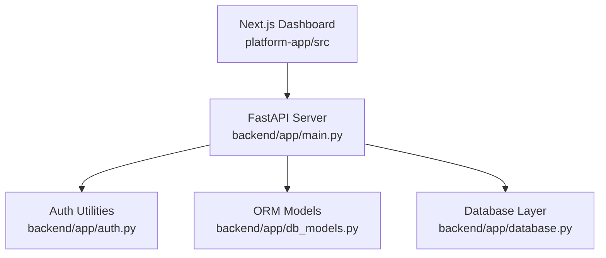
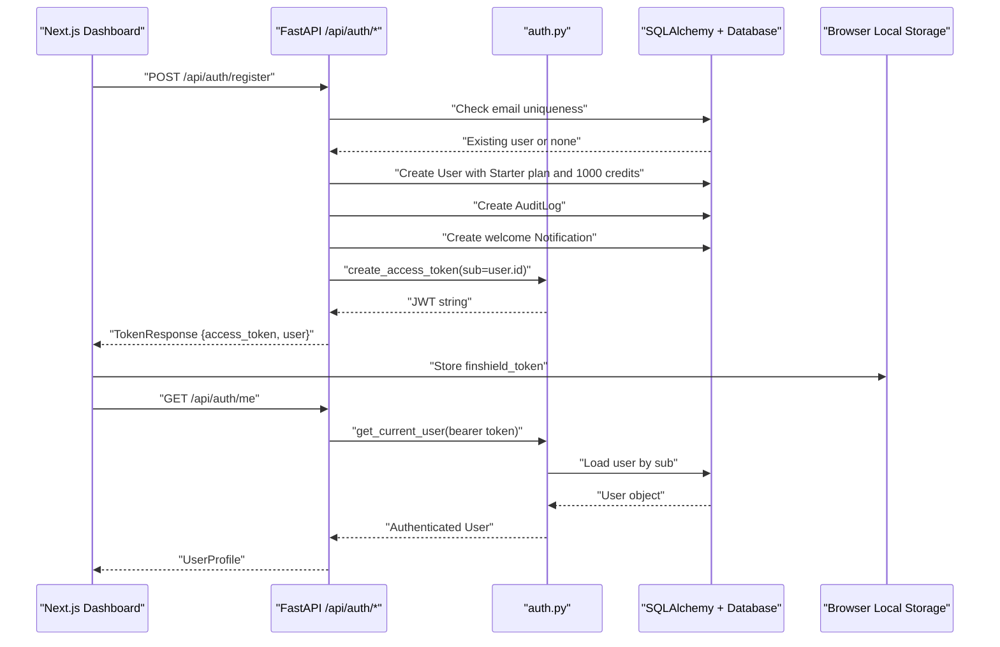
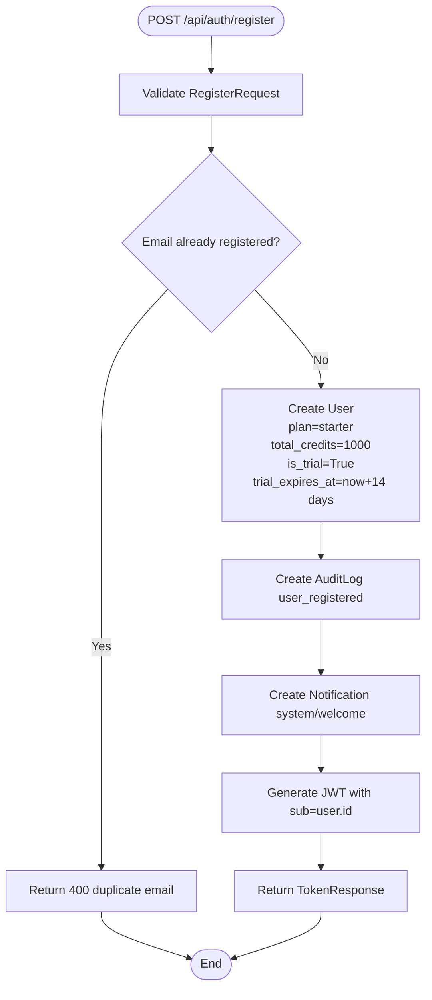
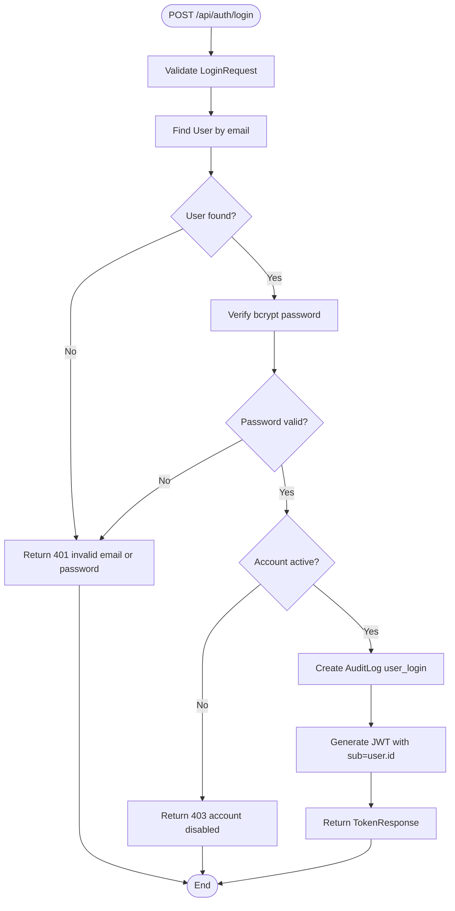
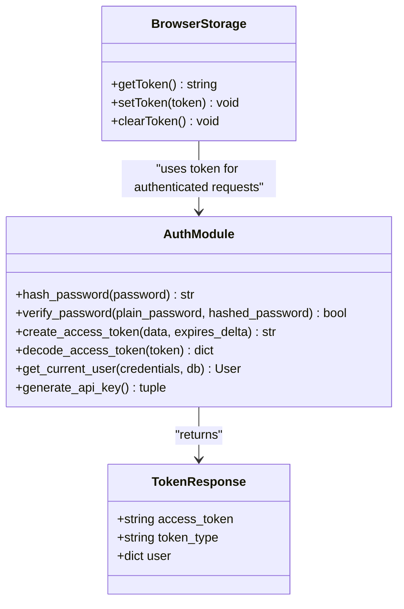
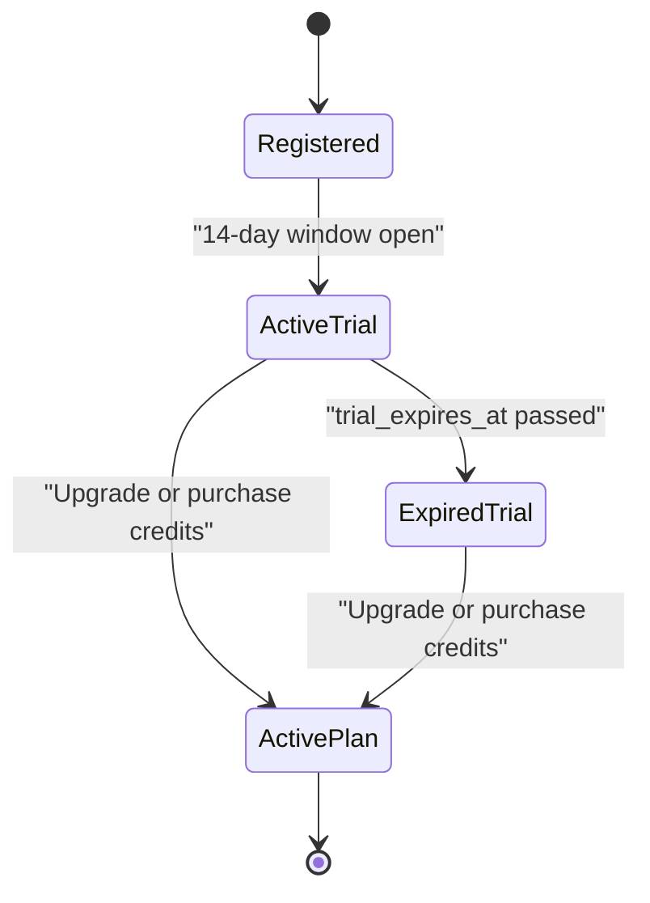
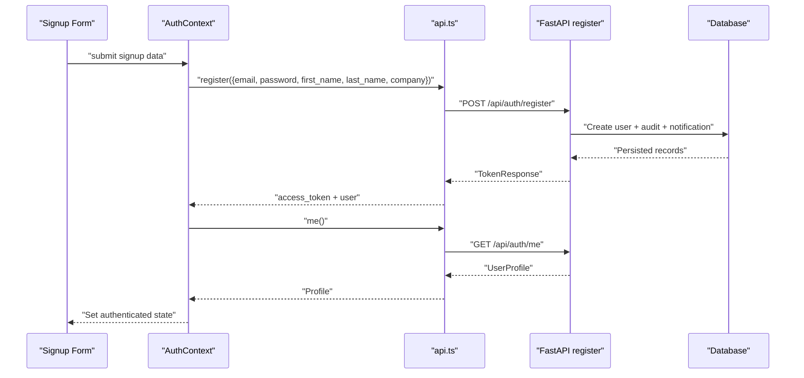
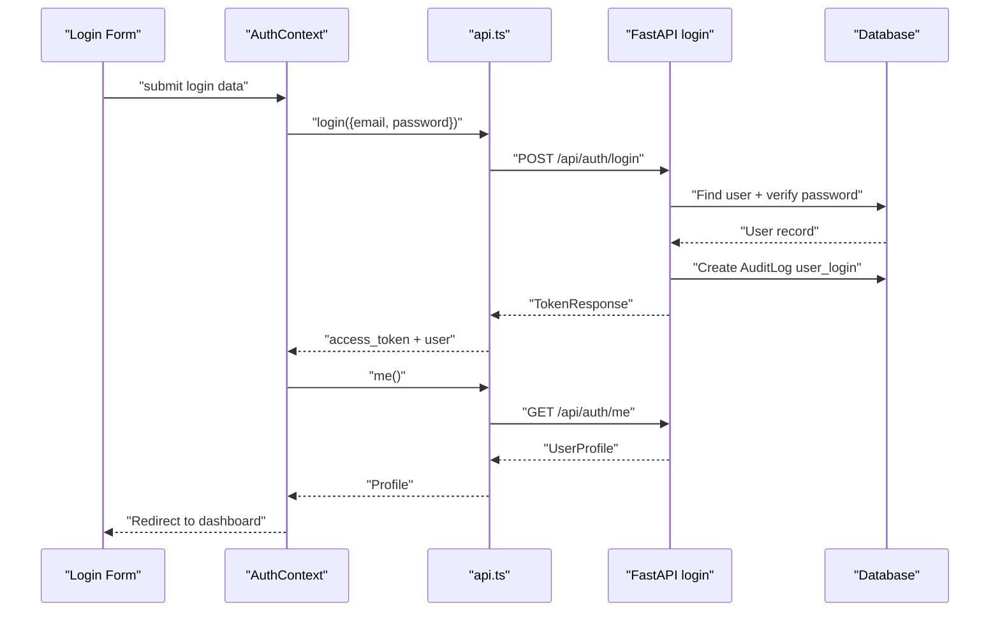
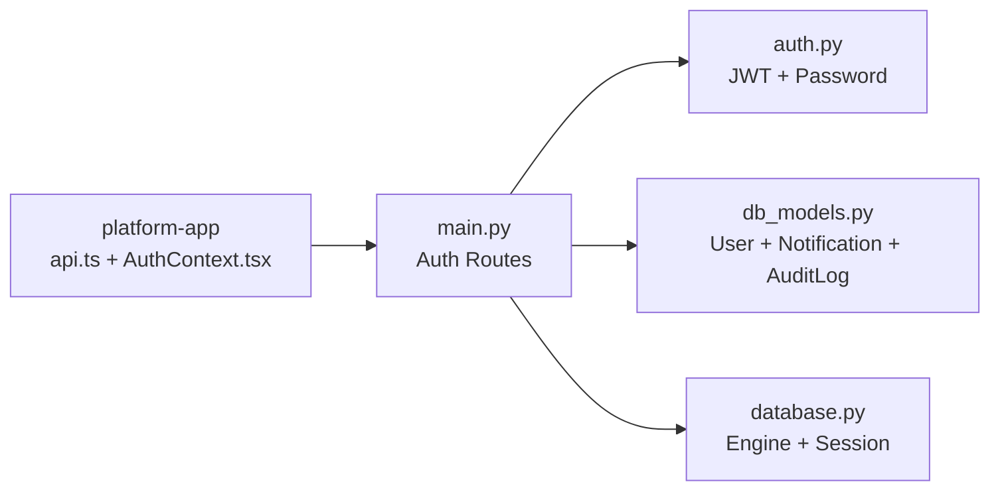

# User Registration and Login

<cite>
**Referenced Files in This Document**   
- [backend/app/main.py](file://backend/app/main.py)
- [backend/app/auth.py](file://backend/app/auth.py)
- [backend/app/db_models.py](file://backend/app/db_models.py)
- [backend/app/database.py](file://backend/app/database.py)
- [platform-app/src/lib/api.ts](file://platform-app/src/lib/api.ts)
- [platform-app/src/contexts/AuthContext.tsx](file://platform-app/src/contexts/AuthContext.tsx)
</cite>

## Table of Contents
1. [Introduction](#introduction)
2. [Project Structure](#project-structure)
3. [Core Components](#core-components)
4. [Architecture Overview](#architecture-overview)
5. [Detailed Component Analysis](#detailed-component-analysis)
6. [Dependency Analysis](#dependency-analysis)
7. [Performance Considerations](#performance-considerations)
8. [Troubleshooting Guide](#troubleshooting-guide)
9. [Conclusion](#conclusion)

## Introduction
This document explains the user registration and login endpoints for FinShield AI, focusing on:
- POST `/api/auth/register` with the `RegisterRequest` schema
- Password validation and automatic trial account creation
- Starter plan assignment and 1,000 credit allocation
- Welcome notification generation
- POST `/api/auth/login` with the `LoginRequest` schema
- JWT token generation using `python-jose`
- Frontend session establishment in the Next.js platform app
- Practical examples for successful flows and common error responses

The backend is a FastAPI application; the frontend is a Next.js 14 App Router dashboard that stores the JWT in browser local storage and calls the backend through a typed API client.

## Project Structure
For this documentation, only the relevant parts of the repository are used:
- Backend authentication routes, request/response models, and database persistence live in `backend/app`.
- The frontend authentication context and API client live in `platform-app/src`.

**Diagram sources**
- [backend/app/main.py:159-266](file://backend/app/main.py#L159-L266)
- [backend/app/auth.py:1-122](file://backend/app/auth.py#L1-L122)
- [backend/app/db_models.py:22-57](file://backend/app/db_models.py#L22-L57)
- [backend/app/database.py:1-45](file://backend/app/database.py#L1-L45)
- [platform-app/src/lib/api.ts:10-46](file://platform-app/src/lib/api.ts#L10-L46)
- [platform-app/src/contexts/AuthContext.tsx:18-68](file://platform-app/src/contexts/AuthContext.tsx#L18-L68)

**Section sources**
- [backend/app/main.py:159-266](file://backend/app/main.py#L159-L266)
- [backend/app/auth.py:1-122](file://backend/app/auth.py#L1-L122)
- [backend/app/db_models.py:22-57](file://backend/app/db_models.py#L22-L57)
- [backend/app/database.py:1-45](file://backend/app/database.py#L1-L45)
- [platform-app/src/lib/api.ts:10-46](file://platform-app/src/lib/api.ts#L10-L46)
- [platform-app/src/contexts/AuthContext.tsx:18-68](file://platform-app/src/contexts/AuthContext.tsx#L18-L68)

## Core Components
The registration and login functionality is implemented across three backend layers and two frontend modules:

| Layer | Responsibility | Key File |
|---|---|---|
| HTTP Routes | Defines `/api/auth/register`, `/api/auth/login`, and related auth endpoints | [backend/app/main.py](file://backend/app/main.py) |
| Authentication Utilities | Password hashing, JWT creation/decoding, bearer token dependency | [backend/app/auth.py](file://backend/app/auth.py) |
| Data Model | SQLAlchemy ORM entities for users, notifications, audit logs, and billing fields | [backend/app/db_models.py](file://backend/app/db_models.py) |
| Persistence | SQLite or PostgreSQL engine, session factory, table initialization | [backend/app/database.py](file://backend/app/database.py) |
| Frontend API Client | Typed request/response interfaces and token transport | [platform-app/src/lib/api.ts](file://platform-app/src/lib/api.ts) |
| Frontend Session Context | Stores tokens, manages login/signup flow, and refreshes user profile | [platform-app/src/contexts/AuthContext.tsx](file://platform-app/src/contexts/AuthContext.tsx) |

**Section sources**
- [backend/app/main.py:159-266](file://backend/app/main.py#L159-L266)
- [backend/app/auth.py:1-122](file://backend/app/auth.py#L1-L122)
- [backend/app/db_models.py:22-57](file://backend/app/db_models.py#L22-L57)
- [backend/app/database.py:1-45](file://backend/app/database.py#L1-L45)
- [platform-app/src/lib/api.ts:10-46](file://platform-app/src/lib/api.ts#L10-L46)
- [platform-app/src/contexts/AuthContext.tsx:18-68](file://platform-app/src/contexts/AuthContext.tsx#L18-L68)

## Architecture Overview
The registration and login flows connect the Next.js dashboard to the FastAPI backend, then to SQLAlchemy and the configured database.

**Diagram sources**
- [backend/app/main.py:176-266](file://backend/app/main.py#L176-L266)
- [backend/app/auth.py:42-56](file://backend/app/auth.py#L42-L56)
- [backend/app/auth.py:59-113](file://backend/app/auth.py#L59-L113)
- [backend/app/db_models.py:22-57](file://backend/app/db_models.py#L22-L57)
- [platform-app/src/lib/api.ts:357-408](file://platform-app/src/lib/api.ts#L357-L408)
- [platform-app/src/contexts/AuthContext.tsx:22-48](file://platform-app/src/contexts/AuthContext.tsx#L22-L48)

## Detailed Component Analysis

### Register Request Schema
The registration endpoint uses a Pydantic model named `RegisterRequest`:

| Field | Type | Validation | Notes |
|---|---|---|---|
| `email` | string | Required | Must be unique in the database |
| `password` | string | Minimum length 8 | Enforced by Pydantic `Field(min_length=8)` |
| `first_name` | string | Minimum length 1 | Required |
| `last_name` | string | Minimum length 1 | Required |
| `company` | optional string | None | Optional company name |

The frontend defines a matching `RegisterRequest` interface and maps dashboard form fields such as `firstName` and `lastName` to the backend’s snake_case fields.

**Section sources**
- [backend/app/main.py:159-165](file://backend/app/main.py#L159-L165)
- [platform-app/src/lib/api.ts:10-16](file://platform-app/src/lib/api.ts#L10-L16)
- [platform-app/src/contexts/AuthContext.tsx:50-68](file://platform-app/src/contexts/AuthContext.tsx#L50-L68)

### Registration Endpoint Behavior
POST `/api/auth/register` performs these steps:

1. Validates the request body against `RegisterRequest`.
2. Checks whether the email already exists.
3. Creates a new `User` record with:
   - Plan set to `starter`
   - `total_credits` set to `1000`
   - `is_trial` set to `True`
   - `trial_expires_at` set to 14 days from the current time
4. Writes an audit log entry for `user_registered`.
5. Creates a welcome notification with type `system`, title about the 14-day free trial, and a link to the billing settings tab.
6. Generates a JWT access token with the user ID as the subject.
7. Returns a `TokenResponse` containing the access token and a user object including trial metadata.

**Diagram sources**
- [backend/app/main.py:176-234](file://backend/app/main.py#L176-L234)
- [backend/app/db_models.py:22-57](file://backend/app/db_models.py#L22-L57)

**Section sources**
- [backend/app/main.py:176-234](file://backend/app/main.py#L176-L234)
- [backend/app/db_models.py:22-57](file://backend/app/db_models.py#L22-L57)

### Login Request Schema
The login endpoint uses a Pydantic model named `LoginRequest`:

| Field | Type | Validation | Notes |
|---|---|---|---|
| `email` | string | Required | Used to look up the user |
| `password` | string | Required | Compared against the stored bcrypt hash |

The frontend defines a matching `LoginRequest` interface and sends it to `/api/auth/login`.

**Section sources**
- [backend/app/main.py:166-168](file://backend/app/main.py#L166-L168)
- [platform-app/src/lib/api.ts:18-21](file://platform-app/src/lib/api.ts#L18-L21)

### Login Endpoint Behavior
POST `/api/auth/login` performs these steps:

1. Validates the request body against `LoginRequest`.
2. Looks up the user by email.
3. Verifies the provided password against the stored bcrypt hash.
4. Rejects disabled accounts.
5. Writes an audit log entry for `user_login`.
6. Generates a JWT access token with the user ID as the subject.
7. Returns a `TokenResponse` containing the access token and a user object.

**Diagram sources**
- [backend/app/main.py:237-266](file://backend/app/main.py#L237-L266)
- [backend/app/auth.py:37-39](file://backend/app/auth.py#L37-L39)

**Section sources**
- [backend/app/main.py:237-266](file://backend/app/main.py#L237-L266)
- [backend/app/auth.py:37-39](file://backend/app/auth.py#L37-L39)

### JWT Generation and Session Establishment
JWT handling is implemented in the auth module:

- `SECRET_KEY` is read from the environment variable `JWT_SECRET_KEY`; if missing, a random URL-safe secret is generated at runtime.
- Tokens use the HS256 algorithm.
- The default access token expiration is 24 hours.
- `create_access_token` encodes the payload with an expiration timestamp.
- `decode_access_token` decodes and validates the token.
- `get_current_user` supports both JWT bearer tokens and API keys starting with `fsk_`.

The frontend stores the returned `access_token` under the key `finshield_token` in browser local storage and attaches it as a Bearer token for subsequent requests. On mount, it attempts to fetch the current user profile; if the token is invalid or expired, it clears the stored token.

**Diagram sources**
- [backend/app/auth.py:21-56](file://backend/app/auth.py#L21-L56)
- [backend/app/auth.py:59-113](file://backend/app/auth.py#L59-L113)
- [platform-app/src/lib/api.ts:357-408](file://platform-app/src/lib/api.ts#L357-L408)

**Section sources**
- [backend/app/auth.py:21-56](file://backend/app/auth.py#L21-L56)
- [backend/app/auth.py:59-113](file://backend/app/auth.py#L59-L113)
- [platform-app/src/lib/api.ts:357-408](file://platform-app/src/lib/api.ts#L357-L408)
- [platform-app/src/contexts/AuthContext.tsx:22-48](file://platform-app/src/contexts/AuthContext.tsx#L22-L48)

### Trial Account Lifecycle and Credit Allocation
When a user registers:
- The account is created with `plan="starter"`.
- `total_credits` is initialized to `1000`.
- `used_credits` starts at `0.0`.
- `is_trial` is `True`.
- `trial_expires_at` is set to 14 days after registration.

The trial lifecycle is enforced later when screening transactions:
- If `is_trial` is true and `trial_expires_at` has passed, transaction screening returns a 403 error indicating the trial has expired.
- Credits are consumed during transaction screening based on the compliance engine result.
- When credits fall below 20%, a low-credit notification is created.

**Diagram sources**
- [backend/app/main.py:184-198](file://backend/app/main.py#L184-L198)
- [backend/app/main.py:443-451](file://backend/app/main.py#L443-L451)
- [backend/app/main.py:550-561](file://backend/app/main.py#L550-L561)

**Section sources**
- [backend/app/main.py:184-198](file://backend/app/main.py#L184-L198)
- [backend/app/main.py:443-451](file://backend/app/main.py#L443-L451)
- [backend/app/main.py:550-561](file://backend/app/main.py#L550-L561)

### Welcome Notification Generation
On successful registration, the backend creates a notification with:
- `type`: `system`
- `title`: Indicates the 14-day free trial has started
- `message`: Mentions the 1,000 Starter credits and upgrade options
- `link`: Points to `/settings?tab=billing`

This notification is persisted in the `notifications` table and can be retrieved through the notification endpoints exposed by the API client.

**Section sources**
- [backend/app/main.py:207-216](file://backend/app/main.py#L207-L216)
- [backend/app/db_models.py:154-166](file://backend/app/db_models.py#L154-L166)
- [platform-app/src/lib/api.ts:271-292](file://platform-app/src/lib/api.ts#L271-L292)

### Successful Registration Flow Example
A successful registration looks like this:

1. The dashboard collects email, password, first name, last name, and optional company.
2. It calls `api.register` with those values.
3. The backend validates the request, checks for duplicate emails, creates the user, writes audit and notification records, and returns a JWT.
4. The frontend stores the token and fetches the full user profile.
5. The dashboard shows the authenticated state and displays the trial information.

**Diagram sources**
- [platform-app/src/contexts/AuthContext.tsx:50-68](file://platform-app/src/contexts/AuthContext.tsx#L50-L68)
- [platform-app/src/lib/api.ts:422-434](file://platform-app/src/lib/api.ts#L422-L434)
- [backend/app/main.py:176-234](file://backend/app/main.py#L176-L234)

### Successful Login Flow Example
A successful login looks like this:

1. The dashboard collects email and password.
2. It calls `api.login`.
3. The backend verifies credentials, writes an audit log, generates a JWT, and returns the token plus user data.
4. The frontend stores the token and fetches the profile.

**Diagram sources**
- [platform-app/src/contexts/AuthContext.tsx:42-48](file://platform-app/src/contexts/AuthContext.tsx#L42-L48)
- [platform-app/src/lib/api.ts:428-434](file://platform-app/src/lib/api.ts#L428-L434)
- [backend/app/main.py:237-266](file://backend/app/main.py#L237-L266)

### Error Responses

| Scenario | Status Code | Backend Behavior | Typical Response |
|---|---:|---|---|
| Duplicate email during registration | 400 | Raises HTTPException with detail `"Email already registered"` | `{"detail": "Email already registered"}` |
| Invalid email or password during login | 401 | Raises HTTPException with detail `"Invalid email or password"` | `{"detail": "Invalid email or password"}` |
| Disabled account during login | 403 | Raises HTTPException with detail `"Account is disabled"` | `{"detail": "Account is disabled"}` |
| Invalid request body | 422 | FastAPI validation exception handler returns structured errors | `{"detail": "Invalid request data", "errors": [...]}` |
| Internal server error | 500 | Global exception handler catches unhandled exceptions | `{"detail": "Internal server error"}` |

The frontend’s `request` helper throws an `ApiError` with the HTTP status and parsed error detail, which calling code should surface to the user.

**Section sources**
- [backend/app/main.py:91-115](file://backend/app/main.py#L91-L115)
- [backend/app/main.py:176-182](file://backend/app/main.py#L176-L182)
- [backend/app/main.py:237-245](file://backend/app/main.py#L237-L245)
- [platform-app/src/lib/api.ts:372-417](file://platform-app/src/lib/api.ts#L372-L417)

## Dependency Analysis
The registration and login endpoints depend on several modules:

**Diagram sources**
- [backend/app/main.py:159-266](file://backend/app/main.py#L159-L266)
- [backend/app/auth.py:1-122](file://backend/app/auth.py#L1-L122)
- [backend/app/db_models.py:22-57](file://backend/app/db_models.py#L22-L57)
- [backend/app/database.py:1-45](file://backend/app/database.py#L1-L45)
- [platform-app/src/lib/api.ts:422-434](file://platform-app/src/lib/api.ts#L422-L434)
- [platform-app/src/contexts/AuthContext.tsx:42-68](file://platform-app/src/contexts/AuthContext.tsx#L42-L68)

Key relationships:
- `main.py` imports `hash_password`, `verify_password`, `create_access_token`, and `get_current_user` from `auth.py`.
- `main.py` imports `User`, `AuditLog`, and `Notification` from `db_models.py`.
- `database.py` provides the SQLAlchemy engine and session dependency used by all routes.
- The frontend API client types mirror the backend request/response contracts.

**Section sources**
- [backend/app/main.py:27-37](file://backend/app/main.py#L27-L37)
- [backend/app/auth.py:12-20](file://backend/app/auth.py#L12-L20)
- [backend/app/db_models.py:22-57](file://backend/app/db_models.py#L22-L57)
- [backend/app/database.py:17-33](file://backend/app/database.py#L17-L33)
- [platform-app/src/lib/api.ts:10-46](file://platform-app/src/lib/api.ts#L10-L46)

## Performance Considerations
- Registration and login are lightweight operations but involve database writes and cryptographic work.
- Password hashing uses bcrypt, which is intentionally slow to resist brute-force attacks.
- JWT encoding/decoding is fast and stateless, making bearer-token verification efficient.
- Rate limiting is applied to registration and login through FastAPI’s slowapi limiter.
- The default database is SQLite, suitable for development and small deployments; PostgreSQL is required for pgvector-based RAG features.

[No sources needed since this section provides general guidance]

## Troubleshooting Guide
Common issues and how to diagnose them:

| Symptom | Likely Cause | What to Check |
|---|---|---|
| Registration fails with duplicate email | Email already exists | Check existing `users.email` records |
| Login returns 401 | Wrong email or password | Confirm stored bcrypt hash and input password |
| Login returns 403 | Account disabled | Check `users.is_active` |
| Registration succeeds but no welcome notification appears | Notification not persisted or not queried | Inspect `notifications` table and notification retrieval logic |
| Frontend loses session after reload | Token expired or cleared | Check `finshield_token` in local storage and `/api/auth/me` behavior |
| Registration or login rate-limited | Too many requests | Check slowapi configuration and client retry behavior |

**Section sources**
- [backend/app/main.py:91-115](file://backend/app/main.py#L91-L115)
- [backend/app/main.py:176-182](file://backend/app/main.py#L176-L182)
- [backend/app/main.py:237-245](file://backend/app/main.py#L237-L245)
- [platform-app/src/lib/api.ts:357-408](file://platform-app/src/lib/api.ts#L357-L408)
- [platform-app/src/contexts/AuthContext.tsx:22-48](file://platform-app/src/contexts/AuthContext.tsx#L22-L48)

## Conclusion
FinShield AI’s registration and login implementation provides:
- A validated registration flow that creates a Starter trial account with 1,000 credits and a welcome notification.
- A secure login flow that verifies passwords with bcrypt and issues a JWT.
- Frontend session management that stores the token and refreshes the user profile.
- Clear error responses for duplicate emails, invalid credentials, disabled accounts, and malformed requests.

For production environments, ensure:
- `JWT_SECRET_KEY` is set to a strong, persistent secret.
- The correct database is configured (`DATABASE_URL` for PostgreSQL or SQLite defaults).
- Rate limiting and CORS settings match the deployment target.
- Trial expiry and credit consumption logic are monitored as users transition from trial to paid plans.

[No sources needed since this section summarizes without analyzing specific files]