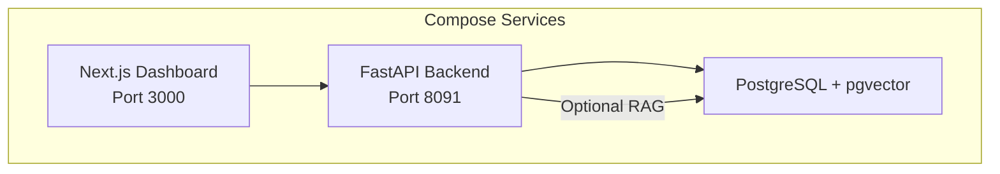
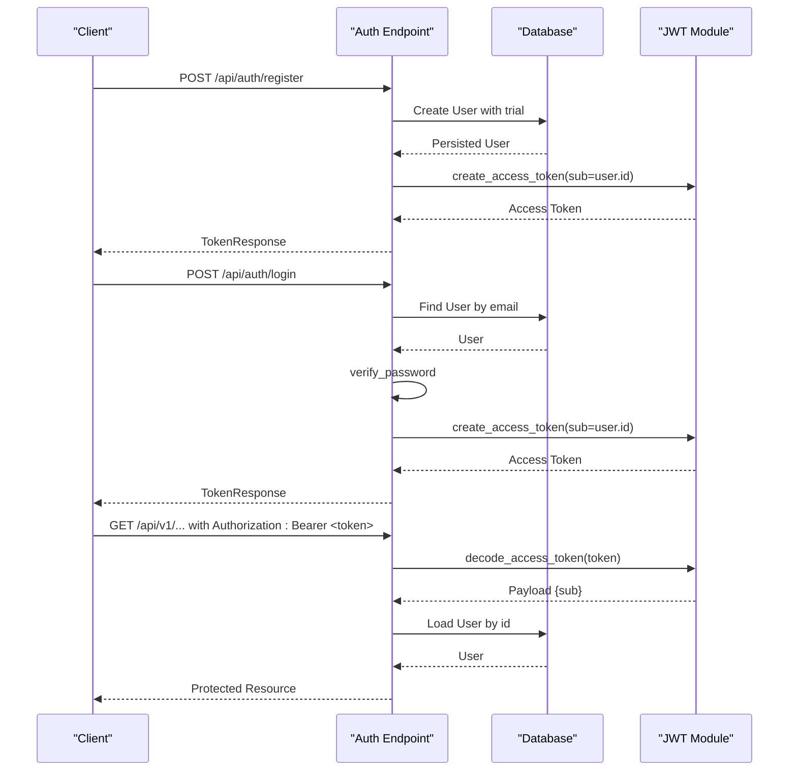
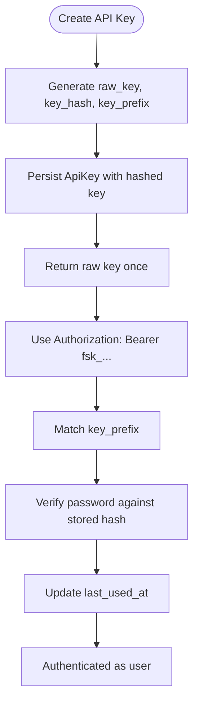
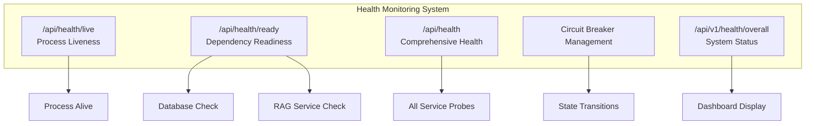
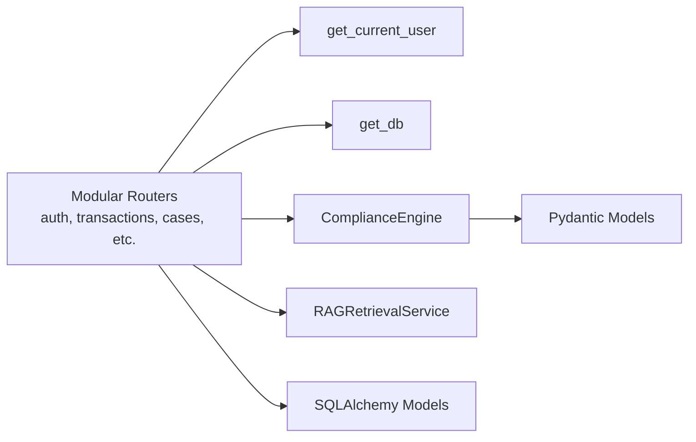

# Backend API Documentation

<cite>
**Referenced Files in This Document**   
- [main.py](file://backend/app/main.py)
- [auth.py](file://backend/app/auth.py)
- [models.py](file://backend/app/models.py)
- [db_models.py](file://backend/app/db_models.py)
- [database.py](file://backend/app/database.py)
- [compliance_engine.py](file://backend/app/compliance_engine.py)
- [rag_service.py](file://backend/app/rag_service.py)
- [seed_rag_data.py](file://backend/app/seed_rag_data.py)
- [requirements.txt](file://backend/requirements.txt)
- [docker-compose.yml](file://docker-compose.yml)
- [README.md](file://README.md)
- [test_api.py](file://backend/tests/test_api.py)
- [settings.py](file://backend/app/api/settings.py)
- [behavioral.py](file://backend/app/api/behavioral.py)
- [rules.py](file://backend/app/api/rules.py)
- [config_service.py](file://backend/app/config_service.py)
- [0002_runtime_settings.py](file://backend/migrations/versions/0002_runtime_settings.py)
</cite>

## Update Summary
**Changes Made**   
- Updated Project Structure section to reflect complete API modularization with separate router modules under `backend/app/api/`
- Added new Runtime Configuration Management section documenting GET/PUT `/api/v1/settings/{key}` and GET/PUT `/api/v1/flags/{key}` endpoints
- Enhanced Behavioral Analysis section with detailed documentation for behavioral scoring, baseline management, and anomaly detection
- Updated Rule Management section to document enhanced priority ordering and effective date windows
- Added new API Router Architecture section explaining the modular structure
- Updated all endpoint references to use the new modular architecture

## Table of Contents
1. [Introduction](#introduction)
2. [Project Structure](#project-structure)
3. [API Router Architecture](#api-router-architecture)
4. [Core Components](#core-components)
5. [Architecture Overview](#architecture-overview)
6. [Authentication and Security](#authentication-and-security)
7. [Runtime Configuration Management](#runtime-configuration-management)
8. [Behavioral Analysis](#behavioral-analysis)
9. [Enhanced Rule Management](#enhanced-rule-management)
10. [API Reference](#api-reference)
11. [Health Monitoring and System Status](#health-monitoring-and-system-status)
12. [Dependency Analysis](#dependency-analysis)
13. [Performance Considerations](#performance-considerations)
14. [Troubleshooting Guide](#troubleshooting-guide)
15. [Conclusion](#conclusion)

## Introduction
This document describes the FinShield FastAPI backend as implemented in `backend/app`. It is a transaction compliance engine that:
- Accepts user registration and login to issue JWT bearer tokens.
- Supports programmatic access through hashed API keys with an `fsk_` prefix.
- Screens transactions through a deterministic rule engine, optional behavioral scoring, optional ML classification, risk scoring, and decision logic.
- Persists users, API keys, transactions, cases, filings, audit logs, behavioral baselines, circuit breaker state, webhook events, and RAG corpus data.
- Provides case management, SAR/STR filing workflows, rule configuration, billing simulation, notifications, search, behavioral monitoring, RAG retrieval, comprehensive health monitoring, webhooks, and runtime configuration management.

The shipped stack is FastAPI 0.115, Uvicorn, Pydantic 2.9, SQLAlchemy 2.0, psycopg2-binary + pgvector, python-jose + bcrypt, slowapi, numpy, pytest. The default persistence database is SQLite (`finshield.db`); PostgreSQL with pgvector is used when `DATABASE_URL` points to PostgreSQL or when the RAG service is configured via `RAG_DATABASE_URL`.

**Section sources**
- [main.py:1-60](file://backend/app/main.py#L1-L60)
- [requirements.txt:1-16](file://backend/requirements.txt#L1-L16)
- [database.py:11-21](file://backend/app/database.py#L11-L21)
- [README.md:18-53](file://README.md#L18-L53)

## Project Structure
The backend module has been completely restructured from a monolithic design into a modular architecture with clear separation of concerns:

| Area | Primary File(s) | Responsibility |
|---|---|---|
| Application bootstrap and router registration | `backend/app/main.py` | FastAPI app setup, CORS, rate limiting, logging, middleware, and router inclusion |
| Authentication | `backend/app/api/auth.py` | User registration, login, profile management, password changes |
| Transaction screening | `backend/app/api/transactions.py` | Transaction submission, listing, deletion, export |
| Case management | `backend/app/api/cases.py` | Case creation, updates, comments, notes, SLA management |
| Billing and credits | `backend/app/api/billing.py` | Plan management, credit purchases, subscription handling |
| Analytics and search | `backend/app/api/stats.py`, `backend/app/api/search.py` | Metrics aggregation and global search |
| Notifications | `backend/app/api/notifications.py` | Notification management and preferences |
| Rule configuration | `backend/app/api/rules.py` | Rule management with priority ordering and effective windows |
| Filing management | `backend/app/api/filings.py` | SAR/STR filing workflows |
| Behavioral analysis | `backend/app/api/behavioral.py` | Baseline computation, anomaly scoring, behavioral monitoring |
| Runtime configuration | `backend/app/api/settings.py` | Settings and feature flags management |
| Health monitoring | `backend/app/api/health.py` | Liveness, readiness, and comprehensive health checks |
| Circuit breakers | `backend/app/api/breakers.py` | Circuit breaker state management |
| Webhooks | `backend/app/api/webhooks.py` | Webhook event dispatch and management |
| Privacy controls | `backend/app/api/privacy.py` | DSAR requests and PII classification |
| RAG retrieval | `backend/app/api/rag.py` | Semantic search over compliance documents |

```mermaid
graph TB
Client["Client"] --> FastAPI["FastAPI App<br/>Router Registration"]
FastAPI --> AuthRouter["Auth Router<br/>/api/auth/*"]
FastAPI --> TxRouter["Transactions Router<br/>/api/v1/transactions/*"]
FastAPI --> CasesRouter["Cases Router<br/>/api/v1/cases/*"]
FastAPI --> BillingRouter["Billing Router<br/>/api/v1/billing/*"]
FastAPI --> StatsRouter["Stats Router<br/>/api/v1/stats/*"]
FastAPI --> SearchRouter["Search Router<br/>/api/v1/search/*"]
FastAPI --> RulesRouter["Rules Router<br/>/api/v1/rules/*"]
FastAPI --> FilingsRouter["Filings Router<br/>/api/v1/filings/*"]
FastAPI --> BehavioralRouter["Behavioral Router<br/>/api/v1/behavioral/*"]
FastAPI --> SettingsRouter["Settings Router<br/>/api/v1/settings/*, /api/v1/flags/*"]
FastAPI --> HealthRouter["Health Router<br/>/api/health/*"]
FastAPI --> BreakersRouter["Breakers Router<br/>/api/v1/health/*"]
FastAPI --> WebhooksRouter["Webhooks Router<br/>/api/v1/webhooks/*"]
FastAPI --> PrivacyRouter["Privacy Router<br/>/api/v1/privacy/*"]
FastAPI --> RagRouter["RAG Router<br/>/api/v1/rag/*"]
```



**Diagram sources**
- [main.py:19-37](file://backend/app/main.py#L19-L37)
- [main.py:147-148](file://backend/app/main.py#L147-L148)

**Section sources**
- [main.py:1-149](file://backend/app/main.py#L1-L149)
- [db_models.py:22-353](file://backend/app/db_models.py#L22-L353)

## API Router Architecture
The application now uses FastAPI's modular routing system with each functional area in its own router module:

### Router Registration
All routers are registered in `main.py` using a clean loop that maintains route matching order:

```python
for _module in (auth, keys, transactions, cases, billing, stats, search, notifications, rules, filings, behavioral, breakers, webhooks, privacy, rag, settings, health):
    app.include_router(_module.router)
```

### Router Organization Principles
- **Single Responsibility**: Each router handles one domain area
- **Consistent Patterns**: All routers follow the same authentication and validation patterns
- **Shared Dependencies**: Common dependencies like `get_db`, `get_current_user` are reused across routers
- **Type Safety**: Pydantic models define request/response schemas for each endpoint
- **Error Handling**: Consistent error responses across all routers

**Section sources**
- [main.py:147-148](file://backend/app/main.py#L147-L148)

## Core Components
### FastAPI Application
- Title: `FinShield AI`
- Version: `2.4.0`
- OpenAPI docs at `/api/docs`
- ReDoc at `/api/redoc`
- Root endpoint returns service metadata and links to docs and health.

Key startup behavior:
- Initializes the database using `init_db()`.
- Optionally initializes `RAGRetrievalService` when `RAG_DATABASE_URL` starts with `postgresql` and optional dependencies are available.
- Stores uptime start time and exposes it through the health endpoint.

**Section sources**
- [main.py:54-60](file://backend/app/main.py#L54-L60)
- [main.py:133-152](file://backend/app/main.py#L133-L152)

### Middleware and Global Error Handling
- CORS middleware allows configurable origins from `CORS_ORIGINS`, defaults to `http://localhost:3000`.
- HTTP request logging middleware records method, path, status code, duration, and adds `X-Process-Time-Ms`.
- Global exception handlers normalize:
  - Rate limit exceeded → `429`
  - `HTTPException` → mapped status code with `detail`
  - Validation errors → `422` with `errors` array
  - Unhandled exceptions → `500`

**Section sources**
- [main.py:62-70](file://backend/app/main.py#L62-L70)
- [main.py:72-78](file://backend/app/main.py#L72-L78)
- [main.py:82-115](file://backend/app/main.py#L82-L115)
- [main.py:118-126](file://backend/app/main.py#L118-L126)

### Database Layer
- Default URL: `sqlite:///./finshield.db`.
- Test environment uses `sqlite:///./test_finshield.db`.
- PostgreSQL is supported when `DATABASE_URL` is set.
- `get_db()` provides scoped sessions; `init_db()` creates tables; `reset_db()` drops and recreates them.

**Section sources**
- [database.py:11-21](file://backend/app/database.py#L11-L21)
- [database.py:27-45](file://backend/app/database.py#L27-L45)

### Compliance Engine
The engine implements a seven-stage pipeline:
1. Idempotency check
2. Input validation
3. Hard rule engine
4. Behavioral analysis
5. ML classification
6. Risk scoring
7. Decision

Rule definitions include:
- `RULE-001`: OFAC sanctions match (block)
- `RULE-002`: PEP check (flag)
- `RULE-003`: Amount threshold (review)
- `RULE-004`: High-risk country check (escalate)

Credit tiers determine pipeline depth:
- `rule_only`: 0.2 credits
- `behavioral`: 0.5 credits
- `full_ml`: 1.0 credit

Decision logic gives hard-rule actions priority over aggregate risk scores.

**Section sources**
- [compliance_engine.py:30-162](file://backend/app/compliance_engine.py#L30-L162)
- [compliance_engine.py:164-240](file://backend/app/compliance_engine.py#L164-L240)
- [compliance_engine.py:280-380](file://backend/app/compliance_engine.py#L280-L380)

### RAG Retrieval Service
Optional service backed by PostgreSQL and pgvector:
- Embeddings can be deterministic hashing-based vectors or optional sentence-transformer embeddings.
- Tables: `compliance_documents`, `sanctions_entries`, `precedent_decisions`.
- Supports similarity search across policies, sanctions, and precedents.
- Multi-hop retrieval combines sender/receiver names, transaction type, and destination country.

**Section sources**
- [rag_service.py:1-45](file://backend/app/rag_service.py#L1-L45)
- [rag_service.py:101-155](file://backend/app/rag_service.py#L101-L155)
- [rag_service.py:361-412](file://backend/app/rag_service.py#L361-L412)
- [seed_rag_data.py:10-198](file://backend/app/seed_rag_data.py#L10-L198)

## Architecture Overview
The runtime architecture consists of three compose services:
- `postgres`: PostgreSQL 16 with pgvector.
- `backend`: FastAPI application exposing `/api/*` endpoints.
- `frontend`: Next.js dashboard built from `platform-app/Dockerfile`.

The backend persists core domain data in SQLite by default but can use PostgreSQL when configured. The RAG service requires PostgreSQL and pgvector.



**Diagram sources**
- [docker-compose.yml:3-61](file://docker-compose.yml#L3-L61)
- [main.py:138-150](file://backend/app/main.py#L138-L150)

**Section sources**
- [docker-compose.yml:3-61](file://docker-compose.yml#L3-L61)
- [main.py:138-150](file://backend/app/main.py#L138-L150)

## Authentication and Security
### Supported Credentials
The `get_current_user` dependency accepts two credential types:
1. **API key**: A live key starting with `fsk_`. The server hashes the full key and stores only the hash and a short prefix. Lookup matches candidates by prefix and verifies the submitted key against the stored hash.
2. **JWT bearer token**: A JSON Web Token signed with HS256 using `JWT_SECRET_KEY`. The token payload must contain `sub` as the user ID.

Both paths require an active user. Disabled accounts receive `403 Forbidden`.

### JWT Configuration
- Algorithm: `HS256`
- Default expiration: 24 hours unless overridden by `ACCESS_TOKEN_EXPIRE_MINUTES`.
- Secret: `JWT_SECRET_KEY`; if unset, a random secret is generated at process start.

### Authentication Flow


**Diagram sources**
- [main.py:176-266](file://backend/app/main.py#L176-L266)
- [auth.py:42-113](file://backend/app/auth.py#L42-L113)

### API Key Lifecycle
- Creation returns the raw key once along with metadata.
- Listing shows only non-sensitive metadata.
- Revocation deactivates the key.
- Usage updates `last_used_at`.



**Diagram sources**
- [main.py:366-427](file://backend/app/main.py#L366-L427)
- [auth.py:116-122](file://backend/app/auth.py#L116-L122)
- [auth.py:76-92](file://backend/app/auth.py#L76-L92)

**Section sources**
- [auth.py:21-122](file://backend/app/auth.py#L21-L122)
- [main.py:366-427](file://backend/app/main.py#L366-L427)

## Runtime Configuration Management

### Overview
The runtime configuration system enables administrators to modify application behavior without redeployment. It consists of two main components:

1. **Settings**: Typed configuration values with validation (e.g., thresholds, weights, pricing)
2. **Feature Flags**: Boolean toggles for enabling/disabling features (e.g., behavioral screening, ML pipeline)

### Database Schema
New tables support runtime configuration:

- `settings`: Stores typed configuration overrides with JSON values
- `feature_flags`: Stores boolean feature flag states
- Both tables include audit fields (`updated_by`, `updated_at`) and support scoping for future multi-tenancy

### Settings Management

#### List All Settings
- **Method:** `GET`
- **Path:** `/api/v1/settings`
- **Authentication:** Required (TODO: Admin role required)
- **Response:** Array of setting objects with key, value, default, description, source, and audit information

**Section sources**
- [settings.py:29-44](file://backend/app/api/settings.py#L29-L44)

#### Update Setting
- **Method:** `PUT`
- **Path:** `/api/v1/settings/{key}`
- **Authentication:** Required (TODO: Admin role required)
- **Request body:** `SettingUpdate`
  - `value`: Any validated value based on setting type
- **Success response:** Object containing key and updated value
- **Error responses:**
  - `404`: Unknown setting key
  - `422`: Invalid value for setting

**Section sources**
- [settings.py:48-62](file://backend/app/api/settings.py#L48-L62)

### Feature Flags Management

#### List All Flags
- **Method:** `GET`
- **Path:** `/api/v1/flags`
- **Authentication:** Required (TODO: Admin role required)
- **Response:** Array of flag objects with key, enabled state, default, description, source, and audit information

**Section sources**
- [settings.py:66-80](file://backend/app/api/settings.py#L66-L80)

#### Update Flag
- **Method:** `PUT`
- **Path:** `/api/v1/flags/{key}`
- **Authentication:** Required (TODO: Admin role required)
- **Request body:** `FlagUpdate`
  - `enabled`: boolean
- **Success response:** Object containing key and updated enabled state
- **Error responses:**
  - `404`: Unknown flag key

**Section sources**
- [settings.py:84-96](file://backend/app/api/settings.py#L84-L96)

### Configuration Service
The `config_service.py` module provides:

- **Typed validation**: Each setting has a validator function ensuring data integrity
- **TTL caching**: 30-second per-process cache with automatic invalidation on writes
- **Audit logging**: Every change is logged with before/after values and actor information
- **Screening configuration**: Aggregates related settings into a `ScreeningConfig` object for the compliance engine

**Section sources**
- [config_service.py:1-257](file://backend/app/config_service.py#L1-L257)
- [0002_runtime_settings.py:1-138](file://backend/migrations/versions/0002_runtime_settings.py#L1-L138)

## Behavioral Analysis

### Overview
The behavioral analysis system provides anomaly detection by establishing baseline patterns for individual accounts and scoring transactions against these baselines.

### Behavioral Scoring

#### Score Transaction
- **Method:** `POST`
- **Path:** `/api/v1/behavioral/score`
- **Authentication:** Required
- **Request body:** `BehavioralScoreRequest`
  - `account_id`: string
  - `amount`: float
  - `transaction_type`: string
  - `destination_country`: optional string
  - `receiver_name`: optional string
- **Success response:** 
  ```json
  {
    "account_id": "string",
    "anomaly_score": float,
    "is_cold_start": boolean,
    "triggered": boolean,
    "trigger_threshold": float,
    "reason": "string",
    "baseline": {
      "avg_amount": float,
      "std_dev_amount": float,
      "history_days": int,
      "total_transactions": int
    }
  }
  ```
- **Cold-start behavior**: New accounts receive higher anomaly scores (0.7) and stricter thresholds

**Section sources**
- [behavioral.py:28-101](file://backend/app/api/behavioral.py#L28-L101)

### Baseline Management

#### Update Account Baseline
- **Method:** `POST`
- **Path:** `/api/v1/behavioral/update-baseline`
- **Authentication:** Required
- **Path parameter:** `account_id`
- **Success response:** 
  ```json
  {
    "account_id": "string",
    "baseline_updated": true,
    "statistics": {
      "total_transactions": int,
      "history_days": int,
      "avg_amount": float,
      "std_dev_amount": float,
      "is_cold_start": boolean
    }
  }
  ```
- **Error responses:**
  - `404`: No transactions found for this account

**Section sources**
- [behavioral.py:104-191](file://backend/app/api/behavioral.py#L104-L191)

#### Get Account Baseline
- **Method:** `GET`
- **Path:** `/api/v1/behavioral/baseline/{account_id}`
- **Authentication:** Required
- **Path parameter:** `account_id`
- **Success response:** Baseline object with statistics and typical patterns
- **Response when no baseline exists:**
  ```json
  {
    "account_id": "string",
    "exists": false,
    "baseline": null
  }
  ```

**Section sources**
- [behavioral.py:194-229](file://backend/app/api/behavioral.py#L194-L229)

### Anomaly Detection Logic
The behavioral scoring algorithm considers:
- **Amount deviation**: Z-score calculation against historical average and standard deviation
- **Country anomalies**: Additional penalty for destinations outside typical patterns
- **Payee anomalies**: Additional penalty for receivers outside typical patterns
- **Cold-start adjustment**: Stricter thresholds for accounts with less than 30 days of history
- **Configurable thresholds**: Cold-start and warm account thresholds controlled via runtime settings

**Section sources**
- [behavioral.py:61-101](file://backend/app/api/behavioral.py#L61-L101)

## Enhanced Rule Management

### Overview
The rule management system has been enhanced with priority ordering and effective date windows, allowing for sophisticated rule configuration scenarios.

### Priority Ordering
Rules can now be assigned priorities (0-10000, lower runs first) to control execution order:

- **Default priority**: 100 for new rules
- **Execution order**: Rules execute in ascending priority order
- **Override precedence**: Lower priority rules take precedence over higher priority ones

### Effective Date Windows
Rules can be configured with temporal validity:
- **effective_from**: Start date/time for rule activation
- **effective_to**: End date/time for rule deactivation
- **Window validation**: `effective_to` must be after `effective_from`
- **Active checking**: Rules outside their effective window use default behavior

### Rule Update Request
Enhanced `RuleUpdateRequest` model includes:
- `enabled`: Optional boolean toggle
- `custom_parameters`: Optional dictionary for rule-specific parameters
- `priority`: Optional integer (0-10000) for execution ordering
- `effective_from`: Optional datetime for start of effectiveness window
- `effective_to`: Optional datetime for end of effectiveness window

**Section sources**
- [rules.py:29-35](file://backend/app/api/rules.py#L29-L35)

### Rule Listing with Priority
The rule listing endpoint now returns rules sorted by priority and includes:
- Execution priority
- Version tracking
- Effective date windows
- Override status
- Customization indicators

**Section sources**
- [rules.py:98-124](file://backend/app/api/rules.py#L98-L124)

**Section sources**
- [rules.py:48-95](file://backend/app/api/rules.py#L48-L95)

## API Reference

### Authentication Endpoints

#### Register
- **Method:** `POST`
- **Path:** `/api/auth/register`
- **Rate limit:** 5 requests per minute
- **Authentication:** None
- **Request body:** `RegisterRequest`
  - `email`: string
  - `password`: string, minimum length 8
  - `first_name`: string, minimum length 1
  - `last_name`: string, minimum length 1
  - `company`: optional string
- **Success response:** `TokenResponse`
  - `access_token`: string
  - `token_type`: `"bearer"`
  - `user`: object containing user profile, plan, credits, trial flags, and trial expiry
- **Error responses:**
  - `400`: Email already registered
  - `422`: Invalid request data
- **Notes:** Creates a Starter trial user with 1,000 credits and a 14-day trial window.

**Section sources**
- [main.py:159-174](file://backend/app/main.py#L159-L174)
- [main.py:176-234](file://backend/app/main.py#L176-L234)

#### Login
- **Method:** `POST`
- **Path:** `/api/auth/login`
- **Rate limit:** 10 requests per minute
- **Authentication:** None
- **Request body:** `LoginRequest`
  - `email`: string
  - `password`: string
- **Success response:** `TokenResponse`
- **Error responses:**
  - `401`: Invalid email or password
  - `403`: Account is disabled
  - `422`: Invalid request data

**Section sources**
- [main.py:166-173](file://backend/app/main.py#L166-L173)
- [main.py:237-266](file://backend/app/main.py#L237-L266)

#### Get Current User
- **Method:** `GET`
- **Path:** `/api/auth/me`
- **Authentication:** Required (JWT or API key)
- **Response:** User profile including credits, plan, billing cycle fields, trial state, timezone, and saved card metadata.

**Section sources**
- [main.py:269-292](file://backend/app/main.py#L269-L292)

#### Update Profile
- **Method:** `PATCH`
- **Path:** `/api/auth/me`
- **Authentication:** Required
- **Request body:** `ProfileUpdateRequest`
  - `first_name`: optional string
  - `last_name`: optional string
  - `company`: optional string
  - `timezone`: optional string
- **Success response:** Updated profile fields
- **Error responses:**
  - `400`: Empty first name or last name

**Section sources**
- [main.py:295-328](file://backend/app/main.py#L295-L328)

#### Change Password
- **Method:** `POST`
- **Path:** `/api/auth/change-password`
- **Authentication:** Required
- **Request body:** `PasswordChangeRequest`
  - `current_password`: string
  - `new_password`: string, minimum length 6
- **Success response:** Confirmation message
- **Error responses:**
  - `400`: Incorrect current password or new password too short

**Section sources**
- [main.py:302-347](file://backend/app/main.py#L302-L347)

### Transaction Screening Endpoints

#### Submit Transaction
- **Method:** `POST`
- **Path:** `/api/v1/transactions`
- **Rate limit:** 60 requests per minute
- **Authentication:** Required
- **Request body:** `TransactionRequest`
  - `idempotency_key`: string, auto-generated UUID if omitted
  - `amount`: float, greater than 0
  - `currency`: string, default `"USD"`, maximum length 3
  - `transaction_type`: one of `wire`, `ach`, `card`, `international`, `crypto`, `p2p`
  - `sender_name`: string
  - `sender_id`: optional string
  - `receiver_name`: string
  - `receiver_id`: optional string
  - `destination_country`: optional string
  - `description`: optional string
  - `metadata`: optional object
- **Success response:** `TransactionResponse`
  - `success`: boolean
  - `data`: `ScreeningResult`
    - `transaction_id`: string
    - `idempotency_key`: string
    - `status`: one of `approved`, `flagged`, `blocked`, `in_review`, `pending`
    - `risk_score`: float between 0 and 1
    - `credit_tier`: one of `rule_only`, `behavioral`, `full_ml`
    - `credits_consumed`: float
    - `rule_results`: list of `RuleResult`
    - `behavioral_score`: optional float
    - `ml_classification`: optional string
    - `ml_confidence`: optional float
    - `total_latency_ms`: float
    - `timestamp`: datetime
    - `pipeline_stages`: list of strings
    - `rag_context`: optional object
- **Idempotency:** Duplicate `idempotency_key` for the same user returns the previously persisted result without double-charging credits.
- **Business checks:**
  - Trial expiry blocks screening after trial expires.
  - Insufficient credits returns `402`.
- **RAG enrichment:** If RAG is available, relevant policy/sanctions/precedent context may reinforce escalation; strong sanctions matches can change an approved result to flagged.
- **Error responses:**
  - `400`: Invalid request data
  - `401`: Not authenticated
  - `402`: Insufficient credits
  - `403`: Trial expired
  - `422`: Invalid request data
  - `429`: Rate limit exceeded

**Section sources**
- [main.py:434-570](file://backend/app/main.py#L434-L570)
- [models.py:67-127](file://backend/app/models.py#L67-L127)
- [compliance_engine.py:89-162](file://backend/app/compliance_engine.py#L89-L162)

#### List Transactions
- **Method:** `GET`
- **Path:** `/api/v1/transactions`
- **Query parameters:**
  - `limit`: integer, default 50
  - `offset`: integer, default 0
- **Authentication:** Required
- **Response:** Array of recent transactions for the current user.

**Section sources**
- [main.py:573-603](file://backend/app/main.py#L573-L603)

#### Get Transaction Detail
- **Method:** `GET`
- **Path:** `/api/v1/transactions/{tx_id}`
- **Authentication:** Required
- **Response:** Full transaction detail including rule results, ML scores, latency, pipeline stages, and RAG context.
- **Error responses:**
  - `404`: Transaction not found

**Section sources**
- [main.py:606-639](file://backend/app/main.py#L606-L639)

#### Delete Transaction
- **Method:** `DELETE`
- **Path:** `/api/v1/transactions/{tx_id}`
- **Authentication:** Required
- **Behavior:** Deletes associated cases and comments before deleting the transaction.
- **Response:** Deleted transaction identifier.
- **Error responses:**
  - `404`: Transaction not found

**Section sources**
- [main.py:642-663](file://backend/app/main.py#L642-L663)

#### Export Transactions
- **Method:** `GET`
- **Path:** `/api/v1/transactions/export`
- **Query parameters:**
  - `fmt`: string, default `"csv"`
  - `start_date`: optional ISO datetime string
  - `end_date`: optional ISO datetime string
- **Authentication:** Required
- **Response:** CSV file download.
- **Error responses:**
  - `400`: Invalid date format or unsupported format

**Section sources**
- [main.py:607-658](file://backend/app/main.py#L607-L658)

### Case Management Endpoints

#### Create Case
- **Method:** `POST`
- **Path:** `/api/v1/cases`
- **Authentication:** Required
- **Request body:** `CaseCreateRequest`
  - `transaction_id`: string
  - `reason`: string
  - `priority`: one of `low`, `medium`, `high`, `critical`, default `medium`
  - `assigned_to`: optional string
- **Validation:** The referenced transaction must exist and belong to the current user.
- **Success response:** `CaseResponse`
- **Error responses:**
  - `404`: Transaction not found for this account

**Section sources**
- [main.py:724-775](file://backend/app/main.py#L724-L775)
- [models.py:85-90](file://backend/app/models.py#L85-L90)

#### Get Case
- **Method:** `GET`
- **Path:** `/api/v1/cases/{case_id}`
- **Authentication:** Required
- **Success response:** `CaseResponse`
- **Error responses:**
  - `404`: Case not found

**Section sources**
- [main.py:778-794](file://backend/app/main.py#L778-L794)

#### List Cases
- **Method:** `GET`
- **Path:** `/api/v1/cases`
- **Authentication:** Required
- **Response:** Array of `CaseResponse` objects for the current user.

**Section sources**
- [main.py:797-811](file://backend/app/main.py#L797-L811)

#### Update Case
- **Method:** `PATCH`
- **Path:** `/api/v1/cases/{case_id}`
- **Authentication:** Required
- **Request body:** `CaseUpdateRequest`
  - `status`: optional string; valid values include `created`, `open`, `under_review`, `in_progress`, `escalated`, `resolved`, `closed`
  - `assigned_to`: optional string
  - `priority`: optional string
  - `resolution`: optional string; accepted values include `confirmed_suspicious`, `false_positive`, `filed_sar`, `closed_no_action`
  - `resolution_summary`: optional string
- **Success response:** `CaseResponse`
- **Error responses:**
  - `400`: Invalid status
  - `404`: Case not found

**Section sources**
- [main.py:1601-1653](file://backend/app/main.py#L1601-L1653)

#### Case Comments
- **List comments:** `GET /api/v1/cases/{case_id}/comments`
- **Add comment:** `POST /api/v1/cases/{case_id}/comments`
- **Authentication:** Required
- **Comment request body:** `CaseCommentRequest`
  - `body`: string, cannot be empty
- **Error responses:**
  - `400`: Empty comment body
  - `404`: Case not found

**Section sources**
- [main.py:1656-1691](file://backend/app/main.py#L1656-L1691)

#### Case Notes
- **List notes:** `GET /api/v1/cases/{case_id}/notes`
- **Add note:** `POST /api/v1/cases/{case_id}/notes`
- **Authentication:** Required
- **Note request body:** `CaseNoteRequest`
  - `note`: string, cannot be empty
- **Error responses:**
  - `400`: Empty note
  - `404`: Case not found

**Section sources**
- [main.py:1694-1745](file://backend/app/main.py#L1694-L1745)

#### SLA Escalation Check
- **Method:** `POST`
- **Path:** `/api/v1/cases/check-sla`
- **Authentication:** Required
- **Behavior:** Auto-escalates breached open cases and reports approaching SLAs.
- **Response:** Counts of escalated, approaching, and breached cases.

**Section sources**
- [main.py:1748-1797](file://backend/app/main.py#L1748-L1797)

#### Aggregate Case
- **Method:** `POST`
- **Path:** `/api/v1/cases/aggregate`
- **Query parameters:**
  - `transaction_id`: string
  - `reason`: string
  - `priority`: string, default `"medium"`
- **Authentication:** Required
- **Behavior:** Attaches related transactions to an existing open case or creates a new case with SLA deadline based on priority.
- **Error responses:**
  - `404`: Transaction not found

**Section sources**
- [main.py:1800-1872](file://backend/app/main.py#L1800-L1872)

#### Delete Case
- **Method:** `DELETE`
- **Path:** `/api/v1/cases/{case_id}`
- **Authentication:** Required
- **Response:** Deleted case identifier.
- **Error responses:**
  - `404`: Case not found

**Section sources**
- [main.py:1875-1890](file://backend/app/main.py#L1875-L1890)

### API Key Management Endpoints

#### Create API Key
- **Method:** `POST`
- **Path:** `/api/v1/keys`
- **Authentication:** Required
- **Request body:** `ApiKeyCreateRequest`
  - `name`: string
- **Success response:** Object containing `id`, `name`, `key`, `key_prefix`, and `created_at`.
- **Security note:** The raw key is returned only on creation.

**Section sources**
- [main.py:354-393](file://backend/app/main.py#L354-L393)

#### List API Keys
- **Method:** `GET`
- **Path:** `/api/v1/keys`
- **Authentication:** Required
- **Response:** Array of `ApiKeyResponse` objects excluding sensitive key material.

**Section sources**
- [main.py:396-409](file://backend/app/main.py#L396-L409)

#### Revoke API Key
- **Method:** `DELETE`
- **Path:** `/api/v1/keys/{key_id}`
- **Authentication:** Required
- **Response:** Confirmation message.
- **Error responses:**
  - `404`: API key not found

**Section sources**
- [main.py:412-427](file://backend/app/main.py#L412-L427)

### Rule Configuration Endpoints

#### Update Rule
- **Method:** `PATCH`
- **Path:** `/api/v1/rules/{rule_id}`
- **Authentication:** Required
- **Request body:** `RuleUpdateRequest`
  - `enabled`: optional boolean
  - `custom_parameters`: optional object
  - `priority`: optional integer (0-10000), lower runs first
  - `effective_from`: optional datetime for rule activation start
  - `effective_to`: optional datetime for rule activation end
- **Behavior:** Creates or updates per-user rule configuration with version tracking and audit logging.
- **Error responses:**
  - `404`: Rule not found
  - `422`: Invalid effective date window

**Section sources**
- [rules.py:48-95](file://backend/app/api/rules.py#L48-L95)

#### List Rules
- **Method:** `GET`
- **Path:** `/api/v1/rules`
- **Authentication:** Required
- **Response:** Rule definitions merged with user-specific overrides, sorted by priority.

**Section sources**
- [rules.py:98-124](file://backend/app/api/rules.py#L98-L124)

#### Simulate Rule
- **Method:** `POST`
- **Path:** `/api/v1/rules/simulate`
- **Authentication:** Required
- **Request body:** `RuleSimulateRequest`
  - `rule_id`: string
  - `days`: integer, default 30
- **Response:** Simulation counts, trigger rate, and projected block/flag impact.
- **Error responses:**
  - `404`: Rule not found

**Section sources**
- [rules.py:132-187](file://backend/app/api/rules.py#L132-L187)

#### Rule Statistics
- **Method:** `GET`
- **Path:** `/api/v1/rules/{rule_id}/stats`
- **Authentication:** Required
- **Response:** Hit count, false positive count, last hit timestamp, and false positive rate.

**Section sources**
- [rules.py:191-223](file://backend/app/api/rules.py#L191-L223)

#### Record Rule Hit
- **Method:** `POST`
- **Path:** `/api/v1/rules/{rule_id}/record-hit`
- **Authentication:** Required
- **Response:** Confirmation and updated hit count.

**Section sources**
- [rules.py:226-252](file://backend/app/api/rules.py#L226-L252)

#### Record False Positive
- **Method:** `POST`
- **Path:** `/api/v1/rules/{rule_id}/record-false-positive`
- **Authentication:** Required
- **Response:** Confirmation and updated false positive count.
- **Error responses:**
  - `404`: Rule config not found

**Section sources**
- [rules.py:255-273](file://backend/app/api/rules.py#L255-L273)

### Filing Management Endpoints

#### Create Filing
- **Method:** `POST`
- **Path:** `/api/v1/filings`
- **Authentication:** Required
- **Request body:** `FilingCreate`
  - `case_id`: string
  - `filing_type`: string, typically `SAR` or `STR`
  - `narrative`: optional string
- **Validation:** Case must exist, belong to the current user, and be resolved as suspicious.
- **Success response:** `FilingResponse`
- **Error responses:**
  - `400`: Case not ready for filing
  - `404`: Case not found

**Section sources**
- [main.py:1897-1997](file://backend/app/main.py#L1897-L1997)

#### List Filings
- **Method:** `GET`
- **Path:** `/api/v1/filings`
- **Query parameters:**
  - `status`: optional string
  - `filing_type`: optional string
- **Authentication:** Required
- **Response:** Array of `FilingResponse` objects.

**Section sources**
- [main.py:2000-2035](file://backend/app/main.py#L2000-L2035)

#### Get Filing
- **Method:** `GET`
- **Path:** `/api/v1/filings/{filing_id}`
- **Authentication:** Required
- **Success response:** `FilingResponse`
- **Error responses:**
  - `404`: Filing not found

**Section sources**
- [main.py:2038-2064](file://backend/app/main.py#L2038-L2064)

#### Update Filing
- **Method:** `PATCH`
- **Path:** `/api/v1/filings/{filing_id}`
- **Authentication:** Required
- **Request body:** `FilingUpdate`
  - `narrative`: optional string
  - `status`: optional string; accepted values include `draft`, `under_review`, `submitted`, `confirmed`, `rejected`
  - `reference_number`: optional string
- **Behavior:** Records submission and confirmation timestamps when transitioning to those statuses.
- **Error responses:**
  - `404`: Filing not found

**Section sources**
- [main.py:2067-2129](file://backend/app/main.py#L2067-L2129)

#### Delete Filing
- **Method:** `DELETE`
- **Path:** `/api/v1/filings/{filing_id}`
- **Authentication:** Required
- **Behavior:** Only draft filings can be deleted.
- **Response:** Deleted filing identifier.
- **Error responses:**
  - `400`: Non-draft filing cannot be deleted
  - `404`: Filing not found

**Section sources**
- [main.py:2132-2155](file://backend/app/main.py#L2132-L2155)

### Additional Functional Areas

#### Credits and Billing
- `GET /api/v1/credits`: Returns total, used, remaining credits and plan.
- `GET /api/v1/billing/plans`: Lists plans, current plan, billing cycle, trial state, and days remaining.
- `POST /api/v1/billing/subscribe`: Upgrades immediately or schedules downgrade at cycle end.
- `POST /api/v1/credits/checkout`: Simulated payment checkout supporting saved cards.
- `PATCH /api/v1/billing/saved-card`: Save or update payment method.
- `DELETE /api/v1/billing/saved-card`: Remove saved payment method.
- `POST /api/v1/credits/purchase`: Legacy credit purchase endpoint.

**Section sources**
- [main.py:818-826](file://backend/app/main.py#L818-L826)
- [main.py:874-1176](file://backend/app/main.py#L874-L1176)

#### Analytics and Search
- `GET /api/v1/stats`: Aggregated metrics including transaction counts by status, open cases, average risk score, and credit usage.
- `GET /api/v1/search`: Global search across transactions, cases, and API keys.

**Section sources**
- [main.py:833-867](file://backend/app/main.py#L833-L867)
- [main.py:1183-1254](file://backend/app/main.py#L1183-L1254)

#### Notifications
- `GET /api/v1/notifications`: List notifications with optional unread filter.
- `PATCH /api/v1/notifications/{notif_id}/read`: Mark notification read.
- `POST /api/v1/notifications/read-all`: Mark all notifications read.
- `GET /api/v1/notifications/preferences`: Get notification preferences.
- `PUT /api/v1/notifications/preferences`: Update notification preferences.

**Section sources**
- [main.py:1261-1365](file://backend/app/main.py#L1261-L1365)

#### Behavioral Monitoring
- `POST /api/v1/behavioral/score`: Score transaction against account baseline.
- `POST /api/v1/behavioral/update-baseline`: Recompute baseline from transaction history.
- `GET /api/v1/behavioral/baseline/{account_id}`: Retrieve baseline.

**Section sources**
- [behavioral.py:36-229](file://backend/app/api/behavioral.py#L36-L229)

#### Webhooks
- `POST /api/v1/webhooks/dispatch`: Queue webhook event.
- `GET /api/v1/webhooks`: List webhook events.
- `POST /api/v1/webhooks/{event_id}/retry`: Retry failed event.

**Section sources**
- [main.py:2584-2670](file://backend/app/main.py#L2584-L2670)

#### Privacy
- `POST /api/v1/privacy/dsar`: Create DSAR request.
- `GET /api/v1/privacy/pii-classification`: List PII, regulated, and system fields.

**Section sources**
- [main.py:2677-2724](file://backend/app/main.py#L2677-L2724)

#### RAG Retrieval
- `POST /api/v1/rag/search-documents`: Search compliance documents.
- `POST /api/v1/rag/search-sanctions`: Search sanctions matches.
- `POST /api/v1/rag/search-precedents`: Search similar precedents.
- `POST /api/v1/rag/multi-hop-retrieval`: Multi-hop retrieval for transaction context.
- All RAG endpoints return `503` when the RAG service is unavailable.

**Section sources**
- [main.py:2731-2823](file://backend/app/main.py#L2731-L2823)
- [rag_service.py:145-412](file://backend/app/rag_service.py#L145-L412)

## Health Monitoring and System Status

### Liveness Probe
- **Method:** `GET`
- **Path:** `/api/health/live`
- **Authentication:** None
- **Purpose:** Kubernetes liveness probe that returns 200 if the process is up with no dependency checks.
- **Success response:** 
  ```json
  {
    "status": "alive"
  }
  ```
- **Use case:** Container orchestration systems use this to restart unhealthy processes.

**Section sources**
- [main.py:2830-2833](file://backend/app/main.py#L2830-L2833)

### Readiness Probe
- **Method:** `GET`
- **Path:** `/api/health/ready`
- **Authentication:** None
- **Purpose:** Kubernetes readiness probe that checks primary database connectivity and RAG service availability.
- **Success response (healthy):**
  ```json
  {
    "status": "ready",
    "services": {
      "database": "healthy",
      "rag_classifier": "healthy"
    },
    "uptime_seconds": 1234.56
  }
  ```
- **Failure response (unhealthy):**
  ```json
  {
    "status": "not_ready",
    "services": {
      "database": "unhealthy: connection error",
      "rag_classifier": "disabled"
    },
    "uptime_seconds": 1234.56
  }
  ```
- **Status codes:**
  - `200`: All required dependencies healthy
  - `503`: One or more dependencies unhealthy
- **Dependency checks:**
  - Primary database: Executes `SELECT 1` query
  - RAG classifier: Checks RAG service engine connectivity when enabled

**Section sources**
- [main.py:2836-2873](file://backend/app/main.py#L2836-L2873)

### Comprehensive Health Check
- **Method:** `GET`
- **Path:** `/api/health`
- **Authentication:** None
- **Purpose:** Comprehensive health endpoint with real dependency probes and service status reporting.
- **Success response:**
  ```json
  {
    "status": "healthy",
    "version": "2.4.0",
    "services": {
      "database": "healthy",
      "rag_classifier": "healthy",
      "rule_engine": "healthy",
      "behavioral_ml": "healthy",
      "case_manager": "healthy",
      "api_gateway": "healthy"
    },
    "uptime_seconds": 1234.56
  }
  ```
- **Enhanced functionality:** Now performs actual database connectivity checks instead of returning hardcoded status values.

**Section sources**
- [main.py:2876-2916](file://backend/app/main.py#L2876-L2916)

### Circuit Breaker Management

#### Get Circuit Breaker Status
- **Method:** `GET`
- **Path:** `/api/v1/health/circuit-breakers`
- **Authentication:** Required
- **Purpose:** Monitor circuit breaker states for all dependencies.
- **Response:** Array of circuit breaker configurations with overall health status.

**Section sources**
- [main.py:2381-2411](file://backend/app/main.py#L2381-L2411)

#### Record Circuit Breaker Failure
- **Method:** `POST`
- **Path:** `/api/v1/health/circuit-breakers/{dependency}/record-failure`
- **Authentication:** Required
- **Purpose:** Record failure events and potentially open circuit breaker.
- **Behavior:** Automatically transitions breaker to "open" state when failure threshold is reached.

**Section sources**
- [main.py:2429-2466](file://backend/app/main.py#L2429-L2466)

#### Record Circuit Breaker Success
- **Method:** `POST`
- **Path:** `/api/v1/health/circuit-breakers/{dependency}/record-success`
- **Authentication:** Required
- **Purpose:** Record success events and potentially close circuit breaker.
- **Behavior:** Transitions breaker from "half_open" to "closed" state after successful calls.

**Section sources**
- [main.py:2469-2507](file://backend/app/main.py#L2469-L2507)

#### Check Half-Open Transition
- **Method:** `POST`
- **Path:** `/api/v1/health/circuit-breakers/{dependency}/check-half-open`
- **Authentication:** Required
- **Purpose:** Check if an open circuit breaker should transition to half-open state.
- **Behavior:** Automatically transitions to "half_open" after cooldown period elapses.

**Section sources**
- [main.py:2510-2543](file://backend/app/main.py#L2510-L2543)

#### Overall Health Status
- **Method:** `GET`
- **Path:** `/api/v1/health/overall`
- **Authentication:** Required
- **Purpose:** Get aggregated system health status for dashboard display.
- **Response:** Overall health color (green/yellow/red), descriptive message, and breaker summary counts.

**Section sources**
- [main.py:2546-2577](file://backend/app/main.py#L2546-L2577)



**Diagram sources**
- [main.py:2830-2916](file://backend/app/main.py#L2830-L2916)
- [main.py:2381-2577](file://backend/app/main.py#L2381-L2577)

## Dependency Analysis
The backend has clear layering with modular router organization:
- Routes depend on `Depends(get_db)` for persistence and `Depends(get_current_user)` for authentication.
- Transaction screening depends on `ComplianceEngine.screen`.
- RAG endpoints depend on `app.state.rag_service`, which is optional.
- Persistence models are defined in `db_models.py`; request/response contracts are defined in `models.py`.
- Each router module follows consistent patterns for authentication, validation, and error handling.



**Diagram sources**
- [main.py:19-37](file://backend/app/main.py#L19-L37)
- [main.py:434-570](file://backend/app/main.py#L434-L570)
- [auth.py:59-113](file://backend/app/auth.py#L59-L113)
- [models.py:15-152](file://backend/app/models.py#L15-L152)
- [db_models.py:22-353](file://backend/app/db_models.py#L22-L353)

**Section sources**
- [main.py:19-37](file://backend/app/main.py#L19-L37)
- [auth.py:59-113](file://backend/app/auth.py#L59-L113)
- [models.py:15-152](file://backend/app/models.py#L15-L152)
- [db_models.py:22-353](file://backend/app/db_models.py#L22-L353)

## Performance Considerations
- **Rate limiting:** slowapi applies per-endpoint limits. Registration is limited to 5/minute, login to 10/minute, and transaction screening to 60/minute. In test mode, rate limiting is disabled.
- **Idempotency:** Transaction screening uses both an in-memory cache inside `ComplianceEngine` and a unique `idempotency_key` constraint in the database to prevent duplicate processing and charges.
- **Pipeline gating:** Credit tier selection avoids unnecessary behavioral or ML work for low-risk transactions.
- **RAG fallback:** RAG enrichment is optional; failures do not block screening.
- **Logging:** Every request includes duration in milliseconds via `X-Process-Time-Ms`.
- **Health monitoring:** Liveness and readiness probes provide fast process and dependency checks without blocking operations.
- **Configuration caching:** Runtime settings use 30-second TTL caching to reduce database load.

Recommendations:
- Monitor `429` responses to tune rate limits for expected throughput.
- Use idempotency keys for retry-safe integrations.
- Enable structured logging and track `X-Process-Time-Ms` for latency budgets.
- Keep RAG enabled only when PostgreSQL/pgvector is healthy; otherwise rely on rule-only or behavioral screening.
- Use `/api/health/live` for container orchestration and `/api/health/ready` for traffic routing decisions.
- Leverage runtime configuration for dynamic tuning without redeployment.

**Section sources**
- [main.py:72-78](file://backend/app/main.py#L72-L78)
- [main.py:82-88](file://backend/app/main.py#L82-L88)
- [main.py:118-126](file://backend/app/main.py#L118-L126)
- [compliance_engine.py:100-103](file://backend/app/compliance_engine.py#L100-L103)
- [main.py:453-473](file://backend/app/main.py#L453-L473)
- [main.py:2830-2873](file://backend/app/main.py#L2830-L2873)
- [config_service.py:18-128](file://backend/app/config_service.py#L18-L128)

## Troubleshooting Guide

### Common Errors and Resolutions
| Symptom | Likely Cause | Resolution |
|---|---|---|
| `401 Not authenticated` | Missing or invalid `Authorization` header | Send `Authorization: Bearer <jwt>` or `Authorization: Bearer fsk_<live-key>` |
| `401 Invalid API key` | Wrong key or inactive key | Regenerate API key and ensure it is active |
| `403 Account disabled` | User `is_active` is false | Activate the account or contact administrator |
| `402 Insufficient credits` | Used credits exceed total credits | Purchase credits or upgrade plan |
| `403 Trial expired` | Trial period ended | Upgrade plan |
| `422 Invalid request data` | Pydantic validation failure | Fix field types, lengths, enums, or required fields |
| `429 Rate limit exceeded` | Too many requests | Back off and retry later |
| `503 RAG service not available` | No RAG database URL or missing dependencies | Configure `RAG_DATABASE_URL` and ensure PostgreSQL/pgvector is running |
| `503 Health check fails` | Database or RAG service unreachable | Check service connectivity and configuration |
| `404 Unknown setting/flag` | Invalid configuration key | Check available keys in `/api/v1/settings` or `/api/v1/flags` |
| `422 Invalid configuration value` | Value doesn't match schema validation | Review setting validators and constraints |

### Debugging Checklist
1. Confirm the correct base URL:
   - Local backend: `http://localhost:8091`
   - Docker Compose backend: `http://backend:8091` from other containers
2. Verify authentication:
   - For UI flows, use JWT from `/api/auth/login`.
   - For programmatic flows, use API keys created via `/api/v1/keys`.
3. Validate request bodies against Pydantic models.
4. Check rate limits if receiving frequent `429` responses.
5. Inspect global error responses for normalized `detail` messages.
6. Use `/api/health/live` to confirm process availability.
7. Use `/api/health/ready` to check dependency connectivity.
8. Use `/api/health` for comprehensive service status.
9. Use `/api/v1/health/overall` and circuit breaker endpoints to diagnose degraded dependencies.
10. Check runtime configuration via `/api/v1/settings` and `/api/v1/flags` for misconfigurations.

### Health Endpoint Examples

#### Basic Liveness Check
```bash
curl http://localhost:8091/api/health/live
# Response: {"status": "alive"}
```

#### Dependency Readiness Check
```bash
curl http://localhost:8091/api/health/ready
# Response: {"status": "ready", "services": {"database": "healthy", "rag_classifier": "disabled"}, "uptime_seconds": 123.45}
```

#### Comprehensive Health Status
```bash
curl http://localhost:8091/api/health
# Response: {"status": "healthy", "version": "2.4.0", "services": {...}, "uptime_seconds": 123.45}
```

### Runtime Configuration Examples

#### List All Settings
```bash
curl -H "Authorization: Bearer <token>" http://localhost:8091/api/v1/settings
```

#### Update a Setting
```bash
curl -X PUT -H "Authorization: Bearer <token>" -H "Content-Type: application/json" \
  -d '{"value": 15000.0}' \
  http://localhost:8091/api/v1/settings/rules.threshold.wire
```

#### Toggle Feature Flag
```bash
curl -X PUT -H "Authorization: Bearer <token>" -H "Content-Type: application/json" \
  -d '{"enabled": false}' \
  http://localhost:8091/api/v1/flags/screening.behavioral
```

**Section sources**
- [auth.py:67-113](file://backend/app/auth.py#L67-L113)
- [main.py:82-115](file://backend/app/main.py#L82-L115)
- [main.py:2830-2916](file://backend/app/main.py#L2830-L2916)
- [main.py:2546-2577](file://backend/app/main.py#L2546-L2577)
- [test_api.py:600-628](file://backend/tests/test_api.py#L600-L628)
- [settings.py:29-96](file://backend/app/api/settings.py#L29-L96)

## Conclusion
The FinShield FastAPI backend provides a production-oriented compliance API with:
- Clear authentication via JWT and hashed API keys.
- Deterministic rule-based screening with optional behavioral and ML signals.
- Persistent case and filing workflows.
- Configurable rules with priority ordering and effective windows, billing simulation, notifications, behavioral baselines, RAG retrieval, comprehensive health monitoring, webhooks, and runtime configuration management.
- Consistent error handling, rate limiting, and request validation.
- Robust health monitoring with liveness probes, readiness checks, and circuit breaker management.
- Modular architecture with clear separation of concerns and maintainable code organization.

For integration, prefer JWT for interactive flows and API keys for machine-to-machine calls. Always supply idempotency keys for transaction submissions, respect rate limits, and handle normalized error responses. When enabling RAG, ensure PostgreSQL with pgvector is available; otherwise, rely on the core rule and behavioral pipeline. Use the health monitoring endpoints for container orchestration and service discovery. Leverage runtime configuration for dynamic tuning without redeployment, and utilize the behavioral analysis system for advanced anomaly detection capabilities.

[No sources needed since this section summarizes without analyzing specific files]