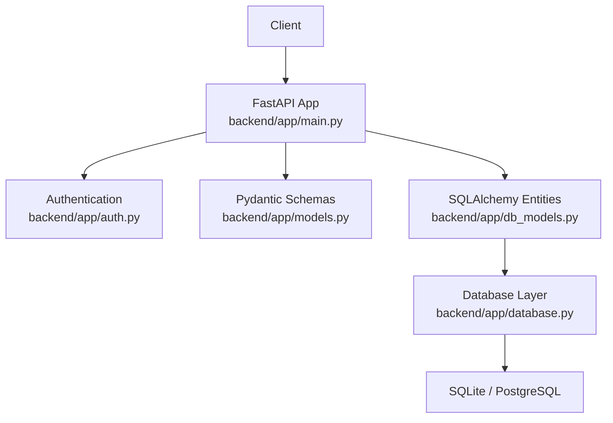
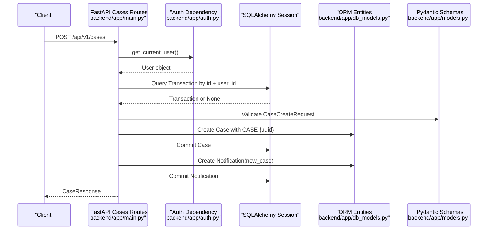
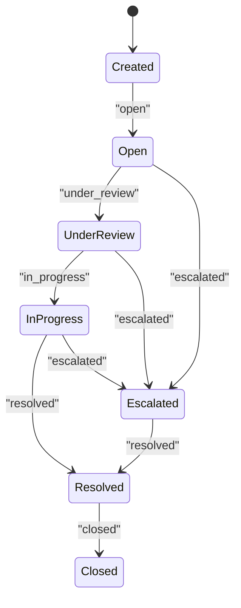
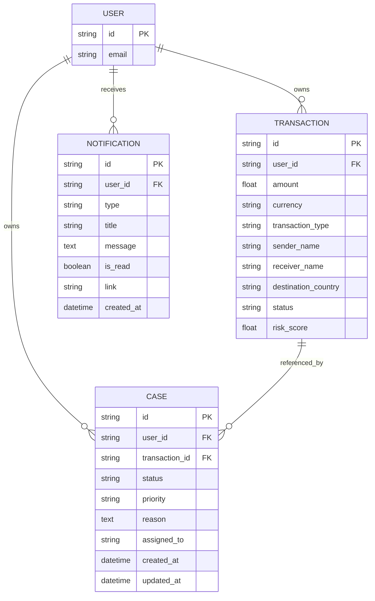
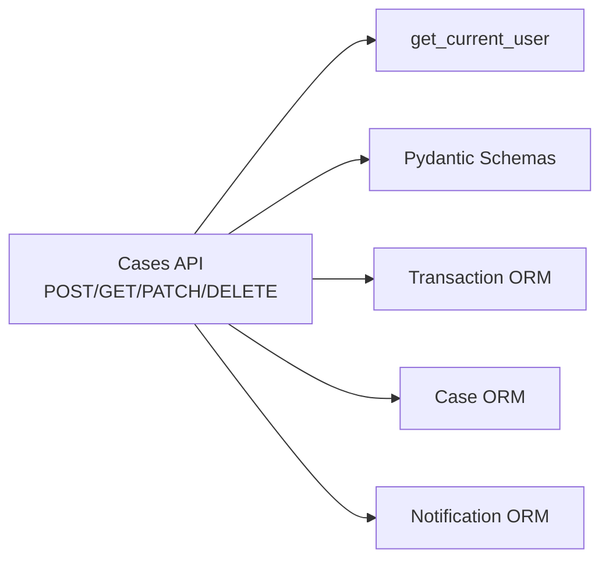

# Case Management API

<cite>
**Referenced Files in This Document**   
- [main.py](file://backend/app/main.py)
- [models.py](file://backend/app/models.py)
- [db_models.py](file://backend/app/db_models.py)
- [auth.py](file://backend/app/auth.py)
- [database.py](file://backend/app/database.py)
</cite>

## Table of Contents
1. [Introduction](#introduction)
2. [Project Structure](#project-structure)
3. [Core Components](#core-components)
4. [Architecture Overview](#architecture-overview)
5. [Detailed Component Analysis](#detailed-component-analysis)
6. [Dependency Analysis](#dependency-analysis)
7. [Performance Considerations](#performance-considerations)
8. [Troubleshooting Guide](#troubleshooting-guide)
9. [Conclusion](#conclusion)

## Introduction
This document describes the case management functionality exposed by the FinShield AI backend. It covers:
- Creating cases linked to transactions
- Retrieving a single case
- Listing all cases for the authenticated user
- Updating case status, assignment, priority, and resolution
- Authentication requirements
- Request/response schemas
- Error responses
- Case ID generation format
- Priority levels
- Assignment mechanisms
- Relationship between cases and transactions
- Referential integrity constraints
- Notification generation for case events

The implementation is built with FastAPI, Pydantic 2, SQLAlchemy 2, and persists data to SQLite by default or PostgreSQL when `DATABASE_URL` is configured.

## Project Structure
The case management endpoints are implemented in the FastAPI application entry point and rely on shared request/response models and database ORM entities.



**Diagram sources**
- [main.py:26-37](file://backend/app/main.py#L26-L37)
- [auth.py:59-113](file://backend/app/auth.py#L59-L113)
- [models.py:85-137](file://backend/app/models.py#L85-L137)
- [db_models.py:75-139](file://backend/app/db_models.py#L75-L139)
- [database.py:17-38](file://backend/app/database.py#L17-L38)

**Section sources**
- [main.py:26-37](file://backend/app/main.py#L26-L37)
- [database.py:11-38](file://backend/app/database.py#L11-L38)

## Core Components
- **Case lifecycle endpoints**: creation, retrieval, listing, update, deletion, comments, notes, SLA checks, aggregation.
- **Request/response schemas**: `CaseCreateRequest`, `CaseResponse`, `CaseUpdateRequest`.
- **Domain enums**: `CaseStatus`, `CasePriority`.
- **Persistence model**: `Case` ORM entity with foreign keys to `User` and `Transaction`.
- **Authentication**: JWT bearer tokens or API keys via `get_current_user`.

Key responsibilities:
- Validate ownership of related resources (user-scoped queries).
- Enforce referential integrity before creating cases.
- Generate human-readable case IDs.
- Persist audit logs and notifications for important case events.

**Section sources**
- [main.py:724-810](file://backend/app/main.py#L724-L810)
- [main.py:1601-1653](file://backend/app/main.py#L1601-L1653)
- [models.py:34-47](file://backend/app/models.py#L34-L47)
- [models.py:85-137](file://backend/app/models.py#L85-L137)
- [db_models.py:108-139](file://backend/app/db_models.py#L108-L139)

## Architecture Overview
The case management flow integrates authentication, validation, persistence, and notification generation.



**Diagram sources**
- [main.py:724-775](file://backend/app/main.py#L724-L775)
- [auth.py:59-113](file://backend/app/auth.py#L59-L113)
- [db_models.py:108-139](file://backend/app/db_models.py#L108-L139)
- [models.py:85-137](file://backend/app/models.py#L85-L137)

## Detailed Component Analysis

### Authentication Requirements
All case endpoints require an authenticated user through the `get_current_user` dependency. Acceptable credentials:
- JWT bearer token
- API key prefixed with `fsk_`

If unauthenticated, the server returns HTTP 401. If the account is disabled, it returns HTTP 403.

**Section sources**
- [auth.py:59-113](file://backend/app/auth.py#L59-L113)

### Case Creation: POST /api/v1/cases
Creates a new compliance case linked to a transaction owned by the current user.

- **Method**: POST
- **Path**: `/api/v1/cases`
- **Authentication**: Required (JWT or API key)
- **Request body**: `CaseCreateRequest`
  - `transaction_id`: string; must exist and belong to the current user
  - `reason`: string; non-empty reason for the case
  - `priority`: optional; defaults to `medium`; allowed values defined by `CasePriority`
  - `assigned_to`: optional string; investigator or team identifier
- **Success response**: `CaseResponse`
  - `case_id`: generated as `CASE-{uuid}`
  - `transaction_id`: provided transaction ID
  - `status`: always starts as `created`
  - `priority`: from request or default
  - `reason`: from request
  - `assigned_to`: from request or null
  - `created_at`: timestamp
  - `updated_at`: timestamp
- **Error responses**:
  - 401 Unauthorized: missing or invalid credentials
  - 403 Forbidden: account disabled
  - 404 Not Found: transaction not found for this account
  - 422 Validation Error: malformed request body
  - 429 Rate Limit Exceeded: rate limit applied globally
  - 500 Internal Server Error: unexpected failure

**Case ID generation format**: `CASE-{uuid}` where the UUID portion is derived from a random UUID. The exact fragment length differs between creation paths:
- Direct creation uses the first eight characters of a UUID converted to uppercase.
- Aggregation may use the first eight hexadecimal characters of a UUID converted to uppercase.

**Notification behavior**: On successful creation, a system notification of type `new_case` is created for the user.

**Section sources**
- [main.py:724-775](file://backend/app/main.py#L724-L775)
- [models.py:85-90](file://backend/app/models.py#L85-L90)
- [models.py:129-137](file://backend/app/models.py#L129-L137)

#### Practical curl example: create a case linked to a transaction
```bash
curl -X POST http://localhost:8091/api/v1/cases \
  -H "Authorization: Bearer YOUR_JWT_TOKEN" \
  -H "Content-Type: application/json" \
  -d '{
    "transaction_id": "EXISTING_TRANSACTION_ID",
    "reason": "High-risk destination country and amount threshold exceeded",
    "priority": "high",
    "assigned_to": "investigator-1"
  }'
```

### Case Retrieval: GET /api/v1/cases/{case_id}
Returns a single case if it belongs to the current user.

- **Method**: GET
- **Path**: `/api/v1/cases/{case_id}`
- **Authentication**: Required
- **Path parameter**: `case_id`
- **Success response**: `CaseResponse`
- **Error responses**:
  - 401 Unauthorized
  - 403 Forbidden
  - 404 Not Found: case not found for this account
  - 422 Validation Error
  - 429 Rate Limit Exceeded
  - 500 Internal Server Error

**Section sources**
- [main.py:778-794](file://backend/app/main.py#L778-L794)

#### Practical curl example: retrieve a case
```bash
curl -X GET http://localhost:8091/api/v1/cases/CASE-EXAMPLEID \
  -H "Authorization: Bearer YOUR_JWT_TOKEN"
```

### Case Listing: GET /api/v1/cases
Lists all cases for the current user, ordered by creation time descending.

- **Method**: GET
- **Path**: `/api/v1/cases`
- **Authentication**: Required
- **Query parameters**: none currently supported
- **Success response**: array of `CaseResponse`
- **Filtering**: No query-based filtering is implemented. Clients should filter client-side after retrieving the list.
- **Error responses**:
  - 401 Unauthorized
  - 403 Forbidden
  - 422 Validation Error
  - 429 Rate Limit Exceeded
  - 500 Internal Server Error

**Section sources**
- [main.py:797-810](file://backend/app/main.py#L797-L810)

#### Practical curl example: list cases
```bash
curl -X GET http://localhost:8091/api/v1/cases \
  -H "Authorization: Bearer YOUR_JWT_TOKEN"
```

### Case Status Updates: PATCH /api/v1/cases/{case_id}
Updates case fields including status, assignment, priority, resolution, and resolution summary.

- **Method**: PATCH
- **Path**: `/api/v1/cases/{case_id}`
- **Authentication**: Required
- **Request body**: `CaseUpdateRequest`
  - `status`: optional; validated against a server-side allowlist
  - `assigned_to`: optional string
  - `priority`: optional string
  - `resolution`: optional string; documented values include `confirmed_suspicious`, `false_positive`, `filed_sar`, `closed_no_action`
  - `resolution_summary`: optional string
- **Success response**: updated `CaseResponse`
- **Validation rules**:
  - Allowed statuses: `created`, `open`, `under_review`, `in_progress`, `escalated`, `resolved`, `closed`
  - Setting `resolution` sets `resolved_at` to the current time
- **Audit logging**: Every update writes an audit log entry with action `case_updated`
- **Error responses**:
  - 401 Unauthorized
  - 403 Forbidden
  - 400 Bad Request: invalid status value
  - 404 Not Found: case not found for this account
  - 422 Validation Error
  - 429 Rate Limit Exceeded
  - 500 Internal Server Error

**Section sources**
- [main.py:1601-1653](file://backend/app/main.py#L1601-L1653)

#### Practical curl example: transition case status
```bash
curl -X PATCH http://localhost:8091/api/v1/cases/CASE-EXAMPLEID \
  -H "Authorization: Bearer YOUR_JWT_TOKEN" \
  -H "Content-Type: application/json" \
  -d '{
    "status": "under_review",
    "assigned_to": "senior-investigator",
    "priority": "critical"
  }'
```

#### Practical curl example: resolve a case
```bash
curl -X PATCH http://localhost:8091/api/v1/cases/CASE-EXAMPLEID \
  -H "Authorization: Bearer YOUR_JWT_TOKEN" \
  -H "Content-Type: application/json" \
  -d '{
    "status": "resolved",
    "resolution": "false_positive",
    "resolution_summary": "No suspicious activity confirmed after review"
  }'
```

### Case Deletion: DELETE /api/v1/cases/{case_id}
Deletes a case and its associated comments.

- **Method**: DELETE
- **Path**: `/api/v1/cases/{case_id}`
- **Authentication**: Required
- **Success response**: `{ "deleted": case_id }`
- **Error responses**:
  - 401 Unauthorized
  - 403 Forbidden
  - 404 Not Found
  - 422 Validation Error
  - 429 Rate Limit Exceeded
  - 500 Internal Server Error

**Section sources**
- [main.py:1875-1890](file://backend/app/main.py#L1875-L1890)

### Related Case Endpoints
- **List comments**: GET `/api/v1/cases/{case_id}/comments`
- **Add comment**: POST `/api/v1/cases/{case_id}/comments`
- **List notes**: GET `/api/v1/cases/{case_id}/notes`
- **Add note**: POST `/api/v1/cases/{case_id}/notes`
- **SLA check**: POST `/api/v1/cases/check-sla`
- **Aggregate by transaction**: POST `/api/v1/cases/aggregate`

These endpoints share the same authentication model and ownership checks.

**Section sources**
- [main.py:1656-1745](file://backend/app/main.py#L1656-L1745)
- [main.py:1749-1872](file://backend/app/main.py#L1749-L1872)

## Data Model and Lifecycle

### Case Lifecycle States
The implementation supports these states:
- `created`: initial state after creation
- `open`: case opened for investigation
- `under_review`: under active review
- `in_progress`: actively being worked on
- `escalated`: escalated due to severity or SLA breach
- `resolved`: resolved with a resolution code
- `closed`: closed after resolution

Note:
- The Pydantic enum `CaseStatus` includes `CREATED`, `OPEN`, `UNDER_REVIEW`, `ESCALATED`, `RESOLVED`, `CLOSED`.
- The update endpoint allows additional statuses such as `open` and `in_progress`.
- The database column default is `open`, while creation explicitly sets `created`.



**Diagram sources**
- [models.py:34-40](file://backend/app/models.py#L34-L40)
- [main.py:1625-1638](file://backend/app/main.py#L1625-L1638)
- [db_models.py:114-132](file://backend/app/db_models.py#L114-L132)

### Priority Levels
Allowed priorities:
- `low`
- `medium`
- `high`
- `critical`

Default priority for case creation is `medium`.

**Section sources**
- [models.py:43-47](file://backend/app/models.py#L43-L47)
- [main.py:738-748](file://backend/app/main.py#L738-L748)

### Assignment Mechanisms
- `assigned_to` is an optional string field on both request and response.
- It can be set during creation and updated later.
- There is no enforced mapping to internal users; clients should treat it as an investigator identifier.

**Section sources**
- [models.py:85-90](file://backend/app/models.py#L85-L90)
- [models.py:129-137](file://backend/app/models.py#L129-L137)
- [db_models.py:118](file://backend/app/db_models.py#L118)

### Relationship Between Cases and Transactions
- A case references exactly one transaction via `transaction_id`.
- A transaction can have multiple cases.
- Case creation validates that the referenced transaction exists and belongs to the current user.
- Deleting a transaction deletes associated cases and case comments.



**Diagram sources**
- [db_models.py:75-139](file://backend/app/db_models.py#L75-L139)
- [db_models.py:154-167](file://backend/app/db_models.py#L154-L167)
- [main.py:731-748](file://backend/app/main.py#L731-L748)
- [main.py:642-663](file://backend/app/main.py#L642-L663)

### Referential Integrity Constraints
- Case creation requires the transaction to exist and belong to the current user.
- The database defines foreign keys from `Case.transaction_id` to `Transaction.id`.
- Deleting a transaction removes associated cases and comments.
- Ownership checks are performed at the API layer using `user_id` filters.

**Section sources**
- [main.py:731-736](file://backend/app/main.py#L731-L736)
- [db_models.py:113](file://backend/app/db_models.py#L113)
- [main.py:642-663](file://backend/app/main.py#L642-L663)

### Notification Generation for Case Events
- On case creation, a notification of type `new_case` is created for the user.
- Notifications include a title, message, and optional deep link.
- Notifications are persisted in the `notifications` table.

**Section sources**
- [main.py:753-762](file://backend/app/main.py#L753-L762)
- [db_models.py:154-167](file://backend/app/db_models.py#L154-L167)

## Request and Response Schemas

### CaseCreateRequest
| Field | Type | Required | Default | Description |
|---|---|---:|---|---|
| `transaction_id` | string | Yes | — | ID of the transaction to link the case to |
| `reason` | string | Yes | — | Reason for opening the case |
| `priority` | string | No | `medium` | Allowed values: `low`, `medium`, `high`, `critical` |
| `assigned_to` | string | No | null | Investigator or team identifier |

**Section sources**
- [models.py:85-90](file://backend/app/models.py#L85-L90)

### CaseResponse
| Field | Type | Description |
|---|---|---|
| `case_id` | string | Generated case identifier |
| `transaction_id` | string | Linked transaction ID |
| `status` | string | Current case status |
| `priority` | string | Current priority |
| `reason` | string | Original reason for the case |
| `assigned_to` | string | Assigned investigator or team |
| `created_at` | datetime | Creation timestamp |
| `updated_at` | datetime | Last update timestamp |

**Section sources**
- [models.py:129-137](file://backend/app/models.py#L129-L137)

### CaseStatus
| Value | Meaning |
|---|---|
| `created` | Case just created |
| `open` | Case opened |
| `under_review` | Under active review |
| `escalated` | Escalated |
| `resolved` | Resolved |
| `closed` | Closed |

Additional statuses accepted by the update endpoint include `open` and `in_progress`.

**Section sources**
- [models.py:34-40](file://backend/app/models.py#L34-L40)
- [main.py:1625-1629](file://backend/app/main.py#L1625-L1629)

### CasePriority
| Value | Meaning |
|---|---|
| `low` | Low priority |
| `medium` | Medium priority |
| `high` | High priority |
| `critical` | Critical priority |

**Section sources**
- [models.py:43-47](file://backend/app/models.py#L43-L47)

## Error Responses
Common error responses across case endpoints:

| Status Code | Meaning | Typical Cause |
|---:|---|---|
| 400 | Bad Request | Invalid status value or empty body |
| 401 | Unauthorized | Missing or invalid JWT/API key |
| 402 | Payment Required | Credit-related errors elsewhere in the app |
| 403 | Forbidden | Account disabled |
| 404 | Not Found | Case or transaction not found for this account |
| 422 | Validation Error | Malformed request payload |
| 429 | Too Many Requests | Rate limit exceeded |
| 500 | Internal Server Error | Unexpected server failure |

Global exception handlers normalize most errors into JSON responses with a `detail` field.

**Section sources**
- [main.py:81-115](file://backend/app/main.py#L81-L115)
- [auth.py:59-113](file://backend/app/auth.py#L59-L113)

## Practical Usage Examples

### Create a case linked to a transaction
Use the transaction ID returned by the screening endpoint to create a case.

```bash
curl -X POST http://localhost:8091/api/v1/cases \
  -H "Authorization: Bearer YOUR_JWT_TOKEN" \
  -H "Content-Type: application/json" \
  -d '{
    "transaction_id": "TX-12345",
    "reason": "Sanctions match and high-risk geography",
    "priority": "critical",
    "assigned_to": "compliance-team"
  }'
```

### Update case status transitions
Transition a case through investigation stages.

```bash
curl -X PATCH http://localhost:8091/api/v1/cases/CASE-EXAMPLEID \
  -H "Authorization: Bearer YOUR_JWT_TOKEN" \
  -H "Content-Type: application/json" \
  -d '{"status": "under_review"}'
```

### List cases with client-side filtering
Retrieve all cases and filter locally by status or priority.

```bash
curl -X GET http://localhost:8091/api/v1/cases \
  -H "Authorization: Bearer YOUR_JWT_TOKEN"
```

## Dependency Analysis



**Diagram sources**
- [main.py:724-810](file://backend/app/main.py#L724-L810)
- [main.py:1601-1653](file://backend/app/main.py#L1601-L1653)
- [db_models.py:75-167](file://backend/app/db_models.py#L75-L167)
- [models.py:85-137](file://backend/app/models.py#L85-L137)

**Section sources**
- [main.py:724-810](file://backend/app/main.py#L724-L810)
- [main.py:1601-1653](file://backend/app/main.py#L1601-L1653)

## Performance Considerations
- Case listing performs a simple filtered query ordered by creation time. For large datasets, consider adding pagination parameters.
- Case creation and updates perform two commits in some flows: one for the case and one for the notification. Batch operations could reduce round-trips.
- Ownership checks add WHERE clauses per request; ensure indexes exist on `user_id` and `transaction_id` in production databases.
- Notifications are synchronous; offload heavy notification delivery to a background worker if needed.

[No sources needed since this section provides general guidance]

## Troubleshooting Guide

### Common Issues
- **401 Unauthorized**: Ensure the Authorization header contains a valid JWT or API key.
- **404 Not Found for transaction**: Confirm the transaction was screened and belongs to the authenticated user.
- **400 Invalid status**: Use only statuses allowed by the update endpoint.
- **404 Not Found for case**: Confirm the case ID belongs to the authenticated user.
- **Rate limiting**: If you receive 429, back off and retry later.

### Debugging Steps
1. Verify authentication by calling `/api/auth/me`.
2. Retrieve the transaction to confirm it exists and belongs to the user.
3. Create the case and capture the generated `case_id`.
4. Retrieve the case to verify persistence.
5. Check the notifications table for `new_case` entries.

**Section sources**
- [auth.py:59-113](file://backend/app/auth.py#L59-L113)
- [main.py:731-775](file://backend/app/main.py#L731-L775)
- [main.py:778-810](file://backend/app/main.py#L778-L810)

## Conclusion
The case management API provides a focused workflow for investigating flagged transactions. It enforces ownership and referential integrity, generates readable case identifiers, supports flexible status transitions, and records relevant audit and notification events. Clients should authenticate requests, validate transaction ownership before case creation, and handle standard error responses consistently.

[No sources needed since this section summarizes without analyzing specific files]