# Filing Management API

<cite>
**Referenced Files in This Document**   
- [main.py](file://backend/app/main.py)
- [db_models.py](file://backend/app/db_models.py)
- [models.py](file://backend/app/models.py)
- [auth.py](file://backend/app/auth.py)
- [database.py](file://backend/app/database.py)
- [compliance_engine.py](file://backend/app/compliance_engine.py)
- [requirements.txt](file://backend/requirements.txt)
- [docker-compose.yml](file://docker-compose.yml)
</cite>

## Table of Contents
1. [Introduction](#introduction)
2. [Project Structure](#project-structure)
3. [Core Components](#core-components)
4. [Architecture Overview](#architecture-overview)
5. [Detailed Component Analysis](#detailed-component-analysis)
6. [Dependency Analysis](#dependency-analysis)
7. [Performance Considerations](#performance-considerations)
8. [Troubleshooting Guide](#troubleshooting-guide)
9. [Conclusion](#conclusion)
10. [Appendices](#appendices)

## Introduction
This document provides comprehensive API documentation for regulatory filing management in FinShield AI. It focuses on creating, tracking, and managing SAR/STR filings, including the relationship between transactions, cases, and filings, as well as status transitions, audit trail requirements, and integration points with external regulatory systems.

The shipped backend is a FastAPI application that exposes authenticated REST endpoints under `/api/v1`. Filings are persisted through SQLAlchemy ORM models and default to SQLite unless `DATABASE_URL` points to PostgreSQL. The repository’s `docker-compose.yml` runs PostgreSQL (pgvector), the backend, and the Next.js frontend; the static marketing site under `website/` is not part of this compose stack.

## Project Structure
The relevant implementation for filing management lives in the backend:

- `backend/app/main.py`: FastAPI routes, request/response schemas, authentication dependencies, persistence logic, and exception handlers.
- `backend/app/db_models.py`: SQLAlchemy ORM entities including `Filing`, `Case`, `Transaction`, `AuditLog`, and related tables.
- `backend/app/models.py`: Pydantic request/response schemas such as `FilingCreate`, `FilingUpdate`, and `FilingResponse`.
- `backend/app/auth.py`: JWT and API key authentication dependency used by all protected endpoints.
- `backend/app/database.py`: Database engine configuration and session factory.
- `backend/app/compliance_engine.py`: Transaction screening pipeline that produces flagged/blocked/in_review results which drive case creation and eventual filing workflows.
- `backend/requirements.txt`: Declared Python dependencies.
- `docker-compose.yml`: Defines postgres, backend, and frontend services.

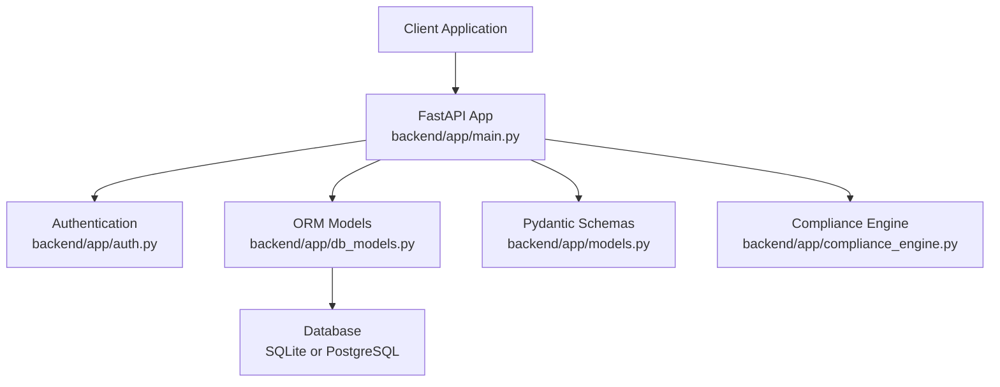

**Diagram sources**
- [main.py:15-37](file://backend/app/main.py#L15-L37)
- [auth.py:59-113](file://backend/app/auth.py#L59-L113)
- [db_models.py:75-272](file://backend/app/db_models.py#L75-L272)
- [models.py:67-152](file://backend/app/models.py#L67-L152)
- [compliance_engine.py:30-162](file://backend/app/compliance_engine.py#L30-L162)

**Section sources**
- [main.py:1-152](file://backend/app/main.py#L1-L152)
- [database.py:1-45](file://backend/app/database.py#L1-L45)
- [requirements.txt:1-16](file://backend/requirements.txt#L1-L16)
- [docker-compose.yml:1-72](file://docker-compose.yml#L1-L72)

## Core Components
The filing management system is built around three core data concepts:

1. **Transactions**: Screened payments that may be approved, flagged, blocked, or placed in review.
2. **Cases**: Investigative records linked to one transaction, with status, priority, resolution, and notes/comments.
3. **Filings**: Regulatory SAR/STR records created from resolved suspicious cases, with narrative, structured data, deadlines, submission timestamps, reference numbers, and confirmation metadata.

The current implementation provides:

- Transaction screening via `/api/v1/transactions`.
- Case lifecycle via `/api/v1/cases`.
- Filing lifecycle via `/api/v1/filings`.
- Audit logging for user actions.
- Optional RAG enrichment during screening when PostgreSQL + pgvector is configured.

**Section sources**
- [db_models.py:75-272](file://backend/app/db_models.py#L75-L272)
- [main.py:434-717](file://backend/app/main.py#L434-L717)
- [main.py:724-811](file://backend/app/main.py#L724-L811)
- [main.py:1897-2155](file://backend/app/main.py#L1897-L2155)

## Architecture Overview
The regulatory compliance workflow proceeds as follows:

1. A client submits a transaction to the screening endpoint.
2. The compliance engine evaluates rules, behavioral signals, and optional ML classification.
3. The result is persisted as a transaction with status and risk metadata.
4. If the transaction is flagged, blocked, or in review, an investigator creates a case.
5. When a case is resolved as suspicious, a SAR/STR filing can be created.
6. The filing progresses through draft, under review, submitted, confirmed, or rejected states.
7. Submission and confirmation timestamps, user IDs, and reference numbers are recorded.
8. All significant actions are written to the audit log table.

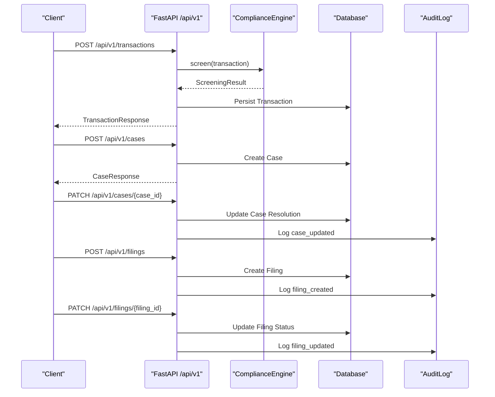

**Diagram sources**
- [main.py:434-570](file://backend/app/main.py#L434-L570)
- [main.py:724-775](file://backend/app/main.py#L724-L775)
- [main.py:1613-1653](file://backend/app/main.py#L1613-L1653)
- [main.py:1926-1997](file://backend/app/main.py#L1926-L1997)
- [main.py:2067-2129](file://backend/app/main.py#L2067-L2129)

## Detailed Component Analysis

### Authentication Requirements
All protected endpoints require authentication through either:

- A JWT bearer token obtained via `/api/auth/login` or `/api/auth/register`.
- An API key starting with `fsk_`, created via `/api/v1/keys`.

The authentication dependency validates both paths and returns the current `User` object. Unauthenticated requests receive 401 responses. Disabled accounts receive 403 responses.

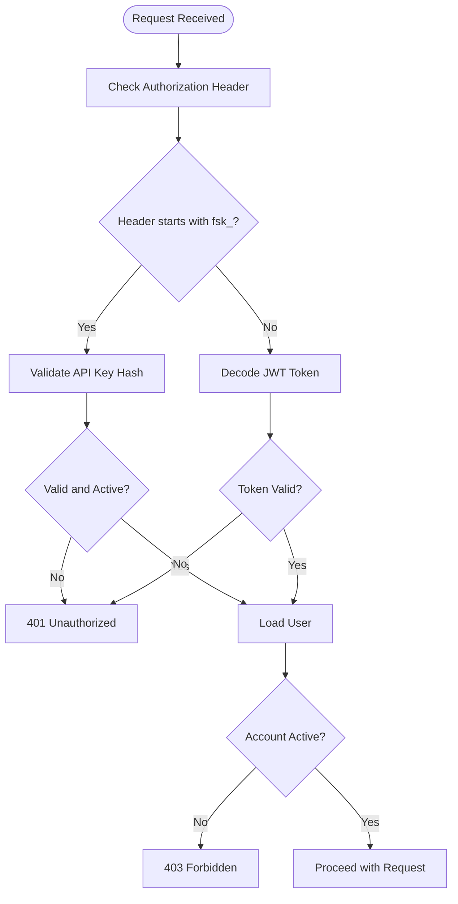

**Diagram sources**
- [auth.py:59-113](file://backend/app/auth.py#L59-L113)

**Section sources**
- [auth.py:21-122](file://backend/app/auth.py#L21-L122)
- [main.py:176-266](file://backend/app/main.py#L176-L266)
- [main.py:366-427](file://backend/app/main.py#L366-L427)

### Filing Model Structure
The `Filing` model represents a SAR or STR regulatory filing associated with a resolved case. Its key fields include:

| Field | Type | Description |
|---|---|---|
| `id` | String UUID | Primary key |
| `case_id` | String FK | Link to the parent case |
| `user_id` | String FK | Owner account |
| `filing_type` | String | `SAR` or `STR` |
| `status` | String | `draft`, `under_review`, `submitted`, `confirmed`, `rejected` |
| `deadline` | DateTime | 30-day deadline from creation |
| `narrative` | Text | Free-text description |
| `structured_data` | JSON | Auto-populated transaction and case details |
| `reference_number` | String | Regulator-assigned identifier |
| `submitted_at` | DateTime | Submission timestamp |
| `submitted_by` | String | User ID who submitted |
| `confirmed_at` | DateTime | Confirmation timestamp |
| `confirmed_by` | String | User ID who confirmed |
| `created_at` | DateTime | Creation timestamp |
| `updated_at` | DateTime | Last update timestamp |

The `Filing` model has a one-to-many relationship with itself through `Case.filings`, meaning one case can have multiple filings.

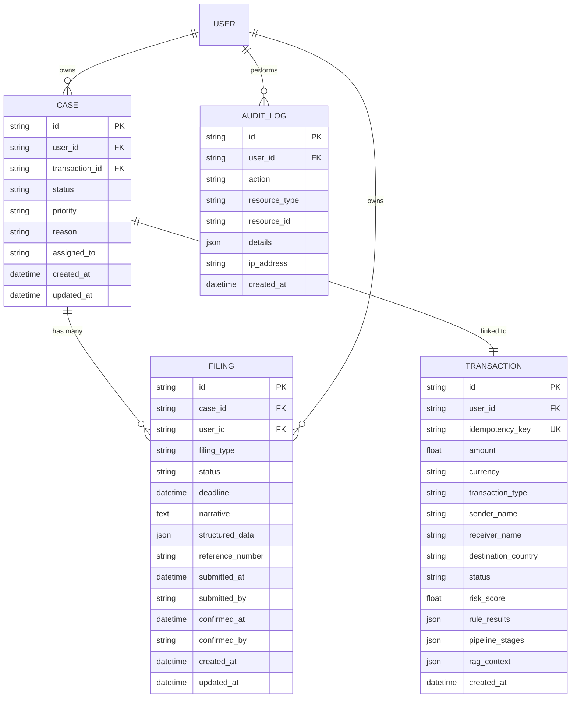

**Diagram sources**
- [db_models.py:75-272](file://backend/app/db_models.py#L75-L272)

**Section sources**
- [db_models.py:108-272](file://backend/app/db_models.py#L108-L272)

### Filing Endpoints

#### Create Filing
- **Endpoint**: `POST /api/v1/filings`
- **Authentication**: Required (JWT or API key)
- **Request Body**:
  - `case_id`: String
  - `filing_type`: String (`SAR` or `STR`)
  - `narrative`: Optional string
- **Success Response**: `FilingResponse` with status `draft`, calculated deadline, auto-populated `structured_data`, and audit log entry.
- **Error Responses**:
  - `404 Case not found`: Case does not exist or does not belong to the current user.
  - `400 Case must be resolved as suspicious before filing`: Case resolution is not `confirmed_suspicious` or `filed_sar`.

Practical usage pattern:
1. Screen a transaction.
2. Create a case if needed.
3. Resolve the case as suspicious.
4. Create the filing.

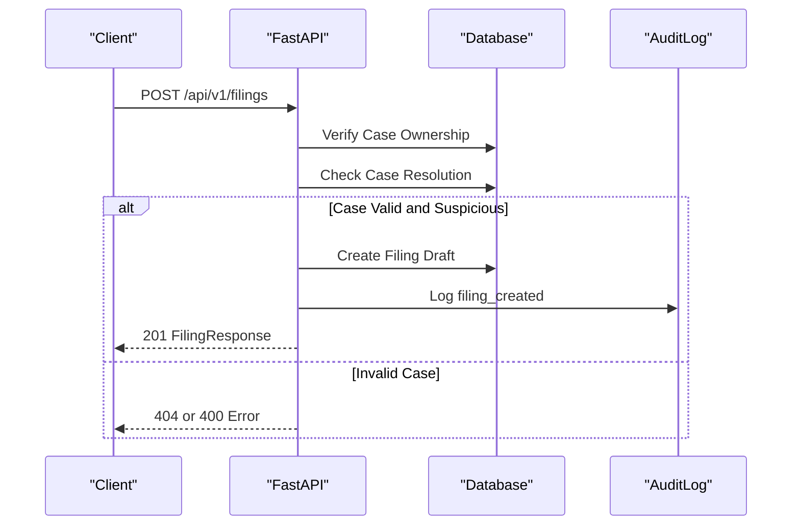

**Diagram sources**
- [main.py:1897-1997](file://backend/app/main.py#L1897-L1997)

**Section sources**
- [main.py:1897-1997](file://backend/app/main.py#L1897-L1997)

#### List Filings
- **Endpoint**: `GET /api/v1/filings`
- **Query Parameters**:
  - `status`: Optional filter by filing status.
  - `filing_type`: Optional filter by `SAR` or `STR`.
- **Authentication**: Required.
- **Response**: Array of `FilingResponse` objects ordered by creation time descending.

**Section sources**
- [main.py:2000-2035](file://backend/app/main.py#L2000-L2035)

#### Get Filing
- **Endpoint**: `GET /api/v1/filings/{filing_id}`
- **Authentication**: Required.
- **Response**: Single `FilingResponse`.
- **Error Responses**:
  - `404 Filing not found`: Filing does not exist or does not belong to the current user.

**Section sources**
- [main.py:2038-2064](file://backend/app/main.py#L2038-L2064)

#### Update Filing
- **Endpoint**: `PATCH /api/v1/filings/{filing_id}`
- **Authentication**: Required.
- **Request Body**:
  - `narrative`: Optional string.
  - `status`: Optional status transition.
  - `reference_number`: Optional regulator-assigned reference.
- **Behavior**:
  - Transitioning to `submitted` sets `submitted_at` and `submitted_by`.
  - Transitioning to `confirmed` sets `confirmed_at` and `confirmed_by`.
  - Every update writes an audit log entry.
- **Response**: Updated `FilingResponse`.
- **Error Responses**:
  - `404 Filing not found`.

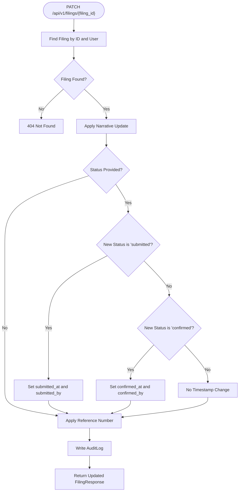

**Diagram sources**
- [main.py:2067-2129](file://backend/app/main.py#L2067-L2129)

**Section sources**
- [main.py:2067-2129](file://backend/app/main.py#L2067-L2129)

#### Delete Filing
- **Endpoint**: `DELETE /api/v1/filings/{filing_id}`
- **Authentication**: Required.
- **Behavior**: Only drafts can be deleted. Deletion writes an audit log entry.
- **Error Responses**:
  - `404 Filing not found`.
  - `400 Only draft filings can be deleted`.

**Section sources**
- [main.py:2132-2155](file://backend/app/main.py#L2132-L2155)

### Relationship Between Cases and Filings
A case is the investigative container for a transaction. A filing is the regulatory output derived from a resolved suspicious case. The schema enforces:

- `Case.filings` is a one-to-many relationship.
- `Filing.case_id` references `Case.id`.
- `Filing.user_id` ensures ownership isolation.
- Filing creation requires the case to be resolved as suspicious.

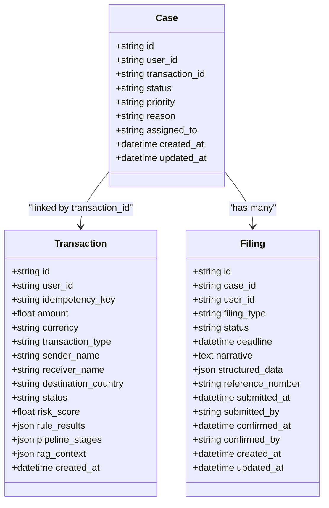

**Diagram sources**
- [db_models.py:75-272](file://backend/app/db_models.py#L75-L272)

**Section sources**
- [db_models.py:108-272](file://backend/app/db_models.py#L108-L272)
- [main.py:1933-1957](file://backend/app/main.py#L1933-L1957)

### Filing Status Transitions
The implemented filing statuses are:

| Status | Meaning | Notes |
|---|---|---|
| `draft` | Initial state after creation | Can be edited or deleted |
| `under_review` | Internal review state | No automatic timestamp set by current handler |
| `submitted` | Filed externally or prepared for submission | Sets `submitted_at` and `submitted_by` |
| `confirmed` | Accepted by regulator or internal confirmation | Sets `confirmed_at` and `confirmed_by` |
| `rejected` | Rejected by regulator or internal decision | No automatic timestamp set by current handler |

Important constraints:

- Filing creation requires the parent case to have resolution `confirmed_suspicious` or `filed_sar`.
- Only `draft` filings can be deleted.
- Submission and confirmation transitions record user identity and timestamps.
- All updates are audit-logged.

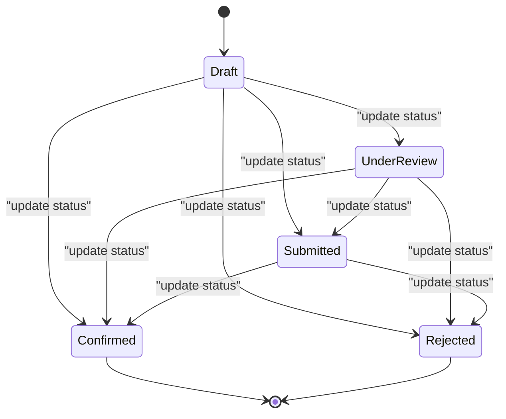

**Diagram sources**
- [db_models.py:240-272](file://backend/app/db_models.py#L240-L272)
- [main.py:2067-2129](file://backend/app/main.py#L2067-L2129)

**Section sources**
- [main.py:1938-1943](file://backend/app/main.py#L1938-L1943)
- [main.py:2083-2095](file://backend/app/main.py#L2083-L2095)
- [main.py:2143-2144](file://backend/app/main.py#L2143-L2144)

### Audit Trail Requirements
Audit logging is implemented for:

- Filing creation.
- Filing updates.
- Filing deletion.
- Case updates.
- Rule updates.
- Billing events.
- Circuit breaker state changes.
- DSAR requests.

Each audit entry includes:

- `user_id`: Who performed the action.
- `action`: Semantic action name.
- `resource_type`: Entity type such as `filing`, `case`, `rule`.
- `resource_id`: Identifier of the affected entity.
- `details`: JSON payload describing changes.
- `ip_address`: Optional client IP.
- `created_at`: Timestamp.

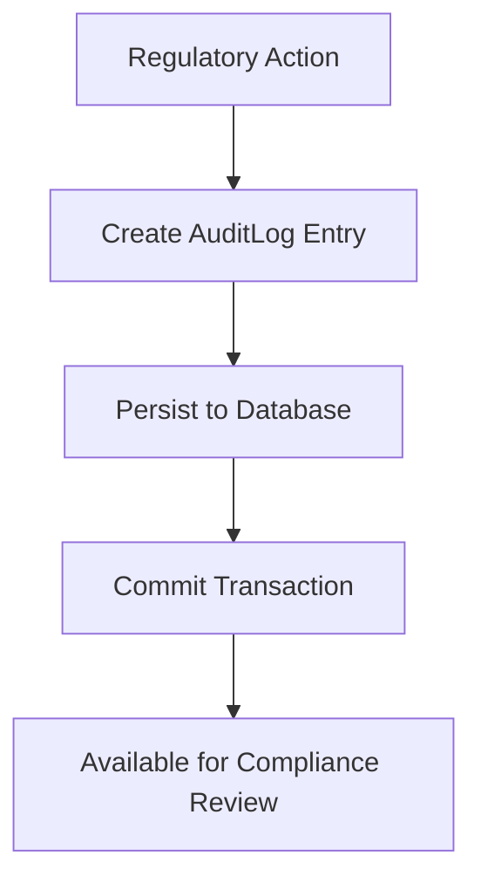

**Diagram sources**
- [db_models.py:141-151](file://backend/app/db_models.py#L141-L151)
- [main.py:1972-1980](file://backend/app/main.py#L1972-L1980)
- [main.py:2102-2109](file://backend/app/main.py#L2102-L2109)
- [main.py:2147-2152](file://backend/app/main.py#L2147-L2152)

**Section sources**
- [db_models.py:141-151](file://backend/app/db_models.py#L141-L151)
- [main.py:1972-1980](file://backend/app/main.py#L1972-L1980)
- [main.py:2102-2109](file://backend/app/main.py#L2102-L2109)
- [main.py:2147-2152](file://backend/app/main.py#L2147-L2152)

### Integration with External Regulatory Systems
The current implementation does not automatically submit filings to an external regulator. Instead, it supports:

- Manual or programmatic status updates to `submitted` and `confirmed`.
- Storing a regulator-assigned `reference_number`.
- Recording submission and confirmation timestamps and user identities.
- Webhook event queuing infrastructure under `/api/v1/webhooks`.

For production integration:

- Use the webhook dispatch endpoint to emit events such as `filing.submitted` or `filing.confirmed`.
- Extend the filing update handler to call an external regulatory submission service.
- Add retry, delivery tracking, and dead-letter handling for failed submissions.
- Record external submission results in `structured_data` or a dedicated submission history table.

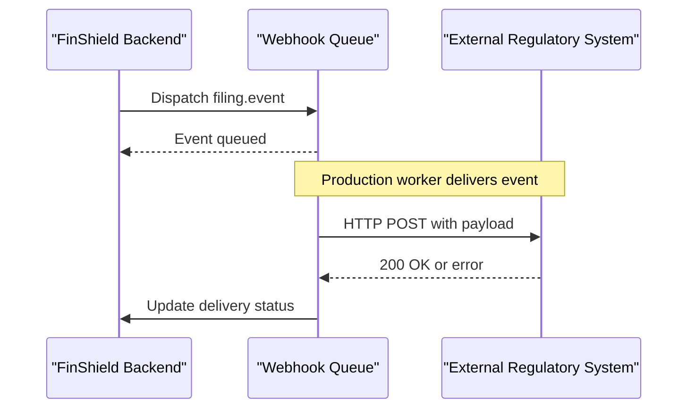

**Diagram sources**
- [main.py:2589-2614](file://backend/app/main.py#L2589-L2614)
- [main.py:2617-2670](file://backend/app/main.py#L2617-L2670)
- [db_models.py:296-316](file://backend/app/db_models.py#L296-L316)

**Section sources**
- [main.py:2589-2670](file://backend/app/main.py#L2589-L2670)
- [db_models.py:296-316](file://backend/app/db_models.py#L296-L316)

### Practical Usage Examples

#### Create a Filing from a Flagged Transaction
Recommended flow:

1. Submit a transaction to `/api/v1/transactions`.
2. If the result is `flagged`, `blocked`, or `in_review`, create a case via `/api/v1/cases`.
3. Update the case resolution to `confirmed_suspicious` or `filed_sar` via `/api/v1/cases/{case_id}`.
4. Create a filing via `/api/v1/filings`.

Example curl pattern:

```bash
curl -X POST http://localhost:8091/api/v1/transactions \
  -H "Authorization: Bearer YOUR_JWT_TOKEN" \
  -H "Content-Type: application/json" \
  -d '{
    "amount": 15000,
    "currency": "USD",
    "transaction_type": "wire",
    "sender_name": "globalremit",
    "receiver_name": "darkfund",
    "destination_country": "KP"
  }'
```

After receiving a flagged result, create a case, resolve it as suspicious, then create the filing:

```bash
curl -X POST http://localhost:8091/api/v1/filings \
  -H "Authorization: Bearer YOUR_JWT_TOKEN" \
  -H "Content-Type: application/json" \
  -d '{
    "case_id": "CASE-XXXXXXXX",
    "filing_type": "SAR",
    "narrative": "Suspicious activity detected based on sanctions and high-risk geography."
  }'
```

**Section sources**
- [main.py:434-570](file://backend/app/main.py#L434-L570)
- [main.py:724-775](file://backend/app/main.py#L724-L775)
- [main.py:1613-1653](file://backend/app/main.py#L1613-L1653)
- [main.py:1926-1997](file://backend/app/main.py#L1926-L1997)

#### Track Filing Status
Retrieve all filings or filter by status:

```bash
curl -X GET "http://localhost:8091/api/v1/filings?status=submitted" \
  -H "Authorization: Bearer YOUR_JWT_TOKEN"
```

Get a specific filing:

```bash
curl -X GET http://localhost:8091/api/v1/filings/FILING_ID \
  -H "Authorization: Bearer YOUR_JWT_TOKEN"
```

**Section sources**
- [main.py:2000-2035](file://backend/app/main.py#L2000-L2035)
- [main.py:2038-2064](file://backend/app/main.py#L2038-L2064)

#### Update Filing and Export
Update a filing to mark it submitted:

```bash
curl -X PATCH http://localhost:8091/api/v1/filings/FILING_ID \
  -H "Authorization: Bearer YOUR_JWT_TOKEN" \
  -H "Content-Type: application/json" \
  -d '{
    "status": "submitted",
    "reference_number": "REG-2024-0001"
  }'
```

Export transactions (not filings directly) as CSV:

```bash
curl -X GET "http://localhost:8091/api/v1/transactions/export?fmt=csv&start_date=2024-01-01&end_date=2024-12-31" \
  -H "Authorization: Bearer YOUR_JWT_TOKEN" \
  --output finshield_transactions.csv
```

Note: The export endpoint currently exports transactions, not filings. To export filings, extend the export endpoint to query `Filing` and serialize its fields.

**Section sources**
- [main.py:2067-2129](file://backend/app/main.py#L2067-L2129)
- [main.py:666-717](file://backend/app/main.py#L666-L717)

## Dependency Analysis
The filing subsystem depends on:

- Authentication layer for authorization.
- Case model for parent linkage.
- Transaction model for structured data population.
- Audit log model for compliance traceability.
- Database layer for persistence.
- Optional RAG service for enriched screening context.

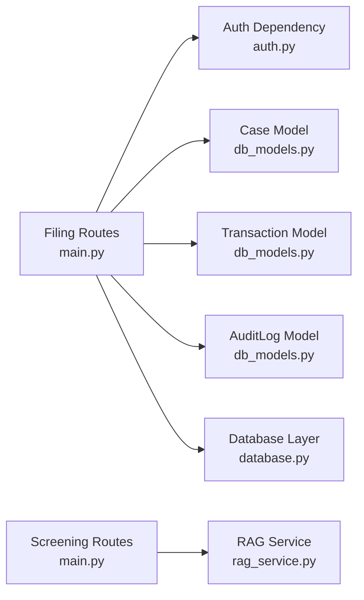

**Diagram sources**
- [main.py:1897-2155](file://backend/app/main.py#L1897-L2155)
- [auth.py:59-113](file://backend/app/auth.py#L59-L113)
- [db_models.py:75-272](file://backend/app/db_models.py#L75-L272)
- [database.py:17-38](file://backend/app/database.py#L17-L38)

**Section sources**
- [main.py:1897-2155](file://backend/app/main.py#L1897-L2155)
- [auth.py:59-113](file://backend/app/auth.py#L59-L113)
- [db_models.py:75-272](file://backend/app/db_models.py#L75-L272)
- [database.py:1-45](file://backend/app/database.py#L1-L45)

## Performance Considerations
- Filing list endpoints use simple filtered queries ordered by creation time. For large datasets, add pagination parameters.
- Filing creation populates structured data from the linked transaction and case; ensure indexes exist on `case_id`, `user_id`, and `filing_type`.
- Audit log writes occur on every filing mutation; consider batching or asynchronous logging in high-throughput environments.
- The database defaults to SQLite for local development; PostgreSQL is required for RAG retrieval and recommended for production.
- Rate limiting is applied globally through SlowAPI; filing endpoints do not have additional per-endpoint limits beyond the global limiter.

[No sources needed since this section provides general guidance]

## Troubleshooting Guide

### Common Errors

| Error | Cause | Resolution |
|---|---|---|
| `401 Not authenticated` | Missing or invalid authorization header | Provide a valid JWT or API key |
| `401 Invalid API key` | API key prefix mismatch or inactive key | Generate a new API key via `/api/v1/keys` |
| `403 Account disabled` | User account is inactive | Reactivate the account or use an active account |
| `404 Case not found` | Case ID missing or belongs to another user | Verify case ownership and ID |
| `400 Case must be resolved as suspicious before filing` | Case resolution is not suspicious | Update case resolution first |
| `404 Filing not found` | Filing ID missing or belongs to another user | Verify filing ownership and ID |
| `400 Only draft filings can be deleted` | Attempted deletion of non-draft filing | Edit or archive instead of deleting |
| `422 Invalid request data` | Pydantic validation failure | Fix request body according to schema |
| `429 Rate limit exceeded` | Too many requests | Reduce request frequency or adjust rate limits |
| `500 Internal server error` | Unhandled exception | Check server logs and database connectivity |

**Section sources**
- [auth.py:59-113](file://backend/app/auth.py#L59-L113)
- [main.py:82-115](file://backend/app/main.py#L82-L115)
- [main.py:1933-1943](file://backend/app/main.py#L1933-L1943)
- [main.py:2143-2144](file://backend/app/main.py#L2143-L2144)

### Debugging Filing Workflows
To debug a filing issue:

1. Confirm the case exists and belongs to the current user.
2. Confirm the case resolution is `confirmed_suspicious` or `filed_sar`.
3. Retrieve the filing via `GET /api/v1/filings/{filing_id}`.
4. Check audit logs for `filing_created`, `filing_updated`, or `filing_deleted` actions.
5. Verify database connectivity and whether SQLite or PostgreSQL is being used.
6. If using RAG enrichment, confirm `RAG_DATABASE_URL` points to a running PostgreSQL instance.

**Section sources**
- [main.py:1933-1997](file://backend/app/main.py#L1933-L1997)
- [main.py:2102-2109](file://backend/app/main.py#L2102-L2109)
- [database.py:11-15](file://backend/app/database.py#L11-L15)
- [docker-compose.yml:31-37](file://docker-compose.yml#L31-L37)

## Conclusion
The FinShield AI filing management API provides a solid foundation for SAR/STR regulatory workflows. It enforces ownership, links filings to resolved suspicious cases, tracks status transitions, and records audit trails. The current implementation supports manual submission and confirmation flows rather than fully automated external regulatory submission.

For production readiness, extend the filing update handler to integrate with external regulators, add robust webhook delivery with retries, implement pagination for large filing histories, and ensure PostgreSQL is used for both persistence and RAG retrieval. The existing architecture makes these extensions straightforward because filing state, audit logs, and webhook infrastructure are already present.

[No sources needed since this section summarizes without analyzing specific files]

## Appendices

### API Summary Table

| Endpoint | Method | Authentication | Purpose | Key Response Fields |
|---|---|---|---|---|
| `/api/v1/filings` | POST | Required | Create SAR/STR filing draft | `id`, `case_id`, `filing_type`, `status`, `deadline`, `structured_data` |
| `/api/v1/filings` | GET | Required | List filings with optional filters | Array of filing responses |
| `/api/v1/filings/{filing_id}` | GET | Required | Get single filing | Full filing response |
| `/api/v1/filings/{filing_id}` | PATCH | Required | Update narrative, status, reference number | Updated filing response |
| `/api/v1/filings/{filing_id}` | DELETE | Required | Delete draft filing | Deleted ID |

**Section sources**
- [main.py:1926-1997](file://backend/app/main.py#L1926-L1997)
- [main.py:2000-2035](file://backend/app/main.py#L2000-L2035)
- [main.py:2038-2064](file://backend/app/main.py#L2038-L2064)
- [main.py:2067-2129](file://backend/app/main.py#L2067-L2129)
- [main.py:2132-2155](file://backend/app/main.py#L2132-L2155)