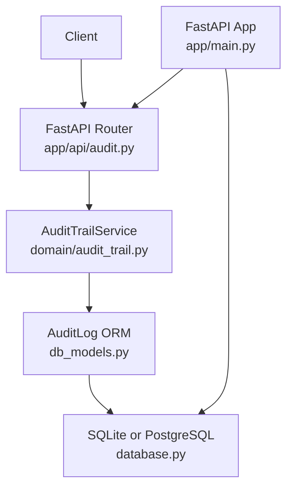
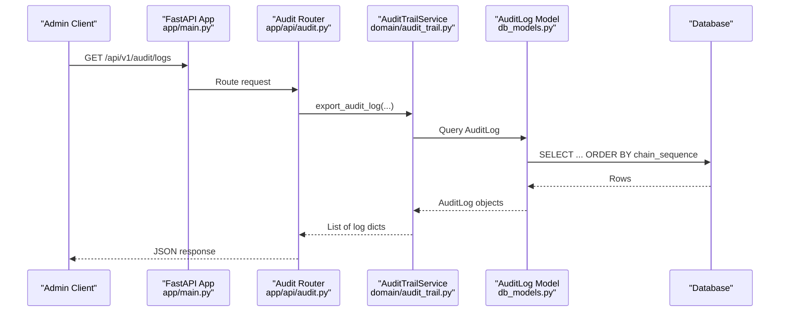
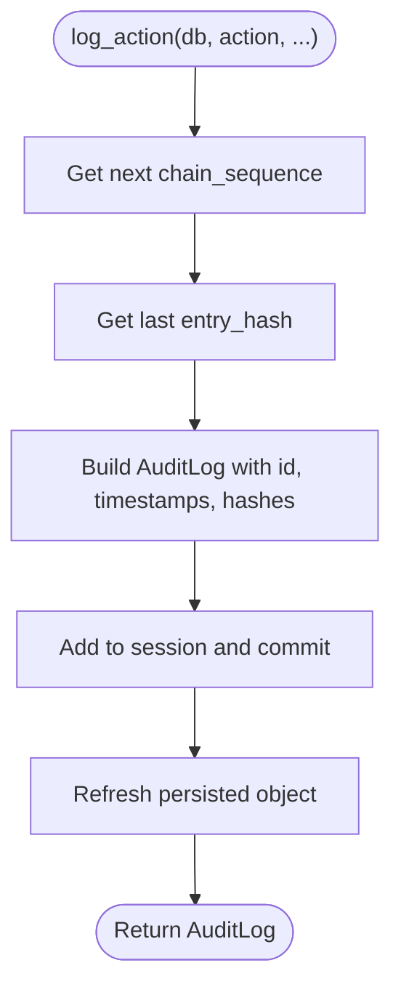
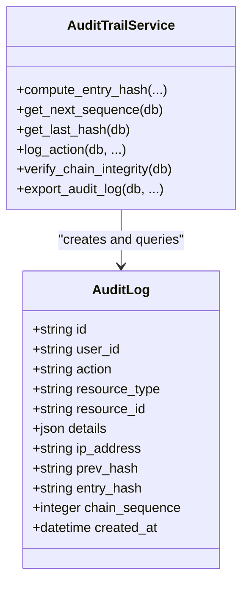
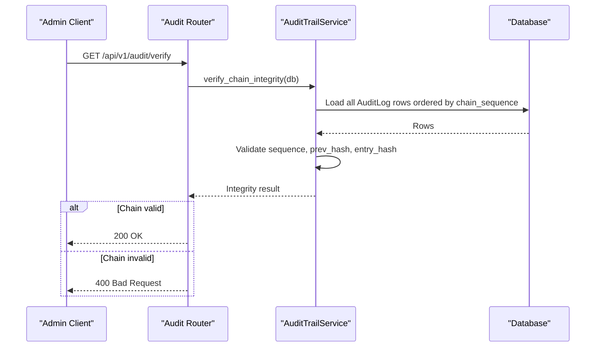
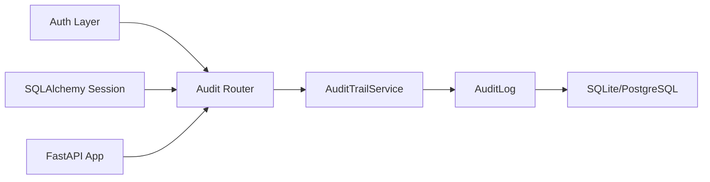

# Immutable Audit Trail System

<cite>
**Referenced Files in This Document**   
- [audit_trail.py](file://backend/app/domain/audit_trail.py)
- [db_models.py](file://backend/app/db_models.py)
- [e36babffa1a1_add_audit_hash_chain.py](file://backend/migrations/versionse36babffa1a1_add_audit_hash_chain.py)
- [audit.py](file://backend/app/api/audit.py)
- [main.py](file://backend/app/main.py)
- [database.py](file://backend/app/database.py)
- [transactions.py](file://backend/app/api/transactions.py)
- [filings.py](file://backend/app/api/filings.py)
- [test_audit.py](file://backend/tests/test_audit.py)
</cite>

## Table of Contents
1. [Introduction](#introduction)
2. [Project Structure](#project-structure)
3. [Core Components](#core-components)
4. [Architecture Overview](#architecture-overview)
5. [Detailed Component Analysis](#detailed-component-analysis)
6. [Dependency Analysis](#dependency-analysis)
7. [Performance Considerations](#performance-considerations)
8. [Troubleshooting Guide](#troubleshooting-guide)
9. [Conclusion](#conclusion)

## Introduction
This document describes the immutable audit trail system implemented in FinShield’s backend. The system records tamper-evident audit events, maintains a hash chain across entries, exposes administrative query and export endpoints, and integrates with database-level immutability expectations validated by tests. It is part of the production FastAPI application that also implements transaction screening, case management, filings, RAG retrieval, and authentication.

The shipped stack for this repository is FastAPI 0.115, Uvicorn, Pydantic 2.9, SQLAlchemy 2.0, psycopg2-binary + pgvector, python-jose + bcrypt, slowapi, numpy, and pytest. Persistence defaults to SQLite (`finshield.db` or `test_finshield.db` under test), while PostgreSQL is required when `DATABASE_URL` is configured outside test mode.

## Project Structure
The audit trail is implemented as a domain service backed by an ORM model and exposed through FastAPI routes:

- Domain logic: `backend/app/domain/audit_trail.py`
- Database model and event listener: `backend/app/db_models.py`
- Alembic migration adding hash-chain columns: `backend/migrations/versions/e36babffa1a1_add_audit_hash_chain.py`
- API router: `backend/app/api/audit.py`
- Application bootstrap and router registration: `backend/app/main.py`
- Database configuration: `backend/app/database.py`
- Example audit-producing flows: transactions and filings APIs
- Tests validating verification, export, tampering detection, and append-only behavior: `backend/tests/test_audit.py`

**Diagram sources**
- [audit.py:17-137](file://backend/app/api/audit.py#L17-L137)
- [audit_trail.py:14-201](file://backend/app/domain/audit_trail.py#L14-L201)
- [db_models.py:144-208](file://backend/app/db_models.py#L144-L208)
- [database.py:17-40](file://backend/app/database.py#L17-L40)
- [main.py:150-152](file://backend/app/main.py#L150-L152)

**Section sources**
- [main.py:1-153](file://backend/app/main.py#L1-L153)
- [database.py:1-75](file://backend/app/database.py#L1-L75)

## Core Components
The audit trail consists of three cooperating layers:

1. **Domain service**: `AuditTrailService` computes deterministic entry hashes, assigns sequential chain numbers, reads previous hashes, verifies chain integrity, and exports filtered logs.
2. **Persistence layer**: `AuditLog` defines the immutable table schema and includes a SQLAlchemy `before_insert` event listener that auto-computes sequence, previous hash, and entry hash.
3. **API layer**: Admin-only endpoints list, export, verify, and summarize audit logs.

Key responsibilities:
- Deterministic hashing over all relevant fields using sorted JSON serialization.
- Append-only semantics enforced both at the service level and expected at the database level.
- Chain verification that checks sequence continuity, previous-hash linkage, and per-entry hash validity.
- Exportable representation suitable for offline verification.

**Section sources**
- [audit_trail.py:14-201](file://backend/app/domain/audit_trail.py#L14-L201)
- [db_models.py:144-208](file://backend/app/db_models.py#L144-L208)
- [audit.py:17-137](file://backend/app/api/audit.py#L17-L137)

## Architecture Overview
The audit trail is not a standalone microservice; it is embedded into the FinShield FastAPI application. Requests flow through FastAPI middleware and exception handlers before reaching the audit router. The router delegates persistence and cryptographic operations to the domain service and ORM model.

**Diagram sources**
- [main.py:150-152](file://backend/app/main.py#L150-L152)
- [audit.py:17-64](file://backend/app/api/audit.py#L17-L64)
- [audit_trail.py:163-201](file://backend/app/domain/audit_trail.py#L163-L201)
- [db_models.py:144-161](file://backend/app/db_models.py#L144-L161)

## Detailed Component Analysis

### AuditTrailService
`AuditTrailService` centralizes audit hashing, sequencing, writing, verification, and export.

Important behaviors:
- `compute_entry_hash` serializes all audit fields deterministically and returns a SHA-256 hex digest.
- `get_next_sequence` finds the maximum existing `chain_sequence` and increments it.
- `get_last_hash` retrieves the most recent entry’s `entry_hash`.
- `log_action` creates an `AuditLog`, commits, refreshes, and returns it.
- `verify_chain_integrity` walks logs in ascending sequence order, validates sequence gaps, previous-hash linkage, and recomputed entry hashes.
- `export_audit_log` applies optional filters and returns a structured list of audit entries.

Complexity considerations:
- Hash computation is linear in serialized field size.
- Verification is O(n) over stored logs.
- Export is O(n) plus filtering cost.

Potential issues visible in the current implementation:
- `log_action` performs its own `commit()` and `refresh()`, which can conflict with callers that already manage a transaction boundary.
- `verify_chain_integrity` loads all logs into memory and uses Python list indexing to compute expected sequence, which is less efficient than relying on the persisted `chain_sequence` column.

**Diagram sources**
- [audit_trail.py:63-115](file://backend/app/domain/audit_trail.py#L63-L115)

**Section sources**
- [audit_trail.py:14-201](file://backend/app/domain/audit_trail.py#L14-L201)

### AuditLog ORM Model and Event Listener
`AuditLog` stores:
- Identity and context: `id`, `user_id`, `action`, `resource_type`, `resource_id`, `details`, `ip_address`.
- Immutability metadata: `prev_hash`, `entry_hash`, `chain_sequence`.
- Timestamp: `created_at`.

A `before_insert` event listener automatically:
- Computes the next `chain_sequence` from the maximum existing value.
- Reads the previous entry’s `entry_hash`.
- Assigns a default `id` if missing.
- Sets `created_at` if missing.
- Serializes the same canonical field set used by `AuditTrailService.compute_entry_hash` and stores the resulting SHA-256 digest.

This dual approach means audit entries can be created either through the service or directly via ORM inserts, but both paths should produce consistent hashes.

**Diagram sources**
- [db_models.py:144-208](file://backend/app/db_models.py#L144-L208)
- [audit_trail.py:14-201](file://backend/app/domain/audit_trail.py#L14-L201)

**Section sources**
- [db_models.py:144-208](file://backend/app/db_models.py#L144-L208)

### Alembic Migration
The migration adds the hash-chain columns to the `audit_logs` table:
- `prev_hash`: string, nullable.
- `entry_hash`: string, nullable, indexed.
- `chain_sequence`: integer, nullable, indexed.

It also creates indexes on `entry_hash` and `chain_sequence` to support ordering and lookup during verification and export.

**Section sources**
- [e36babffa1a1_add_audit_hash_chain.py:19-32](file://backend/migrations/versions/e36babffa1a1_add_audit_hash_chain.py#L19-L32)

### Audit API Endpoints
The audit router registers admin-only endpoints:

| Endpoint | Method | Description | Authentication | Response |
|---|---|---|---|---|
| `/api/v1/audit/logs` | GET | List audit logs with pagination and filters | Admin or super admin | Paginated logs with selected fields |
| `/api/v1/audit/export` | GET | Export filtered audit logs as JSON | Admin or super admin | Export bundle with timestamp, count, and logs |
| `/api/v1/audit/verify` | GET | Verify chain integrity | Admin or super admin | Integrity result or HTTP 400 on failure |
| `/api/v1/audit/stats` | GET | Return total entries, latest sequence, and action breakdown | Admin or super admin | Statistics object |

All endpoints require authentication through `get_current_user` and authorization through `require_role("admin", "super_admin")`.

**Diagram sources**
- [audit.py:93-108](file://backend/app/api/audit.py#L93-L108)
- [audit_trail.py:117-161](file://backend/app/domain/audit_trail.py#L117-L161)

**Section sources**
- [audit.py:1-137](file://backend/app/api/audit.py#L1-137)

### Integration with Transaction Screening and Filings
Audit logging is not yet uniformly routed through `AuditTrailService.log_action` in every write path. For example, the filings endpoint directly inserts an `AuditLog` record rather than calling the service. This is important because:
- Direct ORM inserts bypass `AuditTrailService.get_next_sequence` and `get_last_hash`.
- The `before_insert` event listener compensates by computing sequence and hashes at insert time.
- Consistency depends on both the service and the event listener using the same canonical field set.

The transaction screening endpoint currently persists screening results and notifications but does not explicitly call `AuditTrailService.log_action` in the shown code. Tests reference audit entries for screening decisions, indicating that audit recording for screening may exist in another branch or evolved implementation.

**Section sources**
- [filings.py:103-111](file://backend/app/api/filings.py#L103-L111)
- [transactions.py:37-237](file://backend/app/api/transactions.py#L37-L237)

## Dependency Analysis
The audit trail has clear boundaries:

- **API layer depends on**:
  - Authentication and role checking.
  - SQLAlchemy session dependency.
  - `AuditTrailService`.
  - `AuditLog` ORM model.
- **Domain layer depends on**:
  - SQLAlchemy functions and ORM session.
  - `AuditLog` model.
- **Model layer depends on**:
  - SQLAlchemy base and engine.
  - Database URL configuration.
- **Application bootstrap depends on**:
  - Router modules, including audit.
  - Global exception handlers and middleware.

**Diagram sources**
- [audit.py:1-137](file://backend/app/api/audit.py#L1-L137)
- [audit_trail.py:1-201](file://backend/app/domain/audit_trail.py#L1-L201)
- [db_models.py:144-208](file://backend/app/db_models.py#L144-L208)
- [database.py:17-40](file://backend/app/database.py#L17-L40)
- [main.py:150-152](file://backend/app/main.py#L150-L152)

**Section sources**
- [main.py:1-153](file://backend/app/main.py#L1-L153)
- [database.py:1-75](file://backend/app/database.py#L1-L75)

## Performance Considerations
- **Chain verification** scans all audit logs in sequence order. For large datasets, this becomes expensive and should be used for periodic audits rather than high-frequency requests.
- **Export** loads all matching rows into memory. Filtering by date, user, or action reduces payload size but still requires full scan unless additional indexes are added.
- **Hash computation** is CPU-bound and runs on every write and verification pass.
- **Indexes** on `entry_hash` and `chain_sequence` help ordering and potential lookups, but verification recomputes hashes rather than relying solely on index scans.
- **Transaction boundaries**: If audit writes are batched, prefer a single session with one commit to reduce round-trips and avoid partial chain states.

[No sources needed since this section provides general guidance]

## Troubleshooting Guide

### Chain Verification Fails
Symptoms:
- `/api/v1/audit/verify` returns a failure status.
- Issues include sequence gaps, broken previous-hash links, or invalid entry hashes.

Likely causes:
- Direct database updates or deletes bypassing append-only rules.
- Inconsistent canonical serialization between insertion and verification.
- Missing or incorrect `chain_sequence` values.

Recommended steps:
1. Run the verify endpoint and inspect reported issues.
2. Check whether any direct SQL mutations occurred against `audit_logs`.
3. Confirm that the Alembic migration ran successfully and indexes exist.
4. Ensure new writes use either `AuditTrailService.log_action` or rely on the `before_insert` event listener consistently.

**Section sources**
- [audit_trail.py:117-161](file://backend/app/domain/audit_trail.py#L117-L161)
- [e36babffa1a1_add_audit_hash_chain.py:19-32](file://backend/migrations/versions/e36babffa1a1_add_audit_hash_chain.py#L19-L32)

### Export Does Not Include Expected Fields
Symptoms:
- Exported logs lack `prev_hash`, `entry_hash`, or `chain_sequence`.
- Filters do not appear to apply.

Likely causes:
- Using an older schema without hash-chain columns.
- Calling a different export path that does not use `AuditTrailService.export_audit_log`.
- Incorrect filter parameters.

Recommended steps:
1. Confirm the database schema includes `prev_hash`, `entry_hash`, and `chain_sequence`.
2. Use `/api/v1/audit/export` and pass explicit `start_date`, `end_date`, `user_id`, or `action`.
3. Compare exported counts with `/api/v1/audit/stats`.

**Section sources**
- [audit.py:67-90](file://backend/app/api/audit.py#L67-L90)
- [audit_trail.py:163-201](file://backend/app/domain/audit_trail.py#L163-L201)
- [e36babffa1a1_add_audit_hash_chain.py:19-32](file://backend/migrations/versions/e36babffa1a1_add_audit_hash_chain.py#L19-L32)

### Audit Writes Do Not Appear
Symptoms:
- No audit entries after creating a filing or running screening.
- Stats show zero or stale counts.

Likely causes:
- Filing route inserts `AuditLog` directly instead of using the service.
- Transaction screening route does not call `AuditTrailService.log_action` in the analyzed file.
- Session not committed or error raised before commit.

Recommended steps:
1. Inspect the business operation’s database commit point.
2. Prefer `AuditTrailService.log_action` for consistency.
3. Add explicit audit calls where missing, ensuring they run inside the same transaction as the business write.

**Section sources**
- [filings.py:103-111](file://backend/app/api/filings.py#L103-L111)
- [transactions.py:174-237](file://backend/app/api/transactions.py#L174-L237)
- [audit_trail.py:63-115](file://backend/app/domain/audit_trail.py#L63-L115)

### Database-Level Immutability Is Not Enforced
Symptoms:
- Tests expect UPDATE and DELETE on `audit_logs` to fail.
- Direct SQL succeeds in development environments.

Likely causes:
- SQLite test environment does not enforce row-level security or triggers.
- PostgreSQL append-only enforcement relies on roles, policies, or triggers not present in the current schema.

Recommended steps:
1. Run against PostgreSQL with appropriate roles and policies.
2. Implement database-level triggers or policies to reject non-append operations.
3. Treat the application-layer hash chain as primary evidence and database constraints as defense-in-depth.

**Section sources**
- [test_audit.py:98-111](file://backend/tests/test_audit.py#L98-L111)
- [database.py:17-27](file://backend/app/database.py#L17-L27)

## Conclusion
FinShield’s immutable audit trail combines a deterministic hash chain, sequential ordering, admin-only query and export endpoints, and database-backed persistence. The current implementation provides strong tamper-evidence through SHA-256 hashing and chain verification, but several integration points deserve attention:

- Standardize audit creation through `AuditTrailService.log_action` to avoid divergent insertion paths.
- Avoid manual commits inside `log_action` when callers already manage transactions.
- Optimize verification and export for large audit volumes.
- Enforce append-only semantics at the database layer for stronger guarantees.
- Extend audit recording to transaction screening and other critical compliance operations.

When these improvements are applied, the audit trail will provide a robust, verifiable, and auditable record of system activity suitable for compliance review and forensic analysis.