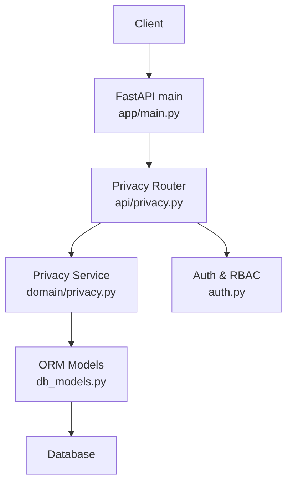
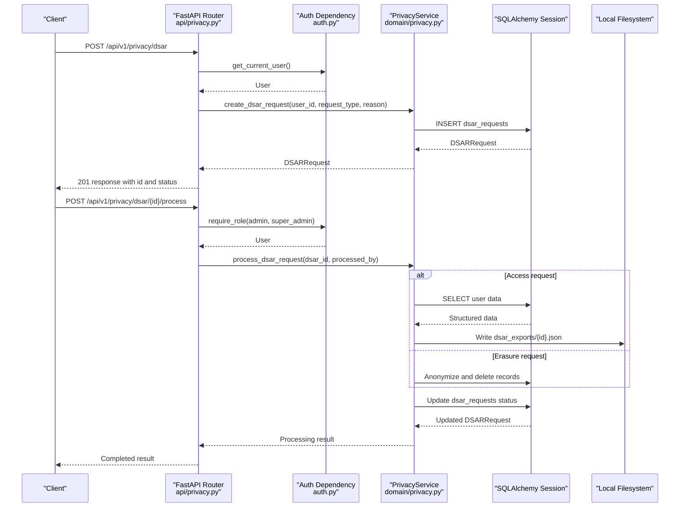
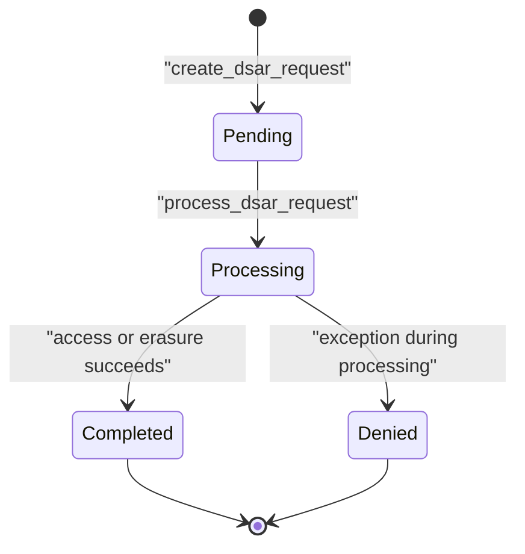
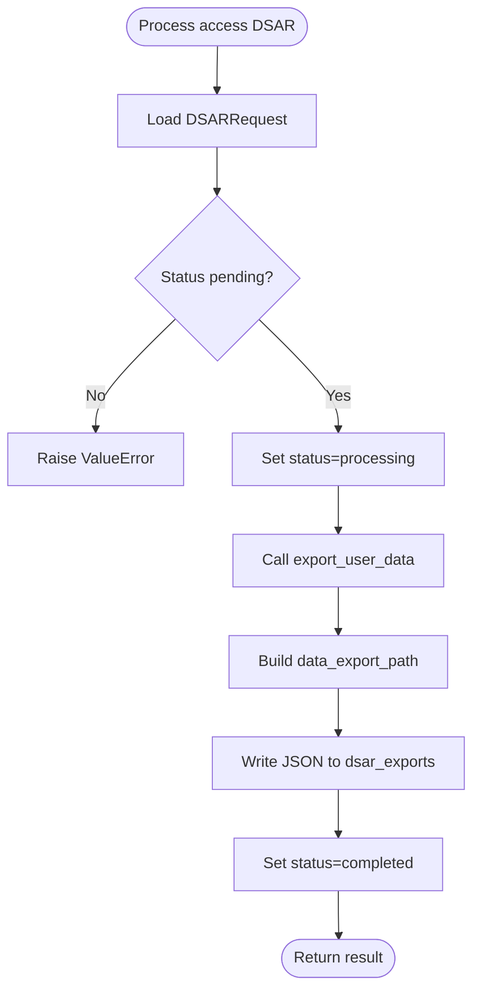
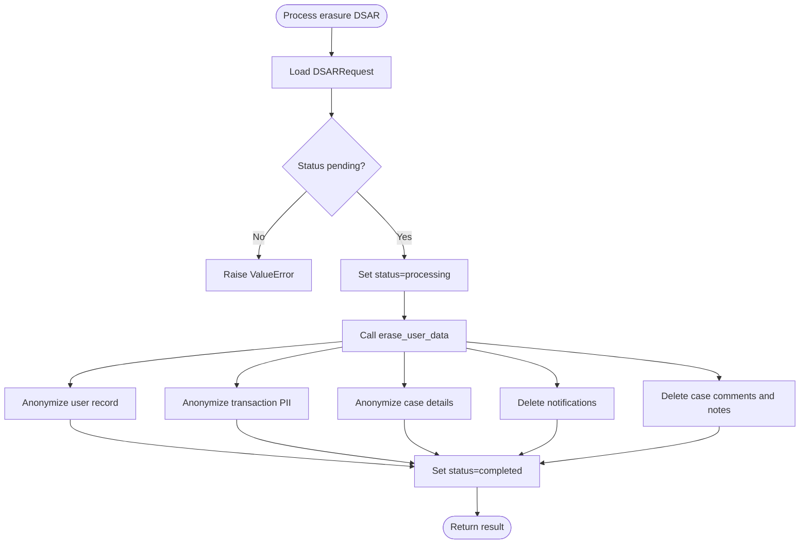
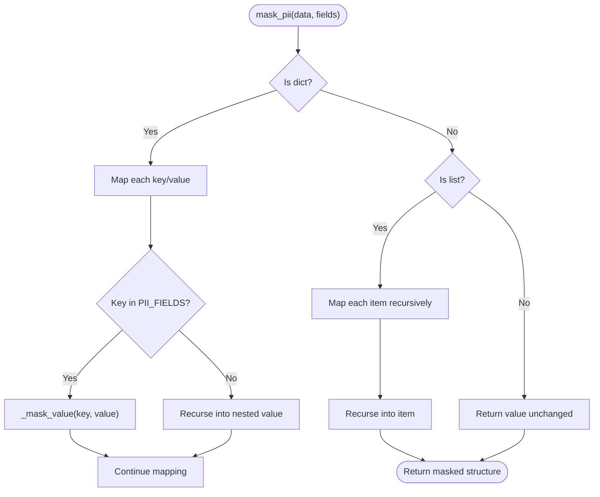
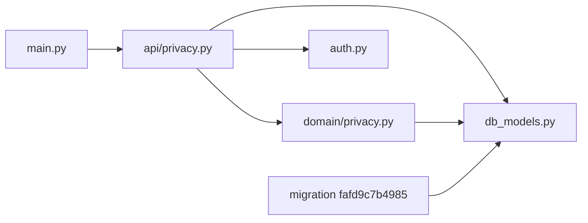

# Privacy DSAR and PII Masking System

<cite>
**Referenced Files in This Document**
- [privacy.py](file://backend/app/api/privacy.py)
- [privacy.py](file://backend/app/domain/privacy.py)
- [db_models.py](file://backend/app/db_models.py)
- [fafd9c7b4985_add_dsar_requests_table.py](file://backend/migrations/versions/fafd9c7b4985_add_dsar_requests_table.py)
- [main.py](file://backend/app/main.py)
- [auth.py](file://backend/app/auth.py)
- [models.py](file://backend/app/models.py)
- [FinShield-AI-Wiki.md](file://FinShield-AI-Wiki.md)
</cite>

## Table of Contents
1. [Introduction](#introduction)
2. [Project Structure](#project-structure)
3. [Core Components](#core-components)
4. [Architecture Overview](#architecture-overview)
5. [Detailed Component Analysis](#detailed-component-analysis)
6. [Dependency Analysis](#dependency-analysis)
7. [Performance Considerations](#performance-considerations)
8. [Troubleshooting Guide](#troubleshooting-guide)
9. [Conclusion](#conclusion)

## Introduction
This document describes the implemented privacy, Data Subject Access Request (DSAR), and Personally Identifiable Information (PII) masking capabilities in FinShield AI. The shipped implementation provides:

- A FastAPI privacy router exposing DSAR lifecycle endpoints, a data export endpoint, a PII masking utility, and a PII classification endpoint.
- A domain service implementing request creation, access/export processing, erasure with legal retention handling, and recursive PII masking.
- A `dsar_requests` database table for tracking DSAR requests and their outcomes.
- Role-based protection for administrative operations through an existing RBAC helper.

The design follows a thin API layer delegating to a stateless domain service, with persistence handled through SQLAlchemy models and Alembic migrations.

## Project Structure
The privacy feature is implemented entirely within the backend FastAPI application:

| Layer | File | Responsibility |
|---|---|---|
| HTTP API | `backend/app/api/privacy.py` | Route definitions, request/response schemas, authorization checks |
| Domain logic | `backend/app/domain/privacy.py` | DSAR workflow, data export, erasure, PII masking |
| Persistence | `backend/app/db_models.py` | ORM model for `DSARRequest` and related entities |
| Migration | `backend/migrations/versions/fafd9c7b4985_add_dsar_requests_table.py` | Creates the `dsar_requests` table and indexes |
| Application bootstrap | `backend/app/main.py` | Registers the privacy router |
| Authentication/RBAC | `backend/app/auth.py` | JWT/API key auth and role guard used by admin endpoints |
| Shared Pydantic models | `backend/app/models.py` | General request/response models; privacy uses its own local schemas |

**Diagram sources**
- [main.py:150-152](file://backend/app/main.py#L150-L152)
- [privacy.py:1-11](file://backend/app/api/privacy.py#L1-L11)
- [privacy.py:24-31](file://backend/app/domain/privacy.py#L24-L31)
- [db_models.py:516-539](file://backend/app/db_models.py#L516-L539)
- [auth.py:209-231](file://backend/app/auth.py#L209-L231)

**Section sources**
- [main.py:19-41](file://backend/app/main.py#L19-L41)
- [main.py:150-152](file://backend/app/main.py#L150-L152)
- [privacy.py:1-11](file://backend/app/api/privacy.py#L1-L11)
- [privacy.py:24-31](file://backend/app/domain/privacy.py#L24-L31)
- [db_models.py:516-539](file://backend/app/db_models.py#L516-L539)
- [fafd9c7b4985_add_dsar_requests_table.py:19-40](file://backend/migrations/versions/fafd9c7b4985_add_dsar_requests_table.py#L19-L40)

## Core Components

### Privacy API Router
The privacy router defines six endpoints under the `/api/v1/privacy` path:

| Endpoint | Method | Authorization | Purpose |
|---|---:|---|---|
| `/api/v1/privacy/dsar` | POST | Authenticated user | Create a DSAR request |
| `/api/v1/privacy/dsar` | GET | Authenticated user | List current user's DSAR requests |
| `/api/v1/privacy/dsar/{dsar_id}` | GET | Authenticated user or admin/super_admin | Read one DSAR request |
| `/api/v1/privacy/dsar/{dsar_id}/process` | POST | Admin or super_admin | Process a pending DSAR request |
| `/api/v1/privacy/export` | GET | Authenticated user | Export all personal data for the current user |
| `/api/v1/privacy/mask` | POST | Admin or super_admin | Mask PII fields in arbitrary JSON input |
| `/api/v1/privacy/pii-classification` | GET | Authenticated user | Return configured PII field classification and examples |

Key implementation characteristics:

- Request validation uses local Pydantic models `DSARRequestCreate` and `DSARResponse`.
- User-scoped endpoints use `get_current_user`; admin endpoints use `require_role("admin", "super_admin")`.
- The list endpoint filters DSAR records by the authenticated user ID.
- The detail endpoint enforces ownership unless the caller has an admin role.
- Processing delegates to `PrivacyService.process_dsar_request`.
- Export delegates to `PrivacyService.export_user_data`.
- Masking delegates to `PrivacyService.mask_pii`.

**Section sources**
- [privacy.py:18-31](file://backend/app/api/privacy.py#L18-L31)
- [privacy.py:33-55](file://backend/app/api/privacy.py#L33-L55)
- [privacy.py:58-85](file://backend/app/api/privacy.py#L58-L85)
- [privacy.py:88-115](file://backend/app/api/privacy.py#L88-L115)
- [privacy.py:118-134](file://backend/app/api/privacy.py#L118-L134)
- [privacy.py:137-147](file://backend/app/api/privacy.py#L137-L147)
- [privacy.py:150-158](file://backend/app/api/privacy.py#L150-L158)
- [privacy.py:161-181](file://backend/app/api/privacy.py#L161-L181)

### Privacy Domain Service
`PrivacyService` centralizes privacy operations. It exposes static methods rather than instance state, making it easy to test and reuse across routes.

| Method | Input | Output | Behavior |
|---|---|---|---|
| `mask_pii(data, fields_to_mask)` | Arbitrary Python object and optional field set | Same-shaped object with masked values | Recursively walks dicts and lists; applies per-field masking rules |
| `export_user_data(db, user_id)` | SQLAlchemy session and user ID | Dictionary containing user, transactions, cases, notifications, audit logs, counts, and timestamp | Queries related tables and returns structured JSON-like data |
| `erase_user_data(db, user_id, preserve_retention)` | Session, user ID, retention flag | Dictionary with affected record count and preserved categories | Anonymizes active PII while preserving regulated records when requested |
| `create_dsar_request(db, user_id, request_type, reason)` | Session, user ID, request type, optional reason | `DSARRequest` ORM object | Validates allowed types and persists a pending request |
| `process_dsar_request(db, dsar_id, processed_by)` | Session, DSAR ID, operator user ID | Result dictionary | Transitions status, performs access or erasure, writes results, and handles failures |

PII classification is defined as a class attribute:

- Fields: email, first_name, last_name, company, phone, sender_name, receiver_name, ip_address.
- Non-string values are replaced with `"***"`.
- Email keeps the first character before `@`.
- Names keep the first letter of each word.
- Phone preserves the last four digits.
- IPv4 addresses preserve the first two octets.

**Section sources**
- [privacy.py:24-76](file://backend/app/domain/privacy.py#L24-L76)
- [privacy.py:78-155](file://backend/app/domain/privacy.py#L78-L155)
- [privacy.py:157-216](file://backend/app/domain/privacy.py#L157-L216)
- [privacy.py:218-238](file://backend/app/domain/privacy.py#L218-L238)
- [privacy.py:240-292](file://backend/app/domain/privacy.py#L240-L292)

### DSAR Request Model and Migration
The `DSARRequest` model maps to the `dsar_requests` table. Its important columns include:

| Column | Type / Constraint | Meaning |
|---|---|---|
| `id` | String primary key | UUID generated by `generate_uuid` |
| `user_id` | String, foreign key to `users.id` | Data subject owning the request |
| `request_type` | String | One of access, erasure, rectification, portability |
| `status` | String, default `pending` | Lifecycle state |
| `reason` | Text | Optional explanation from the requester |
| `requested_at` | DateTime | Creation time |
| `processed_at` | DateTime | Completion time |
| `processed_by` | String | Operator user ID |
| `data_export_path` | String | Path to exported data file |
| `records_affected` | Integer | Count of affected records |
| `retention_preserved` | Boolean | Whether legal retention kept some data |
| `notes` | Text | Error or operational notes |
| `created_at`, `updated_at` | DateTime | Audit timestamps |

The Alembic migration creates the table, adds a foreign key to `users.id`, and indexes `user_id` and `status`.

**Section sources**
- [db_models.py:516-539](file://backend/app/db_models.py#L516-L539)
- [fafd9c7b4985_add_dsar_requests_table.py:19-40](file://backend/migrations/versions/fafd9c7b4985_add_dsar_requests_table.py#L19-L40)

### Authentication and Authorization
Authentication supports two token forms:

1. **JWT bearer tokens**: decoded using HS256 and the configured secret.
2. **API keys**: tokens prefixed with `fsk_` verified against stored bcrypt hashes.

Authorization for privacy endpoints uses:

- `get_current_user`: required by every privacy route.
- `require_role("admin", "super_admin")`: applied to DSAR processing and PII masking endpoints.
- Ownership checks in the DSAR detail endpoint: non-admin users can only view their own requests.

The permission matrix in `auth.py` defines roles such as `user`, `analyst`, `admin`, and `super_admin`, but the privacy router currently relies on explicit role checks rather than fine-grained permissions.

**Section sources**
- [auth.py:21-28](file://backend/app/auth.py#L21-L28)
- [auth.py:63-117](file://backend/app/auth.py#L63-L117)
- [auth.py:131-199](file://backend/app/auth.py#L131-L199)
- [auth.py:209-231](file://backend/app/auth.py#L209-L231)
- [privacy.py:88-101](file://backend/app/api/privacy.py#L88-L101)
- [privacy.py:118-134](file://backend/app/api/privacy.py#L118-L134)
- [privacy.py:150-158](file://backend/app/api/privacy.py#L150-L158)

## Architecture Overview
The privacy system follows a layered architecture:

**Diagram sources**
- [privacy.py:33-55](file://backend/app/api/privacy.py#L33-L55)
- [privacy.py:118-134](file://backend/app/api/privacy.py#L118-L134)
- [privacy.py:218-292](file://backend/app/domain/privacy.py#L218-L292)
- [auth.py:63-117](file://backend/app/auth.py#L63-L117)
- [auth.py:209-231](file://backend/app/auth.py#L209-L231)

## Detailed Component Analysis

### DSAR Request Lifecycle
The DSAR lifecycle is modeled around three states visible to callers:

- `pending`: created by the data subject.
- `processing`: selected by an administrator during processing.
- `completed` or `denied`: final outcome.

**Diagram sources**
- [privacy.py:218-238](file://backend/app/domain/privacy.py#L218-L238)
- [privacy.py:240-292](file://backend/app/domain/privacy.py#L240-L292)
- [db_models.py:516-539](file://backend/app/db_models.py#L516-L539)

#### Access Request Flow
An access request exports the user’s personal data:

1. Validate that the DSAR exists and is pending.
2. Mark the request as processing.
3. Call `export_user_data`.
4. Record the number of affected records.
5. Write the export to `dsar_exports/{dsar_id}.json`.
6. Mark the request completed.

**Diagram sources**
- [privacy.py:240-292](file://backend/app/domain/privacy.py#L240-L292)
- [privacy.py:78-155](file://backend/app/domain/privacy.py#L78-L155)

#### Erasure Request Flow
An erasure request balances GDPR-style deletion with financial regulatory retention:

1. Validate that the DSAR exists and is pending.
2. Mark the request as processing.
3. Call `erase_user_data`.
4. Record affected records and whether retention was preserved.
5. Mark the request completed.

**Diagram sources**
- [privacy.py:157-216](file://backend/app/domain/privacy.py#L157-L216)
- [privacy.py:240-292](file://backend/app/domain/privacy.py#L240-L292)

### PII Masking Algorithm
The masking algorithm is recursive and field-aware:

**Diagram sources**
- [privacy.py:33-45](file://backend/app/domain/privacy.py#L33-L45)
- [privacy.py:47-76](file://backend/app/domain/privacy.py#L47-L76)

#### Per-Field Masking Rules
| Field | Rule | Example Transformation |
|---|---|---|
| `email` | Keep first character before `@`, mask the rest | `j***@example.com` |
| `first_name`, `last_name`, `sender_name`, `receiver_name` | Keep first letter of each word | `J*** D***` |
| `phone` | Remove non-digits; keep last four | `***-***-1234` |
| `ip_address` | Keep first two octets; mask remaining | `192.168.***.***` |
| Other string PII fields | Replace with `***` | `***` |
| Non-string values | Replace with `***` | `***` |

**Section sources**
- [privacy.py:47-76](file://backend/app/domain/privacy.py#L47-L76)
- [privacy.py:161-181](file://backend/app/api/privacy.py#L161-L181)

### Data Export
The export endpoint collects data associated with the authenticated user:

- User profile fields.
- Transactions.
- Cases.
- Notifications.
- Audit logs.
- Record counts.
- Export timestamp.

Important limitation: the export includes raw personal data without applying the same PII masking rules used by the dedicated masking endpoint. Consumers requiring redacted exports should apply `PrivacyService.mask_pii` themselves or extend the export method.

**Section sources**
- [privacy.py:137-147](file://backend/app/api/privacy.py#L137-L147)
- [privacy.py:78-155](file://backend/app/domain/privacy.py#L78-L155)

### Administrative Controls
Administrative endpoints are protected by `require_role("admin", "super_admin")`:

- Processing a DSAR request.
- Masking arbitrary data.

The DSAR detail endpoint additionally allows any authenticated user to read their own request, while admins can read any request.

**Section sources**
- [privacy.py:88-115](file://backend/app/api/privacy.py#L88-L115)
- [privacy.py:118-134](file://backend/app/api/privacy.py#L118-L134)
- [privacy.py:150-158](file://backend/app/api/privacy.py#L150-L158)
- [auth.py:209-231](file://backend/app/auth.py#L209-L231)

## Dependency Analysis
The privacy subsystem depends on several shared components:

**Diagram sources**
- [main.py:150-152](file://backend/app/main.py#L150-L152)
- [privacy.py:1-11](file://backend/app/api/privacy.py#L1-L11)
- [privacy.py:11-21](file://backend/app/domain/privacy.py#L11-L21)
- [db_models.py:516-539](file://backend/app/db_models.py#L516-L539)
- [fafd9c7b4985_add_dsar_requests_table.py:19-40](file://backend/migrations/versions/fafd9c7b4985_add_dsar_requests_table.py#L19-L40)

### Coupling and Cohesion
- **High cohesion**: All privacy logic lives in `PrivacyService`, keeping DSAR, export, erasure, and masking together.
- **Low coupling to infrastructure**: The service uses SQLAlchemy sessions and standard library filesystem APIs.
- **Direct dependency on ORM models**: The service imports multiple models directly, which increases coupling but simplifies queries.
- **Shared auth dependency**: Authorization is delegated to `auth.py`, avoiding duplication.

### External Integration Points
- **Database**: SQLite by default; PostgreSQL when `DATABASE_URL` is set.
- **Filesystem**: Local directory `dsar_exports` for access request exports.
- **FastAPI router registration**: The privacy module is included alongside other domain routers.

**Section sources**
- [privacy.py:1-11](file://backend/app/api/privacy.py#L1-L11)
- [privacy.py:11-21](file://backend/app/domain/privacy.py#L11-L21)
- [privacy.py:265-269](file://backend/app/domain/privacy.py#L265-L269)
- [main.py:150-152](file://backend/app/main.py#L150-L152)

## Performance Considerations
- **Export complexity**: `export_user_data` performs separate queries for transactions, cases, notifications, and audit logs. For large datasets, this can generate multiple round trips and potentially large payloads.
- **Erasure complexity**: `erase_user_data` iterates over user cases and deletes related comments and notes row by row. Bulk operations could reduce database round trips.
- **Masking complexity**: `mask_pii` is recursive and may traverse deeply nested structures. For very large exports, consider streaming or pagination.
- **Filesystem writes**: Access exports write JSON files to the application working directory. In containerized deployments, this requires persistent volume configuration.
- **Index usage**: The `dsar_requests` migration indexes `user_id` and `status`, improving lookup performance for listing and administrative workflows.

[No sources needed since this section provides general guidance]

## Troubleshooting Guide

### Common Errors and Causes

| Symptom | Likely Cause | Resolution |
|---|---|---|
| 401 Unauthorized on privacy endpoints | Missing or invalid JWT/API key | Ensure a valid bearer token or `fsk_` API key is provided |
| 403 Forbidden on DSAR processing | Caller lacks admin or super_admin role | Use a user with the required role |
| 403 Forbidden on DSAR detail | Caller is not the request owner and is not an admin | Verify ownership or use an admin account |
| 404 Not found for DSAR detail | Invalid or missing DSAR ID | Confirm the DSAR ID exists |
| 400 Bad Request for DSAR creation | Invalid `request_type` | Use one of access, erasure, rectification, portability |
| 400 Bad Request for DSAR processing | DSAR not found or not pending | Check DSAR status before processing |
| 404 Not Found for export | User ID not found | Ensure the authenticated user exists |
| Export file not available after access DSAR | Filesystem path not mounted or writable | Configure persistent storage for `dsar_exports` |
| Erasure does not delete regulated data | Legal retention policy preserves transactions, cases, and audit trails | Review `preserve_retention` behavior and regulatory requirements |

### Operational Notes
- The DSAR detail endpoint returns additional fields such as `processed_by`, `retention_preserved`, and `notes`, useful for auditing administrative actions.
- Processing errors transition the DSAR to `denied` and store failure notes; inspect these before retrying.
- The PII classification endpoint returns example masking patterns; use them to validate client-side expectations.
- The wiki describes broader governance goals, including configurable masking rules and dashboard-level masking. The shipped code implements a fixed field set and a utility endpoint rather than full dashboard integration.

**Section sources**
- [privacy.py:33-55](file://backend/app/api/privacy.py#L33-L55)
- [privacy.py:88-115](file://backend/app/api/privacy.py#L88-L115)
- [privacy.py:118-134](file://backend/app/api/privacy.py#L118-L134)
- [privacy.py:137-147](file://backend/app/api/privacy.py#L137-L147)
- [privacy.py:218-292](file://backend/app/domain/privacy.py#L218-L292)
- [FinShield-AI-Wiki.md:561-585](file://FinShield-AI-Wiki.md#L561-L585)

## Conclusion
FinShield AI’s privacy subsystem provides a practical foundation for GDPR-related operations:

- Users can create DSAR requests and retrieve their own data.
- Administrators can process access and erasure requests.
- PII masking is available as a reusable utility with clear field-specific rules.
- DSAR lifecycle is persisted and auditable through the `dsar_requests` table.

Gaps between the shipped implementation and aspirational design include:

- Configurable PII classification and tenant-scoped masking rules.
- Dashboard-level PII masking based on role.
- Secure external storage for DSAR exports instead of the local filesystem.
- Explicit permission checks aligned with the full permission matrix.
- Automated scheduling, deadline tracking, and compliance reporting.

These gaps are documented in the project’s design references and should be addressed before production deployment where regulatory exposure is significant.

[No sources needed since this section summarizes without analyzing specific files]