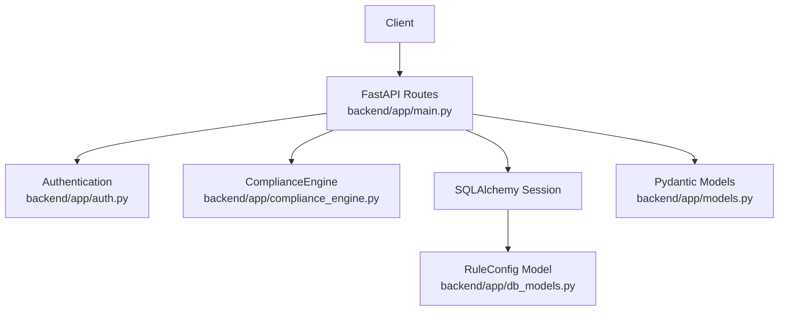
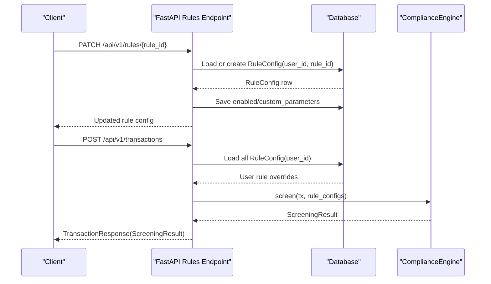
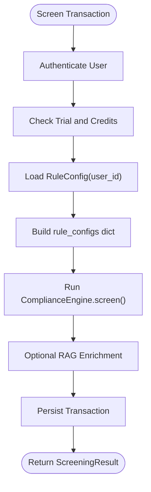
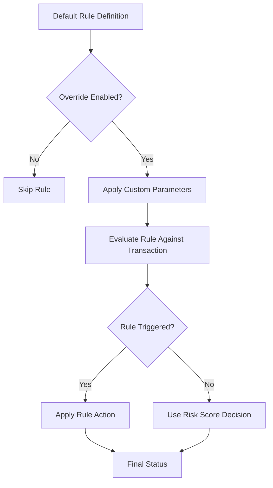
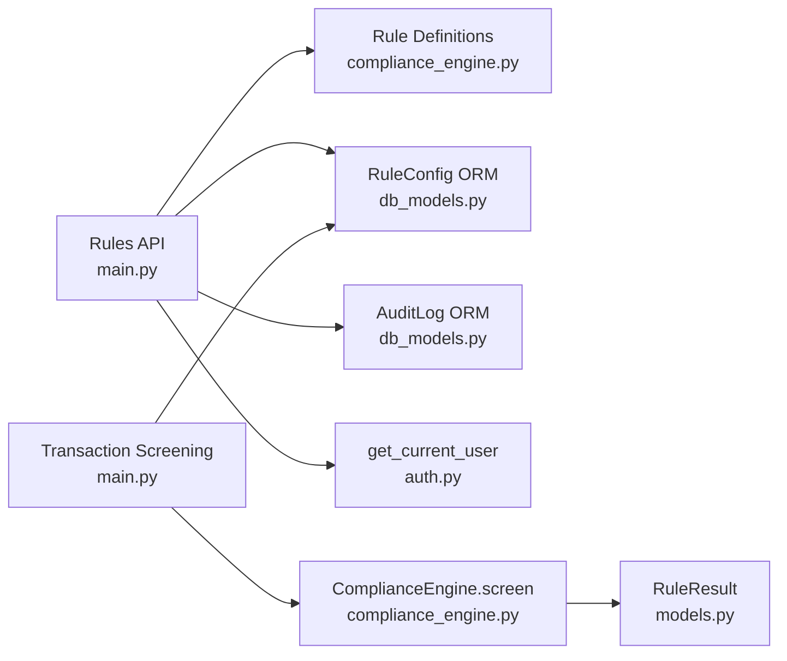

# Rule Configuration API

<cite>
**Referenced Files in This Document**   
- [main.py](file://backend/app/main.py)
- [compliance_engine.py](file://backend/app/compliance_engine.py)
- [models.py](file://backend/app/models.py)
- [db_models.py](file://backend/app/db_models.py)
- [auth.py](file://backend/app/auth.py)
</cite>

## Table of Contents
1. [Introduction](#introduction)
2. [Project Structure](#project-structure)
3. [Core Components](#core-components)
4. [Architecture Overview](#architecture-overview)
5. [Detailed Component Analysis](#detailed-component-analysis)
6. [Dependency Analysis](#dependency-analysis)
7. [Performance Considerations](#performance-considerations)
8. [Troubleshooting Guide](#troubleshooting-guide)
9. [Conclusion](#conclusion)

## Introduction
This document describes the rule configuration management API for FinShield AI’s transaction screening engine. It covers how users list available rules, enable or disable them, and set custom parameters that affect screening outcomes. It also explains how default rule definitions relate to per-user overrides, how those overrides are loaded during transaction processing, and how rule evaluation precedence determines the final decision.

The shipped backend is a FastAPI application under `backend/app/`. Authentication uses JWT bearer tokens or API keys with the `fsk_` prefix. Rule definitions are provided by the compliance engine, while user-specific overrides are persisted through the `RuleConfig` database model.

## Project Structure
The relevant implementation lives in the backend package:

| Area | Responsibility |
|---|---|
| `backend/app/main.py` | FastAPI routes, request/response schemas, authentication dependency, rule endpoints, transaction screening endpoint |
| `backend/app/compliance_engine.py` | Default rule definitions, rule evaluation logic, credit tier determination, risk scoring, and decision mapping |
| `backend/app/models.py` | Pydantic request/response models and enums used by the API |
| `backend/app/db_models.py` | SQLAlchemy ORM entities including `User`, `Transaction`, and `RuleConfig` |
| `backend/app/auth.py` | JWT/API key authentication and current user resolution |



**Diagram sources**
- [main.py:1377-1594](file://backend/app/main.py#L1377-L1594)
- [compliance_engine.py:30-162](file://backend/app/compliance_engine.py#L30-L162)
- [db_models.py:184-209](file://backend/app/db_models.py#L184-L209)
- [models.py:95-127](file://backend/app/models.py#L95-L127)
- [auth.py:59-113](file://backend/app/auth.py#L59-L113)

**Section sources**
- [main.py:1-150](file://backend/app/main.py#L1-L150)
- [requirements.txt:1-16](file://backend/requirements.txt#L1-L16)

## Core Components
The rule configuration system has three main parts:

1. **Default rule definitions**: Provided by `ComplianceEngine.rule_definitions()`. These define rule identifiers, types, names, descriptions, default enabled state, action, and editable parameters.
2. **User-specific overrides**: Persisted as `RuleConfig` rows keyed by `user_id` and `rule_id`. Each override stores whether the rule is enabled, optional custom parameters, priority/versioning fields, and hit-tracking metadata.
3. **Runtime loading**: During transaction screening, the API loads all `RuleConfig` rows for the authenticated user and passes them into `ComplianceEngine.screen()` so disabled rules are skipped and custom parameters replace defaults.

Key data structures:

| Model / Schema | Purpose | Important Fields |
|---|---|---|
| `RuleConfig` (ORM) | Per-user rule configuration | `user_id`, `rule_id`, `enabled`, `custom_parameters`, `priority`, `version`, `effective_from`, `effective_to`, `hit_count`, `false_positive_count` |
| `RuleResult` (Pydantic) | Result of one rule evaluation | `rule_id`, `rule_type`, `rule_name`, `triggered`, `detail`, `latency_ms` |
| `ScreeningResult` (Pydantic) | Full pipeline result returned to clients | `transaction_id`, `idempotency_key`, `status`, `risk_score`, `credit_tier`, `credits_consumed`, `rule_results`, `pipeline_stages`, plus optional ML/RAG fields |
| `RuleUpdateRequest` (Pydantic) | Update payload for a single rule | `enabled`, `custom_parameters` |

**Section sources**
- [db_models.py:184-209](file://backend/app/db_models.py#L184-L209)
- [models.py:95-127](file://backend/app/models.py#L95-L127)
- [main.py:1372-1375](file://backend/app/main.py#L1372-L1375)

## Architecture Overview
The rule configuration flow connects the UI or external client to the FastAPI routes, then to persistence and the compliance engine.



**Diagram sources**
- [main.py:1377-1418](file://backend/app/main.py#L1377-L1418)
- [main.py:434-482](file://backend/app/main.py#L434-L482)
- [compliance_engine.py:89-162](file://backend/app/compliance_engine.py#L89-L162)

## Detailed Component Analysis

### Rule Listing
**Endpoint:** `GET /api/v1/rules`

**Authentication:** Required. Uses `get_current_user`, which accepts either:
- A JWT bearer token from `/api/auth/login`
- An API key starting with `fsk_` created via `/api/v1/keys`

**Purpose:** Returns the complete list of default rule definitions merged with the current user’s overrides.

**Response behavior:**
- Every default rule definition is returned.
- If a user has a `RuleConfig` for a rule, its `enabled` value replaces the default.
- If `custom_parameters` exist, they are merged into the rule’s default `parameters`.
- `is_customized` is `True` only when the user has non-empty `custom_parameters`; otherwise it is `False`.

**Response schema:** Array of rule objects containing at least:
- `rule_id`: string identifier such as `RULE-001`
- `rule_type`: sanctions, pep, threshold, geography, behavioral, velocity
- `name`: human-readable rule name
- `description`: rule description
- `enabled`: effective enabled state after applying user override
- `action`: block, flag, review, escalate
- `parameters`: default parameters possibly merged with user custom parameters
- `metadata`: read-only metadata such as list size and editability
- `is_customized`: boolean indicating whether user parameters were customized

**Error responses:**
- `401 Unauthorized`: Missing or invalid bearer token or API key.
- `403 Forbidden`: Account disabled.
- `422 Unprocessable Entity`: Invalid request body (not applicable here since there is no body).
- `429 Too Many Requests`: Rate limit exceeded if slowapi limiter is active.

**curl example:**
```bash
curl -X GET "http://localhost:8091/api/v1/rules" \
  -H "Authorization: Bearer YOUR_JWT_TOKEN"
```

**Section sources**
- [main.py:1421-1445](file://backend/app/main.py#L1421-L1445)
- [compliance_engine.py:39-87](file://backend/app/compliance_engine.py#L39-L87)
- [auth.py:59-113](file://backend/app/auth.py#L59-L113)

### Enable or Disable a Rule
**Endpoint:** `PATCH /api/v1/rules/{rule_id}`

**Authentication:** Required. Same JWT or API key mechanism as other protected routes.

**Path parameter:**
- `rule_id`: must match one of the default rule IDs exposed by `ComplianceEngine.rule_definitions()`.

**Request body:**
- `enabled`: optional boolean to toggle the rule on or off.
- `custom_parameters`: optional dictionary of user-editable parameters.

**Validation and behavior:**
- The route validates that `rule_id` exists in the engine’s default definitions; otherwise it returns `404`.
- If no `RuleConfig` exists for the current user and rule, one is created with default values.
- Only the provided fields are updated; omitting `enabled` leaves the existing enabled state unchanged.
- The update is committed and audited through an `AuditLog` entry.

**Success response:**
- `rule_id`
- `enabled`
- `custom_parameters`
- `detail` confirming the rule was updated

**Error responses:**
- `401 Unauthorized`: Missing or invalid credentials.
- `403 Forbidden`: Disabled account.
- `404 Not Found`: Unknown `rule_id`.
- `422 Unprocessable Entity`: Invalid JSON or field types.
- `429 Too Many Requests`: Rate-limited requests.

**curl examples:**

Enable a rule:
```bash
curl -X PATCH "http://localhost:8091/api/v1/rules/RULE-003" \
  -H "Authorization: Bearer YOUR_JWT_TOKEN" \
  -H "Content-Type: application/json" \
  -d '{"enabled": true}'
```

Disable a rule:
```bash
curl -X PATCH "http://localhost:8091/api/v1/rules/RULE-004" \
  -H "Authorization: Bearer YOUR_JWT_TOKEN" \
  -H "Content-Type: application/json" \
  -d '{"enabled": false}'
```

Set custom threshold parameters:
```bash
curl -X PATCH "http://localhost:8091/api/v1/rules/RULE-003" \
  -H "Authorization: Bearer YOUR_JWT_TOKEN" \
  -H "Content-Type: application/json" \
  -d '{
    "custom_parameters": {
      "wire": 20000,
      "international": 100000
    }
  }'
```

Customize high-risk countries:
```bash
curl -X PATCH "http://localhost:8091/api/v1/rules/RULE-004" \
  -H "Authorization: Bearer YOUR_JWT_TOKEN" \
  -H "Content-Type: application/json" \
  -d '{
    "custom_parameters": {
      "countries": ["KP", "IR", "SY", "CU", "RU", "XX"]
    }
  }'
```

**Section sources**
- [main.py:1372-1418](file://backend/app/main.py#L1372-L1418)
- [compliance_engine.py:39-87](file://backend/app/compliance_engine.py#L39-L87)

### Custom Parameter Validation
The rule update endpoint does not perform strict schema validation against each rule’s expected parameters. Instead:

- The engine reads custom parameters using safe fallbacks.
- For threshold rules, numeric parameters are converted to floats; invalid values can raise errors during evaluation.
- For geography rules, country lists are accepted as list/tuple/set-like inputs; otherwise the default country set is used.
- Parameters not recognized by the engine are ignored.

Recommended client-side validation before sending updates:
- `enabled` should be a boolean.
- `custom_parameters.wire` and `custom_parameters.international` should be positive numbers.
- `custom_parameters.countries` should be a list of uppercase two-letter country codes.

**Section sources**
- [compliance_engine.py:164-240](file://backend/app/compliance_engine.py#L164-L240)
- [compliance_engine.py:363-380](file://backend/app/compliance_engine.py#L363-L380)

### Rule Simulation
**Endpoint:** `POST /api/v1/rules/simulate`

**Authentication:** Required.

**Request body:**
- `rule_id`: rule to simulate.
- `days`: number of historical days to include; defaults to 30.

**Behavior:**
- Validates the rule ID against default definitions.
- Loads the authenticated user’s transactions within the requested date range.
- Evaluates the rule against each transaction using `ComplianceEngine.evaluate_rule()`.
- Counts triggered results and estimates how many would have been blocked or flagged based on the rule’s declared action.

**Response fields:**
- `rule_id`
- `rule_name`
- `days_simulated`
- `transactions_tested`
- `triggered_count`
- `would_block`
- `would_flag`
- `trigger_rate`

**curl example:**
```bash
curl -X POST "http://localhost:8091/api/v1/rules/simulate" \
  -H "Authorization: Bearer YOUR_JWT_TOKEN" \
  -H "Content-Type: application/json" \
  -d '{"rule_id": "RULE-003", "days": 30}'
```

**Section sources**
- [main.py:1448-1508](file://backend/app/main.py#L1448-L1508)
- [compliance_engine.py:242-278](file://backend/app/compliance_engine.py#L242-L278)

### Rule Hit Statistics
**Endpoint:** `GET /api/v1/rules/{rule_id}/stats`

**Authentication:** Required.

**Behavior:**
- Looks up the user’s `RuleConfig` for the rule.
- If no config exists, returns default zeroed statistics.
- Otherwise returns stored hit count, false-positive count, last hit timestamp, and computed false-positive rate.

**curl example:**
```bash
curl -X GET "http://localhost:8091/api/v1/rules/RULE-003/stats" \
  -H "Authorization: Bearer YOUR_JWT_TOKEN"
```

**Section sources**
- [main.py:1511-1544](file://backend/app/main.py#L1511-L1544)
- [db_models.py:184-209](file://backend/app/db_models.py#L184-L209)

### Recording Hits and False Positives
These endpoints allow recording rule hits and false positives. They are intended for integration with the compliance workflow rather than typical end-user configuration.

| Endpoint | Method | Purpose | Notes |
|---|---:|---|---|
| `/api/v1/rules/{rule_id}/record-hit` | `POST` | Increment hit count and update last hit time | Creates a `RuleConfig` row if missing |
| `/api/v1/rules/{rule_id}/record-false-positive` | `POST` | Increment false-positive count | Requires an existing `RuleConfig`; returns `404` if missing |

**curl examples:**
```bash
curl -X POST "http://localhost:8091/api/v1/rules/RULE-003/record-hit" \
  -H "Authorization: Bearer YOUR_JWT_TOKEN"

curl -X POST "http://localhost:8091/api/v1/rules/RULE-003/record-false-positive" \
  -H "Authorization: Bearer YOUR_JWT_TOKEN"
```

**Section sources**
- [main.py:1547-1594](file://backend/app/main.py#L1547-L1594)

### How Rule Overrides Affect Transaction Screening
When a transaction is screened, the API:

1. Authenticates the user.
2. Checks trial status and credits.
3. Loads all `RuleConfig` rows for the user.
4. Converts them into a dictionary keyed by `rule_id`, where each value contains `enabled` and `custom_parameters`.
5. Calls `ComplianceEngine.screen(tx, rule_configs=user_rule_configs)`.
6. Optionally enriches the result with RAG context if PostgreSQL and pgvector are configured.
7. Persists the transaction and returns the screening result.



**Diagram sources**
- [main.py:434-570](file://backend/app/main.py#L434-L570)
- [compliance_engine.py:89-162](file://backend/app/compliance_engine.py#L89-L162)

**Section sources**
- [main.py:434-570](file://backend/app/main.py#L434-L570)

### Rule Evaluation Precedence
The effective rule behavior follows this precedence:

1. **Default rule definition**: Provides the authoritative rule identity, type, action, and default parameters.
2. **User override `enabled`**: If a `RuleConfig` sets `enabled` to `false`, the rule is skipped entirely.
3. **User override `custom_parameters`**: If present, these replace the default parameters for that rule.
4. **Engine evaluation**: Applies the enabled rule with effective parameters.
5. **Rule action enforcement**: Triggered rule actions (`block`, `escalate`, `flag`, `review`) override the aggregate risk-based decision.



**Diagram sources**
- [compliance_engine.py:164-240](file://backend/app/compliance_engine.py#L164-L240)
- [compliance_engine.py:329-361](file://backend/app/compliance_engine.py#L329-L361)

**Section sources**
- [compliance_engine.py:89-162](file://backend/app/compliance_engine.py#L89-L162)
- [compliance_engine.py:164-240](file://backend/app/compliance_engine.py#L164-L240)
- [compliance_engine.py:329-361](file://backend/app/compliance_engine.py#L329-L361)

### Practical Impact of Rule Updates
Below are practical scenarios showing how rule configuration changes affect screening.

| Scenario | Configuration Change | Expected Screening Impact |
|---|---|---|
| Disable amount threshold | Set `enabled=false` for `RULE-003` | Amount-based reviews no longer trigger; transactions may remain approved unless other rules or risk score force escalation. |
| Raise wire threshold | Set `custom_parameters.wire=20000` for `RULE-003` | Wire transactions below the new threshold stop triggering the threshold rule. |
| Add high-risk country | Add a country code to `custom_parameters.countries` for `RULE-004` | Transactions to that destination may trigger the geography rule and move to escalated/blocked status depending on action mapping. |
| Disable high-risk country check | Set `enabled=false` for `RULE-004` | Geography checks are skipped; high-risk destinations do not trigger that rule. |
| Sanctions or PEP match | No change needed; these are hard matches | Sanctions matches map to block; PEP matches map to flag. |

**Section sources**
- [compliance_engine.py:46-87](file://backend/app/compliance_engine.py#L46-L87)
- [compliance_engine.py:182-237](file://backend/app/compliance_engine.py#L182-L237)
- [compliance_engine.py:332-361](file://backend/app/compliance_engine.py#L332-L361)

## Dependency Analysis
The rule configuration subsystem depends on several components:



**Diagram sources**
- [main.py:1377-1594](file://backend/app/main.py#L1377-L1594)
- [compliance_engine.py:30-162](file://backend/app/compliance_engine.py#L30-L162)
- [db_models.py:141-209](file://backend/app/db_models.py#L141-L209)
- [models.py:95-127](file://backend/app/models.py#L95-L127)
- [auth.py:59-113](file://backend/app/auth.py#L59-L113)

**Section sources**
- [main.py:1377-1594](file://backend/app/main.py#L1377-L1594)
- [compliance_engine.py:30-162](file://backend/app/compliance_engine.py#L30-L162)
- [db_models.py:141-209](file://backend/app/db_models.py#L141-L209)
- [models.py:95-127](file://backend/app/models.py#L95-L127)
- [auth.py:59-113](file://backend/app/auth.py#L59-L113)

## Performance Considerations
- Rule listing merges default definitions with user overrides on every call. For high-frequency dashboards, consider caching the merged rule list per user.
- Transaction screening loads all user `RuleConfig` rows on every screen. If a user has many rules, this adds database latency.
- Rule simulation queries historical transactions for the requested day range; large datasets can be expensive.
- The global exception handler logs unhandled exceptions and returns a generic `500` response, which is useful for debugging but hides internal details from clients.

[No sources needed since this section provides general guidance]

## Troubleshooting Guide

### Common Errors
| Symptom | Likely Cause | Resolution |
|---|---|---|
| `401 Unauthorized` | Missing or invalid `Authorization` header | Use a valid JWT from `/api/auth/login` or an active API key from `/api/v1/keys`. |
| `403 Forbidden` | Account disabled | Contact support or re-enable the account. |
| `404 Not Found` on rule update | Unknown `rule_id` | Use one of the rule IDs returned by `GET /api/v1/rules`. |
| `422 Unprocessable Entity` | Invalid JSON or wrong field types | Ensure `enabled` is boolean and `custom_parameters` is an object. |
| Threshold rule behaves unexpectedly | Invalid numeric parameter | Validate `wire` and `international` as positive numbers. |
| Geography rule ignores custom countries | Wrong parameter shape | Pass `countries` as a list of strings. |
| Rule simulation returns zero triggers | No recent transactions or rule disabled | Check the user’s transaction history and rule enabled state. |

### Debugging Rule Changes
1. Call `GET /api/v1/rules` to confirm the effective enabled state and customized parameters.
2. Call `POST /api/v1/rules/simulate` to estimate historical impact.
3. Submit a test transaction and inspect `rule_results` in the screening response.
4. Use `GET /api/v1/rules/{rule_id}/stats` to verify hit tracking if integration calls record hits.

**Section sources**
- [main.py:81-115](file://backend/app/main.py#L81-L115)
- [main.py:1377-1594](file://backend/app/main.py#L1377-L1594)

## Conclusion
FinShield AI’s rule configuration API provides a focused interface for managing user-specific rule overrides. Clients can list rules, enable or disable them, and supply custom parameters that influence screening. The runtime pipeline loads these overrides per user and applies them before evaluating rules, determining credit tier, computing risk, and making the final decision. For reliable operation, validate parameters on the client side, use the simulation endpoint to assess impact, and monitor rule stats and transaction rule results to confirm expected behavior.