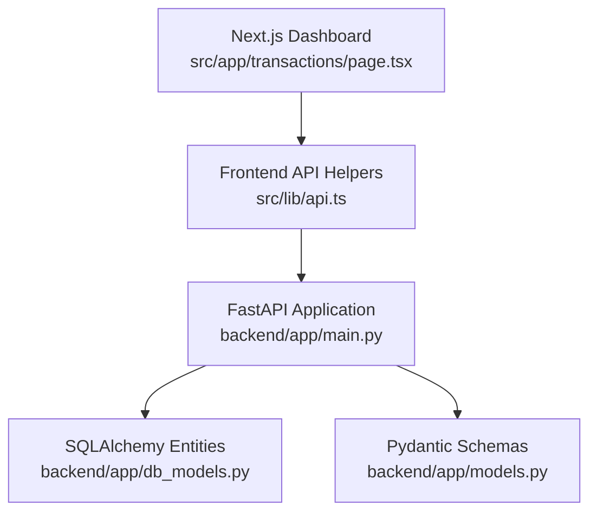
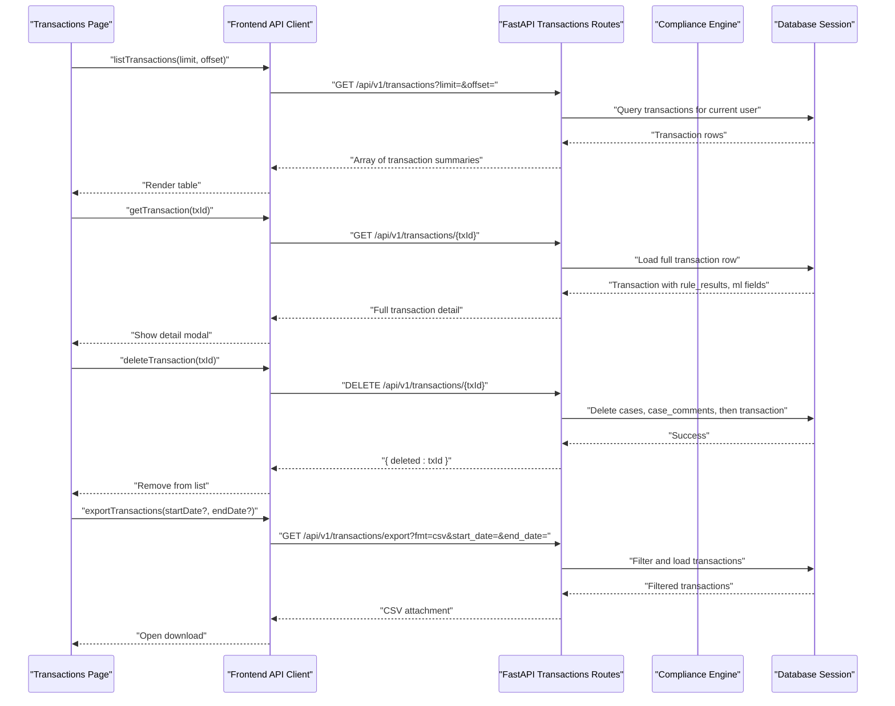
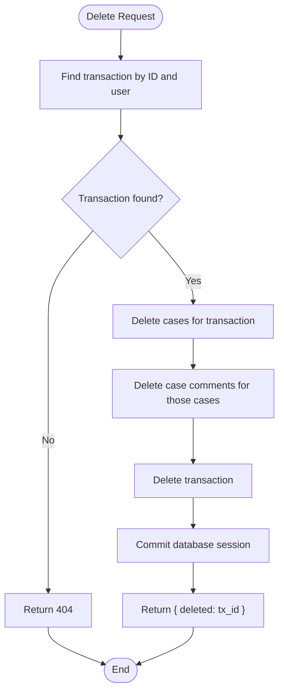
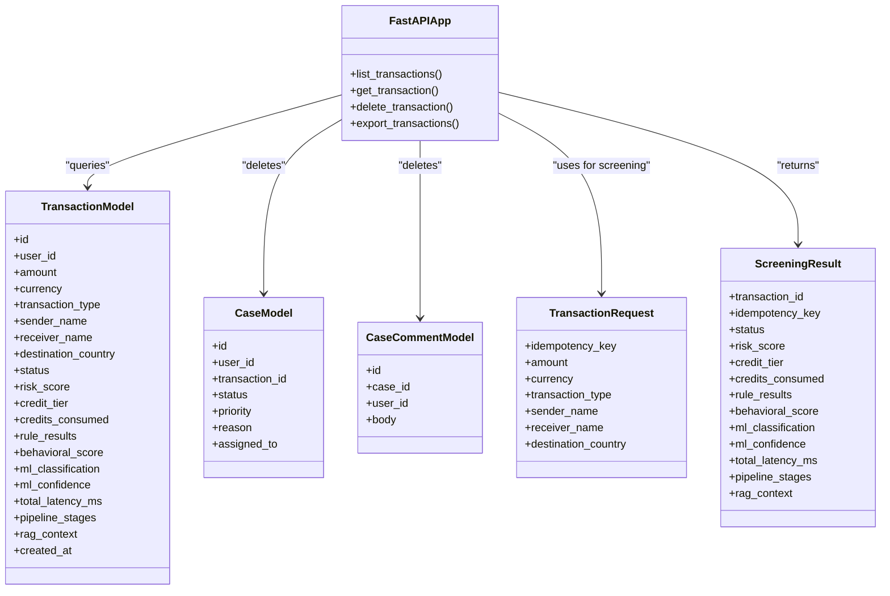

# Transaction Management and Export

<cite>
**Referenced Files in This Document**   
- [main.py](file://backend/app/main.py)
- [models.py](file://backend/app/models.py)
- [db_models.py](file://backend/app/db_models.py)
- [api.ts](file://platform-app/src/lib/api.ts)
- [page.tsx](file://platform-app/src/app/transactions/page.tsx)
- [test_api.py](file://backend/tests/test_api.py)
</cite>

## Table of Contents
1. [Introduction](#introduction)
2. [Project Structure](#project-structure)
3. [Core Components](#core-components)
4. [Architecture Overview](#architecture-overview)
5. [Detailed Component Analysis](#detailed-component-analysis)
6. [Dependency Analysis](#dependency-analysis)
7. [Performance Considerations](#performance-considerations)
8. [Troubleshooting Guide](#troubleshooting-guide)
9. [Conclusion](#conclusion)

## Introduction
This document explains the transaction management operations exposed by the FinShield backend and used by the Next.js dashboard. It focuses on:

- Paginated listing of transactions.
- Detailed transaction retrieval, including rule results, ML classification, and confidence scores.
- Transaction deletion with cascading cleanup of cases and case comments.
- CSV export with optional date range filtering.

The backend is a FastAPI application under `backend/app/main.py`. The frontend calls these endpoints through `platform-app/src/lib/api.ts` and renders them in `platform-app/src/app/transactions/page.tsx`. Data models are defined in `backend/app/models.py`, and database entities are defined in `backend/app/db_models.py`.

## Project Structure
Transaction-related functionality spans three layers:

| Layer | Responsibility | Relevant Files |
|---|---|---|
| Backend API | HTTP routes, authentication, persistence, CSV export | `backend/app/main.py` |
| Data Models | Request/response schemas and enums | `backend/app/models.py` |
| Database Schema | SQLAlchemy ORM entities for transactions, cases, and related tables | `backend/app/db_models.py` |
| Frontend Client | API helpers and transaction UI | `platform-app/src/lib/api.ts`, `platform-app/src/app/transactions/page.tsx` |
| Tests | Example authenticated usage of transaction endpoints | `backend/tests/test_api.py` |

**Diagram sources**
- [page.tsx:17-100](file://platform-app/src/app/transactions/page.tsx#L17-L100)
- [api.ts:443-589](file://platform-app/src/lib/api.ts#L443-L589)
- [main.py:573-717](file://backend/app/main.py#L573-L717)
- [db_models.py:75-139](file://backend/app/db_models.py#L75-L139)
- [models.py:67-127](file://backend/app/models.py#L67-L127)

**Section sources**
- [main.py:573-717](file://backend/app/main.py#L573-L717)
- [models.py:67-127](file://backend/app/models.py#L67-L127)
- [db_models.py:75-139](file://backend/app/db_models.py#L75-L139)
- [api.ts:443-589](file://platform-app/src/lib/api.ts#L443-L589)
- [page.tsx:17-100](file://platform-app/src/app/transactions/page.tsx#L17-L100)

## Core Components
The transaction management surface consists of four endpoints:

| Endpoint | Method | Purpose | Key Parameters | Main Response Shape |
|---|---|---|---|---|
| List transactions | `GET /api/v1/transactions` | Paginated listing of recent transactions for the authenticated user | `limit`, `offset` | Array of summary objects |
| Get transaction detail | `GET /api/v1/transactions/{tx_id}` | Full transaction information, including rule results and ML scores | Path parameter `tx_id` | Object with screening details |
| Delete transaction | `DELETE /api/v1/transactions/{tx_id}` | Remove a transaction and cascade-delete associated cases and comments | Path parameter `tx_id` | Simple confirmation object |
| Export transactions | `GET /api/v1/transactions/export` | Download CSV with optional date range filter | `fmt`, `start_date`, `end_date` | CSV file attachment |

All endpoints require authentication through the shared FastAPI dependency mechanism. The list endpoint defaults to 50 items per page and offset 0. The export endpoint currently supports only CSV format.

**Section sources**
- [main.py:573-717](file://backend/app/main.py#L573-L717)
- [api.ts:443-589](file://platform-app/src/lib/api.ts#L443-L589)

## Architecture Overview
The transaction workflow connects the dashboard UI, the FastAPI routes, the compliance engine, and the database.

**Diagram sources**
- [page.tsx:35-100](file://platform-app/src/app/transactions/page.tsx#L35-L100)
- [api.ts:443-589](file://platform-app/src/lib/api.ts#L443-L589)
- [main.py:573-717](file://backend/app/main.py#L573-L717)

## Detailed Component Analysis

### GET /api/v1/transactions — Paginated Listing
This endpoint returns a paginated array of transaction summaries for the authenticated user.

#### Request
- **Method:** `GET`
- **Path:** `/api/v1/transactions`
- **Query parameters:**
  - `limit`: Integer number of records to return. Default is 50.
  - `offset`: Integer number of records to skip. Default is 0.

#### Response
Returns an array of summary objects. Each object includes:

| Field | Type | Meaning |
|---|---|---|
| `id` | String | Persisted transaction identifier |
| `amount` | Number | Transaction amount |
| `currency` | String | Currency code |
| `type` | String | Transaction type value |
| `sender` | String | Sender name |
| `receiver` | String | Receiver name |
| `status` | String | Screening status |
| `risk_score` | Number | Normalized risk score |
| `credit_tier` | String | Credit tier used during screening |
| `created_at` | String | ISO-formatted creation timestamp |

#### Practical Examples

- **List the first 50 transactions:**
  - `GET /api/v1/transactions`
  - Equivalent frontend call: `api.listTransactions(50, 0)`

- **List the next page of 100 transactions after the first 100:**
  - `GET /api/v1/transactions?limit=100&offset=100`
  - Equivalent frontend call: `api.listTransactions(100, 100)`

- **Dashboard behavior:**
  - The transactions page loads up to 100 transactions on initial render.
  - It applies client-side status filters such as all, approved, flagged, blocked, and in_review.

#### Filtering Capabilities
- Server-side filtering is limited to the authenticated user scope.
- No server-side status, amount, country, or type filters are implemented on this route.
- Client-side filtering is available in the dashboard UI.

#### Performance Notes
- The query orders by `created_at` descending and uses `LIMIT` and `OFFSET`.
- For large datasets, increasing `limit` reduces round-trips but increases payload size.
- Large offsets can become expensive because the database still scans earlier rows before applying the offset.

**Section sources**
- [main.py:573-603](file://backend/app/main.py#L573-L603)
- [api.ts:450-451](file://platform-app/src/lib/api.ts#L450-L451)
- [page.tsx:35-49](file://platform-app/src/app/transactions/page.tsx#L35-L49)
- [test_api.py:235-239](file://backend/tests/test_api.py#L235-L239)

### GET /api/v1/transactions/{tx_id} — Detailed Transaction Information
This endpoint returns the full stored transaction record, including rule evaluation results, behavioral scoring, ML classification, and ML confidence.

#### Request
- **Method:** `GET`
- **Path:** `/api/v1/transactions/{tx_id}`
- **Path parameter:**
  - `tx_id`: The persisted transaction identifier returned by the screening endpoint.

#### Response Fields
| Field | Type | Meaning |
|---|---|---|
| `id` | String | Transaction identifier |
| `amount` | Number | Transaction amount |
| `currency` | String | Currency code |
| `transaction_type` | String | Transaction type |
| `sender_name` | String | Sender name |
| `receiver_name` | String | Receiver name |
| `destination_country` | String or null | Destination country |
| `status` | String | Screening result status |
| `risk_score` | Number | Overall risk score |
| `credit_tier` | String | Applied credit tier |
| `credits_consumed` | Number | Credits charged for this screening |
| `idempotency_key` | String | Idempotency key used during screening |
| `rule_results` | Array | Rule evaluation results |
| `behavioral_score` | Number or null | Behavioral anomaly score |
| `ml_classification` | String or null | Machine learning classification |
| `ml_confidence` | Number or null | Confidence score for ML classification |
| `total_latency_ms` | Number or null | Total pipeline latency |
| `pipeline_stages` | Array | Processing stages executed |
| `rag_context` | Object or null | Optional RAG enrichment context |
| `created_at` | String | ISO-formatted creation timestamp |

#### Rule Results
Each rule result contains:

| Field | Type | Meaning |
|---|---|---|
| `rule_id` | String | Rule identifier |
| `rule_type` | String | Rule category such as sanctions, PEP, threshold, geography, behavioral |
| `rule_name` | String | Human-readable rule name |
| `triggered` | Boolean | Whether the rule was triggered |
| `detail` | String or null | Explanation when triggered |
| `latency_ms` | Number | Rule evaluation latency |

#### Practical Examples

- **Retrieve detail for a known transaction:**
  - `GET /api/v1/transactions/TX-UUID`
  - Frontend call: `api.getTransaction(txId)`

- **Interpreting ML output:**
  - If `ml_classification` is present, it represents the model’s label.
  - If `ml_confidence` is present, it is a normalized confidence value displayed as a percentage in the dashboard.
  - `behavioral_score` indicates behavioral anomaly strength; the dashboard maps larger absolute values to higher anomaly levels.

#### Error Handling
- Returns 404 if the transaction does not exist or does not belong to the authenticated user.

**Section sources**
- [main.py:606-639](file://backend/app/main.py#L606-L639)
- [models.py:95-119](file://backend/app/models.py#L95-L119)
- [db_models.py:75-106](file://backend/app/db_models.py#L75-L106)
- [api.ts:576-577](file://platform-app/src/lib/api.ts#L576-L577)
- [page.tsx:73-84](file://platform-app/src/app/transactions/page.tsx#L73-L84)
- [page.tsx:322-383](file://platform-app/src/app/transactions/page.tsx#L322-L383)
- [page.tsx:385-425](file://platform-app/src/app/transactions/page.tsx#L385-L425)

### DELETE /api/v1/transactions/{tx_id} — Cascading Case Cleanup
This endpoint deletes a transaction and removes related case data to maintain referential integrity.

#### Request
- **Method:** `DELETE`
- **Path:** `/api/v1/transactions/{tx_id}`
- **Path parameter:**
  - `tx_id`: The transaction to delete.

#### Deletion Order
The implementation performs the following steps:

1. Load the transaction and verify ownership by the authenticated user.
2. Delete cases linked to the transaction.
3. Delete case comments linked to those cases.
4. Delete the transaction itself.
5. Commit the transaction.

**Diagram sources**
- [main.py:642-663](file://backend/app/main.py#L642-L663)

#### Response
On success, returns:

| Field | Type | Meaning |
|---|---|---|
| `deleted` | String | Deleted transaction identifier |

#### Practical Workflow
- The dashboard asks for confirmation before deletion.
- On success, it removes the item from the local transaction list.
- If the deleted transaction is open in the detail modal, the modal clears the selected transaction.

#### Error Handling
- Returns 404 if the transaction does not exist or does not belong to the authenticated user.

**Section sources**
- [main.py:642-663](file://backend/app/main.py#L642-L663)
- [db_models.py:108-139](file://backend/app/db_models.py#L108-L139)
- [api.ts:579-582](file://platform-app/src/lib/api.ts#L579-L582)
- [page.tsx:86-95](file://platform-app/src/app/transactions/page.tsx#L86-L95)

### GET /api/v1/transactions/export — CSV Export with Date Range Filtering
This endpoint exports the authenticated user’s transactions as a CSV file.

#### Request
- **Method:** `GET`
- **Path:** `/api/v1/transactions/export`
- **Query parameters:**
  - `fmt`: Format selector. Only `csv` is supported.
  - `start_date`: Optional ISO date string. Filters transactions created at or after this time.
  - `end_date`: Optional ISO date string. Filters transactions created at or before this time.

#### Supported Date Formats
The backend parses dates using ISO format. Acceptable examples include:
- `YYYY-MM-DD`
- `YYYY-MM-DDTHH:MM:SS`

Invalid date strings return a 400 error with a descriptive message.

#### CSV Columns
The exported CSV includes:

| Column | Meaning |
|---|---|
| `ID` | Transaction identifier |
| `Amount` | Transaction amount |
| `Currency` | Currency code |
| `Type` | Transaction type |
| `Sender` | Sender name |
| `Receiver` | Receiver name |
| `Country` | Destination country, empty if missing |
| `Status` | Screening status |
| `Risk Score` | Risk score |
| `Credit Tier` | Credit tier |
| `Credits Used` | Credits consumed |
| `Created At` | ISO-formatted creation timestamp |

#### Practical Examples

- **Export all transactions:**
  - `GET /api/v1/transactions/export?fmt=csv`

- **Export transactions within a date range:**
  - `GET /api/v1/transactions/export?fmt=csv&start_date=2024-01-01&end_date=2024-03-31`

- **Frontend behavior:**
  - The dashboard builds a URL with `fmt=csv` and optional `start_date` and `end_date`.
  - It opens the URL in a new browser tab, which triggers the CSV download.

#### Error Handling
- Invalid `start_date` or `end_date` returns 400.
- Unsupported `fmt` returns 400.
- Authentication is required because the query filters by the current user.

**Section sources**
- [main.py:666-717](file://backend/app/main.py#L666-L717)
- [api.ts:584-589](file://platform-app/src/lib/api.ts#L584-L589)
- [page.tsx:97-100](file://platform-app/src/app/transactions/page.tsx#L97-L100)
- [page.tsx:529-571](file://platform-app/src/app/transactions/page.tsx#L529-L571)

## Dependency Analysis
Transaction endpoints depend on several components:

**Diagram sources**
- [main.py:573-717](file://backend/app/main.py#L573-L717)
- [db_models.py:75-139](file://backend/app/db_models.py#L75-L139)
- [models.py:67-127](file://backend/app/models.py#L67-L127)

Key relationships:

- The list and detail endpoints read from the `Transaction` entity.
- The delete endpoint reads `Transaction`, deletes `Case`, deletes `CaseComment`, then deletes `Transaction`.
- The export endpoint queries `Transaction` with optional date filters.
- The frontend client constructs URLs and handles responses without parsing CSV content directly.

**Section sources**
- [main.py:573-717](file://backend/app/main.py#L573-L717)
- [db_models.py:75-139](file://backend/app/db_models.py#L75-L139)
- [models.py:67-127](file://backend/app/models.py#L67-L127)
- [api.ts:443-589](file://platform-app/src/lib/api.ts#L443-L589)

## Performance Considerations
- **Pagination:** Use reasonable `limit` values. Very large limits increase response size and memory usage.
- **Offset cost:** Large `offset` values cause the database to scan and discard earlier rows. For deep pagination, consider cursor-based approaches in future iterations.
- **Detail endpoint:** Loads the full transaction row, including JSON columns for rule results, pipeline stages, and RAG context. Avoid calling it repeatedly in tight loops.
- **Deletion:** Deletes multiple related rows. For high-volume cleanup, batch operations or background jobs may be preferable.
- **Export:** Builds the entire filtered result set into memory before returning it as a streaming response wrapper. For very large datasets, consider server-side chunking or asynchronous export jobs.
- **Authentication overhead:** All endpoints use authentication dependencies. Ensure tokens or API keys are valid and cached appropriately in the frontend.
- **Rate limiting:** The FastAPI application configures rate limiting globally. Excessive requests may receive 429 responses.

[No sources needed since this section provides general guidance]

## Troubleshooting Guide

### Common Errors

| Symptom | Likely Cause | Resolution |
|---|---|---|
| 404 on list, detail, or delete | Missing or invalid authentication token | Verify login or API key authentication |
| 404 on detail or delete | Transaction ID does not exist or belongs to another user | Confirm the transaction was screened by the same account |
| 400 on export with invalid date | `start_date` or `end_date` is not valid ISO format | Use `YYYY-MM-DD` or `YYYY-MM-DDTHH:MM:SS` |
| 400 on export with unsupported format | `fmt` is not `csv` | Pass `fmt=csv` |
| Empty list from export | Date range excludes all transactions | Expand the date range or remove filters |
| Detail shows no ML fields | ML or behavioral scoring was not applied or not persisted | Check screening pipeline and rule configuration |
| Rule results show no triggered rules | Rules did not match the transaction input | Review sender, receiver, amount, type, and destination country |

### Debugging Steps

1. **Verify authentication:**
   - Ensure the request includes a valid JWT or API key.
   - The tests demonstrate both JWT-based and API-key-based access patterns.

2. **Validate list pagination:**
   - Call `/api/v1/transactions` with small `limit` and increasing `offset`.
   - Confirm the returned arrays are ordered by newest first.

3. **Inspect detail fields:**
   - Check `rule_results`, `ml_classification`, `ml_confidence`, and `pipeline_stages`.
   - Use the dashboard detail modal to visualize rule hits and ML confidence.

4. **Test deletion safely:**
   - Prefer deleting test transactions.
   - Confirm that associated cases and comments are removed.

5. **Validate export filtering:**
   - Test with only `start_date`, only `end_date`, both, and neither.
   - Compare the CSV row count with the expected filtered dataset.

**Section sources**
- [main.py:81-115](file://backend/app/main.py#L81-L115)
- [main.py:573-717](file://backend/app/main.py#L573-L717)
- [test_api.py:235-288](file://backend/tests/test_api.py#L235-L288)

## Conclusion
The FinShield transaction management layer provides a focused API for listing, inspecting, deleting, and exporting transactions. The list endpoint supports basic pagination, while the detail endpoint exposes full rule results and ML outputs for explainability. Deletion enforces cascading cleanup of cases and comments. The export endpoint offers CSV output with optional ISO date filtering.

For production-scale usage, consider adding server-side filtering, cursor-based pagination, async export generation, and explicit response models for list/detail/export endpoints. Until then, clients should paginate carefully, validate dates, and handle 404 and 400 errors as documented.

[No sources needed since this section summarizes without analyzing specific files]