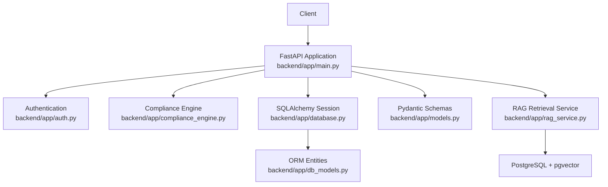
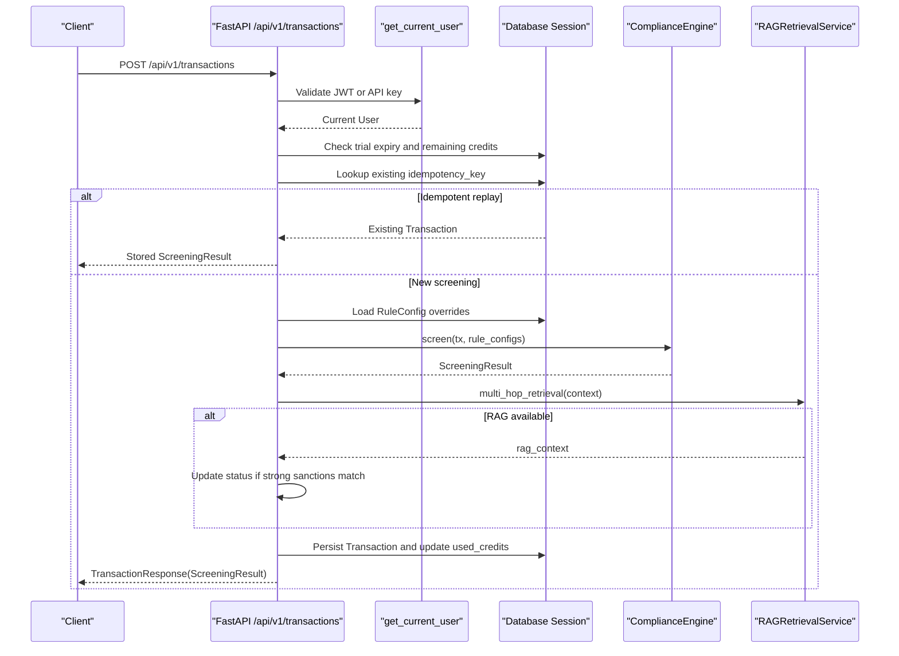
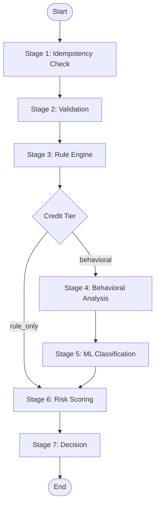
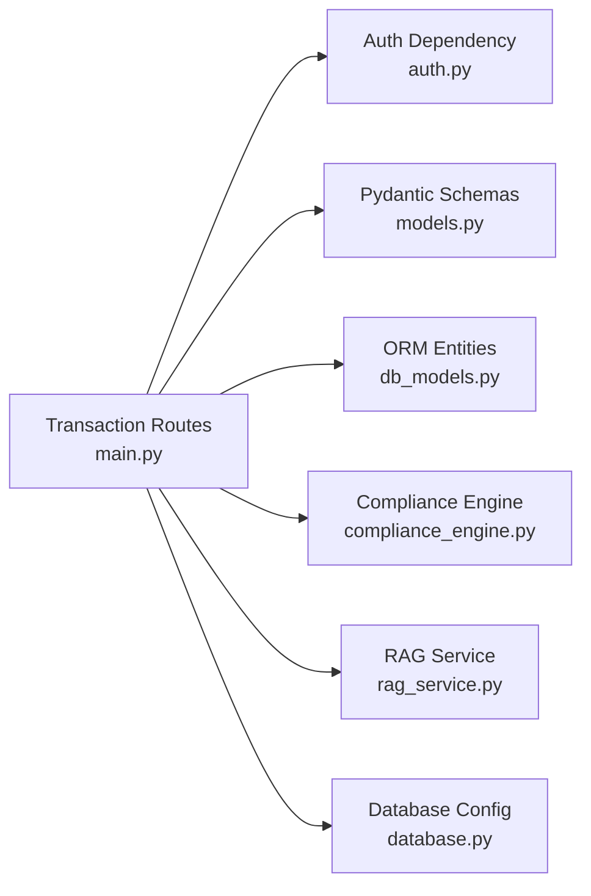

# Transaction Screening API

<cite>
**Referenced Files in This Document**   
- [main.py](file://backend/app/main.py)
- [models.py](file://backend/app/models.py)
- [db_models.py](file://backend/app/db_models.py)
- [auth.py](file://backend/app/auth.py)
- [compliance_engine.py](file://backend/app/compliance_engine.py)
- [rag_service.py](file://backend/app/rag_service.py)
- [database.py](file://backend/app/database.py)
- [requirements.txt](file://backend/requirements.txt)
- [test_api.py](file://backend/tests/test_api.py)
- [docker-compose.yml](file://docker-compose.yml)
</cite>

## Table of Contents
1. [Introduction](#introduction)
2. [Project Structure](#project-structure)
3. [Core Components](#core-components)
4. [Architecture Overview](#architecture-overview)
5. [Detailed Component Analysis](#detailed-component-analysis)
6. [Dependency Analysis](#dependency-analysis)
7. [Performance Considerations](#performance-considerations)
8. [Troubleshooting Guide](#troubleshooting-guide)
9. [Conclusion](#conclusion)

## Introduction
This document describes the transaction screening API implemented in the FinShield AI backend. It focuses on the compliance-oriented endpoints for submitting, listing, retrieving, deleting, and exporting transactions, along with authentication, idempotency, credit consumption, rule configuration loading, and optional RAG enrichment.

The shipped backend is a FastAPI application that:
- Authenticates requests via JWT bearer tokens or live API keys.
- Persists users, transactions, cases, rules, and related entities using SQLAlchemy.
- Runs a 7-stage compliance pipeline through `ComplianceEngine`.
- Optionally enriches screening results with semantic retrieval from PostgreSQL + pgvector when configured.
- Tracks credit consumption per user and enforces trial expiry checks.

## Project Structure
The relevant implementation lives under `backend/app/`:
- `main.py` mounts FastAPI routes, including all transaction endpoints.
- `models.py` defines request/response schemas such as `TransactionRequest`, `ScreeningResult`, and `TransactionResponse`.
- `db_models.py` defines SQLAlchemy ORM entities such as `User`, `Transaction`, and `RuleConfig`.
- `auth.py` implements JWT/API-key authentication.
- `compliance_engine.py` implements the 7-stage pipeline.
- `rag_service.py` provides optional pgvector-based retrieval.
- `database.py` configures SQLite by default and PostgreSQL when `DATABASE_URL` points to Postgres.

**Diagram sources**
- [main.py:26-43](file://backend/app/main.py#L26-L43)
- [auth.py:59-113](file://backend/app/auth.py#L59-L113)
- [compliance_engine.py:30-162](file://backend/app/compliance_engine.py#L30-L162)
- [database.py:11-24](file://backend/app/database.py#L11-L24)
- [db_models.py:22-106](file://backend/app/db_models.py#L22-L106)
- [models.py:67-127](file://backend/app/models.py#L67-L127)
- [rag_service.py:145-155](file://backend/app/rag_service.py#L145-L155)

**Section sources**
- [main.py:54-60](file://backend/app/main.py#L54-L60)
- [database.py:11-24](file://backend/app/database.py#L11-L24)
- [requirements.txt:1-16](file://backend/requirements.txt#L1-L16)

## Core Components
- **Authentication**: The API accepts either a JWT bearer token or an API key prefixed with `fsk_`. Unauthenticated requests receive `401 Unauthorized`.
- **Idempotency**: Each transaction submission uses an `idempotency_key`. If a transaction with the same key already exists for the current user, the stored result is returned without re-screening or double-charging credits.
- **Credit Consumption**: Successful screening increments `used_credits` based on the selected credit tier.
- **Rule Configuration Loading**: Before screening, the endpoint loads per-user `RuleConfig` records and passes them into the engine so disabled rules and custom parameters are respected.
- **RAG Enrichment**: When `RAG_DATABASE_URL` starts with `postgresql` and pgvector dependencies are available, the service performs multi-hop retrieval over policies, sanctions, and precedents. Strong sanctions matches can upgrade an approved decision to flagged.

**Section sources**
- [auth.py:59-113](file://backend/app/auth.py#L59-L113)
- [main.py:434-570](file://backend/app/main.py#L434-L570)
- [compliance_engine.py:89-162](file://backend/app/compliance_engine.py#L89-L162)
- [rag_service.py:361-412](file://backend/app/rag_service.py#L361-L412)

## Architecture Overview
The transaction submission flow integrates authentication, validation, credit checks, idempotency, rule evaluation, behavioral scoring, ML classification, risk scoring, decision logic, optional RAG enrichment, persistence, and credit accounting.

**Diagram sources**
- [main.py:434-570](file://backend/app/main.py#L434-L570)
- [auth.py:59-113](file://backend/app/auth.py#L59-L113)
- [compliance_engine.py:89-162](file://backend/app/compliance_engine.py#L89-L162)
- [rag_service.py:361-412](file://backend/app/rag_service.py#L361-L412)

## Detailed Component Analysis

### Authentication Requirements
All transaction endpoints require authentication. The dependency supports:
- JWT bearer tokens.
- Live API keys starting with `fsk_`.

Unauthenticated requests return `401 Unauthorized`. Disabled accounts return `403 Forbidden`.

**Section sources**
- [auth.py:59-113](file://backend/app/auth.py#L59-L113)
- [main.py:434-441](file://backend/app/main.py#L434-L441)

### POST /api/v1/transactions
Submits a transaction through the full compliance pipeline.

#### HTTP Method and Path
- Method: `POST`
- Path: `/api/v1/transactions`

#### Authentication
- Required: Yes. Use `Authorization: Bearer <JWT>` or `Authorization: Bearer fsk_live_<key>`.

#### Request Schema: `TransactionRequest`
| Field | Type | Required | Description |
|---|---|---:|---|
| `idempotency_key` | string | No | Unique key for deduplication; defaults to a UUID. |
| `amount` | number | Yes | Positive transaction amount. |
| `currency` | string | No | Three-letter currency code; defaults to `"USD"`. |
| `transaction_type` | enum | Yes | One of `wire`, `ach`, `card`, `international`, `crypto`, `p2p`. |
| `sender_name` | string | Yes | Sender identifier or name. |
| `sender_id` | string | No | Optional sender ID. |
| `receiver_name` | string | Yes | Receiver identifier or name. |
| `receiver_id` | string | No | Optional receiver ID. |
| `destination_country` | string | No | Destination country code. |
| `description` | string | No | Optional description. |
| `metadata` | object | No | Optional metadata dictionary. |

#### Response Schema: `TransactionResponse`
| Field | Type | Description |
|---|---|---|
| `success` | boolean | Always `true` for successful processing. |
| `data` | `ScreeningResult` | Screening outcome and audit fields. |
| `error` | string | Present only on error responses. |

#### `ScreeningResult` Fields
| Field | Type | Description |
|---|---|---|
| `transaction_id` | string | Internal transaction identifier. |
| `idempotency_key` | string | Echoed idempotency key. |
| `status` | enum | One of `approved`, `flagged`, `blocked`, `in_review`, `pending`. |
| `risk_score` | number | Normalized risk score between 0 and 1. |
| `credit_tier` | enum | `rule_only`, `behavioral`, or `full_ml`. |
| `credits_consumed` | number | Credits deducted from the user account. |
| `rule_results` | array | Per-rule evaluation results. |
| `behavioral_score` | number | Behavioral anomaly score when applicable. |
| `ml_classification` | string | ML classification label when applicable. |
| `ml_confidence` | number | ML confidence when applicable. |
| `total_latency_ms` | number | Pipeline latency in milliseconds. |
| `timestamp` | datetime | Result timestamp. |
| `pipeline_stages` | array | Ordered stages executed during screening. |
| `rag_context` | object | Optional RAG enrichment payload. |

#### Processing Logic
1. Verify trial expiry for trial users.
2. Check remaining credits; insufficient credits returns `402 Payment Required`.
3. Look up an existing transaction by `idempotency_key`; return stored result if found.
4. Load user-specific `RuleConfig` overrides.
5. Run `ComplianceEngine.screen`.
6. Optionally enrich with RAG retrieval.
7. Update `used_credits` and persist the transaction.
8. Return `TransactionResponse` with `ScreeningResult`.

#### Error Responses
| Status | Meaning |
|---:|---|
| `401` | Missing or invalid JWT/API key. |
| `402` | Insufficient credits. |
| `403` | Trial expired. |
| `422` | Invalid request body. |
| `429` | Rate limit exceeded. |
| `500` | Unexpected server error. |

#### Practical curl Examples
- Submit a clean transaction:
  - Send a JSON body with `amount`, `currency`, `transaction_type`, `sender_name`, and `receiver_name`.
  - Include `Authorization: Bearer <token>`.
  - Observe `success: true` and a `ScreeningResult` with a status such as `approved`, `flagged`, `blocked`, or `in_review`.
- Submit with an idempotency key:
  - Provide a stable `idempotency_key`.
  - Repeating the same request returns the original persisted `transaction_id` and does not consume additional credits.
- Interpret results:
  - Use `status` for business routing.
  - Use `rule_results` to explain hard-rule triggers.
  - Use `behavioral_score`, `ml_classification`, and `ml_confidence` for ML signals.
  - Use `credits_consumed` to reconcile billing.
  - Use `pipeline_stages` to understand which stages ran.

**Section sources**
- [main.py:434-570](file://backend/app/main.py#L434-L570)
- [models.py:67-127](file://backend/app/models.py#L67-L127)
- [compliance_engine.py:89-162](file://backend/app/compliance_engine.py#L89-L162)
- [test_api.py:171-225](file://backend/tests/test_api.py#L171-L225)
- [test_api.py:486-498](file://backend/tests/test_api.py#L486-L498)

### GET /api/v1/transactions
Lists recent transactions for the authenticated user with pagination.

#### HTTP Method and Path
- Method: `GET`
- Path: `/api/v1/transactions`

#### Query Parameters
| Parameter | Type | Default | Description |
|---|---|---:|---|
| `limit` | integer | 50 | Maximum number of transactions to return. |
| `offset` | integer | 0 | Number of transactions to skip. |

#### Authentication
- Required: Yes.

#### Response
An array of transaction summaries containing:
- `id`, `amount`, `currency`, `type`, `sender`, `receiver`, `status`, `risk_score`, `credit_tier`, `created_at`.

#### Practical curl Example
- Retrieve the most recent 20 transactions:
  - `GET /api/v1/transactions?limit=20&offset=0`
- Paginate further:
  - `GET /api/v1/transactions?limit=20&offset=20`

**Section sources**
- [main.py:573-603](file://backend/app/main.py#L573-L603)
- [test_api.py:227-239](file://backend/tests/test_api.py#L227-L239)

### GET /api/v1/transactions/{tx_id}
Returns detailed transaction information, including rule results and ML scores.

#### HTTP Method and Path
- Method: `GET`
- Path: `/api/v1/transactions/{tx_id}`

#### Path Parameters
| Parameter | Type | Description |
|---|---|---|
| `tx_id` | string | Transaction primary key. |

#### Authentication
- Required: Yes.

#### Response Fields
| Field | Type | Description |
|---|---|---|
| `id` | string | Transaction ID. |
| `amount` | number | Transaction amount. |
| `currency` | string | Currency code. |
| `transaction_type` | string | Transaction type. |
| `sender_name` | string | Sender name. |
| `receiver_name` | string | Receiver name. |
| `destination_country` | string | Destination country. |
| `status` | string | Final screening status. |
| `risk_score` | number | Risk score. |
| `credit_tier` | string | Credit tier used. |
| `credits_consumed` | number | Credits consumed. |
| `idempotency_key` | string | Original idempotency key. |
| `rule_results` | array | Hard-rule evaluation details. |
| `behavioral_score` | number | Behavioral score when present. |
| `ml_classification` | string | ML classification when present. |
| `ml_confidence` | number | ML confidence when present. |
| `total_latency_ms` | number | Total pipeline latency. |
| `pipeline_stages` | array | Executed pipeline stages. |
| `rag_context` | object | Optional RAG enrichment context. |
| `created_at` | string | ISO timestamp. |

#### Error Responses
| Status | Meaning |
|---:|---|
| `401` | Not authenticated. |
| `404` | Transaction not found for this user. |

**Section sources**
- [main.py:606-639](file://backend/app/main.py#L606-L639)

### DELETE /api/v1/transactions/{tx_id}
Deletes a transaction and its associated cases and case comments.

#### HTTP Method and Path
- Method: `DELETE`
- Path: `/api/v1/transactions/{tx_id}`

#### Path Parameters
| Parameter | Type | Description |
|---|---|---|
| `tx_id` | string | Transaction primary key. |

#### Authentication
- Required: Yes.

#### Response
A JSON object indicating deletion, typically containing the deleted transaction ID.

#### Error Responses
| Status | Meaning |
|---:|---|
| `401` | Not authenticated. |
| `404` | Transaction not found for this user. |

**Section sources**
- [main.py:642-663](file://backend/app/main.py#L642-L663)

### GET /api/v1/transactions/export
Exports transactions as CSV with optional date filtering.

#### HTTP Method and Path
- Method: `GET`
- Path: `/api/v1/transactions/export`

#### Query Parameters
| Parameter | Type | Optional | Description |
|---|---|---:|---|
| `fmt` | string | Yes | Format; only `csv` is supported. |
| `start_date` | string | Yes | ISO date or datetime; inclusive lower bound. |
| `end_date` | string | Yes | ISO date or datetime; inclusive upper bound. |

#### Authentication
- Required: Yes.

#### Response
A CSV file attachment named `finshield_transactions.csv` with columns:
- `ID`, `Amount`, `Currency`, `Type`, `Sender`, `Receiver`, `Country`, `Status`, `Risk Score`, `Credit Tier`, `Credits Used`, `Created At`.

#### Error Responses
| Status | Meaning |
|---:|---|
| `400` | Unsupported format or invalid date format. |
| `401` | Not authenticated. |

#### Practical curl Example
- Export all transactions:
  - `GET /api/v1/transactions/export?fmt=csv`
- Export transactions within a date range:
  - `GET /api/v1/transactions/export?fmt=csv&start_date=2024-01-01T00:00:00&end_date=2024-01-31T23:59:59`

**Section sources**
- [main.py:666-717](file://backend/app/main.py#L666-L717)

### 7-Stage Compliance Pipeline
The compliance engine implements seven explicit stages:
1. Idempotency check.
2. Input validation.
3. Hard rule engine.
4. Behavioral analysis (conditional).
5. ML classification (conditional).
6. Risk scoring.
7. Decision.

The pipeline determines the credit tier and cost:
- `rule_only`: 0.2 credits.
- `behavioral`: 0.5 credits.
- `full_ml`: 1.0 credit.

Rules include sanctions, PEP, threshold, and geography checks. Triggered rule actions can override aggregate risk-based decisions.

**Diagram sources**
- [compliance_engine.py:89-162](file://backend/app/compliance_engine.py#L89-L162)
- [compliance_engine.py:339-380](file://backend/app/compliance_engine.py#L339-L380)

**Section sources**
- [compliance_engine.py:30-162](file://backend/app/compliance_engine.py#L30-L162)
- [compliance_engine.py:164-240](file://backend/app/compliance_engine.py#L164-L240)
- [compliance_engine.py:280-380](file://backend/app/compliance_engine.py#L280-L380)

### RAG Enrichment
When configured, RAG enrichment runs after the compliance engine:
- Retrieves relevant policies, sanctions matches, and similar precedents.
- Adds `rag_context` to the result.
- Appends `"rag_retrieval"` to `pipeline_stages`.
- Upgrades an approved decision to flagged if strong sanctions matches exist.

RAG requires:
- `RAG_DATABASE_URL` set to a PostgreSQL connection.
- PostgreSQL running with the `pgvector` extension.
- Optional sentence-transformers support controlled by environment variables.

**Section sources**
- [main.py:138-150](file://backend/app/main.py#L138-L150)
- [main.py:484-506](file://backend/app/main.py#L484-L506)
- [rag_service.py:145-155](file://backend/app/rag_service.py#L145-L155)
- [rag_service.py:361-412](file://backend/app/rag_service.py#L361-L412)
- [docker-compose.yml:4-33](file://docker-compose.yml#L4-L33)

### Credit Consumption Tracking
Each successful screening updates the user’s `used_credits` by `credits_consumed`. Clients can:
- Monitor remaining credits before bulk operations.
- Correlate `credits_consumed` with billing.
- Use `/api/v1/credits` to inspect totals and plan information.

Bulk operations should:
- Batch submissions with distinct `idempotency_key` values.
- Retry safely because duplicate keys return stored results without extra charges.
- Respect rate limits and handle `429` responses.

**Section sources**
- [main.py:507-510](file://backend/app/main.py#L507-L510)
- [main.py:818-826](file://backend/app/main.py#L818-L826)
- [test_api.py:356-378](file://backend/tests/test_api.py#L356-L378)

## Dependency Analysis
The transaction endpoints depend on several modules:

**Diagram sources**
- [main.py:26-43](file://backend/app/main.py#L26-L43)
- [auth.py:59-113](file://backend/app/auth.py#L59-L113)
- [models.py:67-127](file://backend/app/models.py#L67-L127)
- [db_models.py:22-106](file://backend/app/db_models.py#L22-L106)
- [compliance_engine.py:30-162](file://backend/app/compliance_engine.py#L30-L162)
- [rag_service.py:145-155](file://backend/app/rag_service.py#L145-L155)
- [database.py:11-24](file://backend/app/database.py#L11-L24)

**Section sources**
- [main.py:26-43](file://backend/app/main.py#L26-L43)
- [requirements.txt:1-16](file://backend/requirements.txt#L1-L16)

## Performance Considerations
- **Idempotency cache**: The engine caches results by `idempotency_key` in memory, making repeated submissions fast.
- **Conditional pipeline depth**: Lower-risk transactions may use `rule_only`, reducing computational cost.
- **Optional RAG**: RAG retrieval is skipped unless PostgreSQL and dependencies are configured; failures do not block screening.
- **Rate limiting**: A global limiter applies to transaction submission; clients should back off on `429`.
- **Database persistence**: Transactions are persisted after screening; large exports should use the CSV export endpoint rather than paginated listing.

[No sources needed since this section provides general guidance]

## Troubleshooting Guide
Common issues and resolutions:
- **401 Unauthorized**: Ensure the request includes a valid JWT or active API key.
- **402 Payment Required**: Top up credits or upgrade the plan.
- **403 Forbidden**: Trial may have expired; upgrade to continue screening.
- **422 Validation Error**: Check required fields and types in `TransactionRequest`.
- **429 Rate Limit Exceeded**: Reduce request frequency or implement exponential backoff.
- **RAG unavailable**: Confirm `RAG_DATABASE_URL` points to PostgreSQL with pgvector enabled.
- **Export errors**: Use ISO-formatted dates and `fmt=csv`.

**Section sources**
- [auth.py:59-113](file://backend/app/auth.py#L59-L113)
- [main.py:81-115](file://backend/app/main.py#L81-L115)
- [main.py:434-570](file://backend/app/main.py#L434-L570)
- [main.py:666-717](file://backend/app/main.py#L666-L717)
- [database.py:11-24](file://backend/app/database.py#L11-L24)

## Conclusion
The FinShield transaction screening API provides a secure, auditable, and configurable compliance workflow. Clients submit transactions with idempotency keys, receive structured screening results with rule and ML signals, and can list, retrieve, delete, and export transactions. Credit consumption and trial enforcement protect usage boundaries, while optional RAG enrichment adds policy and precedent context when PostgreSQL + pgvector is available. For production integrations, rely on the documented schemas, authentication requirements, and error responses, and design retries around idempotency and rate limits.

[No sources needed since this section summarizes without analyzing specific files]