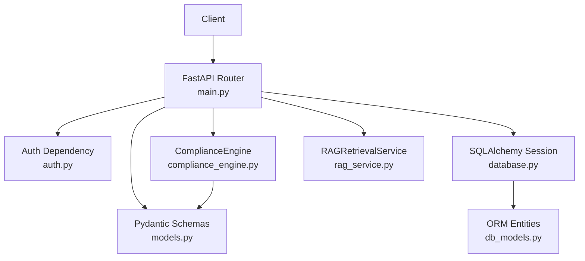
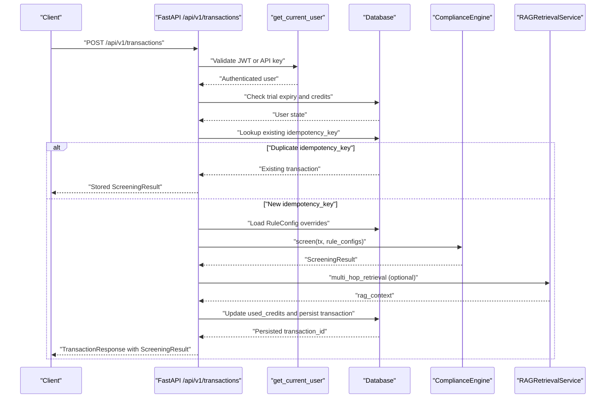
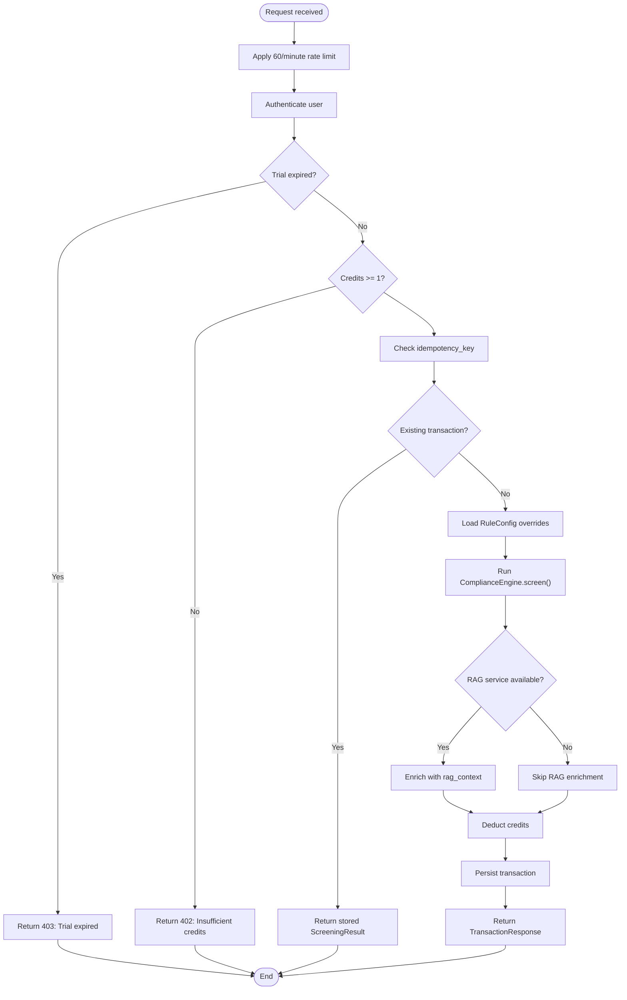
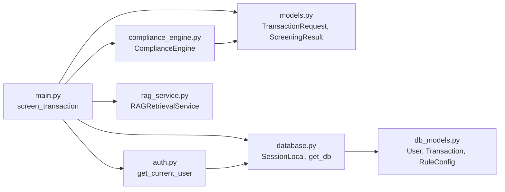

# Transaction Submission and Screening

<cite>
**Referenced Files in This Document**
- [main.py](file://backend/app/main.py)
- [models.py](file://backend/app/models.py)
- [compliance_engine.py](file://backend/app/compliance_engine.py)
- [rag_service.py](file://backend/app/rag_service.py)
- [auth.py](file://backend/app/auth.py)
- [database.py](file://backend/app/database.py)
- [db_models.py](file://backend/app/db_models.py)
- [seed_rag_data.py](file://backend/app/seed_rag_data.py)
- [test_api.py](file://backend/tests/test_api.py)
- [test_compliance_engine.py](file://backend/tests/test_compliance_engine.py)
</cite>

## Table of Contents
1. [Introduction](#introduction)
2. [Project Structure](#project-structure)
3. [Core Components](#core-components)
4. [Architecture Overview](#architecture-overview)
5. [Detailed Component Analysis](#detailed-component-analysis)
6. [Dependency Analysis](#dependency-analysis)
7. [Performance Considerations](#performance-considerations)
8. [Troubleshooting Guide](#troubleshooting-guide)
9. [Conclusion](#conclusion)

## Introduction
This document explains how transaction submission and screening work in the FinShield backend. It focuses on the authenticated `POST /api/v1/transactions` endpoint, the `TransactionRequest` schema, the complete screening workflow, the `ScreeningResult` response structure, rate limiting, and error scenarios such as insufficient credits and expired trials.

The shipped backend is a FastAPI application that:
- Authenticates requests through JWT bearer tokens or API keys.
- Validates request payloads with Pydantic.
- Runs a rule-based compliance engine.
- Optionally enriches results with RAG retrieval from PostgreSQL/pgvector.
- Persists transactions, updates user credits, and returns structured screening results.

## Project Structure
For this documentation, only the backend implementation relevant to transaction screening is used:

| Area | Responsibility |
|---|---|
| `backend/app/main.py` | FastAPI app, routes, rate limiting, exception handling, transaction screening endpoint |
| `backend/app/models.py` | Request/response schemas, enums for transaction type, status, credit tier, and rule result |
| `backend/app/compliance_engine.py` | Core 7-stage compliance pipeline and hard rules |
| `backend/app/rag_service.py` | Optional pgvector-based RAG retrieval service |
| `backend/app/auth.py` | JWT/API key authentication dependency |
| `backend/app/database.py` | SQLite default database configuration and session helpers |
| `backend/app/db_models.py` | SQLAlchemy ORM entities including `User`, `Transaction`, `RuleConfig` |
| `backend/app/seed_rag_data.py` | Seed data script for RAG tables |
| `backend/tests/test_api.py` | Integration tests covering screening, idempotency, auth, and rules |
| `backend/tests/test_compliance_engine.py` | Unit tests for the compliance engine pipeline |

**Diagram sources**
- [main.py:15-37](file://backend/app/main.py#L15-L37)
- [auth.py:59-113](file://backend/app/auth.py#L59-L113)
- [models.py:17-127](file://backend/app/models.py#L17-L127)
- [compliance_engine.py:30-162](file://backend/app/compliance_engine.py#L30-L162)
- [rag_service.py:145-412](file://backend/app/rag_service.py#L145-L412)
- [database.py:17-33](file://backend/app/database.py#L17-L33)
- [db_models.py:22-106](file://backend/app/db_models.py#L22-L106)

**Section sources**
- [main.py:54-78](file://backend/app/main.py#L54-L78)
- [database.py:11-24](file://backend/app/database.py#L11-L24)

## Core Components
The transaction screening feature is built from these core components:

| Component | Purpose | Key Implementation Details |
|---|---|---|
| `TransactionRequest` | Defines incoming screening payload | Includes `idempotency_key`, `amount`, `currency`, `transaction_type`, `sender_name`, `receiver_name`, and optional destination country |
| `ScreeningResult` | Defines screening output | Includes `risk_score`, `status`, `rule_results`, `behavioral_score`, `ml_classification`, `pipeline_stages`, and related fields |
| `ComplianceEngine` | Executes the compliance pipeline | Implements rule checks, behavioral scoring, ML classification simulation, risk scoring, and decision logic |
| `RAGRetrievalService` | Enriches screening with policy/sanctions/precedent context | Uses pgvector embeddings; optional and non-blocking |
| Authentication dependency | Identifies the current user | Accepts JWT bearer tokens or API keys |
| Database models | Persist users, transactions, rule configs, and audit data | Default SQLite file; PostgreSQL when `DATABASE_URL` is set |

**Section sources**
- [models.py:17-127](file://backend/app/models.py#L17-L127)
- [compliance_engine.py:30-162](file://backend/app/compliance_engine.py#L30-L162)
- [rag_service.py:145-412](file://backend/app/rag_service.py#L145-L412)
- [auth.py:59-113](file://backend/app/auth.py#L59-L113)
- [db_models.py:22-106](file://backend/app/db_models.py#L22-L106)

## Architecture Overview
The `POST /api/v1/transactions` endpoint implements the following high-level flow:

1. **Authentication**: The request must include a valid JWT bearer token or API key.
2. **Rate limiting**: Requests are limited to 60 per minute per remote address.
3. **Trial expiry check**: Trial users whose trial has expired cannot screen transactions.
4. **Credit validation**: At least one credit must remain before screening proceeds.
5. **Idempotency check**: A duplicate `idempotency_key` returns the previously persisted result without re-screening.
6. **Rule configuration loading**: User-specific rule overrides are loaded from the database.
7. **Compliance engine execution**: Rules, behavioral analysis, ML classification, risk scoring, and decision stages run.
8. **RAG enrichment**: If configured, semantic retrieval adds policy, sanctions, and precedent context.
9. **Credit deduction**: The user’s `used_credits` is increased by the consumed credits.
10. **Result persistence**: The transaction and its screening metadata are stored.
11. **Response**: A `TransactionResponse` wrapping a `ScreeningResult` is returned.

**Diagram sources**
- [main.py:434-570](file://backend/app/main.py#L434-L570)
- [auth.py:59-113](file://backend/app/auth.py#L59-L113)
- [compliance_engine.py:89-162](file://backend/app/compliance_engine.py#L89-L162)
- [rag_service.py:361-412](file://backend/app/rag_service.py#L361-L412)
- [db_models.py:75-106](file://backend/app/db_models.py#L75-L106)

## Detailed Component Analysis

### POST /api/v1/transactions Endpoint
The endpoint is defined in the FastAPI application and decorated with a 60-per-minute rate limit. It requires an authenticated user and a database session.

Key responsibilities:
- Reject expired trial accounts.
- Reject accounts with fewer than one remaining credit.
- Return cached results for duplicate idempotency keys.
- Load user rule configurations.
- Execute the compliance engine.
- Optionally enrich with RAG context.
- Deduct credits and persist the transaction.
- Create notifications for blocked transactions and low credit balance.

**Diagram sources**
- [main.py:72-88](file://backend/app/main.py#L72-L88)
- [main.py:434-570](file://backend/app/main.py#L434-L570)

**Section sources**
- [main.py:434-570](file://backend/app/main.py#L434-L570)

### TransactionRequest Schema
`TransactionRequest` defines the input contract for screening.

| Field | Type | Required | Description |
|---|---|---:|---|
| `idempotency_key` | string | Yes | Unique key for deduplication; defaults to a UUID if not provided |
| `amount` | number | Yes | Positive transaction amount |
| `currency` | string | No | Three-character currency code; defaults to `"USD"` |
| `transaction_type` | enum | Yes | One of `wire`, `ach`, `card`, `international`, `crypto`, `p2p` |
| `sender_name` | string | Yes | Sender identity |
| `sender_id` | string | No | Optional external sender identifier |
| `receiver_name` | string | Yes | Receiver identity |
| `receiver_id` | string | No | Optional external receiver identifier |
| `destination_country` | string | No | Destination country code used by geography and behavioral rules |
| `description` | string | No | Optional free-text description |
| `metadata` | object | No | Optional arbitrary metadata |

Validation behavior:
- `amount` must be greater than zero.
- `transaction_type` must match one of the allowed enum values.
- Missing required fields return HTTP 422 with validation errors.

**Section sources**
- [models.py:17-83](file://backend/app/models.py#L17-L83)
- [test_api.py:209-225](file://backend/tests/test_api.py#L209-L225)

### Complete Screening Workflow

#### Idempotency Check
The endpoint first checks whether a transaction with the same `idempotency_key` already exists for the current user. If found, it returns the stored result immediately, avoiding double charges and repeated processing.

The engine also maintains an in-process idempotency cache keyed by `idempotency_key`. This provides fast reuse within the process lifetime, while the database provides durable idempotency across restarts.

**Section sources**
- [main.py:453-473](file://backend/app/main.py#L453-L473)
- [compliance_engine.py:36-37](file://backend/app/compliance_engine.py#L36-L37)
- [compliance_engine.py:100-103](file://backend/app/compliance_engine.py#L100-L103)
- [compliance_engine.py:146-162](file://backend/app/compliance_engine.py#L146-L162)
- [test_api.py:486-498](file://backend/tests/test_api.py#L486-L498)
- [test_compliance_engine.py:176-201](file://backend/tests/test_compliance_engine.py#L176-L201)

#### Credit Validation
Before screening, the endpoint calculates remaining credits as `total_credits - used_credits`. If the remaining value is less than one, it returns HTTP 402 with an insufficient-credits error.

Credits are deducted after successful screening by adding `result.credits_consumed` to `current_user.used_credits`.

**Section sources**
- [main.py:448-451](file://backend/app/main.py#L448-L451)
- [main.py:507-508](file://backend/app/main.py#L507-L508)
- [db_models.py:31-33](file://backend/app/db_models.py#L31-L33)
- [db_models.py:92-93](file://backend/app/db_models.py#L92-L93)

#### Trial Expiry Check
If the user is marked as a trial user and `trial_expires_at` is in the past, the endpoint returns HTTP 403.

**Section sources**
- [main.py:443-447](file://backend/app/main.py#L443-L447)
- [db_models.py:36-38](file://backend/app/db_models.py#L36-L38)

#### Rule Configuration Loading
The endpoint loads all `RuleConfig` rows for the current user and converts them into a dictionary keyed by `rule_id`. Each override contains `enabled` and `custom_parameters`.

These overrides are passed to `ComplianceEngine.screen`, which uses them to skip disabled rules and apply custom thresholds or country lists.

**Section sources**
- [main.py:475-482](file://backend/app/main.py#L475-L482)
- [compliance_engine.py:89-95](file://backend/app/compliance_engine.py#L89-L95)
- [compliance_engine.py:165-177](file://backend/app/compliance_engine.py#L165-L177)
- [db_models.py:184-209](file://backend/app/db_models.py#L184-L209)

#### Compliance Engine Execution
The compliance engine runs a staged pipeline:

| Stage | Behavior |
|---|---|
| Idempotency check | Returns cached result if the key was processed during this process lifetime |
| Validation | Relies on Pydantic validation |
| Rule engine | Evaluates sanctions, PEP, threshold, and geography rules |
| Behavioral analysis | Runs for behavioral or full-ML tiers |
| ML classification | Runs for full-ML tier |
| Risk scoring | Combines rule hits, behavioral score, and ML confidence |
| Decision | Applies rule actions and score-based thresholds |

Hard rules:
- Sanctions match: blocks.
- PEP match: flags.
- Threshold exceeded: reviews.
- High-risk country: escalates, which maps to blocked.

Credit tiers:
- `rule_only`: 0.2 credits.
- `behavioral`: 0.5 credits.
- `full_ml`: 1.0 credit.

**Section sources**
- [compliance_engine.py:30-162](file://backend/app/compliance_engine.py#L30-L162)
- [compliance_engine.py:164-240](file://backend/app/compliance_engine.py#L164-L240)
- [compliance_engine.py:280-380](file://backend/app/compliance_engine.py#L280-L380)
- [test_compliance_engine.py:38-80](file://backend/tests/test_compliance_engine.py#L38-L80)
- [test_compliance_engine.py:87-137](file://backend/tests/test_compliance_engine.py#L87-L137)
- [test_compliance_engine.py:144-169](file://backend/tests/test_compliance_engine.py#L144-L169)

#### RAG Enrichment
RAG enrichment is optional. During startup, the application initializes `RAGRetrievalService` only if:
- `RAG_DATABASE_URL` starts with `postgresql`.
- The optional dependencies are available.

When enabled, the screening handler calls `multi_hop_retrieval` with sender name, receiver name, transaction type, and destination country. The result includes:
- Relevant compliance policies.
- Sanctions matches.
- Similar historical precedents.

If RAG finds sanctions matches and the original decision was approved, the result is changed to flagged and the minimum risk score is raised to at least 0.5.

**Section sources**
- [main.py:138-150](file://backend/app/main.py#L138-L150)
- [main.py:484-505](file://backend/app/main.py#L484-L505)
- [rag_service.py:145-155](file://backend/app/rag_service.py#L145-L155)
- [rag_service.py:361-412](file://backend/app/rag_service.py#L361-L412)
- [seed_rag_data.py:10-24](file://backend/app/seed_rag_data.py#L10-L24)

#### Credit Deduction
After the engine produces a result, the endpoint adds `result.credits_consumed` to the user’s `used_credits`.

**Section sources**
- [main.py:507-508](file://backend/app/main.py#L507-L508)
- [compliance_engine.py:113-119](file://backend/app/compliance_engine.py#L113-L119)

#### Result Persistence
The endpoint creates a `Transaction` record containing:
- User ID and idempotency key.
- Amount, currency, transaction type, sender, receiver, and destination country.
- Status, risk score, credit tier, credits consumed.
- Serialized rule results, behavioral score, ML classification, ML confidence.
- Latency, pipeline stages, and RAG context.

After persistence, the database-generated transaction ID is attached to the result and returned.

**Section sources**
- [main.py:510-537](file://backend/app/main.py#L510-L537)
- [db_models.py:75-106](file://backend/app/db_models.py#L75-L106)

### ScreeningResult Response Structure
`ScreeningResult` is the core response model for screening.

| Field | Type | Description |
|---|---|---|
| `transaction_id` | string | Identifier assigned to the screened transaction |
| `idempotency_key` | string | The idempotency key used for deduplication |
| `status` | enum | One of `approved`, `flagged`, `blocked`, `in_review`, `pending` |
| `risk_score` | number | Score between 0 and 1 |
| `credit_tier` | enum | `rule_only`, `behavioral`, or `full_ml` |
| `credits_consumed` | number | Credits deducted for this screening |
| `rule_results` | array | List of individual rule evaluations |
| `behavioral_score` | number or null | Behavioral risk score when behavioral analysis ran |
| `ml_classification` | string or null | ML classification when full ML tier ran |
| `ml_confidence` | number or null | ML confidence when full ML tier ran |
| `total_latency_ms` | number | Pipeline latency in milliseconds |
| `timestamp` | datetime | Result timestamp |
| `pipeline_stages` | array | Ordered list of executed pipeline stages |
| `rag_context` | object or null | Optional RAG enrichment result |

`RuleResult` entries include:
- `rule_id`
- `rule_type`
- `rule_name`
- `triggered`
- `detail`
- `latency_ms`

**Section sources**
- [models.py:95-127](file://backend/app/models.py#L95-L127)
- [compliance_engine.py:146-159](file://backend/app/compliance_engine.py#L146-L159)

### Practical Examples

#### Successful Screening
A clean wire transfer with a normal sender and receiver typically passes rule checks and may receive an approved or reviewed status depending on amount and configuration.

Example request body:
- `amount`: positive value
- `currency`: `"USD"`
- `transaction_type`: `"wire"`
- `sender_name`: normal name
- `receiver_name`: normal name
- `destination_country`: optional safe country

Expected outcome:
- HTTP 200
- `success`: true
- `data.status`: usually `approved`, `flagged`, or `in_review`
- `data.rule_results`: includes sanctions, PEP, threshold, and geography evaluations
- `data.pipeline_stages`: includes at least idempotency, validation, rule engine, risk scoring, and decision

**Section sources**
- [test_api.py:173-185](file://backend/tests/test_api.py#L173-L185)
- [compliance_engine.py:146-162](file://backend/app/compliance_engine.py#L146-L162)

#### Blocked Transaction
A sanctioned sender or a high-risk destination country triggers blocking behavior.

Example inputs:
- Sanctioned sender such as a known entity in the sanctions list.
- Destination country in the high-risk set.

Expected outcome:
- HTTP 200
- `data.status`: `blocked`
- `data.rule_results`: at least one rule marked as triggered
- `data.risk_score`: elevated based on rule and optional ML signals

**Section sources**
- [test_api.py:186-198](file://backend/tests/test_api.py#L186-L198)
- [test_api.py:242-268](file://backend/tests/test_api.py#L242-L268)
- [compliance_engine.py:329-361](file://backend/app/compliance_engine.py#L329-L361)

#### Idempotent Retry
Resubmitting the exact same request with the same `idempotency_key` returns the originally persisted transaction ID and result.

Expected outcome:
- First call: HTTP 200 with a new transaction ID.
- Duplicate call: HTTP 200 with the same transaction ID and identical result.

**Section sources**
- [test_api.py:486-498](file://backend/tests/test_api.py#L486-L498)
- [main.py:453-473](file://backend/app/main.py#L453-L473)

### Rate Limiting
The `/api/v1/transactions` endpoint is protected by a slowapi limiter configured for 60 requests per minute, keyed by remote address.

Behavior:
- When the limit is exceeded, the global rate-limit exception handler returns HTTP 429.
- The response body contains a detail message indicating the rate limit was exceeded.
- In test mode (`APP_ENV=test`), rate limiting is disabled.

**Section sources**
- [main.py:72-88](file://backend/app/main.py#L72-L88)
- [main.py:434-435](file://backend/app/main.py#L434-L435)

### Error Scenarios

| Scenario | Condition | HTTP Status | Response Detail |
|---|---|---:|---|
| Unauthenticated request | Missing or invalid JWT/API key | 401 | Not authenticated, invalid token, or invalid API key |
| Disabled account | Active flag is false | 403 | Account disabled |
| Expired trial | Trial user past `trial_expires_at` | 403 | Upgrade required to continue screening |
| Insufficient credits | Remaining credits below 1 | 402 | Purchase more credits or upgrade plan |
| Invalid request | Missing required fields or invalid types | 422 | Validation errors |
| Rate limit exceeded | More than 60 requests per minute | 429 | Rate limit exceeded |
| Internal failure | Unexpected exception | 500 | Internal server error |

**Section sources**
- [auth.py:67-113](file://backend/app/auth.py#L67-L113)
- [main.py:81-115](file://backend/app/main.py#L81-L115)
- [main.py:443-451](file://backend/app/main.py#L443-L451)
- [test_api.py:200-225](file://backend/tests/test_api.py#L200-L225)

## Dependency Analysis
The transaction screening path connects several modules:

**Diagram sources**
- [main.py:26-37](file://backend/app/main.py#L26-L37)
- [auth.py:18-19](file://backend/app/auth.py#L18-L19)
- [models.py:12-127](file://backend/app/models.py#L12-L127)
- [compliance_engine.py:12-19](file://backend/app/compliance_engine.py#L12-L19)
- [database.py:17-33](file://backend/app/database.py#L17-L33)
- [db_models.py:15-106](file://backend/app/db_models.py#L15-L106)
- [rag_service.py:145-155](file://backend/app/rag_service.py#L145-L155)

### Coupling and Cohesion
- `main.py` orchestrates routing, authentication, rate limiting, and persistence but delegates business logic to `ComplianceEngine`.
- `models.py` is a shared contract layer used by both the API and the engine.
- `compliance_engine.py` is cohesive around the 7-stage pipeline and does not depend on FastAPI.
- `rag_service.py` is optional and isolated behind environment configuration.
- `auth.py` depends on `database.py` and `db_models.py` to resolve users and API keys.

### External Dependencies
- FastAPI, Uvicorn, Pydantic, SQLAlchemy, psycopg2-binary, pgvector, python-jose, bcrypt, slowapi, numpy, pytest.
- PostgreSQL with pgvector is required only when RAG enrichment is enabled.
- SQLite is the default persistence store.

**Section sources**
- [database.py:11-24](file://backend/app/database.py#L11-L24)
- [rag_service.py:148-155](file://backend/app/rag_service.py#L148-L155)

## Performance Considerations
- The screening endpoint performs synchronous database reads and writes.
- Rule evaluation is lightweight and deterministic.
- Behavioral scoring and ML classification are simulated and add minimal CPU overhead.
- RAG enrichment adds vector embedding computation and PostgreSQL/pgvector queries; it is intentionally optional and non-blocking.
- Idempotency avoids redundant processing for duplicate keys.
- Rate limiting protects the endpoint from burst traffic.

Recommendations:
- Keep idempotency keys stable at the client side to avoid accidental retries.
- Monitor `total_latency_ms` and `pipeline_stages` for performance regressions.
- Enable RAG only when PostgreSQL/pgvector is properly configured.
- Use pagination and filtering on listing endpoints rather than exporting large datasets frequently.

[No sources needed since this section provides general guidance]

## Troubleshooting Guide

### Symptom: Repeatedly Getting 429
**Likely cause**: More than 60 requests per minute to `/api/v1/transactions`.
**Action**:
- Reduce request frequency.
- Implement client-side retry with exponential backoff.
- Avoid sending duplicate requests unless using a stable idempotency key.

**Section sources**
- [main.py:72-88](file://backend/app/main.py#L72-L88)

### Symptom: 401 Unauthorized
**Likely causes**:
- Missing `Authorization` header.
- Expired JWT.
- Invalid API key.
- Disabled account.

**Action**:
- Refresh the JWT token.
- Verify the API key prefix and hash lookup.
- Confirm the user account is active.

**Section sources**
- [auth.py:67-113](file://backend/app/auth.py#L67-L113)

### Symptom: 402 Insufficient Credits
**Likely cause**: `total_credits - used_credits < 1`.
**Action**:
- Purchase additional credits.
- Upgrade the subscription plan.
- Review billing endpoints for checkout and plan changes.

**Section sources**
- [main.py:448-451](file://backend/app/main.py#L448-L451)
- [main.py:818-826](file://backend/app/main.py#L818-L826)
- [main.py:1044-1113](file://backend/app/main.py#L1044-L1113)

### Symptom: 403 Trial Expired
**Likely cause**: Trial user past `trial_expires_at`.
**Action**:
- Subscribe to a paid plan.
- Verify trial expiration via the profile or billing endpoints.

**Section sources**
- [main.py:443-447](file://backend/app/main.py#L443-L447)
- [main.py:176-234](file://backend/app/main.py#L176-L234)

### Symptom: 422 Validation Errors
**Likely cause**: Missing required fields, negative amount, or invalid transaction type.
**Action**:
- Validate the request against `TransactionRequest`.
- Ensure `amount > 0`.
- Use one of the allowed `transaction_type` values.

**Section sources**
- [models.py:67-83](file://backend/app/models.py#L67-L83)
- [test_api.py:209-225](file://backend/tests/test_api.py#L209-L225)

### Symptom: RAG Enrichment Not Appearing
**Likely cause**:
- `RAG_DATABASE_URL` is not set or not PostgreSQL.
- Optional dependencies are unavailable.
- RAG seed data was not loaded.

**Action**:
- Set `RAG_DATABASE_URL` to a PostgreSQL connection.
- Ensure pgvector extension is available.
- Run the RAG seed script.

**Section sources**
- [main.py:138-150](file://backend/app/main.py#L138-L150)
- [rag_service.py:148-155](file://backend/app/rag_service.py#L148-L155)
- [seed_rag_data.py:10-24](file://backend/app/seed_rag_data.py#L10-L24)

## Conclusion
The `POST /api/v1/transactions` endpoint provides a secure, auditable, and extensible transaction screening interface. It enforces authentication, rate limits, trial and credit controls, and idempotency, then executes a rule-driven compliance pipeline with optional RAG enrichment. Clients should supply stable idempotency keys, handle 401/402/403/422/429 errors explicitly, and inspect `ScreeningResult` fields such as `status`, `risk_score`, `rule_results`, `behavioral_score`, `ml_classification`, and `pipeline_stages` to implement robust downstream workflows.

[No sources needed since this section summarizes without analyzing specific files]