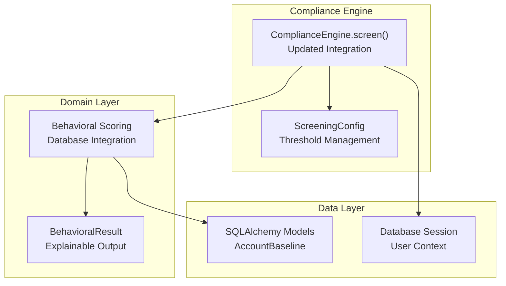
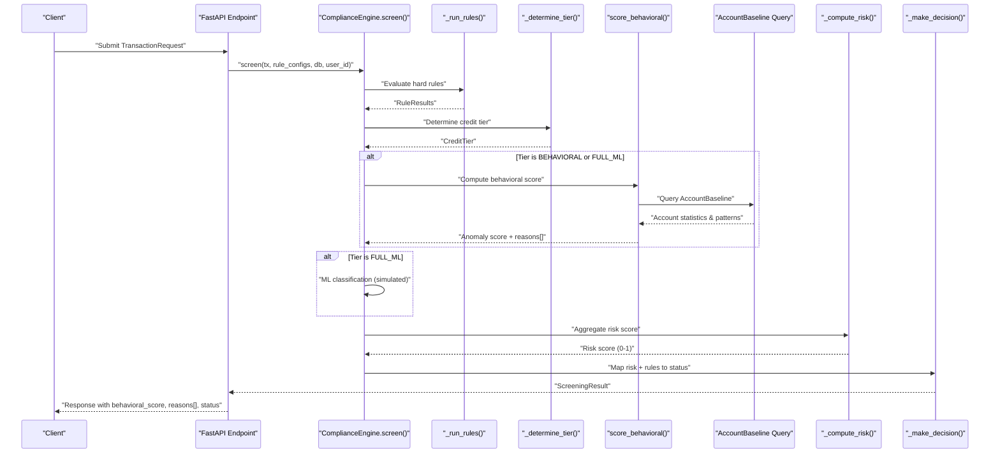
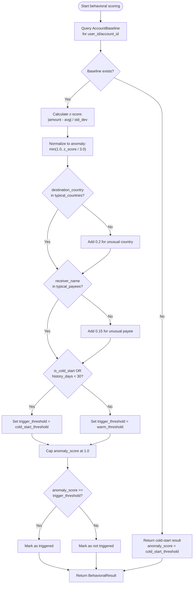
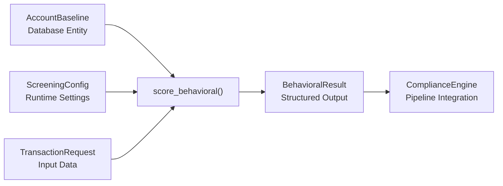

# Behavioral Analysis

<cite>
**Referenced Files in This Document**
- [scoring.py](file://backend/app/domain/behavioral/scoring.py)
- [compliance_engine.py](file://backend/app/compliance_engine.py)
- [models.py](file://backend/app/models.py)
- [db_models.py](file://backend/app/db_models.py)
- [config_service.py](file://backend/app/config_service.py)
</cite>

## Update Summary
**Changes Made**
- Updated behavioral scoring algorithm to use real AccountBaseline data from database
- Added new domain layer with sophisticated anomaly detection using z-scores and statistical analysis
- Enhanced explainability with detailed reasons arrays for each scoring decision
- Integrated cold-start detection with configurable thresholds
- Updated compliance engine integration to support database-backed scoring

## Table of Contents
1. [Introduction](#introduction)
2. [Project Structure](#project-structure)
3. [Core Components](#core-components)
4. [Architecture Overview](#architecture-overview)
5. [Detailed Component Analysis](#detailed-component-analysis)
6. [Dependency Analysis](#dependency-analysis)
7. [Performance Considerations](#performance-considerations)
8. [Troubleshooting Guide](#troubleshooting-guide)
9. [Conclusion](#conclusion)

## Introduction
This document explains the behavioral analysis component used by FinShield's compliance pipeline, focusing on the new domain-layer implementation that queries real AccountBaseline data from the database. The behavioral score is now computed using sophisticated statistical analysis including z-scores, typical pattern matching, and cold-start detection, returning both anomaly scores and detailed reasoning for explainability. The system integrates seamlessly with the compliance engine's screen() method, accepting database sessions and user context for personalized risk assessment.

## Project Structure
The behavioral analysis logic has been restructured into a dedicated domain layer:

- `backend/app/domain/behavioral/scoring.py` implements the core behavioral scoring algorithm with database integration
- `backend/app/domain/behavioral/__init__.py` exports the BehavioralResult class and score_behavioral function
- `backend/app/compliance_engine.py` orchestrates the 7-stage pipeline with updated behavioral integration
- `backend/app/models.py` defines request/response schemas including enhanced behavioral fields
- `backend/app/db_models.py` defines the AccountBaseline entity for storing per-account behavioral statistics
- `backend/app/config_service.py` provides configurable thresholds for cold-start and warm account handling

**Diagram sources**
- [scoring.py:1-109](file://backend/app/domain/behavioral/scoring.py#L1-L109)
- [compliance_engine.py:89-163](file://backend/app/compliance_engine.py#L89-L163)
- [db_models.py:318-352](file://backend/app/db_models.py#L318-L352)

**Section sources**
- [scoring.py:1-109](file://backend/app/domain/behavioral/scoring.py#L1-L109)
- [compliance_engine.py:1-440](file://backend/app/compliance_engine.py#L1-L440)
- [models.py:1-152](file://backend/app/models.py#L1-L152)
- [db_models.py:1-422](file://backend/app/db_models.py#L1-L422)
- [config_service.py:1-257](file://backend/app/config_service.py#L1-L257)

## Core Components
The behavioral analysis component now features a sophisticated domain-driven architecture:

### Behavioral Scoring Algorithm
The new `score_behavioral()` function computes anomaly scores using statistical analysis:

- **Z-score calculation**: Computes amount anomalies relative to account baseline using `(amount - avg_amount) / std_dev_amount`
- **Typical pattern matching**: Flags unusual destination countries and payees not in the account's historical patterns
- **Cold-start detection**: Identifies accounts with less than 30 days of history or explicit cold-start flags
- **Configurable thresholds**: Uses different trigger thresholds for cold-start (default 0.5) vs warm accounts (default 0.7)
- **Explainable output**: Returns detailed reasons arrays documenting each contributing factor

### Database Integration
The system queries real AccountBaseline data containing:

- Rolling statistics (90-day window): average amounts, standard deviations, frequency metrics
- Typical patterns: frequent destination countries, common payees, usual transaction types
- Account age tracking: first/last transaction dates, total transaction count, history duration
- Cold-start indicators: automatic flagging for accounts with insufficient history

### Enhanced Compliance Engine Integration
The compliance engine's `screen()` method now accepts additional parameters:

- `db`: SQLAlchemy session for database access
- `user_id`: User context for personalized baseline lookup
- Automatic fallback to heuristic scoring when database access is unavailable

**Section sources**
- [scoring.py:28-109](file://backend/app/domain/behavioral/scoring.py#L28-L109)
- [compliance_engine.py:287-330](file://backend/app/compliance_engine.py#L287-L330)
- [db_models.py:318-352](file://backend/app/db_models.py#L318-L352)

## Architecture Overview
The behavioral component now operates as a sophisticated statistical analyzer integrated into Stage 4 of the 7-stage pipeline.

**Diagram sources**
- [compliance_engine.py:89-163](file://backend/app/compliance_engine.py#L89-L163)
- [scoring.py:28-109](file://backend/app/domain/behavioral/scoring.py#L28-L109)
- [db_models.py:318-352](file://backend/app/db_models.py#L318-L352)

## Detailed Component Analysis

### Statistical Anomaly Detection Algorithm
The behavioral scoring uses sophisticated statistical methods:

#### Z-Score Amount Analysis
- Calculates z-score: `z = |amount - avg_amount| / std_dev_amount`
- Normalizes to anomaly score: `amount_anomaly = min(1.0, z_score / 3.0)`
- Handles zero standard deviation cases with special logic
- Adds 0.3+ anomaly contribution when z-score exceeds threshold

#### Pattern-Based Detection
- **Country anomaly**: +0.2 points if destination country not in typical_countries list
- **Payee anomaly**: +0.15 points if receiver name not in typical_payees list
- Both checks require corresponding baseline data to be available

#### Cold-Start Handling
- Accounts with `is_cold_start=True` or `history_days < 30` are flagged
- Higher trigger threshold (cold_start_threshold default 0.5) for cold accounts
- Lower trigger threshold (warm_threshold default 0.7) for established accounts
- Explicit reason logging for cold-start policy application

**Diagram sources**
- [scoring.py:28-109](file://backend/app/domain/behavioral/scoring.py#L28-L109)

**Section sources**
- [scoring.py:28-109](file://backend/app/domain/behavioral/scoring.py#L28-L109)

### Behavioral Result Structure
The system returns comprehensive results through the BehavioralResult dataclass:

- **anomaly_score**: Float between 0.0 and 1.0 representing calculated anomaly level
- **is_cold_start**: Boolean indicating if account lacks sufficient history
- **triggered**: Boolean indicating if score exceeds applicable threshold
- **trigger_threshold**: The threshold used (cold_start or warm)
- **reasons**: Array of strings explaining each contributing factor
- **baseline**: Optional dictionary with account statistics for transparency

### Integration With Overall Risk Calculation
The behavioral score integrates with aggregate risk calculation:

- Rule risk derived from triggered hard rules, capped at 1.0
- Aggregate risk starts with rule risk weighted at configurable percentage (default 50%)
- Behavioral contribution uses configurable weight (default 30%) when available
- Optional ML confidence contributes remaining weight (default 20%)
- Final risk score capped at 1.0

**Section sources**
- [compliance_engine.py:349-371](file://backend/app/compliance_engine.py#L349-L371)

### Influence on Credit Tier Decisions
Credit tiers determine whether behavioral analysis and ML classification are invoked:

- `FULL_ML`: Used when amount meets wire threshold or destination is high-risk; incurs maximum credits
- `BEHAVIORAL`: Used when any rule is triggered or amount >= 5k; incurs medium credits  
- `RULE_ONLY`: Default low-cost path without behavioral or ML stages

**Section sources**
- [compliance_engine.py:416-440](file://backend/app/compliance_engine.py#L416-L440)

### Behavioral Scoring Scenarios
Below are representative scenarios illustrating how the new statistical behavioral scoring works:

- **Small domestic transfer with baseline**: Amount 2k, type "wire", normal destination. Z-score near 0, no pattern anomalies; only random variation applies. Expected behavioral score near 0–0.1.
- **Medium international transfer with baseline**: Amount 12k, type "international", unusual destination. Moderate z-score plus 0.2 for unusual country; total before threshold check depends on baseline statistics.
- **Large high-risk transfer with baseline**: Amount 60k, type "international", destination in high-risk set. High z-score plus 0.2 for unusual country plus 0.15 for unusual payee; likely triggers review.
- **Cold-start account**: Any amount with no baseline history. Immediate cold-start policy application with higher threshold (0.5), triggering review for most transactions.
- **Established account with typical patterns**: Amount within normal range, familiar destination and payee. Low anomaly score, unlikely to trigger unless other factors present.

These scenarios demonstrate how statistical analysis replaces simple heuristics with personalized, data-driven scoring.

[No sources needed since this section provides conceptual examples]

### Current Implementation and Future Enhancements
- **Current state**: Behavioral scoring uses statistical analysis against real AccountBaseline data with z-scores and pattern matching. No trained ML model yet, but foundation is established for future enhancement.
- **Future enhancements**:
  - Replace statistical thresholds with trained classifier outputs
  - Incorporate temporal patterns and velocity checks beyond simple averages
  - Integrate with pgvector retrieval for semantic similarity analysis
  - Add calibration layers to map raw scores to calibrated probabilities
  - Implement continuous learning pipelines for adaptive baselines
  - Add feature attribution for explainable AI requirements

[No sources needed since this section provides general guidance]

## Dependency Analysis
The behavioral component depends on several interconnected systems:

- **AccountBaseline**: Database entity providing rolling statistics and typical patterns
- **ScreeningConfig**: Runtime configuration for thresholds and behavioral flags
- **TransactionRequest**: Input schema with sender_id for baseline lookup
- **BehavioralResult**: Structured output with explainability data

**Diagram sources**
- [scoring.py:28-109](file://backend/app/domain/behavioral/scoring.py#L28-L109)
- [db_models.py:318-352](file://backend/app/db_models.py#L318-L352)
- [config_service.py:191-230](file://backend/app/config_service.py#L191-L230)
- [models.py:66-82](file://backend/app/models.py#L66-L82)

**Section sources**
- [scoring.py:28-109](file://backend/app/domain/behavioral/scoring.py#L28-L109)
- [db_models.py:318-352](file://backend/app/db_models.py#L318-L352)
- [config_service.py:191-230](file://backend/app/config_service.py#L191-L230)
- [models.py:66-82](file://backend/app/models.py#L66-L82)

## Performance Considerations
- **Database queries**: O(1) lookup by user_id and account_id with proper indexing expected
- **Statistical calculations**: Constant-time arithmetic operations with minimal overhead
- **Pattern matching**: O(n) lookups in typical_countries and typical_payees lists (typically small)
- **Fallback mechanism**: Heuristic scoring available when database access is unavailable
- **Caching opportunities**: AccountBaseline queries could benefit from caching given repeated access patterns
- **Threshold configuration**: Runtime-configurable thresholds allow performance tuning without code changes

[No sources needed since this section provides general guidance]

## Troubleshooting Guide
- **Missing behavioral scores**: Verify that AccountBaseline records exist for the user_id/account_id combination; check database connectivity and permissions
- **Unexpectedly high scores**: Review AccountBaseline statistics for accuracy; verify that typical_countries and typical_payees lists are properly populated
- **Cold-start issues**: Check history_days and is_cold_start flags in AccountBaseline; ensure baseline computation runs regularly
- **Threshold problems**: Verify behavioral_cold_start_threshold and behavioral_warm_threshold settings in ScreeningConfig
- **Integration failures**: Ensure compliance_engine.screen() receives valid db session and user_id parameters
- **Performance issues**: Monitor database query times and consider adding appropriate indexes on user_id and account_id columns

**Section sources**
- [scoring.py:46-59](file://backend/app/domain/behavioral/scoring.py#L46-L59)
- [compliance_engine.py:301-313](file://backend/app/compliance_engine.py#L301-L313)
- [config_service.py:213-214](file://backend/app/config_service.py#L213-L214)

## Conclusion
The behavioral analysis component in FinShield has evolved from a simple heuristic-based system to a sophisticated statistical analyzer that leverages real account behavior data. The new domain-layer implementation provides explainable AI capabilities through detailed reasoning arrays, while maintaining backward compatibility through fallback mechanisms. The integration with AccountBaseline data enables personalized risk assessment based on individual account patterns, significantly improving detection accuracy over generic rules. Operators should monitor baseline quality, threshold configurations, and database performance to ensure optimal risk management and cost control. The foundation established here supports future enhancements toward fully machine learning-driven behavioral analysis.

[No sources needed since this section summarizes without analyzing specific files]