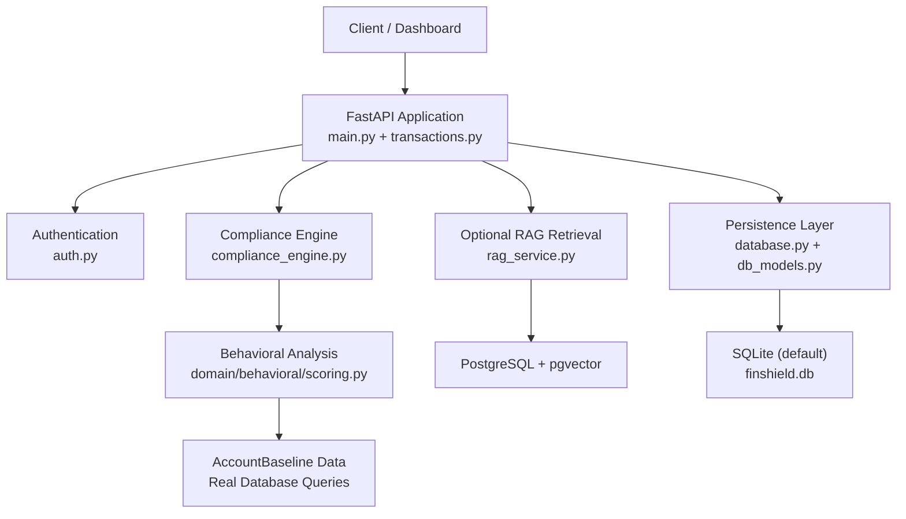
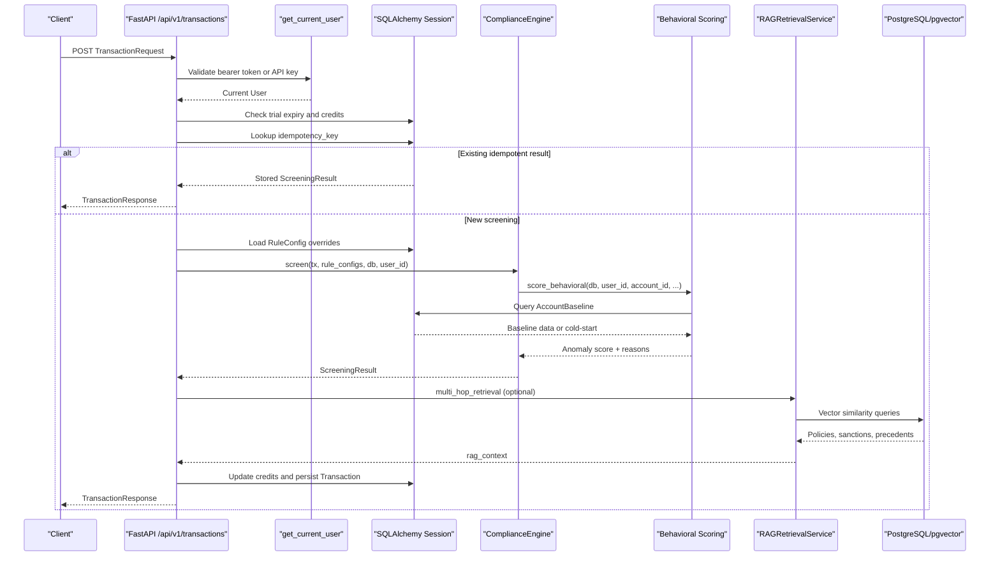
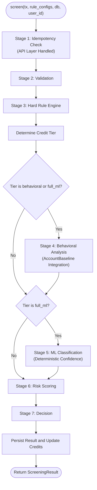
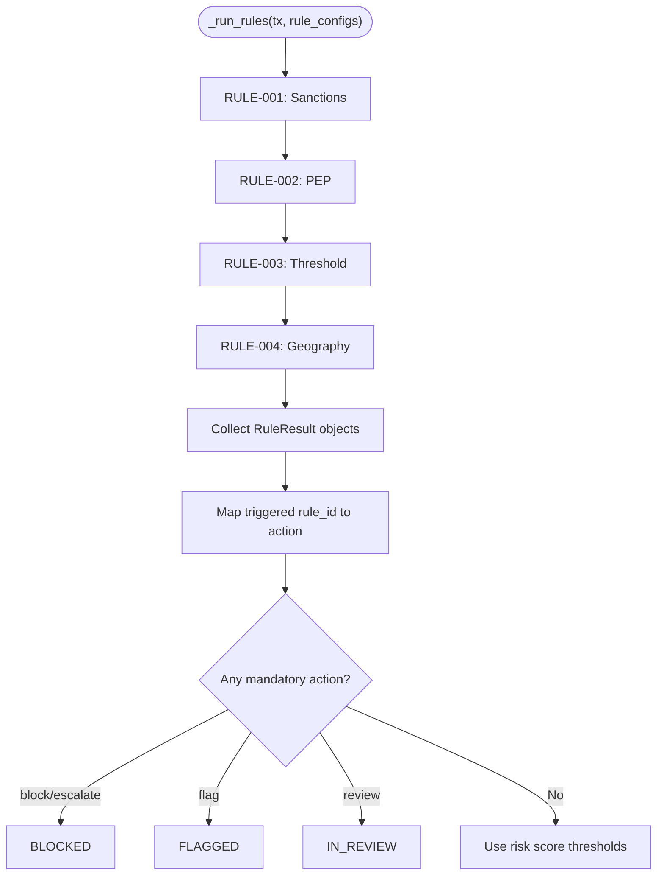
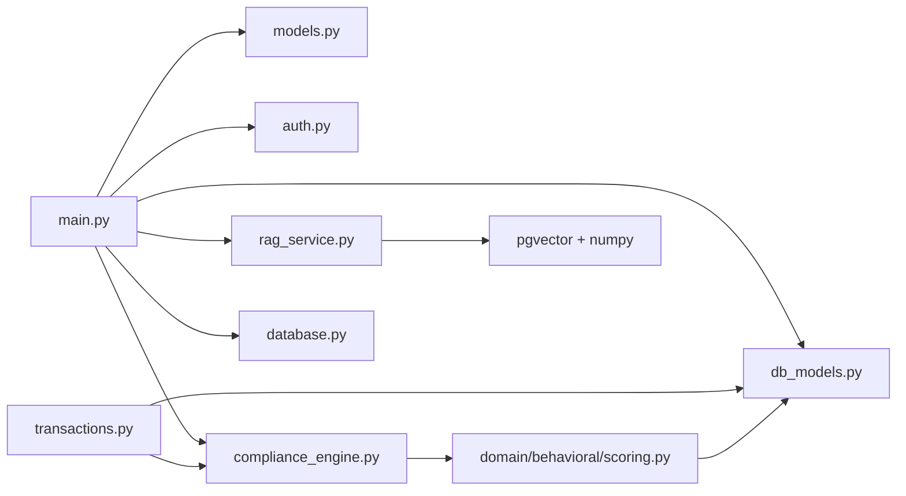

# Compliance Engine Architecture

<cite>
**Referenced Files in This Document**
- [compliance_engine.py](file://backend/app/compliance_engine.py)
- [main.py](file://backend/app/main.py)
- [transactions.py](file://backend/app/api/transactions.py)
- [models.py](file://backend/app/models.py)
- [db_models.py](file://backend/app/db_models.py)
- [auth.py](file://backend/app/auth.py)
- [rag_service.py](file://backend/app/rag_service.py)
- [database.py](file://backend/app/database.py)
- [seed_rag_data.py](file://backend/app/seed_rag_data.py)
- [scoring.py](file://backend/app/domain/behavioral/scoring.py)
- [test_compliance_engine.py](file://backend/tests/test_compliance_engine.py)
- [requirements.txt](file://backend/requirements.txt)
- [docker-compose.yml](file://docker-compose.yml)
</cite>

## Update Summary
**Changes Made**
- Updated Deterministic Screening Engine section to reflect SHA-256 hashing implementation replacing random.* calls
- Added Behavioral Analysis Integration section documenting real AccountBaseline data queries and heuristic fallback scoring
- Updated Idempotency Checks section to emphasize database-level handling with deterministic transaction ID generation
- Revised ML Classification section to document deterministic confidence calculations
- Updated performance considerations to highlight determinism benefits and behavioral analysis integration
- Enhanced troubleshooting guide with determinism-related issues

## Table of Contents
1. [Introduction](#introduction)
2. [Project Structure](#project-structure)
3. [Core Components](#core-components)
4. [Architecture Overview](#architecture-overview)
5. [Detailed Component Analysis](#detailed-component-analysis)
6. [Dependency Analysis](#dependency-analysis)
7. [Performance Considerations](#performance-considerations)
8. [Troubleshooting Guide](#troubleshooting-guide)
9. [Conclusion](#conclusion)

## Introduction
This document describes the implemented FinShield compliance engine as shipped in the repository. The core pipeline is a 7-stage processor that screens transactions through idempotency, validation, hard rules, behavioral analysis, ML classification, risk scoring, and decision logic. It is exposed through a FastAPI application with authentication, persistence, rate limiting, optional RAG enrichment, and user-configurable rule overrides.

The shipped implementation differs from aspirational documentation:
- The actual runtime stack is FastAPI, Pydantic, SQLAlchemy, SQLite by default, PostgreSQL/pgvector only for RAG when configured, JWT-based auth, bcrypt password hashing, slowapi rate limiting, numpy, pytest, psycopg2-binary, and pgvector.
- Celery, Redis, LangChain, DSPy, LoRA/PEFT/BitsAndBytes, vLLM, RAGAS, HashiCorp Vault, OpenTelemetry, Prometheus, structlog, and Kubernetes/Helm are not part of the shipped backend runtime; they appear in README aspirational sections or database schema comments but are not wired into the running API.
- Persistence defaults to SQLite (`finshield.db`), with `test_finshield.db` under test. PostgreSQL/pgvector is used only by the optional RAG retrieval service when `RAG_DATABASE_URL` points to PostgreSQL.

**Updated** The architecture has undergone a major transformation introducing deterministic screening with zero randomness, replacing all `random.*` calls with SHA-256 hashing for transaction IDs and ML confidence calculations. The behavioral analysis component now integrates with real AccountBaseline data queries while maintaining heuristic fallback scoring for cold-start scenarios.

## Project Structure
The relevant deployables for this architecture are:
- `backend/app/main.py`: FastAPI application, routes, middleware, exception handling, transaction screening endpoint, RAG enrichment, credit accounting, notifications, and analytics.
- `backend/app/compliance_engine.py`: Core `ComplianceEngine` implementing the 7-stage pipeline, rule definitions, behavioral scoring, ML classification simulation, risk scoring, and decision logic.
- `backend/app/api/transactions.py`: Transaction screening API endpoint with database-level idempotency handling.
- `backend/app/domain/behavioral/scoring.py`: Behavioral analysis domain module with real AccountBaseline integration and heuristic fallback scoring.
- `backend/app/models.py`: Pydantic request/response schemas and enums such as `TransactionRequest`, `ScreeningResult`, `ScreeningStatus`, `CreditTier`, and `RuleResult`.
- `backend/app/db_models.py`: SQLAlchemy ORM entities including `User`, `ApiKey`, `Transaction`, `Case`, `AuditLog`, `Notification`, `RuleConfig`, `CircuitBreaker`, `WebhookEvent`, and `AccountBaseline`.
- `backend/app/auth.py`: JWT bearer token and API key authentication dependency.
- `backend/app/rag_service.py`: Optional pgvector-backed semantic retrieval over policies, sanctions entries, and precedent decisions.
- `backend/app/database.py`: Default SQLite configuration, session factory, and table initialization.
- `backend/app/seed_rag_data.py`: Seed script for RAG corpus (policies, sanctions, precedents).
- `backend/tests/test_compliance_engine.py`: Unit tests covering rule triggers, credit tiers, pipeline stages, decisions, idempotency, and rule result structure.
- `docker-compose.yml`: Three services — `postgres` (pgvector image), `backend`, and `frontend` (Next.js dashboard). No Redis, Celery, or worker service.

**Diagram sources**
- [main.py:129-152](file://backend/app/main.py#L129-L152)
- [transactions.py:37-170](file://backend/app/api/transactions.py#L37-L170)
- [auth.py:59-113](file://backend/app/auth.py#L59-L113)
- [database.py:11-38](file://backend/app/database.py#L11-L38)
- [db_models.py:320-352](file://backend/app/db_models.py#L320-L352)
- [compliance_engine.py:30-162](file://backend/app/compliance_engine.py#L30-L162)
- [scoring.py:28-109](file://backend/app/domain/behavioral/scoring.py#L28-L109)
- [rag_service.py:145-155](file://backend/app/rag_service.py#L145-L155)

**Section sources**
- [main.py:1-149](file://backend/app/main.py#L1-L149)
- [transactions.py:1-319](file://backend/app/api/transactions.py#L1-L319)
- [compliance_engine.py:1-440](file://backend/app/compliance_engine.py#L1-L440)
- [scoring.py:1-109](file://backend/app/domain/behavioral/scoring.py#L1-L109)
- [models.py:1-152](file://backend/app/models.py#L1-L152)
- [db_models.py:1-422](file://backend/app/db_models.py#L1-L422)
- [auth.py:1-122](file://backend/app/auth.py#L1-L122)
- [rag_service.py:1-413](file://backend/app/rag_service.py#L1-L413)
- [database.py:1-45](file://backend/app/database.py#L1-L45)
- [seed_rag_data.py:1-198](file://backend/app/seed_rag_data.py#L1-L198)
- [docker-compose.yml:1-72](file://docker-compose.yml#L1-L72)

## Core Components
The compliance engine is centered on `ComplianceEngine.screen`, which orchestrates the full pipeline. Its responsibilities include:
- Validation acknowledgment (Pydantic performs input validation before the engine runs).
- Hard rule evaluation against sanctions, PEP, amount thresholds, and geography.
- Credit tier determination controlling whether behavioral analysis and ML classification run.
- Behavioral scoring based on real AccountBaseline data with heuristic fallback for cold-start scenarios.
- ML classification returning a risk class and deterministic confidence score.
- Weighted risk score combining rule hits, behavioral score, and ML confidence.
- Decision mapping that respects triggered rule actions and falls back to score-based thresholds.

Key data contracts are defined in `models.py`:
- `TransactionRequest` defines the incoming transaction fields, including an auto-generated idempotency key.
- `ScreeningResult` captures status, risk score, credit tier, credits consumed, rule results, behavioral and ML signals, latency, pipeline stages, and optional RAG context.
- `ScreeningStatus` enumerates outcomes: approved, flagged, blocked, in_review, pending.
- `CreditTier` controls cost and depth: rule_only, behavioral, full_ml.
- `RuleResult` records each rule's identity, type, name, trigger state, detail, and latency.

**Section sources**
- [compliance_engine.py:30-162](file://backend/app/compliance_engine.py#L30-L162)
- [models.py:17-63](file://backend/app/models.py#L17-L63)
- [models.py:67-119](file://backend/app/models.py#L67-L119)

## Architecture Overview
The transaction flow begins at the FastAPI `/api/v1/transactions` endpoint, authenticates the caller, checks trial and credit limits, enforces database-level idempotency, loads user rule configurations, invokes the compliance engine, optionally enriches the result with RAG retrieval, persists the outcome, updates credits, creates notifications, and returns the response.

**Diagram sources**
- [transactions.py:37-170](file://backend/app/api/transactions.py#L37-L170)
- [auth.py:59-113](file://backend/app/auth.py#L59-L113)
- [compliance_engine.py:89-162](file://backend/app/compliance_engine.py#L89-L162)
- [scoring.py:28-109](file://backend/app/domain/behavioral/scoring.py#L28-L109)
- [rag_service.py:361-412](file://backend/app/rag_service.py#L361-L412)

## Detailed Component Analysis

### Deterministic Screening Engine
**Updated** The screening engine has been transformed to eliminate all randomness, ensuring reproducible results for identical inputs:

- **SHA-256 Hashing**: Transaction IDs are generated using `hashlib.sha256(tx.idempotency_key.encode()).hexdigest()[:8]`, providing deterministic identifiers based on the idempotency key.
- **Zero Randomness**: All `random.*` calls have been removed from the screening path, eliminating nondeterministic behavior in ML confidence calculations and behavioral scoring.
- **Deterministic ML Confidence**: ML classification now uses deterministic confidence calculations based on behavioral scores rather than random values.
- **Reproducible Results**: Identical transaction payloads produce identical decisions, critical for AML compliance and audit trails.

Key implementation details:
- Transaction ID generation: `f"TX-{hashlib.sha256(tx.idempotency_key.encode()).hexdigest()[:8]}"`
- ML confidence calculation: Proportional to behavioral score differences, no random components
- Behavioral scoring: Uses z-score calculations against AccountBaseline statistics

**Section sources**
- [compliance_engine.py:7](file://backend/app/compliance_engine.py#L7)
- [compliance_engine.py:148](file://backend/app/compliance_engine.py#L148)
- [compliance_engine.py:333-346](file://backend/app/compliance_engine.py#L333-L346)

### Behavioral Analysis Integration
**Updated** The behavioral analysis component now integrates with real AccountBaseline data while maintaining robust fallback mechanisms:

- **Real Database Integration**: Behavioral scoring queries actual `AccountBaseline` records from the database using user_id and account_id.
- **Z-Score Anomaly Detection**: Uses statistical z-score calculations against historical transaction patterns (average amount, standard deviation).
- **Cold-Start Handling**: Accounts without sufficient history receive higher suspicion scores with explicit cold-start policy application.
- **Heuristic Fallback**: When database access is unavailable, falls back to heuristic scoring based on amount thresholds and country risk.
- **Rich Reasoning**: Provides detailed reasons for anomaly detection including amount z-scores, unusual countries, and atypical payees.

Behavioral scoring logic:
- Z-score calculation: `z_score = abs(amount - baseline.avg_amount) / baseline.std_dev_amount`
- Cold-start threshold: 0.5 (higher suspicion for new accounts)
- Warm account threshold: 0.7 (lower suspicion for established accounts)
- Country and payee pattern matching against typical behavior profiles

**Section sources**
- [compliance_engine.py:287-330](file://backend/app/compliance_engine.py#L287-L330)
- [scoring.py:28-109](file://backend/app/domain/behavioral/scoring.py#L28-L109)
- [db_models.py:320-352](file://backend/app/db_models.py#L320-L352)

### 7-Stage Pipeline Implementation
The pipeline stages are explicitly tracked in `pipeline_stages` and executed in order:

1. **Idempotency check**: Now handled entirely at the API layer via database lookup using `Transaction.idempotency_key` scoped to the current user. The engine stage is a placeholder that simply records the stage execution.
2. **Validation**: Input validation is delegated to Pydantic; the engine assumes a valid `TransactionRequest`.
3. **Hard rule engine**: Evaluates sanctions, PEP, threshold, and geography rules, respecting per-user enablement and custom parameters.
4. **Behavioral analysis**: Runs when the determined credit tier is `behavioral` or `full_ml`, integrating with real AccountBaseline data.
5. **ML classification**: Runs only for `full_ml` tier, returning a risk class and deterministic confidence score.
6. **Risk scoring**: Combines rule hit count, behavioral score, and ML confidence into a bounded 0–1 score.
7. **Decision**: Applies mandatory rule actions first, then falls back to score-based thresholds.

**Diagram sources**
- [compliance_engine.py:89-162](file://backend/app/compliance_engine.py#L89-L162)

**Section sources**
- [compliance_engine.py:89-162](file://backend/app/compliance_engine.py#L89-L162)
- [test_compliance_engine.py:115-137](file://backend/tests/test_compliance_engine.py#L115-L137)

### Idempotency Checks
**Updated** The idempotency system has been enhanced with deterministic transaction ID generation:

- **Single Source of Truth**: All idempotency logic is now handled in the API layer (`transactions.py`) through database queries using `Transaction.idempotency_key` scoped to the current user.
- **Process-Safe**: The previous in-memory cache within `ComplianceEngine` has been completely removed, eliminating memory leaks and multi-replica correctness issues.
- **Database-Level Enforcement**: Before invoking the compliance engine, the API checks if a transaction with the same `idempotency_key` exists for the current user. If found, it returns the stored result without re-running the pipeline.
- **User Isolation**: Idempotency is enforced per user, preventing cross-user interference.
- **Deterministic IDs**: Transaction IDs are generated using SHA-256 hashing of the idempotency key, ensuring reproducibility.

Important behavior:
- The API layer ensures repeated submissions with the same key return the persisted result and avoid double-charging credits.
- The compliance engine itself no longer maintains any state related to idempotency.
- Tests assert that identical keys return identical results and different keys produce different transaction IDs.
- Transaction IDs are deterministic: same idempotency key always produces the same transaction ID.

**Section sources**
- [transactions.py:56-76](file://backend/app/api/transactions.py#L56-L76)
- [compliance_engine.py:148](file://backend/app/compliance_engine.py#L148)
- [test_compliance_engine.py:176-200](file://backend/tests/test_compliance_engine.py#L176-L200)

### Sanitization and Input Handling
Sanitization is minimal in the current implementation:
- Pydantic validates types, ranges, and lengths.
- Rule checks normalize names to lowercase before set membership checks.
- There is no explicit HTML/script sanitization, PII masking, or structured input normalization beyond Pydantic constraints.

For production deployments, additional input sanitization should be added before rule evaluation and persistence if untrusted text can contain harmful payloads.

**Section sources**
- [models.py:67-83](file://backend/app/models.py#L67-L83)
- [compliance_engine.py:184-193](file://backend/app/compliance_engine.py#L184-L193)
- [compliance_engine.py:197-206](file://backend/app/compliance_engine.py#L197-L206)

### Circuit Breaker Evaluation
The repository includes a `CircuitBreaker` ORM entity describing downstream dependency state, failure counts, cooldowns, and half-open probing. However, the active transaction screening path does not implement circuit breaker gating around dependencies. Instead:
- RAG retrieval is optional and wrapped in try/except; failures are logged and do not block screening.
- The main transaction route does not consult `CircuitBreaker` state before calling RAG or other external systems.
- The health and degraded-mode routing described in README are not implemented in the current API.

Therefore, the shipped system provides graceful degradation for RAG but not a general-purpose circuit breaker pattern across all dependencies.

**Section sources**
- [db_models.py:275-293](file://backend/app/db_models.py#L275-L293)
- [transactions.py:84-106](file://backend/app/api/transactions.py#L84-L106)
- [README.md:47-53](file://README.md#L47-L53)

### Hard Rule Engine
The hard rule engine evaluates four built-in rules:
- RULE-001: Sanctions list match against sender name.
- RULE-002: PEP match against sender or receiver name.
- RULE-003: Amount threshold, differentiated by wire vs international.
- RULE-004: High-risk country check.

Each rule produces a `RuleResult` with trigger state, detail, and latency. Rules can be enabled/disabled and parameterized via `RuleConfig.custom_parameters` loaded from the database.

Rule action enforcement:
- Sanctions → block
- PEP → flag
- Threshold → review
- Geography → escalate

A triggered mandatory action overrides the aggregate risk score. If no rule action fires, the decision falls back to risk score thresholds.

**Diagram sources**
- [compliance_engine.py:164-240](file://backend/app/compliance_engine.py#L164-L240)
- [compliance_engine.py:332-361](file://backend/app/compliance_engine.py#L332-L361)

**Section sources**
- [compliance_engine.py:40-87](file://backend/app/compliance_engine.py#L40-L87)
- [compliance_engine.py:164-240](file://backend/app/compliance_engine.py#L164-L240)
- [compliance_engine.py:242-278](file://backend/app/compliance_engine.py#L242-L278)
- [compliance_engine.py:332-361](file://backend/app/compliance_engine.py#L332-L361)
- [db_models.py:184-209](file://backend/app/db_models.py#L184-L209)
- [test_compliance_engine.py:38-80](file://backend/tests/test_compliance_engine.py#L38-L80)

### Behavioral Analysis
**Updated** Behavioral scoring now integrates with real AccountBaseline data while maintaining heuristic fallback:

- **Database Integration**: Queries actual `AccountBaseline` records for statistical analysis of historical transaction patterns.
- **Z-Score Calculations**: Uses mathematical z-score formulas to detect anomalies relative to account history.
- **Cold-Start Policy**: New accounts (< 30 days history) receive higher suspicion scores with explicit cold-start reasoning.
- **Pattern Recognition**: Detects unusual destination countries and atypical payees compared to historical patterns.
- **Heuristic Fallback**: Falls back to simple amount thresholds and country risk when database access is unavailable.

Scoring components:
- Amount z-score: Statistical deviation from account average
- Country anomaly: Unusual destinations outside typical patterns  
- Payee anomaly: Atypical receivers compared to historical data
- Cold-start adjustment: Higher baseline suspicion for new accounts

**Section sources**
- [compliance_engine.py:287-330](file://backend/app/compliance_engine.py#L287-L330)
- [scoring.py:28-109](file://backend/app/domain/behavioral/scoring.py#L28-L109)

### ML Classification
**Updated** ML classification now uses deterministic confidence calculations:

- **Deterministic Confidence**: Confidence scores are calculated proportionally to behavioral scores rather than using random values.
- **Behavioral Mapping**: High behavioral scores map to high-risk classification with proportional confidence.
- **Threshold-Based Logic**: Medium and low behavioral scores map to corresponding risk classifications with deterministic confidence bounds.
- **No Randomness**: All confidence calculations use mathematical functions without random components.

Classification logic:
- Behavioral > 0.6: high_risk with confidence min(0.7 + (behavioral - 0.6) * 0.75, 0.99)
- Behavioral > 0.3: medium_risk with confidence min(0.5 + (behavioral - 0.3) * 1.17, 0.85)
- Behavioral ≤ 0.3: low_risk with confidence min(0.6 + (0.3 - behavioral) * 1.17, 0.95)

**Section sources**
- [compliance_engine.py:333-346](file://backend/app/compliance_engine.py#L333-L346)

### Risk Scoring
Risk scoring combines:
- Rule hit count scaled to a maximum contribution.
- Behavioral score contribution when available.
- ML confidence contribution when available.
- Baseline contributions when behavioral or ML signals are absent.

The final score is clamped to 0–1.

**Section sources**
- [compliance_engine.py:349-371](file://backend/app/compliance_engine.py#L349-L371)

### Decision Logic and Gating
Decision logic prioritizes rule actions:
- `block` or `escalate` → BLOCKED
- `flag` → FLAGGED
- `review` → IN_REVIEW
- Otherwise, score-based thresholds:
  - High risk or multiple rule triggers with moderate risk → BLOCKED
  - Moderate risk → FLAGGED
  - Lower risk → IN_REVIEW
  - Clean → APPROVED

Gating is currently implemented as rule-action override plus score thresholds. There is no explicit disagreement gate between rule engine, behavioral analysis, and ML classification. The RAG enrichment step can upgrade an approved transaction to flagged if sanctions matches are found, preventing silent auto-approval in that case.

**Section sources**
- [compliance_engine.py:373-413](file://backend/app/compliance_engine.py#L373-L413)
- [transactions.py:99-103](file://backend/app/api/transactions.py#L99-L103)

### Credit Tier Determination
Credit tier determines pipeline depth and credits consumed:
- `full_ml`: Used when amount exceeds the configurable wire threshold or destination is high-risk. Consumes 1.0 credit.
- `behavioral`: Used when any rule triggered or amount exceeds a lower threshold. Consumes 0.5 credit.
- `rule_only`: Default for clean, small transactions. Consumes 0.2 credit.

User-provided rule overrides for thresholds and countries affect tier selection.

**Section sources**
- [compliance_engine.py:416-440](file://backend/app/compliance_engine.py#L416-L440)
- [test_compliance_engine.py:87-109](file://backend/tests/test_compliance_engine.py#L87-L109)

### RAG Enrichment
RAG enrichment is optional and non-blocking:
- Initialized only if `RAG_DATABASE_URL` starts with `postgresql` and pgvector dependencies are available.
- Retrieves policies, sanctions matches, and similar precedents using cosine similarity over 384-dimensional vectors.
- Embeddings use either sentence-transformers (optional) or deterministic hashing embeddings backed by numpy.
- If RAG finds sanctions matches and the transaction was approved, it upgrades the decision to flagged and raises the minimum risk score.

**Section sources**
- [main.py:40-45](file://backend/app/main.py#L40-L45)
- [main.py:123-135](file://backend/app/main.py#L123-L135)
- [transactions.py:84-106](file://backend/app/api/transactions.py#L84-L106)
- [rag_service.py:7-13](file://backend/app/rag_service.py#L7-L13)
- [rag_service.py:52-80](file://backend/app/rag_service.py#L52-L80)
- [rag_service.py:145-155](file://backend/app/rag_service.py#L145-L155)
- [rag_service.py:361-412](file://backend/app/rag_service.py#L361-L412)
- [seed_rag_data.py:10-24](file://backend/app/seed_rag_data.py#L10-L24)

### Authentication and Authorization
Authentication supports:
- Bearer JWT tokens decoded via python-jose.
- API keys with `fsk_` prefix, hashed and stored in the database.
- Account activation checks.
- Token expiration and invalid payload handling.

Authorization is user-scoped: transactions, cases, and rule configs are filtered by `user_id`.

**Section sources**
- [auth.py:21-24](file://backend/app/auth.py#L21-L24)
- [auth.py:59-113](file://backend/app/auth.py#L59-L113)
- [transactions.py:37-44](file://backend/app/api/transactions.py#L37-L44)
- [transactions.py:46-54](file://backend/app/api/transactions.py#L46-L54)

### Persistence Model
The persistence model stores:
- Users, API keys, transactions, cases, audit logs, notifications, rule configs, case comments, notes, filings, circuit breaker state, webhook events, and account baselines.
- Transactions include screening outputs: status, risk score, credit tier, credits consumed, rule results, behavioral score, ML classification, ML confidence, latency, pipeline stages, and RAG context.
- Account baselines store rolling statistics, typical patterns, and cold-start indicators for behavioral analysis.

Default database is SQLite; PostgreSQL/pgvector is required only for RAG.

**Section sources**
- [database.py:11-38](file://backend/app/database.py#L11-L38)
- [db_models.py:22-106](file://backend/app/db_models.py#L22-L106)
- [db_models.py:184-353](file://backend/app/db_models.py#L184-L353)
- [db_models.py:320-352](file://backend/app/db_models.py#L320-L352)
- [docker-compose.yml:4-15](file://docker-compose.yml#L4-L15)

## Dependency Analysis
The main module depends on:
- `app.database` for sessions and initialization.
- `app.db_models` for ORM entities.
- `app.auth` for authentication helpers and dependency.
- `app.compliance_engine` for screening logic.
- `app.models` for request/response schemas.
- `app.rag_service` conditionally for RAG retrieval.
- `app.domain.behavioral` for behavioral analysis integration.

**Diagram sources**
- [main.py:19-37](file://backend/app/main.py#L19-L37)
- [transactions.py:14-28](file://backend/app/api/transactions.py#L14-L28)
- [compliance_engine.py:11-20](file://backend/app/compliance_engine.py#L11-L20)
- [scoring.py:12-14](file://backend/app/domain/behavioral/scoring.py#L12-L14)
- [rag_service.py:15-24](file://backend/app/rag_service.py#L15-L24)
- [database.py:8-24](file://backend/app/database.py#L8-L24)

**Section sources**
- [main.py:19-37](file://backend/app/main.py#L19-L37)
- [transactions.py:14-28](file://backend/app/api/transactions.py#L14-L28)
- [compliance_engine.py:11-20](file://backend/app/compliance_engine.py#L11-L20)
- [scoring.py:12-14](file://backend/app/domain/behavioral/scoring.py#L12-L14)
- [rag_service.py:15-24](file://backend/app/rag_service.py#L15-L24)
- [database.py:8-24](file://backend/app/database.py#L8-L24)

## Performance Considerations
**Updated** Performance characteristics have improved significantly with the introduction of deterministic processing and behavioral analysis integration:

- **Pipeline short-circuiting**: Small, clean transactions may run only the hard rule engine, avoiding behavioral and ML costs.
- **Database idempotency**: Single source of truth prevents duplicate charges and redundant work at the API boundary. Eliminates memory leaks and multi-replica consistency issues.
- **Deterministic Processing**: Zero randomness eliminates computational overhead from random number generation and ensures reproducible results.
- **Behavioral Analysis Optimization**: Real AccountBaseline queries provide accurate anomaly detection while heuristic fallback ensures performance when database access is unavailable.
- **Optional RAG**: RAG retrieval is skipped when not configured or unavailable, keeping screening functional.
- **Latency tracking**: Each rule and the overall pipeline record latency for observability.
- **Rate limiting**: SlowAPI applies per-IP limits to protect the API.
- **SQLite concurrency**: SQLite is single-writer by default; high-throughput production workloads should consider PostgreSQL for the primary store.
- **Statistical Efficiency**: Z-score calculations leverage pre-computed baseline statistics rather than real-time computation.

## Troubleshooting Guide
Common issues and their locations:
- **Invalid request data**: Pydantic validation errors return 422 with error details.
- **Authentication failures**: Missing, expired, or invalid tokens/API keys return 401; disabled accounts return 403.
- **Trial expired**: Trial users past expiry receive 403.
- **Insufficient credits**: Users below 1 credit receive 402.
- **RAG failures**: RAG exceptions are logged and ignored; screening continues normally.
- **Unhandled exceptions**: Global exception handler returns 500 with generic detail.
- **Idempotency confusion**: Database idempotency is persistent and user-scoped; there is no longer any in-memory caching to confuse.
- **RAG requires PostgreSQL**: Without `RAG_DATABASE_URL` pointing to PostgreSQL, RAG is skipped.
- **Determinism issues**: Transaction IDs should be reproducible; check that idempotency keys are consistent.
- **Behavioral analysis failures**: Cold-start accounts receive higher suspicion scores; check AccountBaseline data availability.

Operational checks:
- Verify `DATABASE_URL` for primary persistence.
- Verify `RAG_DATABASE_URL` for vector search.
- Check logs for RAG initialization warnings.
- Confirm rate limit configuration and client IP behavior.
- Inspect `pipeline_stages` and `total_latency_ms` in screening results.
- Validate AccountBaseline data for behavioral analysis accuracy.
- Test determinism by screening identical transactions and comparing results.

**Section sources**
- [main.py:72-106](file://backend/app/main.py#L72-L106)
- [transactions.py:46-106](file://backend/app/api/transactions.py#L46-L106)
- [database.py:11-38](file://backend/app/database.py#L11-L38)
- [rag_service.py:31-44](file://backend/app/rag_service.py#L31-L44)
- [test_compliance_engine.py:160-169](file://backend/tests/test_compliance_engine.py#L160-L169)

## Conclusion
The shipped FinShield compliance engine implements a clear, testable 7-stage pipeline focused on deterministic hard rules, configurable credit-tier gating, integrated behavioral heuristics, and simulated ML classification. Decisions are primarily driven by rule actions with score-based fallbacks. RAG enrichment adds optional semantic context and can prevent false approvals when sanctions matches are found.

**Updated** Key architectural improvements include:
- **Deterministic Processing**: Complete elimination of randomness ensures reproducible results critical for AML compliance.
- **Real Behavioral Analysis**: Integration with AccountBaseline data provides statistically sound anomaly detection.
- **Robust Fallback Mechanisms**: Heuristic scoring ensures functionality even when database dependencies are unavailable.
- **Enhanced Auditability**: Deterministic transaction IDs and detailed reasoning support compliance requirements.

Key limitations relative to aspirational design:
- No real ML model serving, LoRA adapters, or DSPy compilation.
- No Celery/Redis workers, event bus, or async task queue.
- No operational circuit breaker wiring despite schema support.
- Primary persistence defaults to SQLite unless overridden.
- Sanctions and PEP lists are in-memory sets, not live regulatory feeds.

Recommended next steps for production readiness:
- Replace simulated behavioral and ML components with real models and robust scoring.
- Implement true circuit breaker state transitions around external dependencies.
- Add comprehensive input sanitization and PII handling.
- Migrate primary persistence to PostgreSQL for scale and reliability.
- Integrate live sanctions and PEP feeds with fuzzy matching and audit trails.
- Extend gating logic to explicitly handle disagreement between rule engine, behavioral analysis, and ML classification.
- Enhance AccountBaseline computation frequency and accuracy for improved behavioral detection.