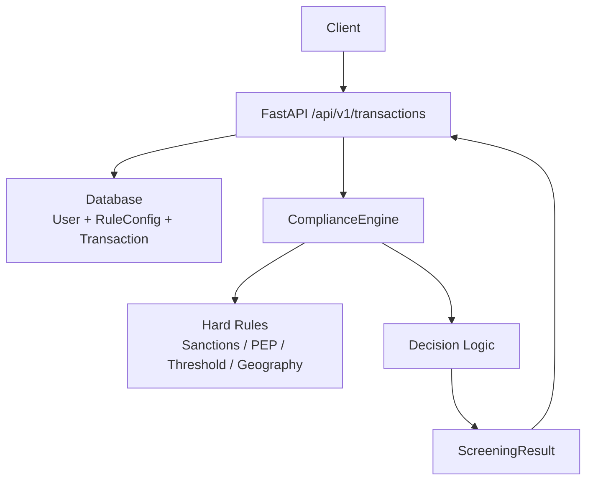
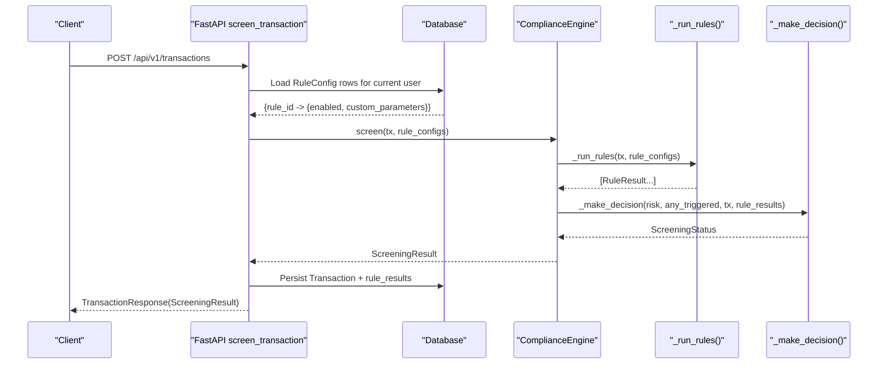
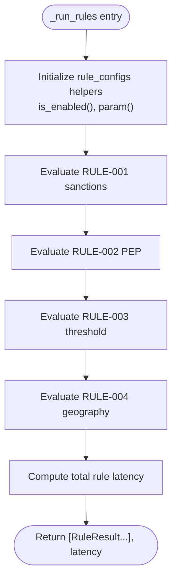
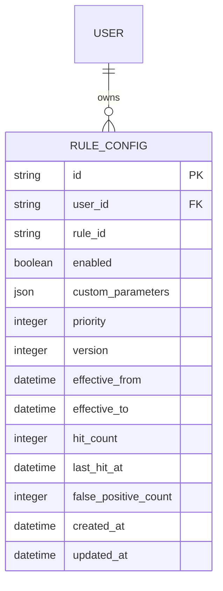
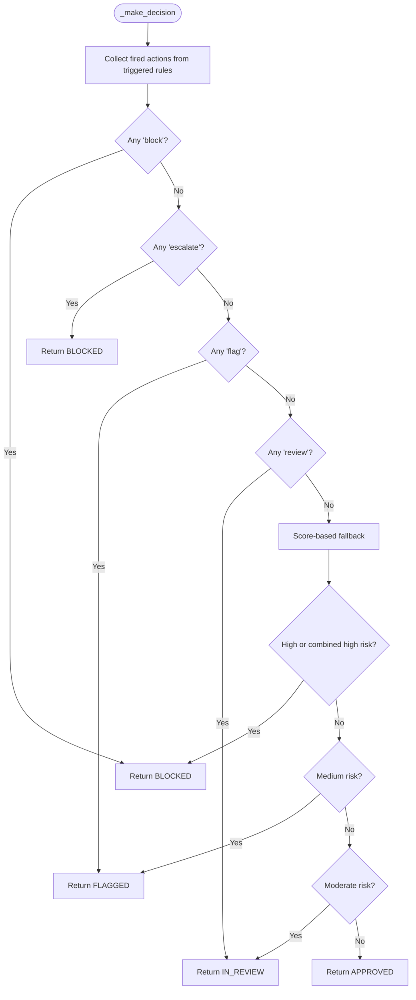
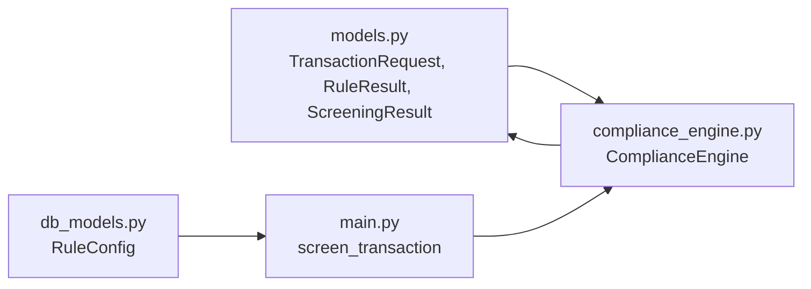

# Hard Rule Engine

<cite>
**Referenced Files in This Document**
- [compliance_engine.py](file://backend/app/compliance_engine.py)
- [models.py](file://backend/app/models.py)
- [db_models.py](file://backend/app/db_models.py)
- [main.py](file://backend/app/main.py)
- [test_compliance_engine.py](file://backend/tests/test_compliance_engine.py)
</cite>

## Table of Contents
1. [Introduction](#introduction)
2. [Project Structure](#project-structure)
3. [Core Components](#core-components)
4. [Architecture Overview](#architecture-overview)
5. [Detailed Component Analysis](#detailed-component-analysis)
6. [Dependency Analysis](#dependency-analysis)
7. [Performance Considerations](#performance-considerations)
8. [Troubleshooting Guide](#troubleshooting-guide)
9. [Conclusion](#conclusion)

## Introduction
This document explains the hard rule evaluation system implemented in `_run_rules()` and `evaluate_rule()`. It covers:
- The four built-in rule types: sanctions screening, PEP checking, amount thresholds (wire vs international), and high-risk geography checks.
- How rule configurations work through the `rule_configs` parameter, including per-user enabled/disabled overrides and `custom_parameters` for threshold values and country lists.
- The `RuleResult` structure with triggered status, detail messages, and latency tracking.
- Examples of rule evaluation scenarios, configuration patterns, and performance considerations.
- How rule actions (`block`, `flag`, `review`, `escalate`) map to final decision outcomes.

The hard rules are part of a broader seven-stage compliance pipeline that also includes behavioral analysis, ML classification, risk scoring, and decision logic. This document focuses on the hard rule engine while explaining its relationship to the rest of the pipeline.

## Project Structure
The hard rule engine lives in the backend FastAPI application:
- `backend/app/compliance_engine.py` defines `ComplianceEngine`, the hard rule evaluation methods, and the full pipeline orchestration.
- `backend/app/models.py` defines request/response schemas, including `TransactionRequest`, `RuleResult`, `ScreeningResult`, and enums such as `RuleType` and `ScreeningStatus`.
- `backend/app/db_models.py` defines the persisted `RuleConfig` model used by the API layer to load user-specific rule overrides.
- `backend/app/main.py` loads user rule configs from the database and passes them into `engine.screen(tx, rule_configs=...)`.
- `backend/tests/test_compliance_engine.py` validates rule triggering, credit tiers, pipeline stages, decisions, idempotency, and rule result structure.

**Diagram sources**
- [main.py:434-570](file://backend/app/main.py#L434-L570)
- [compliance_engine.py:89-162](file://backend/app/compliance_engine.py#L89-L162)
- [compliance_engine.py:165-240](file://backend/app/compliance_engine.py#L165-L240)
- [models.py:67-119](file://backend/app/models.py#L67-L119)

**Section sources**
- [compliance_engine.py:1-381](file://backend/app/compliance_engine.py#L1-L381)
- [models.py:1-152](file://backend/app/models.py#L1-L152)
- [db_models.py:184-210](file://backend/app/db_models.py#L184-L210)
- [main.py:434-570](file://backend/app/main.py#L434-L570)
- [test_compliance_engine.py:1-224](file://backend/tests/test_compliance_engine.py#L1-L224)

## Core Components
The hard rule engine is centered around `ComplianceEngine`:
- `screen()` runs the full pipeline and delegates hard-rule evaluation to `_run_rules()`.
- `_run_rules()` evaluates all four built-in rules, applies per-user `rule_configs`, and returns a list of `RuleResult` objects plus total rule latency.
- `evaluate_rule()` provides a simpler single-rule evaluator used for simulation or testing.
- `_make_decision()` maps triggered rule actions to final `ScreeningStatus` values.

Key data structures:
- `TransactionRequest`: validated transaction input.
- `RuleResult`: one row per evaluated rule, including whether it triggered, human-readable detail, and latency.
- `ScreeningResult`: full pipeline output, including status, risk score, credit tier, rule results, and latency.

**Section sources**
- [compliance_engine.py:30-162](file://backend/app/compliance_engine.py#L30-L162)
- [compliance_engine.py:165-278](file://backend/app/compliance_engine.py#L165-L278)
- [models.py:67-119](file://backend/app/models.py#L67-L119)

## Architecture Overview
The hard rule engine integrates into the transaction screening flow:

**Diagram sources**
- [main.py:434-570](file://backend/app/main.py#L434-L570)
- [compliance_engine.py:89-162](file://backend/app/compliance_engine.py#L89-L162)
- [compliance_engine.py:165-240](file://backend/app/compliance_engine.py#L165-L240)
- [compliance_engine.py:339-361](file://backend/app/compliance_engine.py#L339-L361)

## Detailed Component Analysis

### Rule Evaluation Entry Points

#### `_run_rules(tx, rule_configs)`
`_run_rules()` is the core hard-rule evaluator. For each rule:
1. It checks whether the rule is enabled via `is_enabled(rule_id)`.
2. It resolves parameters via `param(rule_id, key, default)`, which reads `custom_parameters` from `rule_configs`.
3. It computes the rule condition against `tx`.
4. It appends a `RuleResult` with `triggered`, optional `detail`, and `latency_ms`.
5. It tracks per-rule and total rule latency.

Built-in rules:
- Sanctions: compares sender name against a hardcoded set.
- PEP: compares sender and receiver names against a hardcoded set.
- Threshold: selects wire or international threshold based on `transaction_type`.
- Geography: checks `destination_country` against a configurable country list.

If a rule is disabled through `rule_configs`, it is skipped entirely and no `RuleResult` is appended for that rule.

**Diagram sources**
- [compliance_engine.py:165-240](file://backend/app/compliance_engine.py#L165-L240)

**Section sources**
- [compliance_engine.py:165-240](file://backend/app/compliance_engine.py#L165-L240)

#### `evaluate_rule(rule_def, tx_data)`
`evaluate_rule()` is a simplified evaluator for a single rule definition and raw transaction data. It does not use `rule_configs`; instead, it reads defaults from `rule_def["parameters"]`. It returns a dictionary with a `triggered` boolean.

Use cases:
- Simulation scripts.
- Testing individual rule logic without the full pipeline.
- Backward-compatible rule evaluation where rule definitions are already normalized.

**Section sources**
- [compliance_engine.py:242-278](file://backend/app/compliance_engine.py#L242-L278)

### Built-In Rule Types

#### Sanctions Screening (RULE-001)
- Purpose: Block transactions where the sender matches a known sanctions entity.
- Implementation: Compares `tx.sender_name.lower()` against `SANCTIONED_ENTITIES`.
- Default action: `block`.
- Trigger condition: Exact case-insensitive match of sender name.
- Configuration: No editable parameters; only enabled/disabled via `rule_configs`.
- Detail message: Includes the matched sender name when triggered.

Example scenario:
- Sender name matches a sanctioned entity → rule triggers → decision becomes blocked unless overridden by higher-level policy.

Performance consideration:
- Constant-time lookup against a small in-memory set.
- Very low latency; typically negligible compared to I/O-bound steps.

**Section sources**
- [compliance_engine.py:21-26](file://backend/app/compliance_engine.py#L21-L26)
- [compliance_engine.py:46-56](file://backend/app/compliance_engine.py#L46-L56)
- [compliance_engine.py:182-193](file://backend/app/compliance_engine.py#L182-L193)
- [compliance_engine.py:246-249](file://backend/app/compliance_engine.py#L246-L249)

#### PEP Checking (RULE-002)
- Purpose: Flag transactions involving politically exposed persons for enhanced due diligence.
- Implementation: Checks both sender and receiver names against `PEP_ENTITIES`.
- Default action: `flag`.
- Trigger condition: Case-insensitive match of either party.
- Configuration: No editable parameters; only enabled/disabled via `rule_configs`.
- Detail message: Generic “PEP match found” when triggered.

Example scenario:
- Sender or receiver is a PEP → rule triggers → decision becomes flagged.

Performance consideration:
- Two constant-time lookups against a small in-memory set.
- Low latency.

**Section sources**
- [compliance_engine.py:21-26](file://backend/app/compliance_engine.py#L21-L26)
- [compliance_engine.py:57-66](file://backend/app/compliance_engine.py#L57-L66)
- [compliance_engine.py:195-206](file://backend/app/compliance_engine.py#L195-L206)
- [compliance_engine.py:251-257](file://backend/app/compliance_engine.py#L251-L257)

#### Amount Thresholds (RULE-003)
- Purpose: Review transactions exceeding reporting thresholds for their type.
- Threshold selection:
  - If `transaction_type == "wire"`, use the wire threshold.
  - Otherwise, use the international threshold.
- Default thresholds:
  - Wire: $10,000.
  - International: $50,000.
- Default action: `review`.
- Configuration:
  - `custom_parameters.wire` overrides the wire threshold.
  - `custom_parameters.international` overrides the international threshold.
- Trigger condition: `tx.amount >= selected_threshold`.
- Detail message: Shows the actual amount and threshold when triggered.

Example scenarios:
- Wire transfer of $15,000 → exceeds wire threshold → rule triggers → decision becomes in review.
- International transfer of $40,000 → below international threshold → rule does not trigger.
- Per-user override: Set wire threshold to $20,000 → $15,000 wire no longer triggers.

Performance consideration:
- Simple numeric comparison after parameter resolution.
- Negligible CPU cost.

**Section sources**
- [compliance_engine.py:25-26](file://backend/app/compliance_engine.py#L25-L26)
- [compliance_engine.py:67-76](file://backend/app/compliance_engine.py#L67-L76)
- [compliance_engine.py:208-222](file://backend/app/compliance_engine.py#L208-L222)
- [compliance_engine.py:259-267](file://backend/app/compliance_engine.py#L259-L267)

#### High-Risk Geography Check (RULE-004)
- Purpose: Block or escalate transactions destined for embargoed or high-risk jurisdictions.
- Default high-risk countries: A fixed set including several restricted jurisdictions.
- Default action: `escalate`.
- Configuration:
  - `custom_parameters.countries` overrides the high-risk country list.
  - Accepts list, tuple, or set; otherwise falls back to the default set.
- Trigger condition: `tx.destination_country` is present and contained in the configured country set.
- Detail message: Indicates the destination country is high-risk when triggered.

Example scenarios:
- Destination country is in the high-risk list → rule triggers → decision becomes blocked because `escalate` maps to blocked.
- Per-user override: Remove a country from the list → transactions to that country no longer trigger.
- Missing destination country → rule does not trigger.

Performance consideration:
- Country lookup uses a set for O(1) membership testing.
- Low latency.

**Section sources**
- [compliance_engine.py:24](file://backend/app/compliance_engine.py#L24)
- [compliance_engine.py:77-86](file://backend/app/compliance_engine.py#L77-L86)
- [compliance_engine.py:224-237](file://backend/app/compliance_engine.py#L224-L237)
- [compliance_engine.py:269-276](file://backend/app/compliance_engine.py#L269-L276)

### Rule Configurations and Per-User Overrides

#### How `rule_configs` Works
`rule_configs` is a dictionary keyed by `rule_id`. Each value can contain:
- `enabled`: Boolean override. If missing, the rule defaults to enabled.
- `custom_parameters`: Dictionary overriding rule-specific parameters.

Resolution helpers inside `_run_rules()`:
- `is_enabled(rule_id, default=True)`: Returns the override if present; otherwise returns the default.
- `param(rule_id, key, default)`: Reads `custom_parameters[key]` if available; otherwise returns the engine default.

#### Integration with the API Layer
The `/api/v1/transactions` endpoint:
1. Loads `RuleConfig` rows for the authenticated user.
2. Converts them into `{rule_id: {enabled, custom_parameters}}`.
3. Passes this mapping to `engine.screen(tx, rule_configs=user_rule_configs)`.

This means per-user rule behavior is controlled by the persisted `RuleConfig` table.

#### Database Schema for Rule Configs
`RuleConfig` stores:
- `user_id`: Owner of the configuration.
- `rule_id`: Target rule identifier.
- `enabled`: Whether the rule is active for the user.
- `custom_parameters`: JSON field for user overrides.
- Additional fields for priority, versioning, effective dates, hit tracking, and metadata.

**Diagram sources**
- [db_models.py:22-56](file://backend/app/db_models.py#L22-L56)
- [db_models.py:184-210](file://backend/app/db_models.py#L184-L210)

#### Example Configuration Patterns
- Disable sanctions screening for a specific user:
  - `rule_configs["RULE-001"] = {"enabled": False}`
- Lower the wire threshold for a user:
  - `rule_configs["RULE-003"] = {"custom_parameters": {"wire": 5000.0}}`
- Restrict high-risk countries to a smaller set:
  - `rule_configs["RULE-004"] = {"custom_parameters": {"countries": ["KP", "IR"]}}`
- Combine multiple overrides:
  - `rule_configs["RULE-003"] = {"enabled": True, "custom_parameters": {"international": 100000.0}}`

Important note:
- If a rule is disabled, `_run_rules()` skips it entirely.
- If a rule is enabled but has no `custom_parameters`, defaults apply.

**Section sources**
- [compliance_engine.py:89-96](file://backend/app/compliance_engine.py#L89-L96)
- [compliance_engine.py:165-178](file://backend/app/compliance_engine.py#L165-L178)
- [main.py:475-482](file://backend/app/main.py#L475-L482)
- [db_models.py:184-210](file://backend/app/db_models.py#L184-L210)

### RuleResult Structure
`RuleResult` represents the outcome of one hard rule evaluation:
- `rule_id`: Identifier such as `RULE-001`.
- `rule_type`: Enum value such as `sanctions`, `pep`, `threshold`, or `geography`.
- `rule_name`: Human-readable name shown in UIs and logs.
- `triggered`: Boolean indicating whether the rule fired.
- `detail`: Optional human-readable explanation, populated when triggered.
- `latency_ms`: Time spent evaluating that rule, rounded to two decimal places.

`ScreeningResult` aggregates these into:
- `rule_results`: List of `RuleResult` objects.
- `total_latency_ms`: End-to-end pipeline latency.
- `pipeline_stages`: Ordered list of executed stages.

Tests verify:
- All four rule types appear in `rule_results` when enabled.
- Every rule result has non-negative latency.
- Rule IDs and rule names are present.

**Section sources**
- [models.py:95-119](file://backend/app/models.py#L95-L119)
- [compliance_engine.py:182-237](file://backend/app/compliance_engine.py#L182-L237)
- [test_compliance_engine.py:207-224](file://backend/tests/test_compliance_engine.py#L207-L224)

### Rule Actions and Final Decisions

#### Action Mapping
Each built-in rule has an associated action:
- `RULE-001` (sanctions): `block`
- `RULE-002` (PEP): `flag`
- `RULE-003` (threshold): `review`
- `RULE-004` (geography): `escalate`

#### Decision Logic
`_make_decision()` prioritizes triggered rule actions over the aggregate risk score:
1. If any triggered rule has action `block`, the final status is `BLOCKED`.
2. If any triggered rule has action `escalate`, the final status is also `BLOCKED`.
3. If any triggered rule has action `flag`, the final status is `FLAGGED`.
4. If any triggered rule has action `review`, the final status is `IN_REVIEW`.
5. If no rule action fires, the decision falls back to risk-score thresholds:
   - High risk or strongly suspicious combined score → `BLOCKED`.
   - Medium-high risk → `FLAGGED`.
   - Moderate risk → `IN_REVIEW`.
   - Low risk → `APPROVED`.

**Diagram sources**
- [compliance_engine.py:329-361](file://backend/app/compliance_engine.py#L329-L361)

#### Relationship Between Actions and Outcomes
- Sanctions match → block → blocked.
- PEP match → flag → flagged.
- Threshold exceeded → review → in review.
- High-risk geography → escalate → blocked.

This design ensures that hard controls are authoritative: a triggered sanction or high-risk geography check cannot be silently approved by a lower aggregate risk score.

**Section sources**
- [compliance_engine.py:329-361](file://backend/app/compliance_engine.py#L329-L361)

### Rule Evaluation Scenarios

#### Scenario 1: Clean Wire Transfer
- Input: Small wire transfer, clean sender/receiver, safe destination.
- Expected rules:
  - Sanctions: not triggered.
  - PEP: not triggered.
  - Threshold: not triggered.
  - Geography: not triggered.
- Decision: Likely approved unless other pipeline stages raise risk.

#### Scenario 2: Sanctioned Sender
- Input: Sender matches a sanctioned entity.
- Expected rules:
  - Sanctions: triggered.
- Decision: Blocked due to `block` action.

#### Scenario 3: PEP Involvement
- Input: Sender or receiver is a PEP.
- Expected rules:
  - PEP: triggered.
- Decision: Flagged due to `flag` action.

#### Scenario 4: Wire Exceeding Threshold
- Input: Wire above the wire threshold.
- Expected rules:
  - Threshold: triggered.
- Decision: In review due to `review` action.

#### Scenario 5: High-Risk Destination
- Input: Destination country is in the high-risk list.
- Expected rules:
  - Geography: triggered.
- Decision: Blocked because `escalate` maps to blocked.

#### Scenario 6: User Override Disabling Sanctions
- Input: Same as Scenario 2, but user config disables `RULE-001`.
- Expected behavior:
  - Sanctions rule is skipped.
  - Other rules may still fire depending on transaction details.
- Decision: Depends on remaining triggered rules and risk score.

**Section sources**
- [test_compliance_engine.py:38-80](file://backend/tests/test_compliance_engine.py#L38-L80)
- [test_compliance_engine.py:144-169](file://backend/tests/test_compliance_engine.py#L144-L169)
- [compliance_engine.py:182-237](file://backend/app/compliance_engine.py#L182-L237)
- [compliance_engine.py:329-361](file://backend/app/compliance_engine.py#L329-L361)

## Dependency Analysis

**Diagram sources**
- [models.py:67-119](file://backend/app/models.py#L67-L119)
- [db_models.py:184-210](file://backend/app/db_models.py#L184-L210)
- [main.py:434-570](file://backend/app/main.py#L434-L570)
- [compliance_engine.py:89-162](file://backend/app/compliance_engine.py#L89-L162)

### Coupling and Cohesion
- `ComplianceEngine` depends on `models.py` for request/response shapes and enums.
- The API layer depends on `db_models.py` to load user rule configurations.
- Hard rules are cohesive within `_run_rules()`, while decision logic is separated into `_make_decision()`.
- External dependencies are minimal: standard library modules (`time`, `random`, `uuid`, `datetime`) and Pydantic models.

### Potential Circular Dependencies
- There are no circular imports between the analyzed files.
- `compliance_engine.py` imports from `models.py`.
- `main.py` imports from both `compliance_engine.py` and `db_models.py`.
- `db_models.py` does not import from `compliance_engine.py`.

**Section sources**
- [compliance_engine.py:1-381](file://backend/app/compliance_engine.py#L1-L381)
- [models.py:1-152](file://backend/app/models.py#L1-L152)
- [db_models.py:1-353](file://backend/app/db_models.py#L1-L353)
- [main.py:1-570](file://backend/app/main.py#L1-L570)

## Performance Considerations

### Hard Rule Evaluation
- Sanctions and PEP checks are constant-time set lookups.
- Threshold checks involve simple numeric comparisons.
- Geography checks use a set for O(1) country membership tests.
- Total rule latency is tracked per rule and aggregated.

### Pipeline-Level Performance
- `screen()` measures end-to-end latency using `time.monotonic()`.
- Idempotency cache avoids reprocessing identical requests during the process lifetime.
- Credit-tier determination can skip behavioral and ML stages for low-risk transactions.
- RAG enrichment is optional and non-blocking; failures do not prevent screening completion.

### Optimization Opportunities
- Replace in-memory sets with indexed database-backed lists if sanctions/PEP lists grow large.
- Cache frequently used rule configurations at the API layer if database queries become a bottleneck.
- Add structured logging for rule hits to support observability and tuning.
- Consider parallelizing independent rule evaluations if rule count grows significantly.

[No sources needed since this section provides general guidance]

## Troubleshooting Guide

### Common Issues

#### Rule Not Triggering When Expected
- Verify the rule is enabled in `rule_configs`.
- Check `custom_parameters` for incorrect threshold values or country lists.
- Confirm the transaction fields match the rule’s expectations:
  - Sanctions: sender name must match exactly (case-insensitive).
  - PEP: sender or receiver name must match.
  - Threshold: ensure correct `transaction_type`.
  - Geography: ensure `destination_country` is present and correctly cased.

#### Unexpected Blocked Decision
- Sanctions and high-risk geography rules both map to blocked decisions.
- Check whether `RULE-001` or `RULE-004` triggered.
- Review `rule_results.detail` for the exact reason.

#### Unexpected Flagged or In-Review Decision
- PEP triggers flagged.
- Threshold triggers in review.
- If no rule action fires, check the aggregate risk score and pipeline stages.

#### Missing Rule Results
- Disabled rules are skipped entirely.
- Ensure the rule ID exists in `rule_definitions()` and is not disabled by user config.

#### Latency Anomalies
- Inspect `rule_results[].latency_ms` and `ScreeningResult.total_latency_ms`.
- High latency may indicate slow downstream services (RAG, database, ML) rather than hard rules.

**Section sources**
- [compliance_engine.py:165-240](file://backend/app/compliance_engine.py#L165-L240)
- [compliance_engine.py:329-361](file://backend/app/compliance_engine.py#L329-L361)
- [test_compliance_engine.py:207-224](file://backend/tests/test_compliance_engine.py#L207-L224)

## Conclusion
The hard rule engine in FinShield provides four focused compliance checks:
- Sanctions screening blocks sanctioned senders.
- PEP checking flags politically exposed persons.
- Amount thresholds review large wires or international transfers.
- High-risk geography checks escalate restricted destinations, which map to blocked decisions.

Rule behavior is configurable per user through `rule_configs`, supporting enabled/disabled toggles and parameter overrides such as thresholds and country lists. The `RuleResult` structure captures whether each rule triggered, why, and how long it took. Final decisions prioritize triggered rule actions, ensuring that hard controls remain authoritative even when aggregate risk scores are moderate.

For production use, operators should:
- Validate rule configurations before enabling them.
- Monitor rule hit rates and latencies.
- Keep sanctions and PEP lists accurate and up to date.
- Use per-user overrides carefully to avoid weakening required compliance controls.

[No sources needed since this section summarizes without analyzing specific files]