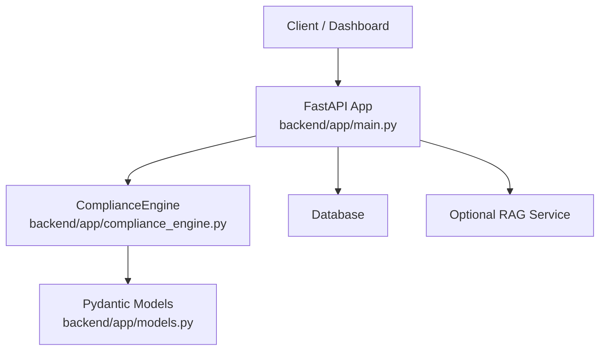
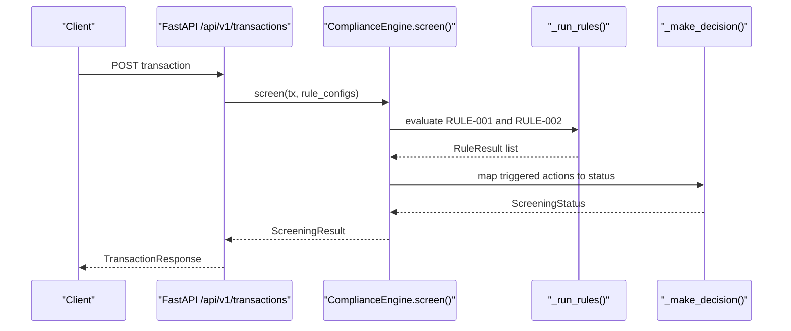
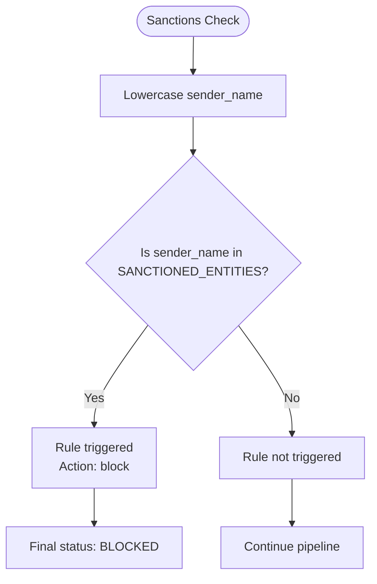
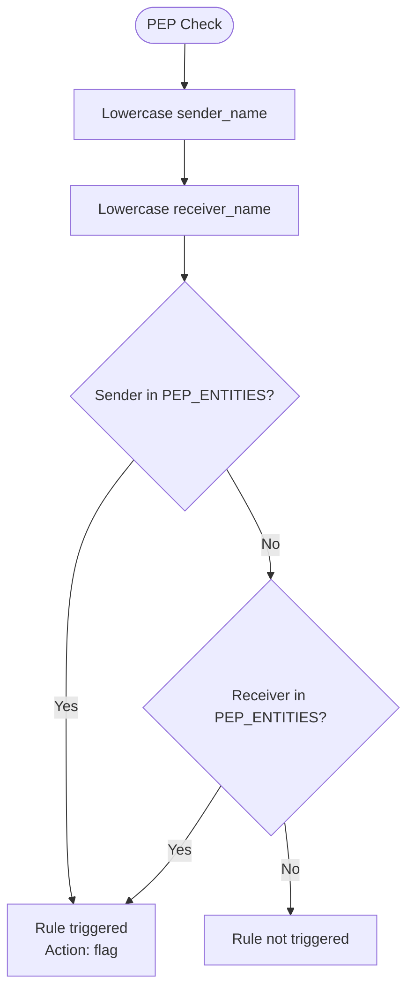
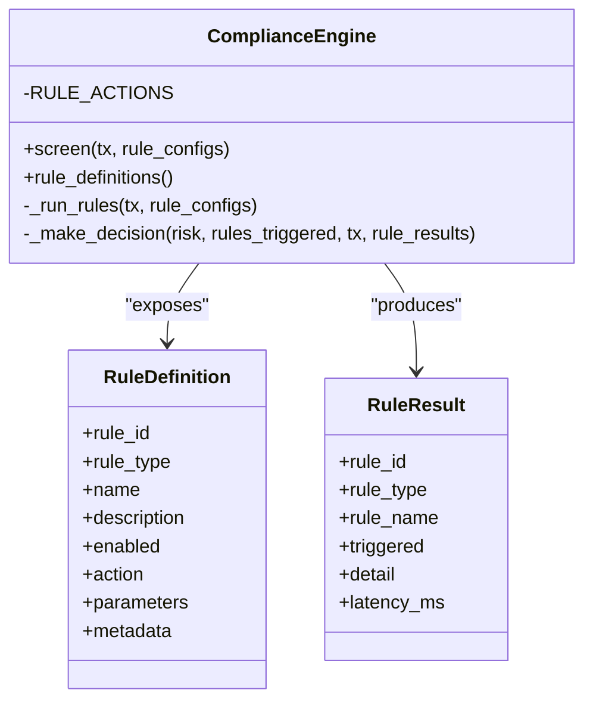
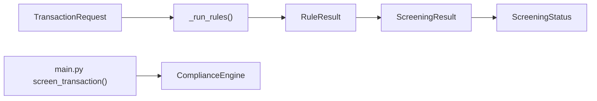

# Sanctions & PEP Rules

<cite>
**Referenced Files in This Document**
- [compliance_engine.py](file://backend/app/compliance_engine.py)
- [models.py](file://backend/app/models.py)
- [main.py](file://backend/app/main.py)
- [test_compliance_engine.py](file://backend/tests/test_compliance_engine.py)
</cite>

## Table of Contents
1. [Introduction](#introduction)
2. [Project Structure](#project-structure)
3. [Core Components](#core-components)
4. [Architecture Overview](#architecture-overview)
5. [Detailed Component Analysis](#detailed-component-analysis)
6. [Dependency Analysis](#dependency-analysis)
7. [Performance Considerations](#performance-considerations)
8. [Troubleshooting Guide](#troubleshooting-guide)
9. [Conclusion](#conclusion)

## Introduction
This document explains the sanctions and Politically Exposed Person (PEP) rule implementations in FinShield’s hard rule engine. It focuses on:

- RULE-001: OFAC Sanctions List Match, which performs exact string matching against a hardcoded set of sanctioned entities and always triggers a block action.
- RULE-002: Politically Exposed Person Check, which matches both sender_name and receiver_name against a hardcoded PEP entity set and triggers a flag action.
- Case sensitivity handling, partial name matching behavior, and security implications.
- The hardcoded entity lists and how they are exposed to the rules management UI.
- Production extension patterns for dynamic sanction list updates.
- Performance considerations for large entity sets and optimization strategies.

The compliance pipeline is implemented as a seven-stage process inside `ComplianceEngine`, with the hard rule engine being stage three. User-configurable rule overrides are supported for some rules, but the sanctions and PEP rules are intentionally deterministic and not user-editable.

## Project Structure
The sanctions and PEP logic lives in the backend FastAPI application:

- `backend/app/compliance_engine.py` defines the `ComplianceEngine`, its hardcoded entity lists, rule definitions, screening pipeline, and decision mapping.
- `backend/app/models.py` defines request/response schemas, including `TransactionRequest`, `RuleResult`, `ScreeningResult`, and enums such as `ScreeningStatus` and `RuleType`.
- `backend/app/main.py` mounts the FastAPI app, loads per-user rule configuration from the database, invokes the engine, persists results, and enriches them with optional RAG context.
- `backend/tests/test_compliance_engine.py` contains unit tests that validate rule triggering, credit tiers, pipeline stages, decisions, idempotency, and rule result structure.

**Diagram sources**
- [main.py:129-152](file://backend/app/main.py#L129-L152)
- [main.py:434-570](file://backend/app/main.py#L434-L570)
- [compliance_engine.py:30-162](file://backend/app/compliance_engine.py#L30-L162)
- [models.py:67-119](file://backend/app/models.py#L67-L119)

**Section sources**
- [compliance_engine.py:1-87](file://backend/app/compliance_engine.py#L1-L87)
- [models.py:15-119](file://backend/app/models.py#L15-L119)
- [main.py:129-152](file://backend/app/main.py#L129-L152)
- [test_compliance_engine.py:38-80](file://backend/tests/test_compliance_engine.py#L38-L80)

## Core Components
The core components relevant to sanctions and PEP rules are:

| Component | Responsibility | Key Behavior |
|---|---|---|
| `SANCTIONED_ENTITIES` | Hardcoded sanctions entity set | Exact lowercase membership check for sender names. |
| `PEP_ENTITIES` | Hardcoded PEP entity set | Exact lowercase membership check for sender and receiver names. |
| `ComplianceEngine.rule_definitions()` | Exposes rule metadata to the UI | Marks RULE-001 and RULE-002 as non-editable; includes list sizes. |
| `ComplianceEngine._run_rules()` | Executes hard rules | Performs case-insensitive exact matching and records latency. |
| `ComplianceEngine.RULE_ACTIONS` | Maps rule IDs to mandatory actions | RULE-001 maps to `block`; RULE-002 maps to `flag`. |
| `ComplianceEngine._make_decision()` | Converts triggered rule actions into final status | Block/escalate force blocked; flag forces flagged; review forces in-review. |
| `TransactionRequest` | Incoming transaction schema | Provides `sender_name`, `receiver_name`, and other fields used by rules. |
| `RuleResult` | Per-rule outcome | Records whether the rule was triggered, detail text, and latency. |
| `ScreeningResult` | Pipeline output | Includes status, risk score, rule results, and pipeline stages. |

**Section sources**
- [compliance_engine.py:21-28](file://backend/app/compliance_engine.py#L21-L28)
- [compliance_engine.py:39-87](file://backend/app/compliance_engine.py#L39-L87)
- [compliance_engine.py:164-240](file://backend/app/compliance_engine.py#L164-L240)
- [compliance_engine.py:332-361](file://backend/app/compliance_engine.py#L332-L361)
- [models.py:67-119](file://backend/app/models.py#L67-L119)

## Architecture Overview
The sanctions and PEP rules are part of the hard rule engine, which runs after input validation and before behavioral analysis, ML classification, risk scoring, and final decision making.

**Diagram sources**
- [main.py:434-570](file://backend/app/main.py#L434-L570)
- [compliance_engine.py:89-162](file://backend/app/compliance_engine.py#L89-L162)
- [compliance_engine.py:164-240](file://backend/app/compliance_engine.py#L164-L240)
- [compliance_engine.py:339-361](file://backend/app/compliance_engine.py#L339-L361)

## Detailed Component Analysis

### RULE-001: OFAC Sanctions List Match
RULE-001 is designed to block transactions where the sender name exactly matches an entry in the hardcoded `SANCTIONED_ENTITIES` set.

Key implementation details:

- Entity set: `SANCTIONED_ENTITIES` is a Python set containing lowercase strings.
- Matching logic: The sender name is converted to lowercase and checked for membership in `SANCTIONED_ENTITIES`.
- Action: The rule is declared with action `block`.
- Editability: The rule definition marks the list as non-editable through metadata.
- Decision override: `_make_decision()` maps a triggered RULE-001 to `BLOCKED`, overriding the aggregate risk score.

**Diagram sources**
- [compliance_engine.py:21-28](file://backend/app/compliance_engine.py#L21-L28)
- [compliance_engine.py:182-193](file://backend/app/compliance_engine.py#L182-L193)
- [compliance_engine.py:332-361](file://backend/app/compliance_engine.py#L332-L361)

Case sensitivity handling:
- The comparison uses `tx.sender_name.lower()`, so `"GlobalRemit"` matches the lowercase `"globalremit"` entry.
- This means the rule is case-insensitive for input, but the stored entity list is lowercase.

Partial name matching behavior:
- The match is exact membership in a Python set.
- A sender name like `"GlobalRemit Corp"` does not match `"globalremit"`.
- Only the full normalized sender name must equal one of the stored entries.

Security implications:
- Exact matching reduces false positives from substring matches.
- It also increases the risk of evasion if sanctioned entities use slight variations in casing, spacing, or suffixes.
- Because the rule always maps to `block`, it cannot be disabled or softened by user configuration.

Concrete example based on tests:
- A sender named `"GlobalRemit"` triggers the sanctions rule and produces a blocked status.
- A clean sender such as `"Normal Corp"` does not trigger the rule.

**Section sources**
- [compliance_engine.py:21-28](file://backend/app/compliance_engine.py#L21-L28)
- [compliance_engine.py:46-56](file://backend/app/compliance_engine.py#L46-L56)
- [compliance_engine.py:182-193](file://backend/app/compliance_engine.py#L182-L193)
- [compliance_engine.py:332-361](file://backend/app/compliance_engine.py#L332-L361)
- [test_compliance_engine.py:39-50](file://backend/tests/test_compliance_engine.py#L39-L50)
- [test_compliance_engine.py:150-158](file://backend/tests/test_compliance_engine.py#L150-L158)

### RULE-002: Politically Exposed Person Check
RULE-002 flags transactions involving politically exposed persons by checking both sender and receiver names against the hardcoded `PEP_ENTITIES` set.

Key implementation details:

- Entity set: `PEP_ENTITIES` is a Python set containing lowercase strings.
- Matching logic: Both `tx.sender_name.lower()` and `tx.receiver_name.lower()` are checked for membership in `PEP_ENTITIES`.
- Action: The rule is declared with action `flag`.
- Editability: The rule definition marks the list as non-editable through metadata.
- Decision override: `_make_decision()` maps a triggered RULE-002 to `FLAGGED`.

**Diagram sources**
- [compliance_engine.py:21-28](file://backend/app/compliance_engine.py#L21-L28)
- [compliance_engine.py:195-206](file://backend/app/compliance_engine.py#L195-L206)
- [compliance_engine.py:332-361](file://backend/app/compliance_engine.py#L332-L361)

Case sensitivity handling:
- Both sender and receiver names are lowercased before lookup.
- `"Senator XYZ"` matches the lowercase `"senator xyz"` entry.

Partial name matching behavior:
- The match is exact membership in a Python set.
- A name like `"Senator XYZ Jr."` does not match `"senator xyz"`.
- Substring matches such as `"xyz"` do not match unless the full normalized name equals an entry.

Security implications:
- Flagging rather than blocking allows enhanced due diligence without automatically stopping legitimate transactions.
- Exact matching avoids broad false positives but can miss variants or aliases.
- The rule cannot be edited or disabled through the rule definition metadata.

Concrete example based on tests:
- A sender named `"Senator XYZ"` triggers the PEP rule.

**Section sources**
- [compliance_engine.py:21-28](file://backend/app/compliance_engine.py#L21-L28)
- [compliance_engine.py:57-66](file://backend/app/compliance_engine.py#L57-L66)
- [compliance_engine.py:195-206](file://backend/app/compliance_engine.py#L195-L206)
- [compliance_engine.py:332-361](file://backend/app/compliance_engine.py#L332-L361)
- [test_compliance_engine.py:52-56](file://backend/tests/test_compliance_engine.py#L52-L56)

### Deterministic Enforcement vs User Configuration Overrides
The engine supports per-user rule configuration overrides, but RULE-001 and RULE-002 are intentionally deterministic:

- `rule_definitions()` exposes `editable: False` for both rules.
- The rule action mapping in `RULE_ACTIONS` assigns fixed actions: `block` for RULE-001 and `flag` for RULE-002.
- `_make_decision()` enforces these actions when the rules are triggered.
- Other rules, such as amount thresholds and high-risk geography, expose editable parameters and metadata.

**Diagram sources**
- [compliance_engine.py:39-87](file://backend/app/compliance_engine.py#L39-L87)
- [compliance_engine.py:164-240](file://backend/app/compliance_engine.py#L164-L240)
- [compliance_engine.py:332-361](file://backend/app/compliance_engine.py#L332-L361)
- [models.py:95-119](file://backend/app/models.py#L95-L119)

**Section sources**
- [compliance_engine.py:39-87](file://backend/app/compliance_engine.py#L39-L87)
- [compliance_engine.py:164-240](file://backend/app/compliance_engine.py#L164-L240)
- [compliance_engine.py:332-361](file://backend/app/compliance_engine.py#L332-L361)

### Hardcoded Entity Lists
The current implementation uses two module-level sets:

| Set | Purpose | Current Entries | Editable? |
|---|---|---|---|
| `SANCTIONED_ENTITIES` | Sanctions screening | Three lowercase entity strings | No |
| `PEP_ENTITIES` | PEP screening | Three lowercase PEP strings | No |

These sets are directly referenced by the rule evaluation logic. They are also reflected in the rule definition metadata as `list_size`, allowing the rules UI to display their size without exposing internal values.

**Section sources**
- [compliance_engine.py:21-28](file://backend/app/compliance_engine.py#L21-L28)
- [compliance_engine.py:46-66](file://backend/app/compliance_engine.py#L46-L66)

### Production Extension Patterns for Dynamic Sanction List Updates
Because the current lists are hardcoded, production systems should move toward dynamic, updatable sanction and PEP lists. Recommended patterns include:

1. **Database-backed entity tables**: Store sanctioned entities and PEP entities in persistent tables with fields for source, effective date, expiration, and confidence.
2. **Service-layer loading**: Load the active entity sets at startup or refresh them periodically from a trusted sanctions provider.
3. **Normalized storage**: Store canonical lowercase forms for fast exact matching while preserving original display names for audit and reporting.
4. **Versioning and rollback**: Track list versions so changes can be audited and rolled back if a feed is corrupted.
5. **Fuzzy matching layer**: Add fuzzy or phonetic matching only after exact matching, with explicit policy controls and higher scrutiny.
6. **Configuration-driven enforcement**: Keep RULE-001 and RULE-002 as hard rules, but allow administrative control over list sources, refresh intervals, and fallback behavior.
7. **Audit logging**: Record every list update, match, and decision change for compliance audits.

The existing code already separates rule metadata from runtime data, which provides a foundation for replacing the hardcoded sets with service-loaded sets without changing the public rule interface.

[No sources needed since this section proposes general production patterns rather than analyzing specific files]

## Dependency Analysis
The sanctions and PEP rules depend on several components:

- `TransactionRequest` supplies `sender_name` and `receiver_name`.
- `RuleResult` captures each rule’s outcome.
- `ScreeningResult` aggregates all rule results and the final decision.
- `ScreeningStatus` represents the final pipeline outcome.
- `main.py` loads user rule configurations and passes them to the engine.

**Diagram sources**
- [models.py:67-119](file://backend/app/models.py#L67-L119)
- [compliance_engine.py:89-162](file://backend/app/compliance_engine.py#L89-L162)
- [compliance_engine.py:164-240](file://backend/app/compliance_engine.py#L164-L240)
- [main.py:434-570](file://backend/app/main.py#L434-L570)

**Section sources**
- [models.py:67-119](file://backend/app/models.py#L67-L119)
- [compliance_engine.py:89-162](file://backend/app/compliance_engine.py#L89-L162)
- [main.py:434-570](file://backend/app/main.py#L434-L570)

## Performance Considerations
The current sanctions and PEP checks are very fast because they use Python set membership:

- Time complexity: O(1) average-case lookup per entity set.
- Space complexity: O(n) for storing the entity sets, where n is the number of entries.
- Normalization cost: Each check converts the input name to lowercase once.

For small hardcoded sets, performance is negligible. For large enterprise sanction lists, consider:

| Optimization | Benefit | Trade-off |
|---|---|---|
| Pre-normalized lowercase entity sets | Avoids repeated normalization work | Requires careful sync between input normalization and stored forms |
| Database-backed indexed lookups | Supports large lists and dynamic updates | Adds I/O latency compared to in-memory sets |
| Bloom filters | Very low memory footprint for negative checks | Possible false positives; still needs exact confirmation |
| Trie or prefix index | Enables efficient prefix or token-based matching | More complex implementation and higher memory usage |
| Caching recent lookups | Reduces repeated work for common names | Memory growth and cache invalidation complexity |
| Batch screening | Processes multiple transactions together | Increases latency per request but improves throughput |
| Asynchronous enrichment | Keeps hard rules synchronous while adding fuzzy or RAG checks later | Adds system complexity and requires careful error handling |

The current implementation measures per-rule latency and total pipeline latency, which is useful for monitoring performance regressions after introducing larger entity sets or additional matching layers.

**Section sources**
- [compliance_engine.py:182-206](file://backend/app/compliance_engine.py#L182-L206)
- [compliance_engine.py:239-240](file://backend/app/compliance_engine.py#L239-L240)
- [compliance_engine.py:144-158](file://backend/app/compliance_engine.py#L144-L158)

## Troubleshooting Guide
Common issues and how to diagnose them:

| Symptom | Likely Cause | Diagnostic Step | Resolution |
|---|---|---|---|
| Sanctioned sender not blocked | Name variation not present in `SANCTIONED_ENTITIES` | Inspect `sender_name` and compare with stored lowercase entity | Add canonical variant or introduce controlled fuzzy matching |
| PEP match missing | Receiver name not matched or name variation | Check both sender and receiver fields in rule results | Normalize names consistently and expand entity list |
| Partial name unexpectedly not matching | Exact set membership required | Review whether the full normalized name equals an entity | Use exact matching for hard rules; add fuzzy matching as a separate step |
| Rule appears configurable but has no effect | RULE-001/RULE-002 are non-editable | Check rule metadata and `RULE_ACTIONS` mapping | Do not rely on user overrides for sanctions or PEP rules |
| High latency on screening | Large entity sets or extra matching steps | Inspect `total_latency_ms` and per-rule `latency_ms` | Optimize entity loading, caching, or matching strategy |
| Status not blocked despite sanctions match | Rule not triggered or decision path overridden | Inspect `rule_results` and `status` | Confirm exact match and rule action mapping |

Relevant test cases:

- Sanctions match triggers the rule.
- Clean sender does not trigger the rule.
- PEP match triggers the rule.
- Sanctioned sender leads to a blocked status.
- All four rules run and report latency.

**Section sources**
- [test_compliance_engine.py:39-56](file://backend/tests/test_compliance_engine.py#L39-L56)
- [test_compliance_engine.py:150-158](file://backend/tests/test_compliance_engine.py#L150-L158)
- [test_compliance_engine.py:207-224](file://backend/tests/test_compliance_engine.py#L207-L224)

## Conclusion
RULE-001 and RULE-002 implement deterministic, security-first screening:

- RULE-001 blocks transactions where the sender name exactly matches a sanctioned entity.
- RULE-002 flags transactions where either the sender or receiver name exactly matches a PEP entity.
- Both rules use lowercase exact matching against hardcoded Python sets.
- Their actions are enforced by the decision layer and cannot be softened by user configuration.
- The current design is simple, fast, and auditable, but it requires careful maintenance of entity lists and may need production-grade extensions for dynamic updates, versioning, and controlled fuzzy matching.

For production deployments, treat sanctions and PEP lists as critical security assets: load them from trusted sources, normalize inputs consistently, preserve exact-match guarantees for hard rules, and add any fuzzy or semantic matching as a separate, explicitly governed step.