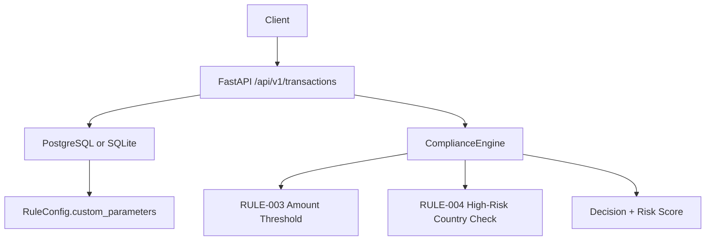
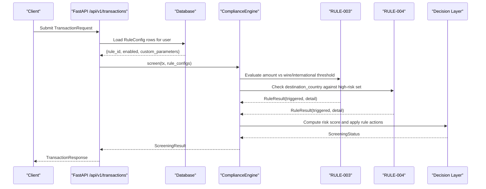
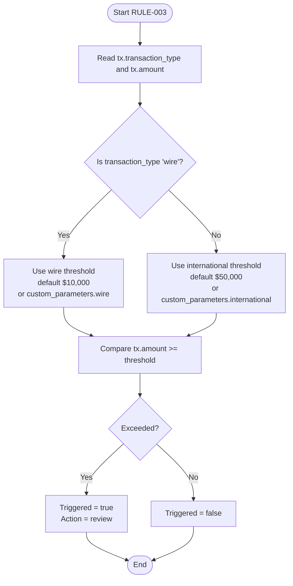
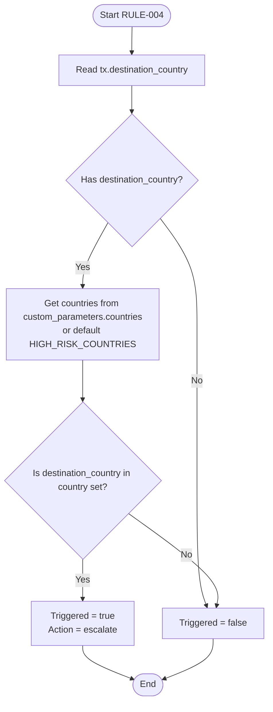
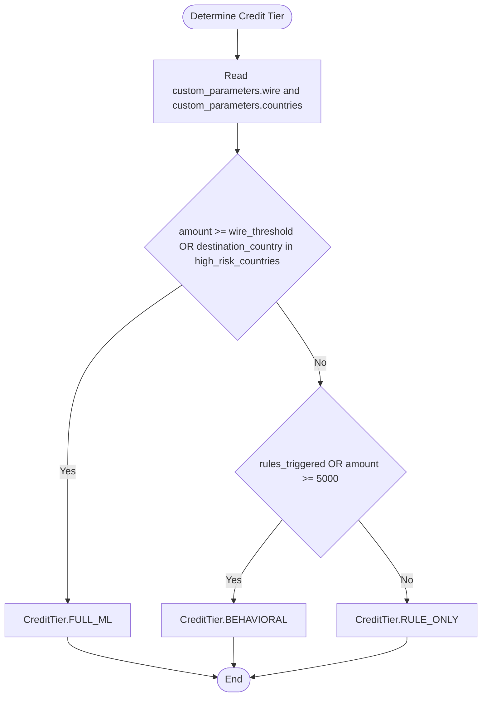
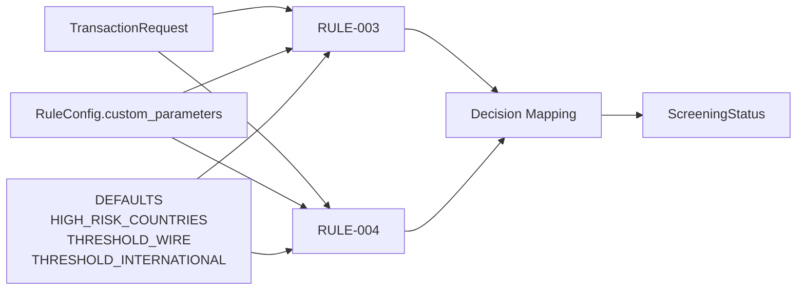

# Threshold & Geography Rules

<cite>
**Referenced Files in This Document**
- [compliance_engine.py](file://backend/app/compliance_engine.py)
- [models.py](file://backend/app/models.py)
- [db_models.py](file://backend/app/db_models.py)
- [main.py](file://backend/app/main.py)
</cite>

## Table of Contents
1. [Introduction](#introduction)
2. [Project Structure](#project-structure)
3. [Core Components](#core-components)
4. [Architecture Overview](#architecture-overview)
5. [Detailed Component Analysis](#detailed-component-analysis)
6. [Dependency Analysis](#dependency-analysis)
7. [Performance Considerations](#performance-considerations)
8. [Troubleshooting Guide](#troubleshooting-guide)
9. [Conclusion](#conclusion)

## Introduction
This document explains the configurable threshold and geography rules implemented by FinShield’s hard rule engine: RULE-003 (Amount Threshold) and RULE-004 (High-Risk Country Check). It covers default thresholds, per-user customization through `custom_parameters`, decision outcomes, credit tier determination, and practical configuration patterns for different business requirements.

The shipped implementation uses FastAPI in `backend/`, with rule logic in `backend/app/compliance_engine.py`, request/response schemas in `backend/app/models.py`, user rule persistence in `backend/app/db_models.py`, and API wiring in `backend/app/main.py`.

## Project Structure
The relevant runtime components are:

- `backend/app/compliance_engine.py`: Defines the 7-stage compliance pipeline, hard rules, risk scoring, decisions, and credit tier selection.
- `backend/app/models.py`: Defines transaction inputs, rule results, screening outputs, enums such as `TransactionType` and `CreditTier`.
- `backend/app/db_models.py`: Persists user rule overrides under `RuleConfig.custom_parameters`.
- `backend/app/main.py`: Loads each authenticated user’s rule configurations and passes them to the compliance engine during transaction screening.

**Diagram sources**
- [main.py:434-482](file://backend/app/main.py#L434-L482)
- [compliance_engine.py:89-162](file://backend/app/compliance_engine.py#L89-L162)
- [db_models.py:184-210](file://backend/app/db_models.py#L184-L210)

**Section sources**
- [compliance_engine.py:1-381](file://backend/app/compliance_engine.py#L1-L381)
- [models.py:17-119](file://backend/app/models.py#L17-L119)
- [db_models.py:184-210](file://backend/app/db_models.py#L184-L210)
- [main.py:434-482](file://backend/app/main.py#L434-L482)

## Core Components
- **RULE-003 (Amount Threshold)**: Reviews transactions that exceed a type-specific threshold. Default thresholds are $10,000 for wire transactions and $50,000 for international transactions. The rule is customizable via `custom_parameters.wire` and `custom_parameters.international`.
- **RULE-004 (High-Risk Country Check)**: Flags transactions whose destination country matches the high-risk country set. The default set is KP, IR, SY, CU, RU. The list is customizable via `custom_parameters.countries`.
- **Rule configuration storage**: Per-user rule overrides are stored in `RuleConfig.custom_parameters` and loaded into the engine at screen time.
- **Decision mapping**: RULE-003 maps to `review`; RULE-004 maps to `escalate`, which currently produces a blocked outcome in the decision layer.

**Section sources**
- [compliance_engine.py:24-26](file://backend/app/compliance_engine.py#L24-L26)
- [compliance_engine.py:67-86](file://backend/app/compliance_engine.py#L67-L86)
- [compliance_engine.py:208-237](file://backend/app/compliance_engine.py#L208-L237)
- [compliance_engine.py:332-337](file://backend/app/compliance_engine.py#L332-L337)
- [db_models.py:184-210](file://backend/app/db_models.py#L184-L210)

## Architecture Overview
The hard rule engine runs inside the full compliance pipeline. For threshold and geography rules:

1. The API endpoint loads the authenticated user’s rule configurations from the database.
2. The engine evaluates enabled rules using either defaults or user-provided `custom_parameters`.
3. Triggered rules contribute to risk scoring and determine mandatory actions.
4. Credit tier selection considers both custom thresholds and high-risk countries before deciding whether behavioral analysis or ML classification is needed.

**Diagram sources**
- [main.py:475-482](file://backend/app/main.py#L475-L482)
- [compliance_engine.py:89-162](file://backend/app/compliance_engine.py#L89-L162)
- [compliance_engine.py:208-237](file://backend/app/compliance_engine.py#L208-L237)
- [compliance_engine.py:339-361](file://backend/app/compliance_engine.py#L339-L361)

## Detailed Component Analysis

### RULE-003: Amount Threshold
RULE-003 selects a threshold based on `transaction_type`:

- If `transaction_type == "wire"`, the wire threshold applies.
- Otherwise, the international threshold applies.
- The rule triggers when `amount >= threshold`.

Default values:
- Wire threshold: $10,000
- International threshold: $50,000

Customization:
- `custom_parameters.wire` overrides the wire threshold.
- `custom_parameters.international` overrides the international threshold.

Threshold calculation flow:

**Diagram sources**
- [compliance_engine.py:208-222](file://backend/app/compliance_engine.py#L208-L222)
- [compliance_engine.py:259-267](file://backend/app/compliance_engine.py#L259-L267)

Practical examples:
- A wire transaction of $12,000 exceeds the default wire threshold and triggers RULE-003.
- An international transaction of $40,000 does not exceed the default international threshold and does not trigger RULE-003.
- If a user sets `custom_parameters.wire = 15000`, a $12,000 wire transaction no longer triggers RULE-003.
- If a user sets `custom_parameters.international = 30000`, a $40,000 international transaction triggers RULE-003.

Decision impact:
- RULE-003 has action `review`.
- When triggered, `_make_decision` returns `IN_REVIEW` unless another rule forces a stronger action.

Risk scoring impact:
- Each triggered rule contributes to the number of triggered rules.
- The aggregate risk score increases with more triggered rules, but RULE-003 alone typically leads to review rather than block.

**Section sources**
- [compliance_engine.py:24-26](file://backend/app/compliance_engine.py#L24-L26)
- [compliance_engine.py:67-76](file://backend/app/compliance_engine.py#L67-L76)
- [compliance_engine.py:208-222](file://backend/app/compliance_engine.py#L208-L222)
- [compliance_engine.py:259-267](file://backend/app/compliance_engine.py#L259-L267)
- [compliance_engine.py:332-337](file://backend/app/compliance_engine.py#L332-L337)
- [compliance_engine.py:339-361](file://backend/app/compliance_engine.py#L339-L361)

### RULE-004: High-Risk Country Check
RULE-004 checks whether the destination country is in the high-risk country set.

Default high-risk countries:
- KP, IR, SY, CU, RU

Customization:
- `custom_parameters.countries` replaces the default set.
- The engine accepts lists, tuples, or sets; otherwise it falls back to the default set.

Country matching behavior:
- If `destination_country` is present and matches the configured country set, the rule triggers.
- If `destination_country` is missing, the rule does not trigger.

Country matching flow:

**Diagram sources**
- [compliance_engine.py:24](file://backend/app/compliance_engine.py#L24)
- [compliance_engine.py:224-237](file://backend/app/compliance_engine.py#L224-L237)
- [compliance_engine.py:269-276](file://backend/app/compliance_engine.py#L269-L276)

Practical examples:
- A transaction to KP triggers RULE-004.
- A transaction to DE does not trigger RULE-004.
- If a user sets `custom_parameters.countries = ["KP", "IR", "NG"]`, NG becomes high-risk even though it is not in the default set.
- If a user removes RU from the list, RU no longer triggers RULE-004.

Decision impact:
- RULE-004 has action `escalate`.
- In the current decision logic, `escalate` maps to `BLOCKED`.
- Therefore, a high-risk country match blocks the transaction unless overridden by other pipeline stages.

Risk scoring impact:
- A triggered RULE-004 increases the count of triggered rules and raises the aggregate risk score.
- Because its action is authoritative, the final status is blocked regardless of the numeric score.

**Section sources**
- [compliance_engine.py:24](file://backend/app/compliance_engine.py#L24)
- [compliance_engine.py:77-86](file://backend/app/compliance_engine.py#L77-L86)
- [compliance_engine.py:224-237](file://backend/app/compliance_engine.py#L224-L237)
- [compliance_engine.py:269-276](file://backend/app/compliance_engine.py#L269-L276)
- [compliance_engine.py:332-337](file://backend/app/compliance_engine.py#L332-L337)
- [compliance_engine.py:339-361](file://backend/app/compliance_engine.py#L339-L361)

### Relationship to Credit Tier Determination
Credit tier selection determines how much downstream analysis is applied:

- `RULE_ONLY`: Only hard rules run.
- `BEHAVIORAL`: Hard rules plus simulated behavioral analysis.
- `FULL_ML`: Full pipeline including behavioral analysis and ML classification.

Rules interaction:
- If the transaction amount meets or exceeds the custom wire threshold, or if the destination country is in the custom high-risk country list, the engine selects `FULL_ML`.
- If any rule is triggered or the amount is at least $5,000, the engine selects `BEHAVIORAL`.
- Otherwise, it selects `RULE_ONLY`.

**Diagram sources**
- [compliance_engine.py:363-380](file://backend/app/compliance_engine.py#L363-L380)

Practical implications:
- Lowering `custom_parameters.wire` can push more transactions into `FULL_ML`, increasing credit consumption.
- Adding countries to `custom_parameters.countries` can also force `FULL_ML` for those destinations.
- RULE-003 and RULE-004 therefore influence both immediate decision outcomes and long-term resource usage through credit tiers.

**Section sources**
- [compliance_engine.py:363-380](file://backend/app/compliance_engine.py#L363-L380)
- [models.py:59-62](file://backend/app/models.py#L59-L62)

### Configuration Patterns for Different Business Requirements

#### Conservative Compliance Posture
- Keep default thresholds: wire $10,000, international $50,000.
- Keep default high-risk countries: KP, IR, SY, CU, RU.
- Expected outcome:
  - Large wires trigger review.
  - High-risk destinations trigger escalation and block.
  - Transactions near or above thresholds may enter higher credit tiers.

#### Tightened Geographic Controls
- Set `custom_parameters.countries` to include additional jurisdictions.
- Expected outcome:
  - More transactions trigger RULE-004.
  - Those transactions are blocked.
  - Destination-country matches may promote transactions to `FULL_ML`.

#### Relaxed Wire Thresholds for Low-Risk Flows
- Increase `custom_parameters.wire` to reduce false reviews for small-to-medium wires.
- Expected outcome:
  - Fewer wire transactions trigger RULE-003.
  - Less automatic review traffic.
  - Lower credit consumption if fewer rules trigger.

#### Stricter International Thresholds
- Decrease `custom_parameters.international` to catch smaller international transfers earlier.
- Expected outcome:
  - More international transactions trigger RULE-003.
  - Increased review workload.
  - Potential increase in behavioral or ML analysis depending on other conditions.

#### Custom High-Risk List Without Blocking
- Note: In the current implementation, RULE-004 always maps to `escalate`, which results in `BLOCKED`.
- To avoid blocking while still tracking high-risk countries, operators should monitor `rule_results` and downstream cases rather than relying solely on this rule’s action.
- Alternatively, disable RULE-004 and implement geographic controls elsewhere if non-blocking behavior is required.

**Section sources**
- [compliance_engine.py:208-237](file://backend/app/compliance_engine.py#L208-L237)
- [compliance_engine.py:332-337](file://backend/app/compliance_engine.py#L332-L337)
- [compliance_engine.py:363-380](file://backend/app/compliance_engine.py#L363-L380)
- [db_models.py:184-210](file://backend/app/db_models.py#L184-L210)

## Dependency Analysis
The hard rule engine depends on:

- Transaction input fields: `amount`, `transaction_type`, `destination_country`.
- User rule configuration: `RuleConfig.enabled` and `RuleConfig.custom_parameters`.
- Default constants: `HIGH_RISK_COUNTRIES`, `THRESHOLD_WIRE`, `THRESHOLD_INTERNATIONAL`.
- Decision mapping: `RULE_ACTIONS` mapping rule IDs to mandatory actions.

**Diagram sources**
- [models.py:67-82](file://backend/app/models.py#L67-L82)
- [db_models.py:184-210](file://backend/app/db_models.py#L184-L210)
- [compliance_engine.py:24-26](file://backend/app/compliance_engine.py#L24-L26)
- [compliance_engine.py:208-237](file://backend/app/compliance_engine.py#L208-L237)
- [compliance_engine.py:332-337](file://backend/app/compliance_engine.py#L332-L337)

**Section sources**
- [models.py:67-82](file://backend/app/models.py#L67-L82)
- [db_models.py:184-210](file://backend/app/db_models.py#L184-L210)
- [compliance_engine.py:24-26](file://backend/app/compliance_engine.py#L24-L26)
- [compliance_engine.py:208-237](file://backend/app/compliance_engine.py#L208-L237)
- [compliance_engine.py:332-337](file://backend/app/compliance_engine.py#L332-L337)

## Performance Considerations
- RULE-003 performs a simple numeric comparison after selecting the appropriate threshold.
- RULE-004 converts the configured country list to a set for membership checks, giving constant-time lookups.
- Both rules are lightweight and do not call external services.
- The main performance cost comes from database access to load `RuleConfig` rows and from downstream behavioral/ML stages selected by credit tier.

[No sources needed since this section provides general guidance]

## Troubleshooting Guide

### RULE-003 Does Not Trigger as Expected
Check:
- Whether `transaction_type` is exactly `"wire"`; otherwise the international threshold applies.
- Whether `custom_parameters.wire` or `custom_parameters.international` overrides the default.
- Whether the rule is disabled in `RuleConfig.enabled`.
- Whether the amount is strictly less than the selected threshold.

Relevant paths:
- Threshold selection and comparison: [compliance_engine.py:208-222](file://backend/app/compliance_engine.py#L208-L222)
- Simulation path: [compliance_engine.py:259-267](file://backend/app/compliance_engine.py#L259-L267)
- Rule definition parameters: [compliance_engine.py:67-76](file://backend/app/compliance_engine.py#L67-L76)

### RULE-004 Matches Unexpected Countries
Check:
- Whether `destination_country` is provided.
- Whether `custom_parameters.countries` contains the country code.
- Whether the country code casing matches expected uppercase codes.
- Whether the rule is disabled.

Relevant paths:
- Country check logic: [compliance_engine.py:224-237](file://backend/app/compliance_engine.py#L224-L237)
- Simulation path: [compliance_engine.py:269-276](file://backend/app/compliance_engine.py#L269-L276)
- Default high-risk set: [compliance_engine.py:24](file://backend/app/compliance_engine.py#L24)

### Transaction Is Blocked Due to High-Risk Country
Under current logic, RULE-004 maps to `escalate`, which results in `BLOCKED`. If blocking is not desired:
- Disable RULE-004.
- Or handle geographic risk outside this rule and use a different rule action.

Relevant paths:
- Action mapping: [compliance_engine.py:332-337](file://backend/app/compliance_engine.py#L332-L337)
- Decision enforcement: [compliance_engine.py:339-361](file://backend/app/compliance_engine.py#L339-L361)

### Credit Tier Is Higher Than Expected
Check:
- Whether `custom_parameters.wire` is low enough to classify the transaction as high-value.
- Whether `custom_parameters.countries` includes the destination country.
- Whether other rules are triggered.

Relevant paths:
- Tier determination: [compliance_engine.py:363-380](file://backend/app/compliance_engine.py#L363-L380)

**Section sources**
- [compliance_engine.py:24](file://backend/app/compliance_engine.py#L24)
- [compliance_engine.py:67-76](file://backend/app/compliance_engine.py#L67-L76)
- [compliance_engine.py:208-237](file://backend/app/compliance_engine.py#L208-L237)
- [compliance_engine.py:259-276](file://backend/app/compliance_engine.py#L259-L276)
- [compliance_engine.py:332-361](file://backend/app/compliance_engine.py#L332-L361)
- [compliance_engine.py:363-380](file://backend/app/compliance_engine.py#L363-L380)

## Conclusion
RULE-003 and RULE-004 form the core configurable guardrails for amount-based and geography-based risk control in FinShield’s hard rule engine. RULE-003 uses separate wire and international thresholds, while RULE-004 validates destination countries against a configurable high-risk set. Both rules support per-user customization through `custom_parameters`, persist via `RuleConfig`, and directly influence rule results, risk scores, decision outcomes, and credit tier selection. Operators should tune thresholds and country lists according to their regulatory posture, understanding that RULE-004 currently blocks transactions on high-risk country matches.