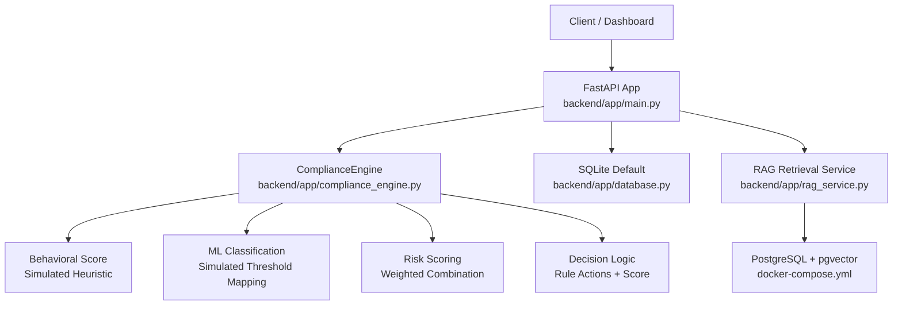
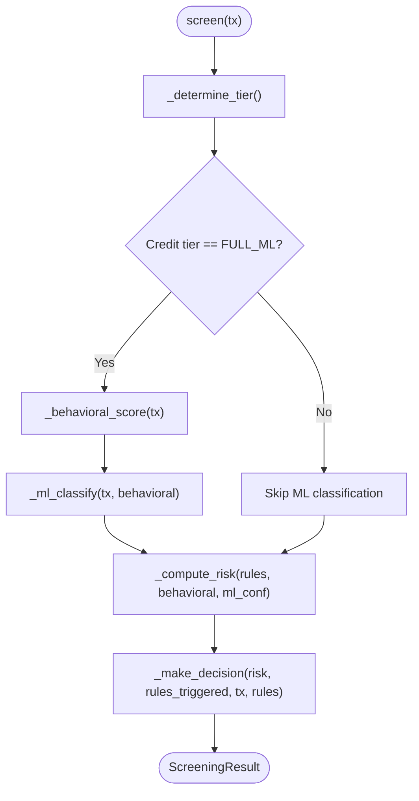
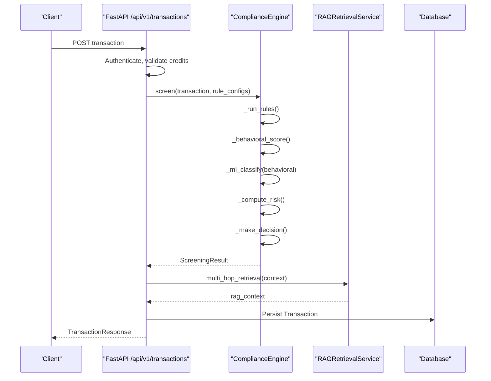
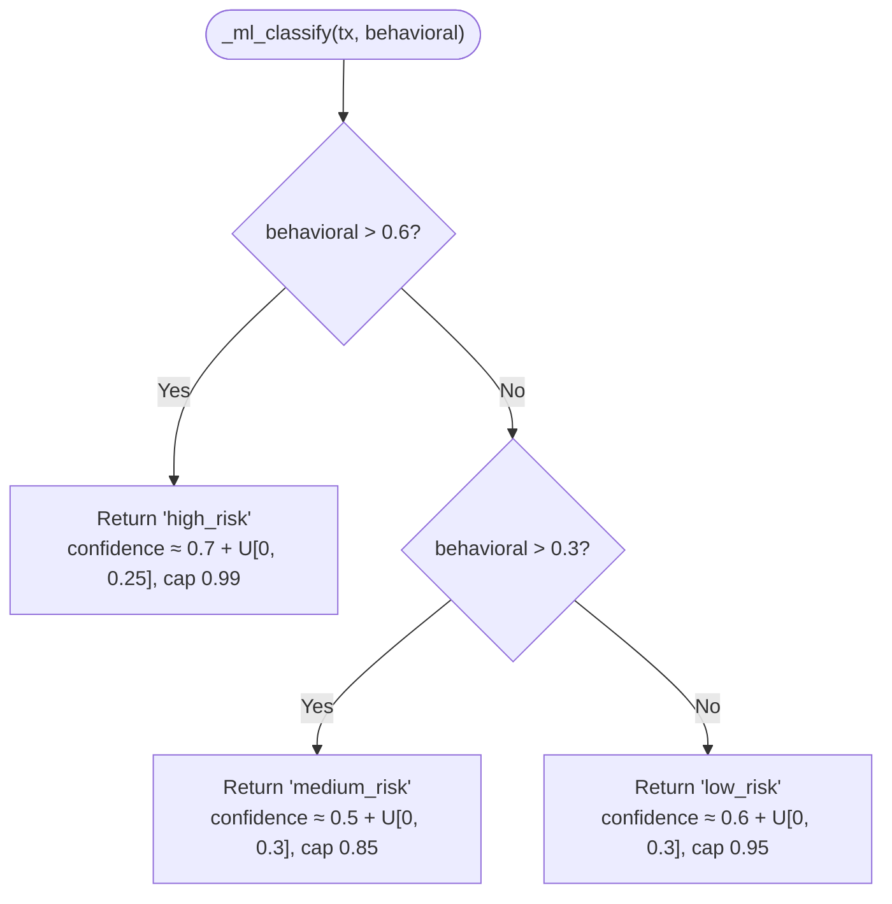
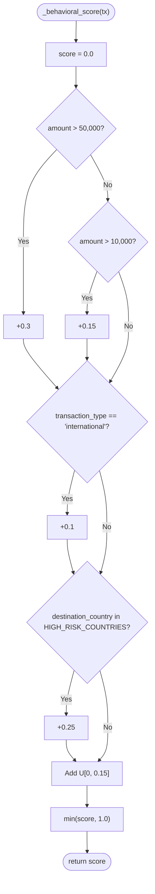
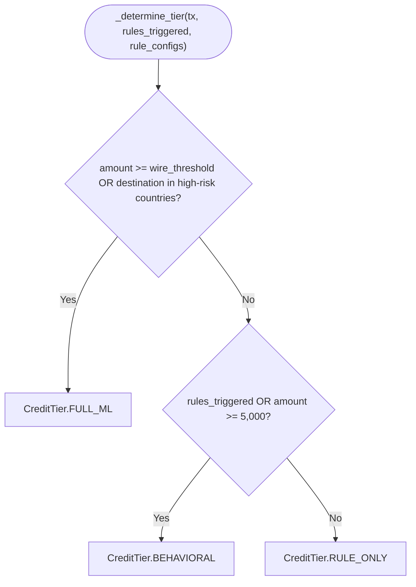
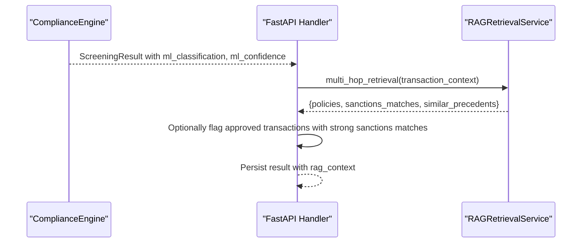
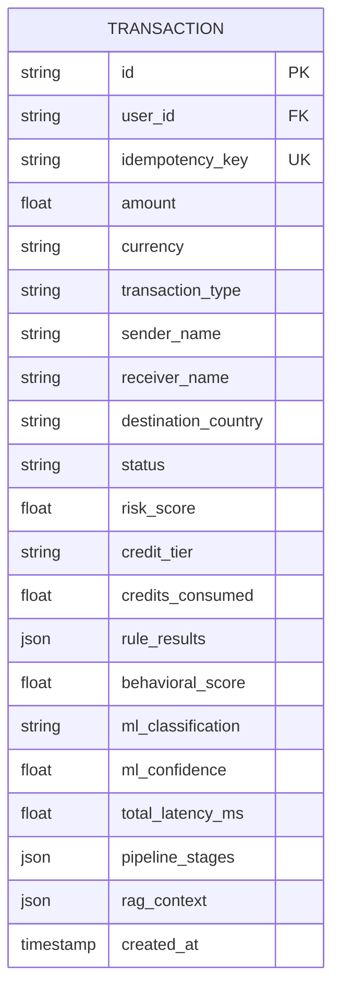
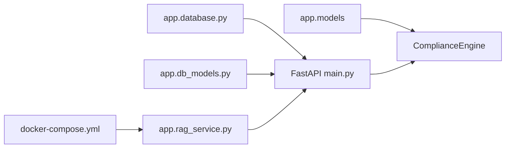
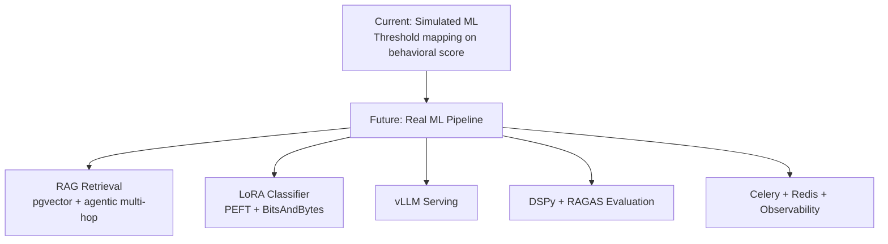

# ML Classification

<cite>
**Referenced Files in This Document**
- [compliance_engine.py](file://backend/app/compliance_engine.py)
- [rag_service.py](file://backend/app/rag_service.py)
- [main.py](file://backend/app/main.py)
- [models.py](file://backend/app/models.py)
- [database.py](file://backend/app/database.py)
- [db_models.py](file://backend/app/db_models.py)
- [FinShield-AI-Wiki.md](file://FinShield-AI-Wiki.md)
- [docker-compose.yml](file://docker-compose.yml)
</cite>

## Table of Contents
1. [Introduction](#introduction)
2. [Project Structure](#project-structure)
3. [Core Components](#core-components)
4. [Architecture Overview](#architecture-overview)
5. [Detailed Component Analysis](#detailed-component-analysis)
6. [Dependency Analysis](#dependency-analysis)
7. [Performance Considerations](#performance-considerations)
8. [Troubleshooting Guide](#troubleshooting-guide)
9. [Roadmap: Actual ML Integration](#roadmap-actual-ml-integration)
10. [Conclusion](#conclusion)

## Introduction
This document explains the ML classification component used by FinShield’s compliance pipeline, specifically `_ml_classify()` inside `ComplianceEngine`. In the shipped codebase, this method does not call a trained model. Instead, it simulates ML inference by mapping a behavioral score to one of three risk categories — `high_risk`, `medium_risk`, or `low_risk` — and attaching a confidence score generated with bounded random noise. The simulation is intentionally lightweight so the API can return structured ML-like outputs without requiring an external model server.

The broader system design describes a future path toward a LoRA fine-tuned classifier served through vLLM, with RAG retrieval over pgvector providing policy, sanctions, and precedent context. That design is aspirational; the current implementation separates deterministic rule screening from a simulated ML stage, while still exposing fields for `ml_classification` and `ml_confidence` in the response schema and database.

## Project Structure
For the purposes of ML classification, the relevant deployables are:

| Layer | File | Responsibility |
|---|---|---|
| Compliance pipeline | `backend/app/compliance_engine.py` | Rule screening, behavioral scoring, simulated ML classification, risk scoring, decision logic |
| RAG retrieval service | `backend/app/rag_service.py` | pgvector-based semantic search over compliance documents, sanctions entries, and precedents |
| FastAPI application | `backend/app/main.py` | Authentication, transaction ingestion, credit accounting, RAG enrichment, persistence |
| Request/response schemas | `backend/app/models.py` | Pydantic models including `ScreeningResult`, `CreditTier`, `TransactionRequest` |
| Persistence configuration | `backend/app/database.py` | SQLite default (`finshield.db`) with PostgreSQL only when `DATABASE_URL` is set |
| ORM entities | `backend/app/db_models.py` | SQLAlchemy tables including `Transaction`, which stores ML fields |
| Design reference | `FinShield-AI-Wiki.md` | Canonical description of intended ML/RAG architecture and roadmap items |
| Compose stack | `docker-compose.yml` | Three services: `postgres`, `backend`, `frontend`; no Redis/Celery worker |

**Diagram sources**
- [main.py:129-152](file://backend/app/main.py#L129-L152)
- [compliance_engine.py:89-162](file://backend/app/compliance_engine.py#L89-L162)
- [rag_service.py:145-155](file://backend/app/rag_service.py#L145-L155)
- [database.py:11-21](file://backend/app/database.py#L11-L21)
- [docker-compose.yml:3-45](file://docker-compose.yml#L3-L45)

**Section sources**
- [compliance_engine.py:1-381](file://backend/app/compliance_engine.py#L1-L381)
- [rag_service.py:1-413](file://backend/app/rag_service.py#L1-L413)
- [main.py:1-152](file://backend/app/main.py#L1-L152)
- [models.py:1-152](file://backend/app/models.py#L1-L152)
- [database.py:1-45](file://backend/app/database.py#L1-L45)
- [db_models.py:75-106](file://backend/app/db_models.py#L75-L106)
- [FinShield-AI-Wiki.md:35-60](file://FinShield-AI-Wiki.md#L35-L60)
- [docker-compose.yml:1-72](file://docker-compose.yml#L1-L72)

## Core Components
The ML classification flow is part of a seven-stage pipeline: idempotency check, validation, hard rules, behavioral analysis, ML classification, risk scoring, and decision. Only transactions that reach the `FULL_ML` credit tier execute `_ml_classify()`.

Key behaviors:

- **Credit tier gating**: `_determine_tier()` selects `RULE_ONLY`, `BEHAVIORAL`, or `FULL_ML`. A transaction reaches `FULL_ML` if its amount meets or exceeds the wire threshold or its destination country is high-risk.
- **Behavioral score**: `_behavioral_score()` adds deterministic components for large amounts, international transfers, and high-risk countries, then adds uniform random noise up to 0.15 and caps at 1.0.
- **ML classification**: `_ml_classify()` maps the behavioral score to a risk category and returns a confidence score in a bounded range with random variation.
- **Risk scoring**: `_compute_risk()` combines rule hits, behavioral score, and ML confidence into a final risk score between 0 and 1.
- **Decision**: `_make_decision()` gives priority to hard-rule actions (`block`, `escalate`, `flag`, `review`) and otherwise uses risk thresholds.

**Diagram sources**
- [compliance_engine.py:89-162](file://backend/app/compliance_engine.py#L89-L162)
- [compliance_engine.py:363-380](file://backend/app/compliance_engine.py#L363-L380)
- [compliance_engine.py:280-304](file://backend/app/compliance_engine.py#L280-L304)
- [compliance_engine.py:306-361](file://backend/app/compliance_engine.py#L306-L361)

**Section sources**
- [compliance_engine.py:89-162](file://backend/app/compliance_engine.py#L89-L162)
- [compliance_engine.py:280-304](file://backend/app/compliance_engine.py#L280-L304)
- [compliance_engine.py:306-380](file://backend/app/compliance_engine.py#L306-L380)

## Architecture Overview
At runtime, a client calls the FastAPI `/api/v1/transactions` endpoint. The handler authenticates the user, checks credits, loads per-user rule configurations, runs `ComplianceEngine.screen()`, optionally enriches the result with RAG retrieval, persists the result, and returns it.

The ML classification itself lives inside `ComplianceEngine._ml_classify()`. It currently ignores the raw transaction object beyond receiving it as context and instead uses the already-computed behavioral score to decide the risk category.

**Diagram sources**
- [main.py:434-570](file://backend/app/main.py#L434-L570)
- [compliance_engine.py:89-162](file://backend/app/compliance_engine.py#L89-L162)
- [rag_service.py:361-412](file://backend/app/rag_service.py#L361-L412)

**Section sources**
- [main.py:434-570](file://backend/app/main.py#L434-L570)
- [compliance_engine.py:89-162](file://backend/app/compliance_engine.py#L89-L162)

## Detailed Component Analysis

### ML Classification Simulation: `_ml_classify()`
`_ml_classify(tx, behavioral)` is the core of the current ML simulation. Its responsibilities are narrow:

1. Accept a `TransactionRequest` and a behavioral score.
2. Map the behavioral score to one of three categories:
   - Above 0.6 → `high_risk`
   - Above 0.3 → `medium_risk`
   - 0.3 or below → `low_risk`
3. Generate a confidence score using bounded random noise:
   - `high_risk`: base around 0.7 plus noise up to 0.25, capped at 0.99
   - `medium_risk`: base around 0.5 plus noise up to 0.3, capped at 0.85
   - `low_risk`: base around 0.6 plus noise up to 0.3, capped at 0.95
4. Return `(category, confidence)`.

**Diagram sources**
- [compliance_engine.py:296-304](file://backend/app/compliance_engine.py#L296-L304)

#### Behavioral Thresholds to ML Categories
| Behavioral Score Range | ML Category | Confidence Behavior |
|---|---|---|
| Greater than 0.6 | `high_risk` | Starts near 0.7, increases with random noise, maximum 0.99 |
| Greater than 0.3 and less than or equal to 0.6 | `medium_risk` | Starts near 0.5, increases with random noise, maximum 0.85 |
| Less than or equal to 0.3 | `low_risk` | Starts near 0.6, increases with random noise, maximum 0.95 |

Important distinction: the confidence score is not a calibrated probability from a trained model. It is a heuristic value designed to look like model output while remaining deterministic enough to be testable and fast.

#### Example Classification Outputs
These examples describe representative outputs rather than exact repeated values, because the confidence includes randomness.

| Scenario | Behavioral Score | ML Classification | Expected Confidence Range |
|---|---:|---|---:|
| Small domestic transfer, low amount, normal country | ~0.0–0.15 | `low_risk` | ~0.6–0.95 |
| International transfer above moderate threshold | ~0.3–0.5 | `medium_risk` | ~0.5–0.85 |
| Large international transfer to high-risk country | ~0.6–1.0 | `high_risk` | ~0.7–0.99 |

In all cases, the returned tuple is `(ml_classification, ml_confidence)`, where `ml_classification` is a string and `ml_confidence` is a float rounded to four decimal places in the outer `screen()` method.

**Section sources**
- [compliance_engine.py:296-304](file://backend/app/compliance_engine.py#L296-L304)
- [compliance_engine.py:127-132](file://backend/app/compliance_engine.py#L127-L132)
- [compliance_engine.py:146-159](file://backend/app/compliance_engine.py#L146-L159)

### Behavioral Scoring: `_behavioral_score()`
Before ML classification, the pipeline computes a behavioral score when the credit tier is `BEHAVIORAL` or `FULL_ML`. The score is additive:

- Amount above 50,000 adds 0.3
- Amount above 10,000 adds 0.15
- International transaction type adds 0.1
- Destination country in the high-risk list adds 0.25
- Random uniform noise adds up to 0.15
- Final score is capped at 1.0

This means a single transaction can accumulate multiple signals. For example, an international transfer to a high-risk country above $10,000 could easily exceed 0.6 and therefore map to `high_risk`.

**Diagram sources**
- [compliance_engine.py:280-294](file://backend/app/compliance_engine.py#L280-L294)

**Section sources**
- [compliance_engine.py:280-294](file://backend/app/compliance_engine.py#L280-L294)

### Credit Tier Gating
ML classification is not executed for every transaction. `_determine_tier()` decides whether the pipeline should run:

- `RULE_ONLY`: cheap rule-only screening (0.2 credits)
- `BEHAVIORAL`: rules plus behavioral score (0.5 credits)
- `FULL_ML`: full path including simulated ML classification (1.0 credit)

A transaction reaches `FULL_ML` when:
- Its amount meets or exceeds the wire threshold, or
- Its destination country is in the high-risk country set.

If any rule triggered or the amount is at least 5,000, it reaches `BEHAVIORAL`. Otherwise, it stays `RULE_ONLY`.

**Diagram sources**
- [compliance_engine.py:363-380](file://backend/app/compliance_engine.py#L363-L380)

**Section sources**
- [compliance_engine.py:113-132](file://backend/app/compliance_engine.py#L113-L132)
- [compliance_engine.py:363-380](file://backend/app/compliance_engine.py#L363-L380)

### Integration with RAG Service Architecture
The RAG service is separate from `_ml_classify()`. In the current code:

- `ComplianceEngine._ml_classify()` does not call `RAGRetrievalService`.
- `main.py` runs RAG enrichment after the compliance engine has produced a result.
- If RAG is available and configured with a PostgreSQL URL, `multi_hop_retrieval()` searches policies, sanctions matches, and similar precedents.
- Strong sanctions matches can upgrade an otherwise approved transaction to flagged, but they do not replace the ML classification field.

**Diagram sources**
- [main.py:484-505](file://backend/app/main.py#L484-L505)
- [rag_service.py:361-412](file://backend/app/rag_service.py#L361-L412)

**Section sources**
- [main.py:484-505](file://backend/app/main.py#L484-L505)
- [rag_service.py:1-413](file://backend/app/rag_service.py#L1-L413)

### Data Model and Persistence
The ML classification output is exposed through the public response model and persisted in the database.

| Field | Type | Meaning |
|---|---|---|
| `ml_classification` | Optional string | One of `high_risk`, `medium_risk`, or `low_risk` when `FULL_ML` tier is active |
| `ml_confidence` | Optional float | Simulated confidence score associated with the classification |
| `behavioral_score` | Optional float | Input signal used by `_ml_classify()` |
| `risk_score` | Float 0–1 | Weighted combination of rules, behavioral score, and ML confidence |
| `credit_tier` | Enum | `rule_only`, `behavioral`, or `full_ml` |
| `pipeline_stages` | List of strings | Includes `ml_classification` when the ML stage runs |

**Diagram sources**
- [db_models.py:75-106](file://backend/app/db_models.py#L75-L106)

**Section sources**
- [models.py:104-119](file://backend/app/models.py#L104-L119)
- [db_models.py:75-106](file://backend/app/db_models.py#L75-L106)
- [main.py:510-537](file://backend/app/main.py#L510-L537)

## Dependency Analysis
The ML classification component depends on several parts of the backend:

- **Direct dependencies**:
  - `TransactionRequest` from `app.models`
  - `ScreeningResult`, `CreditTier`, `RuleResult`, `RuleType`, `ScreeningStatus` from `app.models`
  - `random` and `time` for simulation and latency tracking
- **Indirect dependencies**:
  - `main.py` mounts the engine and exposes it via FastAPI routes
  - `database.py` provides SQLite persistence unless `DATABASE_URL` points to PostgreSQL
  - `rag_service.py` is optional and requires PostgreSQL/pgvector for vector operations
  - `docker-compose.yml` defines PostgreSQL as a dependency for RAG, even though the main app defaults to SQLite

**Diagram sources**
- [compliance_engine.py:12-19](file://backend/app/compliance_engine.py#L12-L19)
- [main.py:26-43](file://backend/app/main.py#L26-L43)
- [database.py:11-21](file://backend/app/database.py#L11-L21)
- [rag_service.py:145-155](file://backend/app/rag_service.py#L145-L155)
- [docker-compose.yml:3-45](file://docker-compose.yml#L3-L45)

**Section sources**
- [compliance_engine.py:1-381](file://backend/app/compliance_engine.py#L1-L381)
- [main.py:26-152](file://backend/app/main.py#L26-L152)
- [database.py:1-45](file://backend/app/database.py#L1-L45)
- [rag_service.py:1-413](file://backend/app/rag_service.py#L1-L413)
- [docker-compose.yml:1-72](file://docker-compose.yml#L1-L72)

## Performance Considerations
The current ML classification simulation is extremely fast because it performs only numeric comparisons and random number generation. Its cost is negligible compared to real model inference.

Key performance characteristics:

- **Latency**: `_ml_classify()` is effectively constant time relative to input size.
- **Randomness**: Each call produces a different confidence score due to `random.uniform()`, which is useful for simulation but makes exact output testing non-deterministic unless seeded.
- **Gating**: Because only `FULL_ML` transactions reach `_ml_classify()`, most small, low-risk transactions avoid the ML branch entirely.
- **RAG vs ML**: RAG retrieval is more expensive than the simulated ML step and may require PostgreSQL/pgvector. The API handles RAG failures gracefully and continues screening.

Optimization opportunities include:

- Replacing `_ml_classify()` with a deterministic function during tests.
- Caching behavioral scores if the same transaction is evaluated multiple times within a process.
- Moving actual ML inference to an asynchronous worker if model latency becomes load-bearing.
- Adding metrics for `ml_classification` distribution and confidence histogram.

[No sources needed since this section provides general guidance]

## Troubleshooting Guide
Common issues related to ML classification and its surrounding pipeline:

| Symptom | Likely Cause | Resolution |
|---|---|---|
| `ml_classification` is always `None` | Transaction did not reach `FULL_ML` tier | Increase amount or use a high-risk destination country, or adjust rule thresholds |
| `ml_confidence` varies across identical requests | Random noise in `_ml_classify()` | Seed `random` in tests or replace with deterministic confidence for evaluation |
| Transaction is blocked before ML runs | Hard rule action such as sanctions or high-risk geography | Inspect `rule_results` and `pipeline_stages` |
| RAG enrichment fails but screening succeeds | Missing PostgreSQL, missing pgvector extension, or unavailable `RAG_DATABASE_URL` | Configure PostgreSQL and enable RAG; the API logs warnings and continues |
| ML classification appears too aggressive | Behavioral score thresholds combined with high-risk country/international flags | Tune behavioral scoring or credit-tier thresholds |
| Risk score seems unrelated to ML confidence | Risk scoring weights rules, behavioral score, and ML confidence together | Review `_compute_risk()` weighting and rule hit count |

Relevant error handling paths:

- The FastAPI global exception handler returns a generic 500 response for unhandled exceptions.
- RAG enrichment is wrapped in try/except; failures are logged and do not prevent screening completion.
- Idempotency ensures duplicate submissions return the original result without reprocessing.

**Section sources**
- [main.py:109-115](file://backend/app/main.py#L109-L115)
- [main.py:484-505](file://backend/app/main.py#L484-L505)
- [main.py:453-473](file://backend/app/main.py#L453-L473)
- [compliance_engine.py:306-361](file://backend/app/compliance_engine.py#L306-L361)

## Roadmap: Actual ML Integration
The repository’s canonical design reference describes a future architecture where ML classification is powered by a LoRA fine-tuned Llama classifier, with retrieval provided by RAG over pgvector. Several technologies mentioned there — Celery, Redis, LangChain, DSPy, PEFT, BitsAndBytes, vLLM, RAGAS, HashiCorp Vault, OpenTelemetry, Prometheus, structlog, Kubernetes/Helm — are roadmap targets, not part of the shipped stack.

Current state versus planned state:

| Area | Current Implementation | Planned Roadmap State |
|---|---|---|
| ML classifier | Deterministic threshold mapping on behavioral score | LoRA fine-tuned Llama classifier |
| Model serving | None | vLLM with continuous batching and PagedAttention |
| Prompt engineering | Not applicable to current simulation | DSPy-compiled task signature |
| Retrieval | pgvector RAG service exists but is not called by `_ml_classify()` | Agentic multi-hop retrieval feeding classifier context |
| Evaluation | No model eval harness | RAGAS for retrieval quality; independent eval for classifier |
| Async processing | Synchronous FastAPI pipeline | Celery + Redis broker for async scoring |
| Observability | Basic logging and latency tracking | OpenTelemetry traces, Prometheus metrics, structlog |
| Secrets | Environment variables | HashiCorp Vault integration |
| Deployment | Docker Compose with postgres, backend, frontend | Kubernetes/Helm for production scale |

**Diagram sources**
- [FinShield-AI-Wiki.md:35-60](file://FinShield-AI-Wiki.md#L35-L60)
- [FinShield-AI-Wiki.md:62-216](file://FinShield-AI-Wiki.md#L62-L216)
- [compliance_engine.py:296-304](file://backend/app/compliance_engine.py#L296-L304)
- [rag_service.py:1-413](file://backend/app/rag_service.py#L1-L413)

Migration considerations:

1. Replace `_ml_classify()` with a call to a model-serving endpoint or local inference path.
2. Keep the behavioral score as an independent signal; the roadmap emphasizes decoupling classifier output from risk scoring.
3. Preserve `ml_classification` and `ml_confidence` in the response schema so downstream systems remain compatible.
4. Integrate RAG retrieval as classifier context rather than keeping it as a post-screening enrichment step.
5. Add evaluation gates: shadow mode, drift detection, and sign-off before promoting a new model version.
6. Ensure degraded mode routes to human review when the model server is unavailable, consistent with the “fail closed” principle.

**Section sources**
- [FinShield-AI-Wiki.md:35-60](file://FinShield-AI-Wiki.md#L35-L60)
- [FinShield-AI-Wiki.md:62-216](file://FinShield-AI-Wiki.md#L62-L216)
- [FinShield-AI-Wiki.md:690-737](file://FinShield-AI-Wiki.md#L690-L737)
- [compliance_engine.py:296-304](file://backend/app/compliance_engine.py#L296-L304)
- [rag_service.py:1-413](file://backend/app/rag_service.py#L1-L413)

## Conclusion
The current ML classification component is a deliberate simulation. `_ml_classify()` maps a behavioral score to `high_risk`, `medium_risk`, or `low_risk` and attaches a bounded, noisy confidence score. This allows the API to expose ML-like outputs while keeping the shipped stack simple, deterministic, and free of heavy model dependencies.

The broader system design envisions a richer pipeline: pgvector-backed RAG retrieval, a LoRA fine-tuned classifier, DSPy prompt optimization, vLLM serving, async workers, and comprehensive observability. Until those components are implemented, operators should treat `ml_classification` and `ml_confidence` as simulation artifacts, not calibrated model probabilities. The safest operational stance remains: hard rules govern blocking decisions, behavioral and rule signals drive routing, and any future ML integration must preserve fail-closed behavior and human-review fallbacks.

[No sources needed since this section summarizes without analyzing specific files]