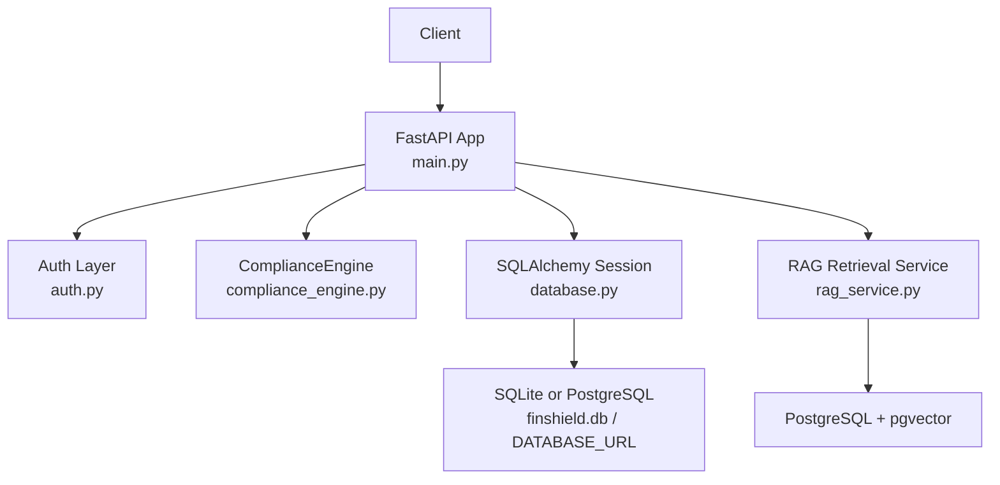
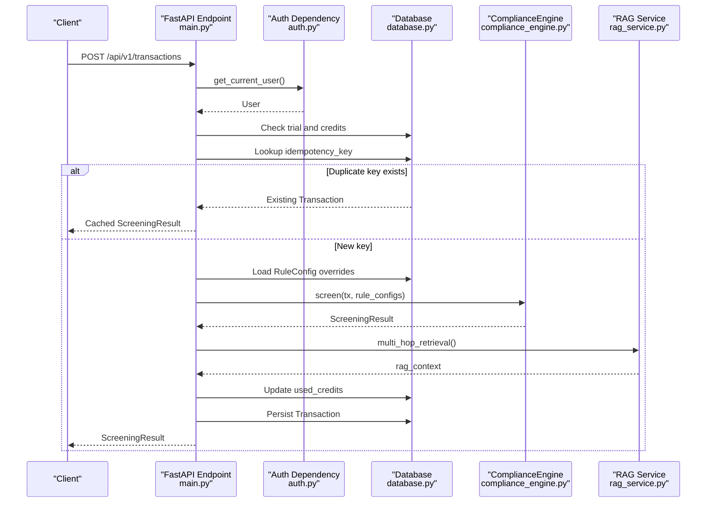
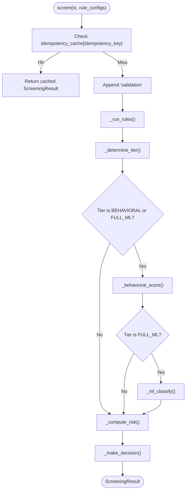
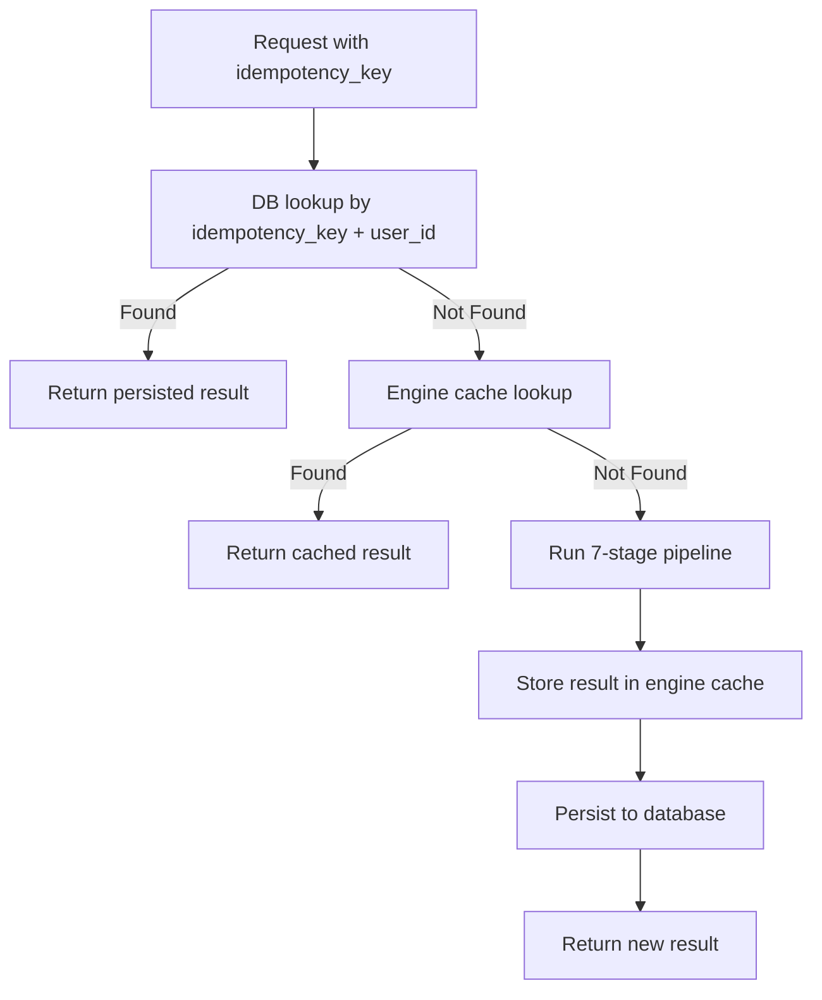
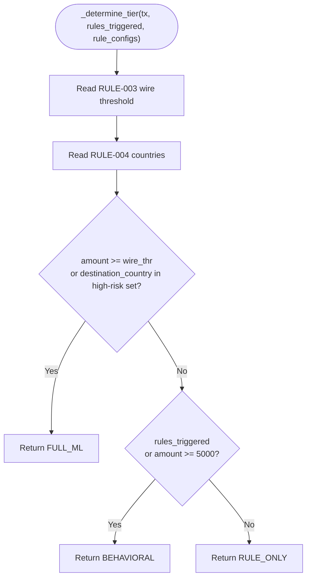
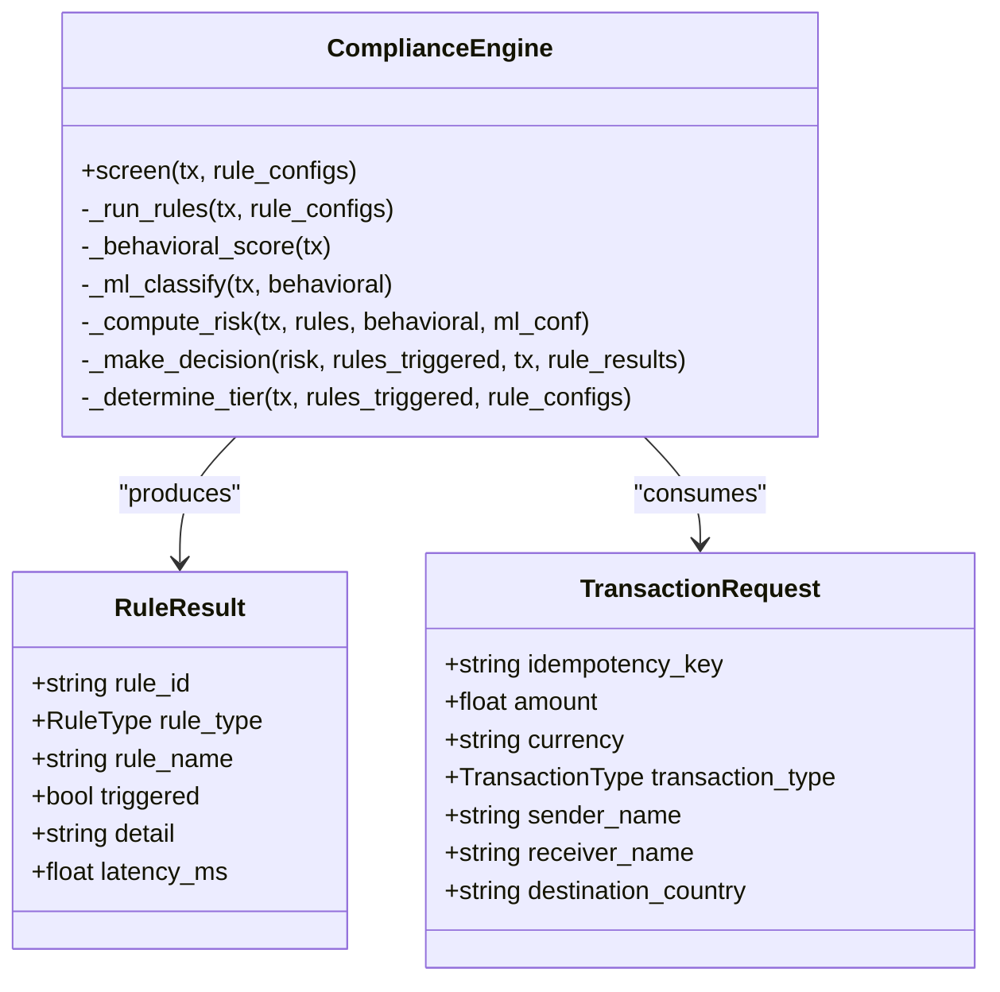
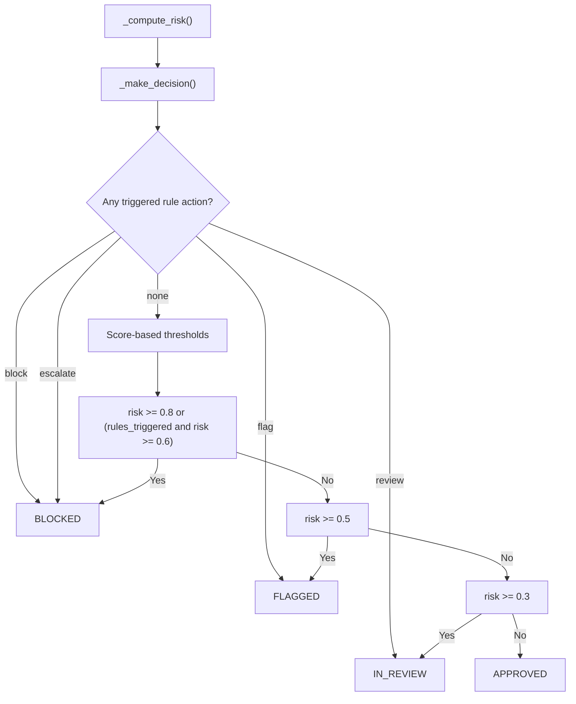
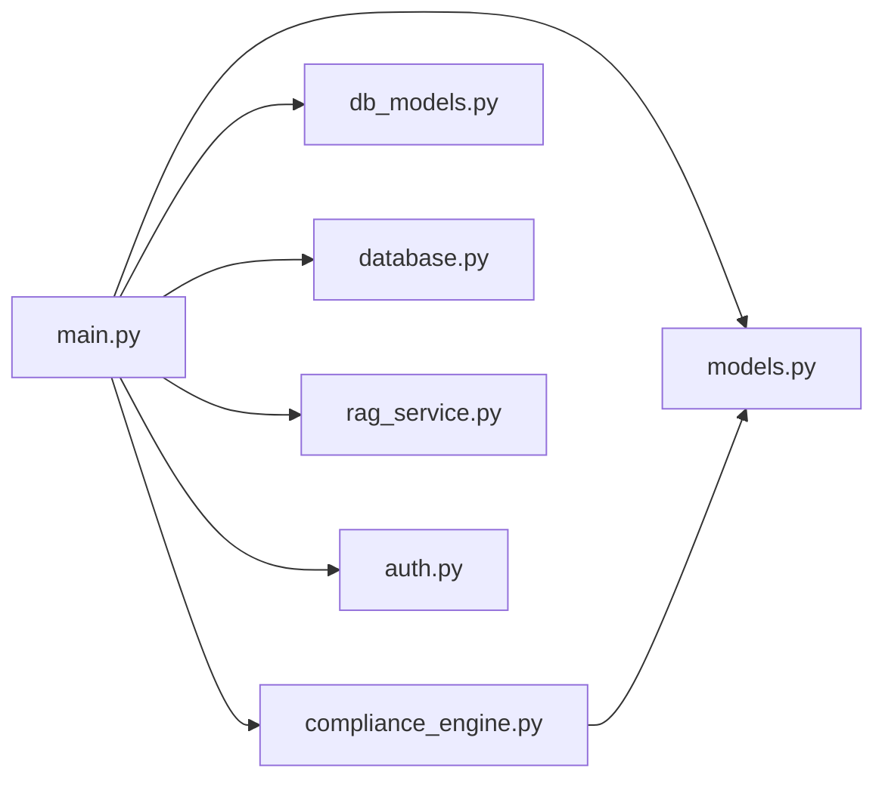

# Pipeline Orchestration

<cite>
**Referenced Files in This Document**   
- [compliance_engine.py](file://backend/app/compliance_engine.py)
- [models.py](file://backend/app/models.py)
- [db_models.py](file://backend/app/db_models.py)
- [main.py](file://backend/app/main.py)
- [database.py](file://backend/app/database.py)
- [rag_service.py](file://backend/app/rag_service.py)
- [auth.py](file://backend/app/auth.py)
- [requirements.txt](file://backend/requirements.txt)
</cite>

## Table of Contents
1. [Introduction](#introduction)
2. [Project Structure](#project-structure)
3. [Core Components](#core-components)
4. [Architecture Overview](#architecture-overview)
5. [Detailed Component Analysis](#detailed-component-analysis)
6. [Dependency Analysis](#dependency-analysis)
7. [Performance Considerations](#performance-considerations)
8. [Troubleshooting Guide](#troubleshooting-guide)
9. [Conclusion](#conclusion)

## Introduction
This document explains the FinShield compliance pipeline orchestration implemented by `ComplianceEngine.screen()`. It covers the seven-stage flow: idempotency check, input validation, hard rule engine, behavioral analysis, ML classification, risk scoring, and decision logic. It also documents how execution stages are tracked, latency is measured, credit tier consumption is determined, and duplicate transactions with the same `idempotency_key` are handled.

The shipped implementation uses FastAPI for the API layer, Pydantic for request/response models, SQLAlchemy for persistence, SQLite by default (PostgreSQL when `DATABASE_URL` is set), and an optional pgvector-backed RAG retrieval service. The core screening logic lives in `backend/app/compliance_engine.py`, while the HTTP endpoint that wires authentication, credits, persistence, and RAG enrichment lives in `backend/app/main.py`.

## Project Structure
FinShield’s relevant backend code is organized around a small number of focused modules:

- `backend/app/main.py`: FastAPI application, routes, authentication, rate limiting, transaction screening endpoint, credit accounting, persistence, and optional RAG enrichment.
- `backend/app/compliance_engine.py`: Core 7-stage compliance pipeline and rule definitions.
- `backend/app/models.py`: Pydantic request/response schemas and enums used by the pipeline.
- `backend/app/db_models.py`: SQLAlchemy ORM entities for users, transactions, cases, rule configurations, and related audit data.
- `backend/app/database.py`: Database configuration, session factory, and initialization.
- `backend/app/rag_service.py`: Optional semantic retrieval over policies, sanctions, and precedents using pgvector.
- `backend/app/auth.py`: JWT and API-key authentication helpers.
- `backend/requirements.txt`: Shipped Python dependencies.

**Diagram sources**
- [main.py:54-150](file://backend/app/main.py#L54-L150)
- [compliance_engine.py:30-162](file://backend/app/compliance_engine.py#L30-L162)
- [database.py:11-39](file://backend/app/database.py#L11-L39)
- [rag_service.py:145-155](file://backend/app/rag_service.py#L145-L155)

**Section sources**
- [main.py:1-150](file://backend/app/main.py#L1-L150)
- [database.py:1-45](file://backend/app/database.py#L1-L45)
- [requirements.txt:1-16](file://backend/requirements.txt#L1-L16)

## Core Components
The pipeline is centered on `ComplianceEngine`, whose public entry point is `screen()`. Supporting types include:

- `TransactionRequest`: validated transaction payload, including `idempotency_key`.
- `ScreeningResult`: full pipeline output, including status, risk score, credit tier, consumed credits, rule results, behavioral score, ML outputs, latency, and executed stages.
- `CreditTier`: enum defining `RULE_ONLY`, `BEHAVIORAL`, and `FULL_ML`.
- `RuleResult`: per-rule evaluation result with trigger state and latency.
- `ScreeningStatus`: final decision outcome such as approved, flagged, blocked, or in review.

The engine maintains an in-process idempotency cache keyed by `idempotency_key`, so repeated calls with the same key return the cached result without re-executing the pipeline.

**Section sources**
- [compliance_engine.py:30-38](file://backend/app/compliance_engine.py#L30-L38)
- [models.py:17-63](file://backend/app/models.py#L17-L63)
- [models.py:67-119](file://backend/app/models.py#L67-L119)

## Architecture Overview
The end-to-end screen flow is:

1. The client calls `/api/v1/transactions`.
2. FastAPI validates the request body using Pydantic.
3. Authentication resolves the current user via JWT or API key.
4. Trial expiry and credit availability are checked.
5. A database-level idempotency lookup prevents double processing.
6. User rule configurations are loaded from the database.
7. `ComplianceEngine.screen()` runs the 7-stage pipeline.
8. Optional RAG enrichment may augment the result.
9. Credits are consumed and the transaction is persisted.
10. Notifications are created for blocked transactions or low credit balance.
11. The response returns the screening result.

**Diagram sources**
- [main.py:434-570](file://backend/app/main.py#L434-L570)
- [auth.py:59-113](file://backend/app/auth.py#L59-L113)
- [compliance_engine.py:89-162](file://backend/app/compliance_engine.py#L89-L162)
- [rag_service.py:361-412](file://backend/app/rag_service.py#L361-L412)

## Detailed Component Analysis

### Seven-Stage Processing Flow in `ComplianceEngine.screen()`
`screen()` implements the documented pipeline explicitly:

| Stage | Method / Logic | Purpose |
|---|---|---|
| 1. Idempotency check | In-process cache lookup by `tx.idempotency_key` | Return cached result immediately if present |
| 2. Input validation | Pydantic model validation before reaching the engine | Reject malformed requests early |
| 3. Hard rule engine | `_run_rules()` evaluates sanctions, PEP, threshold, geography rules | Produce `RuleResult` list and determine whether any rule fired |
| 4. Behavioral analysis | `_behavioral_score()` computes a suspiciousness score | Add behavioral signal when the selected tier requires it |
| 5. ML classification | `_ml_classify()` simulates ML classification | Provide class and confidence when `FULL_ML` tier is selected |
| 6. Risk scoring | `_compute_risk()` combines rule, behavioral, and ML signals | Normalize to a 0–1 risk score |
| 7. Decision | `_make_decision()` applies rule actions and fallback thresholds | Map to `ScreeningStatus` |

**Diagram sources**
- [compliance_engine.py:89-162](file://backend/app/compliance_engine.py#L89-L162)

**Section sources**
- [compliance_engine.py:89-162](file://backend/app/compliance_engine.py#L89-L162)

### Idempotency Cache Mechanism
The engine stores completed `ScreeningResult` objects in `self._idempotency_cache`, keyed by `tx.idempotency_key`. If a request arrives with a previously seen key, the cached result is returned immediately.

At the API layer, there is also a database-level idempotency guard: before calling the engine, `screen_transaction()` queries `Transaction` by `idempotency_key` and user ID. If found, it returns a reconstructed `ScreeningResult` without running the engine or consuming additional credits.

Important implications:

- The in-process cache provides fast deduplication within a single process lifetime.
- The database-level check ensures correctness across processes and after restarts.
- Reusing the same `idempotency_key` does not rerun rules, behavioral analysis, ML classification, or credit consumption.
- Clients should generate a unique `idempotency_key` per logical transaction attempt.

**Diagram sources**
- [compliance_engine.py:36-38](file://backend/app/compliance_engine.py#L36-L38)
- [compliance_engine.py:100-103](file://backend/app/compliance_engine.py#L100-L103)
- [compliance_engine.py:161-162](file://backend/app/compliance_engine.py#L161-L162)
- [main.py:453-473](file://backend/app/main.py#L453-L473)
- [main.py:510-534](file://backend/app/main.py#L510-L534)

**Section sources**
- [compliance_engine.py:36-38](file://backend/app/compliance_engine.py#L36-L38)
- [compliance_engine.py:100-103](file://backend/app/compliance_engine.py#L100-L103)
- [compliance_engine.py:161-162](file://backend/app/compliance_engine.py#L161-L162)
- [main.py:453-473](file://backend/app/main.py#L453-L473)

### Credit Tier System
The credit tier determines which deeper stages run and how many credits are consumed:

| Tier | Execution Depth | Credits Consumed | Selection Logic |
|---|---|---:|---|
| `RULE_ONLY` | Idempotency, validation, rules, risk, decision | 0.2 | Default for low-risk transactions |
| `BEHAVIORAL` | Adds behavioral analysis | 0.5 | Any rule triggered, or amount ≥ 5,000 |
| `FULL_ML` | Adds behavioral analysis and ML classification | 1.0 | Amount meets custom wire threshold, or destination country is high-risk |

The mapping between tier and credits is defined inside `screen()`:

- `RULE_ONLY` → 0.2
- `BEHAVIORAL` → 0.5
- `FULL_ML` → 1.0

The tier selection logic in `_determine_tier()` prioritizes user-configured rule parameters:

1. If the transaction amount meets the configured wire threshold for `RULE-003`, select `FULL_ML`.
2. If the destination country is in the configured high-risk country list for `RULE-004`, select `FULL_ML`.
3. Otherwise, if any rule was triggered or the amount is at least 5,000, select `BEHAVIORAL`.
4. Otherwise, select `RULE_ONLY`.

**Diagram sources**
- [compliance_engine.py:363-380](file://backend/app/compliance_engine.py#L363-L380)

**Section sources**
- [compliance_engine.py:113-119](file://backend/app/compliance_engine.py#L113-L119)
- [compliance_engine.py:363-380](file://backend/app/compliance_engine.py#L363-L380)
- [models.py:59-63](file://backend/app/models.py#L59-L63)

### Hard Rule Engine
The hard rule engine evaluates four built-in rules:

| Rule ID | Type | Action Mapping | Behavior |
|---|---|---|---|
| `RULE-001` | Sanctions | Block | Checks sender against known sanctioned entities |
| `RULE-002` | PEP | Flag | Checks sender or receiver against known PEP entities |
| `RULE-003` | Threshold | Review | Compares amount to wire or international threshold based on transaction type |
| `RULE-004` | Geography | Escalate | Checks destination country against high-risk country list |

Each rule can be enabled or disabled through `rule_configs`, and each rule supports `custom_parameters` overrides. For example, clients can override the wire/international thresholds for `RULE-003` or the high-risk country list for `RULE-004`.

The rule engine records per-rule latency and whether each rule was triggered.

**Diagram sources**
- [compliance_engine.py:164-240](file://backend/app/compliance_engine.py#L164-L240)
- [models.py:67-83](file://backend/app/models.py#L67-L83)
- [models.py:95-102](file://backend/app/models.py#L95-L102)

**Section sources**
- [compliance_engine.py:40-87](file://backend/app/compliance_engine.py#L40-L87)
- [compliance_engine.py:164-240](file://backend/app/compliance_engine.py#L164-L240)
- [compliance_engine.py:332-337](file://backend/app/compliance_engine.py#L332-L337)

### Behavioral Analysis and ML Classification
Behavioral analysis is a simulated scoring function that increases suspicion based on amount size, international transaction type, and high-risk destination country, plus a small random component.

ML classification is also simulated. It maps behavioral scores into risk classes with randomized confidence values. In this shipped implementation, these stages do not call an external model server; they provide deterministic-enough behavior for testing and demonstration.

Execution is gated by credit tier:

- `BEHAVIORAL` executes `_behavioral_score()`.
- `FULL_ML` executes both `_behavioral_score()` and `_ml_classify()`.

**Section sources**
- [compliance_engine.py:280-304](file://backend/app/compliance_engine.py#L280-L304)
- [compliance_engine.py:121-132](file://backend/app/compliance_engine.py#L121-L132)

### Risk Scoring and Decision Logic
Risk scoring combines:

- Rule-trigger count, capped at 1.0.
- Behavioral score when available.
- ML confidence when available.

If behavioral or ML signals are absent, baseline contributions are added so the pipeline still produces a meaningful risk score.

Decision logic gives priority to triggered rule actions:

- `block` → blocked.
- `escalate` → blocked.
- `flag` → flagged.
- `review` → in review.

If no rule action fires, the aggregate risk score determines the final status using fixed thresholds.

**Diagram sources**
- [compliance_engine.py:306-361](file://backend/app/compliance_engine.py#L306-L361)

**Section sources**
- [compliance_engine.py:306-361](file://backend/app/compliance_engine.py#L306-L361)

### Pipeline Execution Traces and Timing Metrics
Every successful pipeline execution records:

- `pipeline_stages`: ordered list of stage names appended during execution.
- `total_latency_ms`: total wall-clock time spent in `screen()`, measured with `time.monotonic()`.
- Per-rule `latency_ms` inside each `RuleResult`.

Example trace patterns:

| Scenario | Expected `pipeline_stages` | Expected Tier | Notes |
|---|---|---|---|
| Small domestic transfer, no rule triggers | `["idempotency_check", "validation", "rule_engine", "risk_scoring", "decision"]` | `RULE_ONLY` | Cheapest path |
| Amount exceeds 5,000 but below wire threshold | `["idempotency_check", "validation", "rule_engine", "behavioral_analysis", "risk_scoring", "decision"]` | `BEHAVIORAL` | Behavioral analysis included |
| Destination country is high-risk | `["idempotency_check", "validation", "rule_engine", "behavioral_analysis", "ml_classification", "risk_scoring", "decision"]` | `FULL_ML` | Full ML path |
| Duplicate `idempotency_key` | May only contain `["idempotency_check"]` if returned from engine cache | Depends on cached result | No re-execution |

The API endpoint also exposes:

- `X-Process-Time-Ms` header for overall HTTP request duration.
- `total_latency_ms` in the `ScreeningResult`.
- `credits_consumed` reflecting the selected credit tier.
- `credit_tier` indicating which depth of analysis ran.

**Section sources**
- [compliance_engine.py:97-158](file://backend/app/compliance_engine.py#L97-L158)
- [compliance_engine.py:179-240](file://backend/app/compliance_engine.py#L179-L240)
- [main.py:119-126](file://backend/app/main.py#L119-L126)
- [main.py:507-534](file://backend/app/main.py#L507-L534)

### RAG Enrichment Integration Point
RAG enrichment is optional and non-blocking. If a PostgreSQL RAG database URL is configured and the optional dependencies are available, `multi_hop_retrieval()` searches policies, sanctions entries, and precedent decisions. If RAG is unavailable, screening still completes normally.

When RAG finds sanctions matches and the original decision was approved, the endpoint upgrades the decision to flagged and raises the minimum risk score to 0.5.

**Section sources**
- [main.py:138-150](file://backend/app/main.py#L138-L150)
- [main.py:484-505](file://backend/app/main.py#L484-L505)
- [rag_service.py:361-412](file://backend/app/rag_service.py#L361-L412)

## Dependency Analysis
The compliance pipeline has clear boundaries:

- `main.py` owns HTTP concerns: routing, auth, rate limiting, persistence, credits, notifications, and optional RAG enrichment.
- `compliance_engine.py` owns business logic: rule evaluation, tier selection, behavioral scoring, ML simulation, risk computation, and decision mapping.
- `models.py` defines the contract between API and engine.
- `db_models.py` defines persistent schema.
- `database.py` configures the storage backend.
- `rag_service.py` is an optional downstream dependency.
- `auth.py` provides authentication primitives.

**Diagram sources**
- [main.py:26-43](file://backend/app/main.py#L26-L43)
- [compliance_engine.py:12-19](file://backend/app/compliance_engine.py#L12-L19)

Potential coupling concerns:

- The engine depends on Pydantic models imported from `models.py`.
- The API layer depends on both the engine and persistence models.
- RAG is intentionally optional; missing dependencies do not break screening.
- The engine’s in-process idempotency cache is not shared across processes, so the database-level idempotency check is essential for distributed deployments.

**Section sources**
- [main.py:26-43](file://backend/app/main.py#L26-L43)
- [compliance_engine.py:12-19](file://backend/app/compliance_engine.py#L12-L19)
- [rag_service.py:38-44](file://backend/app/rag_service.py#L38-L44)

## Performance Considerations
- The fastest path is `RULE_ONLY`, which skips behavioral and ML stages and consumes only 0.2 credits.
- Behavioral analysis adds computational overhead and increases cost to 0.5 credits.
- Full ML adds another simulated inference step and costs 1.0 credit.
- Latency is measured with monotonic timers, making it suitable for performance tracking.
- The in-process idempotency cache avoids recomputation for repeated keys within the same process.
- Database persistence introduces I/O latency and is the source of truth for cross-process idempotency.
- RAG enrichment is asynchronous in intent: it enriches the result but does not block screening if unavailable.

Recommendations:

- Monitor `total_latency_ms` and per-rule `latency_ms` to identify slow rules.
- Track `credit_tier` distribution to understand cost composition.
- Use `pipeline_stages` to detect unexpected stage skipping or extra stages.
- Keep `idempotency_key` generation stable and unique per logical transaction.
- Avoid sending identical payloads with different keys unless intentional retries are required.

[No sources needed since this section provides general guidance]

## Troubleshooting Guide

### Duplicate Transactions Appear Charged
Symptoms:

- Same `idempotency_key` appears to consume credits more than once.

Likely causes:

- Different processes or restarts bypass the in-process engine cache.
- The database-level idempotency lookup did not find the prior transaction.

Checks:

- Verify the stored `idempotency_key` and `user_id` match the request.
- Confirm the first request completed successfully and was persisted.
- Ensure the client does not change the key between retries.

**Section sources**
- [main.py:453-473](file://backend/app/main.py#L453-L473)
- [main.py:510-534](file://backend/app/main.py#L510-L534)

### Unexpected Credit Consumption
Symptoms:

- More credits are consumed than expected.

Likely causes:

- The transaction qualified for `BEHAVIORAL` or `FULL_ML`.
- A rule override changed the wire threshold or high-risk country list.
- A previous failed request was retried with a new key.

Checks:

- Inspect `credit_tier` and `credits_consumed` in the response.
- Inspect `rule_configs` for `RULE-003` and `RULE-004`.
- Compare `amount` and `destination_country` against tier selection logic.

**Section sources**
- [compliance_engine.py:113-119](file://backend/app/compliance_engine.py#L113-L119)
- [compliance_engine.py:363-380](file://backend/app/compliance_engine.py#L363-L380)
- [main.py:507-534](file://backend/app/main.py#L507-L534)

### Pipeline Stages Missing
Symptoms:

- `pipeline_stages` does not include behavioral or ML stages.

Likely causes:

- The selected tier was `RULE_ONLY`.
- The request was served from the idempotency cache.
- RAG enrichment was unavailable.

Checks:

- Confirm tier selection logic.
- Check whether the key was already processed.
- Verify RAG configuration and dependencies.

**Section sources**
- [compliance_engine.py:100-138](file://backend/app/compliance_engine.py#L100-L138)
- [main.py:484-505](file://backend/app/main.py#L484-L505)

### RAG Enrichment Not Applied
Symptoms:

- `rag_context` is empty or absent.

Likely causes:

- `RAG_DATABASE_URL` is not configured.
- The database is not PostgreSQL with pgvector.
- Optional dependencies are unavailable.

Checks:

- Confirm `RAG_DATABASE_URL` starts with `postgresql`.
- Confirm pgvector extension is available.
- Check logs for RAG initialization warnings.

**Section sources**
- [main.py:138-150](file://backend/app/main.py#L138-L150)
- [rag_service.py:145-155](file://backend/app/rag_service.py#L145-L155)

### High Latency
Symptoms:

- `total_latency_ms` is unusually high.

Likely causes:

- Frequent `FULL_ML` executions.
- Slow database operations.
- RAG retrieval latency.
- High rule evaluation volume.

Checks:

- Analyze `pipeline_stages` distribution.
- Inspect per-rule latencies.
- Monitor database query performance.
- Evaluate whether rule configuration can reduce unnecessary deep-tier execution.

**Section sources**
- [compliance_engine.py:97-158](file://backend/app/compliance_engine.py#L97-L158)
- [main.py:119-126](file://backend/app/main.py#L119-L126)

## Conclusion
FinShield’s `ComplianceEngine.screen()` implements a clear, testable seven-stage compliance pipeline. The design separates HTTP concerns from screening logic, uses Pydantic for validation, tracks execution stages and latency, and enforces idempotency at both in-process and database levels. The credit tier system controls pipeline depth based on transaction characteristics and user-configurable rule parameters, balancing security rigor with operational cost. RAG enrichment is optional and designed to enhance explainability without breaking screening when unavailable.

For production use, operators should monitor stage progression, latency, credit tier distribution, and idempotency hit rates, and tune rule configurations to align detection sensitivity with acceptable false-positive and cost profiles.

[No sources needed since this section summarizes without analyzing specific files]