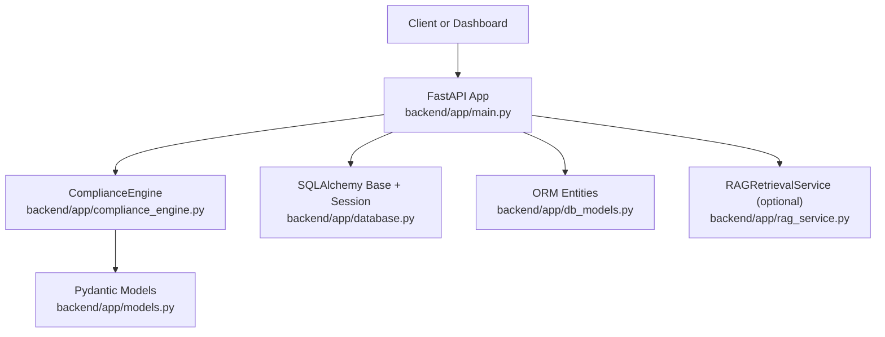
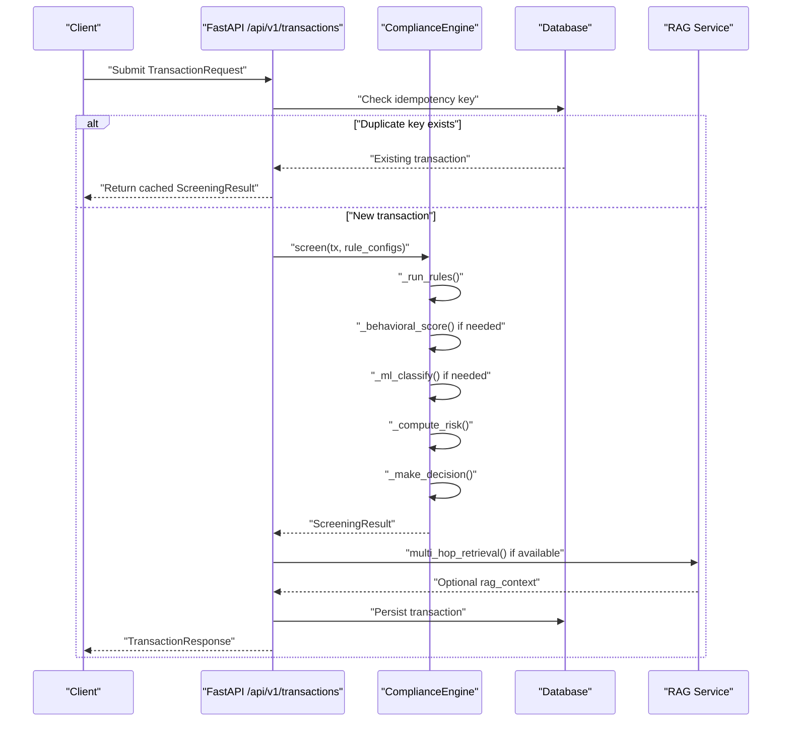
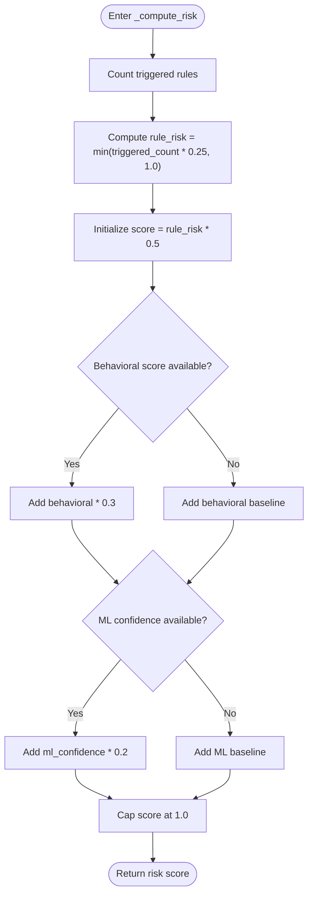
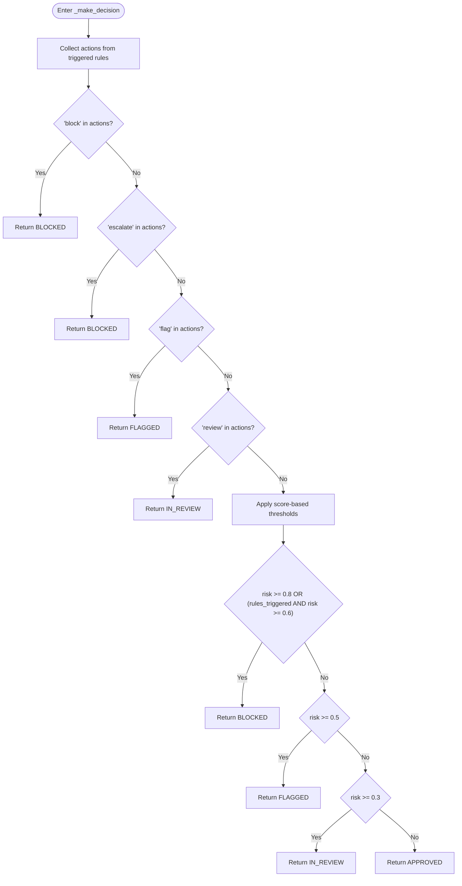
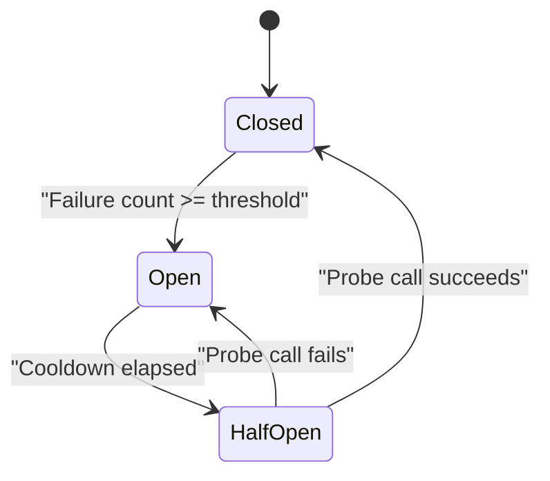
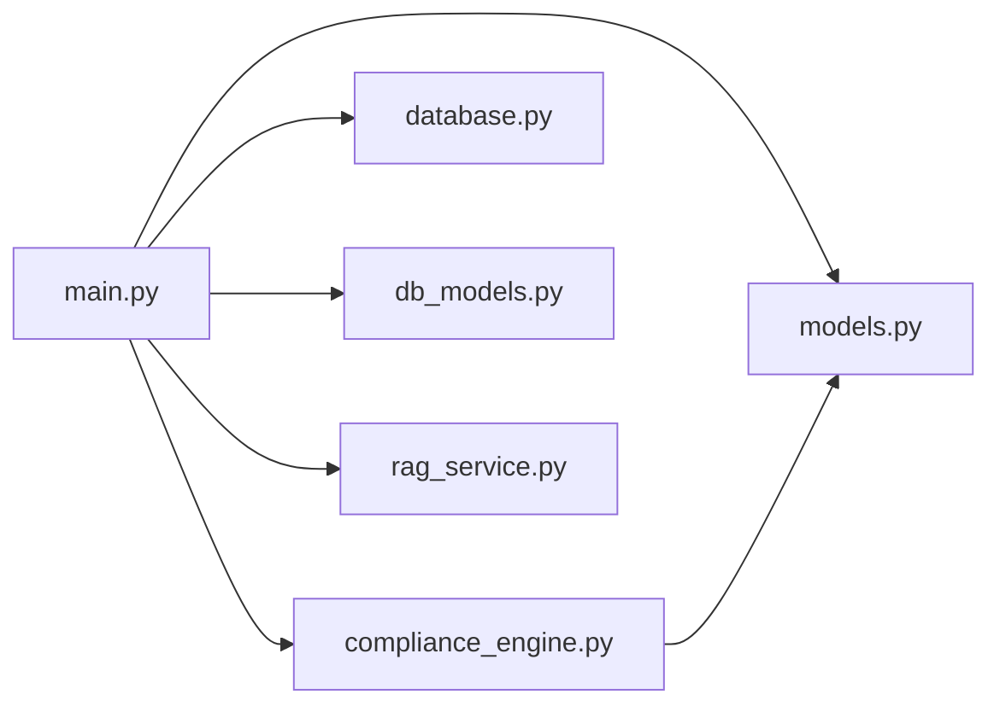

# Risk Scoring & Decision Logic

<cite>
**Referenced Files in This Document**   
- [compliance_engine.py](file://backend/app/compliance_engine.py)
- [models.py](file://backend/app/models.py)
- [main.py](file://backend/app/main.py)
- [rag_service.py](file://backend/app/rag_service.py)
- [db_models.py](file://backend/app/db_models.py)
- [database.py](file://backend/app/database.py)
- [FinShield-AI-Wiki.md](file://FinShield-AI-Wiki.md)
</cite>

## Table of Contents
1. [Introduction](#introduction)
2. [Project Structure](#project-structure)
3. [Core Components](#core-components)
4. [Architecture Overview](#architecture-overview)
5. [Detailed Component Analysis](#detailed-component-analysis)
6. [Dependency Analysis](#dependency-analysis)
7. [Performance Considerations](#performance-considerations)
8. [Troubleshooting Guide](#troubleshooting-guide)
9. [Conclusion](#conclusion)

## Introduction
This document explains the risk scoring and decision-making components implemented in FinShield AI’s backend compliance engine. It focuses on:

- The unified risk score produced by `_compute_risk()`.
- The hard-rule-first decision logic in `_make_decision()`.
- The `ScreeningStatus` enum values and their business meanings.
- Decision matrix examples showing how rule results, behavioral scores, ML confidence, and thresholds combine into final outcomes.
- The circuit breaker pattern described in the project design and its graceful degradation behavior.

The shipped implementation is a FastAPI application whose core pipeline lives in `backend/app/compliance_engine.py`, with request/response schemas in `backend/app/models.py`, API wiring in `backend/app/main.py`, optional RAG retrieval in `backend/app/rag_service.py`, persistence models in `backend/app/db_models.py`, and database configuration in `backend/app/database.py`.

## Project Structure
For this documentation, only the backend files relevant to screening, scoring, decisions, and resilience are used.

**Diagram sources**
- [main.py:26-43](file://backend/app/main.py#L26-L43)
- [main.py:129-150](file://backend/app/main.py#L129-L150)
- [compliance_engine.py:12-19](file://backend/app/compliance_engine.py#L12-L19)
- [database.py:17-24](file://backend/app/database.py#L17-L24)
- [db_models.py:15-15](file://backend/app/db_models.py#L15-L15)
- [rag_service.py:145-155](file://backend/app/rag_service.py#L145-L155)

**Section sources**
- [main.py:1-150](file://backend/app/main.py#L1-L150)
- [database.py:1-45](file://backend/app/database.py#L1-L45)

## Core Components
The risk-scoring and decision system is centered around `ComplianceEngine.screen()`, which runs a seven-stage pipeline:

1. Idempotency check.
2. Input validation.
3. Hard rule evaluation.
4. Behavioral analysis (conditional).
5. ML classification (conditional).
6. Unified risk scoring.
7. Final decision.

The engine returns a `ScreeningResult` that includes status, risk score, credit tier, consumed credits, rule results, behavioral score, ML classification, ML confidence, latency, and pipeline stages.

Key responsibilities:

| Component | Responsibility |
|---|---|
| `ComplianceEngine` | Orchestrates the full screening pipeline and implements scoring and decision logic. |
| `TransactionRequest` | Validates incoming transaction data before it enters the pipeline. |
| `RuleResult` | Records whether each hard rule fired and why. |
| `ScreeningResult` | Returns the complete outcome, including status, scores, and audit-friendly metadata. |
| `ScreeningStatus` | Enumerates the possible final statuses for a screened transaction. |
| `CircuitBreaker` | Defines the schema for downstream dependency resilience state. |

**Section sources**
- [compliance_engine.py:30-162](file://backend/app/compliance_engine.py#L30-L162)
- [models.py:67-119](file://backend/app/models.py#L67-L119)

## Architecture Overview
At runtime, an authenticated client calls the `/api/v1/transactions` endpoint. The route handler checks trial expiry, credits, idempotency, user rule overrides, then delegates to `ComplianceEngine.screen()`. After screening, the API optionally enriches the result with RAG context and persists the transaction.

**Diagram sources**
- [main.py:434-570](file://backend/app/main.py#L434-L570)
- [compliance_engine.py:89-162](file://backend/app/compliance_engine.py#L89-L162)
- [rag_service.py:361-412](file://backend/app/rag_service.py#L361-L412)

## Detailed Component Analysis

### Unified Risk Score: `_compute_risk()`
`_compute_risk()` combines three signals into a single risk score between 0 and 1:

| Signal | Source | Weight | Notes |
|---|---|---:|---|
| Rule risk | Number of triggered rules | 50% | Each triggered rule contributes up to 0.25; capped at 1.0 before weighting. |
| Behavioral score | `_behavioral_score()` | 30% | If unavailable, a baseline contribution is added instead. |
| ML confidence | `_ml_classify()` | 20% | If unavailable, a small baseline contribution is added instead. |

Algorithm summary:

1. Count triggered rules.
2. Compute `rule_risk = min(triggered_count × 0.25, 1.0)`.
3. Start with `score = rule_risk × 0.5`.
4. Add behavioral contribution:
   - If behavioral score exists: add `behavioral × 0.3`.
   - Otherwise: add a fixed baseline value.
5. Add ML contribution:
   - If ML confidence exists: add `ml_confidence × 0.2`.
   - Otherwise: add a smaller fixed baseline value.
6. Cap the final score at 1.0.

Complexity:
- Time complexity: O(R), where R is the number of rules evaluated. In the current implementation, R is four rules, so this is effectively constant time per transaction.
- Space complexity: O(1) beyond the input lists and scalar accumulators.

Behavioral implications:
- A transaction with no triggered rules can still receive a non-zero score from behavioral and ML baselines.
- Multiple triggered rules increase rule risk linearly until the cap.
- Missing behavioral or ML signals do not reduce the score below the configured baseline contributions.

**Diagram sources**
- [compliance_engine.py:306-327](file://backend/app/compliance_engine.py#L306-L327)

**Section sources**
- [compliance_engine.py:306-327](file://backend/app/compliance_engine.py#L306-L327)

### Decision Logic: `_make_decision()`
`_make_decision()` prioritizes hard rule actions over aggregate scoring. The effective priority order is:

1. **Block** — returned when a hard rule declares action `block`.
2. **Escalate** — mapped to `BLOCKED` in the current implementation.
3. **Flag** — returned when a hard rule declares action `flag`.
4. **Review** — returned when a hard rule declares action `review`.
5. **Score-based decisions** — fallback when no hard rule action fires.

Hard rule-to-action mapping:

| Rule ID | Rule Name | Declared Action | Business Meaning |
|---|---|---:|---|
| RULE-001 | OFAC Sanctions List Match | block | Known sanctions match blocks the transaction. |
| RULE-002 | Politically Exposed Person Check | flag | PEP involvement triggers enhanced review. |
| RULE-003 | Amount Threshold | review | High-value transactions require manual review. |
| RULE-004 | High-Risk Country Check | escalate | Destination country triggers escalation. |

Important implementation detail: although the declared action for RULE-004 is `escalate`, `_make_decision()` maps both `block` and `escalate` to `ScreeningStatus.BLOCKED`. Therefore, in the shipped code, a high-risk country match produces a blocked outcome rather than a distinct escalated status.

Score-based fallback thresholds:

| Condition | Outcome |
|---|---|
| No hard rule action AND `risk >= 0.8` | `BLOCKED` |
| No hard rule action AND any rule triggered AND `risk >= 0.6` | `BLOCKED` |
| No hard rule action AND `risk >= 0.5` | `FLAGGED` |
| No hard rule action AND `risk >= 0.3` | `IN_REVIEW` |
| No hard rule action AND `risk < 0.3` | `APPROVED` |

**Diagram sources**
- [compliance_engine.py:329-361](file://backend/app/compliance_engine.py#L329-L361)

**Section sources**
- [compliance_engine.py:329-361](file://backend/app/compliance_engine.py#L329-L361)

### ScreeningStatus Enum Values and Business Meanings
`ScreeningStatus` defines the possible outcomes for a screened transaction:

| Value | String | Business Meaning | Typical Trigger |
|---|---|---|---|
| `APPROVED` | `"approved"` | Transaction passes screening without further action. | No hard rule trigger and low risk score. |
| `FLAGGED` | `"flagged"` | Transaction requires investigation but is not automatically blocked. | PEP match, moderate risk score, or RAG sanctions enrichment upgrading an approved result. |
| `BLOCKED` | `"blocked"` | Transaction is rejected by hard controls or high-risk scoring. | Sanctions match, high-risk geography, or high aggregate risk. |
| `IN_REVIEW` | `"in_review"` | Transaction needs manual review before a final decision. | Amount threshold exceeded or moderate risk without stronger signals. |
| `PENDING` | `"pending"` | Initial persisted state before screening completes. | Used during ingestion before the engine assigns a terminal-like status. |

Note: `PENDING` exists in the model but is not normally assigned by `_make_decision()`. The API initially persists new transactions with `pending` semantics through the broader workflow, while the engine itself returns one of the active screening statuses.

**Section sources**
- [models.py:26-31](file://backend/app/models.py#L26-L31)
- [main.py:454-473](file://backend/app/main.py#L454-L473)

### Decision Matrix Examples
The following examples show how different signal combinations lead to final outcomes under the current implementation.

#### Example 1: Clean Transaction
- Rules triggered: none.
- Behavioral score: low.
- ML confidence: low.
- Result: `APPROVED`.

Reasoning:
- No hard rule action.
- Aggregate risk falls below 0.3.

#### Example 2: Amount Threshold Only
- Rules triggered: RULE-003 (`review`).
- Behavioral score: low.
- ML confidence: low.
- Result: `IN_REVIEW`.

Reasoning:
- Hard rule action `review` takes precedence over score-based logic.

#### Example 3: PEP Match
- Rules triggered: RULE-002 (`flag`).
- Behavioral score: medium.
- ML confidence: medium.
- Result: `FLAGGED`.

Reasoning:
- Hard rule action `flag` takes precedence.

#### Example 4: Sanctions Match
- Rules triggered: RULE-001 (`block`).
- Behavioral score: irrelevant after hard rule.
- ML confidence: irrelevant after hard rule.
- Result: `BLOCKED`.

Reasoning:
- Hard rule action `block` short-circuits scoring and decision.

#### Example 5: High-Risk Geography
- Rules triggered: RULE-004 (`escalate`).
- Behavioral score: low.
- ML confidence: low.
- Result: `BLOCKED`.

Reasoning:
- Declared action is `escalate`, but `_make_decision()` maps `escalate` to `BLOCKED`.

#### Example 6: No Hard Rule Trigger, High Aggregate Risk
- Rules triggered: none.
- Behavioral score: high.
- ML confidence: high.
- Result: `BLOCKED`.

Reasoning:
- No hard rule action.
- Aggregate risk reaches or exceeds 0.8.

#### Example 7: Mixed Signals, Moderate Risk
- Rules triggered: none.
- Behavioral score: medium.
- ML confidence: medium.
- Result: `FLAGGED`.

Reasoning:
- No hard rule action.
- Aggregate risk is at least 0.5 but below 0.8.

#### Example 8: Any Rule Triggered, Moderate Risk
- Rules triggered: one or more.
- Behavioral score: medium.
- ML confidence: medium.
- Result: `BLOCKED`.

Reasoning:
- No hard rule action.
- Any rule triggered plus risk at least 0.6 forces `BLOCKED`.

These examples assume the default weights and thresholds in `_compute_risk()` and `_make_decision()`. They do not include RAG enrichment overrides, which can upgrade an otherwise approved result to flagged when sanctions matches are found.

**Section sources**
- [compliance_engine.py:164-240](file://backend/app/compliance_engine.py#L164-L240)
- [compliance_engine.py:306-361](file://backend/app/compliance_engine.py#L306-L361)
- [main.py:484-505](file://backend/app/main.py#L484-L505)

### Circuit Breaker Pattern and Graceful Degradation
The project design describes a circuit breaker pattern for downstream dependencies such as the model server, pgvector, Redis, and notification services. The intended states are:

| State | Behavior |
|---|---|
| Closed | Normal operation; requests flow through. |
| Open | Calls are rejected immediately; the system routes to degraded mode. |
| Half-open | Limited probe requests are allowed; success closes the breaker, failure reopens it. |

Graceful degradation guidance from the design:

| Dependency Down | Expected Behavior |
|---|---|
| Model server | Transactions route to human review; no ML classification. |
| pgvector | Risk scorer and behavioral checks continue without RAG context; reduced confidence leads to human review. |
| Redis broker | API continues accepting requests; async pipeline stalls; transactions remain pending. |
| Notification service | Pipeline continues; notifications are queued for later delivery. |
| Config service | Cached config is used until TTL expires; hot reload is unavailable. |

In the shipped backend:

- The `CircuitBreaker` ORM entity exists in `db_models.py`, defining fields for dependency name, state, failure/success counts, cooldowns, and thresholds.
- There is no dedicated circuit breaker service class in the current source tree.
- The closest operational resilience patterns are:
  - Optional RAG import and initialization in `main.py`.
  - Try/except handling around RAG retrieval in the transaction screen route.
  - Logging warnings when RAG initialization or retrieval fails.
  - Continuing screening even when RAG enrichment fails.

Therefore, the circuit breaker pattern is partially represented:
- Schema and design intent are present.
- Operational integration for all dependencies is not fully implemented in the analyzed files.
- RAG availability is handled gracefully, but other dependencies such as model servers or Redis do not have explicit breaker logic visible in these files.

**Diagram sources**
- [db_models.py:275-293](file://backend/app/db_models.py#L275-L293)
- [FinShield-AI-Wiki.md:461-493](file://FinShield-AI-Wiki.md#L461-L493)

**Section sources**
- [db_models.py:275-293](file://backend/app/db_models.py#L275-L293)
- [main.py:38-43](file://backend/app/main.py#L38-L43)
- [main.py:138-150](file://backend/app/main.py#L138-L150)
- [main.py:484-505](file://backend/app/main.py#L484-L505)
- [FinShield-AI-Wiki.md:461-493](file://FinShield-AI-Wiki.md#L461-L493)

## Dependency Analysis
The risk-scoring and decision components depend on several modules:

Key relationships:

- `main.py` imports `ComplianceEngine`, Pydantic models, database helpers, ORM entities, and optionally `RAGRetrievalService`.
- `compliance_engine.py` imports `ScreeningStatus`, `RuleResult`, `RuleType`, `CreditTier`, and `TransactionRequest` from `models.py`.
- `rag_service.py` is optional and wrapped in try/except so missing vector dependencies do not prevent the core app from starting.
- `database.py` provides SQLite by default and PostgreSQL when `DATABASE_URL` is set.
- `db_models.py` defines the `CircuitBreaker` table alongside users, transactions, cases, and related entities.

**Diagram sources**
- [main.py:26-43](file://backend/app/main.py#L26-L43)
- [compliance_engine.py:12-19](file://backend/app/compliance_engine.py#L12-L19)
- [rag_service.py:38-44](file://backend/app/rag_service.py#L38-L44)
- [database.py:11-19](file://backend/app/database.py#L11-L19)
- [db_models.py:275-293](file://backend/app/db_models.py#L275-L293)

**Section sources**
- [main.py:26-43](file://backend/app/main.py#L26-L43)
- [compliance_engine.py:12-19](file://backend/app/compliance_engine.py#L12-L19)
- [database.py:11-19](file://backend/app/database.py#L11-L19)
- [db_models.py:275-293](file://backend/app/db_models.py#L275-L293)

## Performance Considerations
- Rule evaluation is deterministic and fast. With four built-in rules, the rule stage is effectively constant time.
- Behavioral scoring adds small arithmetic operations and random noise; it is lightweight compared to ML inference.
- ML classification is simulated in the current engine; in production, the design expects a LoRA fine-tuned classifier served locally.
- RAG retrieval is optional and may involve pgvector queries; it is intentionally decoupled so screening can proceed without it.
- The API layer measures total pipeline latency and exposes it in `ScreeningResult.total_latency_ms`.
- Idempotency avoids reprocessing duplicate transactions, improving throughput and preventing double charges.

[No sources needed since this section provides general guidance]

## Troubleshooting Guide
Common issues and where to look:

| Symptom | Likely Area | What to Check |
|---|---|---|
| Transaction always approved despite suspicious inputs | `_compute_risk()` and `_make_decision()` | Verify rule triggers, behavioral score, ML confidence, and thresholds. |
| High-risk country does not produce a distinct escalated status | `_make_decision()` | Note that `escalate` maps to `BLOCKED` in the current implementation. |
| RAG enrichment does not appear | `main.py` RAG initialization and retrieval | Check `RAG_DATABASE_URL`, optional dependency availability, and exception logs. |
| Screening result differs from expected due to RAG | `main.py` RAG enrichment path | Strong sanctions matches can upgrade an approved result to flagged. |
| Duplicate transaction returns same result | Idempotency cache and database lookup | Confirm `idempotency_key` reuse. |
| Circuit breaker state is not changing | `db_models.CircuitBreaker` vs runtime implementation | The schema exists, but no dedicated breaker controller is visible in the analyzed files. |

Operational notes:
- Use `ScreeningResult.pipeline_stages` to understand which stages ran.
- Inspect `rule_results` to see which hard rules fired and why.
- Review `behavioral_score` and `ml_confidence` to understand the non-rule portion of the risk score.
- Enable debug logging via environment variables to observe request processing and exceptions.

**Section sources**
- [compliance_engine.py:89-162](file://backend/app/compliance_engine.py#L89-L162)
- [compliance_engine.py:306-361](file://backend/app/compliance_engine.py#L306-L361)
- [main.py:484-505](file://backend/app/main.py#L484-L505)
- [db_models.py:275-293](file://backend/app/db_models.py#L275-L293)

## Conclusion
FinShield AI’s risk scoring and decision logic follows a clear hierarchy:

- Hard rules execute first and can override aggregate scoring.
- The unified risk score combines rule results, behavioral signals, and ML confidence with explicit weights.
- Decisions prioritize safety: block and escalate take precedence, followed by flag and review, with score-based outcomes as a fallback.
- `ScreeningStatus` provides a bounded set of business outcomes, with `PENDING` representing initial ingestion state.
- The circuit breaker pattern is documented and modeled, but the current backend ships partial resilience: RAG is optional and degrades gracefully, while the full circuit breaker controller is not present in the analyzed source files.

For production use, operators should verify that the decision mappings, thresholds, and circuit breaker integrations match their compliance policy, especially the mapping of `escalate` to `BLOCKED` and the absence of a runtime circuit breaker implementation beyond the schema and design documentation.