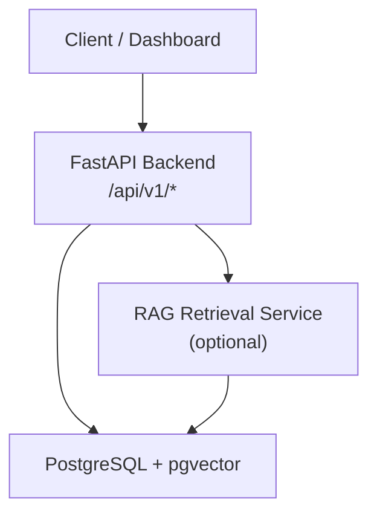
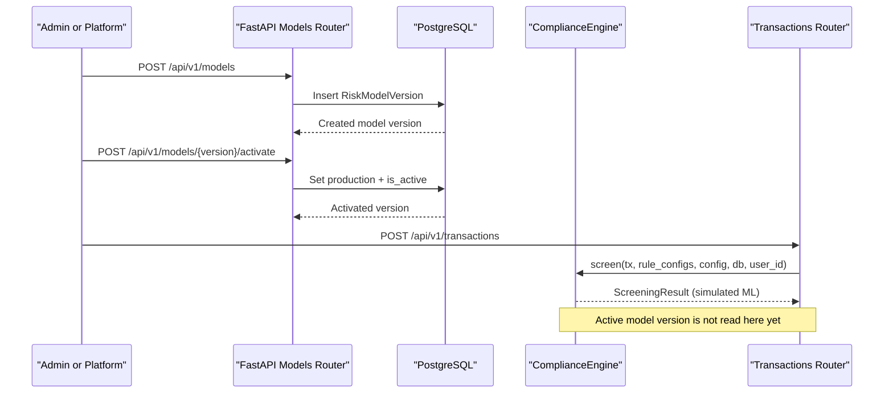
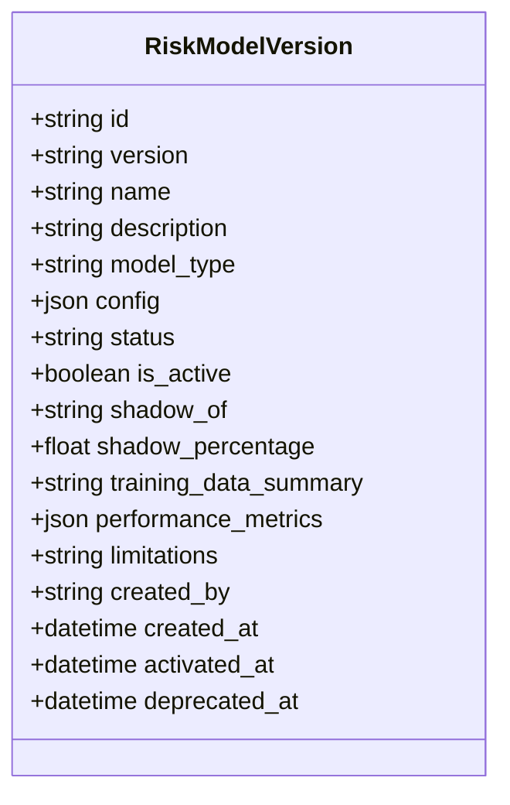
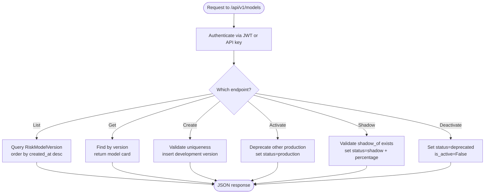
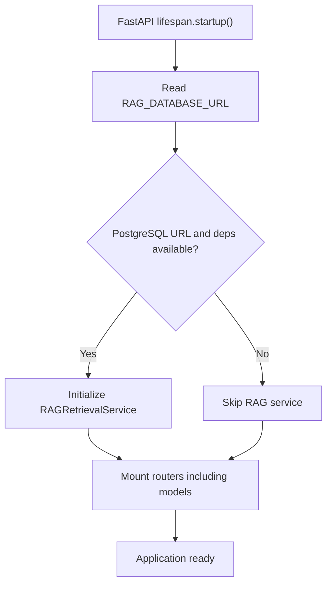
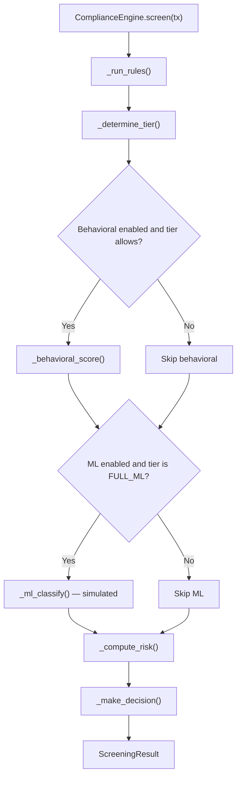
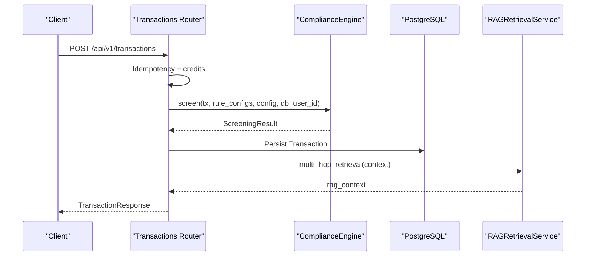
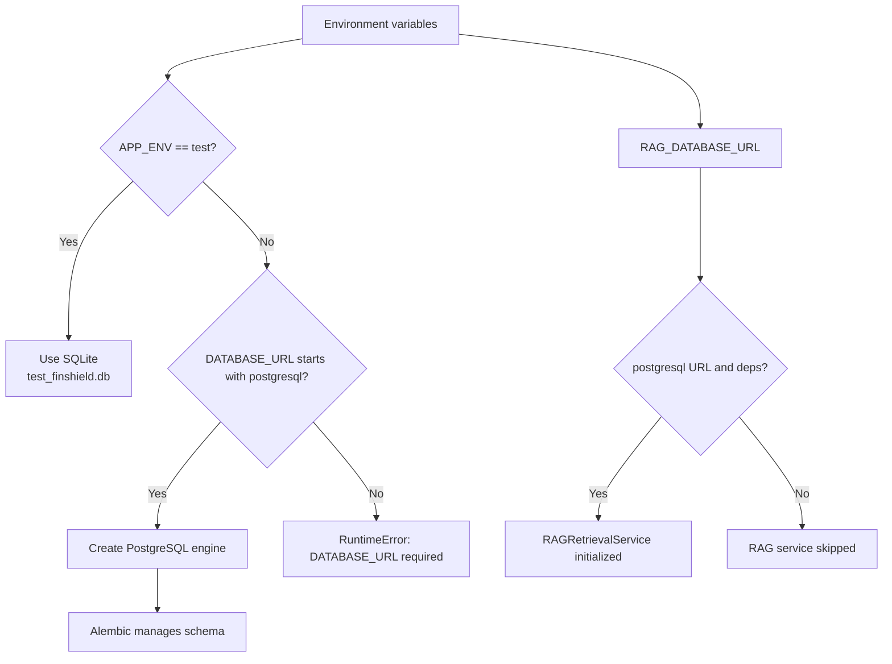
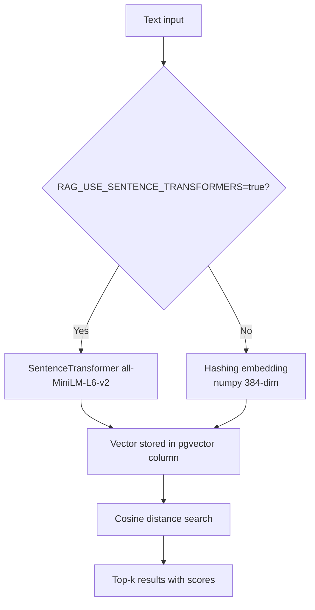
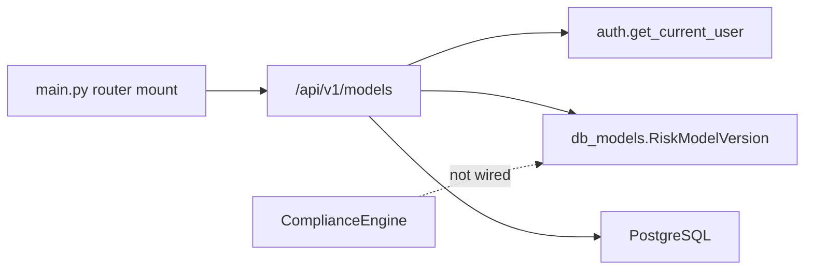

# Versioned Risk Model Management

<cite>
**Referenced Files in This Document**   
- [docker-compose.yml](file://docker-compose.yml)
- [backend/requirements.txt](file://backend/requirements.txt)
- [README.md](file://README.md)
- [FinShield-AI-Wiki.md](file://FinShield-AI-Wiki.md)
- [backend/app/main.py](file://backend/app/main.py)
- [backend/app/database.py](file://backend/app/database.py)
- [backend/app/db_models.py](file://backend/app/db_models.py)
- [backend/app/models.py](file://backend/app/models.py)
- [backend/app/auth.py](file://backend/app/auth.py)
- [backend/app/compliance_engine.py](file://backend/app/compliance_engine.py)
- [backend/app/rag_service.py](file://backend/app/rag_service.py)
- [backend/app/api/transactions.py](file://backend/app/api/transactions.py)
- [backend/app/api/models.py](file://backend/app/api/models.py)
- [backend/app/seed_rag_data.py](file://backend/app/seed_rag_data.py)
</cite>

## Table of Contents
1. [Introduction](#introduction)
2. [Project Structure](#project-structure)
3. [Core Components](#core-components)
4. [Architecture Overview](#architecture-overview)
5. [Detailed Component Analysis](#detailed-component-analysis)
6. [Dependency Analysis](#dependency-analysis)
7. [Performance Considerations](#performance-considerations)
8. [Troubleshooting Guide](#troubleshooting-guide)
9. [Conclusion](#conclusion)

## Introduction
This document explains the versioned risk model management capability as implemented in FinShield AI. It focuses on how risk models are represented, stored, exposed through the API, and related to the transaction screening pipeline. The shipped codebase is a local-first FastAPI backend with PostgreSQL (pgvector for RAG), Next.js 14 dashboard, and a static marketing site; many advanced features described in the README and Wiki are target state. The versioned risk model feature is present in the schema and API, but it is not wired into the live screening decision path — the current classifier stage is simulated.

The key takeaway is:
- A `risk_model_versions` table exists and supports versioning, status, shadow mode metadata, and model card fields.
- A `/api/v1/models` REST surface lets you list, create, activate, enable shadow mode, deactivate, and inspect model versions.
- The active model is not yet consumed by `ComplianceEngine.screen`; the ML classification step remains deterministic simulation based on behavioral score.
- RAG retrieval is optional and requires PostgreSQL configured via `RAG_DATABASE_URL`.

## Project Structure
The relevant deployables are:
- `backend/`: FastAPI service containing routers, domain logic, ORM models, schemas, database configuration, and RAG service.
- `platform-app/`: Next.js 14 dashboard.
- `website/`: Static marketing site plus legacy console pages.

At runtime, `docker-compose.yml` starts three services: PostgreSQL (`pgvector/pgvector:pg16`), the backend, and the frontend. The website directory is not part of this compose stack.

**Diagram sources**
- [docker-compose.yml:1-78](file://docker-compose.yml#L1-L78)
- [backend/app/main.py:56-63](file://backend/app/main.py#L56-L63)
- [backend/app/main.py:123-138](file://backend/app/main.py#L123-L138)

**Section sources**
- [README.md:247-276](file://README.md#L247-L276)
- [docker-compose.yml:1-78](file://docker-compose.yml#L1-L78)

## Core Components
Versioned risk model management spans four layers:
- Data model: `RiskModelVersion` in the ORM layer.
- API layer: `/api/v1/models` router for CRUD and lifecycle operations.
- Application wiring: FastAPI app startup and router registration.
- Screening integration point: `ComplianceEngine`, which currently simulates classification and does not read the active model.

Key responsibilities:
- `db_models.RiskModelVersion` stores version identity, type, config, status, shadow linkage, and model card metadata.
- `api.models` exposes endpoints to manage model versions.
- `main.py` mounts all routers, including the models router.
- `compliance_engine.ComplianceEngine.screen` is the screening entry point; its ML classification method is simulated today.

**Section sources**
- [backend/app/db_models.py:435-466](file://backend/app/db_models.py#L435-L466)
- [backend/app/api/models.py:1-226](file://backend/app/api/models.py#L1-L226)
- [backend/app/main.py:149-151](file://backend/app/main.py#L149-L151)
- [backend/app/compliance_engine.py:90-164](file://backend/app/compliance_engine.py#L90-L164)

## Architecture Overview
The versioned risk model system is a data-and-API subsystem that sits alongside the transaction screening pipeline. It is not yet an active control plane for the screening engine.

**Diagram sources**
- [backend/app/api/models.py:83-125](file://backend/app/api/models.py#L83-L125)
- [backend/app/api/models.py:128-161](file://backend/app/api/models.py#L128-L161)
- [backend/app/api/transactions.py:37-83](file://backend/app/api/transactions.py#L37-L83)
- [backend/app/compliance_engine.py:90-164](file://backend/app/compliance_engine.py#L90-L164)

## Detailed Component Analysis

### Risk Model Version Data Model
`RiskModelVersion` is the canonical record for a risk model version. It includes:
- Identity and human-readable name.
- Model type such as rule-based, ML classifier, or ensemble.
- JSON configuration for model-specific parameters.
- Lifecycle status: development, shadow, production, deprecated.
- Activation flag and activation/deprecation timestamps.
- Shadow linkage to another version and traffic percentage.
- Model card fields: training data summary, performance metrics, limitations.
- Creator identity.

**Diagram sources**
- [backend/app/db_models.py:435-466](file://backend/app/db_models.py#L435-L466)

**Section sources**
- [backend/app/db_models.py:435-466](file://backend/app/db_models.py#L435-L466)

### Risk Model Version API Surface
The models router provides:
- `GET /api/v1/models`: List versions, optionally filtered by status.
- `GET /api/v1/models/{version}`: Get full model card and metadata.
- `POST /api/v1/models`: Create a new version in development.
- `POST /api/v1/models/{version}/activate`: Promote a version to production and deprecate other production versions.
- `POST /api/v1/models/{version}/shadow`: Enable shadow mode against a production version with a traffic percentage.
- `POST /api/v1/models/{version}/deactivate`: Deprecate and deactivate a version.

All endpoints require authentication via `get_current_user`.

**Diagram sources**
- [backend/app/api/models.py:15-46](file://backend/app/api/models.py#L15-L46)
- [backend/app/api/models.py:49-80](file://backend/app/api/models.py#L49-L80)
- [backend/app/api/models.py:83-125](file://backend/app/api/models.py#L83-L125)
- [backend/app/api/models.py:128-161](file://backend/app/api/models.py#L128-L161)
- [backend/app/api/models.py:164-198](file://backend/app/api/models.py#L164-L198)
- [backend/app/api/models.py:201-225](file://backend/app/api/models.py#L201-L225)
- [backend/app/auth.py:63-117](file://backend/app/auth.py#L63-L117)

**Section sources**
- [backend/app/api/models.py:1-226](file://backend/app/api/models.py#L1-L226)
- [backend/app/auth.py:63-117](file://backend/app/auth.py#L63-L117)

### Application Wiring and Startup
`main.py` initializes the FastAPI application, registers CORS, exception handlers, request logging middleware, and mounts routers. During lifespan startup, it conditionally initializes the RAG retrieval service when `RAG_DATABASE_URL` points at PostgreSQL and optional dependencies are available. The models router is included among the mounted routers.

Important implications:
- RAG is optional; if unavailable, screening still completes.
- The models router is always mounted regardless of RAG availability.
- The active model version is not loaded into application state during startup.

**Diagram sources**
- [backend/app/main.py:50-63](file://backend/app/main.py#L50-L63)
- [backend/app/main.py:123-138](file://backend/app/main.py#L123-L138)
- [backend/app/main.py:149-151](file://backend/app/main.py#L149-L151)

**Section sources**
- [backend/app/main.py:50-63](file://backend/app/main.py#L50-L63)
- [backend/app/main.py:123-138](file://backend/app/main.py#L123-L138)
- [backend/app/main.py:149-151](file://backend/app/main.py#L149-L151)

### Screening Pipeline Integration Point
`ComplianceEngine.screen` implements the seven-stage pipeline: idempotency check, validation, hard rules, behavioral analysis, ML classification, risk scoring, and decision. The ML classification method `_ml_classify` is deterministic simulation based on behavioral score; it does not consult `RiskModelVersion`.

Consequences:
- Activating or shadowing a model version has no effect on screening outcomes today.
- The active model is not part of the credit tier determination or decision bands.
- To make versioned models operational, the engine must be extended to select the active model and route classification accordingly.

**Diagram sources**
- [backend/app/compliance_engine.py:90-164](file://backend/app/compliance_engine.py#L90-L164)
- [backend/app/compliance_engine.py:375-435](file://backend/app/compliance_engine.py#L375-L435)
- [backend/app/compliance_engine.py:437-502](file://backend/app/compliance_engine.py#L437-L502)
- [backend/app/compliance_engine.py:504-529](file://backend/app/compliance_engine.py#L504-L529)

**Section sources**
- [backend/app/compliance_engine.py:90-164](file://backend/app/compliance_engine.py#L90-L164)
- [backend/app/compliance_engine.py:375-435](file://backend/app/compliance_engine.py#L375-L435)
- [backend/app/compliance_engine.py:437-502](file://backend/app/compliance_engine.py#L437-L502)
- [backend/app/compliance_engine.py:504-529](file://backend/app/compliance_engine.py#L504-L529)

### Transaction Submission and RAG Enrichment
The transactions router handles idempotent submission, credit checks, persistence, notifications, and optional RAG enrichment. RAG enrichment is guarded by:
- Presence of `app.state.rag_service`.
- Feature flag `screening.rag`.
- Circuit breaker state for pgvector.

RAG enrichment can adjust the result’s `rag_context` and, for strong sanctions matches, reinforce escalation without silently auto-approving. This is orthogonal to the versioned risk model API.

**Diagram sources**
- [backend/app/api/transactions.py:37-83](file://backend/app/api/transactions.py#L37-L83)
- [backend/app/api/transactions.py:84-173](file://backend/app/api/transactions.py#L84-L173)
- [backend/app/api/transactions.py:174-237](file://backend/app/api/transactions.py#L174-L237)
- [backend/app/rag_service.py:323-374](file://backend/app/rag_service.py#L323-L374)

**Section sources**
- [backend/app/api/transactions.py:37-237](file://backend/app/api/transactions.py#L37-L237)
- [backend/app/rag_service.py:323-374](file://backend/app/rag_service.py#L323-L374)

### Database Configuration and Persistence Model
Persistence defaults:
- SQLite is used only under `APP_ENV=test`.
- Outside tests, `DATABASE_URL` must be a PostgreSQL URL.
- The schema is managed by Alembic migrations.

RAG uses a separate connection string `RAG_DATABASE_URL`. If it is not set or not PostgreSQL, RAG is skipped at startup.

**Diagram sources**
- [backend/app/database.py:15-38](file://backend/app/database.py#L15-L38)
- [backend/app/database.py:56-75](file://backend/app/database.py#L56-L75)
- [backend/app/main.py:123-138](file://backend/app/main.py#L123-L138)

**Section sources**
- [backend/app/database.py:15-38](file://backend/app/database.py#L15-L38)
- [backend/app/database.py:56-75](file://backend/app/database.py#L56-L75)
- [backend/app/main.py:123-138](file://backend/app/main.py#L123-L138)

### Authentication and Authorization
Authentication supports:
- JWT bearer tokens.
- Live API keys with the `fsk_` prefix.
- Per-user row filtering is enforced by routes using the authenticated user.
- Role-based permission helpers exist, though the models router currently relies on authentication rather than explicit role guards.

For versioned risk model management, any authenticated user can call the models endpoints unless additional authorization is added.

**Section sources**
- [backend/app/auth.py:21-28](file://backend/app/auth.py#L21-L28)
- [backend/app/auth.py:63-117](file://backend/app/auth.py#L63-L117)
- [backend/app/auth.py:130-256](file://backend/app/auth.py#L130-L256)

### RAG Retrieval and Embedding Strategy
RAG retrieval uses pgvector cosine similarity. The default embedding strategy is deterministic hashing with numpy, producing 384-dimensional vectors. Optional semantic embeddings are supported via `sentence-transformers` when explicitly enabled.

Seed data adds compliance documents, sanctions entries, and precedent decisions to the same PostgreSQL database.

**Diagram sources**
- [backend/app/rag_service.py:35-53](file://backend/app/rag_service.py#L35-L53)
- [backend/app/rag_service.py:56-89](file://backend/app/rag_service.py#L56-L89)
- [backend/app/rag_service.py:218-254](file://backend/app/rag_service.py#L218-L254)
- [backend/app/seed_rag_data.py:11-25](file://backend/app/seed_rag_data.py#L11-L25)

**Section sources**
- [backend/app/rag_service.py:35-53](file://backend/app/rag_service.py#L35-L53)
- [backend/app/rag_service.py:56-89](file://backend/app/rag_service.py#L56-L89)
- [backend/app/rag_service.py:218-254](file://backend/app/rag_service.py#L218-L254)
- [backend/app/seed_rag_data.py:11-25](file://backend/app/seed_rag_data.py#L11-L25)

## Dependency Analysis
Versioned risk model management depends on:
- SQLAlchemy ORM for `RiskModelVersion`.
- PostgreSQL for persistence.
- FastAPI routing and Pydantic validation.
- Authentication dependency for protected endpoints.
- Alembic migrations for schema evolution.

It does not currently depend on:
- Celery or Redis.
- LangChain or DSPy.
- LoRA, PEFT, BitsAndBytes, or vLLM.
- OpenTelemetry or Prometheus.

**Diagram sources**
- [backend/app/api/models.py:1-226](file://backend/app/api/models.py#L1-L226)
- [backend/app/auth.py:63-117](file://backend/app/auth.py#L63-L117)
- [backend/app/db_models.py:435-466](file://backend/app/db_models.py#L435-L466)
- [backend/app/main.py:149-151](file://backend/app/main.py#L149-L151)
- [backend/app/compliance_engine.py:90-164](file://backend/app/compliance_engine.py#L90-L164)

**Section sources**
- [backend/requirements.txt:1-17](file://backend/requirements.txt#L1-L17)
- [backend/app/api/models.py:1-226](file://backend/app/api/models.py#L1-L226)
- [backend/app/db_models.py:435-466](file://backend/app/db_models.py#L435-L466)
- [backend/app/main.py:149-151](file://backend/app/main.py#L149-L151)
- [backend/app/compliance_engine.py:90-164](file://backend/app/compliance_engine.py#L90-L164)

## Performance Considerations
- Model version queries are simple primary-key or status filters; they are lightweight compared to screening.
- Activating a model updates one row and may update other production rows; this is a small transactional cost.
- Shadow mode metadata is persisted but not evaluated by the screening engine today, so enabling shadow mode has no runtime screening cost.
- RAG retrieval is optional and can degrade gracefully; it should not block screening.
- Avoid making the active model lookup part of every screening request until the engine is wired to use it; cache or load it at startup if needed later.

[No sources needed since this section provides general guidance]

## Troubleshooting Guide
Common issues and resolutions:
- Cannot connect to PostgreSQL: ensure `DATABASE_URL` is set and points to a running PostgreSQL instance. Outside test mode, SQLite is rejected.
- RAG service not initialized: verify `RAG_DATABASE_URL` is set to a PostgreSQL URL and that optional dependencies are available.
- Model version not found: confirm the requested version exists before activating or enabling shadow mode.
- Shadow mode validation fails: the referenced production model must exist and have status `production`.
- Screening outcome unchanged after activating a model: expected, because the active model is not yet consumed by `ComplianceEngine.screen`.

Operational checks:
- Use `GET /api/v1/models` to inspect available versions and their statuses.
- Use `GET /api/v1/models/{version}` to inspect model card details.
- Use `GET /api/health` to verify backend health.
- Seed RAG data with `python -m app.seed_rag_data` when RAG is enabled.

**Section sources**
- [backend/app/database.py:15-38](file://backend/app/database.py#L15-L38)
- [backend/app/main.py:123-138](file://backend/app/main.py#L123-L138)
- [backend/app/api/models.py:49-80](file://backend/app/api/models.py#L49-L80)
- [backend/app/api/models.py:164-198](file://backend/app/api/models.py#L164-L198)
- [backend/app/seed_rag_data.py:191-200](file://backend/app/seed_rag_data.py#L191-L200)

## Conclusion
FinShield AI ships a complete versioned risk model data model and API, but the active model is not yet integrated into the screening pipeline. Today:
- You can create, list, inspect, activate, shadow, and deactivate model versions.
- The screening engine simulates ML classification and does not read the active model.
- RAG retrieval is optional and runs against PostgreSQL with pgvector.
- The shipped stack is FastAPI, PostgreSQL, pgvector, Pydantic, SQLAlchemy, bcrypt, PyJWT, slowapi, numpy, pytest, and Alembic.

To move from “model registry” to “model-driven screening,” the next implementation steps should:
- Select the active model during screening.
- Support shadow evaluation without affecting decisions.
- Tie model selection to credit tiers, decision bands, and audit trails.
- Add authorization controls for model lifecycle endpoints.
- Wire model version metadata into `ScreeningResult` and audit records.

[No sources needed since this section summarizes without analyzing specific files]