# Database Schema Design

<cite>
**Referenced Files in This Document**   
- [database.py](file://backend/app/database.py)
- [db_models.py](file://backend/app/db_models.py)
- [config_service.py](file://backend/app/config_service.py)
- [main.py](file://backend/app/main.py)
- [alembic.ini](file://backend/alembic.ini)
- [env.py](file://backend/migrations/env.py)
- [0001_baseline_schema.py](file://backend/migrations/versions/0001_baseline_schema.py)
- [0002_runtime_settings.py](file://backend/migrations/versions/0002_runtime_settings.py)
- [docker-compose.yml](file://docker-compose.yml)
</cite>

## Update Summary
**Changes Made**   
- Updated persistence model to reflect PostgreSQL as primary database with SQLite for testing only
- Added comprehensive Alembic migration infrastructure documentation
- Documented new settings and feature_flags tables for runtime configuration management
- Updated connection pooling configuration with pre-ping enabled
- Enhanced migration strategy section with versioning approach
- Added vector extension support documentation for pgvector integration

## Table of Contents
1. [Introduction](#introduction)
2. [Project Structure](#project-structure)
3. [Core Components](#core-components)
4. [Architecture Overview](#architecture-overview)
5. [Detailed Component Analysis](#detailed-component-analysis)
6. [Dependency Analysis](#dependency-analysis)
7. [Performance Considerations](#performance-considerations)
8. [Troubleshooting Guide](#troubleshooting-guide)
9. [Conclusion](#conclusion)
10. [Appendices](#appendices)

## Introduction
This document describes FinShield's database schema and persistence model as implemented in the shipped backend. It covers all SQLAlchemy ORM entities, their fields, relationships, constraints, indexes, validation rules, business logic embedded in models and routes, multi-tenant isolation, audit trail design, data lifecycle, pgvector integration for semantic search, and comprehensive migration strategy using Alembic.

**Updated** FinShield has migrated from SQLite-only to PostgreSQL as the primary production database while maintaining SQLite for testing environments. The application now uses Alembic for schema versioning and includes new runtime configuration management through settings and feature_flags tables.

The core application requires PostgreSQL (`DATABASE_URL`) in production and switches to SQLite only when `APP_ENV=test`. The RAG retrieval service requires a separate PostgreSQL connection with the `pgvector` extension enabled; it is initialized from `RAG_DATABASE_URL` at startup and is optional for the rest of the API.

## Project Structure
The database-related code lives under `backend/app`:

| Area | Responsibility |
|---|---|
| `database.py` | Engine/session configuration, PostgreSQL vs SQLite selection, Alembic integration, connection pooling |
| `db_models.py` | SQLAlchemy ORM entities for users, transactions, cases, filings, audits, notifications, rule configurations, webhooks, baselines, circuit breakers, settings, and feature flags |
| `config_service.py` | Runtime configuration management with settings and feature flags |
| `rag_service.py` | Separate SQLAlchemy base and tables for RAG corpus: compliance documents, sanctions entries, precedent decisions, plus vector search methods |
| `seed_rag_data.py` | Idempotent seed script for the RAG corpus |
| `main.py` | FastAPI application that mounts routes, initializes DB/RAG, persists transactions, creates cases, and writes audit logs |
| `auth.py` | JWT/API-key authentication and password hashing |
| `compliance_engine.py` | Rule/gating logic that determines screening status, credit tier, and pipeline stages |
| `migrations/` | Alembic migration files for schema evolution |
| `alembic.ini` | Alembic configuration file |

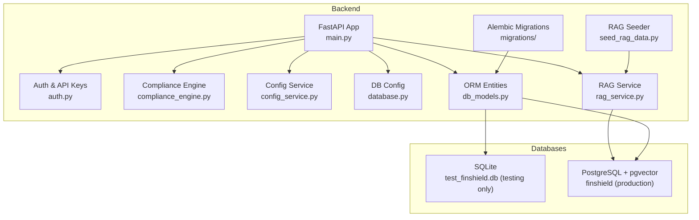

**Diagram sources**
- [main.py:19-37](file://backend/app/main.py#L19-L37)
- [database.py:15-38](file://backend/app/database.py#L15-L38)
- [db_models.py:22-422](file://backend/app/db_models.py#L22-L422)
- [config_service.py:16-17](file://backend/app/config_service.py#L16-L17)
- [alembic.ini:1-37](file://backend/alembic.ini#L1-L37)

**Section sources**
- [database.py:1-75](file://backend/app/database.py#L1-L75)
- [db_models.py:1-422](file://backend/app/db_models.py#L1-L422)
- [config_service.py:1-257](file://backend/app/config_service.py#L1-L257)
- [main.py:1-149](file://backend/app/main.py#L1-L149)
- [alembic.ini:1-37](file://backend/alembic.ini#L1-L37)

## Core Components
FinShield's persistence layer has three related but distinct parts:

1. **Application database**: Managed by `database.Base`. It stores user accounts, API keys, transactions, cases, filings, audit logs, notifications, rule overrides, case comments/notes, webhook delivery state, account baselines, circuit breaker state, runtime settings, and feature flags.
2. **RAG database**: Managed by `rag_service.RAGBase`. It stores compliance documents, sanctions entries, and precedent decisions with 384-dimensional vectors for cosine similarity search.
3. **Migration system**: Alembic-managed schema evolution with version control and rollback capabilities.

### Persistence Model
- **Production database**: PostgreSQL via `DATABASE_URL` environment variable (required).
- **Test database**: SQLite file `test_finshield.db` when `APP_ENV=test`, or PostgreSQL if `TEST_DATABASE_URL` is set.
- **RAG database**: Set `RAG_DATABASE_URL` to a PostgreSQL DSN; the service enables the `vector` extension and creates its own tables.
- **Connection pooling**: PostgreSQL connections use `pool_pre_ping=True`, configurable pool size and overflow settings.
- **Schema management**: Alembic handles all schema evolution; `create_all()` is test-only.

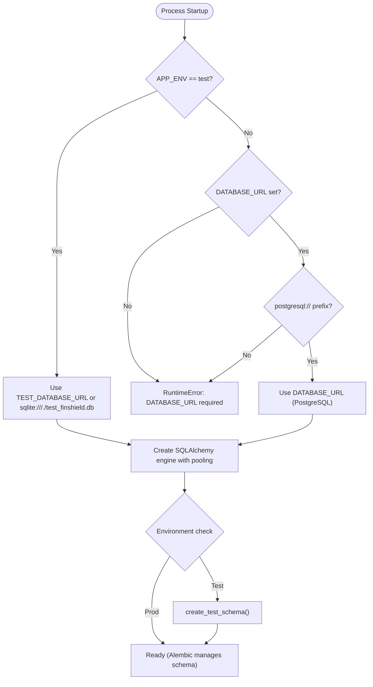

**Diagram sources**
- [database.py:15-38](file://backend/app/database.py#L15-L38)
- [database.py:56-75](file://backend/app/database.py#L56-L75)

**Section sources**
- [database.py:1-75](file://backend/app/database.py#L1-L75)

## Architecture Overview
The database schema supports three major flows:

1. **Transaction screening**: Request → Pydantic validation → compliance engine → optional RAG enrichment → transaction persistence → notification/audit updates.
2. **Case management**: Transaction → Case → Case notes/comments → Filings.
3. **RAG retrieval**: Compliance documents, sanctions entries, and precedent decisions are embedded and searched using pgvector cosine distance.
4. **Runtime configuration**: Settings and feature flags provide dynamic configuration without redeployment.

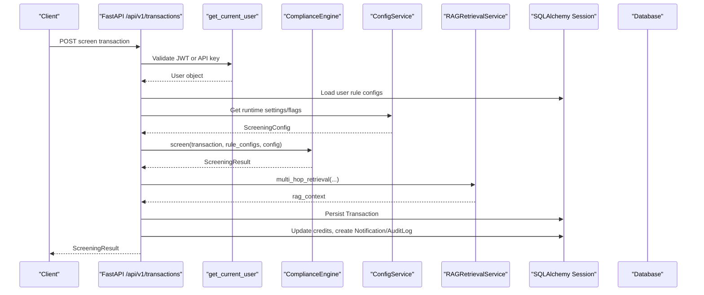

**Diagram sources**
- [main.py:120-135](file://backend/app/main.py#L120-L135)
- [config_service.py:219-230](file://backend/app/config_service.py#L219-L230)

## Detailed Component Analysis

### Application Database Entities

#### User
- **Table**: `users`
- **Primary key**: `id` (string UUID, generated by `generate_uuid`)
- **Key fields**:
  - `email`: unique, indexed, required
  - `hashed_password`: bcrypt hash stored as string
  - `first_name`, `last_name`: required
  - `company`: optional
  - `plan`: default `"starter"`
  - `total_credits`: integer, default `1000`
  - `used_credits`: float, default `0.0`
  - `is_active`, `is_verified`, `is_trial`: boolean flags
  - `trial_expires_at`: datetime
  - `billing_cycle_start`, `billing_cycle_end`: billing window
  - `pending_plan_change`: downgrade queue field
  - `timezone`: IANA timezone string
  - `saved_card_last4`, `saved_card_expiry`, `saved_card_holder`: payment metadata
  - `created_at`, `updated_at`: timestamps
- **Relationships**:
  - One-to-many: `api_keys`, `transactions`, `cases`, `notifications`
- **Validation and business rules**:
  - Email uniqueness enforced by ORM index/constraint.
  - Registration sets trial plan, credits, and expiry.
  - Login checks active status.
  - Profile update enforces non-empty names.
  - Password change validates minimum length before hashing.

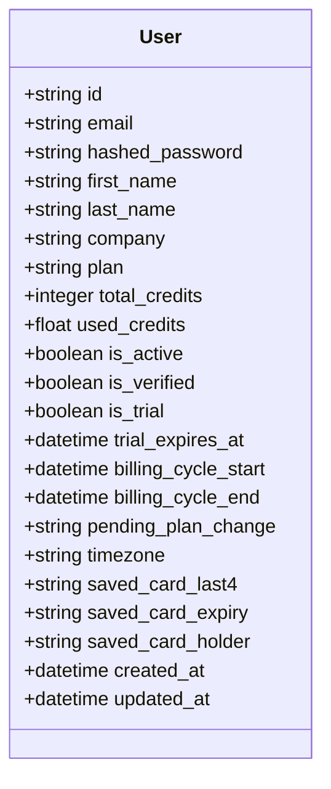

**Diagram sources**
- [db_models.py:22-57](file://backend/app/db_models.py#L22-L57)

**Section sources**
- [db_models.py:22-57](file://backend/app/db_models.py#L22-L57)

#### ApiKey
- **Table**: `api_keys`
- **Primary key**: `id` (UUID)
- **Foreign keys**: `user_id` references `users.id`
- **Key fields**:
  - `name`: required
  - `key_hash`: bcrypt hash of full key, unique
  - `key_prefix`: display prefix
  - `is_active`: boolean
  - `created_at`, `last_used_at`: timestamps
- **Relationships**:
  - Many-to-one: `user`
- **Business rules**:
  - Full key returned only on creation.
  - Authentication verifies prefix match then bcrypt comparison.
  - Last-used timestamp updated on successful API-key auth.

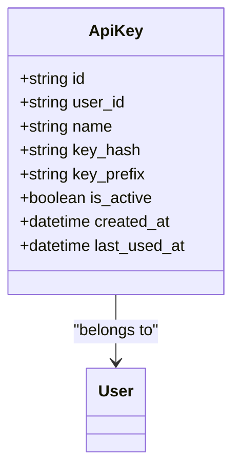

**Diagram sources**
- [db_models.py:59-73](file://backend/app/db_models.py#L59-L73)

**Section sources**
- [db_models.py:59-73](file://backend/app/db_models.py#L59-L73)

#### Transaction
- **Table**: `transactions`
- **Primary key**: `id` (UUID)
- **Foreign keys**: `user_id` references `users.id`
- **Key fields**:
  - `idempotency_key`: unique, indexed, required
  - `amount`: float, required
  - `currency`: default `"USD"`
  - `transaction_type`: string
  - `sender_name`, `receiver_name`: required
  - `destination_country`: optional
  - `description`: text
  - `status`: default `"pending"`
  - `risk_score`: float, default `0.0`
  - `credit_tier`: string
  - `credits_consumed`: float, default `0.0`
  - `rule_results`: JSON
  - `behavioral_score`: float
  - `ml_classification`: string
  - `ml_confidence`: float
  - `total_latency_ms`: float
  - `pipeline_stages`: JSON list
  - `rag_context`: JSON
  - `created_at`: timestamp
- **Relationships**:
  - Many-to-one: `user`
  - One-to-many: `cases`
- **Validation and business rules**:
  - Pydantic `TransactionRequest` enforces positive amount, currency length, enum type, and required names.
  - Idempotency prevents duplicate charges and returns existing result.
  - Credits are deducted before persisting.
  - Status, risk score, ML outputs, latency, and RAG context are persisted.

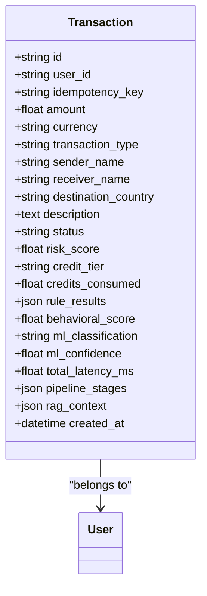

**Diagram sources**
- [db_models.py:75-106](file://backend/app/db_models.py#L75-L106)

**Section sources**
- [db_models.py:75-106](file://backend/app/db_models.py#L75-L106)

#### Case
- **Table**: `cases`
- **Primary key**: `id` (string, prefixed `CASE-...`)
- **Foreign keys**: `user_id` references `users.id`, `transaction_id` references `transactions.id`
- **Key fields**:
  - `status`: default `"open"`
  - `priority`: default `"medium"`
  - `severity`: default `"medium"`
  - `reason`: required text
  - `assigned_to`: optional investigator ID
  - `sla_deadline`, `escalated_at`, `escalated_by`, `escalation_reason`: SLA tracking
  - `resolution`, `resolution_summary`, `resolved_at`: resolution fields
  - `created_at`, `updated_at`: timestamps
- **Relationships**:
  - Many-to-one: `user`, `transaction`
  - One-to-many: `filings`, `notes`, `comments`
- **Business rules**:
  - Case creation requires a transaction belonging to the current user.
  - Notifications are created on case creation.

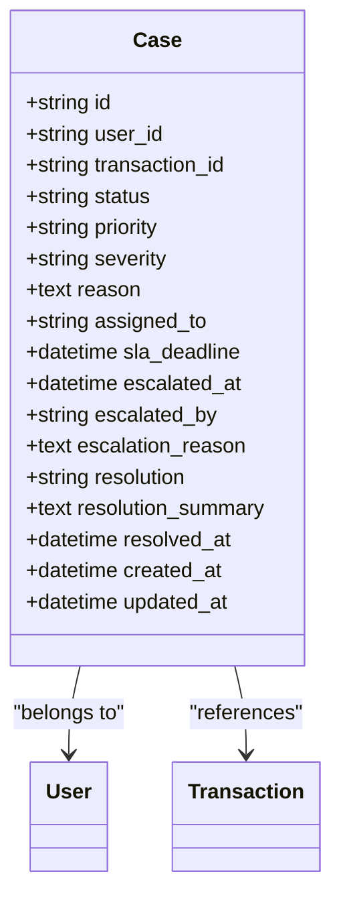

**Diagram sources**
- [db_models.py:108-139](file://backend/app/db_models.py#L108-L139)

**Section sources**
- [db_models.py:108-139](file://backend/app/db_models.py#L108-L139)

#### AuditLog
- **Table**: `audit_logs`
- **Primary key**: `id` (UUID)
- **Foreign keys**: `user_id` references `users.id` (nullable)
- **Key fields**:
  - `action`: required
  - `resource_type`, `resource_id`: optional resource reference
  - `details`: JSON
  - `ip_address`: optional
  - `created_at`: timestamp
- **Purpose**: Immutable audit trail for important actions such as registration, login, password changes, setting changes, and flag changes.

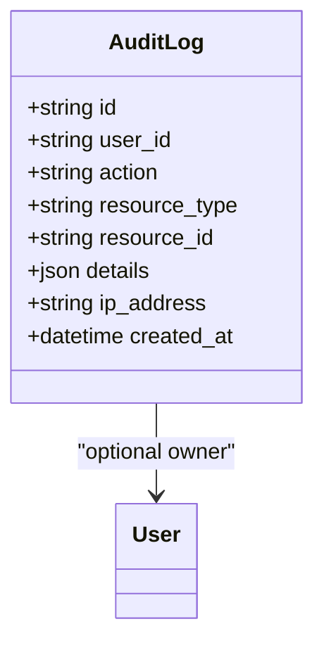

**Diagram sources**
- [db_models.py:141-152](file://backend/app/db_models.py#L141-L152)

**Section sources**
- [db_models.py:141-152](file://backend/app/db_models.py#L141-L152)

#### Notification and NotificationPreference
- **Notifications**:
  - Table: `notifications`
  - Fields: `user_id`, `type`, `title`, `message`, `is_read`, `link`, `created_at`
  - Used for blocked transactions, new cases, credit alerts, system messages, and plan changes.
- **NotificationPreferences**:
  - Table: `notification_preferences`
  - One-to-one with `User` via unique `user_id`
  - Boolean toggles for email channels.

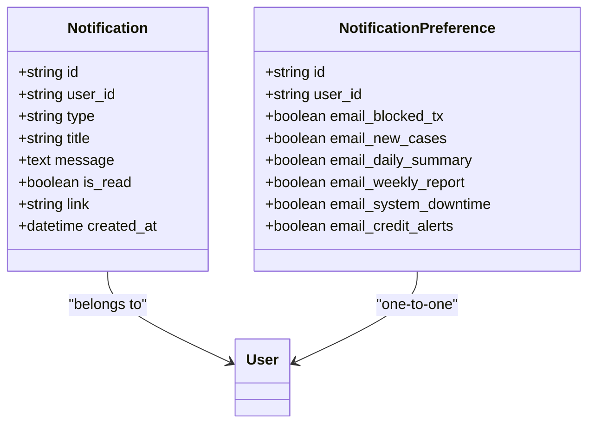

**Diagram sources**
- [db_models.py:154-181](file://backend/app/db_models.py#L154-L181)

**Section sources**
- [db_models.py:154-181](file://backend/app/db_models.py#L154-L181)

#### RuleConfig
- **Table**: `rule_configs`
- **Purpose**: Per-user rule overrides with enable/disable, custom parameters, priority, versioning, effective windows, hit tracking, and timestamps.
- **Key fields**:
  - `user_id`, `rule_id`, `enabled`, `custom_parameters`
  - `priority`, `version`, `effective_from`, `effective_to`
  - `hit_count`, `last_hit_at`, `false_positive_count`
  - `created_at`, `updated_at`
- **Usage**: Loaded into memory during transaction screening and passed to the compliance engine.

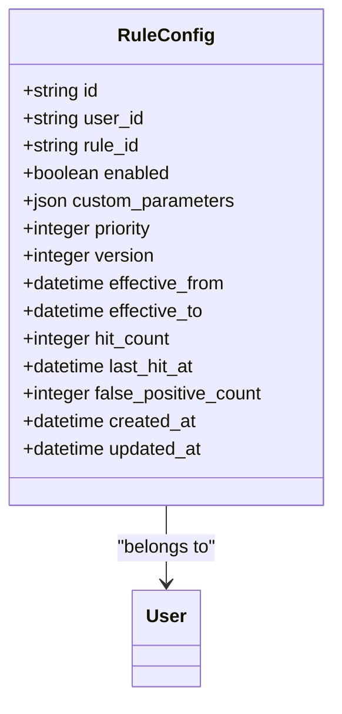

**Diagram sources**
- [db_models.py:184-210](file://backend/app/db_models.py#L184-L210)

**Section sources**
- [db_models.py:184-210](file://backend/app/db_models.py#L184-L210)

#### CaseComment and CaseNote
- **CaseComment**: Immutable comment attached to a case, authored by a user.
- **CaseNote**: Ephemeral investigator note, mutable, also linked to a case and user.

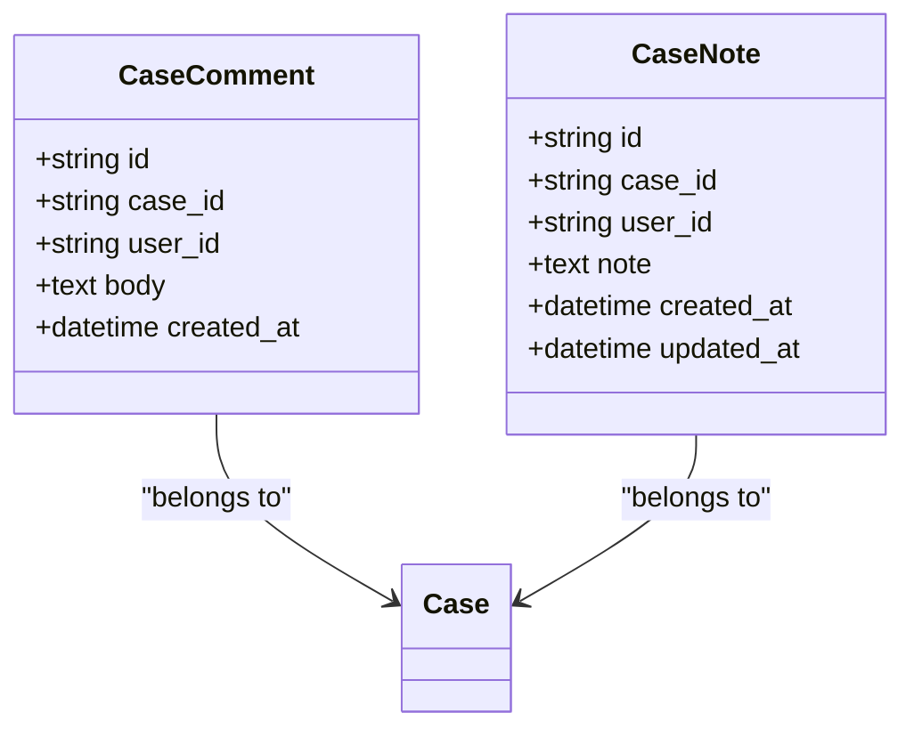

**Diagram sources**
- [db_models.py:212-238](file://backend/app/db_models.py#L212-L238)

**Section sources**
- [db_models.py:212-238](file://backend/app/db_models.py#L212-L238)

#### Filing
- **Table**: `filings`
- **Purpose**: SAR/STR regulatory filings for confirmed suspicious cases.
- **Key fields**:
  - `case_id`, `user_id`
  - `filing_type`: SAR or STR
  - `status`: draft, under_review, submitted, confirmed, rejected
  - `deadline`: regulatory deadline
  - `narrative`, `structured_data`
  - `reference_number`, `submitted_at`, `submitted_by`, `confirmed_at`, `confirmed_by`
  - `created_at`, `updated_at`
- **Relationships**:
  - Many-to-one: `case`, `user`

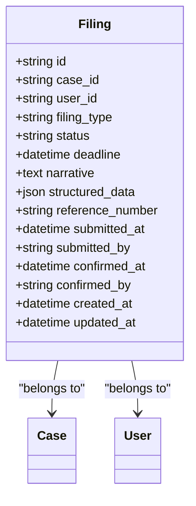

**Diagram sources**
- [db_models.py:240-273](file://backend/app/db_models.py#L240-L273)

**Section sources**
- [db_models.py:240-273](file://backend/app/db_models.py#L240-L273)

#### CircuitBreaker, WebhookEvent, AccountBaseline
- **CircuitBreaker**: Tracks downstream dependency health per dependency name.
- **WebhookEvent**: Tracks webhook delivery attempts, retries, errors, and delivery status.
- **AccountBaseline**: Rolling behavioral baseline per external account identifier, including statistics, typical patterns, age tracking, cold-start flag, and freshness timestamps.

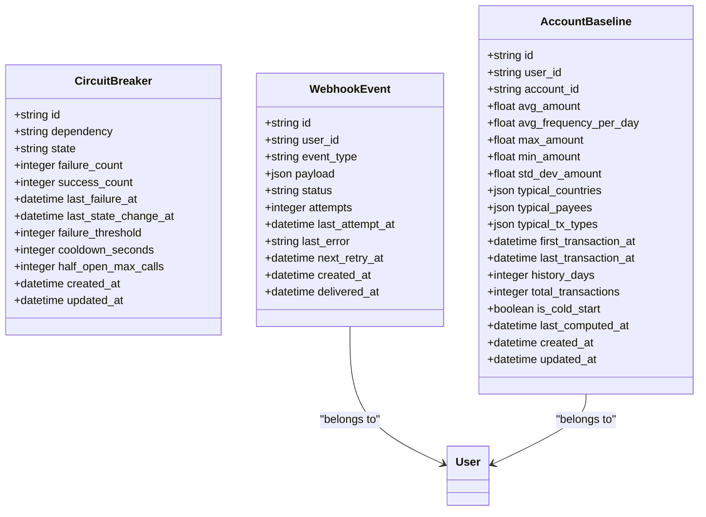

**Diagram sources**
- [db_models.py:275-353](file://backend/app/db_models.py#L275-L353)

**Section sources**
- [db_models.py:275-353](file://backend/app/db_models.py#L275-L353)

#### Setting
- **Table**: `settings`
- **Purpose**: Runtime setting overrides with typed validation and descriptions.
- **Key fields**:
  - `key`: primary key, setting identifier
  - `scope`: primary key, defaults to "global" (for future tenant support)
  - `value`: JSON value with validation
  - `updated_by`: foreign key to users table
  - `updated_at`: timestamp
- **Supported settings**: Rules thresholds, behavioral triggers, risk weights, decision bands, billing configuration, and subscription plans.

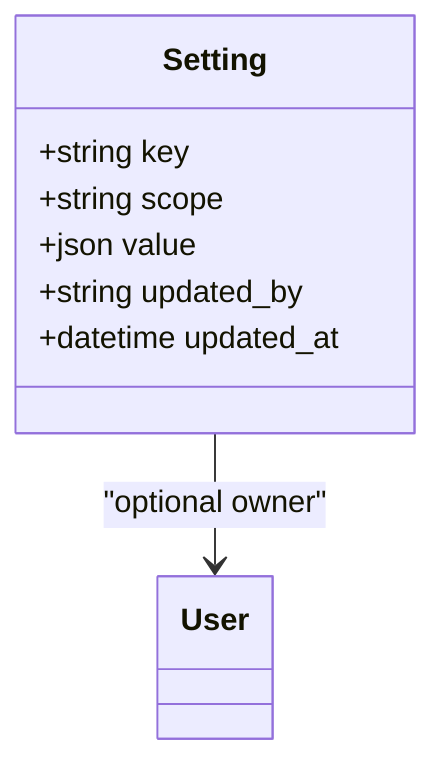

**Diagram sources**
- [db_models.py:356-365](file://backend/app/db_models.py#L356-L365)
- [config_service.py:85-98](file://backend/app/config_service.py#L85-L98)

**Section sources**
- [db_models.py:356-365](file://backend/app/db_models.py#L356-L365)
- [config_service.py:85-98](file://backend/app/config_service.py#L85-L98)

#### FeatureFlag
- **Table**: `feature_flags`
- **Purpose**: Runtime feature flags for enabling/disabling functionality without redeployment.
- **Key fields**:
  - `key`: primary key, flag identifier
  - `scope`: primary key, defaults to "global"
  - `enabled`: boolean flag value
  - `updated_by`: foreign key to users table
  - `updated_at`: timestamp
- **Supported flags**: screening.behavioral, screening.ml, screening.rag

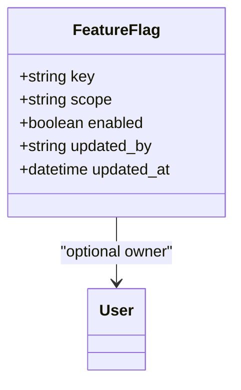

**Diagram sources**
- [db_models.py:367-376](file://backend/app/db_models.py#L367-L376)
- [config_service.py:100-104](file://backend/app/config_service.py#L100-L104)

**Section sources**
- [db_models.py:367-376](file://backend/app/db_models.py#L367-L376)
- [config_service.py:100-104](file://backend/app/config_service.py#L100-L104)

### RAG Corpus Entities

#### ComplianceDocument
- **Table**: `compliance_documents`
- **Fields**:
  - `id`, `title`, `content`, `category`, `jurisdiction`, `effective_date`, `metadata`
  - `embedding`: 384-dim vector
  - `created_at`
- **Purpose**: Stores policies, regulations, and guidelines for semantic retrieval.

#### SanctionsEntry
- **Table**: `sanctions_entries`
- **Fields**:
  - `id`, `name`, `type`, `program`, `country`, `aliases`, `remarks`
  - `embedding`: 384-dim vector
  - `created_at`
- **Purpose**: Sanctions lists with embeddings for fuzzy name matching.

#### PrecedentDecision
- **Table**: `precedent_decisions`
- **Fields**:
  - `id`, `case_summary`, `decision`, `reasoning`, `risk_factors`
  - `embedding`: 384-dim vector
  - `created_at`
- **Purpose**: Historical decisions used for precedent-based retrieval.

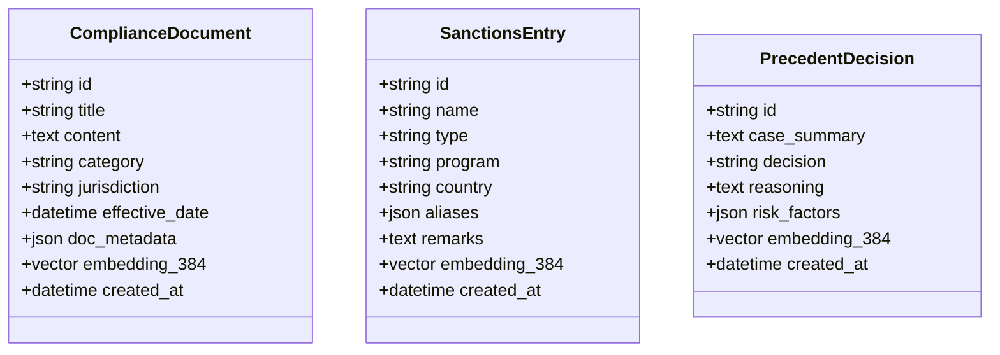

**Diagram sources**
- [db_models.py:381-422](file://backend/app/db_models.py#L381-L422)

**Section sources**
- [db_models.py:381-422](file://backend/app/db_models.py#L381-L422)

## Dependency Analysis

### Entity Relationship Diagram
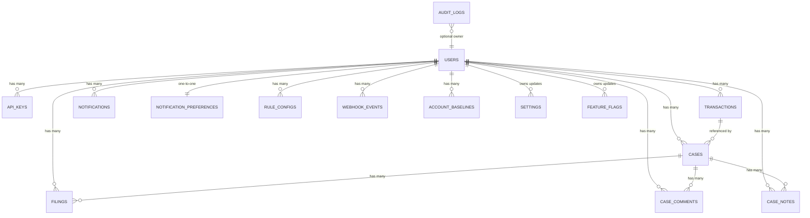

**Diagram sources**
- [db_models.py:22-422](file://backend/app/db_models.py#L22-L422)

### Data Flow Dependencies
- `main.py` imports ORM entities, auth helpers, compliance engine, and Pydantic models.
- `auth.py` depends on `User` and `ApiKey` to resolve identity from JWT or API key.
- `compliance_engine.py` depends on Pydantic models and enums to compute screening results.
- `config_service.py` provides runtime configuration through `Setting` and `FeatureFlag` models.
- `rag_service.py` defines its own SQLAlchemy base and vector-enabled tables, independent of the application ORM base.
- `seed_rag_data.py` depends on `RAGRetrievalService` to populate RAG tables.

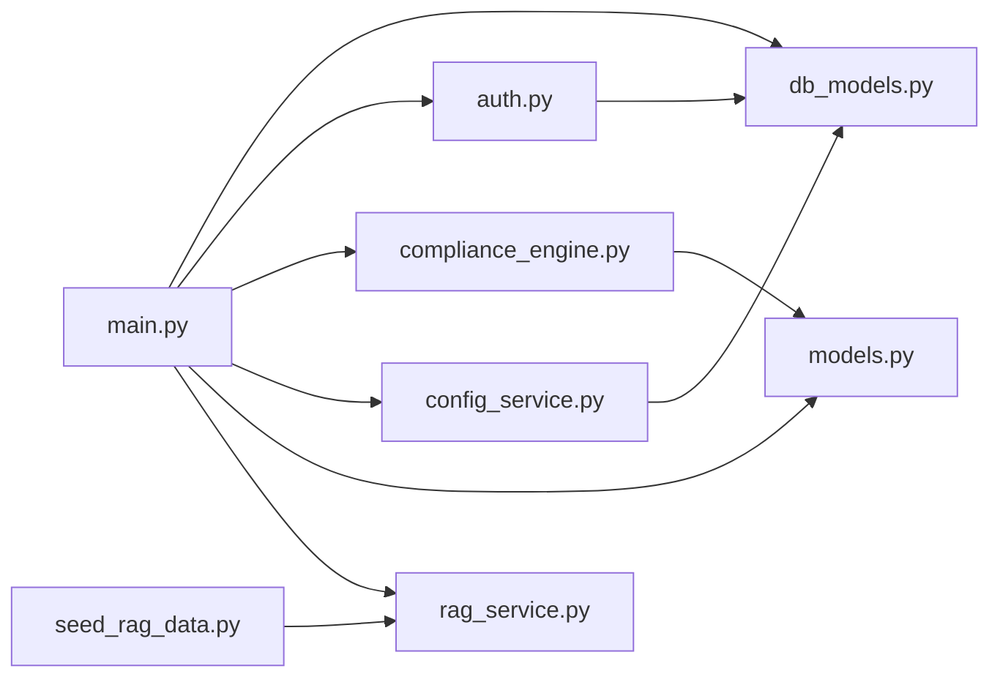

**Diagram sources**
- [main.py:19-37](file://backend/app/main.py#L19-L37)
- [config_service.py:16-17](file://backend/app/config_service.py#L16-L17)

**Section sources**
- [main.py:19-37](file://backend/app/main.py#L19-L37)
- [config_service.py:16-17](file://backend/app/config_service.py#L16-L17)

## Performance Considerations
- **PostgreSQL production**: Primary database with connection pooling (`pool_size=10`, `max_overflow=20`), `pool_pre_ping=True` for connection health checking.
- **SQLite testing**: Suitable for development and small-scale testing. The engine disables thread-safety checks for SQLite via `check_same_thread=False`.
- **Vector dimension**: All RAG embeddings are fixed at 384 dimensions, matching both hashing-based embeddings and the optional `all-MiniLM-L6-v2` transformer.
- **Idempotency**: Transactions use a unique `idempotency_key` with an index to prevent duplicate processing and double-charging.
- **Indexing**:
  - `users.email` is unique and indexed.
  - `transactions.idempotency_key` is unique and indexed.
- **JSON fields**: Several tables store flexible payloads (`rule_results`, `pipeline_stages`, `rag_context`, `typical_countries`, etc.). This improves flexibility but reduces strict schema enforcement for those fields.
- **Configuration caching**: Runtime settings and flags use a 30-second TTL cache to reduce database load.

[No sources needed since this section provides general guidance]

## Troubleshooting Guide

### Common Database Issues
- **Missing DATABASE_URL**: Production requires `DATABASE_URL` to be set with PostgreSQL connection string.
- **Invalid DATABASE_URL format**: Must start with `postgresql://` prefix in production.
- **Missing RAG service**: If `RAG_DATABASE_URL` is not set or dependencies are unavailable, RAG initialization is skipped. Screening still completes normally.
- **pgvector extension missing**: The RAG service attempts `CREATE EXTENSION IF NOT EXISTS vector` before creating tables. If PostgreSQL lacks pgvector, RAG operations will fail.
- **SQLite concurrency**: SQLite is single-writer by default; concurrent writes may cause contention. Use PostgreSQL for production workloads.
- **Test database isolation**: Tests use `test_finshield.db` when `APP_ENV=test`.

**Section sources**
- [database.py:17-25](file://backend/app/database.py#L17-L25)
- [main.py:124-135](file://backend/app/main.py#L124-L135)

### Validation and Business Rule Failures
- **Invalid request data**: FastAPI returns 422 with Pydantic error details.
- **Insufficient credits**: Screening returns HTTP 402 when remaining credits are below 1.0.
- **Trial expired**: Trial users cannot screen after `trial_expires_at`.
- **Duplicate idempotency key**: Returns the previously computed result instead of reprocessing.
- **Case creation without owned transaction**: Returns 404 if the referenced transaction does not belong to the authenticated user.
- **Unknown setting/flag keys**: Configuration service raises `UnknownKey` exception for unrecognized keys.
- **Invalid configuration values**: Configuration service raises `InvalidValue` exception for values that don't pass validation.

**Section sources**
- [config_service.py:109-114](file://backend/app/config_service.py#L109-L114)
- [config_service.py:153-158](file://backend/app/config_service.py#L153-L158)

### Multi-Tenant Isolation
- **Current approach**: Every query filters by `current_user.id`. There is no explicit tenant column in the core entities.
- **Future support**: Settings and feature flags include a `scope` field designed for future tenant isolation.
- **Implication**: Tenancy is enforced at the application layer rather than through a dedicated tenant partition.
- **Risk**: A missing `user_id` filter could expose cross-tenant data. Always verify route handlers include user-scoped queries.

**Section sources**
- [db_models.py:361](file://backend/app/db_models.py#L361)

### Audit Trail Requirements
- **Registered users**: Audit log entry with action `user_registered`.
- **Login events**: Audit log entry with action `user_login`.
- **Password changes**: Audit log entry with action `password_changed`.
- **Setting changes**: Audit log entry with action `setting_changed` including before/after values.
- **Flag changes**: Audit log entry with action `flag_changed` including before/after values.
- **Design**: Audit logs are append-only and include optional resource references and JSON details.

**Section sources**
- [config_service.py:166-167](file://backend/app/config_service.py#L166-L167)
- [config_service.py:184-185](file://backend/app/config_service.py#L184-L185)

### Data Lifecycle Management
- **User lifecycle**: Register → trial → login → profile/password updates → credit consumption.
- **Transaction lifecycle**: Idempotency check → rule/screening → optional RAG enrichment → persistence → notifications.
- **Case lifecycle**: Creation → investigation → notes/comments → potential filing.
- **Filing lifecycle**: Draft → review → submission → confirmation/rejection.
- **Configuration lifecycle**: Default values → database overrides → cached reads → audit logging on changes.
- **Cleanup**: No automated retention policy is implemented in the schema or models.

**Section sources**
- [config_service.py:153-188](file://backend/app/config_service.py#L153-L188)

### Migration Strategy and Versioning
**Updated** FinShield now uses Alembic for comprehensive schema versioning and management.

- **Migration framework**: Alembic manages all schema evolution with version control.
- **Initial migrations**: 
  - `0001_baseline_schema.py`: Creates all core tables including RAG corpus with pgvector support.
  - `0002_runtime_settings.py`: Adds settings and feature_flags tables with seeded default values.
- **Schema creation**: Production relies entirely on Alembic; `create_all()` is test-only.
- **Testing helper**: `create_test_schema()` runs Alembic migrations for PostgreSQL tests or uses direct table creation for SQLite.
- **Vector extension**: Automatic `CREATE EXTENSION IF NOT EXISTS vector` for PostgreSQL databases.
- **Rollback support**: Each migration includes proper `downgrade()` functions.
- **Pre-existing table handling**: Baseline migration detects and skips pre-existing RAG tables created by older versions.

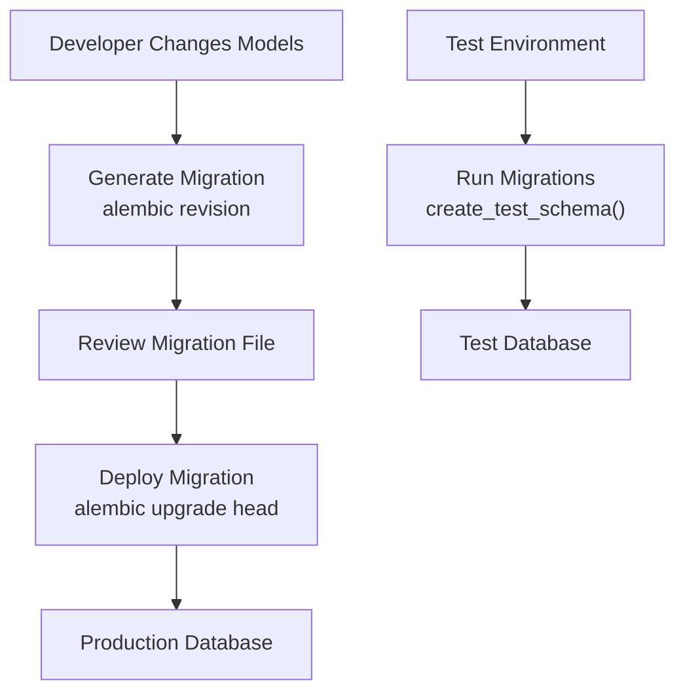

**Diagram sources**
- [database.py:56-75](file://backend/app/database.py#L56-L75)
- [0001_baseline_schema.py:37-41](file://backend/migrations/versions/0001_baseline_schema.py#L37-L41)
- [0002_runtime_settings.py:105-132](file://backend/migrations/versions/0002_runtime_settings.py#L105-L132)

**Section sources**
- [database.py:56-75](file://backend/app/database.py#L56-L75)
- [0001_baseline_schema.py:1-336](file://backend/migrations/versions/0001_baseline_schema.py#L1-L336)
- [0002_runtime_settings.py:1-138](file://backend/migrations/versions/0002_runtime_settings.py#L1-L138)

## Conclusion
FinShield's database schema centers on a PostgreSQL-backed application database and an optional PostgreSQL-backed RAG corpus. The ORM models define a comprehensive compliance workflow: users, transactions, cases, filings, audits, notifications, rule overrides, auxiliary operational tables, runtime settings, and feature flags. Validation is primarily enforced at the API boundary through Pydantic, while business rules live in the compliance engine and route handlers.

**Updated** Key improvements include:
- **PostgreSQL as primary database** with robust connection pooling and pre-ping support
- **Comprehensive Alembic migration infrastructure** for schema versioning and rollback
- **Runtime configuration management** through settings and feature_flags tables
- **Enhanced security** with strict database URL validation and environment separation
- **Scalable architecture** supporting future multi-tenant requirements

For production readiness, consider:
- Adding explicit tenant isolation columns and database-level constraints.
- Implementing data retention and archival policies for audit logs, transactions, and RAG corpus.
- Ensuring RAG availability is monitored and degraded gracefully.
- Reviewing JSON-heavy fields for indexing strategies and schema validation where appropriate.
- Setting up monitoring and alerting for database performance and connection pool utilization.

## Appendices

### Pgvector Integration Summary
- **Extension**: `vector` is created automatically by the baseline migration for PostgreSQL databases.
- **Embeddings**: 384-dimensional vectors produced by deterministic hashing or optional sentence-transformers.
- **Search**: Cosine similarity ranking via `embedding.cosine_distance`.
- **Thresholding**: Sanctions matches apply a configurable similarity threshold.
- **Multi-hop retrieval**: Combines policy search, sanctions matching, and precedent search.

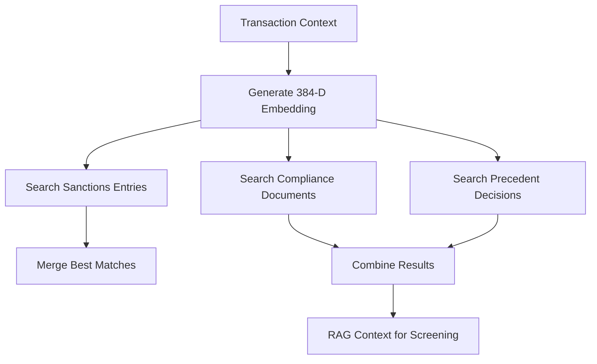

**Diagram sources**
- [0001_baseline_schema.py:39-40](file://backend/migrations/versions/0001_baseline_schema.py#L39-L40)

### Docker Services Relevant to Persistence
- **postgres**: Uses `pgvector/pgvector:pg16`, exposes port 5432, and runs the `finshield` database.
- **backend**: Defaults to PostgreSQL via `DATABASE_URL`, with RAG service configured through `RAG_DATABASE_URL`.
- **frontend**: Next.js dashboard built from `platform-app/Dockerfile`.

**Section sources**
- [docker-compose.yml:1-78](file://docker-compose.yml#L1-L78)

### Alembic Configuration Details
- **Script location**: `migrations` directory relative to alembic.ini
- **Logging**: Configured for root, sqlalchemy, and alembic loggers
- **Environment integration**: Reads DATABASE_URL from app.database module
- **Target metadata**: Uses Base.metadata from app.database for unified schema management

**Section sources**
- [alembic.ini:1-37](file://backend/alembic.ini#L1-L37)
- [env.py:1-33](file://backend/migrations/env.py#L1-L33)