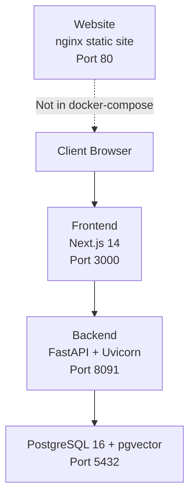
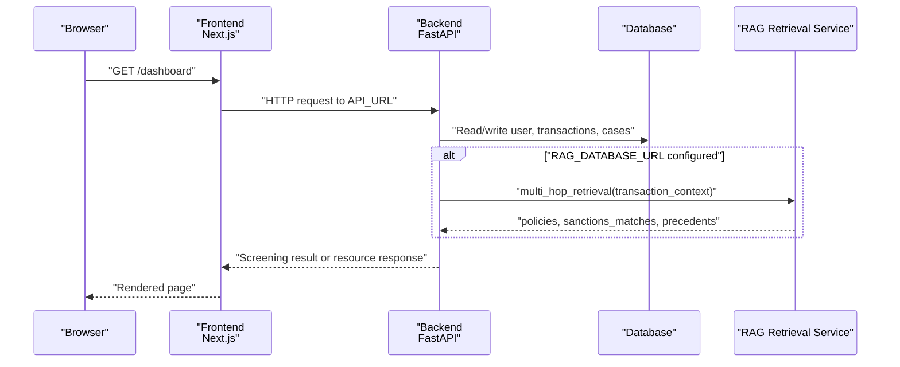
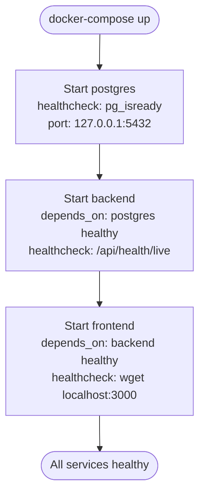
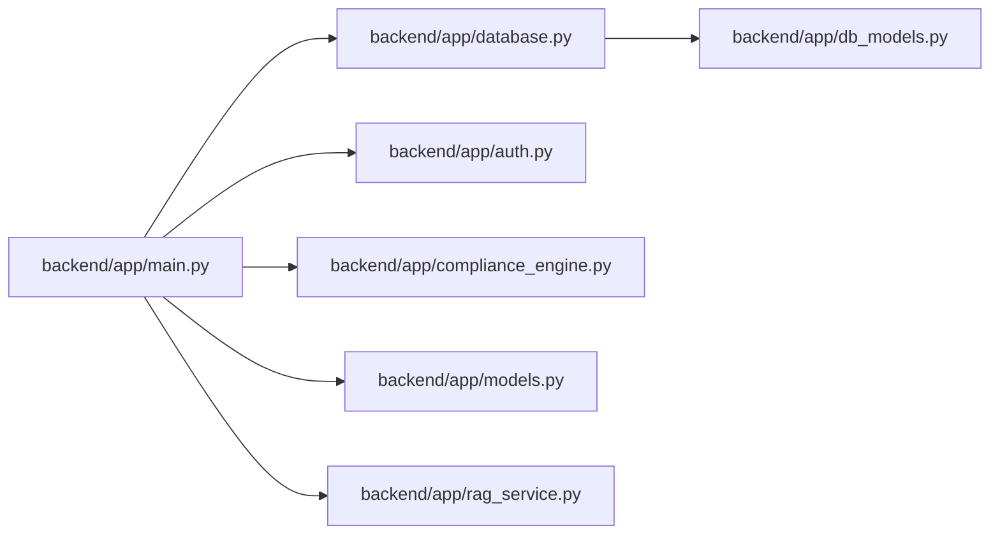
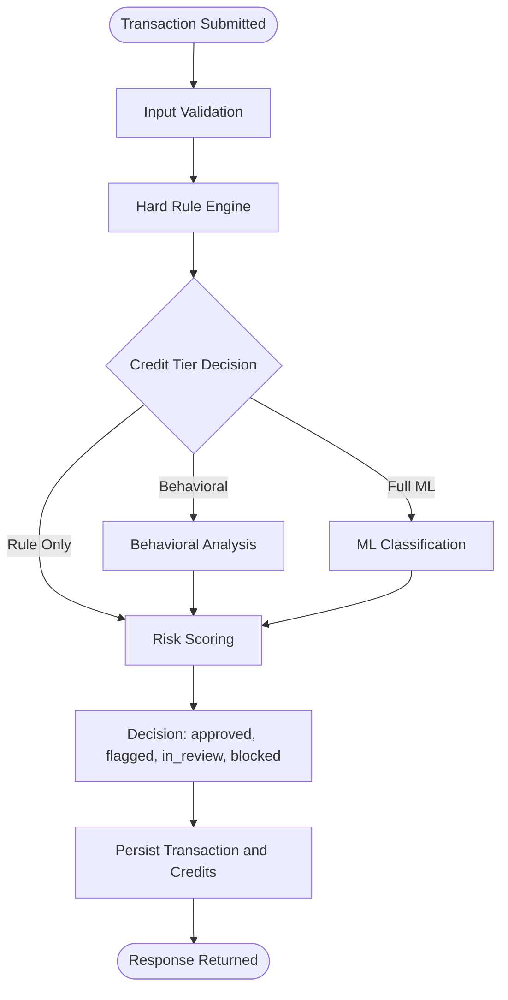

# Deployment and Operations

<cite>
**Referenced Files in This Document**   
- [docker-compose.yml](file://docker-compose.yml)
- [.env.example](file://.env.example)
- [backend/Dockerfile](file://backend/Dockerfile)
- [platform-app/Dockerfile](file://platform-app/Dockerfile)
- [website/Dockerfile](file://website/Dockerfile)
- [website/nginx.conf](file://website/nginx.conf)
- [DOCKER.md](file://DOCKER.md)
- [DEPLOYMENT.md](file://DEPLOYMENT.md)
- [README.md](file://README.md)
- [backend/app/main.py](file://backend/app/main.py)
- [backend/app/database.py](file://backend/app/database.py)
- [backend/app/auth.py](file://backend/app/auth.py)
- [backend/app/compliance_engine.py](file://backend/app/compliance_engine.py)
- [backend/app/rag_service.py](file://backend/app/rag_service.py)
- [backend/app/seed_rag_data.py](file://backend/app/seed_rag_data.py)
- [backend/app/db_models.py](file://backend/app/db_models.py)
- [backend/app/models.py](file://backend/app/models.py)
</cite>

## Update Summary
**Changes Made**   
- Updated secrets management section with new ${VAR:?} interpolation pattern implementation
- Added comprehensive environment configuration documentation for .env.example files
- Enhanced PostgreSQL security configuration with localhost-only port binding
- Updated container health check configurations for IPv4-only nginx compatibility
- Added detailed secrets handling procedures and validation requirements
- Enhanced operational runbooks with new environment setup instructions

## Table of Contents
1. [Introduction](#introduction)
2. [Project Structure](#project-structure)
3. [Core Components](#core-components)
4. [Architecture Overview](#architecture-overview)
5. [Detailed Component Analysis](#detailed-component-analysis)
6. [Dependency Analysis](#dependency-analysis)
7. [Performance Considerations](#performance-considerations)
8. [Troubleshooting Guide](#troubleshooting-guide)
9. [Conclusion](#conclusion)
10. [Appendices](#appendices)

## Introduction
This document provides production-oriented deployment and operations guidance for FinShield using the shipped Docker artifacts: a FastAPI backend, a Next.js frontend, and PostgreSQL with pgvector. It explains how to run the stack with `docker-compose`, how environment variables and secrets should be managed, what is actually implemented versus roadmap features, and which operational controls are available today.

The shipped runtime stack is:
- Backend: FastAPI 0.115, Uvicorn, Pydantic 2.9, SQLAlchemy 2.0, psycopg2-binary + pgvector, python-jose + bcrypt, slowapi, numpy, pytest.
- Frontend: Next.js 14 App Router under `platform-app/`.
- Website: Static marketing site served by nginx via `website/Dockerfile`; it is not part of the default compose stack.
- Database: PostgreSQL 16 with pgvector when configured; SQLite is the default when `DATABASE_URL` is not set.

Important distinction: The repository README describes an aspirational enterprise architecture (Celery, Redis, LangChain, DSPy, LoRA/PEFT/BitsAndBytes, vLLM, RAGAS, HashiCorp Vault, OpenTelemetry, Prometheus, Kubernetes/Helm). Those components are **roadmap only**. The codebase ships a deterministic rule engine, optional pgvector-based RAG retrieval, JWT/API-key authentication, and persistence through SQLAlchemy.

**Section sources**
- [README.md:107-124](file://README.md#L107-L124)
- [README.md:197-222](file://README.md#L197-L222)
- [DOCKER.md:1-174](file://DOCKER.md#L1-L174)

## Project Structure
FinShield has three real deployables relevant to containerized deployment:

| Deployable | Purpose | Containerization |
|---|---|---|
| `backend/` | FastAPI compliance API, authentication, persistence, rule engine, optional RAG enrichment | `backend/Dockerfile` runs Uvicorn on port 8091 |
| `platform-app/` | Next.js 14 dashboard UI | `platform-app/Dockerfile` builds and serves the app on port 3000 |
| `website/` | Static marketing site plus legacy console HTML pages | `website/Dockerfile` serves static files via nginx on port 80 |

The root `docker-compose.yml` defines exactly three services: `postgres`, `backend`, and `frontend`. The `website` service is not included in this compose file.



**Diagram sources**
- [docker-compose.yml:3-61](file://docker-compose.yml#L3-L61)
- [backend/Dockerfile:1-23](file://backend/Dockerfile#L1-L23)
- [platform-app/Dockerfile:1-29](file://platform-app/Dockerfile#L1-L29)
- [website/Dockerfile:1-16](file://website/Dockerfile#L1-L16)

**Section sources**
- [docker-compose.yml:1-79](file://docker-compose.yml#L1-L79)
- [backend/Dockerfile:1-27](file://backend/Dockerfile#L1-L27)
- [platform-app/Dockerfile:1-33](file://platform-app/Dockerfile#L1-L33)
- [website/Dockerfile:1-20](file://website/Dockerfile#L1-L20)

## Core Components
### Backend Service
The backend is a FastAPI application that:
- Loads environment configuration from `.env` at startup.
- Initializes CORS, rate limiting, exception handlers, request logging middleware, and database initialization.
- Mounts authentication routes, API key management, transaction screening, case management, and related endpoints.
- Optionally initializes a RAG retrieval service when `RAG_DATABASE_URL` points to PostgreSQL and optional dependencies are available.

Key implementation details:
- Default persistence uses SQLite (`finshield.db`) unless `DATABASE_URL` is set.
- RAG enrichment is non-blocking: if unavailable, screening still completes normally.
- Authentication supports both JWT bearer tokens and hashed API keys with `fsk_` prefix.
- Rate limiting is enabled except in test mode.

**Updated** The backend now includes comprehensive health check endpoints and Docker HEALTHCHECK instructions for container orchestration compatibility.

**Section sources**
- [backend/app/main.py:1-153](file://backend/app/main.py#L1-L153)
- [backend/app/main.py:156-570](file://backend/app/main.py#L156-L570)
- [backend/app/database.py:1-45](file://backend/app/database.py#L1-L45)
- [backend/app/auth.py:1-122](file://backend/app/auth.py#L1-L122)

### Frontend Service
The frontend is a Next.js 14 application built inside the container. Build-time environment variables configure the API base URL used by the client. Runtime variables include `NEXT_PUBLIC_API_URL`.

Operational notes:
- The build image is Node 18 Alpine.
- Dependencies are installed with `npm ci`.
- The container exposes port 3000 and runs the Next.js production server.
- Includes Docker HEALTHCHECK instruction for container orchestration.

**Updated** The frontend Dockerfile now includes HEALTHCHECK instructions for better container orchestration support.

**Section sources**
- [platform-app/Dockerfile:1-33](file://platform-app/Dockerfile#L1-L33)

### Website Service
The website is a static nginx deployment. It removes the default nginx configuration, copies a custom `nginx.conf`, and serves files from `/usr/share/nginx/html`. It is independent of the compose stack and typically deployed separately.

**Updated** The website Dockerfile now includes HEALTHCHECK instructions for container orchestration compatibility, with IPv4-only configuration for reliable health checks.

**Section sources**
- [website/Dockerfile:1-20](file://website/Dockerfile#L1-L20)
- [website/nginx.conf:1-35](file://website/nginx.conf#L1-L35)

## Architecture Overview
The production-oriented container architecture consists of:
- A browser accessing the frontend on port 3000.
- The frontend calling the backend API over HTTP.
- The backend persisting data to PostgreSQL or SQLite depending on configuration.
- Optional RAG enrichment querying a separate PostgreSQL instance with pgvector.



**Diagram sources**
- [docker-compose.yml:24-61](file://docker-compose.yml#L24-L61)
- [backend/app/main.py:132-153](file://backend/app/main.py#L132-L153)
- [backend/app/main.py:434-570](file://backend/app/main.py#L434-L570)
- [backend/app/rag_service.py:361-413](file://backend/app/rag_service.py#L361-L413)

## Detailed Component Analysis

### Docker Compose Orchestration
The compose file defines:
- `postgres`: Uses `pgvector/pgvector:pg16`, exposes port 5432 bound to localhost only (`127.0.0.1:5432:5432`), sets credentials, mounts persistent volume `postgres-data`, and includes a health check using `pg_isready`.
- `backend`: Builds from `backend/Dockerfile`, exposes port 8091, sets `DATABASE_URL` to SQLite by default, configures `RAG_DATABASE_URL` for PostgreSQL, sets JWT secrets, and depends on a healthy postgres service.
- `frontend`: Builds from `platform-app/Dockerfile`, exposes port 3000, sets `API_URL` and `NEXT_PUBLIC_API_URL`, and depends on `backend`.

**Updated** All services now include comprehensive health check configurations and proper service dependency management with `service_healthy` conditions. PostgreSQL port is restricted to localhost-only access for enhanced security.

Networking:
- All services join `finshield-network`, allowing `frontend` to reach `backend` by service name.

Volumes:
- `backend-data` is mounted at `/app/data` in the backend container.
- `postgres-data` persists PostgreSQL data.



**Updated** Enhanced service dependency chain with health checks ensuring proper startup order and localhost-only database access.

**Diagram sources**
- [docker-compose.yml:18-51](file://docker-compose.yml#L18-L51)

**Section sources**
- [docker-compose.yml:1-79](file://docker-compose.yml#L1-L79)

### Health Check Configuration
**New Section** The deployment now includes comprehensive health check configurations across all services:

#### Backend Health Endpoints
The backend provides three distinct health endpoints:

| Endpoint | Purpose | Response | Use Case |
|---|---|---|---|
| `/api/health/live` | Liveness probe | `{"status": "alive"}` | Process liveness - no dependency checks |
| `/api/health/ready` | Readiness probe | Detailed service status | Dependency readiness - checks DB and RAG |
| `/api/health` | Comprehensive health | Full health report | Monitoring and observability |

#### Docker HEALTHCHECK Instructions
All Dockerfiles now include HEALTHCHECK instructions:

- **Backend**: Polls `/api/health/live` every 30s with 10s timeout, 40s start period, 3 retries
- **Frontend**: Uses wget to check `/` endpoint every 30s with 10s timeout, 40s start period, 3 retries  
- **Website**: Uses wget to check `/` endpoint every 30s with 10s timeout, 5s start period, 3 retries

#### Service Dependency Management
The compose file uses `condition: service_healthy` for proper startup ordering:
- `backend` depends on `postgres` being healthy before starting
- `frontend` depends on `backend` being healthy before starting

**Section sources**
- [docker-compose.yml:18-51](file://docker-compose.yml#L18-L51)
- [backend/Dockerfile:21-23](file://backend/Dockerfile#L21-L23)
- [platform-app/Dockerfile:27-29](file://platform-app/Dockerfile#L27-L29)
- [website/Dockerfile:15-17](file://website/Dockerfile#L15-L17)
- [backend/app/main.py:2830-2916](file://backend/app/main.py#L2830-L2916)

### Environment Configuration Management
Environment variables control runtime behavior:

| Scope | Variable | Purpose | Production Guidance |
|---|---|---|---|
| Backend | `DATABASE_URL` | Main persistence connection string | Use PostgreSQL in production; SQLite is development default |
| Backend | `RAG_DATABASE_URL` | PostgreSQL connection for pgvector RAG retrieval | Required for semantic policy/sanctions search |
| Backend | `JWT_SECRET_KEY` | Secret used to sign JWT access tokens | Rotate to a strong random value |
| Backend | `JWT_ALGORITHM` | JWT signing algorithm | Keep HS256 unless explicitly changed |
| Backend | `ACCESS_TOKEN_EXPIRE_MINUTES` | Token lifetime | Align with security policy |
| Backend | `DEBUG` | Enables verbose logging and SQL echo | Set to false in production |
| Backend | `CORS_ORIGINS` | Allowed frontend origins | Restrict to production domains |
| Frontend | `API_URL` | Build-time API base URL | Point to backend hostname in container network |
| Frontend | `NEXT_PUBLIC_API_URL` | Runtime API base URL exposed to browser | Point to public backend endpoint |

The backend loads `.env` at startup and reads these values throughout authentication, database setup, CORS configuration, and RAG initialization.

**Updated** Complete secrets management overhaul implemented with `${VAR:?}` interpolation pattern in docker-compose.yml ensuring application refuses to start without required environment variables. New `.env.example` files created at repository root and backend/.env.example with SQLite defaults and optional RAG service settings.

**Section sources**
- [backend/app/main.py:1-153](file://backend/app/main.py#L1-L153)
- [backend/app/database.py:11-21](file://backend/app/database.py#L11-L21)
- [backend/app/auth.py:21-25](file://backend/app/auth.py#L1-L25)
- [platform-app/Dockerfile:13-16](file://platform-app/Dockerfile#L13-L16)
- [.env.example:1-24](file://.env.example#L1-L24)

### Secrets Handling and Security Considerations
Current implementation:
- JWT secret is read from `JWT_SECRET_KEY`; if missing, a runtime-generated value is used, which is unsafe for multi-container deployments because each container would get a different secret.
- Passwords are hashed with bcrypt.
- API keys use hashed storage with a visible prefix for identification.
- Rate limiting is applied to sensitive endpoints such as registration and login.
- CORS is configurable but defaults to localhost during development.

Production hardening checklist:
- Replace the default JWT secret with a strong, centrally managed value.
- Pin `CORS_ORIGINS` to production domains only.
- Disable debug logging and SQL echo.
- Enforce HTTPS through a reverse proxy or platform-managed TLS.
- Rotate API keys regularly and revoke compromised keys.
- Avoid committing secrets; use platform secrets management or external secret stores.

Note: HashiCorp Vault is listed in the README as a roadmap feature. The shipped code does not integrate Vault.

**Updated** Complete secrets management overhaul with mandatory environment variable validation. The application now refuses to start if required secrets (`JWT_SECRET_KEY`, `POSTGRES_PASSWORD`) are not provided. PostgreSQL port is restricted to localhost-only access (`127.0.0.1:5432:5432`) preventing external exposure.

**Section sources**
- [backend/app/auth.py:21-122](file://backend/app/auth.py#L1-L122)
- [backend/app/main.py:62-78](file://backend/app/main.py#L62-L78)
- [backend/app/main.py:81-115](file://backend/app/main.py#L81-L115)
- [docker-compose.yml:6-10](file://docker-compose.yml#L6-L10)
- [docker-compose.yml:34-36](file://docker-compose.yml#L34-L36)
- [README.md:317-326](file://README.md#L317-L326)

### Scaling Strategies and Load Balancing
Shipped capabilities:
- The backend is stateless with respect to process memory caches beyond idempotency caching within the process.
- The frontend is a Next.js application serving built assets.
- PostgreSQL is defined as a single service with a local volume.

Recommended scaling approach:
- Run multiple backend replicas behind a load balancer.
- Ensure `DATABASE_URL` points to a shared, externally managed PostgreSQL instance rather than relying on the compose SQLite default.
- If using pgvector RAG, point `RAG_DATABASE_URL` to the same PostgreSQL instance with the vector extension enabled.
- Externalize session/state where needed; avoid assuming in-process caches survive across replicas.
- Configure horizontal pod autoscaling or container orchestration scaling policies based on CPU, memory, and request latency.

Load balancing considerations:
- Sticky sessions are not required because authentication is token-based.
- Idempotency keys protect against duplicate submissions.
- Rate limiting is per remote address by default; consider adjusting limits for trusted proxies.

**Section sources**
- [backend/app/compliance_engine.py:36-38](file://backend/app/compliance_engine.py#L36-L38)
- [backend/app/main.py:434-473](file://backend/app/main.py#L434-L473)
- [docker-compose.yml:24-45](file://docker-compose.yml#L24-L45)

### High Availability Patterns
Current state:
- No built-in multi-instance database or message queue.
- No Redis or Celery worker service in the shipped compose stack.

High availability recommendations:
- Use a managed PostgreSQL service with automated backups, failover, and replication.
- Run multiple backend instances behind a load balancer.
- Add a dedicated worker tier later if asynchronous processing is introduced.
- Implement readiness and liveness probes at the platform level.
- Plan region-aware deployments if regulatory or latency requirements demand it.

**Updated** The enhanced health check infrastructure now supports platform-level readiness and liveness probes more effectively.

**Section sources**
- [docker-compose.yml:3-79](file://docker-compose.yml#L3-L79)
- [README.md:107-124](file://README.md#L107-L124)

### Monitoring and Logging Setup
Backend logging:
- Structured Python logging is configured with log level controlled by `DEBUG`.
- Request logging middleware records method, path, status code, and duration.
- Exception handlers log HTTP errors, validation errors, and unhandled exceptions.

Health checks:
- PostgreSQL health check is defined in compose using `pg_isready`.
- Backend provides comprehensive health endpoints: `/api/health/live`, `/api/health/ready`, and `/api/health`.
- Docker HEALTHCHECK instructions enable container orchestration health monitoring.

Observability roadmap:
- OpenTelemetry, Prometheus, and structlog are mentioned as roadmap targets. They are not present in the shipped backend.

**Updated** Enhanced health check infrastructure provides better integration with container orchestration platforms.

**Section sources**
- [backend/app/main.py:46-51](file://backend/app/main.py#L46-L51)
- [backend/app/main.py:118-126](file://backend/app/main.py#L118-L126)
- [backend/app/main.py:81-115](file://backend/app/main.py#L81-L115)
- [docker-compose.yml:18-51](file://docker-compose.yml#L18-L51)
- [backend/app/main.py:2830-2916](file://backend/app/main.py#L2830-L2916)
- [README.md:107-124](file://README.md#L107-L124)

### Operational Runbooks

#### Start the Stack
- Copy `.env.example` to `.env` at the repo root and fill in required secrets (`JWT_SECRET_KEY`, `POSTGRES_PASSWORD`).
- Build and start all services using Docker Compose.
- Access the frontend at `http://localhost:3000`.
- Access the backend API at `http://localhost:8091`.
- Open API documentation at `http://localhost:8091/docs`.
- Verify health endpoints: `curl http://localhost:8091/api/health/live`

#### Stop the Stack
- Stop running services.
- Remove volumes only when resetting state intentionally.

#### View Logs
- Follow logs for all services.
- Filter logs by service name.

These commands are documented in the repository's Docker guide.

**Updated** Environment setup now requires mandatory secrets configuration before the stack can start successfully.

**Section sources**
- [DOCKER.md:3-26](file://DOCKER.md#L3-L26)
- [DOCKER.md:28-33](file://DOCKER.md#L28-L33)
- [.env.example:1-24](file://.env.example#L1-L24)

### Backup and Disaster Recovery
Persistence model:
- Default backend persistence is SQLite stored in the backend container's filesystem.
- PostgreSQL data is persisted through the `postgres-data` volume.

Backup procedures:
- For SQLite-backed development stacks, copy the database file from the backend volume.
- For PostgreSQL-backed production stacks, use `pg_dump` or the managed provider's backup and restore tools.
- Tag releases in version control to support reproducible rollbacks.

Disaster recovery:
- Restore the latest valid database dump.
- Redeploy the backend and frontend containers.
- Re-seed RAG data if the RAG database was restored.

**Section sources**
- [backend/app/database.py:11-21](file://backend/app/database.py#L11-L21)
- [docker-compose.yml:13-14](file://docker-compose.yml#L13-L14)
- [docker-compose.yml:38-39](file://docker-compose.yml#L38-L39)
- [DOCKER.md:121-133](file://DOCKER.md#L121-L133)
- [DEPLOYMENT.md:391-400](file://DEPLOYMENT.md#L391-L400)

### Database Migration Strategy
Current implementation:
- Tables are created automatically through SQLAlchemy's `Base.metadata.create_all` during backend startup.
- There is no Alembic migration layer in the shipped backend.

Migration guidance:
- Treat schema changes as code changes and redeploy the backend after modifying models.
- For production PostgreSQL, prefer explicit migrations managed by a migration tool once added.
- Back up the database before applying schema changes.
- Test migrations locally against a PostgreSQL instance with pgvector enabled.

**Section sources**
- [backend/app/database.py:36-38](file://backend/app/database.py#L36-L38)
- [backend/app/main.py:132-136](file://backend/app/main.py#L132-L136)
- [backend/app/db_models.py:1-353](file://backend/app/db_models.py#L1-L353)

### Rollback Approach
Rollback strategy:
- Revert the code commit or tag to the previous known-good version.
- Redeploy the backend and frontend containers.
- Do not downgrade the database schema without testing compatibility.
- If RAG data must be restored, re-run the seed script against the RAG database.

**Section sources**
- [DEPLOYMENT.md:391-400](file://DEPLOYMENT.md#L391-L400)
- [backend/app/seed_rag_data.py:10-24](file://backend/app/seed_rag_data.py#L10-L24)

### Performance Tuning Guidelines
Backend tuning:
- Disable debug logging in production.
- Tune rate limits according to expected traffic patterns.
- Use PostgreSQL instead of SQLite for concurrent workloads.
- Enable pgvector indexing if RAG queries become a bottleneck.

Frontend tuning:
- Use the production Next.js build.
- Serve static assets through a CDN if deployed outside Docker.

Database tuning:
- Allocate sufficient CPU and memory to PostgreSQL.
- Configure connection pooling at the platform level if running multiple backend replicas.
- Monitor query performance for RAG similarity searches.

**Section sources**
- [backend/app/main.py:46-51](file://backend/app/main.py#L46-L51)
- [backend/app/main.py:72-78](file://backend/app/main.py#L72-L78)
- [backend/app/database.py:17-21](file://backend/app/database.py#L17-L21)
- [backend/app/rag_service.py:148-155](file://backend/app/rag_service.py#L148-L155)

### Capacity Planning Considerations
- Estimate requests per second for transaction screening and dashboard queries.
- Size backend replicas based on CPU utilization and latency SLOs.
- Size PostgreSQL based on dataset size, vector index size, and query complexity.
- Plan RAG corpus growth: more documents increase embedding storage and query cost.
- Monitor credit consumption patterns to forecast backend load and potential billing integration needs.

[No sources needed since this section provides general guidance]

## Dependency Analysis
The backend depends on:
- FastAPI, Uvicorn, Pydantic, SQLAlchemy, psycopg2-binary, pgvector, python-jose, bcrypt, slowapi, numpy.
- Optional sentence-transformers for higher-quality embeddings when explicitly enabled.

Runtime dependency flow:
- `main.py` imports database, models, auth, compliance engine, and optional RAG service.
- `database.py` creates the engine and session factory.
- `auth.py` handles JWT and API key authentication.
- `compliance_engine.py` implements the rule/gating pipeline.
- `rag_service.py` connects to PostgreSQL with pgvector and performs semantic retrieval.



**Diagram sources**
- [backend/app/main.py:1-44](file://backend/app/main.py#L1-L44)
- [backend/app/database.py:1-45](file://backend/app/database.py#L1-L45)
- [backend/app/auth.py:1-122](file://backend/app/auth.py#L1-L122)
- [backend/app/compliance_engine.py:1-381](file://backend/app/compliance_engine.py#L1-L381)
- [backend/app/rag_service.py:1-413](file://backend/app/rag_service.py#L1-L413)
- [backend/app/db_models.py:1-353](file://backend/app/db_models.py#L1-L353)
- [backend/app/models.py:1-152](file://backend/app/models.py#L1-L152)

**Section sources**
- [backend/app/main.py:1-44](file://backend/app/main.py#L1-L44)
- [backend/app/database.py:1-45](file://backend/app/database.py#L1-L45)
- [backend/app/auth.py:1-122](file://backend/app/auth.py#L1-L122)
- [backend/app/compliance_engine.py:1-381](file://backend/app/compliance_engine.py#L1-L381)
- [backend/app/rag_service.py:1-413](file://backend/app/rag_service.py#L1-L413)
- [backend/app/db_models.py:1-353](file://backend/app/db_models.py#L1-L353)
- [backend/app/models.py:1-152](file://backend/app/models.py#L1-L152)

## Performance Considerations
- Prefer PostgreSQL for production concurrency and reliability.
- Avoid enabling debug mode in production.
- Use rate limiting to protect authentication and screening endpoints.
- Keep RAG optional so the core screening pipeline remains resilient when vector search is unavailable.
- Monitor backend latency headers and database query performance.
- Scale horizontally behind a load balancer once stateless backend replicas are confirmed.

[No sources needed since this section provides general guidance]

## Troubleshooting Guide

### Common Deployment Issues
- Port conflicts: Change exposed ports in `docker-compose.yml` if host ports are already in use.
- Build issues: Clear Docker cache and rebuild without cache.
- Database issues: Reset volumes and restart services when starting fresh.
- Health checks: Verify backend API and frontend accessibility.

**Updated** With the new health check infrastructure, you can diagnose service startup issues more effectively using Docker's built-in health monitoring.

### Authentication Problems
- Invalid or expired JWT tokens indicate misconfigured `JWT_SECRET_KEY` or token expiration settings.
- API key failures may indicate revoked keys or incorrect hashing/prefix handling.

### RAG Retrieval Failures
- RAG requires PostgreSQL with pgvector and the correct `RAG_DATABASE_URL`.
- If optional dependencies like sentence-transformers are missing, the service falls back to hashing-based embeddings.
- Seed data can be initialized using the provided seed script.

### Health Check Issues
**New Section** When troubleshooting health check problems:

- **Backend not starting**: Check `/api/health/live` endpoint availability
- **Service dependency failures**: Verify `service_healthy` conditions in docker-compose.yml
- **Container orchestration issues**: Inspect Docker HEALTHCHECK status with `docker inspect`
- **Health endpoint failures**: Validate backend health endpoints manually

Common health check diagnostics:
```bash
# Check backend health
curl http://localhost:8091/api/health/live
curl http://localhost:8091/api/health/ready
curl http://localhost:8091/api/health

# Check Docker health status
docker inspect --format='{{json .State.Health}}' finshield-backend
docker inspect --format='{{json .State.Health}}' finshield-frontend
docker inspect --format='{{json .State.Health}}' finshield-postgres
```

### Environment Configuration Issues
**New Section** When encountering environment variable problems:

- **Application refuses to start**: Ensure all required variables are set in `.env` file
- **Missing required secrets**: Generate `JWT_SECRET_KEY` and set `POSTGRES_PASSWORD`
- **PostgreSQL connection issues**: Verify `POSTGRES_USER` and `POSTGRES_DB` match compose configuration
- **IPv4 connectivity issues**: Health checks now use IPv4-only addresses for nginx compatibility

Environment validation commands:
```bash
# Check if required environment variables are set
echo $JWT_SECRET_KEY
echo $POSTGRES_PASSWORD

# Verify compose environment interpolation
docker compose config

# Check container environment variables
docker exec finshield-backend env | grep -E "JWT_SECRET_KEY|POSTGRES_"
```

**Section sources**
- [DOCKER.md:67-105](file://DOCKER.md#L67-L105)
- [backend/app/auth.py:59-113](file://backend/app/auth.py#L59-L113)
- [backend/app/rag_service.py:31-44](file://backend/app/rag_service.py#L31-L44)
- [backend/app/seed_rag_data.py:10-24](file://backend/app/seed_rag_data.py#L10-L24)
- [docker-compose.yml:18-51](file://docker-compose.yml#L18-L51)
- [.env.example:1-24](file://.env.example#L1-L24)

## Conclusion
FinShield's shipped deployment model centers on three Dockerized services orchestrated by `docker-compose`. The backend provides a FastAPI compliance API with JWT and API-key authentication, rule-based screening, and optional pgvector RAG enrichment. The frontend is a Next.js dashboard, and the website is a separate static nginx deployment.

**Updated** The enhanced health check infrastructure now provides comprehensive container orchestration support with proper service dependency management, Docker HEALTHCHECK instructions, and robust health monitoring endpoints. Complete secrets management overhaul ensures secure deployment with mandatory environment variable validation and localhost-only database access.

For production, replace SQLite with PostgreSQL, rotate secrets, restrict CORS, enable HTTPS, and externalize configuration and secrets. Horizontal scaling is straightforward for the backend, while high availability depends on managed database infrastructure and platform-level orchestration. Observability and advanced ML/runtime components described in the README are roadmap targets; current operations should focus on the implemented stack, its enhanced health checks, logging, backups, and rollback procedures.

[No sources needed since this section summarizes without analyzing specific files]

## Appendices

### Environment Variables Reference
| Variable | Default Behavior | Production Recommendation |
|---|---|---|
| `DATABASE_URL` | SQLite file | PostgreSQL connection string |
| `RAG_DATABASE_URL` | Empty or local PostgreSQL | PostgreSQL with pgvector |
| `JWT_SECRET_KEY` | Generated at runtime if missing | Strong centralized secret |
| `JWT_ALGORITHM` | HS256 | Keep unless explicitly changed |
| `ACCESS_TOKEN_EXPIRE_MINUTES` | 24 hours | Align with security policy |
| `DEBUG` | Controls log level and SQL echo | False |
| `CORS_ORIGINS` | Localhost | Production domains only |
| `API_URL` | Build-time frontend API base | Backend hostname in container network |
| `NEXT_PUBLIC_API_URL` | Localhost backend | Public backend endpoint |
| `POSTGRES_USER` | finshield | Secure database username |
| `POSTGRES_PASSWORD` | Required | Strong database password |
| `POSTGRES_DB` | finshield | Database name |

**Updated** Added new required environment variables for complete secrets management with mandatory validation.

**Section sources**
- [backend/app/database.py:11-21](file://backend/app/database.py#L11-L21)
- [backend/app/auth.py:21-25](file://backend/app/auth.py#L1-L25)
- [backend/app/main.py:62-78](file://backend/app/main.py#L62-L78)
- [platform-app/Dockerfile:13-16](file://platform-app/Dockerfile#L13-L16)
- [.env.example:1-24](file://.env.example#L1-L24)
- [docker-compose.yml:8-10](file://docker-compose.yml#L8-L10)

### Compliance Pipeline Flow


**Diagram sources**
- [backend/app/compliance_engine.py:89-162](file://backend/app/compliance_engine.py#L89-L162)
- [backend/app/compliance_engine.py:339-380](file://backend/app/compliance_engine.py#L339-L380)
- [backend/app/models.py:67-119](file://backend/app/models.py#L67-L119)

### Health Check Configuration Reference
**New Section** Complete health check configuration for all services:

#### Backend Health Endpoints
| Endpoint | Method | Status Codes | Description |
|---|---|---|---|
| `/api/health/live` | GET | 200 | Process liveness - always returns alive |
| `/api/health/ready` | GET | 200/503 | Dependency readiness - checks DB and RAG |
| `/api/health` | GET | 200/503 | Comprehensive health with service details |

#### Docker HEALTHCHECK Settings
| Service | Command | Interval | Timeout | Start Period | Retries |
|---|---|---|---|---|---|
| Backend | Python urllib request to `/api/health/live` | 30s | 10s | 40s | 3 |
| Frontend | wget spider check on `/` | 30s | 10s | 40s | 3 |
| Website | wget spider check on `/` | 30s | 10s | 5s | 3 |
| Postgres | pg_isready command | 5s | 5s | N/A | 5 |

**Updated** Enhanced health check configurations with IPv4-only nginx compatibility and comprehensive service monitoring.

**Section sources**
- [backend/app/main.py:2830-2916](file://backend/app/main.py#L2830-L2916)
- [backend/Dockerfile:21-23](file://backend/Dockerfile#L21-L23)
- [platform-app/Dockerfile:27-29](file://platform-app/Dockerfile#L27-L29)
- [website/Dockerfile:15-17](file://website/Dockerfile#L15-L17)
- [website/nginx.conf:28-33](file://website/nginx.conf#L28-L33)
- [docker-compose.yml:18-51](file://docker-compose.yml#L18-L51)

### Secrets Management Reference
**New Section** Complete secrets management configuration:

#### Required Environment Variables
| Variable | Purpose | Generation Method | Validation |
|---|---|---|---|
| `JWT_SECRET_KEY` | JWT token signing secret | `python -c "import secrets; print(secrets.token_hex(32))"` | Mandatory - application refuses to start without it |
| `POSTGRES_PASSWORD` | PostgreSQL database password | Strong random password generator | Mandatory - application refuses to start without it |

#### Optional Environment Variables
| Variable | Default | Purpose | Notes |
|---|---|---|---|
| `POSTGRES_USER` | finshield | Database username | Can be customized |
| `POSTGRES_DB` | finshield | Database name | Can be customized |
| `CORS_ORIGINS` | http://localhost:3000 | Allowed frontend origins | Restrict to production domains |
| `DEBUG` | false | Debug mode toggle | Should be false in production |

#### Security Configuration
- PostgreSQL port restricted to localhost-only access: `127.0.0.1:5432:5432`
- Environment variable validation using `${VAR:?error_message}` pattern
- Secrets must be provided via `.env` file, never hardcoded in compose files
- Container health checks use IPv4-only addresses for reliable operation

**Section sources**
- [.env.example:1-24](file://.env.example#L1-L24)
- [docker-compose.yml:6-10](file://docker-compose.yml#L6-L10)
- [docker-compose.yml:34-36](file://docker-compose.yml#L34-L36)
- [website/Dockerfile:15-17](file://website/Dockerfile#L15-L17)