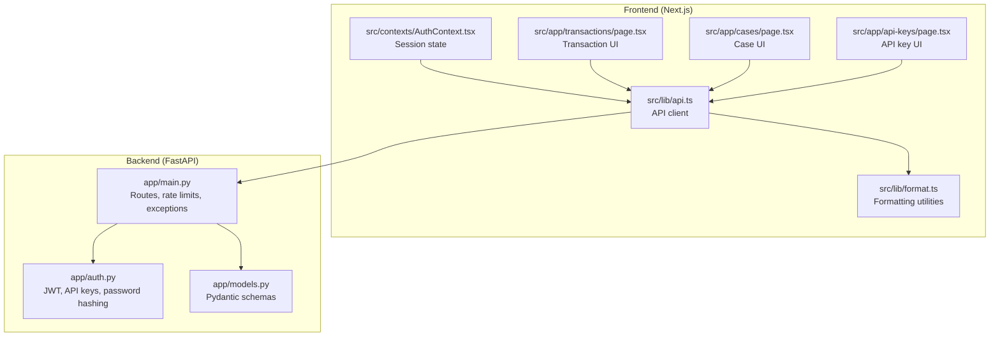
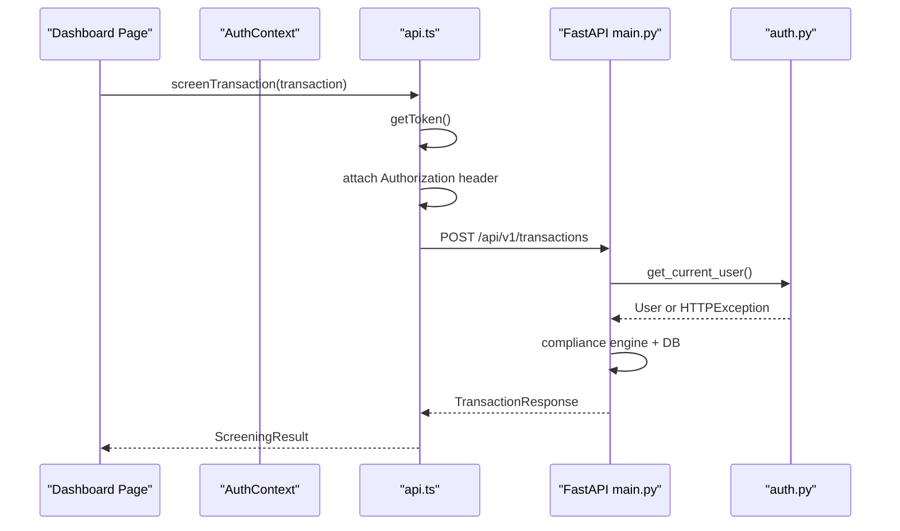
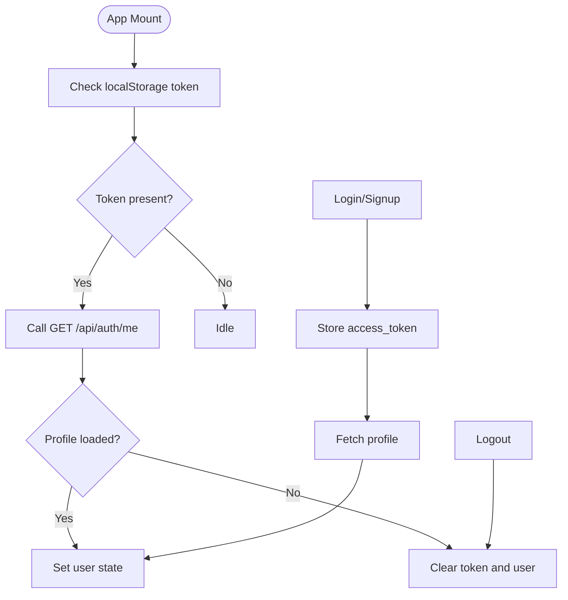
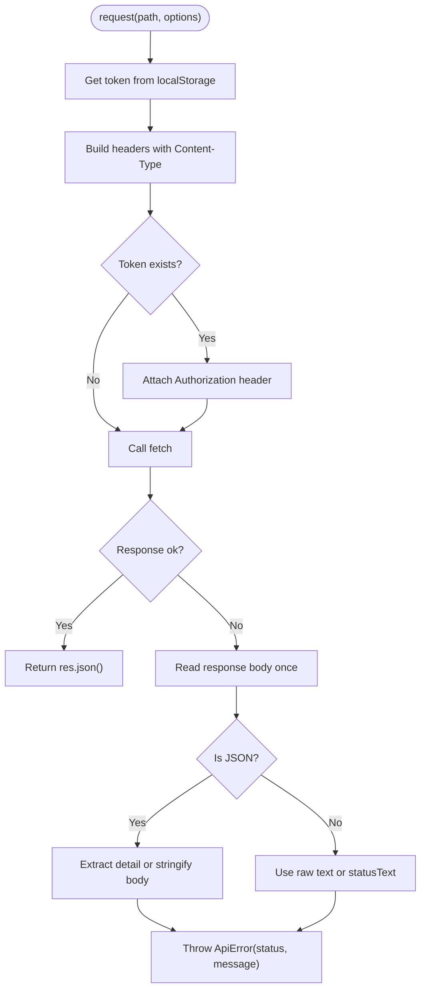
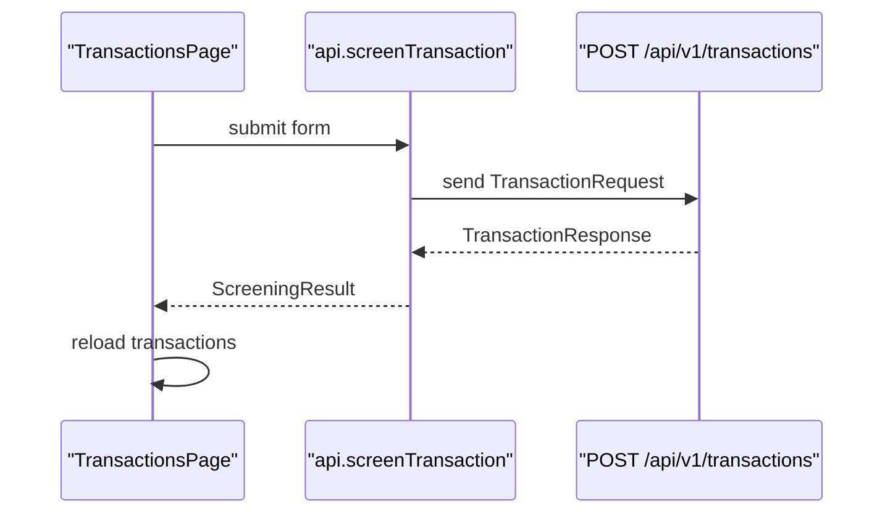
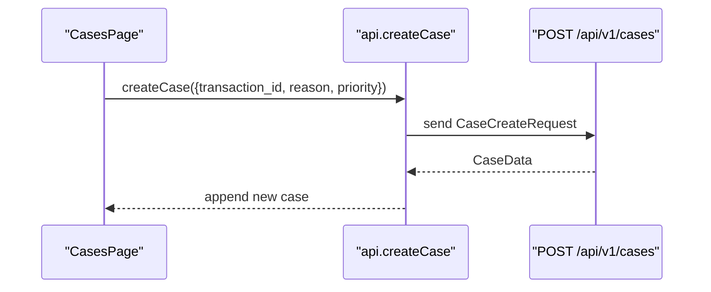
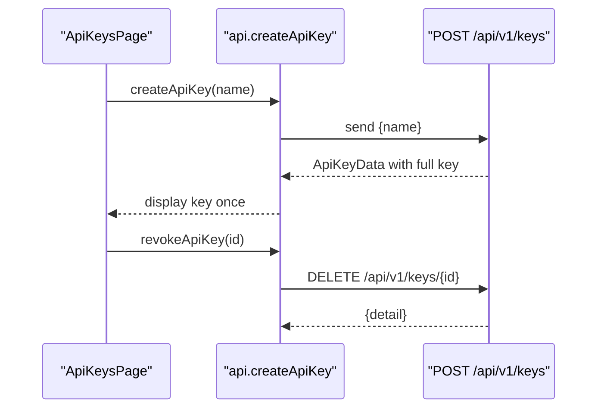
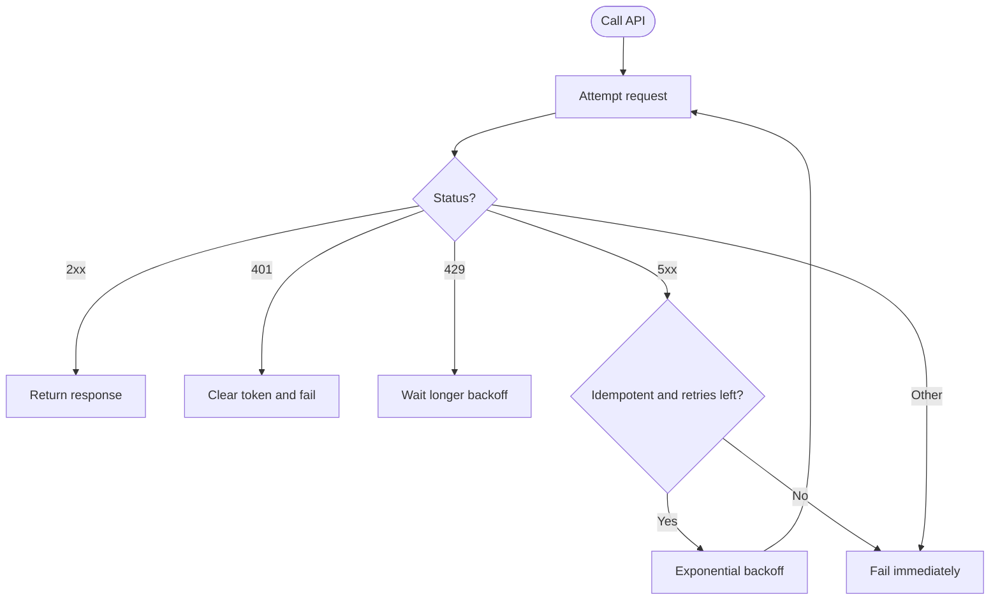
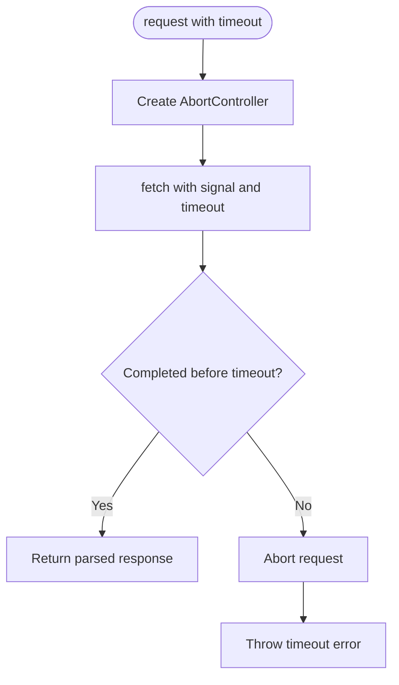
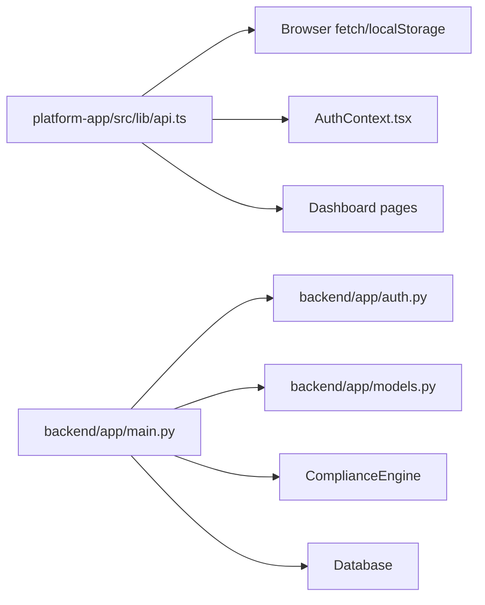

# API Client Library

<cite>
**Referenced Files in This Document**   
- [api.ts](file://platform-app/src/lib/api.ts)
- [format.ts](file://platform-app/src/lib/format.ts)
- [AuthContext.tsx](file://platform-app/src/contexts/AuthContext.tsx)
- [transactions/page.tsx](file://platform-app/src/app/transactions/page.tsx)
- [cases/page.tsx](file://platform-app/src/app/cases/page.tsx)
- [api-keys/page.tsx](file://platform-app/src/app/api-keys/page.tsx)
- [models.py](file://backend/app/models.py)
- [auth.py](file://backend/app/auth.py)
- [main.py](file://backend/app/main.py)
</cite>

## Table of Contents
1. [Introduction](#introduction)
2. [Project Structure](#project-structure)
3. [Core Components](#core-components)
4. [Architecture Overview](#architecture-overview)
5. [Detailed Component Analysis](#detailed-component-analysis)
6. [Dependency Analysis](#dependency-analysis)
7. [Performance Considerations](#performance-considerations)
8. [Troubleshooting Guide](#troubleshooting-guide)
9. [Conclusion](#conclusion)
10. [Appendices](#appendices)

## Introduction
This document explains the FinShield API client library used by the Next.js dashboard to communicate with the FastAPI backend. It covers:

- Request and response TypeScript types for authentication, transactions, cases, filings, rules, notifications, billing, search, and API keys.
- How JWT tokens are stored, attached, refreshed, and cleared.
- The shared request interceptor that adds authorization headers, parses JSON responses, and throws typed errors.
- Error transformation from HTTP status codes and backend detail messages into a frontend-friendly `ApiError`.
- Rate limiting, timeout configuration, retry logic, network error recovery, and testing guidance.
- Format utilities for currency, numbers, dates, relative time, credits calculations, timezone labels, and country names.
- Examples of common API calls and how the dashboard pages consume them.

The shipped stack is FastAPI 0.115, Uvicorn, Pydantic 2.9, SQLAlchemy 2.0, psycopg2-binary + pgvector, python-jose + bcrypt, slowapi, numpy, and pytest. The platform-app is Next.js 14 App Router with React 18 and Tailwind 3.

## Project Structure
The API client lives in the frontend application under `platform-app/src/lib`. The backend routes and models live under `backend/app`.

**Diagram sources**
- [api.ts:1-631](file://platform-app/src/lib/api.ts#L1-L631)
- [format.ts:1-149](file://platform-app/src/lib/format.ts#L1-L149)
- [AuthContext.tsx:1-107](file://platform-app/src/contexts/AuthContext.tsx#L1-L107)
- [transactions/page.tsx:1-585](file://platform-app/src/app/transactions/page.tsx#L1-L585)
- [cases/page.tsx:1-415](file://platform-app/src/app/cases/page.tsx#L1-L415)
- [api-keys/page.tsx:1-185](file://platform-app/src/app/api-keys/page.tsx#L1-L185)
- [main.py:1-153](file://backend/app/main.py#L1-L153)
- [auth.py:1-122](file://backend/app/auth.py#L1-L122)
- [models.py:1-152](file://backend/app/models.py#L1-L152)

**Section sources**
- [api.ts:1-631](file://platform-app/src/lib/api.ts#L1-L631)
- [main.py:1-153](file://backend/app/main.py#L1-L153)

## Core Components
The API client library has three main responsibilities:

1. **Type definitions**: Strongly typed request and response shapes for every endpoint.
2. **Request handling**: A generic `request<T>` function that attaches JWT tokens, performs fetch calls, parses JSON, and throws `ApiError` on non-OK responses.
3. **Endpoint methods**: An exported `api` object exposing authenticated operations for auth, health, transactions, cases, credits, analytics, rules, search, notifications, profile, billing, API keys, filings, and exports.

Key implementation points:

- Base path is `/api`.
- Authorization header is `Authorization: Bearer <token>` when a token exists.
- Non-OK responses read the body once, try JSON parsing, then fall back to raw text or status text.
- `ApiError` carries both `status` and message so callers can branch on HTTP semantics.
- Token storage uses `localStorage` keys `finshield_token`, `finshield_user`, and `clearToken` removes both.

**Section sources**
- [api.ts:7-8](file://platform-app/src/lib/api.ts#L7-L8)
- [api.ts:357-417](file://platform-app/src/lib/api.ts#L357-L417)
- [api.ts:419-631](file://platform-app/src/lib/api.ts#L419-L631)

## Architecture Overview
The runtime flow connects the Next.js UI through the API client to FastAPI endpoints protected by JWT or API-key authentication.

**Diagram sources**
- [api.ts:372-408](file://platform-app/src/lib/api.ts#L372-L408)
- [api.ts:443-448](file://platform-app/src/lib/api.ts#L443-L448)
- [main.py:434-570](file://backend/app/main.py#L434-L570)
- [auth.py:59-113](file://backend/app/auth.py#L59-L113)

## Detailed Component Analysis

### Authentication Flow and Token Management
The frontend stores the JWT after login or registration, loads it on mount, refreshes the user profile, and clears session data on logout or invalid token.

**Diagram sources**
- [AuthContext.tsx:22-40](file://platform-app/src/contexts/AuthContext.tsx#L22-L40)
- [AuthContext.tsx:42-68](file://platform-app/src/contexts/AuthContext.tsx#L42-L68)
- [AuthContext.tsx:70-85](file://platform-app/src/contexts/AuthContext.tsx#L70-L85)
- [api.ts:357-370](file://platform-app/src/lib/api.ts#L357-L370)
- [api.ts:422-438](file://platform-app/src/lib/api.ts#L422-L438)

#### Backend Authentication
The backend supports two bearer strategies:

- **JWT bearer tokens**: decoded via `python-jose`, validated against `SECRET_KEY`, and mapped to a `User`.
- **API keys**: tokens starting with `fsk_` are matched by prefix and hashed value; successful matches update `last_used_at`.

Both paths reject missing credentials, invalid tokens, disabled accounts, and unknown users.

**Section sources**
- [auth.py:21-27](file://backend/app/auth.py#L21-L27)
- [auth.py:42-56](file://backend/app/auth.py#L42-L56)
- [auth.py:59-113](file://backend/app/auth.py#L59-L113)
- [auth.py:116-122](file://backend/app/auth.py#L116-L122)

### Request Interception, Response Parsing, and Error Transformation
The core `request<T>` function:

1. Reads the current token.
2. Sets `Content-Type: application/json`.
3. Adds `Authorization: Bearer <token>` if available.
4. Calls `fetch` against `${API_BASE}${path}`.
5. On non-OK responses, reads the body once, tries JSON parsing, extracts `detail` or serializes the body, and throws `ApiError(status, message)`.
6. On success, returns parsed JSON typed as `T`.

**Diagram sources**
- [api.ts:372-417](file://platform-app/src/lib/api.ts#L372-L417)

**Section sources**
- [api.ts:372-417](file://platform-app/src/lib/api.ts#L372-L417)

### API Method Inventory
The `api` object exposes these endpoint groups:

| Area | Methods | Backend Route | Notes |
|---|---|---|---|
| Authentication | `register`, `login`, `me`, `logout` | `/api/auth/register`, `/api/auth/login`, `/api/auth/me` | Stores JWT after login/signup; clears local storage on logout. |
| Health | `health` | `/api/health` | Returns service version and uptime. |
| Transactions | `screenTransaction`, `listTransactions`, `getTransaction`, `deleteTransaction`, `exportTransactions` | `/api/v1/transactions`, `/api/v1/transactions/{id}`, `/api/v1/transactions/export` | Screening runs compliance pipeline and persists results. |
| Cases | `createCase`, `getCase`, `listCases`, `updateCase`, `deleteCase`, `listCaseComments`, `addCaseComment` | `/api/v1/cases*` | Case lifecycle and comments. |
| Credits | `getCredits`, `purchaseCredits` | `/api/v1/credits`, `/api/v1/credits/purchase` | Legacy purchase route still exists. |
| Analytics | `getStats` | `/api/v1/stats` | Aggregated metrics over user data. |
| Rules | `listRules`, `updateRule` | `/api/v1/rules`, `/api/v1/rules/{rule_id}` | Per-user rule overrides. |
| Search | `search` | `/api/v1/search?q=...` | Searches transactions, cases, and API keys. |
| Notifications | `listNotifications`, `markNotificationRead`, `markAllNotificationsRead`, `getNotificationPreferences`, `updateNotificationPreferences` | `/api/v1/notifications*` | Includes preferences. |
| Profile | `updateProfile`, `changePassword` | `/api/auth/me`, `/api/auth/change-password` | Updates name, company, timezone, and password. |
| Billing | `checkoutCredits`, `savePaymentMethod`, `removePaymentMethod`, `listPlans`, `subscribe` | `/api/v1/billing/*` | Simulated checkout and plan management. |
| API Keys | `createApiKey`, `listApiKeys`, `revokeApiKey` | `/api/v1/keys*` | Full key returned only on creation. |
| Filings | `listFilings`, `getFiling`, `createFiling`, `updateFiling`, `deleteFiling` | `/api/v1/filings*` | SAR/STR filing workflow. |

**Section sources**
- [api.ts:419-631](file://platform-app/src/lib/api.ts#L419-L631)
- [main.py:176-348](file://backend/app/main.py#L176-L348)
- [main.py:366-428](file://backend/app/main.py#L366-L428)
- [main.py:434-717](file://backend/app/main.py#L434-L717)
- [main.py:724-811](file://backend/app/main.py#L724-L811)
- [main.py:818-867](file://backend/app/main.py#L818-L867)
- [main.py:940-1176](file://backend/app/main.py#L940-L1176)
- [main.py:1183-1508](file://backend/app/main.py#L1183-L1508)
- [main.py:1261-1365](file://backend/app/main.py#L1261-L1365)
- [main.py:1613-1890](file://backend/app/main.py#L1613-L1890)
- [main.py:1926-2155](file://backend/app/main.py#L1926-L2155)

### Request and Response Type Definitions

#### Authentication Types
- `RegisterRequest`: email, password, first_name, last_name, optional company.
- `LoginRequest`: email, password.
- `AuthUser`: user profile fields including plan, credits, trial flags, billing cycle, timezone, and saved card metadata.
- `TokenResponse`: access_token, token_type, user.
- `UserProfile`: extended profile returned by `/api/auth/me`.

These map to backend registration, login, and profile endpoints.

**Section sources**
- [api.ts:9-68](file://platform-app/src/lib/api.ts#L9-L68)
- [main.py:159-174](file://backend/app/main.py#L159-L174)
- [main.py:269-292](file://backend/app/main.py#L269-L292)

#### Transaction Types
- `TransactionRequest`: amount, currency, transaction_type, sender/receiver names, optional IDs, destination country, description, idempotency_key.
- `RuleResult`: rule evaluation result with trigger flag, detail, and latency.
- `ScreeningResult`: full pipeline output including status, risk score, credit tier, credits consumed, rule results, behavioral and ML scores, latency, pipeline stages, timestamp, and optional RAG context.
- `TransactionResponse`: wrapper with success, data, and error.
- `TransactionListItem`: list view shape.
- `TransactionDetail`: detailed view including persisted fields, rule results, ML/behavioral scores, pipeline stages, RAG context, and timestamps.

The backend enforces positive amounts, ISO-style enums, idempotency keys, and persistence.

**Section sources**
- [api.ts:70-168](file://platform-app/src/lib/api.ts#L70-L168)
- [models.py:67-127](file://backend/app/models.py#L67-L127)
- [main.py:434-570](file://backend/app/main.py#L434-L570)
- [main.py:606-639](file://backend/app/main.py#L606-L639)

#### Case, Filing, Rule, Notification, Billing, and API Key Types
- `CaseData`: case identifier, transaction link, status, priority, reason, assignment, timestamps.
- `Filing`: SAR/STR filing lifecycle with narrative, structured data, reference number, submission/confirmation timestamps.
- `RuleDefinition`: rule metadata, enabled flag, action, parameters, customization markers.
- `NotificationData`, `NotificationListResponse`, `NotificationPreferences`: notification payload, list wrapper, and preference toggles.
- Billing types include plans, subscription, credit purchase, checkout, and saved payment method responses.
- `ApiKeyData`: key identity, prefix, active flag, creation time, and optional full key on creation.

**Section sources**
- [api.ts:170-355](file://platform-app/src/lib/api.ts#L170-L355)
- [main.py:724-811](file://backend/app/main.py#L724-L811)
- [main.py:1377-1445](file://backend/app/main.py#L1377-L1445)
- [main.py:1261-1365](file://backend/app/main.py#L1261-L1365)
- [main.py:940-1176](file://backend/app/main.py#L940-L1176)
- [main.py:366-428](file://backend/app/main.py#L366-L428)
- [main.py:1926-2155](file://backend/app/main.py#L1926-L2155)

### Common API Call Examples

#### Screen a Transaction
The transactions page collects sender, receiver, amount, currency, type, and destination country, then calls `api.screenTransaction`. On success, it displays the screening result and reloads the transaction list.

**Diagram sources**
- [transactions/page.tsx:51-71](file://platform-app/src/app/transactions/page.tsx#L51-L71)
- [api.ts:443-448](file://platform-app/src/lib/api.ts#L443-L448)
- [main.py:434-570](file://backend/app/main.py#L434-L570)

#### Create a Case
The cases page lists available transactions, lets the user select one, provide a reason and priority, and create a case.

**Diagram sources**
- [cases/page.tsx:80-98](file://platform-app/src/app/cases/page.tsx#L80-L98)
- [api.ts:454-458](file://platform-app/src/lib/api.ts#L454-L458)
- [main.py:724-775](file://backend/app/main.py#L724-L775)

#### Manage API Keys
The API keys page creates keys, shows the full key only once, lists prefixes and activity, and revokes keys.

**Diagram sources**
- [api-keys/page.tsx:32-56](file://platform-app/src/app/api-keys/page.tsx#L32-L56)
- [api.ts:562-573](file://platform-app/src/lib/api.ts#L562-L573)
- [main.py:366-428](file://backend/app/main.py#L366-L428)

### Error Handling Patterns
The client throws `ApiError` for any non-OK response. Dashboard pages catch the error, extract its message, and show user-facing feedback.

Recommended patterns:

- Catch `ApiError` and branch on `status`:
  - `401`: clear token and redirect to login.
  - `403`: inform the user that their account is disabled or trial expired.
  - `402`: prompt for billing or credit purchase.
  - `404`: show resource-not-found messaging.
  - `429`: show rate-limit messaging and disable controls temporarily.
  - `5xx`: show a generic failure message and optionally retry once.
- For mutation endpoints, confirm destructive actions before calling delete methods.
- For export endpoints, open the generated URL in a new tab rather than trying to parse CSV as JSON.

**Section sources**
- [api.ts:388-417](file://platform-app/src/lib/api.ts#L388-L417)
- [transactions/page.tsx:35-45](file://platform-app/src/app/transactions/page.tsx#L35-L45)
- [transactions/page.tsx:86-95](file://platform-app/src/app/transactions/page.tsx#L86-L95)
- [cases/page.tsx:61-76](file://platform-app/src/app/cases/page.tsx#L61-L76)
- [api-keys/page.tsx:18-28](file://platform-app/src/app/api-keys/page.tsx#L18-L28)

### Retry Logic and Network Error Recovery
The current client does not implement automatic retries. To add safe retry behavior:

- Wrap `request<T>` or individual methods with an exponential backoff helper.
- Retry only idempotent requests such as `GET`, `HEAD`, `OPTIONS`, and safe `PUT`/`DELETE` where business logic permits.
- Do not retry mutations like `POST /api/v1/transactions` unless you pass an explicit idempotency key and accept duplicate attempts.
- Limit maximum retries and total retry duration.
- Treat `429` separately with a longer backoff and user-visible cooldown.
- Treat `401` by clearing the token instead of retrying.
- Log retry attempts for observability.

A conceptual retry flow:

[No sources needed since this diagram shows conceptual retry logic, not actual code structure]

### Rate Limiting Handling
The backend uses SlowAPI with per-route limits:

- Registration: 5 requests per minute.
- Login: 10 requests per minute.
- Transaction screening: 60 requests per minute.
- Other endpoints use default limiter settings.

When exceeded, the backend returns `429` with a `detail` message. The frontend should:

- Display a friendly rate-limit notice.
- Disable the triggering control until the limit resets.
- Avoid rapid polling loops.
- Prefer debounced search and pagination over repeated full-list requests.

**Section sources**
- [main.py:72-78](file://backend/app/main.py#L72-L78)
- [main.py:82-88](file://backend/app/main.py#L82-L88)
- [main.py:176-178](file://backend/app/main.py#L176-L178)
- [main.py:237-239](file://backend/app/main.py#L237-L239)
- [main.py:434-436](file://backend/app/main.py#L434-L436)

### Timeout Configuration
The current client uses the browser’s default `fetch` timeout behavior, which may be long and confusing for users. Recommended configuration:

- Add a configurable timeout, for example 10 seconds for normal reads and 30 seconds for screening.
- Use `AbortController` to cancel pending requests.
- Convert timeouts into a distinct error type so callers can distinguish network timeouts from server errors.
- Surface timeout warnings in the UI without treating them as user input failures.

Conceptual timeout integration:

[No sources needed since this diagram shows conceptual timeout configuration, not actual code structure]

### TypeScript Integration for Type Safety
The client provides TypeScript interfaces for all major payloads. Benefits:

- Compile-time validation of request bodies.
- Autocomplete for endpoint arguments.
- Safe access to response properties.
- Clear separation between list items and detailed objects.
- Consistent enum-like string values for statuses, tiers, and rule types.

Best practices:

- Keep frontend types aligned with backend Pydantic models.
- When adding endpoints, define both request and response types in `api.ts`.
- Use discriminated unions for polymorphic responses where appropriate.
- Avoid using `any` for API payloads; prefer narrow interfaces.
- Mirror backend enums such as `TransactionType`, `ScreeningStatus`, `CreditTier`, and `RuleType` in frontend code when they affect UI logic.

**Section sources**
- [api.ts:9-355](file://platform-app/src/lib/api.ts#L9-L355)
- [models.py:15-152](file://backend/app/models.py#L15-L152)

### Format Utilities
The format module provides production-grade formatting utilities:

| Utility | Purpose | Input | Output |
|---|---|---|---|
| `formatCurrency` | Locale-aware currency formatting | amount, currency, locale | formatted string |
| `formatNumber` | General number formatting | value, locale, options | formatted string |
| `formatDate` | Date-only formatting | ISO string, locale, timezone | localized date |
| `formatDateTime` | Date and time formatting | ISO string, locale, timezone | localized datetime |
| `formatTime` | Time-only formatting | ISO string, locale, timezone | localized time |
| `timeAgo` | Relative time label | ISO string | human-readable age |
| `calcCredits` | Credits progress calculation | total, used | computed info object |
| `timezoneLabel` | Short timezone label | timezone ID | short label or fallback |
| `countryName` | Country code to name mapping | ISO-like code | localized or uppercase code |

These utilities are used across the transactions and cases pages for displaying amounts, timestamps, and contextual information.

**Section sources**
- [format.ts:6-149](file://platform-app/src/lib/format.ts#L6-L149)
- [transactions/page.tsx:6](file://platform-app/src/app/transactions/page.tsx#L6)
- [transactions/page.tsx:243-263](file://platform-app/src/app/transactions/page.tsx#L243-L263)
- [cases/page.tsx:6](file://platform-app/src/app/cases/page.tsx#L6)

### Testing Approach and Mock Strategies
There are no dedicated test files for the frontend API client in the analyzed repository. The recommended testing strategy is:

#### Unit Tests for the API Client
- Test `request<T>` with mocked `fetch`:
  - Successful JSON response returns typed data.
  - Non-OK JSON response throws `ApiError` with correct status and detail.
  - Non-OK text response falls back to raw text.
  - Missing token omits Authorization header.
  - Present token includes Authorization header.
- Test token helpers:
  - `getToken` returns stored token or null.
  - `setToken` writes to localStorage.
  - `clearToken` removes token and user storage.

#### Mock Strategies
- Replace `fetch` with a test double that returns controlled responses.
- Mock `localStorage` with a simple in-memory store.
- For integration tests, spin up the FastAPI test server and call real endpoints with test credentials.
- For backend tests, use the existing `pytest` setup and database fixtures.

#### Example Test Scenarios
- Login flow: register → login → store token → fetch profile → set user.
- Expired token: profile call fails → clear token → redirect.
- Rate limit: 429 response → show cooldown UI.
- Screening: valid transaction → return `ScreeningResult` → update list.
- Delete: confirm deletion → call delete → remove item from list.

[No sources needed since this section describes recommended testing approach]

## Dependency Analysis
The frontend client depends on:

- Browser APIs: `window`, `localStorage`, `navigator`, `Intl`, `fetch`.
- React context for authentication state.
- Dashboard pages for usage examples.

The backend depends on:

- FastAPI, CORS middleware, SlowAPI, Pydantic, SQLAlchemy, python-jose, bcrypt.
- Database initialization and ORM entities.
- Compliance engine and optional RAG service.

**Diagram sources**
- [api.ts:1-631](file://platform-app/src/lib/api.ts#L1-L631)
- [AuthContext.tsx:1-107](file://platform-app/src/contexts/AuthContext.tsx#L1-L107)
- [main.py:1-153](file://backend/app/main.py#L1-L153)
- [auth.py:1-122](file://backend/app/auth.py#L1-L122)
- [models.py:1-152](file://backend/app/models.py#L1-L152)

**Section sources**
- [api.ts:1-631](file://platform-app/src/lib/api.ts#L1-L631)
- [main.py:1-153](file://backend/app/main.py#L1-L153)

## Performance Considerations
- Avoid unnecessary re-fetching of the same data. Cache transaction lists and profiles where possible.
- Use pagination parameters (`limit`, `offset`) for large datasets.
- Debounce search queries to reduce repeated `/api/v1/search` calls.
- Respect backend rate limits to avoid 429 responses.
- Prefer listing endpoints over fetching many single-item endpoints when bulk data is needed.
- For transaction screening, consider disabling the submit button while the request is in flight to prevent duplicate submissions.
- If implementing retries, bound total retry time and avoid retrying expensive screening calls unnecessarily.

[No sources needed since this section provides general guidance]

## Troubleshooting Guide
Common issues and resolutions:

| Symptom | Likely Cause | Resolution |
|---|---|---|
| 401 Unauthorized | Missing, expired, or invalid JWT/API key | Clear token, log in again, verify backend secret and token expiry. |
| 403 Forbidden | Disabled account or expired trial | Check user status and trial expiration; upgrade or reactivate account. |
| 402 Payment Required | Insufficient credits or failed simulated payment | Purchase credits or use a different card in checkout simulation. |
| 404 Not Found | Invalid transaction, case, filing, or API key ID | Verify resource existence and ownership. |
| 422 Validation Error | Malformed request body | Validate frontend form inputs against request types. |
| 429 Too Many Requests | Rate limit exceeded | Back off, reduce polling frequency, and show cooldown UI. |
| 500 Internal Server Error | Backend exception | Check server logs; retry once with user notification. |
| Export CSV opens as text | Expected behavior for streaming download | Open the generated URL in a new tab and save the file. |

Backend error transformation is centralized:

- Rate limit exceptions return 429 with a detail message.
- HTTP exceptions return the configured status and detail.
- Validation errors return 422 with structured errors.
- Global exceptions return 500 with a generic message.

**Section sources**
- [main.py:82-115](file://backend/app/main.py#L82-L115)
- [api.ts:388-417](file://platform-app/src/lib/api.ts#L388-L417)

## Conclusion
The FinShield API client library centralizes backend communication behind a strongly typed interface. It handles JWT-based authentication, attaches authorization headers, parses JSON responses, and transforms HTTP errors into a consistent `ApiError`. The backend enforces authentication, rate limits, validation, persistence, and compliance processing.

To extend the system safely:

- Add new endpoints with matching frontend types and backend Pydantic models.
- Implement retries only for safe operations with bounded backoff.
- Add explicit timeout handling for better user experience.
- Improve error UX by distinguishing network, authentication, rate-limit, and server errors.
- Add unit and integration tests for both the client and backend.
- Keep frontend types synchronized with backend schema evolution.

[No sources needed since this section summarizes without analyzing specific files]

## Appendices

### Endpoint Summary Table

| Area | Method | Path | Request Shape | Response Shape |
|---|---|---|---|---|
| Auth | POST | `/api/auth/register` | `RegisterRequest` | `TokenResponse` |
| Auth | POST | `/api/auth/login` | `LoginRequest` | `TokenResponse` |
| Auth | GET | `/api/auth/me` | None | `UserProfile` |
| Auth | PATCH | `/api/auth/me` | Partial profile | Detail response |
| Auth | POST | `/api/auth/change-password` | Password change request | Detail response |
| Health | GET | `/api/health` | None | `HealthData` |
| Transactions | POST | `/api/v1/transactions` | `TransactionRequest` | `TransactionResponse` |
| Transactions | GET | `/api/v1/transactions` | Pagination params | List of `TransactionListItem` |
| Transactions | GET | `/api/v1/transactions/{id}` | None | `TransactionDetail` |
| Transactions | DELETE | `/api/v1/transactions/{id}` | None | Deleted ID response |
| Transactions | GET | `/api/v1/transactions/export` | CSV format and date params | CSV stream URL |
| Cases | POST | `/api/v1/cases` | Transaction and reason | `CaseData` |
| Cases | GET | `/api/v1/cases/{id}` | None | `CaseData` |
| Cases | GET | `/api/v1/cases` | None | List of `CaseData` |
| Cases | PATCH | `/api/v1/cases/{id}` | Status/assignment/priority | `CaseData` |
| Cases | DELETE | `/api/v1/cases/{id}` | None | Deleted ID response |
| Cases | GET | `/api/v1/cases/{id}/comments` | None | List of comments |
| Cases | POST | `/api/v1/cases/{id}/comments` | Comment body | Comment |
| Credits | GET | `/api/v1/credits` | None | `CreditsData` |
| Credits | POST | `/api/v1/credits/purchase` | Credits count | `PurchaseResponse` |
| Analytics | GET | `/api/v1/stats` | None | `StatsData` |
| Rules | GET | `/api/v1/rules` | None | List of `RuleDefinition` |
| Rules | PATCH | `/api/v1/rules/{rule_id}` | Enabled/parameters | Updated rule response |
| Search | GET | `/api/v1/search` | Query parameter | `SearchResults` |
| Notifications | GET | `/api/v1/notifications` | Limit/unread filter | `NotificationListResponse` |
| Notifications | PATCH | `/api/v1/notifications/{id}/read` | None | Detail response |
| Notifications | POST | `/api/v1/notifications/read-all` | None | Detail response |
| Notifications | GET | `/api/v1/notifications/preferences` | None | `NotificationPreferences` |
| Notifications | PUT | `/api/v1/notifications/preferences` | Preferences | Detail response |
| Billing | GET | `/api/v1/billing/plans` | None | `PlansResponse` |
| Billing | POST | `/api/v1/billing/subscribe` | Plan ID | `SubscribeResponse` |
| Billing | POST | `/api/v1/credits/checkout` | Card and credits | `CheckoutResponse` |
| Billing | PATCH | `/api/v1/billing/saved-card` | Card details | Saved card response |
| Billing | DELETE | `/api/v1/billing/saved-card` | None | Detail response |
| API Keys | POST | `/api/v1/keys` | Key name | `ApiKeyData` |
| API Keys | GET | `/api/v1/keys` | None | List of `ApiKeyData` |
| API Keys | DELETE | `/api/v1/keys/{id}` | None | Detail response |
| Filings | GET | `/api/v1/filings` | Optional filters | List of `Filing` |
| Filings | GET | `/api/v1/filings/{id}` | None | `Filing` |
| Filings | POST | `/api/v1/filings` | Case, type, narrative | `Filing` |
| Filings | PATCH | `/api/v1/filings/{id}` | Update fields | `Filing` |
| Filings | DELETE | `/api/v1/filings/{id}` | None | Deleted ID response |

**Section sources**
- [api.ts:419-631](file://platform-app/src/lib/api.ts#L419-L631)
- [main.py:176-348](file://backend/app/main.py#L176-L348)
- [main.py:366-428](file://backend/app/main.py#L366-L428)
- [main.py:434-717](file://backend/app/main.py#L434-L717)
- [main.py:724-811](file://backend/app/main.py#L724-L811)
- [main.py:818-867](file://backend/app/main.py#L818-L867)
- [main.py:940-1176](file://backend/app/main.py#L940-L1176)
- [main.py:1183-1508](file://backend/app/main.py#L1183-L1508)
- [main.py:1261-1365](file://backend/app/main.py#L1261-L1365)
- [main.py:1613-1890](file://backend/app/main.py#L1613-L1890)
- [main.py:1926-2155](file://backend/app/main.py#L1926-L2155)