# Application Architecture & Layout

<cite>
**Referenced Files in This Document**
- [next.config.js](file://platform-app/next.config.js)
- [tailwind.config.js](file://platform-app/tailwind.config.js)
- [layout.tsx](file://platform-app/src/app/layout.tsx)
- [page.tsx](file://platform-app/src/app/page.tsx)
- [PlatformLayout.tsx](file://platform-app/src/components/PlatformLayout.tsx)
- [Sidebar.tsx](file://platform-app/src/components/Sidebar.tsx)
- [Topbar.tsx](file://platform-app/src/components/Topbar.tsx)
- [dashboard page.tsx](file://platform-app/src/app/dashboard/page.tsx)
- [transactions page.tsx](file://platform-app/src/app/transactions/page.tsx)
- [cases page.tsx](file://platform-app/src/app/cases/page.tsx)
- [filings page.tsx](file://platform-app/src/app/filings/page.tsx)
- [rules page.tsx](file://platform-app/src/app/rules/page.tsx)
- [reports page.tsx](file://platform-app/src/app/reports/page.tsx)
- [settings page.tsx](file://platform-app/src/app/settings/page.tsx)
- [package.json](file://platform-app/package.json)
- [docker-compose.yml](file://docker-compose.yml)
</cite>

## Table of Contents
1. [Introduction](#introduction)
2. [Project Structure](#project-structure)
3. [Core Components](#core-components)
4. [Architecture Overview](#architecture-overview)
5. [Detailed Component Analysis](#detailed-component-analysis)
6. [Dependency Analysis](#dependency-analysis)
7. [Performance Considerations](#performance-considerations)
8. [Troubleshooting Guide](#troubleshooting-guide)
9. [Conclusion](#conclusion)

## Introduction
This document explains the FinShield Next.js 14 platform application architecture, focusing on the App Router layout, shared shell components, routing conventions, Tailwind styling, build and deployment configuration, and performance considerations. The shipped frontend is located under `platform-app/` and uses Next.js 14 App Router with route folders for dashboard, transactions, cases, filings, rules, reports, settings, api-keys, docs, login, and signup. Authentication state is provided by a React context, and all backend calls go through a centralized API client.

The three real deployables are:
- Backend FastAPI service under `backend/`.
- Next.js 14 dashboard under `platform-app/`.
- Static marketing site under `website/`, which is not part of the compose stack.

## Project Structure
The platform app follows Next.js App Router conventions:
- `src/app/layout.tsx` defines the root HTML shell, metadata, fonts, and authentication provider.
- `src/app/page.tsx` is the root route that redirects authenticated users to `/dashboard` and unauthenticated users to `/login`.
- Feature pages live under `src/app/<feature>/page.tsx`, mapping directly to URL paths such as `/dashboard`, `/transactions`, `/cases`, `/filings`, `/rules`, `/reports`, `/settings`, `/api-keys`, `/docs`, `/login`, and `/signup`.
- Shared UI shell components live under `src/components/`:
  - `PlatformLayout.tsx` renders the fixed sidebar, sticky topbar, and scrollable main content area.
  - `Sidebar.tsx` provides navigation grouped into Overview, Compliance, Developer, and Account sections.
  - `Topbar.tsx` provides search, notifications, trial badge, credits display, user controls, and logout.

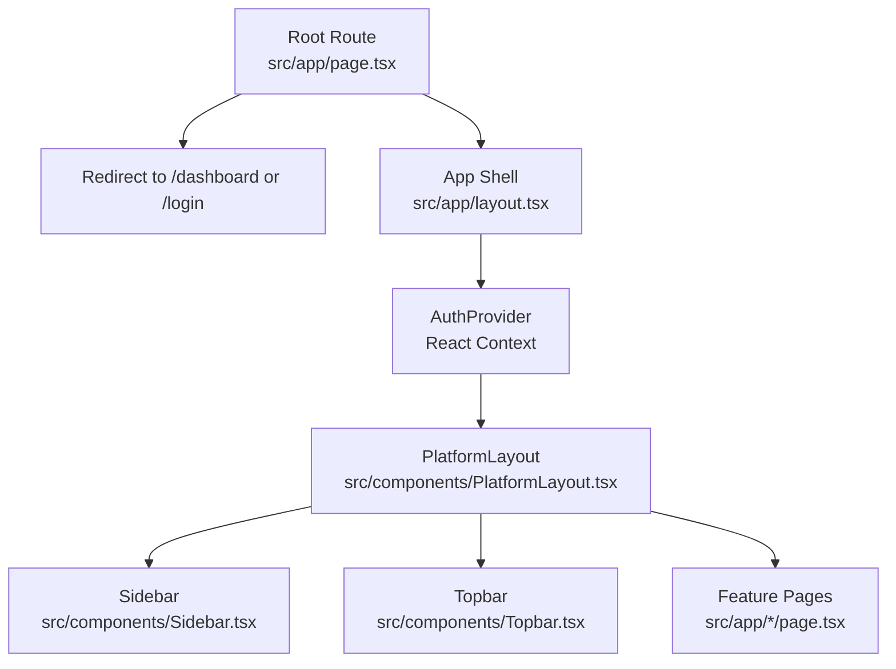

**Diagram sources**
- [layout.tsx:5-25](file://platform-app/src/app/layout.tsx#L5-L25)
- [page.tsx:7-17](file://platform-app/src/app/page.tsx#L7-L17)
- [PlatformLayout.tsx:7-18](file://platform-app/src/components/PlatformLayout.tsx#L7-L18)
- [Sidebar.tsx:9-39](file://platform-app/src/components/Sidebar.tsx#L9-L39)
- [Topbar.tsx:230-337](file://platform-app/src/components/Topbar.tsx#L230-L337)

**Section sources**
- [layout.tsx:5-25](file://platform-app/src/app/layout.tsx#L5-L25)
- [page.tsx:7-17](file://platform-app/src/app/page.tsx#L7-L17)
- [PlatformLayout.tsx:7-18](file://platform-app/src/components/PlatformLayout.tsx#L7-L18)
- [Sidebar.tsx:9-39](file://platform-app/src/components/Sidebar.tsx#L9-L39)
- [Topbar.tsx:230-337](file://platform-app/src/components/Topbar.tsx#L230-L337)

## Core Components
- Root layout (`src/app/layout.tsx`) sets metadata, loads Inter and JetBrains Mono fonts, wraps the application in `AuthProvider`, and mounts child routes.
- Root page (`src/app/page.tsx`) checks authentication and redirects to `/dashboard` when logged in, otherwise to `/login`.
- `PlatformLayout.tsx` composes the fixed-width sidebar and a flexible main area containing the sticky topbar and scrollable content.
- `Sidebar.tsx` defines navigation sections and active-state highlighting based on the current pathname. It also shows credit usage and trial status from the auth context.
- `Topbar.tsx` implements:
  - Command palette search with debounced queries against the backend search endpoint.
  - Notification dropdown with unread count polling and mark-as-read actions.
  - Trial countdown badge, credits display, timezone label, user avatar/name/company, and logout.

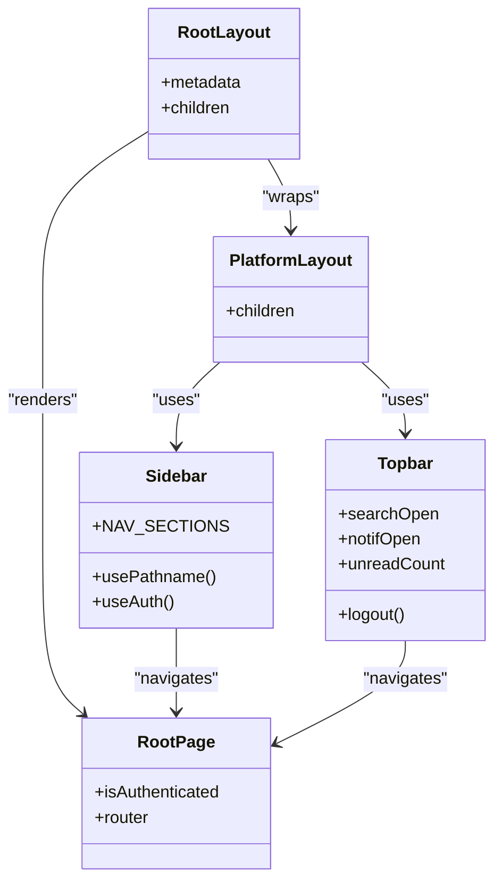

**Diagram sources**
- [layout.tsx:5-25](file://platform-app/src/app/layout.tsx#L5-L25)
- [page.tsx:7-17](file://platform-app/src/app/page.tsx#L7-L17)
- [PlatformLayout.tsx:7-18](file://platform-app/src/components/PlatformLayout.tsx#L7-L18)
- [Sidebar.tsx:9-39](file://platform-app/src/components/Sidebar.tsx#L9-L39)
- [Topbar.tsx:230-337](file://platform-app/src/components/Topbar.tsx#L230-L337)

**Section sources**
- [layout.tsx:5-25](file://platform-app/src/app/layout.tsx#L5-L25)
- [page.tsx:7-17](file://platform-app/src/app/page.tsx#L7-L17)
- [PlatformLayout.tsx:7-18](file://platform-app/src/components/PlatformLayout.tsx#L7-L18)
- [Sidebar.tsx:9-39](file://platform-app/src/components/Sidebar.tsx#L9-L39)
- [Topbar.tsx:230-337](file://platform-app/src/components/Topbar.tsx#L230-L337)

## Architecture Overview
The platform app is a client-heavy Next.js 14 application using the App Router. Each feature folder under `src/app/` exports a default page component that composes `PlatformLayout` and fetches data via `src/lib/api.ts`. The root layout injects global styles and the authentication context.

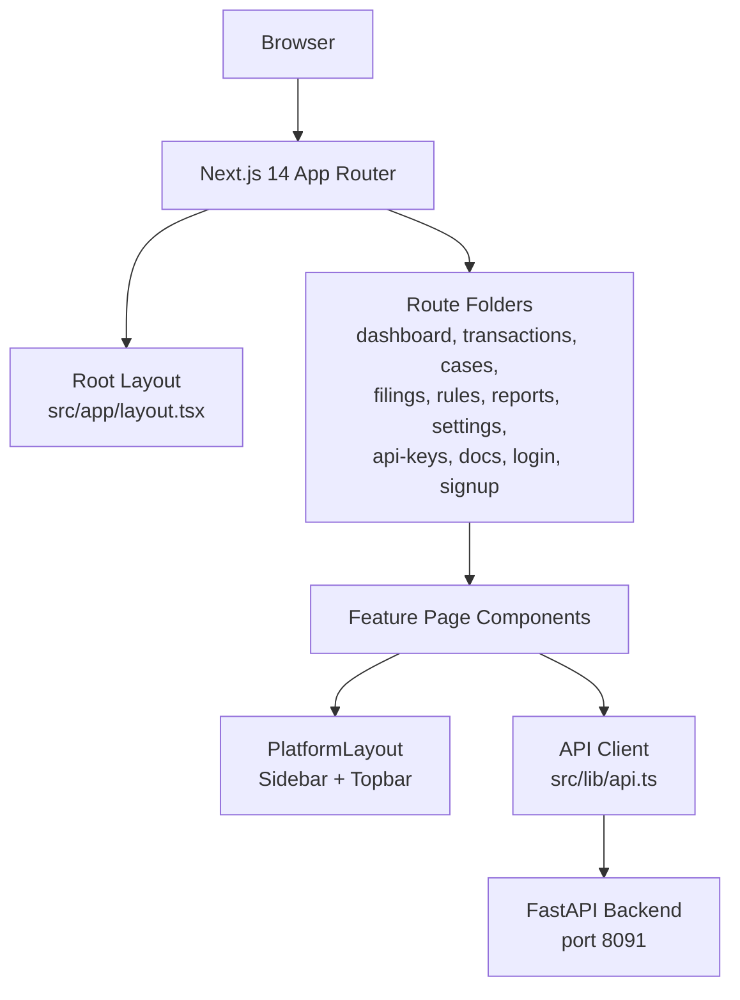

**Diagram sources**
- [next.config.js:4-14](file://platform-app/next.config.js#L4-L14)
- [layout.tsx:5-25](file://platform-app/src/app/layout.tsx#L5-L25)
- [PlatformLayout.tsx:7-18](file://platform-app/src/components/PlatformLayout.tsx#L7-L18)

**Section sources**
- [next.config.js:4-14](file://platform-app/next.config.js#L4-L14)
- [layout.tsx:5-25](file://platform-app/src/app/layout.tsx#L5-L25)
- [PlatformLayout.tsx:7-18](file://platform-app/src/components/PlatformLayout.tsx#L7-L18)

## Detailed Component Analysis

### App Router Routing and Page Composition
- Route-to-path mapping:
  - `/dashboard` → `src/app/dashboard/page.tsx`
  - `/transactions` → `src/app/transactions/page.tsx`
  - `/cases` → `src/app/cases/page.tsx`
  - `/filings` → `src/app/filings/page.tsx`
  - `/rules` → `src/app/rules/page.tsx`
  - `/reports` → `src/app/reports/page.tsx`
  - `/settings` → `src/app/settings/page.tsx`
  - `/api-keys` → `src/app/api-keys/page.tsx`
  - `/docs` → `src/app/docs/page.tsx`
  - `/login` → `src/app/login/page.tsx`
  - `/signup` → `src/app/signup/page.tsx`
- Root redirect logic:
  - If authenticated, replace route with `/dashboard`.
  - Otherwise, replace route with `/login`.

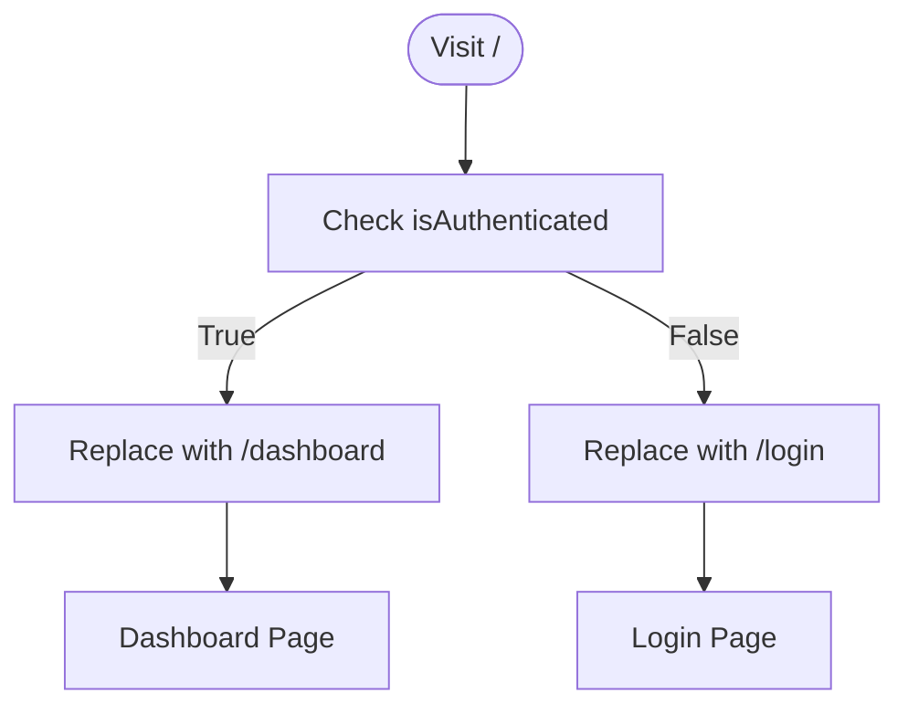

**Diagram sources**
- [page.tsx:7-17](file://platform-app/src/app/page.tsx#L7-L17)

**Section sources**
- [page.tsx:7-17](file://platform-app/src/app/page.tsx#L7-L17)

### Shared Shell: PlatformLayout, Sidebar, Topbar
- `PlatformLayout.tsx` creates a full-height flex container with a fixed left sidebar and a right column containing the topbar and scrollable main content.
- `Sidebar.tsx` groups navigation items into sections and highlights the active link based on the current pathname. It also displays credit usage and trial status.
- `Topbar.tsx` includes:
  - A command palette triggered by keyboard shortcuts and displaying search results for transactions, cases, and API keys.
  - A notification dropdown with unread count polling and per-notification read actions.
  - Trial countdown badge, credits display, timezone label, user info, and logout.

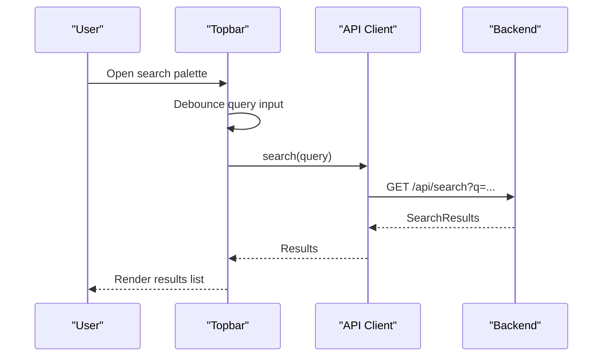

**Diagram sources**
- [Topbar.tsx:11-39](file://platform-app/src/components/Topbar.tsx#L11-L39)

**Section sources**
- [PlatformLayout.tsx:7-18](file://platform-app/src/components/PlatformLayout.tsx#L7-L18)
- [Sidebar.tsx:9-39](file://platform-app/src/components/Sidebar.tsx#L9-L39)
- [Topbar.tsx:11-39](file://platform-app/src/components/Topbar.tsx#L11-L39)
- [Topbar.tsx:230-337](file://platform-app/src/components/Topbar.tsx#L230-L337)

### Dashboard Page
- Loads stats, recent transactions, and system health concurrently.
- Displays KPI cards, a conic-gradient donut chart, credit usage, system health indicators, and a recent transactions table.
- Wraps all content in `PlatformLayout`.

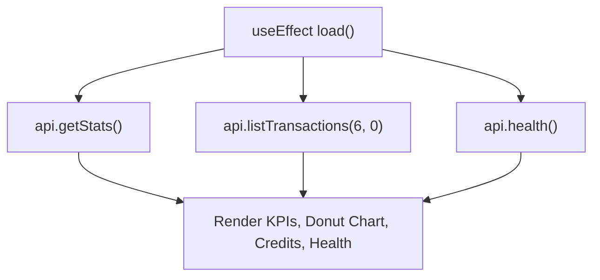

**Diagram sources**
- [dashboard page.tsx:25-43](file://platform-app/src/app/dashboard/page.tsx#L25-L43)
- [dashboard page.tsx:60-237](file://platform-app/src/app/dashboard/page.tsx#L60-L237)

**Section sources**
- [dashboard page.tsx:25-43](file://platform-app/src/app/dashboard/page.tsx#L25-L43)
- [dashboard page.tsx:60-237](file://platform-app/src/app/dashboard/page.tsx#L60-L237)

### Transactions Page
- Lists transactions with status filters, supports screening new transactions, viewing details, deleting records, and exporting CSV.
- Detail modal shows rule evaluation results, pipeline stages, and RAG context where available.

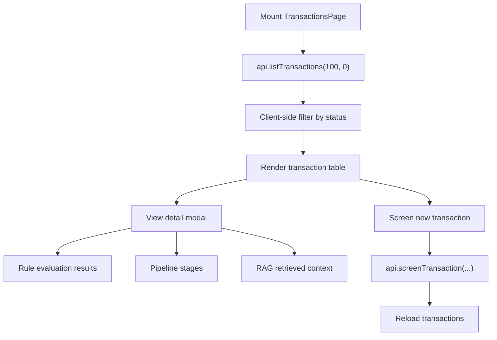

**Diagram sources**
- [transactions page.tsx:35-47](file://platform-app/src/app/transactions/page.tsx#L35-L47)
- [transactions page.tsx:51-71](file://platform-app/src/app/transactions/page.tsx#L51-L71)
- [transactions page.tsx:288-527](file://platform-app/src/app/transactions/page.tsx#L288-L527)

**Section sources**
- [transactions page.tsx:35-47](file://platform-app/src/app/transactions/page.tsx#L35-L47)
- [transactions page.tsx:51-71](file://platform-app/src/app/transactions/page.tsx#L51-L71)
- [transactions page.tsx:288-527](file://platform-app/src/app/transactions/page.tsx#L288-L527)

### Cases Page
- Lists cases with grouped status filters (open, escalated, resolved).
- Supports creating cases linked to transactions, managing case status transitions, assigning analysts, adding comments, and deleting cases.

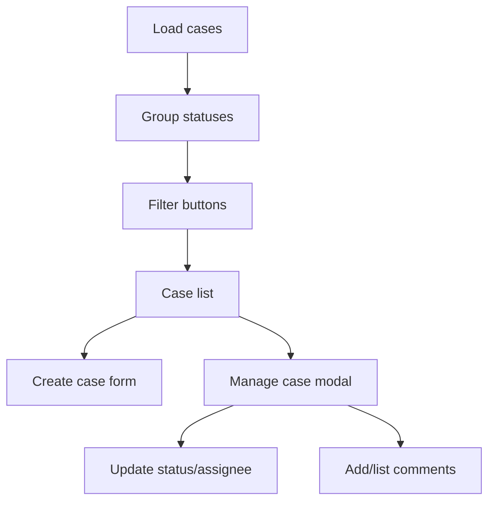

**Diagram sources**
- [cases page.tsx:61-76](file://platform-app/src/app/cases/page.tsx#L61-L76)
- [cases page.tsx:80-98](file://platform-app/src/app/cases/page.tsx#L80-L98)
- [cases page.tsx:272-414](file://platform-app/src/app/cases/page.tsx#L272-L414)

**Section sources**
- [cases page.tsx:61-76](file://platform-app/src/app/cases/page.tsx#L61-L76)
- [cases page.tsx:80-98](file://platform-app/src/app/cases/page.tsx#L80-L98)
- [cases page.tsx:272-414](file://platform-app/src/app/cases/page.tsx#L272-L414)

### Filings Page
- Lists SAR/STR filings with status and type filters.
- Shows deadlines, overdue/urgent badges, narratives, structured data, and workflow actions (submit, confirm, delete draft).

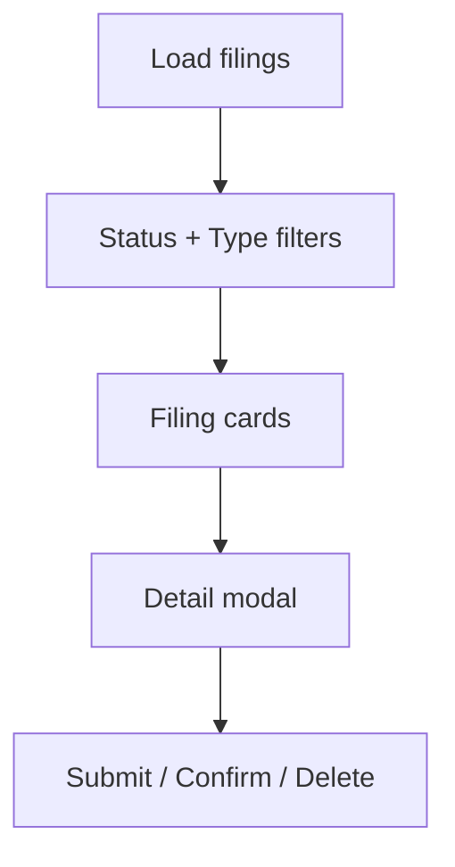

**Diagram sources**
- [filings page.tsx:29-43](file://platform-app/src/app/filings/page.tsx#L29-L43)
- [filings page.tsx:122-198](file://platform-app/src/app/filings/page.tsx#L122-L198)
- [filings page.tsx:201-343](file://platform-app/src/app/filings/page.tsx#L201-L343)

**Section sources**
- [filings page.tsx:29-43](file://platform-app/src/app/filings/page.tsx#L29-L43)
- [filings page.tsx:122-198](file://platform-app/src/app/filings/page.tsx#L122-L198)
- [filings page.tsx:201-343](file://platform-app/src/app/filings/page.tsx#L201-L343)

### Rules Page
- Lists compliance rules with enabled/disabled toggles and parameter editing for customizable rules.
- Indicates whether lists are managed by FinShield or editable.

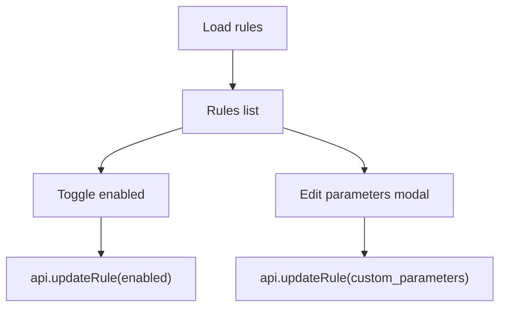

**Diagram sources**
- [rules page.tsx:21-33](file://platform-app/src/app/rules/page.tsx#L21-L33)
- [rules page.tsx:35-56](file://platform-app/src/app/rules/page.tsx#L35-L56)
- [rules page.tsx:150-206](file://platform-app/src/app/rules/page.tsx#L150-L206)

**Section sources**
- [rules page.tsx:21-33](file://platform-app/src/app/rules/page.tsx#L21-L33)
- [rules page.tsx:35-56](file://platform-app/src/app/rules/page.tsx#L35-L56)
- [rules page.tsx:150-206](file://platform-app/src/app/rules/page.tsx#L150-L206)

### Reports Page
- Loads aggregated stats and renders summary metrics, decision breakdown bars, and risk posture text.

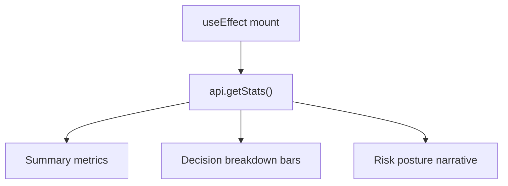

**Diagram sources**
- [reports page.tsx:12-17](file://platform-app/src/app/reports/page.tsx#L12-L17)
- [reports page.tsx:33-107](file://platform-app/src/app/reports/page.tsx#L33-L107)

**Section sources**
- [reports page.tsx:12-17](file://platform-app/src/app/reports/page.tsx#L12-L17)
- [reports page.tsx:33-107](file://platform-app/src/app/reports/page.tsx#L33-L107)

### Settings Page
- Tabbed interface for profile, notifications, security, and billing.
- Profile tab updates name, company, and timezone; notifications tab toggles email preferences; security tab changes password; billing tab manages plans, credit packs, saved payment methods, and checkout flows.

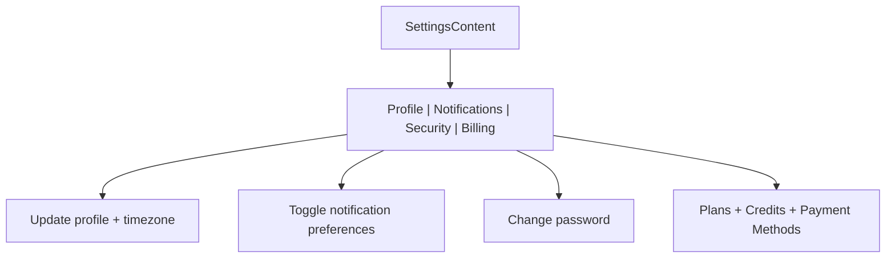

**Diagram sources**
- [settings page.tsx:21-77](file://platform-app/src/app/settings/page.tsx#L21-L77)
- [settings page.tsx:80-153](file://platform-app/src/app/settings/page.tsx#L80-L153)
- [settings page.tsx:156-223](file://platform-app/src/app/settings/page.tsx#L156-L223)
- [settings page.tsx:226-269](file://platform-app/src/app/settings/page.tsx#L226-L269)
- [settings page.tsx:272-695](file://platform-app/src/app/settings/page.tsx#L272-L695)

**Section sources**
- [settings page.tsx:21-77](file://platform-app/src/app/settings/page.tsx#L21-L77)
- [settings page.tsx:80-153](file://platform-app/src/app/settings/page.tsx#L80-L153)
- [settings page.tsx:156-223](file://platform-app/src/app/settings/page.tsx#L156-L223)
- [settings page.tsx:226-269](file://platform-app/src/app/settings/page.tsx#L226-L269)
- [settings page.tsx:272-695](file://platform-app/src/app/settings/page.tsx#L272-L695)

## Dependency Analysis
- Frontend runtime dependencies:
  - Next.js 14.2.x, React 18.x, TypeScript, Tailwind CSS, PostCSS, Autoprefixer, ESLint.
- Build output:
  - `next.config.js` configures standalone output and rewrites `/api/:path*` to the backend at port 8091.
- Docker Compose:
  - Three services: PostgreSQL (pgvector), backend, and frontend.
  - Frontend builds `platform-app/Dockerfile` and sets `API_URL=http://backend:8091` for server-side rewrites.
  - Backend defaults to SQLite unless `DATABASE_URL` is set; RAG retrieval path requires PostgreSQL.

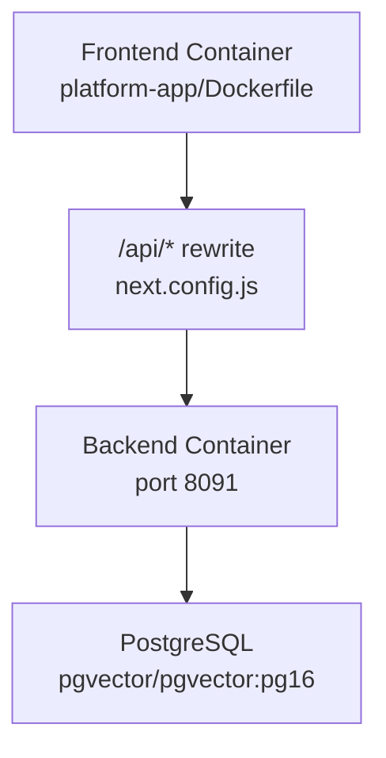

**Diagram sources**
- [next.config.js:4-14](file://platform-app/next.config.js#L4-L14)
- [docker-compose.yml:4-15](file://docker-compose.yml#L4-L15)
- [docker-compose.yml:24-45](file://docker-compose.yml#L24-L45)
- [docker-compose.yml:47-61](file://docker-compose.yml#L47-L61)

**Section sources**
- [package.json:1-28](file://platform-app/package.json#L1-L28)
- [next.config.js:1-18](file://platform-app/next.config.js#L1-L18)
- [docker-compose.yml:1-72](file://docker-compose.yml#L1-L72)

## Performance Considerations
- Code splitting:
  - Next.js App Router automatically splits code by route. Each feature page is its own entry point, reducing initial bundle size.
- Standalone output:
  - `output: 'standalone'` produces a minimal Node server for production deployments.
- Server-side rewrites:
  - `/api/:path*` is rewritten to the backend, avoiding proxy middleware overhead in the browser.
- Styling:
  - Tailwind scans only configured paths under `src/pages`, `src/components`, and `src/app`, minimizing unused CSS.
- Data fetching:
  - Dashboard performs parallel requests for stats, recent transactions, and health.
  - Topbar polls notifications periodically; consider throttling or using WebSockets if latency becomes an issue.
- Bundle analysis:
  - Use `next build --profile` and `next-bundle-analyzer` to inspect large dependencies and lazy-load heavy components.
- Images and assets:
  - Prefer Next.js Image optimization and avoid loading large third-party libraries on every route.

[No sources needed since this section provides general guidance]

## Troubleshooting Guide
- Cannot reach backend:
  - Verify `API_URL` and `NEXT_PUBLIC_API_URL` environment variables.
  - Ensure backend is running on port 8091 and reachable from the frontend container.
- Database connectivity:
  - Backend defaults to SQLite (`finshield.db`). For vector retrieval, run PostgreSQL with pgvector and set `RAG_DATABASE_URL`.
- Authentication redirects:
  - If stuck at `/`, check `isAuthenticated` from `AuthProvider` and ensure session/JWT handling is correct.
- Navigation not highlighting:
  - Sidebar active state depends on exact pathname matches or prefix matches; verify route paths.
- Notifications not updating:
  - Check polling interval and error handling in `Topbar`; network errors are silently ignored.

**Section sources**
- [next.config.js:4-14](file://platform-app/next.config.js#L4-L14)
- [docker-compose.yml:31-37](file://docker-compose.yml#L31-L37)
- [Topbar.tsx:237-247](file://platform-app/src/components/Topbar.tsx#L237-L247)
- [Sidebar.tsx:135-153](file://platform-app/src/components/Sidebar.tsx#L135-L153)

## Conclusion
FinShield’s Next.js 14 platform uses a clean App Router structure with feature-based route folders and a consistent shell built from `PlatformLayout`, `Sidebar`, and `Topbar`. The build configuration enables standalone output and server-side API rewrites, while Tailwind provides a cohesive design system. The frontend integrates tightly with the FastAPI backend through a centralized API client, and Docker Compose orchestrates PostgreSQL, backend, and frontend services. For further performance gains, adopt bundle analysis, lazy-loading, and efficient polling strategies.

[No sources needed since this section summarizes without analyzing specific files]