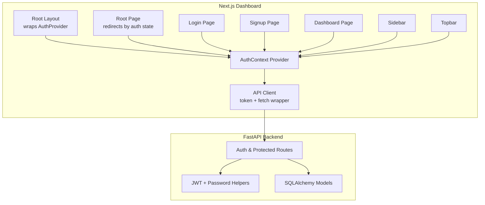
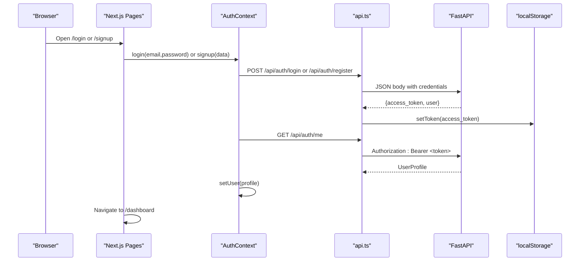
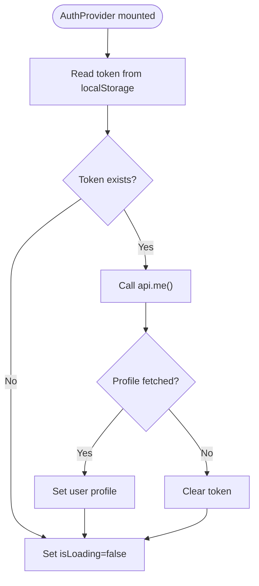
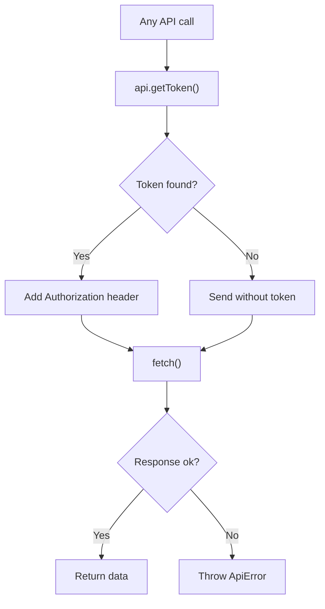
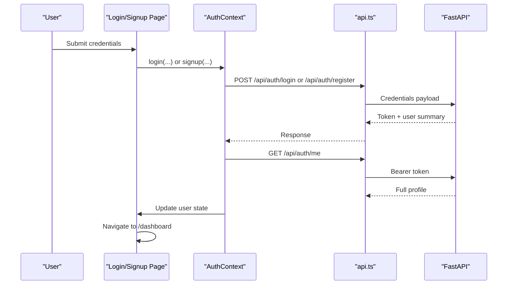
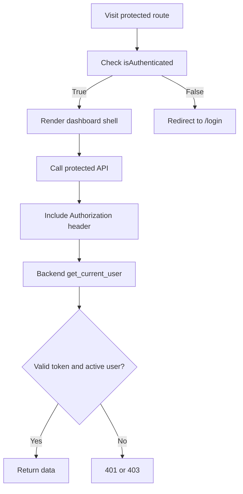
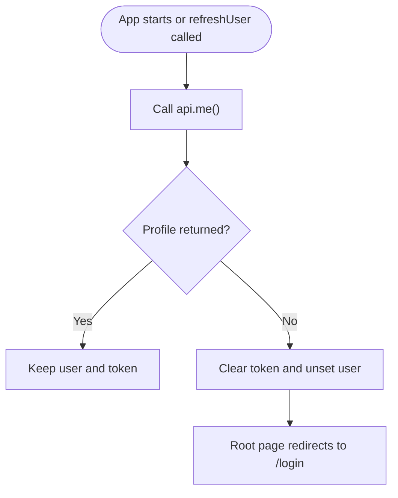
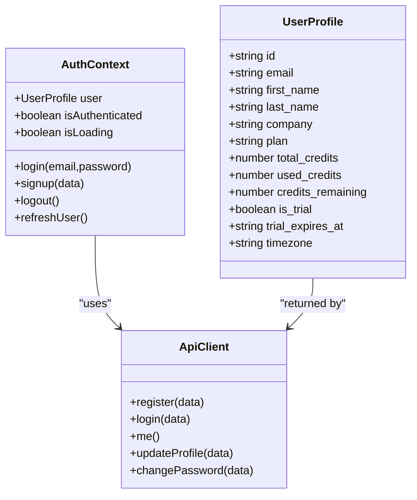
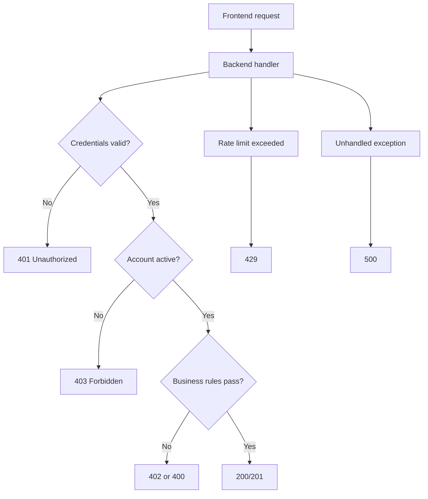
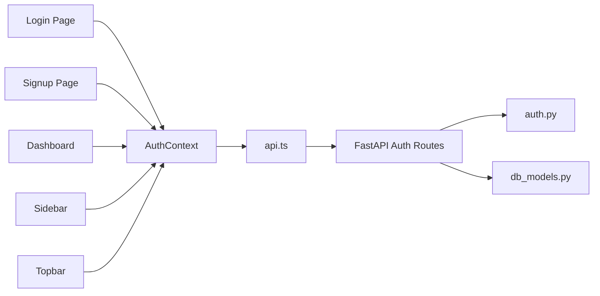

# Authentication & Session Management

<cite>
**Referenced Files in This Document**
- [AuthContext.tsx](file://platform-app/src/contexts/AuthContext.tsx)
- [api.ts](file://platform-app/src/lib/api.ts)
- [layout.tsx](file://platform-app/src/app/layout.tsx)
- [page.tsx](file://platform-app/src/app/page.tsx)
- [login page.tsx](file://platform-app/src/app/login/page.tsx)
- [signup page.tsx](file://platform-app/src/app/signup/page.tsx)
- [dashboard page.tsx](file://platform-app/src/app/dashboard/page.tsx)
- [Sidebar.tsx](file://platform-app/src/components/Sidebar.tsx)
- [Topbar.tsx](file://platform-app/src/components/Topbar.tsx)
- [PlatformLayout.tsx](file://platform-app/src/components/PlatformLayout.tsx)
- [auth.py](file://backend/app/auth.py)
- [main.py](file://backend/app/main.py)
- [db_models.py](file://backend/app/db_models.py)
</cite>

## Table of Contents
1. [Introduction](#introduction)
2. [Project Structure](#project-structure)
3. [Core Components](#core-components)
4. [Architecture Overview](#architecture-overview)
5. [Detailed Component Analysis](#detailed-component-analysis)
6. [Dependency Analysis](#dependency-analysis)
7. [Performance Considerations](#performance-considerations)
8. [Troubleshooting Guide](#troubleshooting-guide)
9. [Conclusion](#conclusion)
10. [Appendices](#appendices)

## Introduction
This document explains how FinShield authenticates users and manages sessions across the Next.js dashboard and FastAPI backend. It covers:

- The client-side `AuthProvider` that owns login, signup, logout, token persistence, and user profile state.
- Token storage in browser `localStorage`, automatic session restoration on reload, and invalidation on expiration.
- Login and signup form handling, validation, and navigation to protected routes.
- Backend JWT issuance, verification, API-key authentication, and protected endpoints.
- Role-based access control considerations and permission checks currently implemented.
- Security guidance for token storage, XSS protection, CSRF mitigation, and safe error handling.
- Error handling paths for network failures, invalid tokens, disabled accounts, and rate limits.
- Testing strategies for authentication flows and mocking the auth context.

The shipped stack is a Next.js 14 App Router frontend under `platform-app/` and a FastAPI backend under `backend/`. The marketing site under `website/` is separate and not part of the authenticated platform.

## Project Structure
Authentication-related code is split between the frontend application shell and the backend API:

- Frontend:
  - `src/contexts/AuthContext.tsx`: React context provider for authentication state and actions.
  - `src/lib/api.ts`: HTTP client, token helpers, and typed API methods.
  - `src/app/layout.tsx`: Root layout that wraps the app with `AuthProvider`.
  - `src/app/page.tsx`: Root route redirect based on authentication state.
  - `src/app/login/page.tsx` and `src/app/signup/page.tsx`: Auth forms.
  - `src/app/dashboard/page.tsx`, `Sidebar.tsx`, `Topbar.tsx`, `PlatformLayout.tsx`: Protected UI components.
- Backend:
  - `backend/app/auth.py`: JWT creation/verification, password hashing, and current-user dependency.
  - `backend/app/main.py`: Auth endpoints, protected routes, exception handlers, and middleware.
  - `backend/app/db_models.py`: User, API key, and related database entities.

**Diagram sources**
- [layout.tsx:10-25](file://platform-app/src/app/layout.tsx#L10-L25)
- [page.tsx:7-31](file://platform-app/src/app/page.tsx#L7-L31)
- [AuthContext.tsx:18-106](file://platform-app/src/contexts/AuthContext.tsx#L18-L106)
- [api.ts:357-438](file://platform-app/src/lib/api.ts#L357-L438)
- [main.py:176-347](file://backend/app/main.py#L176-L347)
- [auth.py:42-113](file://backend/app/auth.py#L42-L113)
- [db_models.py:22-73](file://backend/app/db_models.py#L22-L73)

**Section sources**
- [layout.tsx:10-25](file://platform-app/src/app/layout.tsx#L10-L25)
- [page.tsx:7-31](file://platform-app/src/app/page.tsx#L7-L31)
- [AuthContext.tsx:18-106](file://platform-app/src/contexts/AuthContext.tsx#L18-L106)
- [api.ts:357-438](file://platform-app/src/lib/api.ts#L357-L438)
- [main.py:176-347](file://backend/app/main.py#L176-L347)
- [auth.py:42-113](file://backend/app/auth.py#L42-L113)
- [db_models.py:22-73](file://backend/app/db_models.py#L22-L73)

## Core Components
- `AuthProvider` (`AuthContext.tsx`)
  - Owns `user`, `isAuthenticated`, and `isLoading`.
  - On mount, reads the stored token, calls `/api/auth/me`, and sets the user or clears an invalid token.
  - Provides `login`, `signup`, `logout`, and `refreshUser`.
- API client (`api.ts`)
  - Stores the JWT in `localStorage` under `finshield_token`.
  - Adds `Authorization: Bearer <token>` to requests when present.
  - Throws `ApiError` with HTTP status and parsed detail for non-OK responses.
- Backend auth module (`auth.py`)
  - Creates HS256 JWTs with an expiry.
  - Decodes and validates tokens.
  - Supports both JWT bearer tokens and hashed API keys starting with `fsk_`.
- Auth endpoints (`main.py`)
  - `POST /api/auth/register`: creates trial user, returns JWT and user summary.
  - `POST /api/auth/login`: verifies credentials, logs audit event, returns JWT and user summary.
  - `GET /api/auth/me`: returns full profile for the authenticated user.
  - `PATCH /api/auth/me` and `POST /api/auth/change-password`: protected profile operations.

**Section sources**
- [AuthContext.tsx:18-106](file://platform-app/src/contexts/AuthContext.tsx#L18-L106)
- [api.ts:357-438](file://platform-app/src/lib/api.ts#L357-L438)
- [auth.py:21-113](file://backend/app/auth.py#L21-L113)
- [main.py:176-347](file://backend/app/main.py#L176-L347)

## Architecture Overview
The authentication flow uses short-lived JWTs persisted in the browser. The frontend stores the token, attaches it to every request, and refreshes the user profile on startup. The backend issues tokens after successful registration or login and enforces authentication through a FastAPI dependency.

**Diagram sources**
- [login page.tsx:16-28](file://platform-app/src/app/login/page.tsx#L16-L28)
- [signup page.tsx:18-30](file://platform-app/src/app/signup/page.tsx#L18-L30)
- [AuthContext.tsx:42-68](file://platform-app/src/contexts/AuthContext.tsx#L42-L68)
- [api.ts:420-438](file://platform-app/src/lib/api.ts#L420-L438)
- [main.py:176-266](file://backend/app/main.py#L176-L266)

## Detailed Component Analysis

### AuthContext Implementation
`AuthProvider` is the single source of truth for authentication state:

- Initialization
  - Reads the token from `api.getToken()`.
  - If present, calls `api.me()`; on failure, clears the token.
  - Sets `isLoading` to false after initialization completes.
- Login
  - Calls `api.login`, stores the returned `access_token`, then fetches the full profile via `api.me()`.
- Signup
  - Calls `api.register`, stores the returned `access_token`, then fetches the full profile.
- Logout
  - Clears the token, resets user state, and redirects to `/login`.
- Refresh user
  - Attempts to refresh the profile; if the token is expired, clears the token and unsets the user.

**Diagram sources**
- [AuthContext.tsx:22-40](file://platform-app/src/contexts/AuthContext.tsx#L22-L40)

**Section sources**
- [AuthContext.tsx:18-106](file://platform-app/src/contexts/AuthContext.tsx#L18-L106)

### Token Storage and Session Persistence
- Storage location
  - The JWT is stored in `localStorage` under the key `finshield_token`.
- Lifecycle
  - `setToken` writes the token after login or signup.
  - `getToken` reads the token before each request.
  - `clearToken` removes both `finshield_token` and `finshield_user`.
- Request injection
  - Every request built by `request()` adds `Authorization: Bearer <token>` when a token exists.
- Automatic logout on expiration
  - When `api.me()` fails due to an invalid or expired token, `AuthProvider.refreshUser` clears the token and unsets the user.
  - The root redirect page will then navigate unauthenticated users to `/login`.

**Diagram sources**
- [api.ts:357-408](file://platform-app/src/lib/api.ts#L357-L408)
- [AuthContext.tsx:76-85](file://platform-app/src/contexts/AuthContext.tsx#L76-L85)

**Section sources**
- [api.ts:357-438](file://platform-app/src/lib/api.ts#L357-L438)
- [AuthContext.tsx:22-40](file://platform-app/src/contexts/AuthContext.tsx#L22-L40)
- [page.tsx:7-31](file://platform-app/src/app/page.tsx#L7-L31)

### Login and Signup Forms
- Login page
  - Controlled email and password fields.
  - Submits to `useAuth().login`, navigates to `/dashboard` on success, and displays server errors.
- Signup page
  - Controlled first name, last name, work email, company, and password fields.
  - Submits to `useAuth().signup`, navigates to `/dashboard` on success, and displays server errors.
- Validation
  - HTML attributes enforce required inputs and minimum password length.
  - Backend validation rejects invalid payloads and duplicate registrations.

**Diagram sources**
- [login page.tsx:16-28](file://platform-app/src/app/login/page.tsx#L16-L28)
- [signup page.tsx:18-30](file://platform-app/src/app/signup/page.tsx#L18-L30)
- [AuthContext.tsx:42-68](file://platform-app/src/contexts/AuthContext.tsx#L42-L68)
- [main.py:176-266](file://backend/app/main.py#L176-L266)

**Section sources**
- [login page.tsx:8-28](file://platform-app/src/app/login/page.tsx#L8-L28)
- [signup page.tsx:8-30](file://platform-app/src/app/signup/page.tsx#L8-L30)
- [main.py:176-266](file://backend/app/main.py#L176-L266)

### Protected Route Mechanism
FinShield currently protects backend endpoints rather than using a centralized Next.js route guard:

- Frontend behavior
  - The root page redirects to `/dashboard` when authenticated and to `/login` otherwise.
  - Protected pages such as `/dashboard` assume the user is authenticated and render the platform shell.
- Backend enforcement
  - Most business endpoints depend on `get_current_user`, which requires either a valid JWT or a valid API key.
  - Invalid or missing credentials return `401`; disabled accounts return `403`.

**Diagram sources**
- [page.tsx:7-31](file://platform-app/src/app/page.tsx#L7-L31)
- [dashboard page.tsx:17-43](file://platform-app/src/app/dashboard/page.tsx#L17-L43)
- [auth.py:59-113](file://backend/app/auth.py#L59-L113)
- [main.py:434-470](file://backend/app/main.py#L434-L470)

**Section sources**
- [page.tsx:7-31](file://platform-app/src/app/page.tsx#L7-L31)
- [dashboard page.tsx:17-43](file://platform-app/src/app/dashboard/page.tsx#L17-L43)
- [auth.py:59-113](file://backend/app/auth.py#L59-L113)
- [main.py:434-470](file://backend/app/main.py#L434-L470)

### Token Refresh Logic and Automatic Logout
- Current behavior
  - There is no background refresh-token endpoint or silent token renewal.
  - On app start, the provider attempts to validate the stored token by calling `/api/auth/me`.
  - If that call fails, the token is cleared and the user is logged out.
  - `refreshUser` provides an explicit way to revalidate the profile and log out on failure.
- Practical effect
  - A tab remains open but becomes unauthenticated after token expiration until the user logs in again.
  - Any subsequent API call will fail with an authentication error because the token has been removed.

**Diagram sources**
- [AuthContext.tsx:22-40](file://platform-app/src/contexts/AuthContext.tsx#L22-L40)
- [AuthContext.tsx:76-85](file://platform-app/src/contexts/AuthContext.tsx#L76-L85)
- [page.tsx:7-31](file://platform-app/src/app/page.tsx#L7-L31)

**Section sources**
- [AuthContext.tsx:22-40](file://platform-app/src/contexts/AuthContext.tsx#L22-L40)
- [AuthContext.tsx:76-85](file://platform-app/src/contexts/AuthContext.tsx#L76-L85)
- [page.tsx:7-31](file://platform-app/src/app/page.tsx#L7-L31)

### User Profile Management
- Reading the profile
  - After login or signup, the frontend calls `/api/auth/me` to populate the user object.
  - The dashboard and sidebar use profile fields such as name, company, credits, trial status, and billing cycle dates.
- Updating the profile
  - The client exposes `updateProfile` and `changePassword` methods.
  - The backend validates and persists changes under protected endpoints.
- Trial and billing signals
  - The sidebar and topbar display trial countdowns and credit usage derived from the profile.

**Diagram sources**
- [api.ts:48-68](file://platform-app/src/lib/api.ts#L48-L68)
- [api.ts:521-532](file://platform-app/src/lib/api.ts#L521-L532)
- [AuthContext.tsx:6-14](file://platform-app/src/contexts/AuthContext.tsx#L6-L14)
- [main.py:269-347](file://backend/app/main.py#L269-L347)

**Section sources**
- [api.ts:48-68](file://platform-app/src/lib/api.ts#L48-L68)
- [api.ts:521-532](file://platform-app/src/lib/api.ts#L521-L532)
- [AuthContext.tsx:6-14](file://platform-app/src/contexts/AuthContext.tsx#L6-L14)
- [main.py:269-347](file://backend/app/main.py#L269-L347)
- [Sidebar.tsx:103-183](file://platform-app/src/components/Sidebar.tsx#L103-L183)
- [Topbar.tsx:231-341](file://platform-app/src/components/Topbar.tsx#L231-L341)

### Role-Based Access Control and Permission Checking
- Current implementation
  - The backend supports per-user API keys and basic user state such as `is_active`, `plan`, and trial flags.
  - There is no explicit role field or fine-grained permission model in the provided models.
- Existing permission checks
  - Account activation: disabled users receive `403`.
  - Trial enforcement: trial-expired users are blocked from screening transactions.
  - Credit enforcement: insufficient credits return `402`.
- Recommended extension
  - Introduce roles or permissions in the user model and add middleware or dependencies to enforce them at the route level.
  - Use the existing `plan` and trial fields for coarse gating while adding finer controls later.

**Section sources**
- [db_models.py:22-57](file://backend/app/db_models.py#L22-L57)
- [auth.py:59-113](file://backend/app/auth.py#L59-L113)
- [main.py:434-470](file://backend/app/main.py#L434-L470)

### Security Considerations
- Token storage best practices
  - Tokens are stored in `localStorage`, which is accessible to JavaScript. This is convenient but vulnerable to XSS.
  - For stronger security, consider httpOnly cookies with CSRF protections, especially if cross-site scripting risks exist.
- XSS protection
  - Avoid rendering unsanitized user input directly into HTML.
  - Use React’s default escaping and avoid `dangerouslySetInnerHTML` for untrusted content.
- CSRF mitigation
  - If switching to cookies for tokens, enable SameSite cookie policies and CSRF tokens for state-changing requests.
  - The current bearer-token approach avoids traditional CSRF but introduces XSS exposure.
- CORS configuration
  - The backend allows configured origins with credentials enabled. Ensure only trusted origins are allowed.
- Rate limiting
  - Registration and login endpoints are rate-limited. General API endpoints also have rate-limiting infrastructure.
- Password security
  - Passwords are hashed with bcrypt on the backend.

**Section sources**
- [api.ts:357-370](file://platform-app/src/lib/api.ts#L357-L370)
- [main.py:62-70](file://backend/app/main.py#L62-L70)
- [main.py:72-78](file://backend/app/main.py#L72-L78)
- [auth.py:30-47](file://backend/app/auth.py#L30-L47)

### Error Handling for Authentication Failures
- Frontend
  - Login and signup pages catch errors from `useAuth` and display user-facing messages.
  - The dashboard shows an API offline message when health or data calls fail.
  - `ApiError` carries HTTP status and parsed backend detail.
- Backend
  - Invalid credentials return `401`.
  - Disabled accounts return `403`.
  - Missing or malformed tokens return `401`.
  - Validation errors return `422`.
  - Rate limit exceeded returns `429`.
  - Unhandled exceptions return `500`.

**Diagram sources**
- [login page.tsx:16-28](file://platform-app/src/app/login/page.tsx#L16-L28)
- [api.ts:388-417](file://platform-app/src/lib/api.ts#L388-L417)
- [main.py:81-115](file://backend/app/main.py#L81-L115)
- [main.py:176-266](file://backend/app/main.py#L176-L266)

**Section sources**
- [login page.tsx:16-28](file://platform-app/src/app/login/page.tsx#L16-L28)
- [api.ts:388-417](file://platform-app/src/lib/api.ts#L388-L417)
- [main.py:81-115](file://backend/app/main.py#L81-L115)
- [main.py:176-266](file://backend/app/main.py#L176-L266)

### Testing Approach and Mock Strategies
- Backend testing
  - Use FastAPI’s test client to register a user, log in, obtain a token, and call protected endpoints.
  - Assert 401 for missing tokens, 403 for disabled accounts, and correct profile responses.
  - Validate rate-limit headers and error shapes where applicable.
- Frontend testing
  - Wrap components with a mocked `AuthProvider` that supplies a fake user and stubbed `login`, `signup`, `logout`, and `refreshUser`.
  - Mock `api.ts` methods to return controlled responses and errors.
  - Test:
    - Successful login and navigation to `/dashboard`.
    - Failed login displaying an error.
    - Initial load restoring a valid session.
    - Expired token clearing the session and redirecting to `/login`.
    - Protected pages refusing to render sensitive data when unauthenticated.
- Mock strategy for auth context
  - Provide a context value with `user: null`, `isAuthenticated: false`, and `isLoading: false` for unauthenticated tests.
  - Provide a context value with a sample `UserProfile` for authenticated tests.
  - Spy on `login`, `signup`, `logout`, and `refreshUser` to assert side effects such as navigation and token clearing.

[No sources needed since this section provides general guidance]

## Dependency Analysis
The authentication system connects React components, the auth context, the API client, and the FastAPI backend.

**Diagram sources**
- [login page.tsx:8-14](file://platform-app/src/app/login/page.tsx#L8-L14)
- [signup page.tsx:8-13](file://platform-app/src/app/signup/page.tsx#L8-L13)
- [dashboard page.tsx:17-23](file://platform-app/src/app/dashboard/page.tsx#L17-L23)
- [Sidebar.tsx:103-105](file://platform-app/src/components/Sidebar.tsx#L103-L105)
- [Topbar.tsx:231-235](file://platform-app/src/components/Topbar.tsx#L231-L235)
- [AuthContext.tsx:18-106](file://platform-app/src/contexts/AuthContext.tsx#L18-L106)
- [api.ts:420-438](file://platform-app/src/lib/api.ts#L420-L438)
- [main.py:176-347](file://backend/app/main.py#L176-L347)
- [auth.py:42-113](file://backend/app/auth.py#L42-L113)
- [db_models.py:22-73](file://backend/app/db_models.py#L22-L73)

**Section sources**
- [AuthContext.tsx:18-106](file://platform-app/src/contexts/AuthContext.tsx#L18-L106)
- [api.ts:420-438](file://platform-app/src/lib/api.ts#L420-L438)
- [main.py:176-347](file://backend/app/main.py#L176-L347)
- [auth.py:42-113](file://backend/app/auth.py#L42-L113)
- [db_models.py:22-73](file://backend/app/db_models.py#L22-L73)

## Performance Considerations
- Minimize unnecessary profile fetches
  - `AuthProvider` already fetches the profile once on mount when a token exists.
  - Avoid calling `refreshUser` too frequently; use it on demand or after critical mutations.
- Batch dashboard data loading
  - The dashboard loads stats, recent transactions, and health concurrently using `Promise.all`.
- Backend efficiency
  - JWT decoding is lightweight; expensive work should remain in business endpoints.
  - Database queries for authentication are simple lookups by ID or email.

[No sources needed since this section provides general guidance]

## Troubleshooting Guide
Common issues and resolutions:

- “Invalid email or password”
  - Verify credentials and ensure the account is active.
  - Check backend login endpoint logs and rate limits.
- “Not authenticated” or “Invalid or expired token”
  - Confirm the token exists in `localStorage`.
  - Check whether `/api/auth/me` succeeds; if not, clear the token and log in again.
- “Account disabled”
  - An inactive user receives `403`; contact an administrator to reactivate the account.
- API offline or network error
  - Ensure the backend is reachable and CORS is configured correctly.
  - The dashboard shows an API offline indicator when health or data calls fail.
- Rate limit exceeded
  - Registration and login endpoints are rate-limited; wait and retry or adjust client behavior.

**Section sources**
- [login page.tsx:16-28](file://platform-app/src/app/login/page.tsx#L16-L28)
- [api.ts:388-417](file://platform-app/src/lib/api.ts#L388-L417)
- [auth.py:59-113](file://backend/app/auth.py#L59-L113)
- [main.py:81-115](file://backend/app/main.py#L81-L115)
- [dashboard page.tsx:25-43](file://platform-app/src/app/dashboard/page.tsx#L25-L43)

## Conclusion
FinShield’s authentication system combines a straightforward React context provider with a FastAPI backend that issues and validates JWTs. Sessions persist through `localStorage`, and the app restores authentication on reload by validating the token against `/api/auth/me`. Protected routes rely primarily on backend authorization, while the frontend redirects unauthenticated users at the root route.

For production hardening, consider:

- Adding a refresh-token flow to reduce manual logout on expiration.
- Moving tokens to httpOnly cookies with CSRF protection if XSS risk is significant.
- Implementing explicit roles and permissions beyond trial and credit checks.
- Strengthening frontend route guards so protected pages cannot render before authentication is resolved.
- Expanding automated tests for both backend auth flows and frontend auth context behavior.

[No sources needed since this section summarizes without analyzing specific files]

## Appendices

### Key Endpoints Summary
- `POST /api/auth/register`
  - Registers a trial user and returns a JWT plus user summary.
- `POST /api/auth/login`
  - Authenticates a user and returns a JWT plus user summary.
- `GET /api/auth/me`
  - Returns the full profile for the authenticated user.
- `PATCH /api/auth/me`
  - Updates profile fields for the authenticated user.
- `POST /api/auth/change-password`
  - Changes the authenticated user’s password.

**Section sources**
- [main.py:176-347](file://backend/app/main.py#L176-L347)