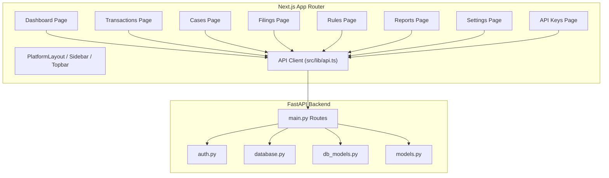
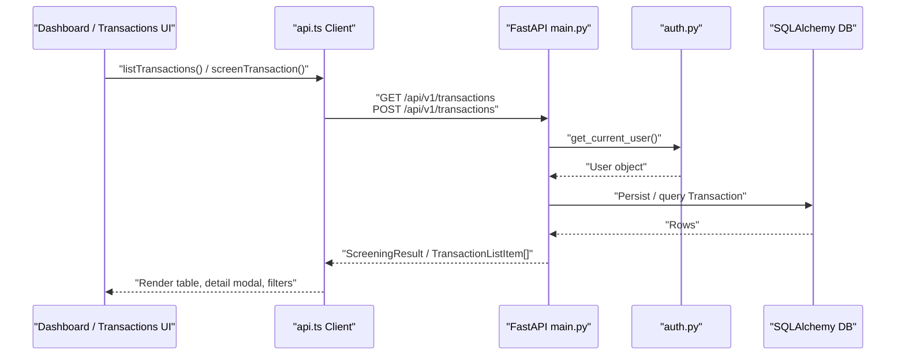
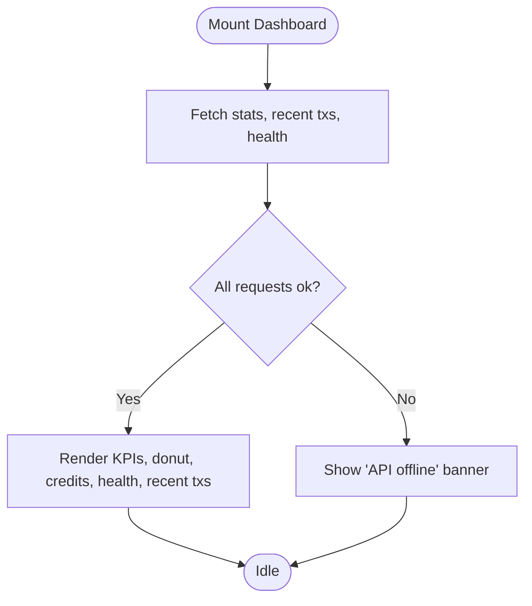
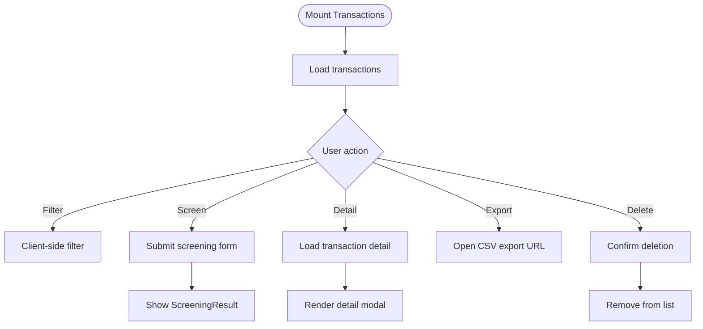
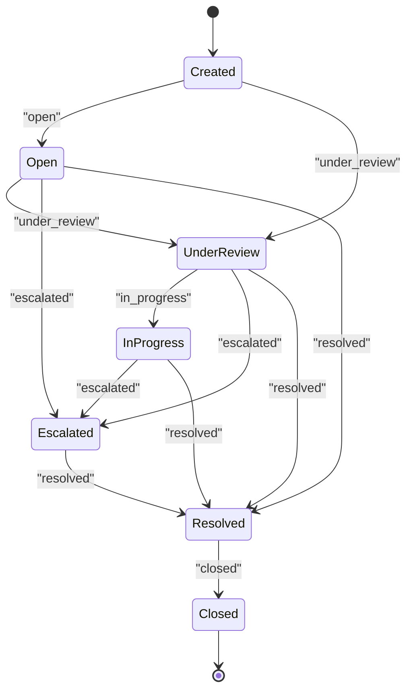
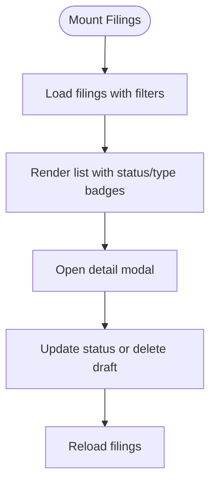
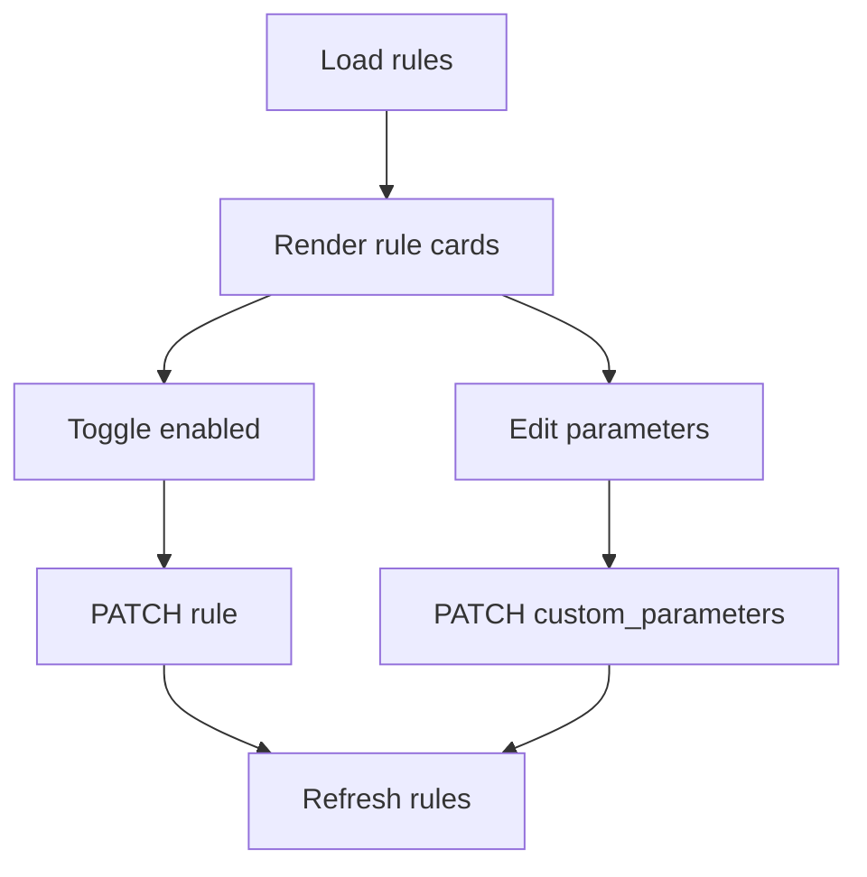
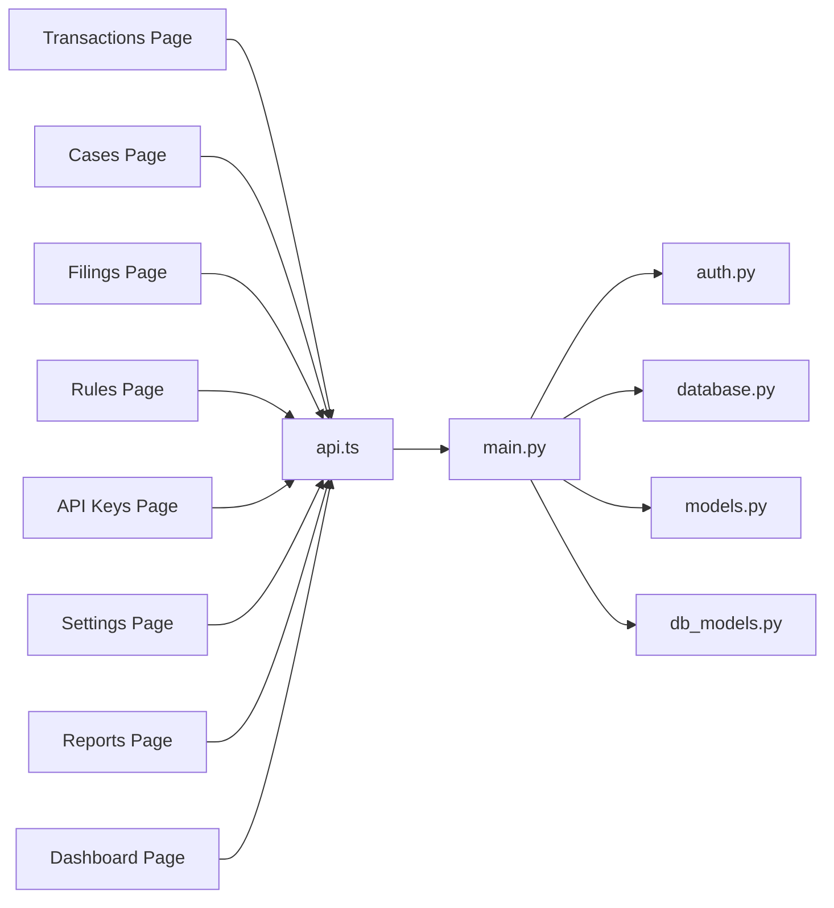

# Dashboard & Feature Pages

<cite>
**Referenced Files in This Document**   
- [page.tsx](file://platform-app/src/app/dashboard/page.tsx)
- [page.tsx](file://platform-app/src/transactions/page.tsx)
- [page.tsx](file://platform-app/src/cases/page.tsx)
- [page.tsx](file://platform-app/src/filings/page.tsx)
- [page.tsx](file://platform-app/src/rules/page.tsx)
- [page.tsx](file://platform-app/src/reports/page.tsx)
- [page.tsx](file://platform-app/src/settings/page.tsx)
- [page.tsx](file://platform-app/src/api-keys/page.tsx)
- [api.ts](file://platform-app/src/lib/api.ts)
- [models.py](file://backend/app/models.py)
- [db_models.py](file://backend/app/db_models.py)
- [main.py](file://backend/app/main.py)
- [auth.py](file://backend/app/auth.py)
- [database.py](file://backend/app/database.py)
</cite>

## Table of Contents
1. [Introduction](#introduction)
2. [Project Structure](#project-structure)
3. [Core Components](#core-components)
4. [Architecture Overview](#architecture-overview)
5. [Detailed Component Analysis](#detailed-component-analysis)
6. [Dependency Analysis](#dependency-analysis)
7. [Performance Considerations](#performance-considerations)
8. [Troubleshooting Guide](#troubleshooting-guide)
9. [Conclusion](#conclusion)

## Introduction
This document describes the FinShield platform dashboard and feature pages implemented in the Next.js application under `platform-app/src/app`. It explains each page’s purpose, data requirements, user interactions, UI state management, data fetching patterns, error handling, and loading states. The backend is a FastAPI service exposing `/api/v1/*` endpoints for transactions, cases, filings, rules, API keys, billing, notifications, and analytics. Authentication uses JWT bearer tokens or API keys, and persistence defaults to SQLite unless `DATABASE_URL` points to PostgreSQL.

Important context:
- The shipped stack is FastAPI, Uvicorn, Pydantic 2, SQLAlchemy 2, psycopg2-binary + pgvector, python-jose + bcrypt, slowapi, numpy, pytest.
- Celery, Redis, LangChain, DSPy, LoRA/PEFT/BitsAndBytes, vLLM, RAGAS, HashiCorp Vault, OpenTelemetry, Prometheus, structlog, and Kubernetes/Helm are roadmap-only; they are not present in the current repository.
- Persistence defaults to SQLite (`finshield.db`) and uses PostgreSQL only when `DATABASE_URL` is set.
- Detection logic is implemented through the rule/gating engine and optional pgvector RAG retrieval seeded by the seed script.

## Project Structure
The relevant frontend routes are:
- `dashboard` — overview metrics, system health, recent transactions, credit usage.
- `transactions` — screening form, transaction list, detail modal, filtering, export.
- `cases` — case creation, status grouping, assignment, comments, lifecycle transitions.
- `filings` — SAR/STR draft management, status workflow, deadline tracking.
- `rules` — hard compliance rule configuration, enable/disable, parameter editing.
- `reports` — aggregated analytics from stats.
- `settings` — profile, notifications, security, billing tabs.
- `api-keys` — API key creation, listing, revocation, quick start example.

**Diagram sources**
- [page.tsx](file://platform-app/src/dashboard/page.tsx)
- [page.tsx](file://platform-app/src/transactions/page.tsx)
- [page.tsx](file://platform-app/src/cases/page.tsx)
- [page.tsx](file://platform-app/src/filings/page.tsx)
- [page.tsx](file://platform-app/src/rules/page.tsx)
- [page.tsx](file://platform-app/src/reports/page.tsx)
- [page.tsx](file://platform-app/src/settings/page.tsx)
- [page.tsx](file://platform-app/src/api-keys/page.tsx)
- [api.ts](file://platform-app/src/lib/api.ts)
- [main.py](file://backend/app/main.py)
- [auth.py](file://backend/app/auth.py)
- [database.py](file://backend/app/database.py)
- [db_models.py](file://backend/app/db_models.py)
- [models.py](file://backend/app/models.py)

**Section sources**
- [page.tsx](file://platform-app/src/dashboard/page.tsx)
- [page.tsx](file://platform-app/src/transactions/page.tsx)
- [page.tsx](file://platform-app/src/cases/page.tsx)
- [page.tsx](file://platform-app/src/filings/page.tsx)
- [page.tsx](file://platform-app/src/rules/page.tsx)
- [page.tsx](file://platform-app/src/reports/page.tsx)
- [page.tsx](file://platform-app/src/settings/page.tsx)
- [page.tsx](file://platform-app/src/api-keys/page.tsx)
- [api.ts](file://platform-app/src/lib/api.ts)
- [main.py](file://backend/app/main.py)
- [auth.py](file://backend/app/auth.py)
- [database.py](file://backend/app/database.py)
- [db_models.py](file://backend/app/db_models.py)
- [models.py](file://backend/app/models.py)

## Core Components
- Shared API client: `src/lib/api.ts` centralizes all HTTP calls, token injection, error wrapping, and typed request/response interfaces.
- Layout shell: `PlatformLayout`, `Sidebar`, and `Topbar` provide navigation and authentication-aware chrome.
- Auth context: `AuthContext` supplies the current user and refresh helpers used by settings and dashboard.
- Formatting utilities: `format.ts` provides currency, number, date, timezone, and credit calculations.

Key responsibilities:
- All pages fetch data through `api.*` methods.
- Error messages are surfaced inline per page.
- Loading spinners and empty states are consistent across pages.
- Mutations update local state immediately where possible and refetch on success.

**Section sources**
- [api.ts](file://platform-app/src/lib/api.ts)
- [page.tsx](file://platform-app/src/dashboard/page.tsx)
- [page.tsx](file://platform-app/src/settings/page.tsx)

## Architecture Overview
The frontend pages call FastAPI endpoints under `/api/v1/*`. Authentication is enforced via JWT bearer tokens or API keys. Transactions flow through the compliance engine, persist results, and optionally enrich with RAG context. Cases, filings, rules, and API keys are persisted through SQLAlchemy models.

**Diagram sources**
- [api.ts](file://platform-app/src/lib/api.ts)
- [main.py](file://backend/app/main.py)
- [auth.py](file://backend/app/auth.py)
- [db_models.py](file://backend/app/db_models.py)

## Detailed Component Analysis

### Dashboard Page
Purpose:
- Provide an overview of screened transactions, system health, credit usage, and recent activity.

Data requirements:
- Stats: total transactions, approved, flagged, blocked, in review, open cases, average risk score, credits used.
- Recent transactions: up to six items with amount, parties, status, risk score, timestamp.
- Health: overall status, version, services, uptime.

User interactions:
- View KPI cards, donut breakdown, credit usage progress bar, system health indicators.
- Navigate to transactions or settings.

UI state and behavior:
- Loads stats, recent transactions, and health concurrently.
- Shows spinner while loading.
- Displays error banner if API is unreachable.
- Uses user profile first name and credit calculation.

Error handling:
- Sets a user-facing error message and disables live health indicator when fetch fails.

Loading states:
- Global spinner during initial load.
- Empty state guidance when no transactions exist.

**Diagram sources**
- [page.tsx](file://platform-app/src/dashboard/page.tsx)
- [api.ts](file://platform-app/src/lib/api.ts)

**Section sources**
- [page.tsx](file://platform-app/src/dashboard/page.tsx)
- [api.ts](file://platform-app/src/lib/api.ts)

### Transactions Page
Purpose:
- Screen new transactions, view and filter results, inspect detailed rule evaluation and ML signals, delete records, and export CSV.

Data requirements:
- List: transaction id, amount, currency, sender, receiver, status, risk score, credit tier, created_at.
- Detail: full fields including rule_results, behavioral_score, ml_classification, pipeline_stages, rag_context.
- Export endpoint URL builder supports optional start_date and end_date.

User interactions:
- Toggle “Screen New” form and submit screening.
- Filter by status: all, approved, flagged, blocked, in_review.
- Open detail modal to inspect rule hits, ML scores, pipeline stages, and RAG context.
- Delete transactions after confirmation.
- Open export modal and download CSV.

UI state and behavior:
- Local filter state applied client-side.
- Screening result shown inline with status, risk, tier, latency, and pipeline stages.
- Detail modal loads asynchronously and shows rule evaluation results.
- Export opens a new window to the CSV endpoint.

Error handling:
- Errors from list, detail, delete, and screening are captured and displayed.

Loading states:
- Spinner for initial list load.
- Spinner inside detail modal while loading rule results.

**Diagram sources**
- [page.tsx](file://platform-app/src/transactions/page.tsx)
- [api.ts](file://platform-app/src/lib/api.ts)

**Section sources**
- [page.tsx](file://platform-app/src/transactions/page.tsx)
- [api.ts](file://platform-app/src/lib/api.ts)

### Cases Page
Purpose:
- Investigate and manage compliance cases linked to transactions.

Data requirements:
- Case list: case_id, transaction_id, status, priority, reason, assigned_to, timestamps.
- Available transactions for case creation.
- Case comments: body, author, timestamp.

User interactions:
- Create a case with transaction selection, reason, and priority.
- Group statuses into buckets: open, escalated, resolved.
- Manage a selected case: update status within allowed transitions, assign investigator, add comments.
- Delete cases.

UI state and behavior:
- Status transition matrix restricts next states based on current status.
- Comments loaded per case and appended after posting.
- Refreshes case list after mutations.

Error handling:
- Creation, deletion, update, and comment posting errors are caught and surfaced.

Loading states:
- Spinner for initial load and comment loading.

**Diagram sources**
- [page.tsx](file://platform-app/src/cases/page.tsx)

**Section sources**
- [page.tsx](file://platform-app/src/cases/page.tsx)
- [api.ts](file://platform-app/src/lib/api.ts)

### Filings Page
Purpose:
- Manage SAR/STR drafts and track regulatory submission status and deadlines.

Data requirements:
- Filings: id, case_id, filing_type, status, deadline, narrative, structured_data, reference_number, timestamps.

User interactions:
- Filter by status and filing type.
- View details, update status through workflow: draft → under_review → submitted → confirmed.
- Delete draft filings.

UI state and behavior:
- Deadline urgency badges: overdue and due soon.
- Detail modal exposes narrative and structured data.
- Actions change according to current status.

Error handling:
- Listing and updating failures are logged; UI remains usable.

Loading states:
- Spinner while loading filings.

**Diagram sources**
- [page.tsx](file://platform-app/src/filings/page.tsx)
- [api.ts](file://platform-app/src/lib/api.ts)

**Section sources**
- [page.tsx](file://platform-app/src/filings/page.tsx)
- [api.ts](file://platform-app/src/lib/api.ts)

### Rules Page
Purpose:
- Configure hard compliance rules evaluated before the ML pipeline.

Data requirements:
- Rule definitions: rule_id, rule_type, name, description, enabled, action, parameters, metadata, customization flag.

User interactions:
- Toggle rules on/off.
- Edit parameters for editable rules.
- View active count.

UI state and behavior:
- Immediate optimistic toggle with server confirmation.
- Edit modal parses inputs to numbers or arrays where appropriate.

Error handling:
- Toggle and save errors are shown.

Loading states:
- Spinner while loading rules.

**Diagram sources**
- [page.tsx](file://platform-app/src/rules/page.tsx)
- [api.ts](file://platform-app/src/lib/api.ts)

**Section sources**
- [page.tsx](file://platform-app/src/rules/page.tsx)
- [api.ts](file://platform-app/src/lib/api.ts)

### Reports Page
Purpose:
- Display compliance analytics derived from stats.

Data requirements:
- Stats: total_transactions, approved, flagged, in_review, blocked, avg_risk_score, credits_used, open_cases.

User interactions:
- Review summary metrics and decision breakdown bars.
- Read risk posture commentary.

UI state and behavior:
- Single stats fetch on mount.
- Percentage calculations computed client-side.

Error handling:
- Error banner on failure.

Loading states:
- Spinner while generating report.

**Section sources**
- [page.tsx](file://platform-app/src/reports/page.tsx)
- [api.ts](file://platform-app/src/lib/api.ts)

### Settings Page
Purpose:
- Manage profile, notification preferences, security, and billing.

Data requirements:
- Profile: names, company, timezone, member since.
- Notifications: boolean toggles for email alerts.
- Billing: plans, subscription, credit packs, saved payment method.

User interactions:
- Update profile and timezone.
- Toggle notification preferences.
- Change password.
- Subscribe/downgrade plans, purchase credits, save/remove payment method.

UI state and behavior:
- Tabbed interface driven by URL search params.
- Flash messages for success/error feedback.
- Billing tab includes multiple modals for plan changes, checkout, and card management.

Error handling:
- Validation and API errors surfaced as flash messages.

Loading states:
- Spinner for preferences and plan loading.
- Suspense fallback around settings content.

**Section sources**
- [page.tsx](file://platform-app/src/settings/page.tsx)
- [api.ts](file://platform-app/src/lib/api.ts)

### API Keys Page
Purpose:
- Create, list, copy, and revoke API keys for programmatic access.

Data requirements:
- Key list: id, name, key_prefix, is_active, created_at, last_used_at.
- Newly created key payload includes full key once.

User interactions:
- Create a named key and copy it immediately.
- Revoke active keys.
- Use quick-start cURL example.

UI state and behavior:
- One-time display of full key after creation.
- Copy-to-clipboard feedback.

Error handling:
- Creation and revocation errors shown inline.

Loading states:
- Spinner while loading keys.

**Section sources**
- [page.tsx](file://platform-app/src/api-keys/page.tsx)
- [api.ts](file://platform-app/src/lib/api.ts)

## Dependency Analysis
Frontend dependencies:
- Each page depends on `api.ts` for typed requests and error handling.
- Dashboard and reports depend on stats; transactions depend on transaction CRUD and export; cases depend on case CRUD and comments; filings depend on filing CRUD; rules depend on rule CRUD; api-keys depend on key CRUD; settings depends on auth, notifications, and billing endpoints.

Backend dependencies:
- `main.py` mounts routes for auth, API keys, transactions, cases, filings, rules, stats, and more.
- `auth.py` enforces JWT and API key authentication.
- `database.py` configures SQLite by default and PostgreSQL when `DATABASE_URL` is set.
- `db_models.py` defines ORM entities for users, transactions, cases, filings, rules, notes, and related tables.
- `models.py` defines Pydantic schemas for requests and responses.

**Diagram sources**
- [page.tsx](file://platform-app/src/transactions/page.tsx)
- [page.tsx](file://platform-app/src/cases/page.tsx)
- [page.tsx](file://platform-app/src/filings/page.tsx)
- [page.tsx](file://platform-app/src/rules/page.tsx)
- [page.tsx](file://platform-app/src/api-keys/page.tsx)
- [page.tsx](file://platform-app/src/settings/page.tsx)
- [page.tsx](file://platform-app/src/reports/page.tsx)
- [page.tsx](file://platform-app/src/dashboard/page.tsx)
- [api.ts](file://platform-app/src/lib/api.ts)
- [main.py](file://backend/app/main.py)
- [auth.py](file://backend/app/auth.py)
- [database.py](file://backend/app/database.py)
- [models.py](file://backend/app/models.py)
- [db_models.py](file://backend/app/db_models.py)

**Section sources**
- [api.ts](file://platform-app/src/lib/api.ts)
- [main.py](file://backend/app/main.py)
- [auth.py](file://backend/app/auth.py)
- [database.py](file://backend/app/database.py)
- [models.py](file://backend/app/models.py)
- [db_models.py](file://backend/app/db_models.py)

## Performance Considerations
- Concurrent fetches: Dashboard loads stats, recent transactions, and health in parallel to reduce perceived latency.
- Client-side filtering: Transactions and cases apply lightweight filters locally to avoid extra network calls.
- Pagination: Transaction list uses limit/offset; consider increasing limit for bulk operations or adding pagination controls.
- Export: CSV export streams directly from the backend; large datasets may take time but do not block the UI.
- RAG enrichment: Optional and non-blocking; screening completes even if RAG retrieval fails.

[No sources needed since this section provides general guidance]

## Troubleshooting Guide
Common issues and resolutions:
- Dashboard shows “API offline”:
  - Ensure the backend is running and reachable at the expected port.
  - Verify CORS origins include the frontend origin.
- Authentication errors:
  - Confirm JWT token or API key is present and valid.
  - Check that the account is active and not expired.
- Transaction screening fails:
  - Validate required fields and amounts.
  - Check trial expiry and credit balance.
- RAG-related features missing:
  - RAG requires PostgreSQL with pgvector and proper environment variables; otherwise, screening still works without RAG context.
- Database connectivity:
  - Default SQLite file is `finshield.db`; tests use `test_finshield.db`.
  - Set `DATABASE_URL` to a PostgreSQL connection string to enable pgvector-dependent features.

**Section sources**
- [page.tsx](file://platform-app/src/dashboard/page.tsx)
- [auth.py](file://backend/app/auth.py)
- [main.py](file://backend/app/main.py)
- [database.py](file://backend/app/database.py)

## Conclusion
FinShield’s dashboard and feature pages provide a cohesive compliance workspace:
- Dashboard offers real-time overview and system health.
- Transactions support screening, inspection, filtering, and export.
- Cases enable investigation workflows with clear state transitions and collaboration via comments.
- Filings streamline SAR/STR drafting and submission tracking.
- Rules allow operational control over deterministic compliance checks.
- Reports summarize performance and risk posture.
- Settings centralize account, notification, security, and billing configuration.
- API keys enable secure programmatic access.

All pages follow consistent patterns for state management, data fetching, error handling, and loading states, backed by a well-defined FastAPI backend and typed API client.

[No sources needed since this section summarizes without analyzing specific files]