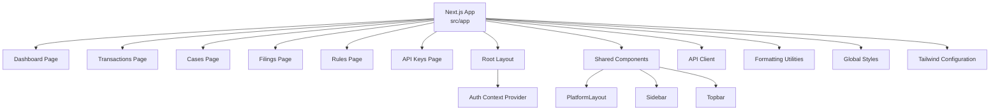
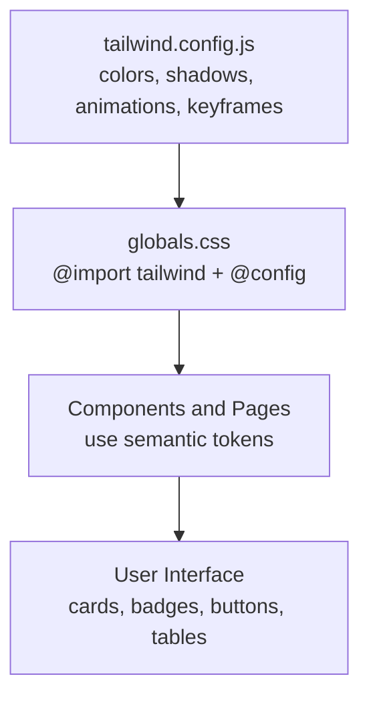
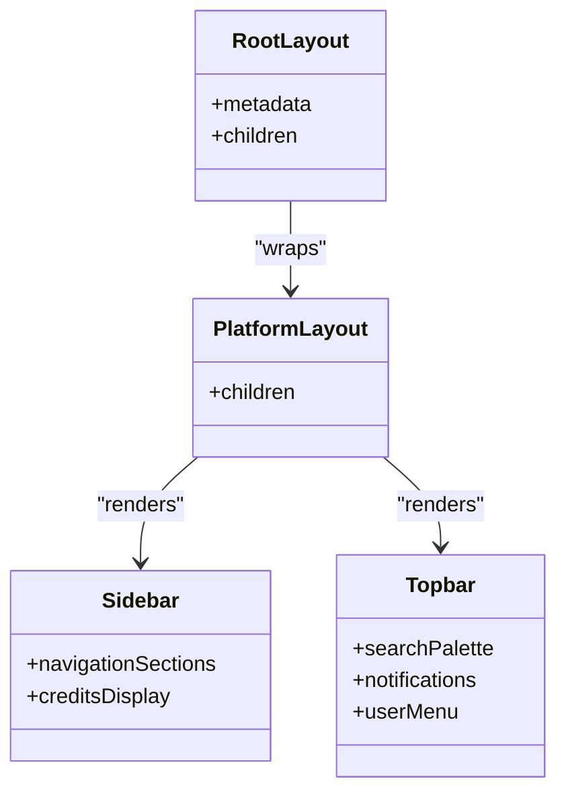
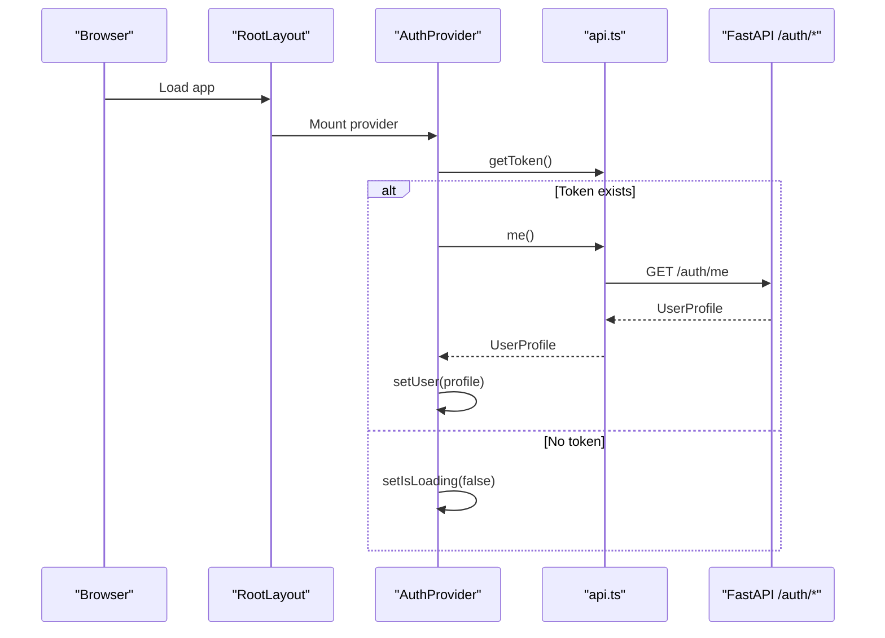
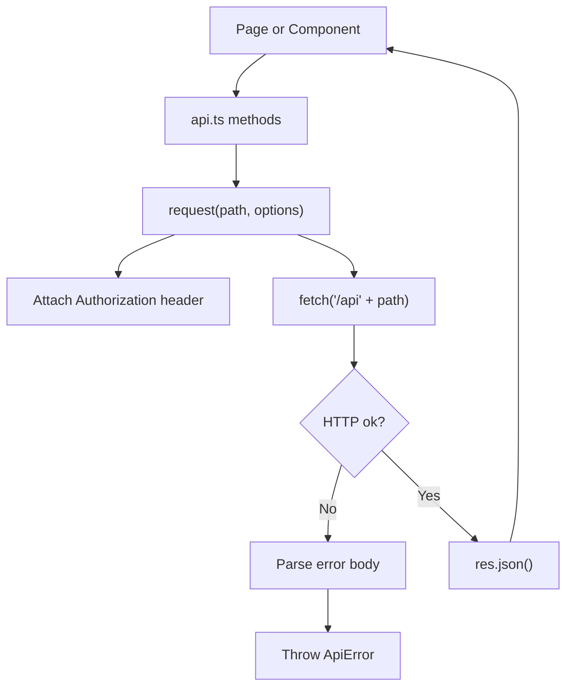
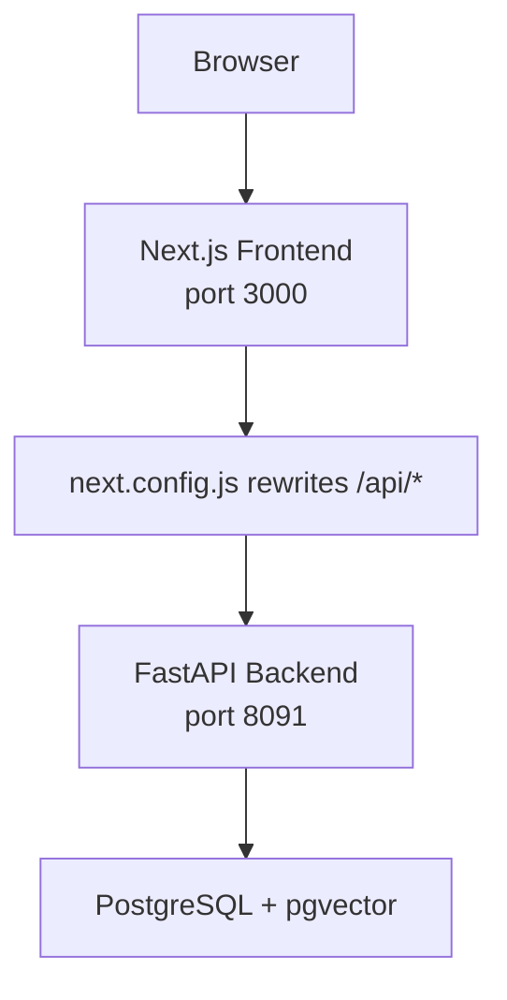
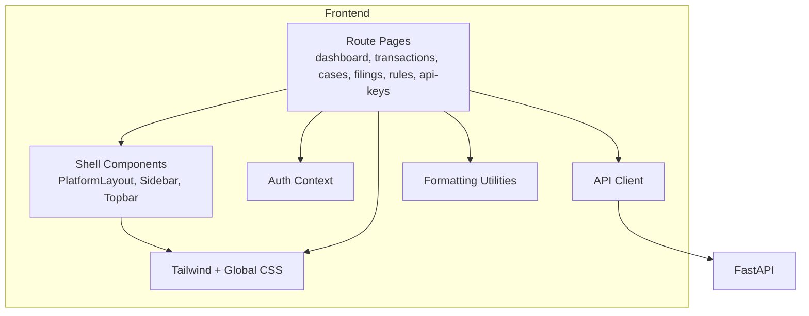
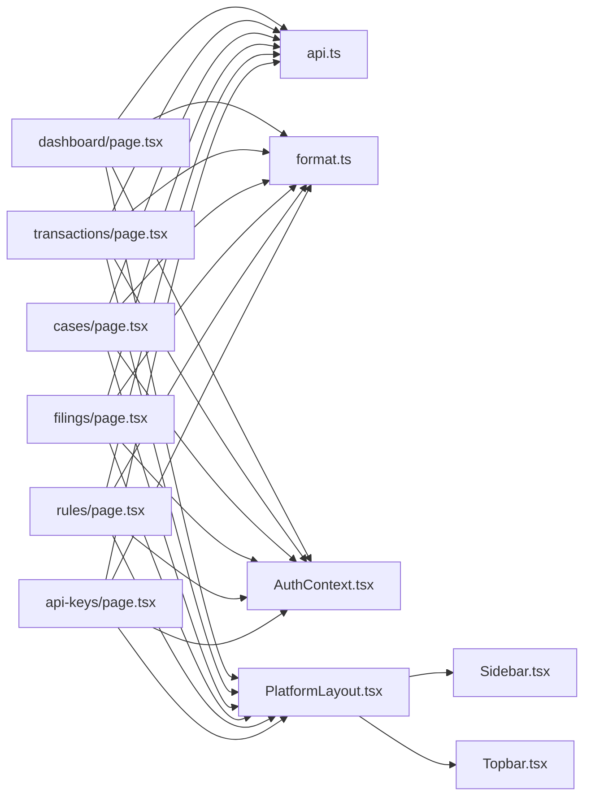

# Frontend Design System

<cite>
**Referenced Files in This Document**
- [platform-app/package.json](file://platform-app/package.json)
- [platform-app/DESIGN.md](file://platform-app/DESIGN.md)
- [platform-app/tailwind.config.js](file://platform-app/tailwind.config.js)
- [platform-app/globals.css](file://platform-app/src/app/globals.css)
- [platform-app/next.config.js](file://platform-app/next.config.js)
- [platform-app/layout.tsx](file://platform-app/src/app/layout.tsx)
- [platform-app/AuthContext.tsx](file://platform-app/src/contexts/AuthContext.tsx)
- [platform-app/api.ts](file://platform-app/src/lib/api.ts)
- [platform-app/format.ts](file://platform-app/src/lib/format.ts)
- [platform-app/PlatformLayout.tsx](file://platform-app/src/components/PlatformLayout.tsx)
- [platform-app/Sidebar.tsx](file://platform-app/src/components/Sidebar.tsx)
- [platform-app/Topbar.tsx](file://platform-app/src/components/Topbar.tsx)
- [platform-app/dashboard/page.tsx](file://platform-app/src/app/dashboard/page.tsx)
- [platform-app/transactions/page.tsx](file://platform-app/src/app/transactions/page.tsx)
- [platform-app/cases/page.tsx](file://platform-app/src/app/cases/page.tsx)
- [platform-app/filings/page.tsx](file://platform-app/src/app/filings/page.tsx)
- [platform-app/rules/page.tsx](file://platform-app/src/app/rules/page.tsx)
- [platform-app/api-keys/page.tsx](file://platform-app/src/app/api-keys/page.tsx)
- [docker-compose.yml](file://docker-compose.yml)
</cite>

## Table of Contents
1. [Introduction](#introduction)
2. [Project Structure](#project-structure)
3. [Design Tokens and Visual Language](#design-tokens-and-visual-language)
4. [Application Shell and Layout](#application-shell-and-layout)
5. [Shared Components](#shared-components)
6. [Authentication and Session Flow](#authentication-and-session-flow)
7. [API Client and Data Contracts](#api-client-and-data-contracts)
8. [Feature Pages](#feature-pages)
9. [Routing, Rewrites, and Deployment Integration](#routing-rewrites-and-deployment-integration)
10. [Architecture Overview](#architecture-overview)
11. [Dependency Analysis](#dependency-analysis)
12. [Performance Considerations](#performance-considerations)
13. [Troubleshooting Guide](#troubleshooting-guide)
14. [Conclusion](#conclusion)

## Introduction
This document describes the FinShield frontend design system implemented in `platform-app/`. It is a Next.js 14 App Router dashboard built with React, TypeScript, and Tailwind CSS. The design system defines shared tokens, layout conventions, reusable components, authentication context, API client contracts, formatting utilities, and feature pages for transactions, cases, filings, rules, and API keys.

The shipped stack uses FastAPI for the backend, PostgreSQL with pgvector for persistence, and a static or standalone Next.js frontend. The marketing site under `website/` is separate from the platform dashboard and is not part of this design system.

## Project Structure
The frontend lives under `platform-app/`:
- `src/app/` contains route folders for each page.
- `src/components/` contains shared shell components: `PlatformLayout`, `Sidebar`, and `Topbar`.
- `src/contexts/AuthContext.tsx` provides user session state.
- `src/lib/api.ts` centralizes all backend calls and type definitions.
- `src/lib/format.ts` provides locale-, timezone-, and currency-aware formatting.
- `tailwind.config.js` extends Tailwind with brand colors, shadows, animations, and keyframes.
- `src/app/globals.css` imports Tailwind v4 configuration and defines global styles, glass cards, status badges, animations, and typography defaults.
- `next.config.js` configures standalone output and rewrites `/api/*` to the backend.

**Diagram sources**
- [platform-app/layout.tsx:10-25](file://platform-app/src/app/layout.tsx#L10-L25)
- [platform-app/PlatformLayout.tsx:7-19](file://platform-app/src/components/PlatformLayout.tsx#L7-L19)
- [platform-app/Sidebar.tsx:103-183](file://platform-app/src/components/Sidebar.tsx#L103-L183)
- [platform-app/Topbar.tsx:231-340](file://platform-app/src/components/Topbar.tsx#L231-L340)
- [platform-app/api.ts:420-630](file://platform-app/src/lib/api.ts#L420-L630)
- [platform-app/format.ts:1-149](file://platform-app/src/lib/format.ts#L1-L149)
- [platform-app/globals.css:1-110](file://platform-app/src/app/globals.css#L1-L110)
- [platform-app/tailwind.config.js:1-51](file://platform-app/tailwind.config.js#L1-L51)

**Section sources**
- [platform-app/package.json:1-30](file://platform-app/package.json#L1-L30)
- [platform-app/DESIGN.md:1-156](file://platform-app/DESIGN.md#L1-L156)
- [platform-app/tailwind.config.js:1-51](file://platform-app/tailwind.config.js#L1-L51)
- [platform-app/globals.css:1-110](file://platform-app/src/app/globals.css#L1-L110)
- [platform-app/next.config.js:1-18](file://platform-app/next.config.js#L1-L18)

## Design Tokens and Visual Language
The design system is token-driven through Tailwind and global CSS:
- Colors include warm neutrals, surface variants, border tones, ink text levels, brand accents, teal, navy, and semantic success/warning/danger/info states.
- Typography uses Inter as the primary font and JetBrains Mono/Fira Code for monospace identifiers.
- Shadows are defined as card, card-lg, card-xl, and dropdown tokens.
- Animations include fade-in-up and slide-in with delay utilities.
- Global CSS defines `.glass`, `.glass-hover`, `.glass-strong`, status badge classes, focus rings, scrollbar styling, and link defaults.

These tokens are declared in `tailwind.config.js` and referenced via Tailwind utility classes. `globals.css` loads the Tailwind configuration using the `@config` directive and adds component-level CSS.

**Diagram sources**
- [platform-app/tailwind.config.js:8-47](file://platform-app/tailwind.config.js#L8-L47)
- [platform-app/globals.css:1-110](file://platform-app/src/app/globals.css#L1-L110)

**Section sources**
- [platform-app/DESIGN.md:5-147](file://platform-app/DESIGN.md#L5-L147)
- [platform-app/tailwind.config.js:1-51](file://platform-app/tailwind.config.js#L1-L51)
- [platform-app/globals.css:1-110](file://platform-app/src/app/globals.css#L1-L110)

## Application Shell and Layout
The root layout sets metadata, loads Inter and JetBrains Mono fonts, and wraps every route in `AuthProvider`. `PlatformLayout` renders a fixed sidebar, sticky topbar, and scrollable main content area. The sidebar groups navigation into Overview, Compliance, Developer, and Account sections. The topbar includes search, notifications, trial badge, credits display, user menu, and logout.

**Diagram sources**
- [platform-app/layout.tsx:5-25](file://platform-app/src/app/layout.tsx#L5-L25)
- [platform-app/PlatformLayout.tsx:7-19](file://platform-app/src/components/PlatformLayout.tsx#L7-L19)
- [platform-app/Sidebar.tsx:9-39](file://platform-app/src/components/Sidebar.tsx#L9-L39)
- [platform-app/Topbar.tsx:231-340](file://platform-app/src/components/Topbar.tsx#L231-L340)

**Section sources**
- [platform-app/layout.tsx:1-26](file://platform-app/src/app/layout.tsx#L1-L26)
- [platform-app/PlatformLayout.tsx:1-20](file://platform-app/src/components/PlatformLayout.tsx#L1-L20)
- [platform-app/Sidebar.tsx:1-184](file://platform-app/src/components/Sidebar.tsx#L1-L184)
- [platform-app/Topbar.tsx:1-341](file://platform-app/src/components/Topbar.tsx#L1-L341)

## Shared Components
### Sidebar
The sidebar renders grouped navigation links, highlights the active route, shows versioning, displays trial status, and presents credit usage with a progress bar. It reads user data from `useAuth()` and formats numbers and timezones through `@/lib/format`.

Key responsibilities:
- Navigation grouping and active-state detection.
- Trial badge and credit progress visualization.
- Consistent dark brand panel styling.

**Section sources**
- [platform-app/Sidebar.tsx:9-39](file://platform-app/src/components/Sidebar.tsx#L9-L39)
- [platform-app/Sidebar.tsx:90-101](file://platform-app/src/components/Sidebar.tsx#L90-L101)
- [platform-app/Sidebar.tsx:103-183](file://platform-app/src/components/Sidebar.tsx#L103-L183)

### Topbar
The topbar implements:
- Command palette-style search that queries `api.search`.
- Notification dropdown with unread count, mark-as-read, and mark-all-read.
- Trial countdown badge.
- Credits display and timezone label.
- User avatar, name, company, and logout.

It also registers keyboard shortcuts (`Cmd/Ctrl+K` for search, `Escape` to close overlays).

**Section sources**
- [platform-app/Topbar.tsx:11-120](file://platform-app/src/components/Topbar.tsx#L11-L120)
- [platform-app/Topbar.tsx:122-200](file://platform-app/src/components/Topbar.tsx#L122-L200)
- [platform-app/Topbar.tsx:210-228](file://platform-app/src/components/Topbar.tsx#L210-L228)
- [platform-app/Topbar.tsx:231-340](file://platform-app/src/components/Topbar.tsx#L231-L340)

## Authentication and Session Flow
`AuthContext.tsx` manages:
- Loading state while checking for an existing token.
- Login and signup flows that store JWTs and fetch the full user profile.
- Logout that clears stored tokens and redirects to `/login`.
- Profile refresh on mount and explicit refresh.

**Diagram sources**
- [platform-app/layout.tsx:10-25](file://platform-app/src/app/layout.tsx#L10-L25)
- [platform-app/AuthContext.tsx:18-40](file://platform-app/src/contexts/AuthContext.tsx#L18-L40)
- [platform-app/api.ts:420-438](file://platform-app/src/lib/api.ts#L420-L438)

**Section sources**
- [platform-app/AuthContext.tsx:1-107](file://platform-app/src/contexts/AuthContext.tsx#L1-L107)
- [platform-app/api.ts:357-438](file://platform-app/src/lib/api.ts#L357-L438)

## API Client and Data Contracts
`api.ts` is the single source of truth for frontend-backend communication:
- Centralized `request` function attaches JSON headers and Bearer tokens.
- Error handling parses backend responses and throws `ApiError`.
- Typed interfaces cover auth, transactions, cases, filings, rules, search, notifications, billing, and API keys.
- Methods map directly to backend endpoints such as `/auth/register`, `/auth/login`, `/v1/transactions`, `/v1/cases`, `/v1/filings`, `/v1/rules`, `/v1/keys`, and more.

**Diagram sources**
- [platform-app/api.ts:372-417](file://platform-app/src/lib/api.ts#L372-L417)
- [platform-app/api.ts:420-630](file://platform-app/src/lib/api.ts#L420-L630)

**Section sources**
- [platform-app/api.ts:1-631](file://platform-app/src/lib/api.ts#L1-L631)

## Feature Pages
### Dashboard
The dashboard aggregates stats, recent transactions, health status, and credit usage. It uses `api.getStats`, `api.listTransactions`, and `api.health`, then renders KPI cards, a conic-gradient donut chart, and a recent transactions table.

**Section sources**
- [platform-app/dashboard/page.tsx:17-43](file://platform-app/src/app/dashboard/page.tsx#L17-L43)
- [platform-app/dashboard/page.tsx:87-187](file://platform-app/src/app/dashboard/page.tsx#L87-L187)
- [platform-app/dashboard/page.tsx:189-269](file://platform-app/src/app/dashboard/page.tsx#L189-L269)

### Transactions
The transactions page supports:
- Listing and filtering by status.
- Screening new transactions.
- Viewing detailed rule results, ML signals, pipeline stages, and RAG context.
- Deleting transactions and exporting CSV.

It demonstrates explainability UI patterns: rule hit badges, latency display, confidence bars, and retrieved context sections.

**Section sources**
- [platform-app/transactions/page.tsx:17-71](file://platform-app/src/app/transactions/page.tsx#L17-L71)
- [platform-app/transactions/page.tsx:136-199](file://platform-app/src/app/transactions/page.tsx#L136-L199)
- [platform-app/transactions/page.tsx:288-527](file://platform-app/src/app/transactions/page.tsx#L288-L527)
- [platform-app/transactions/page.tsx:529-585](file://platform-app/src/app/transactions/page.tsx#L529-L585)

### Cases
The cases page provides:
- Case listing with grouped filters.
- Case creation linked to a transaction.
- A management modal enforcing valid status transitions.
- Assignment, comments, and deletion.

**Section sources**
- [platform-app/cases/page.tsx:25-48](file://platform-app/src/app/cases/page.tsx#L25-L48)
- [platform-app/cases/page.tsx:50-109](file://platform-app/src/app/cases/page.tsx#L50-L109)
- [platform-app/cases/page.tsx:132-172](file://platform-app/src/app/cases/page.tsx#L132-L172)
- [platform-app/cases/page.tsx:259-415](file://platform-app/src/app/cases/page.tsx#L259-L415)

### Filings
The filings page lists SAR/STR filings, supports status and type filters, shows deadline urgency, and allows viewing details and updating filing status.

**Section sources**
- [platform-app/filings/page.tsx:21-43](file://platform-app/src/app/filings/page.tsx#L21-L43)
- [platform-app/filings/page.tsx:71-199](file://platform-app/src/app/filings/page.tsx#L71-L199)
- [platform-app/filings/page.tsx:201-347](file://platform-app/src/app/filings/page.tsx#L201-L347)

### Rules
The rules page lists hard compliance rules, toggles them on/off, and edits parameters when allowed. It communicates with `api.listRules` and `api.updateRule`.

**Section sources**
- [platform-app/rules/page.tsx:14-33](file://platform-app/src/app/rules/page.tsx#L14-L33)
- [platform-app/rules/page.tsx:35-56](file://platform-app/src/app/rules/page.tsx#L35-L56)
- [platform-app/rules/page.tsx:58-147](file://platform-app/src/app/rules/page.tsx#L58-L147)
- [platform-app/rules/page.tsx:150-207](file://platform-app/src/app/rules/page.tsx#L150-L207)

### API Keys
The API keys page creates, lists, revokes, and copies API keys. It shows the newly created key only once and includes a quick-start example.

**Section sources**
- [platform-app/api-keys/page.tsx:8-30](file://platform-app/src/app/api-keys/page.tsx#L8-L30)
- [platform-app/api-keys/page.tsx:32-62](file://platform-app/src/app/api-keys/page.tsx#L32-L62)
- [platform-app/api-keys/page.tsx:64-185](file://platform-app/src/app/api-keys/page.tsx#L64-L185)

## Routing, Rewrites, and Deployment Integration
The frontend runs on port 3000 and rewrites `/api/*` requests to the backend. In Docker Compose, `API_URL` points to the backend service, while `NEXT_PUBLIC_API_URL` is used for development. The compose file defines three services: `postgres`, `backend`, and `frontend`.

**Diagram sources**
- [platform-app/next.config.js:2-14](file://platform-app/next.config.js#L2-L14)
- [docker-compose.yml:1-78](file://docker-compose.yml#L1-L78)

**Section sources**
- [platform-app/next.config.js:1-18](file://platform-app/next.config.js#L1-L18)
- [docker-compose.yml:1-78](file://docker-compose.yml#L1-L78)

## Architecture Overview
The frontend architecture separates concerns across routes, shared components, context, API client, and formatting utilities. All user-facing screens use the same visual language and rely on typed API contracts.

**Diagram sources**
- [platform-app/layout.tsx:10-25](file://platform-app/src/app/layout.tsx#L10-L25)
- [platform-app/PlatformLayout.tsx:7-19](file://platform-app/src/components/PlatformLayout.tsx#L7-L19)
- [platform-app/Sidebar.tsx:103-183](file://platform-app/src/components/Sidebar.tsx#L103-L183)
- [platform-app/Topbar.tsx:231-340](file://platform-app/src/components/Topbar.tsx#L231-L340)
- [platform-app/AuthContext.tsx:18-107](file://platform-app/src/contexts/AuthContext.tsx#L18-L107)
- [platform-app/api.ts:420-630](file://platform-app/src/lib/api.ts#L420-L630)
- [platform-app/format.ts:1-149](file://platform-app/src/lib/format.ts#L1-L149)
- [platform-app/tailwind.config.js:1-51](file://platform-app/tailwind.config.js#L1-L51)
- [platform-app/globals.css:1-110](file://platform-app/src/app/globals.css#L1-L110)

## Dependency Analysis
The frontend has clear layering:
- Pages depend on shared components, context, API client, and formatting utilities.
- Shared components depend on context and formatting utilities.
- The API client depends only on browser APIs and backend endpoints.
- Global styles and Tailwind configuration provide cross-cutting visual tokens.

**Diagram sources**
- [platform-app/dashboard/page.tsx:1-269](file://platform-app/src/app/dashboard/page.tsx#L1-L269)
- [platform-app/transactions/page.tsx:1-585](file://platform-app/src/app/transactions/page.tsx#L1-L585)
- [platform-app/cases/page.tsx:1-415](file://platform-app/src/app/cases/page.tsx#L1-L415)
- [platform-app/filings/page.tsx:1-347](file://platform-app/src/app/filings/page.tsx#L1-L347)
- [platform-app/rules/page.tsx:1-207](file://platform-app/src/app/rules/page.tsx#L1-L207)
- [platform-app/api-keys/page.tsx:1-185](file://platform-app/src/app/api-keys/page.tsx#L1-L185)
- [platform-app/PlatformLayout.tsx:1-20](file://platform-app/src/components/PlatformLayout.tsx#L1-L20)
- [platform-app/Sidebar.tsx:1-184](file://platform-app/src/components/Sidebar.tsx#L1-L184)
- [platform-app/Topbar.tsx:1-341](file://platform-app/src/components/Topbar.tsx#L1-L341)
- [platform-app/AuthContext.tsx:1-107](file://platform-app/src/contexts/AuthContext.tsx#L1-L107)
- [platform-app/api.ts:1-631](file://platform-app/src/lib/api.ts#L1-L631)
- [platform-app/format.ts:1-149](file://platform-app/src/lib/format.ts#L1-L149)

**Section sources**
- [platform-app/dashboard/page.tsx:1-269](file://platform-app/src/app/dashboard/page.tsx#L1-L269)
- [platform-app/transactions/page.tsx:1-585](file://platform-app/src/app/transactions/page.tsx#L1-L585)
- [platform-app/cases/page.tsx:1-415](file://platform-app/src/app/cases/page.tsx#L1-L415)
- [platform-app/filings/page.tsx:1-347](file://platform-app/src/app/filings/page.tsx#L1-L347)
- [platform-app/rules/page.tsx:1-207](file://platform-app/src/app/rules/page.tsx#L1-L207)
- [platform-app/api-keys/page.tsx:1-185](file://platform-app/src/app/api-keys/page.tsx#L1-L185)

## Performance Considerations
- Use the existing `Promise.all` pattern on the dashboard to load independent data concurrently.
- Avoid unnecessary re-renders by keeping local state minimal and relying on typed API responses.
- Prefer server-side or build-time configuration where possible; the current rewrite logic selects the backend URL at runtime based on environment variables.
- Keep token storage in `localStorage` consistent with the API client’s helpers.
- Reuse formatting utilities instead of duplicating locale/timezone logic in components.

[No sources needed since this section provides general guidance]

## Troubleshooting Guide
Common issues and resolutions:
- **Frontend cannot reach the backend:** Verify `API_URL` and `NEXT_PUBLIC_API_URL` in the frontend container and ensure `next.config.js` rewrites `/api/*` correctly.
- **Authentication fails after login:** Confirm the backend returns a token and that `api.setToken` stores it; check that `api.me()` succeeds with the stored token.
- **API errors show generic messages:** Inspect `ApiError.status` and the parsed error detail from the backend response.
- **Styles look inconsistent:** Ensure `globals.css` imports Tailwind and the `@config` directive points to `tailwind.config.js`.
- **Docker compose does not start frontend:** Check that `postgres` and `backend` are healthy before `frontend` starts, as configured in `docker-compose.yml`.

**Section sources**
- [platform-app/next.config.js:2-14](file://platform-app/next.config.js#L2-L14)
- [platform-app/api.ts:372-417](file://platform-app/src/lib/api.ts#L372-L417)
- [platform-app/AuthContext.tsx:22-40](file://platform-app/src/contexts/AuthContext.tsx#L22-L40)
- [platform-app/globals.css:1-3](file://platform-app/src/app/globals.css#L1-L3)
- [docker-compose.yml:52-67](file://docker-compose.yml#L52-L67)

## Conclusion
The FinShield frontend design system is a cohesive Next.js application with strong separation between presentation, state, API access, and formatting. Tokens defined in Tailwind and global CSS ensure consistent visuals across pages. Shared components standardize the shell, while typed API contracts make integration with the FastAPI backend predictable. The system is ready for extension through additional route folders, reusable components, and consistent use of the design tokens and API client.

[No sources needed since this section summarizes without analyzing specific files]