# Frontend Platform Application

<cite>
**Referenced Files in This Document**
- [layout.tsx](file://platform-app/src/app/layout.tsx)
- [page.tsx](file://platform-app/src/app/page.tsx)
- [dashboard page.tsx](file://platform-app/src/app/dashboard/page.tsx)
- [login page.tsx](file://platform-app/src/app/login/page.tsx)
- [signup page.tsx](file://platform-app/src/app/signup/page.tsx)
- [PlatformLayout.tsx](file://platform-app/src/components/PlatformLayout.tsx)
- [Sidebar.tsx](file://platform-app/src/components/Sidebar.tsx)
- [Topbar.tsx](file://platform-app/src/components/Topbar.tsx)
- [AuthContext.tsx](file://platform-app/src/contexts/AuthContext.tsx)
- [api.ts](file://platform-app/src/lib/api.ts)
- [format.ts](file://platform-app/src/lib/format.ts)
- [package.json](file://platform-app/package.json)
- [next.config.js](file://platform-app/next.config.js)
- [tailwind.config.js](file://platform-app/tailwind.config.js)
- [postcss.config.js](file://platform-app/postcss.config.js)
- [eslint.config.js](file://platform-app/eslint.config.js)
- [globals.css](file://platform-app/src/app/globals.css)
- [tsconfig.json](file://platform-app/tsconfig.json)
- [Dockerfile](file://platform-app/Dockerfile)
- [docker-compose.yml](file://docker-compose.yml)
</cite>

## Update Summary
**Changes Made**
- Updated version information to reflect Next.js 16.4.3 and React 19.3.1 upgrades
- Added Tailwind CSS v4 migration details with new PostCSS configuration
- Documented ESLint flat config implementation replacing legacy .eslintrc.json
- Updated build process documentation for new toolchain versions
- Added Tailwind v4 syntax migration notes for global styles
- Updated dependency analysis with new package versions

## Table of Contents
1. [Introduction](#introduction)
2. [Project Structure](#project-structure)
3. [Core Components](#core-components)
4. [Architecture Overview](#architecture-overview)
5. [Detailed Component Analysis](#detailed-component-analysis)
6. [Dependency Analysis](#dependency-analysis)
7. [Performance Considerations](#performance-considerations)
8. [Troubleshooting Guide](#troubleshooting-guide)
9. [Conclusion](#conclusion)
10. [Appendices](#appendices)

## Introduction
This document describes the FinShield Next.js 16 frontend platform application located under `platform-app/`. It is a client-side dashboard built with the App Router, React 19, TypeScript, and Tailwind CSS v4. The application provides authenticated access to transaction screening, cases, filings, rules, reports, settings, API keys, documentation, login, and signup flows. All backend communication goes through a centralized API client that manages authentication tokens, request/response types, and error handling.

The upgraded stack for this frontend includes:
- **Next.js 16.4.3** App Router (upgraded from 14.2.15)
- **React 19.3.1** (upgraded from 18.3.1)
- **TypeScript 5.6.3**
- **Tailwind CSS 4.3.3** with PostCSS v4 migration (upgraded from 3.4.13)
- **ESLint 9.0.0** with flat config (replacing legacy .eslintrc.json)
- Docker-based build and deployment via the repository's compose setup

The root layout wraps every route with an authentication provider so session state is available globally. Shared shell components (`PlatformLayout`, `Sidebar`, `Topbar`) provide the navigation, header, search palette, notifications, and user controls. Authentication state is managed by `AuthContext`, which persists JWT tokens in browser local storage and refreshes the user profile on mount.

## Project Structure
The frontend follows the Next.js App Router convention under `src/app/`. Each feature area is a folder containing its own page component. Shared UI logic lives under `src/components`, global session state under `src/contexts`, and shared utilities under `src/lib`.

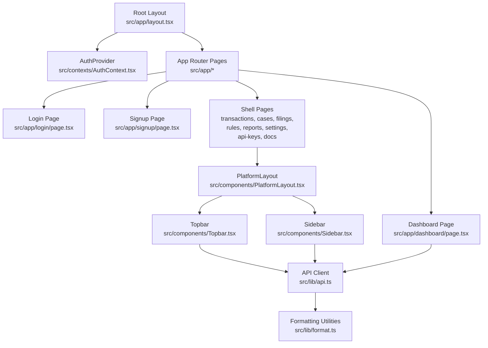

**Diagram sources**
- [layout.tsx:10-25](file://platform-app/src/app/layout.tsx#L10-L25)
- [page.tsx:7-17](file://platform-app/src/app/page.tsx#L7-L17)
- [dashboard page.tsx:17-43](file://platform-app/src/app/dashboard/page.tsx#L17-L43)
- [PlatformLayout.tsx:7-18](file://platform-app/src/components/PlatformLayout.tsx#L7-L18)
- [Sidebar.tsx:103-183](file://platform-app/src/components/Sidebar.tsx#L103-L183)
- [Topbar.tsx:231-337](file://platform-app/src/components/Topbar.tsx#L231-L337)
- [api.ts:357-417](file://platform-app/src/lib/api.ts#L357-L417)
- [format.ts:19-119](file://platform-app/src/lib/format.ts#L19-L119)

**Section sources**
- [layout.tsx:1-26](file://platform-app/src/app/layout.tsx#L1-L26)
- [page.tsx:1-32](file://platform-app/src/app/page.tsx#L1-L32)
- [dashboard page.tsx:1-269](file://platform-app/src/app/dashboard/page.tsx#L1-L269)
- [PlatformLayout.tsx:1-20](file://platform-app/src/components/PlatformLayout.tsx#L1-L20)
- [Sidebar.tsx:1-184](file://platform-app/src/components/Sidebar.tsx#L1-L184)
- [Topbar.tsx:1-341](file://platform-app/src/components/Topbar.tsx#L1-L341)
- [api.ts:1-631](file://platform-app/src/lib/api.ts#L1-L631)
- [format.ts:1-149](file://platform-app/src/lib/format.ts#L1-L149)

## Core Components
The core runtime structure consists of:
- Root layout and routing entry point
- Shared shell layout
- Navigation sidebar
- Header topbar with search and notifications
- Authentication context
- Centralized API client
- Formatting utilities

### Root Layout and Routing Entry Point
The root layout defines metadata, loads global styles, and wraps all routes with `AuthProvider`. The root page redirects authenticated users to `/dashboard` and unauthenticated users to `/login`.

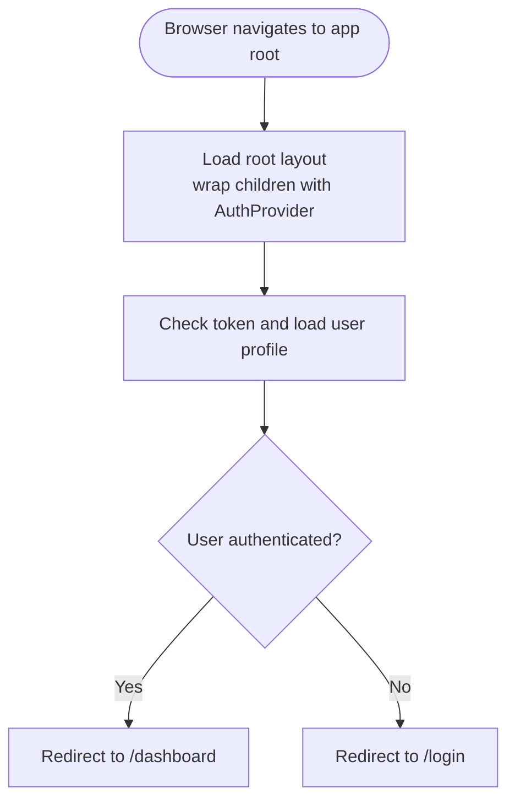

**Diagram sources**
- [layout.tsx:10-25](file://platform-app/src/app/layout.tsx#L10-L25)
- [page.tsx:7-17](file://platform-app/src/app/page.tsx#L7-L17)
- [AuthContext.tsx:22-40](file://platform-app/src/contexts/AuthContext.tsx#L22-L40)

**Section sources**
- [layout.tsx:1-26](file://platform-app/src/app/layout.tsx#L1-L26)
- [page.tsx:1-32](file://platform-app/src/app/page.tsx#L1-L32)
- [AuthContext.tsx:1-107](file://platform-app/src/contexts/AuthContext.tsx#L1-L107)

### Shared Shell Layout
`PlatformLayout` renders a fixed sidebar, a sticky topbar, and a scrollable main content area. It is used by dashboard pages and other authenticated feature pages.

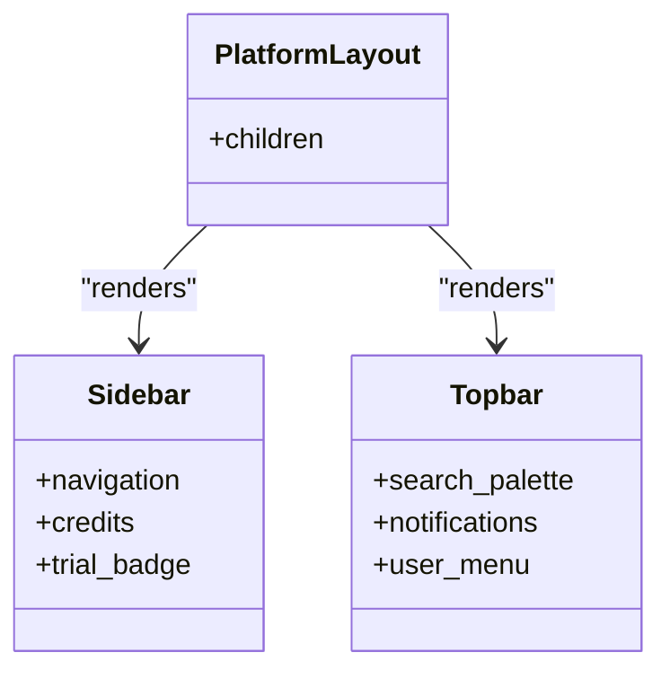

**Diagram sources**
- [PlatformLayout.tsx:7-18](file://platform-app/src/components/PlatformLayout.tsx#L7-L18)
- [Sidebar.tsx:103-183](file://platform-app/src/components/Sidebar.tsx#L103-L183)
- [Topbar.tsx:231-337](file://platform-app/src/components/Topbar.tsx#L231-L337)

**Section sources**
- [PlatformLayout.tsx:1-20](file://platform-app/src/components/PlatformLayout.tsx#L1-L20)
- [Sidebar.tsx:1-184](file://platform-app/src/components/Sidebar.tsx#L1-L184)
- [Topbar.tsx:1-341](file://platform-app/src/components/Topbar.tsx#L1-L341)

### Sidebar
The sidebar groups navigation into overview, compliance, developer, and account sections. It highlights the active route using the current pathname and displays credit usage and trial status from the authenticated user.

Key responsibilities:
- Route navigation for dashboard, transactions, cases, rules, filings, reports, API keys, docs, and settings
- Active link highlighting
- Credit calculation and progress visualization
- Trial expiration badge
- Timezone label

**Section sources**
- [Sidebar.tsx:9-39](file://platform-app/src/components/Sidebar.tsx#L9-L39)
- [Sidebar.tsx:103-183](file://platform-app/src/components/Sidebar.tsx#L103-L183)
- [format.ts:114-119](file://platform-app/src/lib/format.ts#L114-L119)
- [format.ts:122-134](file://platform-app/src/lib/format.ts#L122-L134)

### Topbar
The topbar provides:
- A command-palette-style search overlay that queries transactions, cases, and API keys
- A notification dropdown with unread counts, read marking, and mark-all-read actions
- A trial countdown badge
- Credits display and timezone label
- User menu with sign-out action

It also listens for keyboard shortcuts such as `Ctrl/Cmd+K` to open search and `Escape` to close overlays.

**Section sources**
- [Topbar.tsx:11-120](file://platform-app/src/components/Topbar.tsx#L11-L120)
- [Topbar.tsx:123-200](file://platform-app/src/components/Topbar.tsx#L123-L200)
- [Topbar.tsx:210-228](file://platform-app/src/components/Topbar.tsx#L210-L228)
- [Topbar.tsx:231-337](file://platform-app/src/components/Topbar.tsx#L231-L337)

### Authentication Context
`AuthContext` manages:
- Token persistence in local storage
- Initial user profile loading on app start
- Login, signup, logout, and profile refresh
- Global `isAuthenticated` and `isLoading` flags

On mount, it reads the stored token, calls the profile endpoint, and clears invalid tokens. Login and signup store the returned access token and then fetch the full user profile. Logout clears tokens and redirects to `/login`.

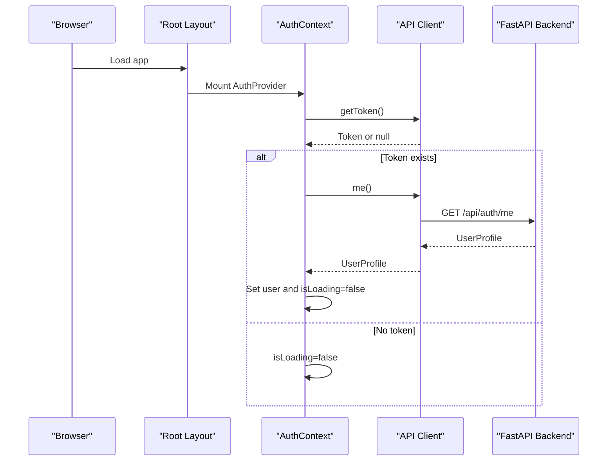

**Diagram sources**
- [AuthContext.tsx:22-40](file://platform-app/src/contexts/AuthContext.tsx#L22-L40)
- [api.ts:420-438](file://platform-app/src/lib/api.ts#L420-L438)

**Section sources**
- [AuthContext.tsx:1-107](file://platform-app/src/contexts/AuthContext.tsx#L1-L107)
- [api.ts:357-417](file://platform-app/src/lib/api.ts#L357-L417)
- [api.ts:420-438](file://platform-app/src/lib/api.ts#L420-L438)

### API Client Library
`src/lib/api.ts` is the single source of truth for backend communication. It:
- Defines typed request and response interfaces for auth, transactions, cases, filings, rules, analytics, credits, notifications, billing, and API keys
- Manages JWT tokens through `getToken`, `setToken`, and `clearToken`
- Wraps `fetch` with a `request<T>` helper that attaches authorization headers and throws `ApiError` on non-OK responses
- Exposes a flat `api` object with methods for every supported endpoint

Authentication flow:
- Login and register return a token response; the context stores the token and fetches the user profile
- Every subsequent request includes `Authorization: Bearer <token>` when present
- Non-OK responses are parsed for error details and wrapped in `ApiError`

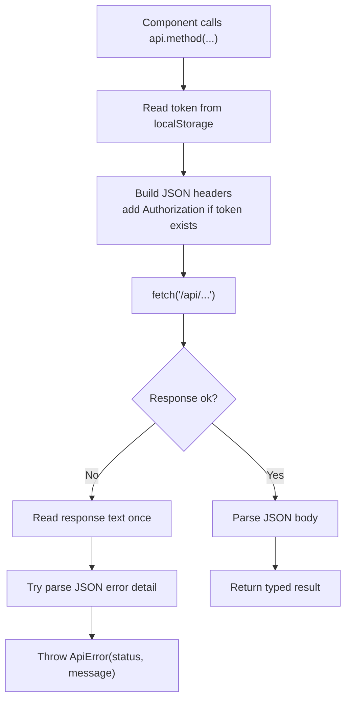

**Diagram sources**
- [api.ts:357-417](file://platform-app/src/lib/api.ts#L357-L417)
- [api.ts:420-631](file://platform-app/src/lib/api.ts#L420-L631)

**Section sources**
- [api.ts:1-631](file://platform-app/src/lib/api.ts#L1-L631)

### Formatting Utilities
`src/lib/format.ts` provides locale-aware formatting for currency, numbers, dates, relative time, timezone labels, and credit calculations. These helpers are used across the sidebar, topbar, and dashboard to ensure consistent presentation.

**Section sources**
- [format.ts:1-149](file://platform-app/src/lib/format.ts#L1-L149)

## Architecture Overview
The frontend architecture separates concerns between routing, shared shell, domain pages, authentication state, and backend integration.

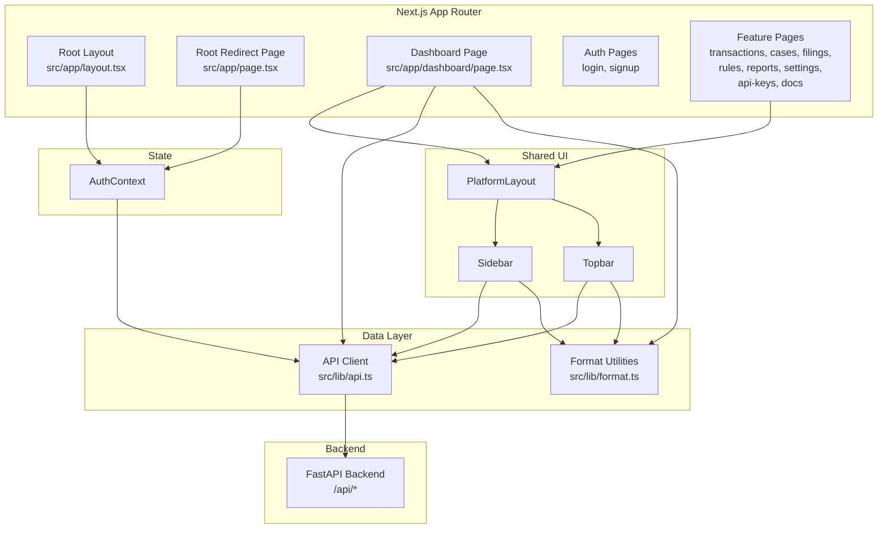

**Diagram sources**
- [layout.tsx:10-25](file://platform-app/src/app/layout.tsx#L10-L25)
- [page.tsx:7-17](file://platform-app/src/app/page.tsx#L7-L17)
- [dashboard page.tsx:17-43](file://platform-app/src/app/dashboard/page.tsx#L17-L43)
- [PlatformLayout.tsx:7-18](file://platform-app/src/components/PlatformLayout.tsx#L7-L18)
- [Sidebar.tsx:103-183](file://platform-app/src/components/Sidebar.tsx#L103-L183)
- [Topbar.tsx:231-337](file://platform-app/src/components/Topbar.tsx#L231-L337)
- [AuthContext.tsx:22-40](file://platform-app/src/contexts/AuthContext.tsx#L22-L40)
- [api.ts:357-417](file://platform-app/src/lib/api.ts#L357-L417)

## Detailed Component Analysis

### Authentication Flow
The authentication flow covers initial token validation, login, signup, and logout.

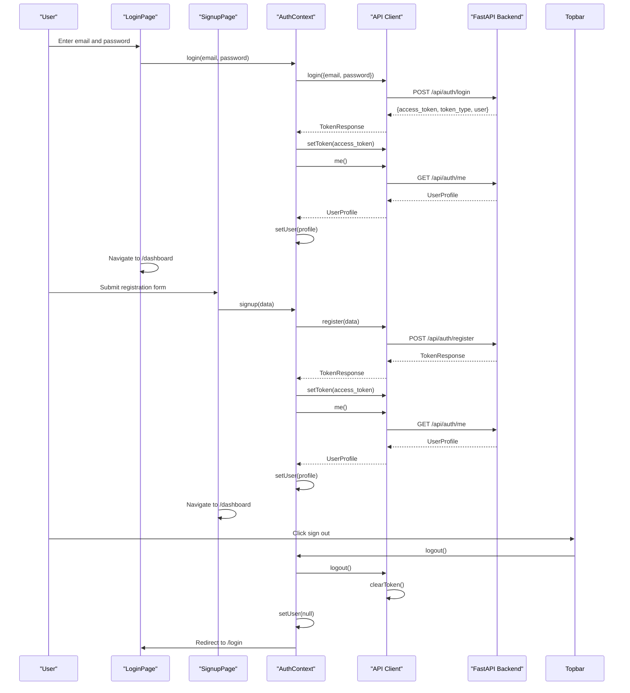

**Diagram sources**
- [login page.tsx:16-28](file://platform-app/src/app/login/page.tsx#L16-L28)
- [signup page.tsx:18-30](file://platform-app/src/app/signup/page.tsx#L18-L30)
- [AuthContext.tsx:42-85](file://platform-app/src/contexts/AuthContext.tsx#L42-L85)
- [api.ts:420-438](file://platform-app/src/lib/api.ts#L420-L438)

**Section sources**
- [login page.tsx:1-145](file://platform-app/src/app/login/page.tsx#L1-L145)
- [signup page.tsx:1-138](file://platform-app/src/app/signup/page.tsx#L1-L138)
- [AuthContext.tsx:1-107](file://platform-app/src/contexts/AuthContext.tsx#L1-L107)
- [api.ts:420-438](file://platform-app/src/lib/api.ts#L420-L438)

### Dashboard Data Loading
The dashboard page loads statistics, recent transactions, and system health concurrently. It uses `PlatformLayout` for the shell and formats data using `format.ts`.

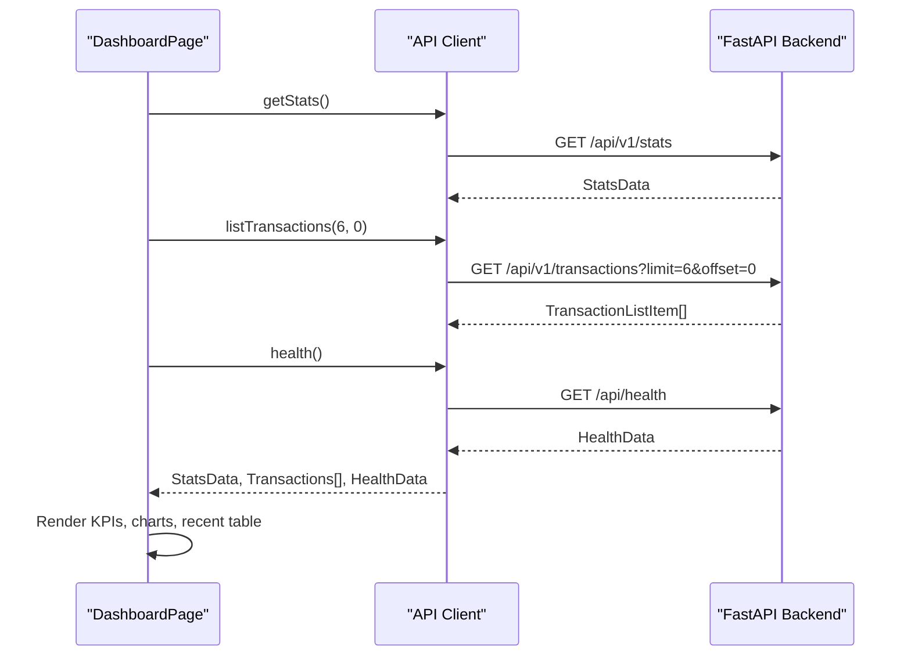

**Diagram sources**
- [dashboard page.tsx:25-43](file://platform-app/src/app/dashboard/page.tsx#L25-L43)
- [api.ts:443-474](file://platform-app/src/lib/api.ts#L443-L474)

**Section sources**
- [dashboard page.tsx:1-269](file://platform-app/src/app/dashboard/page.tsx#L1-L269)
- [api.ts:443-474](file://platform-app/src/lib/api.ts#L443-L474)

### Search Command Palette
The topbar's search palette debounces input, calls the unified search endpoint, and groups results by transactions, cases, and API keys.

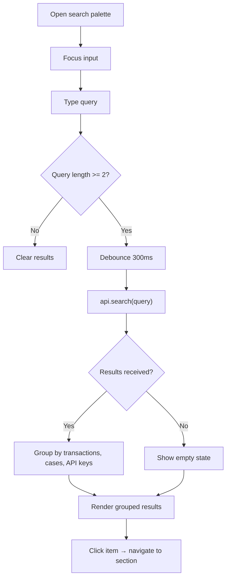

**Diagram sources**
- [Topbar.tsx:11-120](file://platform-app/src/components/Topbar.tsx#L11-L120)
- [api.ts:485-486](file://platform-app/src/lib/api.ts#L485-L486)

**Section sources**
- [Topbar.tsx:11-120](file://platform-app/src/components/Topbar.tsx#L11-L120)
- [api.ts:241-269](file://platform-app/src/lib/api.ts#L241-L269)

### Notifications Dropdown
The notifications dropdown loads unread count and notification items, supports marking individual or all notifications as read, and closes on outside clicks.

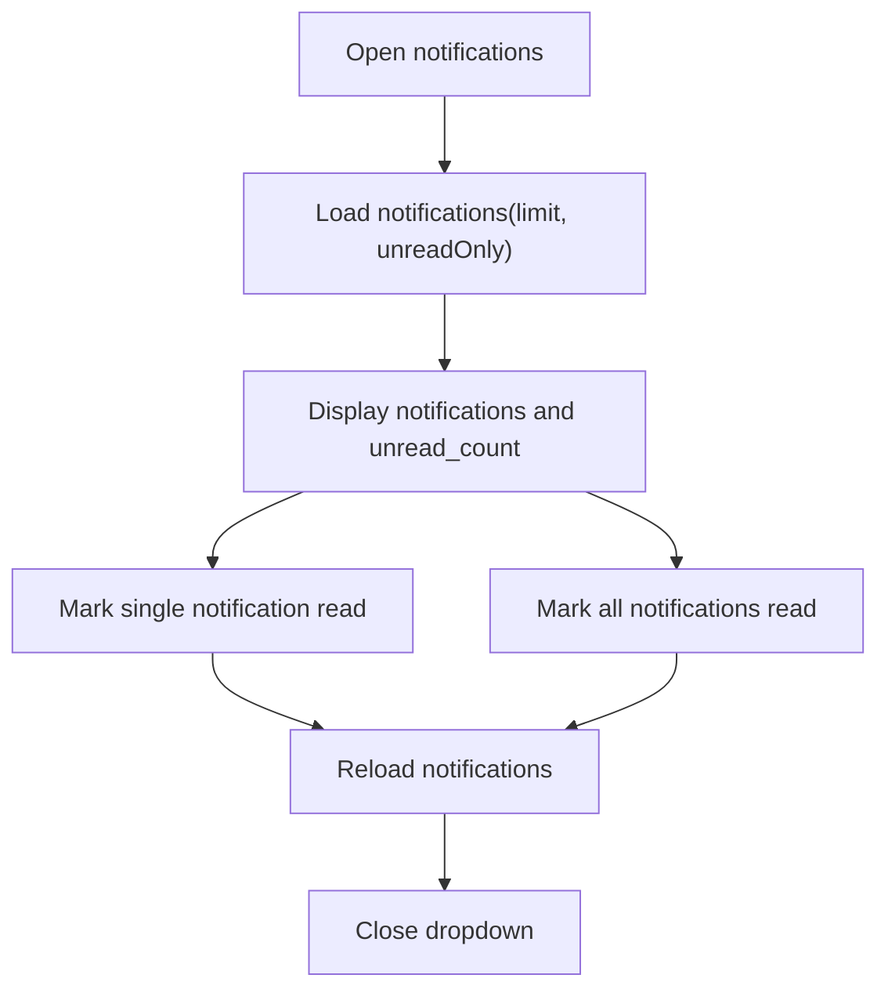

**Diagram sources**
- [Topbar.tsx:123-200](file://platform-app/src/components/Topbar.tsx#L123-L200)
- [api.ts:488-504](file://platform-app/src/lib/api.ts#L488-L504)

**Section sources**
- [Topbar.tsx:123-200](file://platform-app/src/components/Topbar.tsx#L123-L200)
- [api.ts:488-504](file://platform-app/src/lib/api.ts#L488-L504)

## Dependency Analysis
The frontend has clear layering:
- Pages depend on shared layout components
- Shared layout components depend on the API client and formatting utilities
- Authentication context depends on the API client
- The API client depends only on browser APIs and the backend

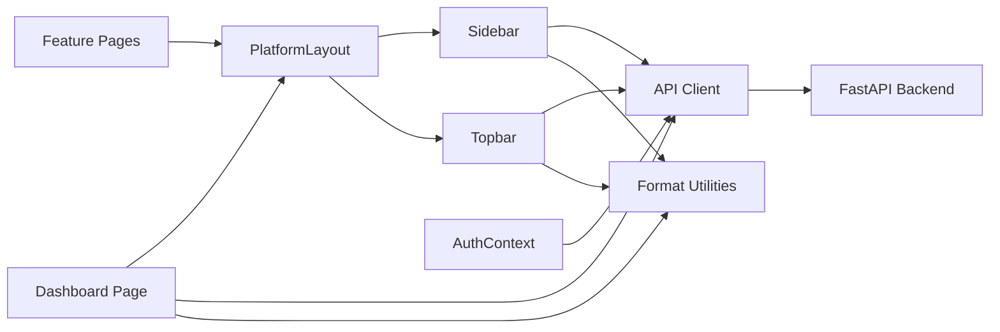

**Diagram sources**
- [dashboard page.tsx:17-43](file://platform-app/src/app/dashboard/page.tsx#L17-L43)
- [PlatformLayout.tsx:7-18](file://platform-app/src/components/PlatformLayout.tsx#L7-L18)
- [Sidebar.tsx:103-183](file://platform-app/src/components/Sidebar.tsx#L103-L183)
- [Topbar.tsx:231-337](file://platform-app/src/components/Topbar.tsx#L231-L337)
- [AuthContext.tsx:22-40](file://platform-app/src/contexts/AuthContext.tsx#L22-L40)
- [api.ts:357-417](file://platform-app/src/lib/api.ts#L357-L417)

**Section sources**
- [dashboard page.tsx:1-269](file://platform-app/src/app/dashboard/page.tsx#L1-L269)
- [PlatformLayout.tsx:1-20](file://platform-app/src/components/PlatformLayout.tsx#L1-L20)
- [Sidebar.tsx:1-184](file://platform-app/src/components/Sidebar.tsx#L1-L184)
- [Topbar.tsx:1-341](file://platform-app/src/components/Topbar.tsx#L1-L341)
- [AuthContext.tsx:1-107](file://platform-app/src/contexts/AuthContext.tsx#L1-L107)
- [api.ts:1-631](file://platform-app/src/lib/api.ts#L1-L631)

## Performance Considerations
- Concurrent data fetching: The dashboard uses parallel requests for stats, recent transactions, and health checks to reduce total load time.
- Debounced search: The command palette waits before querying to avoid excessive network calls.
- Local token storage: JWT persistence avoids repeated authentication round trips on reload.
- Standalone output: The Next.js build produces a standalone server bundle suitable for containerized deployment.
- Lightweight dependencies: The frontend package lists only Next.js, React, and React DOM as runtime dependencies.

Recommendations:
- Add pagination or virtualization for large transaction or case lists.
- Cache frequent read-only data (plans, rules) using React state or a lightweight cache layer.
- Consider adding request deduplication for repeated API calls within short time windows.
- Monitor token refresh behavior if backend sessions expire frequently.

[No sources needed since this section provides general guidance]

## Troubleshooting Guide
Common issues and where to look:

- Backend connectivity errors:
  - The dashboard shows an "API offline" message when health or stats requests fail.
  - Verify the backend is reachable at the configured API URL.
  - In development, the default rewrite target is `http://localhost:8091`; in Docker builds, `API_URL` is set to `http://backend:8091`.

- Authentication failures:
  - If the initial profile call fails, the context clears the token and treats the user as unauthenticated.
  - After logout, the app redirects to `/login`.

- Search not returning results:
  - The search requires at least two characters.
  - Errors from the search endpoint are silently ignored in the UI; check the network tab for HTTP errors.

- Notification count not updating:
  - The topbar polls notifications periodically; confirm the polling interval and endpoint availability.

- Build or deployment issues:
  - Ensure `npm ci` runs successfully during Docker build.
  - Confirm environment variables `API_URL` and `NEXT_PUBLIC_API_URL` are set appropriately.

**Section sources**
- [dashboard page.tsx:25-43](file://platform-app/src/app/dashboard/page.tsx#L25-L43)
- [dashboard page.tsx:70-85](file://platform-app/src/app/dashboard/page.tsx#L70-L85)
- [AuthContext.tsx:22-40](file://platform-app/src/contexts/AuthContext.tsx#L22-L40)
- [AuthContext.tsx:70-85](file://platform-app/src/contexts/AuthContext.tsx#L70-L85)
- [Topbar.tsx:26-37](file://platform-app/src/components/Topbar.tsx#L26-L37)
- [next.config.js:4-14](file://platform-app/next.config.js#L4-L14)
- [Dockerfile:13-19](file://platform-app/Dockerfile#L13-L19)

## Conclusion
The FinShield Next.js 16 frontend is a structured, type-safe dashboard application leveraging the latest React 19 features and Tailwind CSS v4. Its App Router layout provides clear separation between public auth pages and protected feature pages. Shared components deliver a consistent shell, while `AuthContext` centralizes session management and `api.ts` centralizes backend communication. The project is designed for containerized deployment with Docker Compose, rewrites API calls to the backend, and exposes a clean surface for extending new compliance features.

[No sources needed since this section summarizes without analyzing specific files]

## Appendices

### Build Process and Development Workflow
- Development server: `npm run dev` starts Next.js on port 3000.
- Production build: `npm run build` generates a standalone Next.js server.
- Linting: `npm run lint` runs TypeScript compiler checks (updated from ESLint).
- Dependencies: Next.js 16.4.3, React 19.3.1, TypeScript 5.6.3, Tailwind CSS 4.3.3, PostCSS 8.4.47, Autoprefixer 10.4.20, and ESLint 9.0.0 with flat config.

**Updated** The build process now uses TypeScript compiler for linting instead of ESLint, and includes the latest versions of all major dependencies.

**Section sources**
- [package.json:5-28](file://platform-app/package.json#L5-L28)

### Deployment Configuration
- Docker image: Node 18 Alpine, installs dependencies, copies code, sets API URLs, builds, and runs the production server.
- Compose services: `postgres`, `backend`, and `frontend` are defined at the repository root. The frontend service builds `platform-app/Dockerfile` and depends on the backend.
- API rewriting: `next.config.js` rewrites `/api/*` to the configured backend URL.

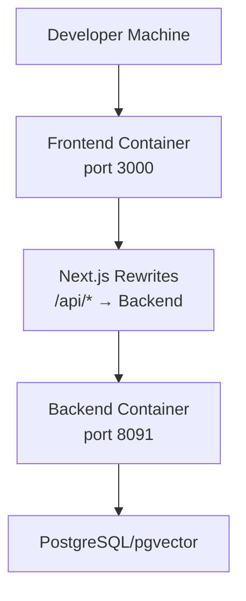

**Diagram sources**
- [Dockerfile:1-33](file://platform-app/Dockerfile#L1-L33)
- [docker-compose.yml:47-61](file://docker-compose.yml#L47-L61)
- [next.config.js:4-14](file://platform-app/next.config.js#L4-L14)

**Section sources**
- [Dockerfile:1-33](file://platform-app/Dockerfile#L1-L33)
- [docker-compose.yml:1-72](file://docker-compose.yml#L1-L72)
- [next.config.js:1-18](file://platform-app/next.config.js#L1-L18)

### Responsive Design and Accessibility Notes
- The login and signup pages use responsive layouts with hidden brand panels on small screens and visible forms on mobile.
- Inputs include accessible attributes such as `aria-required` and appropriate `autoComplete` values.
- The topbar hides certain elements on smaller viewports and uses keyboard shortcuts for power users.
- The sidebar and topbar rely on Tailwind utility classes for spacing, colors, and layout.

Accessibility recommendations:
- Add explicit focus management for modal-like overlays such as the search palette and notifications dropdown.
- Provide skip links for keyboard navigation.
- Ensure color contrast meets WCAG guidelines for all custom colors.
- Test screen reader announcements for dynamic updates such as notification counts and credit balances.

[No sources needed since this section provides general guidance]

### Cross-Browser Compatibility
- Uses standard Web APIs: `localStorage`, `fetch`, `navigator.language`, `Intl.DateTimeFormat`.
- Relies on modern CSS features provided by Tailwind and browsers supporting CSS Grid and Flexbox.
- For older browsers, polyfills may be required for `Intl` features or `fetch`.

[No sources needed since this section provides general guidance]

### Modernization Changes and Migration Notes

#### Next.js 16.4.3 Upgrade
- Enhanced App Router performance and stability
- Improved TypeScript support with better type inference
- Updated build system with improved caching

#### React 19.3.1 Upgrade
- New concurrent rendering features available
- Improved hooks performance and reliability
- Better TypeScript integration with React 19 types

#### Tailwind CSS v4 Migration
- Migrated from Tailwind CSS 3.4.13 to 4.3.3
- Updated PostCSS configuration to use `@tailwindcss/postcss` plugin
- Migrated global styles to use Tailwind v4 import syntax: `@import "tailwindcss";`
- Updated `tailwind.config.js` to work with v4 configuration format
- Maintained existing design system with custom colors, shadows, and animations

#### ESLint Flat Config Implementation
- Replaced legacy `.eslintrc.json` with modern `eslint.config.js`
- Updated to ESLint 9.0.0 with flat configuration format
- Integrated with Next.js core web vitals rules
- Simplified configuration structure

#### TypeScript Updates
- Updated to TypeScript 5.6.3 for better React 19 support
- Enhanced module resolution with bundler strategy
- Improved JSX transform with `react-jsx`

**Section sources**
- [package.json:11-28](file://platform-app/package.json#L11-L28)
- [postcss.config.js:1-7](file://platform-app/postcss.config.js#L1-L7)
- [eslint.config.js:1-10](file://platform-app/eslint.config.js#L1-L10)
- [globals.css:1-2](file://platform-app/src/app/globals.css#L1-L2)
- [tsconfig.json:1-42](file://platform-app/tsconfig.json#L1-L42)