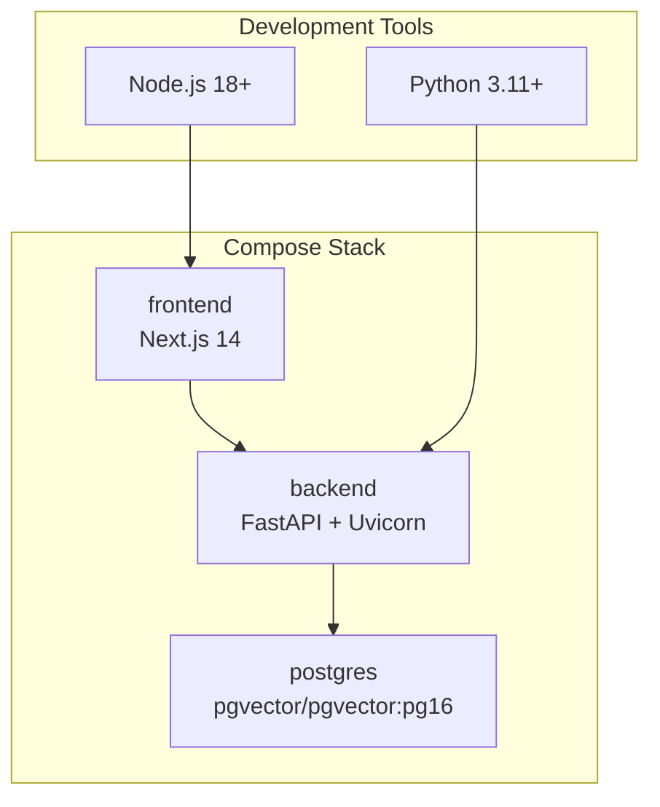
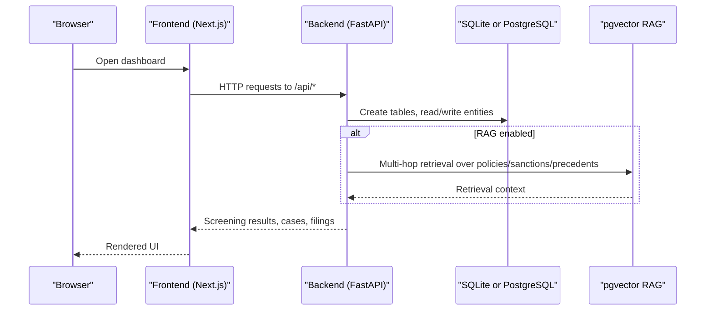
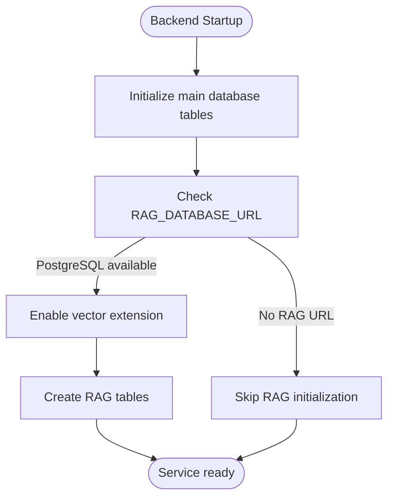
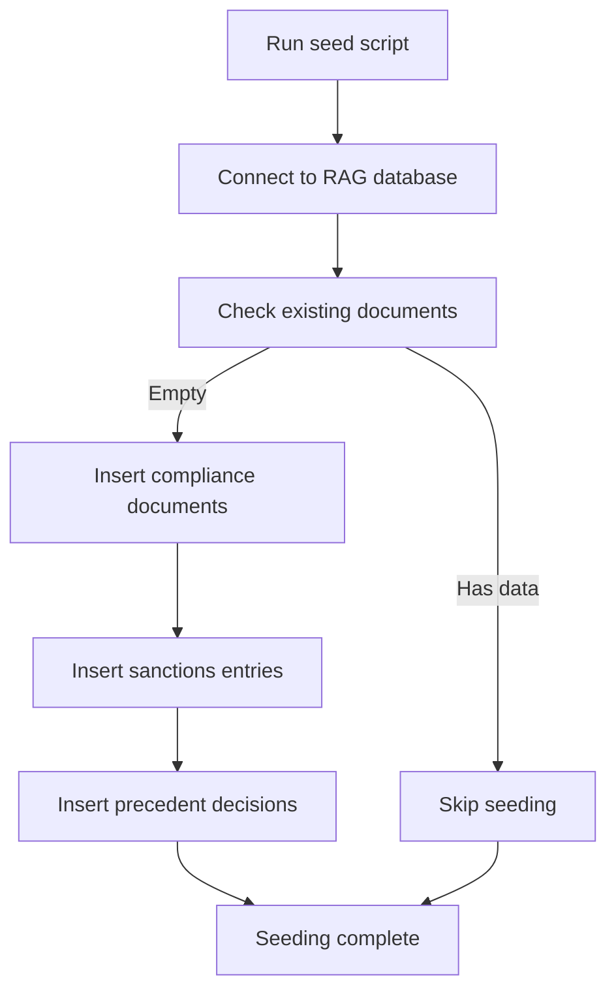
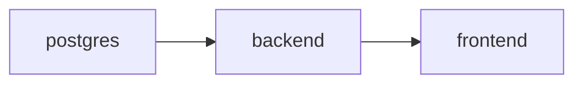

# Getting Started

<cite>
**Referenced Files in This Document**   
- [docker-compose.yml](file://docker-compose.yml)
- [README.md](file://README.md)
- [DOCKER.md](file://DOCKER.md)
- [DEPLOYMENT.md](file://DEPLOYMENT.md)
- [backend/requirements.txt](file://backend/requirements.txt)
- [backend/app/database.py](file://backend/app/database.py)
- [backend/app/main.py](file://backend/app/main.py)
- [backend/app/auth.py](file://backend/app/auth.py)
- [backend/app/db_models.py](file://backend/app/db_models.py)
- [backend/app/compliance_engine.py](file://backend/app/compliance_engine.py)
- [backend/app/rag_service.py](file://backend/app/rag_service.py)
- [backend/app/seed_rag_data.py](file://backend/app/seed_rag_data.py)
- [platform-app/Dockerfile](file://platform-app/Dockerfile)
- [platform-app/package.json](file://platform-app/package.json)
- [platform-app/src/lib/api.ts](file://platform-app/src/lib/api.ts)
</cite>

## Table of Contents
1. [Introduction](#introduction)
2. [Project Structure](#project-structure)
3. [Core Components](#core-components)
4. [Architecture Overview](#architecture-overview)
5. [Detailed Component Analysis](#detailed-component-analysis)
6. [Dependency Analysis](#dependency-analysis)
7. [Performance Considerations](#performance-considerations)
8. [Troubleshooting Guide](#troubleshooting-guide)
9. [Conclusion](#conclusion)
10. [Appendices](#appendices)

## Introduction
FinShield AI is a local-first transaction compliance engine that screens transactions through hard rules, behavioral monitoring, and optional retrieval-augmented generation (RAG). The shipped repository provides:
- A FastAPI backend for screening, authentication, persistence, and RAG enrichment.
- A Next.js 14 dashboard under `platform-app/`.
- A static marketing website under `website/` served separately.

The shipped stack includes FastAPI, SQLAlchemy, psycopg2-binary, pgvector, numpy, python-jose, bcrypt, slowapi, pytest, httpx, and uvicorn. Features such as Celery/Redis, LangChain, DSPy, LoRA/PEFT/BitsAndBytes, vLLM, RAGAS, HashiCorp Vault, OpenTelemetry, Prometheus, structlog, and Kubernetes/Helm are roadmap items and are not part of the current runnable stack.

For development, you need Docker & Docker Compose, Python 3.11+, and Node.js 18+. For production, use PostgreSQL instead of SQLite and configure secure secrets, TLS, CORS, and environment variables.

**Section sources**
- [README.md:18-54](file://README.md#L18-L54)
- [README.md:107-124](file://README.md#L107-L124)
- [README.md:127-134](file://README.md#L127-L134)
- [backend/requirements.txt:1-16](file://backend/requirements.txt#L1-L16)

## Project Structure
The repository ships three real deployables:
- `backend/`: FastAPI application with authentication, database models, compliance engine, and RAG service.
- `platform-app/`: Next.js 14 App Router dashboard built from `platform-app/Dockerfile`.
- `website/`: Static marketing site plus legacy platform console pages; it is not part of the default compose stack.

**Diagram sources**
- [docker-compose.yml:3-61](file://docker-compose.yml#L3-L61)
- [platform-app/Dockerfile:1-29](file://platform-app/Dockerfile#L1-L29)
- [platform-app/package.json:1-28](file://platform-app/package.json#L1-L28)

**Section sources**
- [docker-compose.yml:3-61](file://docker-compose.yml#L3-L61)
- [platform-app/Dockerfile:1-29](file://platform-app/Dockerfile#L1-L29)
- [platform-app/package.json:1-28](file://platform-app/package.json#L1-L28)

## Core Components
- **PostgreSQL Service**: Uses `pgvector/pgvector:pg16`, exposes port 5432, and persists data via the `postgres-data` volume.
- **Backend Service**: FastAPI app exposing port 8091. It defaults to SQLite (`finshield.db`) unless `DATABASE_URL` points to PostgreSQL. When `RAG_DATABASE_URL` starts with `postgresql`, the startup routine initializes the RAG service using pgvector.
- **Frontend Service**: Builds `platform-app/Dockerfile`, serves on port 3000, and calls the backend at `API_URL=http://backend:8091`.

Persistence model:
- Default: SQLite file `finshield.db` created by `backend/app/database.py`.
- Production recommendation: PostgreSQL connection string via `DATABASE_URL`.
- RAG requirement: `RAG_DATABASE_URL` must point to PostgreSQL with the `vector` extension enabled by `pgvector`.

Environment configuration highlights:
- Backend: `DATABASE_URL`, `RAG_DATABASE_URL`, `JWT_SECRET_KEY`, `JWT_ALGORITHM`, `ACCESS_TOKEN_EXPIRE_MINUTES`, `DEBUG`, `CORS_ORIGINS`.
- Frontend: `API_URL`, `NEXT_PUBLIC_API_URL`.

**Section sources**
- [docker-compose.yml:4-61](file://docker-compose.yml#L4-L61)
- [backend/app/database.py:11-21](file://backend/app/database.py#L11-L21)
- [backend/app/main.py:132-152](file://backend/app/main.py#L132-L152)
- [backend/app/rag_service.py:148-155](file://backend/app/rag_service.py#L148-L155)

## Architecture Overview
The runtime architecture consists of three services orchestrated by Docker Compose. The frontend proxies API calls to the backend, which persists data to SQLite or PostgreSQL and optionally enriches screening results with pgvector-based RAG retrieval.

**Diagram sources**
- [docker-compose.yml:24-61](file://docker-compose.yml#L24-L61)
- [backend/app/main.py:132-152](file://backend/app/main.py#L132-L152)
- [backend/app/rag_service.py:361-412](file://backend/app/rag_service.py#L361-L412)

## Detailed Component Analysis

### Installation Prerequisites
- Install Docker & Docker Compose.
- Install Python 3.11+ for local backend development.
- Install Node.js 18+ for local frontend development.

These prerequisites are required for running the full stack locally and for developing the dashboard.

**Section sources**
- [README.md:127-134](file://README.md#L127-L134)
- [DOCKER.md:5-8](file://DOCKER.md#L5-L8)

### Local Development Setup
Recommended steps:
1. Start the stack with Docker Compose.
2. Verify the backend is reachable at `http://localhost:8091`.
3. Open the dashboard at `http://localhost:3000`.
4. Register or log in via the dashboard to obtain a JWT token.
5. Submit your first transaction via the dashboard or curl.

Notes:
- The compose stack defines exactly three services: `postgres`, `backend`, and `frontend`.
- The frontend builds `platform-app/Dockerfile`.
- The backend defaults to SQLite unless `DATABASE_URL` is set to PostgreSQL.
- RAG enrichment requires `RAG_DATABASE_URL` pointing to PostgreSQL with pgvector.

**Section sources**
- [docker-compose.yml:3-61](file://docker-compose.yml#L3-L61)
- [DOCKER.md:28-47](file://DOCKER.md#L28-L47)
- [backend/app/database.py:11-21](file://backend/app/database.py#L11-L21)
- [backend/app/main.py:132-152](file://backend/app/main.py#L132-L152)

### Database Initialization
- On startup, the backend initializes database tables using SQLAlchemy’s declarative base.
- With the default SQLite configuration, the file `finshield.db` is created in the backend container’s working directory.
- Tests use `test_finshield.db` when `APP_ENV=test`.
- For RAG, the service creates the `vector` extension and RAG tables on the PostgreSQL database configured by `RAG_DATABASE_URL`.

**Diagram sources**
- [backend/app/main.py:132-152](file://backend/app/main.py#L132-L152)
- [backend/app/database.py:36-44](file://backend/app/database.py#L36-L44)
- [backend/app/rag_service.py:148-155](file://backend/app/rag_service.py#L148-L155)

**Section sources**
- [backend/app/main.py:132-152](file://backend/app/main.py#L132-L152)
- [backend/app/database.py:11-21](file://backend/app/database.py#L11-L21)
- [backend/app/database.py:36-44](file://backend/app/database.py#L36-L44)
- [backend/app/rag_service.py:148-155](file://backend/app/rag_service.py#L148-L155)

### First Transaction Submission
You can submit a transaction either through the web dashboard or via curl against the backend API.

Dashboard flow:
- Log in to `http://localhost:3000`.
- Navigate to the transactions page and submit a new transaction.
- View screening results, rule hits, risk score, and pipeline stages.

curl flow:
- Use the backend endpoint `/api/v1/transactions`.
- Include an Authorization header with a valid Bearer token or API key.
- Provide required fields such as amount, currency, transaction type, sender/receiver names, and destination country.

Important:
- Authentication accepts either a JWT bearer token or an API key prefixed with `fsk_`.
- Idempotency keys prevent duplicate processing of the same transaction.

**Section sources**
- [backend/app/main.py:434-570](file://backend/app/main.py#L434-L570)
- [backend/app/auth.py:59-122](file://backend/app/auth.py#L59-L122)
- [platform-app/src/lib/api.ts:444-448](file://platform-app/src/lib/api.ts#L444-L448)

### Environment Configuration Options
Key environment variables:

- Backend
  - `DATABASE_URL`: SQLite default (`sqlite:///./finshield.db`) or PostgreSQL connection string.
  - `RAG_DATABASE_URL`: PostgreSQL connection string enabling pgvector RAG.
  - `JWT_SECRET_KEY`: Secret used to sign JWT tokens.
  - `JWT_ALGORITHM`: Algorithm for JWT signing (default HS256).
  - `ACCESS_TOKEN_EXPIRE_MINUTES`: Token lifetime.
  - `DEBUG`: Enables verbose logging and SQL echo when true.
  - `CORS_ORIGINS`: Comma-separated allowed origins for browser access.

- Frontend
  - `API_URL`: Backend host inside the Docker network.
  - `NEXT_PUBLIC_API_URL`: Publicly accessible backend URL for the browser.

Production notes:
- Change `JWT_SECRET_KEY` before deploying.
- Set `CORS_ORIGINS` to trusted domains only.
- Disable debug mode in production.

**Section sources**
- [docker-compose.yml:31-56](file://docker-compose.yml#L31-L56)
- [backend/app/main.py:62-70](file://backend/app/main.py#L62-L70)
- [backend/app/auth.py:21-25](file://backend/app/auth.py#L21-L25)
- [DOCKER.md:34-47](file://DOCKER.md#L34-L47)

### Development vs Production Deployment
Development:
- Run the full stack with Docker Compose.
- SQLite is used by default for simplicity.
- The frontend runs on port 3000 and the backend on port 8091.

Production:
- Use PostgreSQL for persistence and enable pgvector for RAG.
- Configure secure secrets, HTTPS/TLS, and strict CORS.
- Deploy backend and frontend on separate platforms if desired.
- Back up databases and rotate secrets regularly.

The repository also includes guidance for external hosting providers and environment variable management.

**Section sources**
- [DOCKER.md:48-66](file://DOCKER.md#L48-L66)
- [DEPLOYMENT.md:22-58](file://DEPLOYMENT.md#L22-L58)
- [DEPLOYMENT.md:314-334](file://DEPLOYMENT.md#L314-L334)

### RAG Data Seeding
To seed sample compliance documents, sanctions entries, and precedent decisions into the RAG index:
- Ensure `RAG_DATABASE_URL` points to PostgreSQL with pgvector.
- Run the seed script to populate the RAG tables.
- After seeding, transaction screening may include RAG enrichment if the RAG service is initialized.

**Diagram sources**
- [backend/app/seed_rag_data.py:10-24](file://backend/app/seed_rag_data.py#L10-L24)
- [backend/app/seed_rag_data.py:26-187](file://backend/app/seed_rag_data.py#L26-L187)

**Section sources**
- [backend/app/seed_rag_data.py:10-24](file://backend/app/seed_rag_data.py#L10-L24)
- [backend/app/seed_rag_data.py:26-187](file://backend/app/seed_rag_data.py#L26-L187)
- [backend/app/main.py:138-150](file://backend/app/main.py#L138-L150)

## Dependency Analysis
The compose stack defines explicit dependencies:
- `backend` depends on `postgres` being healthy.
- `frontend` depends on `backend`.
- All services share the `finshield-network` bridge network.

**Diagram sources**
- [docker-compose.yml:40-58](file://docker-compose.yml#L40-L58)

**Section sources**
- [docker-compose.yml:40-58](file://docker-compose.yml#L40-L58)

## Performance Considerations
- SQLite is convenient for local development but is not recommended for production workloads.
- PostgreSQL with pgvector enables efficient vector similarity search for RAG.
- RAG embedding strategy defaults to deterministic hashing embeddings using numpy; optional sentence-transformers can be enabled via environment configuration.
- Rate limiting is enabled by default outside test environments.

[No sources needed since this section provides general guidance]

## Troubleshooting Guide

Common setup issues and resolutions:

- Port conflicts
  - Symptoms: Services fail to start because ports 3000 or 8091 are already in use.
  - Resolution: Change exposed ports in `docker-compose.yml` or stop conflicting processes.

- Database connectivity
  - Symptoms: Backend cannot connect to PostgreSQL or pgvector features fail.
  - Resolution: Verify `DATABASE_URL` and `RAG_DATABASE_URL`, ensure PostgreSQL is healthy, and confirm the `vector` extension is enabled.

- Container networking
  - Symptoms: Frontend cannot reach backend or backend cannot reach postgres.
  - Resolution: Confirm all services are on `finshield-network` and that hostnames resolve correctly inside containers.

- Build issues
  - Symptoms: Frontend build fails due to cached dependencies or Node version mismatch.
  - Resolution: Clear Docker cache, rebuild without cache, and ensure Node.js 18+ is used.

- Health checks
  - Backend health endpoint: `http://localhost:8091/api/health`.
  - Frontend health check: `http://localhost:3000`.

- Logs
  - View all logs: `docker-compose logs -f`.
  - View specific service logs: `docker-compose logs backend`, `docker-compose logs frontend`.

- Resetting state
  - Stop and remove volumes to reset persistent data: `docker-compose down -v`.

**Section sources**
- [DOCKER.md:67-119](file://DOCKER.md#L67-L119)
- [docker-compose.yml:18-22](file://docker-compose.yml#L18-L22)
- [backend/app/main.py:132-152](file://backend/app/main.py#L132-L152)

## Conclusion
FinShield AI provides a practical local-first compliance workflow with a FastAPI backend and a Next.js dashboard. For quick local development, use SQLite and Docker Compose. For production, switch to PostgreSQL, enable pgvector for RAG, secure secrets, and configure TLS and CORS appropriately. The shipped stack focuses on core compliance screening, authentication, persistence, and optional RAG enrichment, while advanced ML and enterprise features remain on the roadmap.

[No sources needed since this section summarizes without analyzing specific files]

## Appendices

### API Endpoints Used in This Guide
- Authentication
  - POST `/api/auth/register`
  - POST `/api/auth/login`
  - GET `/api/auth/me`
- Transactions
  - POST `/api/v1/transactions`
  - GET `/api/v1/transactions`
  - GET `/api/v1/transactions/{id}`
  - DELETE `/api/v1/transactions/{id}`
- Cases
  - POST `/api/v1/cases`
  - GET `/api/v1/cases`
  - GET `/api/v1/cases/{case_id}`

**Section sources**
- [backend/app/main.py:176-266](file://backend/app/main.py#L176-L266)
- [backend/app/main.py:434-717](file://backend/app/main.py#L434-L717)