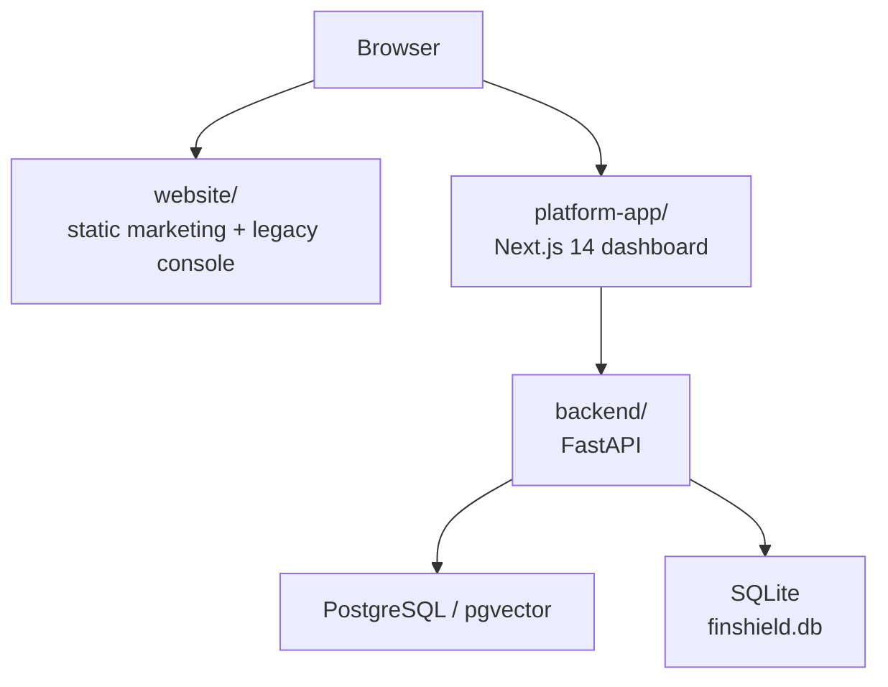
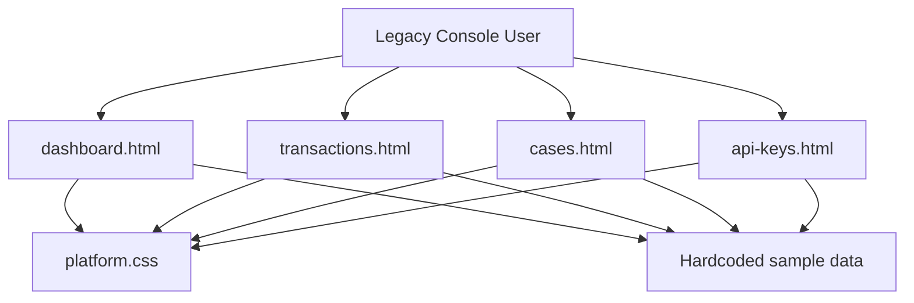
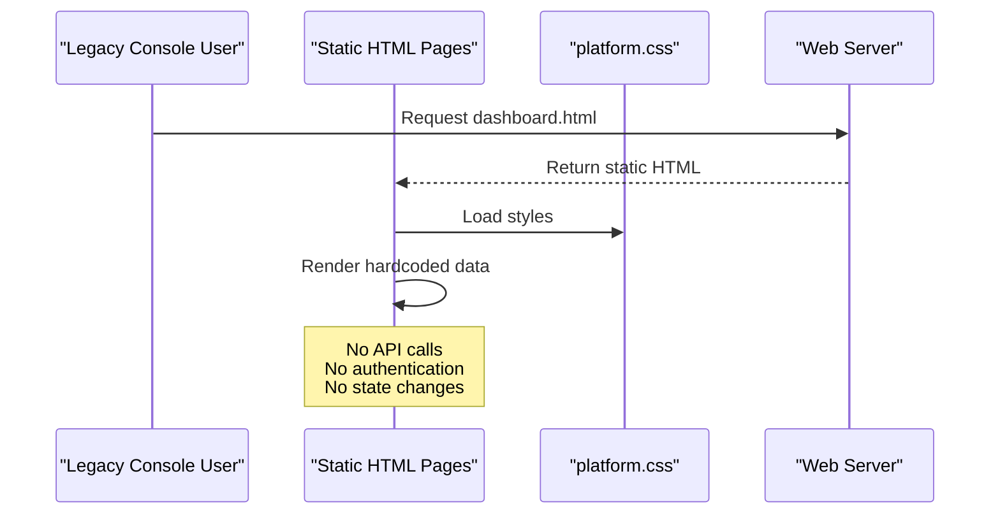
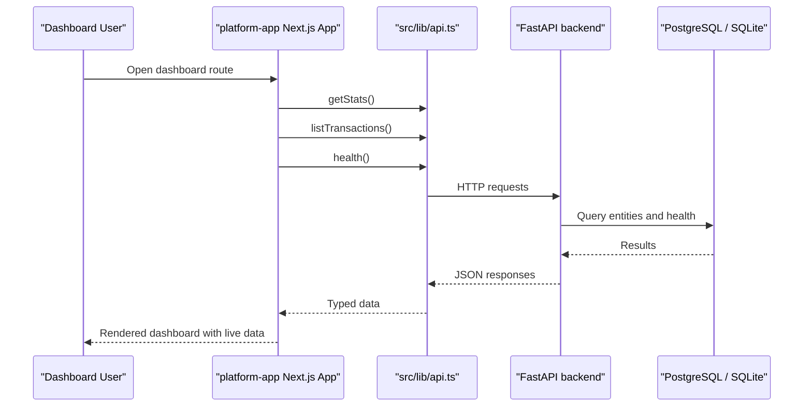
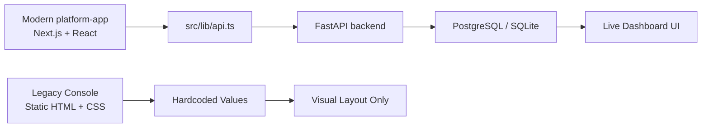

# Legacy Platform Console

<cite>
**Referenced Files in This Document**
- [dashboard.html](file://website/platform/dashboard.html)
- [transactions.html](file://website/platform/transactions.html)
- [cases.html](file://website/platform/cases.html)
- [api-keys.html](file://website/platform/api-keys.html)
- [platform.css](file://website/css/platform.css)
- [README.md](file://README.md)
- [docker-compose.yml](file://docker-compose.yml)
- [AGENTS.md](file://platform-app/AGENTS.md)
- [page.tsx (dashboard)](file://platform-app/src/app/dashboard/page.tsx)
- [page.tsx (transactions)](file://platform-app/src/app/transactions/page.tsx)
- [page.tsx (cases)](file://platform-app/src/app/cases/page.tsx)
- [page.tsx (api-keys)](file://platform-app/src/app/api-keys/page.tsx)
</cite>

## Table of Contents
1. [Introduction](#introduction)
2. [Project Structure](#project-structure)
3. [Deprecation Status and Migration Guidance](#deprecation-status-and-migration-guidance)
4. [Legacy Console Overview](#legacy-console-overview)
5. [Historical Feature Inventory](#historical-feature-inventory)
6. [UI Component Reference](#ui-component-reference)
7. [Feature Gap Analysis vs Modern platform-app](#feature-gap-analysis-vs-modern-platform-app)
8. [Remaining Use Cases](#remaining-use-cases)
9. [Architecture and Data Flow](#architecture-and-data-flow)
10. [Performance and Operational Characteristics](#performance-and-operational-characteristics)
11. [Troubleshooting Guide](#troubleshooting-guide)
12. [Conclusion](#conclusion)

## Introduction

The files under `website/platform/*.html` are the legacy HTML-based FinShield platform console. They provide a static, server-rendered dashboard shell with hardcoded sample data for transactions, cases, API keys, and system health. They are **not** the current operational dashboard.

The modern replacement is `platform-app/`, a Next.js 14 App Router application built with React 18 and Tailwind CSS. The shipped stack uses FastAPI for the backend, PostgreSQL with pgvector for retrieval, and SQLite by default for the main database when `DATABASE_URL` points to SQLite. The compose file at the repository root builds and runs `backend/` and `platform-app/`; it does not include `website/`.

This document treats `website/platform/*.html` as deprecated documentation. It explains what they historically presented, how they differ from the modern platform-app, and how users should migrate.

**Section sources**
- [README.md:18-28](file://README.md#L18-L28)
- [README.md:107-124](file://README.md#L107-L124)
- [README.md:197-222](file://README.md#L197-L222)
- [docker-compose.yml:1-72](file://docker-compose.yml#L1-L72)

## Project Structure

At the top level, the repository has three real deployables relevant to this topic:

| Area | Role | Current status |
|---|---|---|
| `backend/` | FastAPI compliance screening API, rule engine, RAG service, auth, models, and persistence | Active backend |
| `platform-app/` | Next.js 14 dashboard with routes for dashboard, transactions, cases, filings, rules, reports, settings, api-keys, docs, login, signup | Active frontend |
| `website/` | Static marketing site plus legacy platform console | Legacy UI surface |



**Diagram sources**
- [docker-compose.yml:3-61](file://docker-compose.yml#L3-L61)
- [README.md:197-222](file://README.md#L197-L222)

The legacy console lives under `website/platform/`. Its pages share `website/css/main.css` and `website/css/platform.css`. Unlike the modern dashboard, these pages do not import JavaScript modules, state management, or an API client; their content is embedded directly in the HTML.

**Section sources**
- [dashboard.html:1-12](file://website/platform/dashboard.html#L1-L12)
- [transactions.html:1-12](file://website/platform/transactions.html#L1-L12)
- [cases.html:1-12](file://website/platform/cases.html#L1-L12)
- [api-keys.html:1-12](file://website/platform/api-keys.html#L1-L12)
- [platform.css:1-27](file://website/css/platform.css#L1-L27)

## Deprecation Status and Migration Guidance

### Deprecation Statement

`website/platform/*.html` is superseded by `platform-app/`. Users should treat the legacy console as historical UI reference material rather than the supported operational interface.

Key reasons:

- The modern dashboard is the deployed frontend in `docker-compose.yml`.
- The legacy console contains static sample data, not live API responses.
- The modern dashboard calls backend endpoints through `src/lib/api.ts`, handles loading states, errors, authentication context, and structured data types.
- The legacy console has no session handling, no form submission logic, no pagination, and no real-time updates.

### Recommended Migration Path

1. Stop using `website/platform/*.html` as your primary operational console.
2. Run the modern stack using the repository’s compose configuration or the `platform-app/` development workflow.
3. Map legacy console workflows to the corresponding Next.js routes:
   - Legacy dashboard → `/dashboard`
   - Legacy transactions → `/transactions`
   - Legacy cases → `/cases`
   - Legacy API keys → `/api-keys`
4. For programmatic access, use the backend API documented in the repository README and the FastAPI `/docs` endpoint when running locally.
5. If you have custom integrations that depend on the legacy console URLs, add a reverse proxy redirect to the modern dashboard or API endpoints.

### Support Status

There is no explicit deprecation date in the referenced files. However, the project structure, compose configuration, and README describe `platform-app/` as the active frontend. The legacy console should be considered maintenance-only unless explicitly reactivated by deployment configuration.

**Section sources**
- [docker-compose.yml:47-61](file://docker-compose.yml#L47-L61)
- [README.md:197-222](file://README.md#L197-L222)
- [README.md:246-266](file://README.md#L246-L266)

## Legacy Console Overview

The legacy console presents a dark, glassmorphic dashboard layout with:

- A fixed left sidebar containing navigation sections for Overview, Compliance, Developer, and Account.
- A sticky topbar with search input, credits display, notifications badge, and links back to the marketing website.
- Page-specific content areas showing KPI cards, charts, tables, activity feeds, and system health indicators.
- Shared CSS classes such as `plat-sidebar`, `plat-topbar`, `plat-content`, `plat-card`, `plat-kpi`, `plat-table`, and `plat-status`.

The visual design is intentionally similar to the modern dashboard, but the implementation is fundamentally different:

| Aspect | Legacy console | Modern platform-app |
|---|---|---|
| Rendering | Static HTML served by nginx | Next.js 14 App Router |
| Data source | Hardcoded values in HTML | Backend API via `src/lib/api.ts` |
| State | None | React component state and AuthContext |
| Navigation | Anchor links between `.html` files | Route folders under `src/app/` |
| Forms | Presentational only | Functional forms calling backend endpoints |
| Error handling | None visible | Loading states, error messages, empty states |
| Authentication | Not implemented in legacy pages | AuthContext and JWT/API key flow |



**Diagram sources**
- [dashboard.html:15-98](file://website/platform/dashboard.html#L15-L98)
- [transactions.html:15-52](file://website/platform/transactions.html#L15-L52)
- [cases.html:15-48](file://website/platform/cases.html#L15-L48)
- [api-keys.html:15-49](file://website/platform/api-keys.html#L15-L49)
- [platform.css:39-202](file://website/css/platform.css#L39-L202)

**Section sources**
- [dashboard.html:15-119](file://website/platform/dashboard.html#L15-L119)
- [transactions.html:15-64](file://website/platform/transactions.html#L15-L64)
- [cases.html:15-57](file://website/platform/cases.html#L15-L57)
- [api-keys.html:15-57](file://website/platform/api-keys.html#L15-L57)
- [platform.css:39-325](file://website/css/platform.css#L39-L325)

## Historical Feature Inventory

### Basic Dashboard View

The legacy dashboard shows:

- A page header welcoming the user.
- Four KPI cards: transactions today, flagged for review, open cases, blocked transactions.
- A seven-day transaction volume bar chart placeholder.
- A screening results donut chart placeholder.
- A recent transactions table.
- An activity feed with alerts, case escalations, SAR filing success, rule engine updates, case resolutions, and report generation.
- A system health grid listing rule engine, behavioral ML, RAG classifier, case manager, SAR filing, and API gateway.

All values are static. There is no refresh mechanism, no API call, and no connection to the backend.

**Section sources**
- [dashboard.html:121-175](file://website/platform/dashboard.html#L121-L175)
- [dashboard.html:177-217](file://website/platform/dashboard.html#L177-L217)
- [dashboard.html:219-333](file://website/platform/dashboard.html#L219-L333)
- [dashboard.html:335-373](file://website/platform/dashboard.html#L335-L373)

### Transaction Listing

The legacy transactions page shows:

- A page header describing transaction monitoring.
- Filter controls for status, type, and time range.
- A paginated-style table with columns for transaction ID, customer, amount, type, screening method, status, latency, and time.
- Placeholder pagination controls.

The filters and pagination are presentational. Selecting options does not change the table because there is no JavaScript-driven filtering or backend integration.

**Section sources**
- [transactions.html:66-93](file://website/platform/transactions.html#L66-L93)
- [transactions.html:95-130](file://website/platform/transactions.html#L95-L130)

### Case Management Interface

The legacy cases page shows:

- A page header for case management.
- A “Create Case” button.
- Summary KPIs for escalated, under review, open, and resolved cases.
- A filter row for All, Open, and Escalated.
- A table of active cases with case ID, subject, type, priority, status, assigned analyst, and creation time.

The interface suggests a full investigation workflow, but the page itself is static. There is no case detail view, no comment thread, no status transition logic, and no assignment update mechanism.

**Section sources**
- [cases.html:59-88](file://website/platform/cases.html#L59-L88)
- [cases.html:90-177](file://website/platform/cases.html#L90-L177)

### API Key Administration

The legacy API keys page shows:

- A page header explaining API key usage.
- A “Create API Key” button.
- A quick-start code block demonstrating a curl request against `https://api.finshield.ai/v1/transactions`.
- A table of existing keys with name, masked key value, environment, status, last used, created date, and revoke action.
- Rate limits and quotas section showing API requests, credits, and plan limits.

The create and revoke buttons are presentational. The example URL points to a production domain and does not match the local backend port configured in `docker-compose.yml`.

**Section sources**
- [api-keys.html:59-83](file://website/platform/api-keys.html#L59-L83)
- [api-keys.html:85-132](file://website/platform/api-keys.html#L85-L132)
- [api-keys.html:134-165](file://website/platform/api-keys.html#L134-L165)

## UI Component Reference

The legacy console relies entirely on shared CSS classes defined in `platform.css`. The most important components are:

| Component | Purpose | Notes |
|---|---|---|
| Sidebar | Global navigation across console pages | Fixed left panel with brand, nav sections, and user footer |
| Topbar | Search, credits, notifications, and external links | Sticky header above page content |
| Content area | Main page body | Padded container below the topbar |
| Card | Grouped content blocks | Glassmorphic background with hover effects |
| KPI card | Metric summary | Color-coded top borders and icons |
| Bar chart placeholder | Transaction volume visualization | Pure CSS bars with labels and values |
| Donut chart placeholder | Screening result breakdown | CSS conic gradient with legend |
| Table | Lists of transactions, cases, and keys | Styled rows, status badges, monospace IDs |
| Activity feed | Timeline-like event list | Colored icons with timestamps |
| System health grid | Service status indicators | Pulsing green dots and latency labels |
| Buttons | Primary and glass variants | Hover transitions and icon support |

```mermaid
classDiagram
class Sidebar {
"Brand"
"Navigation sections"
"User footer"
}
class Topbar {
"Search input"
"Credits display"
"Notifications"
"External links"
}
class ContentArea {
"Page header"
"KPI cards"
"Charts"
"Tables"
"Activity feed"
"System health"
}
class Card {
"Header"
"Title"
"Action link"
}
class KpiCard {
"Icon"
"Value"
"Label"
"Change indicator"
}
class Table {
"Headers"
"Rows"
"Status badges"
}
Sidebar --> ContentArea : "frames"
Topbar --> ContentArea : "frames"
ContentArea --> Card : "uses"
ContentArea --> KpiCard : "uses"
ContentArea --> Table : "uses"
```

**Diagram sources**
- [dashboard.html:15-119](file://website/platform/dashboard.html#L15-L119)
- [platform.css:39-325](file://website/css/platform.css#L39-L325)
- [platform.css:351-481](file://website/css/platform.css#L351-L481)
- [platform.css:607-668](file://website/css/platform.css#L607-L668)

**Section sources**
- [platform.css:39-325](file://website/css/platform.css#L39-L325)
- [platform.css:351-481](file://website/css/platform.css#L351-L481)
- [platform.css:483-606](file://website/css/platform.css#L483-L606)
- [platform.css:607-765](file://website/css/platform.css#L607-L765)
- [platform.css:767-800](file://website/css/platform.css#L767-L800)

## Feature Gap Analysis vs Modern platform-app

### Dashboard

| Capability | Legacy console | Modern platform-app |
|---|---|---|
| Real-time metrics | No | Yes, fetched from backend stats endpoint |
| Recent transactions | Hardcoded table | Live list with formatting and risk scores |
| Screening results chart | Static donut | Dynamic gradient based on backend data |
| System health | Static indicators | Health endpoint with per-service status |
| Credits display | Hardcoded value | Computed from user context |
| Error handling | None | Shows API offline message and guidance |

The modern dashboard loads stats, recent transactions, and health in parallel and displays loading spinners, empty states, and error banners.

**Section sources**
- [dashboard.html:141-373](file://website/platform/dashboard.html#L141-L373)
- [page.tsx (dashboard):25-43](file://platform-app/src/app/dashboard/page.tsx#L25-L43)
- [page.tsx (dashboard):60-85](file://platform-app/src/app/dashboard/page.tsx#L60-L85)
- [page.tsx (dashboard):87-187](file://platform-app/src/app/dashboard/page.tsx#L87-L187)
- [page.tsx (dashboard):189-234](file://platform-app/src/app/dashboard/page.tsx#L189-L234)

### Transactions

| Capability | Legacy console | Modern platform-app |
|---|---|---|
| Filtering | Presentational selects | Client-side status filter |
| Pagination | Visual placeholder | Loads up to 100 items |
| Screen new transaction | Button exists but does nothing | Full form calling backend screen endpoint |
| Transaction detail | None | Modal with rule results, pipeline stages, RAG context, ML classification, behavioral score |
| Export | Link/button without behavior | CSV export modal with date filters |
| Delete transaction | None | Delete action with confirmation |
| Risk scoring | Latency column only | Numeric risk score with color coding |

The modern transactions page is the closest functional equivalent to the legacy table, but it adds substantial backend integration and explainability features.

**Section sources**
- [transactions.html:79-130](file://website/platform/transactions.html#L79-L130)
- [page.tsx (transactions):35-47](file://platform-app/src/app/transactions/page.tsx#L35-L47)
- [page.tsx (transactions):51-71](file://platform-app/src/app/transactions/page.tsx#L51-L71)
- [page.tsx (transactions):73-100](file://platform-app/src/app/transactions/page.tsx#L73-L100)
- [page.tsx (transactions):136-199](file://platform-app/src/app/transactions/page.tsx#L136-L199)
- [page.tsx (transactions):288-527](file://platform-app/src/app/transactions/page.tsx#L288-L527)

### Cases

| Capability | Legacy console | Modern platform-app |
|---|---|---|
| Create case | Button exists but does nothing | Form linked to available transactions |
| Case list | Static table | Live list grouped into open, escalated, resolved buckets |
| Case detail | None | Modal with status transitions, assignment, comments |
| Status workflow | None | Valid next-state transitions enforced |
| Comments | None | Add and view case comments |
| Delete case | None | Delete with confirmation |

The legacy cases page communicates intent but provides no workflow. The modern cases page implements a constrained lifecycle and investigation workspace.

**Section sources**
- [cases.html:59-177](file://website/platform/cases.html#L59-L177)
- [page.tsx (cases):50-76](file://platform-app/src/app/cases/page.tsx#L50-L76)
- [page.tsx (cases):80-98](file://platform-app/src/app/cases/page.tsx#L80-L98)
- [page.tsx (cases):132-172](file://platform-app/src/app/cases/page.tsx#L132-L172)
- [page.tsx (cases):259-414](file://platform-app/src/app/cases/page.tsx#L259-L414)

### API Keys

| Capability | Legacy console | Modern platform-app |
|---|---|---|
| List keys | Static table | Live list from backend |
| Create key | Button exists but does nothing | Creates key and shows it once |
| Revoke key | Button exists but does nothing | Revokes and updates state |
| Copy key | No copy action | Clipboard copy with feedback |
| Quick start example | Points to production domain | Uses local backend URL |
| Environment labels | Live/Test | Active/Revoked state |

The modern API keys page is safer and more practical for local development because it references the local backend and exposes the newly generated key only once.

**Section sources**
- [api-keys.html:59-165](file://website/platform/api-keys.html#L59-L165)
- [page.tsx (api-keys):18-28](file://platform-app/src/app/api-keys/page.tsx#L18-L28)
- [page.tsx (api-keys):32-47](file://platform-app/src/app/api-keys/page.tsx#L32-L47)
- [page.tsx (api-keys):49-62](file://platform-app/src/app/api-keys/page.tsx#L49-L62)
- [page.tsx (api-keys):85-100](file://platform-app/src/app/api-keys/page.tsx#L85-L100)
- [page.tsx (api-keys):163-180](file://platform-app/src/app/api-keys/page.tsx#L163-L180)

## Remaining Use Cases

The legacy console may still be appropriate in limited scenarios:

1. **Design reference**: The HTML and CSS demonstrate the intended FinShield platform visual language, including colors, spacing, typography, and component structure.
2. **Minimal static preview**: If you need a lightweight snapshot of the dashboard look without running Node.js or Next.js, the static HTML can be served by any web server.
3. **Training or walkthrough material**: The pages are useful for illustrating expected UI layouts during onboarding or documentation reviews.
4. **Integration fallback**: If a deployment cannot run the modern dashboard but must expose a basic static compliance overview, the legacy pages can be adapted as a non-functional placeholder.

They are **not** appropriate for production operations where live data, security, auditability, or correct API integration is required.

[No sources needed since this section provides general guidance]

## Architecture and Data Flow

### Legacy Console Data Flow



**Diagram sources**
- [dashboard.html:1-12](file://website/platform/dashboard.html#L1-L12)
- [platform.css:1-27](file://website/css/platform.css#L1-L27)

### Modern Platform-App Data Flow



**Diagram sources**
- [page.tsx (dashboard):25-43](file://platform-app/src/app/dashboard/page.tsx#L25-L43)
- [page.tsx (dashboard):87-187](file://platform-app/src/app/dashboard/page.tsx#L87-L187)
- [docker-compose.yml:24-45](file://docker-compose.yml#L24-L45)

### Comparison Diagram



**Diagram sources**
- [dashboard.html:141-373](file://website/platform/dashboard.html#L141-L373)
- [page.tsx (dashboard):25-43](file://platform-app/src/app/dashboard/page.tsx#L25-L43)
- [docker-compose.yml:31-37](file://docker-compose.yml#L31-L37)

## Performance and Operational Characteristics

### Legacy Console

- **Rendering cost**: Very low. Each page is a static HTML document loaded by the browser.
- **Network cost**: Minimal, limited to HTML and CSS assets.
- **Interactivity**: None beyond browser-native form elements.
- **Scalability**: Scales like any static site served by nginx or another web server.
- **Maintainability**: Low complexity but high duplication because each page repeats sidebar and topbar markup.
- **Security**: No authentication, authorization, CSRF protection, or API token handling.
- **Correctness risk**: Misleading because it looks like a working dashboard while displaying fake numbers.

### Modern platform-app

- **Rendering cost**: Higher due to Next.js build, React hydration, and runtime.
- **Network cost**: Calls to the backend for stats, transactions, cases, health, and API keys.
- **Interactivity**: Full client-side state, modals, forms, filters, and error handling.
- **Scalability**: Depends on backend performance and database capacity.
- **Maintainability**: More complex but centralized through components, contexts, and typed API clients.
- **Security**: Designed around JWT/API key authentication and structured API contracts.
- **Correctness**: Reflects actual backend state, though the installed Next.js version has breaking changes relative to model training data.

**Section sources**
- [AGENTS.md:1-10](file://platform-app/AGENTS.md#L1-L10)
- [docker-compose.yml:31-37](file://docker-compose.yml#L31-L37)
- [page.tsx (dashboard):25-43](file://platform-app/src/app/dashboard/page.tsx#L25-L43)

## Troubleshooting Guide

### Legacy Console Issues

| Symptom | Likely Cause | Resolution |
|---|---|---|
| Dashboard shows fake numbers | Data is hardcoded in HTML | Treat as preview only; use modern dashboard for real data |
| Filters do not work | No JavaScript filtering logic | Migrate to modern platform-app |
| Pagination buttons do nothing | Visual placeholder only | Use backend pagination or modern dashboard |
| API key examples fail | Example points to production domain | Use local backend URL from modern platform-app |
| Styles look broken | Missing CSS path or wrong base URL | Verify `../css/platform.css` resolves correctly |
| Sidebar links return 404 | Missing target pages like `rules.html` | These are aspirational links in the legacy console |

### Modern platform-app Issues

| Symptom | Likely Cause | Resolution |
|---|---|---|
| Dashboard shows API offline | Backend not reachable | Start backend and ensure `API_URL` is configured |
| Transactions page fails to load | Backend API unavailable | Check backend logs and database connectivity |
| Cases page cannot create cases | Missing transactions or backend error | Screen a transaction first and verify API |
| API keys page cannot create keys | Backend rejects request | Validate key name and backend permissions |
| Next.js build or dev issues | Breaking changes in installed Next.js | Follow `platform-app/AGENTS.md` guidance |

**Section sources**
- [api-keys.html:75-82](file://website/platform/api-keys.html#L75-L82)
- [page.tsx (dashboard):70-85](file://platform-app/src/app/dashboard/page.tsx#L70-L85)
- [page.tsx (transactions):35-47](file://platform-app/src/app/transactions/page.tsx#L35-L47)
- [page.tsx (cases):61-76](file://platform-app/src/app/cases/page.tsx#L61-L76)
- [page.tsx (api-keys):18-28](file://platform-app/src/app/api-keys/page.tsx#L18-L28)
- [AGENTS.md:1-10](file://platform-app/AGENTS.md#L1-L10)

## Conclusion

The legacy platform console under `website/platform/*.html` is a visually polished but functionally static preview of FinShield’s compliance dashboard. It documents the intended layout and terminology—transactions, cases, API keys, system health—but does not implement the backend integration, authentication, state management, or workflow logic required for real operations.

The modern `platform-app/` is the active dashboard. It connects to the FastAPI backend, renders live data, supports transaction screening, case lifecycle management, API key administration, and structured error handling. Users relying on the legacy console should migrate to the modern dashboard and use the backend API for programmatic integrations.

For now, keep the legacy console only if you need a static design reference or a minimal non-functional preview. Do not treat it as production-ready, authenticated, or data-connected.

[No sources needed since this section summarizes without analyzing specific files]