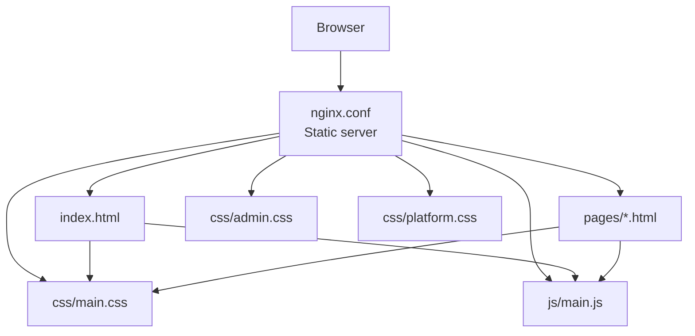
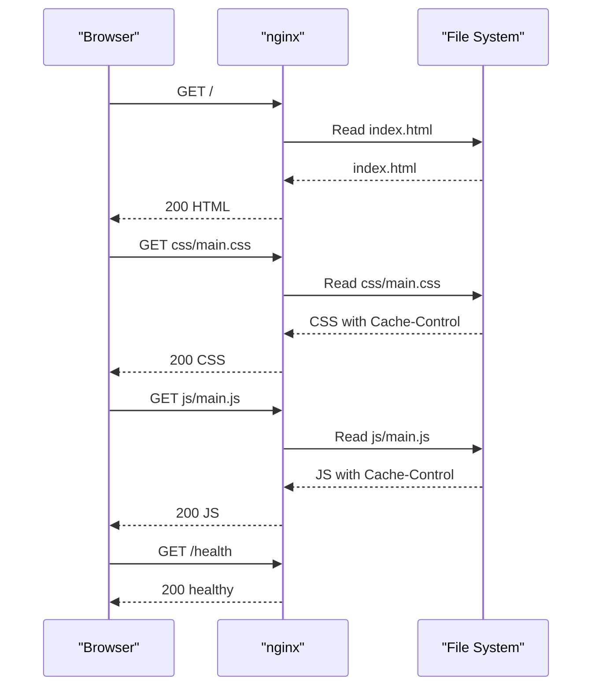
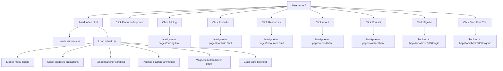
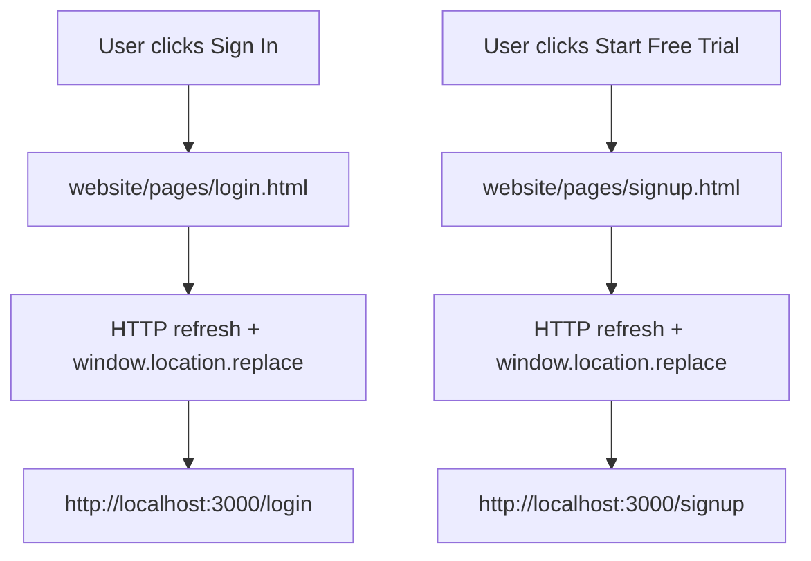
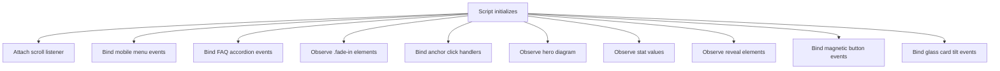
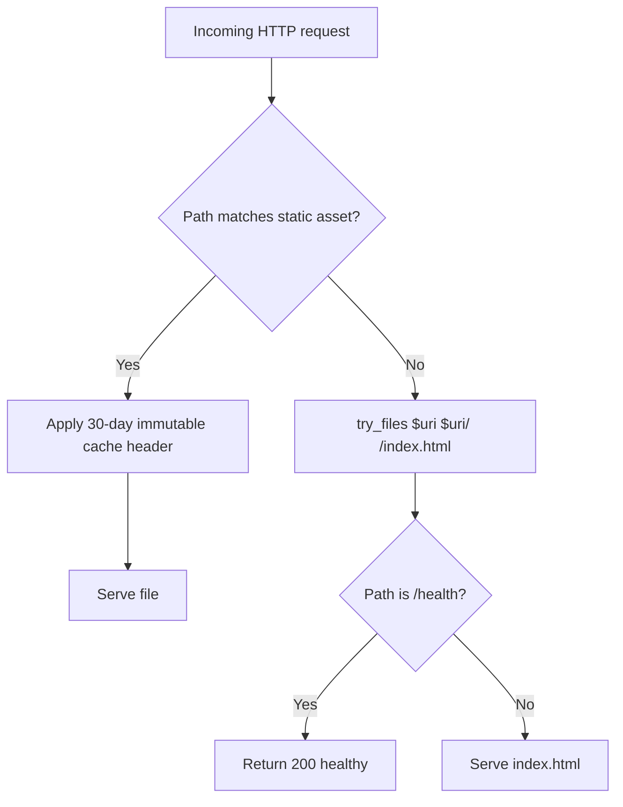
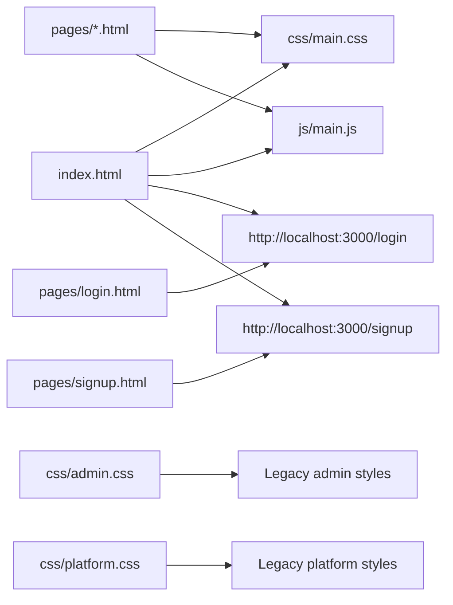

# Marketing Website

<cite>
**Referenced Files in This Document**   
- [index.html](file://website/index.html)
- [about.html](file://website/pages/about.html)
- [pricing.html](file://website/pages/pricing.html)
- [contact.html](file://website/pages/contact.html)
- [portfolio.html](file://website/pages/portfolio.html)
- [resources.html](file://website/pages/resources.html)
- [login.html](file://website/pages/login.html)
- [signup.html](file://website/pages/signup.html)
- [main.js](file://website/js/main.js)
- [main.css](file://website/css/main.css)
- [admin.css](file://website/css/admin.css)
- [platform.css](file://website/css/platform.css)
- [nginx.conf](file://website/nginx.conf)
</cite>

## Update Summary
**Changes Made**   
- Removed references to legacy static HTML stubs in website/platform/ directory (api-keys.html, cases.html, dashboard.html, transactions.html)
- Updated architecture diagrams to reflect current state without platform directory
- Clarified that all platform functionality is now handled by Next.js application in platform-app/
- Updated troubleshooting section to remove references to non-existent platform pages

## Table of Contents
1. [Introduction](#introduction)
2. [Project Structure](#project-structure)
3. [Core Components](#core-components)
4. [Architecture Overview](#architecture-overview)
5. [Detailed Component Analysis](#detailed-component-analysis)
6. [Dependency Analysis](#dependency-analysis)
7. [Performance Considerations](#performance-considerations)
8. [Troubleshooting Guide](#troubleshooting-guide)
9. [Conclusion](#conclusion)

## Introduction
This document describes the static marketing website under `website/`. It is a pure HTML, CSS, and JavaScript site served by nginx. The landing page is `index.html`, with additional informational pages under `website/pages/`. Authentication-related links on the marketing site redirect to the actual platform application at `http://localhost:3000`; the marketing site itself does not implement login or signup logic.

The marketing site is informational. The functional dashboard and application are provided by `platform-app/` (Next.js 14 App Router). All platform functionality is now exclusively handled by the Next.js application, with no legacy static HTML stubs remaining in the website directory.

## Project Structure
The marketing site lives under `website/`:

- `index.html` — Landing page with hero, features, portfolio highlights, pipeline explanation, industries, security, awards, testimonials, and call-to-action sections.
- `pages/` — Additional marketing pages:
  - `about.html`
  - `pricing.html`
  - `contact.html`
  - `portfolio.html`
  - `resources.html`
  - `login.html` — Redirects to the platform sign-in route.
  - `signup.html` — Redirects to the platform sign-up route.
- `css/` — Stylesheets:
  - `main.css` — Shared marketing theme.
  - `admin.css` — Legacy admin dashboard styles.
  - `platform.css` — Legacy platform dashboard styles.
- `js/main.js` — Shared interactive behavior for the marketing site.
- `nginx.conf` — nginx configuration for serving static content.
- `Dockerfile` and `.dockerignore` — Containerization artifacts referenced by the repository structure.

**Diagram sources**
- [nginx.conf:1-35](file://website/nginx.conf#L1-L35)
- [index.html:1-12](file://website/index.html#L1-L12)
- [about.html:1-12](file://website/pages/about.html#L1-L12)
- [pricing.html:1-12](file://website/pages/pricing.html#L1-L12)
- [contact.html:1-12](file://website/pages/contact.html#L1-L12)
- [portfolio.html:1-12](file://website/pages/portfolio.html#L1-L12)
- [resources.html:1-12](file://website/pages/resources.html#L1-L12)

**Section sources**
- [index.html:1-12](file://website/index.html#L1-L12)
- [nginx.conf:1-35](file://website/nginx.conf#L1-L35)

## Core Components
The marketing site has three primary concerns:

1. **Content pages** — Static HTML describing FinShield's compliance engine, pricing, portfolio, resources, about information, and contact details.
2. **Shared styling** — A main stylesheet defining brand colors, typography, layout utilities, navigation, hero, sections, cards, and responsive patterns.
3. **Shared interactivity** — A single JavaScript file handling mobile menu behavior, scroll effects, FAQ accordion behavior, intersection observer animations, smooth scrolling, and lightweight hover effects.

Key responsibilities:

| Area | Primary File(s) | Responsibility |
|---|---|---|
| Landing page | `index.html` | Hero, services, portfolio highlights, stats, pipeline, industries, security, awards, testimonials, CTA |
| Marketing pages | `pages/about.html`, `pages/pricing.html`, `pages/contact.html`, `pages/portfolio.html`, `pages/resources.html` | Informational content with shared navigation and footer |
| Auth redirects | `pages/login.html`, `pages/signup.html` | Redirect users to the platform application |
| Shared styles | `css/main.css` | Brand palette, layout, components, animations |
| Legacy admin styles | `css/admin.css` | Dashboard-style layout for legacy admin pages |
| Legacy platform styles | `css/platform.css` | Dark glassmorphism dashboard styles for legacy platform pages |
| Shared behavior | `js/main.js` | Mobile menu, scroll effects, FAQ, reveal animations, smooth scrolling, hover effects |
| Web server | `nginx.conf` | Static file serving, compression, caching, health endpoint, SPA fallback routing |

**Section sources**
- [index.html:1-12](file://website/index.html#L1-L12)
- [about.html:1-12](file://website/pages/about.html#L1-L12)
- [pricing.html:1-12](file://website/pages/pricing.html#L1-L12)
- [contact.html:1-12](file://website/pages/contact.html#L1-L12)
- [portfolio.html:1-12](file://website/pages/portfolio.html#L1-L12)
- [resources.html:1-12](file://website/pages/resources.html#L1-L12)
- [login.html:1-14](file://website/pages/login.html#L1-L14)
- [signup.html:1-14](file://website/pages/signup.html#L1-L14)
- [main.js:1-232](file://website/js/main.js#L1-L232)
- [main.css:1-800](file://website/css/main.css#L1-L800)
- [admin.css:1-800](file://website/css/admin.css#L1-L800)
- [platform.css:1-800](file://website/css/platform.css#L1-L800)
- [nginx.conf:1-35](file://website/nginx.conf#L1-L35)

## Architecture Overview
The runtime architecture for the marketing site is intentionally simple:

- nginx serves static HTML, CSS, JS, and images from `/usr/share/nginx/html`.
- `index.html` is the default index.
- Static assets such as CSS and JS are cached for 30 days with immutable cache headers.
- A `/health` endpoint returns a plain-text health response.
- All routes fall back to `index.html`, which supports anchor-based navigation within the landing page.

**Diagram sources**
- [nginx.conf:1-35](file://website/nginx.conf#L1-L35)
- [index.html:1-12](file://website/index.html#L1-L12)

**Section sources**
- [nginx.conf:1-35](file://website/nginx.conf#L1-L35)

## Detailed Component Analysis

### Landing Page (`index.html`)
`index.html` is the marketing entry point. It includes:

- A top bar with location labels and quick actions.
- A fixed navigation bar with dropdown menus for Platform and Solutions.
- A mobile menu controlled by `js/main.js`.
- A hero section describing the transaction compliance system.
- Sections for services, portfolio highlights, statistics, pipeline stages, industries, security, awards, testimonials, and a final call-to-action.
- Links to internal marketing pages and external platform routes.

Important routing behavior:

- Internal marketing pages use relative paths such as `pages/pricing.html`, `pages/portfolio.html`, `pages/resources.html`, `pages/about.html`, and `pages/contact.html`.
- Platform authentication flows link directly to `http://localhost:3000/login` and `http://localhost:3000/signup`.

**Diagram sources**
- [index.html:15-108](file://website/index.html#L15-L108)
- [index.html:133-224](file://website/index.html#L133-L224)
- [index.html:246-314](file://website/index.html#L246-L314)
- [index.html:318-412](file://website/index.html#L318-L412)
- [index.html:449-556](file://website/index.html#L449-L556)
- [index.html:560-616](file://website/index.html#L560-L616)
- [index.html:620-687](file://website/index.html#L620-L687)
- [index.html:691-732](file://website/index.html#L691-L732)
- [index.html:736-788](file://website/index.html#L736-L788)
- [index.html:792-800](file://website/index.html#L792-L800)

**Section sources**
- [index.html:1-12](file://website/index.html#L1-L12)
- [index.html:15-108](file://website/index.html#L15-L108)
- [index.html:133-224](file://website/index.html#L133-L224)
- [index.html:246-314](file://website/index.html#L246-L314)
- [index.html:318-412](file://website/index.html#L318-L412)
- [index.html:449-556](file://website/index.html#L449-L556)
- [index.html:560-616](file://website/index.html#L560-L616)
- [index.html:620-687](file://website/index.html#L620-L687)
- [index.html:691-732](file://website/index.html#L691-L732)
- [index.html:736-788](file://website/index.html#L736-L788)
- [index.html:792-800](file://website/index.html#L792-L800)

### Marketing Pages

#### About (`pages/about.html`)
Provides company background, values, leadership team, and calls to action. It shares the same navigation and footer pattern as other marketing pages and loads `../css/main.css` and `../js/main.js`.

**Section sources**
- [about.html:1-12](file://website/pages/about.html#L1-L12)
- [about.html:14-83](file://website/pages/about.html#L14-L83)
- [about.html:84-122](file://website/pages/about.html#L84-L122)
- [about.html:124-164](file://website/pages/about.html#L124-L164)
- [about.html:166-200](file://website/pages/about.html#L166-L200)
- [about.html:202-247](file://website/pages/about.html#L202-L247)

#### Pricing (`pages/pricing.html`)
Describes a credits-based pricing model with Starter, Growth, and Enterprise tiers. It includes a monthly/annual toggle implemented inline in the page script.

Key elements:

- Plan names and descriptions.
- Monthly and annual amounts stored in data attributes.
- Feature lists per plan.
- Credit consumption explanation.
- Add-ons section.
- FAQ accordion using the shared `faq-item` classes.

**Section sources**
- [pricing.html:1-12](file://website/pages/pricing.html#L1-L12)
- [pricing.html:14-74](file://website/pages/pricing.html#L14-L74)
- [pricing.html:75-86](file://website/pages/pricing.html#L75-L86)
- [pricing.html:88-165](file://website/pages/pricing.html#L88-L165)
- [pricing.html:167-192](file://website/pages/pricing.html#L167-L192)
- [pricing.html:194-226](file://website/pages/pricing.html#L194-L226)
- [pricing.html:228-251](file://website/pages/pricing.html#L228-L251)
- [pricing.html:253-279](file://website/pages/pricing.html#L253-L279)
- [pricing.html:279-298](file://website/pages/pricing.html#L279-L298)

#### Contact (`pages/contact.html`)
Provides contact information and a client-side form. The form fields include name, email, phone, company, interest, message, and an NDA checkbox. There is no backend submission handler in this file; it is a static marketing form.

**Section sources**
- [contact.html:1-12](file://website/pages/contact.html#L1-L12)
- [contact.html:14-62](file://website/pages/contact.html#L14-L62)
- [contact.html:63-74](file://website/pages/contact.html#L63-L74)
- [contact.html:76-156](file://website/pages/contact.html#L76-L156)
- [contact.html:158-182](file://website/pages/contact.html#L158-L182)

#### Portfolio (`pages/portfolio.html`)
Showcases case studies across fintech, banking, payments, and crypto. It includes filter buttons that are present in the markup but do not have dedicated filtering logic in the included scripts.

**Section sources**
- [portfolio.html:1-12](file://website/pages/portfolio.html#L1-L12)
- [portfolio.html:14-18](file://website/pages/portfolio.html#L14-L18)
- [portfolio.html:20-27](file://website/pages/portfolio.html#L20-L27)
- [portfolio.html:29-130](file://website/pages/portfolio.html#L29-L130)
- [portfolio.html:132-142](file://website/pages/portfolio.html#L132-L142)
- [portfolio.html:144-168](file://website/pages/portfolio.html#L144-L168)

#### Resources (`pages/resources.html`)
Lists whitepapers, guides, case studies, API documentation references, webinars, reports, and blog posts. It is primarily informational and uses shared styling classes.

**Section sources**
- [resources.html:1-12](file://website/pages/resources.html#L1-L12)
- [resources.html:14-17](file://website/pages/resources.html#L14-L17)
- [resources.html:19-26](file://website/pages/resources.html#L19-L26)
- [resources.html:28-118](file://website/pages/resources.html#L28-L118)
- [resources.html:120-149](file://website/pages/resources.html#L120-L149)

#### Login and Signup Redirects
`pages/login.html` and `pages/signup.html` are minimal redirect pages. They use both meta refresh and JavaScript redirection to send users to the platform application at `http://localhost:3000`.

**Diagram sources**
- [login.html:1-14](file://website/pages/login.html#L1-L14)
- [signup.html:1-14](file://website/pages/signup.html#L1-L14)

**Section sources**
- [login.html:1-14](file://website/pages/login.html#L1-L14)
- [signup.html:1-14](file://website/pages/signup.html#L1-L14)

### CSS Architecture

#### Main Theme (`css/main.css`)
`main.css` defines the marketing site's design system:

- CSS custom properties for brand colors, neutrals, semantic tokens, typography, spacing, layout widths, borders, shadows, transitions, and easing.
- Reset and base styles.
- Utility classes such as container sizing and screen-reader-only text.
- Typography scale and label styles.
- Button variants: primary, secondary, dark, outline-light, large, ghost.
- Navigation styles including fixed positioning, logo area, links, dropdown indicators, and mobile toggle.
- Hero section styles, including a pipeline diagram visualization.
- Trust bar, section layouts, feature grids, pipeline visuals, industry cards, security categories, awards, testimonials, and footer structures.

This stylesheet is loaded by `index.html` and all marketing pages except the legacy admin and platform console pages.

**Section sources**
- [main.css:1-800](file://website/css/main.css#L1-L800)

#### Admin Theme (`css/admin.css`)
`admin.css` provides a light-background admin dashboard layout with:

- Fixed sidebar with navigation items and user area.
- Sticky top bar with search and action icons.
- KPI cards, chart placeholders, donut charts, tables, customer lists, system health cards, and alerts.
- Responsive grid adjustments.

These styles target legacy admin pages rather than the current Next.js dashboard.

**Section sources**
- [admin.css:1-800](file://website/css/admin.css#L1-L800)

#### Platform Theme (`css/platform.css`)
`platform.css` provides a dark, glassmorphism-style dashboard layout with:

- Custom variables for dark backgrounds, surfaces, borders, text, accents, and glass effects.
- Fixed sidebar with navigation sections and active states.
- Sticky topbar with search, notification badges, and credits display.
- Glass cards, KPI cards, chart placeholders, donut charts, tables, activity feed, system health indicators, and button variants.

These styles target legacy platform console pages. The current functional dashboard is implemented in `platform-app/`.

**Section sources**
- [platform.css:1-800](file://website/css/platform.css#L1-L800)

### JavaScript Functionality (`js/main.js`)
`js/main.js` implements shared client-side behavior for the marketing site:

| Feature | Behavior |
|---|---|
| Navigation scroll effect | Adds or removes a scrolled class when the page is scrolled past a small threshold. |
| Mobile menu | Opens and closes the mobile menu, locks body overflow, handles overlay clicks, link clicks, and Escape key presses. |
| FAQ accordion | Toggles `data-open` state on FAQ items and collapses other open items. |
| Fade-in animations | Uses `IntersectionObserver` to add a visible class to elements with the `fade-in` class. Falls back to immediately showing them if the observer is unavailable. |
| Smooth scrolling | Intercepts anchor links, prevents default navigation for hash links, calculates offset based on navigation height, and scrolls smoothly. |
| Pipeline diagram animation | Observes the hero diagram and animates pipeline stages with staggered opacity and transform transitions. |
| Stats visibility | Observes stat value elements and adds a visible class when they enter the viewport. |
| Reveal animations | Observes elements with reveal-related classes and adds a visible class. |
| Magnetic button hover | Updates CSS custom properties for mouse position on magnetic buttons. |
| Glassmorphism tilt | Applies perspective transforms to glass-card-like elements on mouse move and resets them on mouse leave. |

**Diagram sources**
- [main.js:9-23](file://website/js/main.js#L9-L23)
- [main.js:25-55](file://website/js/main.js#L25-L55)
- [main.js:57-73](file://website/js/main.js#L57-L73)
- [main.js:75-102](file://website/js/main.js#L75-L102)
- [main.js:104-122](file://website/js/main.js#L104-L122)
- [main.js:124-159](file://website/js/main.js#L124-L159)
- [main.js:161-180](file://website/js/main.js#L161-L180)
- [main.js:182-205](file://website/js/main.js#L182-L205)
- [main.js:207-229](file://website/js/main.js#L207-L229)

**Section sources**
- [main.js:1-232](file://website/js/main.js#L1-L232)

### Nginx Configuration
`nginx.conf` configures nginx as a static site server:

- Listens on port 80.
- Serves files from `/usr/share/nginx/html`.
- Sets `index.html` as the default document.
- Enables gzip compression for common text-based asset types.
- Adds security headers: `X-Frame-Options`, `X-Content-Type-Options`, and `X-XSS-Protection`.
- Caches static assets with a 30-day expiration and immutable cache control.
- Falls back to `index.html` for all routes.
- Exposes a `/health` endpoint returning a plain-text health status.

**Diagram sources**
- [nginx.conf:1-35](file://website/nginx.conf#L1-L35)

**Section sources**
- [nginx.conf:1-35](file://website/nginx.conf#L1-L35)

## Dependency Analysis
The marketing site has low coupling between its own files and higher-level application code:

- HTML pages depend on `css/main.css` and `js/main.js`.
- The marketing site does not import backend APIs directly.
- Authentication and account creation are delegated to the platform application via absolute URLs to `http://localhost:3000`.
- All platform functionality is now exclusively handled by the Next.js application in `platform-app/`, with no legacy static HTML stubs remaining.

**Diagram sources**
- [index.html:25-28](file://website/index.html#L25-L28)
- [index.html:100-103](file://website/index.html#L100-L103)
- [login.html:1-14](file://website/pages/login.html#L1-L14)
- [signup.html:1-14](file://website/pages/signup.html#L1-L14)

**Section sources**
- [index.html:25-28](file://website/index.html#L25-L28)
- [index.html:100-103](file://website/index.html#L100-L103)
- [login.html:1-14](file://website/pages/login.html#L1-L14)
- [signup.html:1-14](file://website/pages/signup.html#L1-L14)

## Performance Considerations
The marketing site is optimized for static delivery:

- Gzip compression is enabled for text-based asset types.
- Static assets receive long-lived cache headers with immutable directives.
- The site avoids heavy client-side frameworks.
- Animations rely on lightweight DOM manipulation and `IntersectionObserver`.
- The `/health` endpoint is lightweight and intended for liveness checks.

Recommendations:

- Keep `js/main.js` focused on marketing interactions; avoid adding heavy third-party libraries unless necessary.
- Prefer CSS animations where possible to reduce JavaScript work.
- Ensure new images are optimized before deployment.
- Validate that any new static assets are covered by the existing nginx cache rule.

[No sources needed since this section provides general guidance]

## Troubleshooting Guide

### Marketing pages do not load styles
- Verify that `css/main.css` is reachable from the deployed root.
- Confirm that pages reference `../css/main.css` correctly when located under `pages/`.
- Check browser network requests for 404 responses.

**Section sources**
- [about.html:1-12](file://website/pages/about.html#L1-L12)
- [pricing.html:1-12](file://website/pages/pricing.html#L1-L12)
- [contact.html:1-12](file://website/pages/contact.html#L1-L12)
- [portfolio.html:1-12](file://website/pages/portfolio.html#L1-L12)
- [resources.html:1-12](file://website/pages/resources.html#L1-L12)

### Login and signup links go to localhost
- The marketing site hardcodes `http://localhost:3000/login` and `http://localhost:3000/signup`.
- Update these URLs in `index.html` and related pages if the platform is hosted elsewhere.

**Section sources**
- [index.html:25-28](file://website/index.html#L25-L28)
- [index.html:100-103](file://website/index.html#L100-L103)
- [login.html:1-14](file://website/pages/login.html#L1-L14)
- [signup.html:1-14](file://website/pages/signup.html#L1-L14)

### Mobile menu does not close
- Ensure `js/main.js` is loaded after the DOM elements exist.
- Verify that the mobile menu IDs match those expected by the script: `mobileToggle`, `mobileMenu`, `mobileClose`, and `mobileOverlay`.

**Section sources**
- [main.js:25-55](file://website/js/main.js#L25-L55)

### FAQ accordion does not work
- Ensure FAQ items use the `faq-item__question` class and questions use `faq-item__question`.
- Confirm that `data-open` attributes are present on FAQ containers.

**Section sources**
- [main.js:57-73](file://website/js/main.js#L57-L73)
- [pricing.html:232-249](file://website/pages/pricing.html#L232-L249)

### Health check fails
- Confirm nginx is running and listening on port 80.
- Verify the `/health` route is not overridden by another configuration.
- Check that the response is `200` with plain text content.

**Section sources**
- [nginx.conf:28-33](file://website/nginx.conf#L28-L33)

## Conclusion
The marketing website is a static, content-focused site built with HTML, CSS, and JavaScript and served by nginx. Its purpose is to describe FinShield's compliance capabilities, pricing, portfolio, resources, and contact information. It delegates authentication and account creation to the platform application at `http://localhost:3000`.

For maintenance:

- Update marketing content in `index.html` and the relevant page under `pages/`.
- Modify shared visual behavior through `js/main.js`.
- Adjust branding and layout through `css/main.css`.
- Treat `css/admin.css` and `css/platform.css` as legacy dashboard styles.
- Do not confuse the marketing site with `platform-app/`, which provides the functional Next.js dashboard.
- When deploying, ensure nginx serves the correct static root and that platform URLs are configured for the production environment.

[No sources needed since this section summarizes without analyzing specific files]