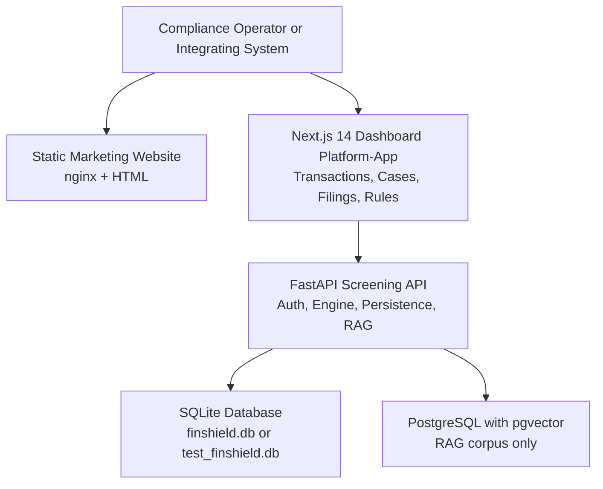
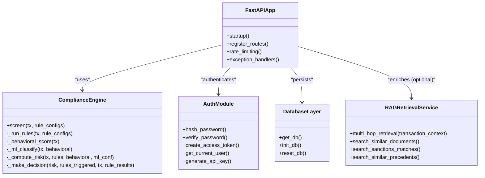
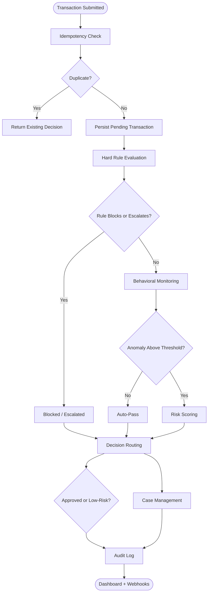
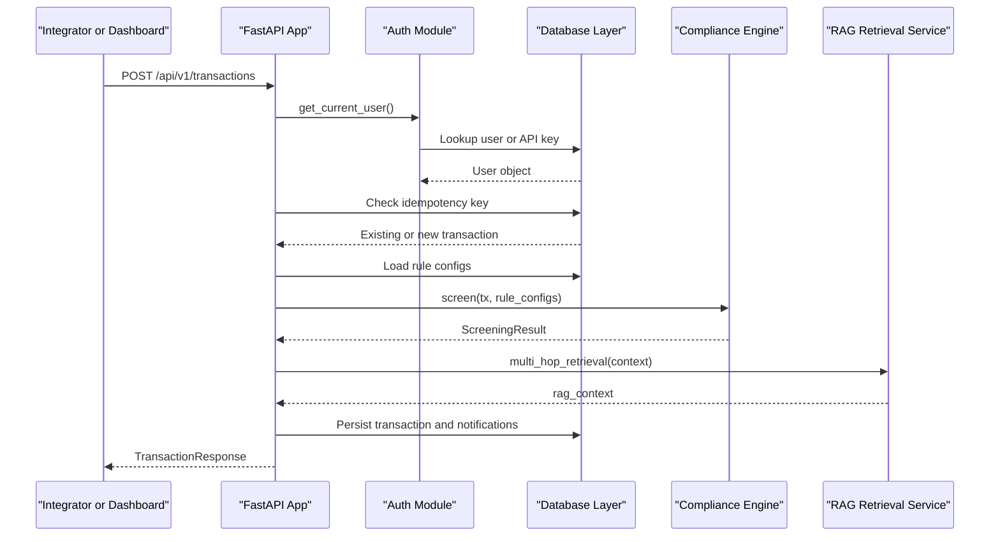
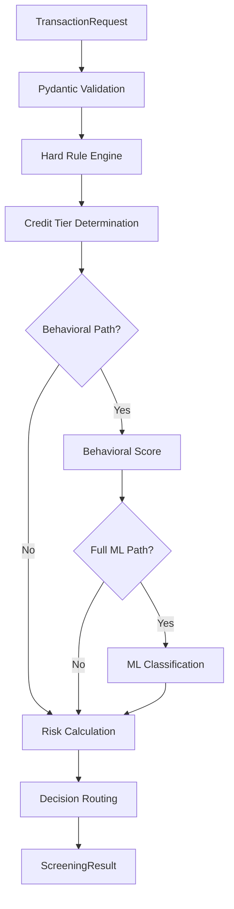
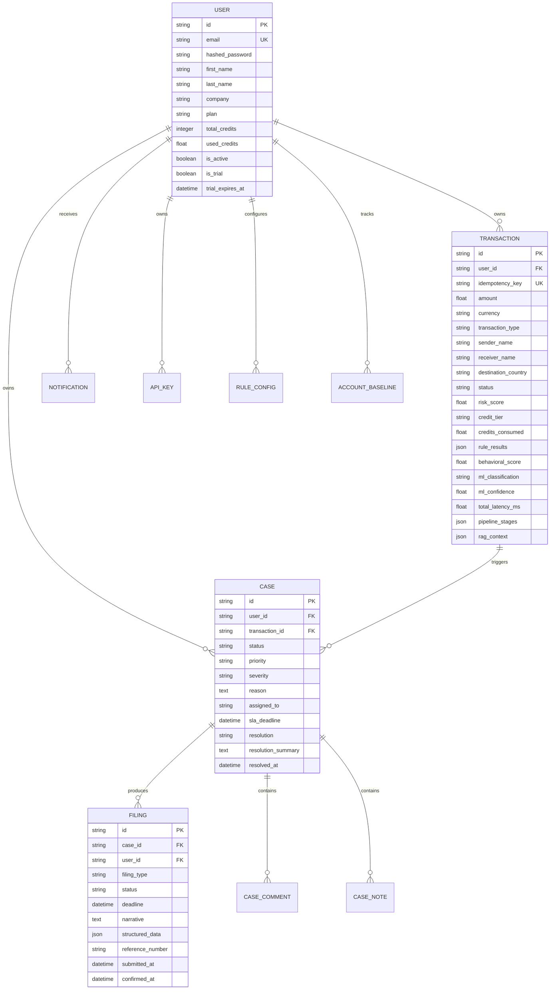
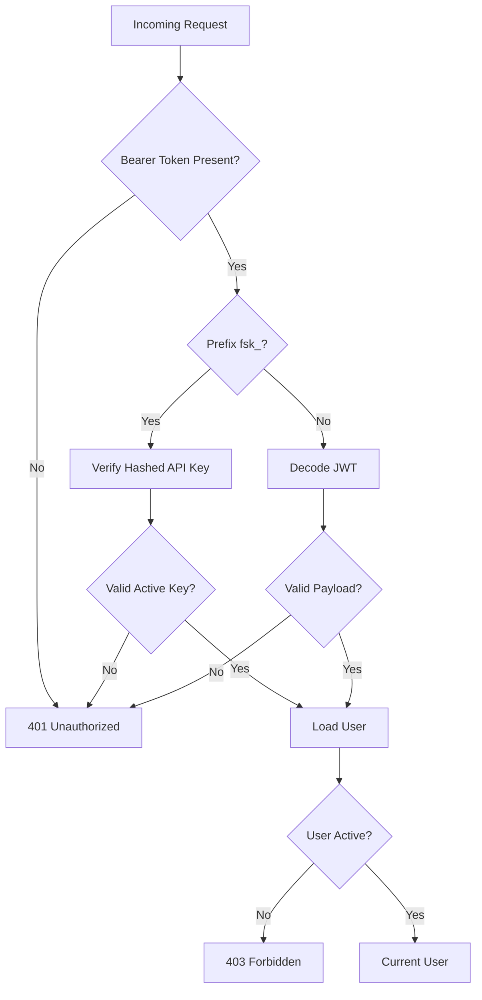
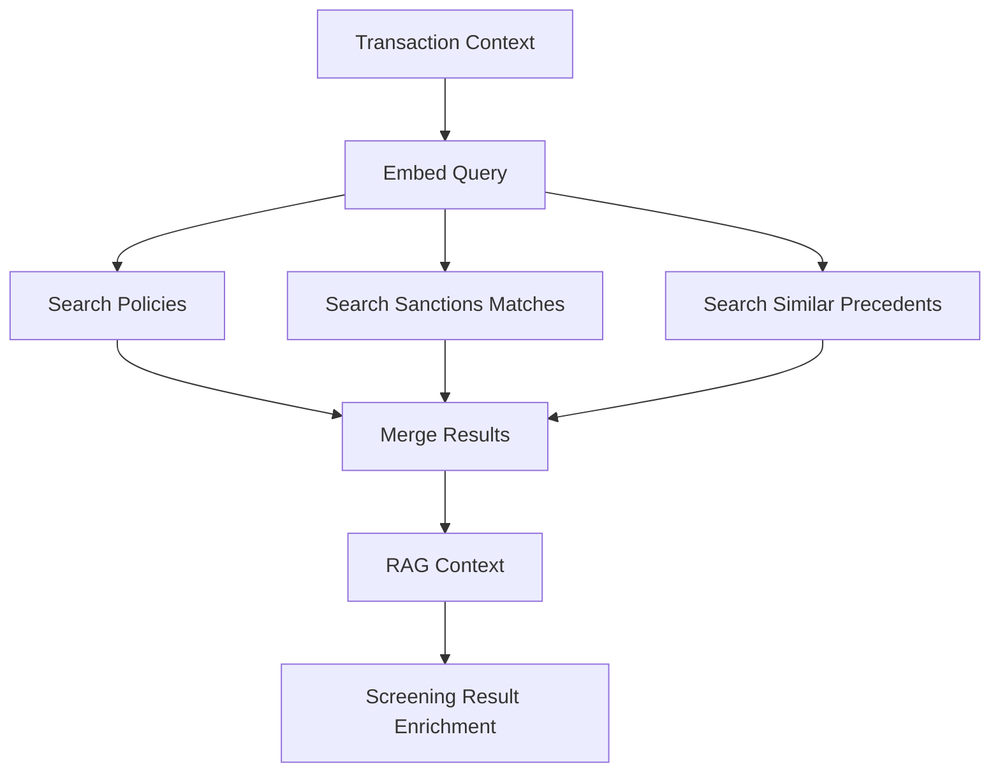
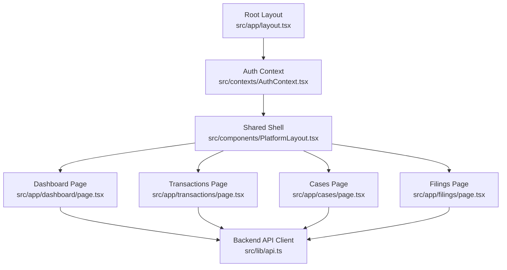
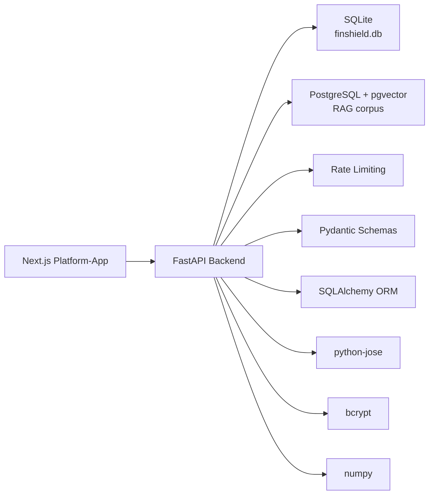

# Project Overview

<cite>
**Referenced Files in This Document**
- [README.md](file://README.md)
- [FinShield-AI-Wiki.md](file://FinShield-AI-Wiki.md)
- [backend/requirements.txt](file://backend/requirements.txt)
- [docker-compose.yml](file://docker-compose.yml)
- [backend/app/main.py](file://backend/app/main.py)
- [backend/app/compliance_engine.py](file://backend/app/compliance_engine.py)
- [backend/app/database.py](file://backend/app/database.py)
- [backend/app/db_models.py](file://backend/app/db_models.py)
- [backend/app/models.py](file://backend/app/models.py)
- [backend/app/auth.py](file://backend/app/auth.py)
- [backend/app/rag_service.py](file://backend/app/rag_service.py)
- [backend/app/seed_rag_data.py](file://backend/app/seed_rag_data.py)
- [platform-app/package.json](file://platform-app/package.json)
- [platform-app/AGENTS.md](file://platform-app/AGENTS.md)
- [platform-app/src/lib/api.ts](file://platform-app/src/lib/api.ts)
- [platform-app/src/contexts/AuthContext.tsx](file://platform-app/src/contexts/AuthContext.tsx)
- [platform-app/src/components/PlatformLayout.tsx](file://platform-app/src/components/PlatformLayout.tsx)
- [platform-app/src/app/layout.tsx](file://platform-app/src/app/layout.tsx)
- [platform-app/src/app/dashboard/page.tsx](file://platform-app/src/app/dashboard/page.tsx)
- [platform-app/src/app/transactions/page.tsx](file://platform-app/src/app/transactions/page.tsx)
- [platform-app/src/app/cases/page.tsx](file://platform-app/src/app/cases/page.tsx)
- [platform-app/src/app/filings/page.tsx](file://platform-app/src/app/filings/page.tsx)
</cite>

## Table of Contents
1. [Introduction](#introduction)
2. [Project Structure](#project-structure)
3. [Core Components](#core-components)
4. [Architecture Overview](#architecture-overview)
5. [Detailed Component Analysis](#detailed-component-analysis)
6. [Dependency Analysis](#dependency-analysis)
7. [Performance Considerations](#performance-considerations)
8. [Troubleshooting Guide](#troubleshooting-guide)
9. [Conclusion](#conclusion)

## Introduction
FinShield AI is a local-first transaction compliance engine designed for fintechs and banks that must screen every transaction against hard compliance rules, behavioral monitoring, and optional ML-assisted classification while keeping all inference and data under operator control. Its value proposition is full-lifecycle compliance: detection, investigation through case management, and regulatory filing support, backed by an audit trail defensible to regulators.

The shipped system consists of three real deployables:
- Backend FastAPI screening API: the compliance engine, persistence layer, authentication, rate limiting, and RAG retrieval service.
- Next.js 14 dashboard platform-app: the operational console for transactions, cases, filings, rules, reports, settings, and API keys.
- Static marketing website: a separate nginx-served site with legacy platform console pages superseded by the Next.js dashboard.

For beginners, AML/KYC screening means checking payments and transfers against sanctions, politically exposed persons, high-risk jurisdictions, reporting thresholds, and internal risk policies before allowing them to proceed. FinShield automates this process so institutions can cover 100% of transactions without manually reviewing every one, while still providing investigators a case-centric workspace for suspicious activity.

For experienced developers, FinShield exposes a versioned FastAPI surface, Pydantic request/response schemas, SQLAlchemy ORM entities, JWT/API-key authentication, idempotent transaction submission, rule-driven gating, behavioral scoring, pgvector-based retrieval, and a configurable pipeline that routes low-risk traffic to auto-resolve and higher-risk traffic to human review.

**Section sources**
- [README.md:18-28](file://README.md#L18-L28)
- [FinShield-AI-Wiki.md:9-31](file://FinShield-AI-Wiki.md#L9-L31)

## Project Structure
The repository ships three main runtime surfaces rather than the aspirational directory layout shown in the README’s “Project Structure” section. The actual code lives under `backend/`, `platform-app/`, and `website/`.

| Deployable | Purpose | Key files |
|---|---|---|
| Backend FastAPI screening API | Transaction ingestion, compliance engine, auth, persistence, rate limiting, RAG enrichment | `backend/app/main.py`, `backend/app/compliance_engine.py`, `backend/app/database.py`, `backend/app/db_models.py`, `backend/app/models.py`, `backend/app/auth.py`, `backend/app/rag_service.py` |
| Next.js 14 dashboard platform-app | Case-centric compliance console for transactions, cases, filings, rules, reports, settings, and API keys | `platform-app/src/app/*`, `platform-app/src/components/PlatformLayout.tsx`, `platform-app/src/contexts/AuthContext.tsx`, `platform-app/src/lib/api.ts` |
| Static marketing website | Public landing/marketing site plus legacy HTML console pages | `website/index.html`, `website/pages/*`, `website/platform/*.html`, `website/nginx.conf` |

**Diagram sources**
- [docker-compose.yml:3-61](file://docker-compose.yml#L3-L61)
- [backend/app/database.py:11-15](file://backend/app/database.py#L11-L15)
- [backend/app/rag_service.py:148-155](file://backend/app/rag_service.py#L148-L155)

Important structural notes:
- `docker-compose.yml` defines exactly three services: `postgres`, `backend`, and `frontend`. The frontend builds `platform-app/Dockerfile`; it does not build `website/`.
- `website/platform/*.html` is the legacy console; `platform-app/` is the current dashboard.
- The backend defaults to SQLite for normal persistence but uses PostgreSQL only when `DATABASE_URL` points to Postgres; the RAG retrieval path requires PostgreSQL because it creates the `vector` extension and stores embeddings.

**Section sources**
- [docker-compose.yml:3-61](file://docker-compose.yml#L3-L61)
- [backend/app/database.py:11-15](file://backend/app/database.py#L11-L15)
- [platform-app/AGENTS.md:1-10](file://platform-app/AGENTS.md#L1-L10)

## Core Components
FinShield’s core is the FastAPI application mounted from `backend/app/main.py`. It wires together:
- Authentication via JWT bearer tokens and hashed API keys.
- Rate limiting through `slowapi`.
- Request validation and response modeling through Pydantic.
- Persistence through SQLAlchemy and SQLite by default.
- The compliance engine that evaluates hard rules, behavioral signals, ML classification, risk scoring, and final decision logic.
- Optional RAG enrichment over a PostgreSQL/pgvector corpus.

The shipped stack is exactly what `backend/requirements.txt` declares: FastAPI 0.115, Uvicorn, Pydantic 2.9, pytest, httpx, SQLAlchemy 2.0, python-jose with cryptography, bcrypt, python-multipart, python-dotenv, slowapi, psycopg2-binary, pgvector, and numpy. Items such as Celery, Redis, LangChain, DSPy, LoRA/PEFT/BitsAndBytes, vLLM, RAGAS, HashiCorp Vault, OpenTelemetry, Prometheus, structlog, and Kubernetes/Helm are roadmap items described in the README and Wiki, not present in the current runtime.

**Diagram sources**
- [backend/app/main.py:54-152](file://backend/app/main.py#L54-L152)
- [backend/app/compliance_engine.py:30-162](file://backend/app/compliance_engine.py#L30-L162)
- [backend/app/auth.py:30-122](file://backend/app/auth.py#L30-L122)
- [backend/app/database.py:17-45](file://backend/app/database.py#L17-L45)
- [backend/app/rag_service.py:145-412](file://backend/app/rag_service.py#L145-L412)

**Section sources**
- [backend/requirements.txt:1-16](file://backend/requirements.txt#L1-L16)
- [backend/app/main.py:54-152](file://backend/app/main.py#L54-L152)
- [backend/app/compliance_engine.py:30-162](file://backend/app/compliance_engine.py#L30-L162)
- [backend/app/auth.py:30-122](file://backend/app/auth.py#L30-L122)
- [backend/app/database.py:17-45](file://backend/app/database.py#L17-L45)
- [backend/app/rag_service.py:145-412](file://backend/app/rag_service.py#L145-L412)

## Architecture Overview
A transaction enters the compliance engine through the FastAPI `/api/v1/transactions` endpoint. The first gate is idempotency: duplicate submissions return the existing decision without reprocessing. After persistence as pending, the engine runs deterministic hard rules, then behavioral analysis, then optional ML classification, then risk scoring, and finally decision routing.

**Diagram sources**
- [backend/app/main.py:434-570](file://backend/app/main.py#L434-L570)
- [backend/app/compliance_engine.py:89-162](file://backend/app/compliance_engine.py#L89-L162)
- [backend/app/compliance_engine.py:164-380](file://backend/app/compliance_engine.py#L164-L380)

The architecture emphasizes:
- Deterministic hard rules before any ML path.
- Cheap behavioral checks gating expensive ML/RAG paths.
- Case-centric workflows for flagged or blocked transactions.
- Optional RAG enrichment that can reinforce escalation but never silently auto-approve.
- Append-only auditability through persisted transaction records, rule results, behavioral scores, ML outputs, and pipeline stages.

**Section sources**
- [FinShield-AI-Wiki.md:62-216](file://FinShield-AI-Wiki.md#L62-L216)
- [backend/app/main.py:434-570](file://backend/app/main.py#L434-L570)
- [backend/app/compliance_engine.py:89-380](file://backend/app/compliance_engine.py#L89-L380)

## Detailed Component Analysis

### Backend FastAPI Screening API
The backend is the compliance engine boundary. On startup it initializes the database, optionally initializes the RAG retrieval service if `RAG_DATABASE_URL` points to PostgreSQL and optional dependencies are available, and mounts CORS, rate limiting, exception handlers, and API routes.

Key responsibilities:
- User registration, login, profile updates, and password changes.
- API key creation, listing, and revocation.
- Transaction screening with idempotency, credit tracking, rule configuration loading, engine execution, RAG enrichment, notification creation, and persistence.
- Transaction listing, detail retrieval, deletion, and CSV export.
- Case creation and retrieval.

**Diagram sources**
- [backend/app/main.py:133-152](file://backend/app/main.py#L133-L152)
- [backend/app/main.py:434-570](file://backend/app/main.py#L434-L570)
- [backend/app/auth.py:59-122](file://backend/app/auth.py#L59-L122)
- [backend/app/database.py:27-45](file://backend/app/database.py#L27-L45)
- [backend/app/compliance_engine.py:89-162](file://backend/app/compliance_engine.py#L89-L162)
- [backend/app/rag_service.py:361-412](file://backend/app/rag_service.py#L361-L412)

**Section sources**
- [backend/app/main.py:54-152](file://backend/app/main.py#L54-L152)
- [backend/app/main.py:176-570](file://backend/app/main.py#L176-L570)
- [backend/app/auth.py:30-122](file://backend/app/auth.py#L30-L122)
- [backend/app/database.py:17-45](file://backend/app/database.py#L17-L45)

### Compliance Engine: Hard Rules, Behavioral Monitoring, and Decision Logic
The compliance engine implements the seven-stage pipeline: idempotency check, validation, hard rule evaluation, behavioral analysis, ML classification, risk scoring, and decision. Hard rules include sanctions matching, PEP checks, amount thresholds, and high-risk geography checks. Behavioral scoring adds anomaly signals based on amount, transaction type, destination country, and randomness. Risk scoring combines rule hits, behavioral score, and ML confidence. Decision logic enforces mandatory rule actions like block, escalate, flag, or review, then falls back to score-based routing.

**Diagram sources**
- [backend/app/compliance_engine.py:89-162](file://backend/app/compliance_engine.py#L89-L162)
- [backend/app/compliance_engine.py:164-380](file://backend/app/compliance_engine.py#L164-L380)
- [backend/app/models.py:67-119](file://backend/app/models.py#L67-L119)

**Section sources**
- [backend/app/compliance_engine.py:30-380](file://backend/app/compliance_engine.py#L30-L380)
- [backend/app/models.py:15-119](file://backend/app/models.py#L15-L119)

### Data Models and Persistence
Persistence is split between two concerns:
- Operational persistence: SQLite by default (`finshield.db`) or `test_finshield.db` in tests, configured through `backend/app/database.py`.
- RAG corpus persistence: PostgreSQL with pgvector, initialized separately when `RAG_DATABASE_URL` starts with `postgresql`.

SQLAlchemy models define users, API keys, transactions, cases, audit logs, notifications, rule configurations, case comments, case notes, filings, circuit breakers, webhook events, and account baselines. Pydantic models define request and response contracts for the API.

**Diagram sources**
- [backend/app/db_models.py:22-353](file://backend/app/db_models.py#L22-L353)
- [backend/app/database.py:11-45](file://backend/app/database.py#L11-L45)

**Section sources**
- [backend/app/database.py:11-45](file://backend/app/database.py#L11-L45)
- [backend/app/db_models.py:22-353](file://backend/app/db_models.py#L22-L353)
- [backend/app/models.py:67-152](file://backend/app/models.py#L67-L152)

### Authentication and Authorization
Authentication supports two paths:
- JWT bearer tokens issued after login.
- Live API keys with a hashed prefix stored in the database.

Passwords are hashed with bcrypt, tokens are created and decoded with python-jose, and the current user dependency validates both token types before returning a user object.

**Diagram sources**
- [backend/app/auth.py:30-122](file://backend/app/auth.py#L30-L122)

**Section sources**
- [backend/app/auth.py:30-122](file://backend/app/auth.py#L30-L122)

### RAG Retrieval and Corpus Seeding
The RAG retrieval service provides semantic search over compliance documents, sanctions entries, and precedent decisions using pgvector. By default it uses deterministic hashing-based embeddings with numpy; optional sentence-transformers embeddings can be enabled through environment configuration. The service creates the `vector` extension and tables on the PostgreSQL connection used for RAG.

Corpus seeding populates sample compliance regulations, OFAC-style sanctions entries, and historical precedent decisions. During transaction screening, RAG enrichment is non-blocking: if unavailable, screening still completes normally, but strong sanctions matches can reinforce escalation.

**Diagram sources**
- [backend/app/rag_service.py:145-412](file://backend/app/rag_service.py#L145-L412)
- [backend/app/seed_rag_data.py:10-198](file://backend/app/seed_rag_data.py#L10-L198)
- [backend/app/main.py:484-506](file://backend/app/main.py#L484-L506)

**Section sources**
- [backend/app/rag_service.py:1-412](file://backend/app/rag_service.py#L1-L412)
- [backend/app/seed_rag_data.py:1-198](file://backend/app/seed_rag_data.py#L1-L198)
- [backend/app/main.py:484-506](file://backend/app/main.py#L484-L506)

### Next.js 14 Dashboard Platform-App
The platform-app is version 2.4.0, built on Next.js 14.2 App Router, React 18, Tailwind CSS, and TypeScript. Its shared shell is `src/components/PlatformLayout.tsx`, which composes `Sidebar` and `Topbar`. Authentication state is managed by `src/contexts/AuthContext.tsx`, and all backend calls go through `src/lib/api.ts`.

Routes include dashboard, transactions, cases, filings, rules, reports, settings, api-keys, docs, login, and signup. The root layout sets metadata and wraps the app in `AuthProvider`.

**Diagram sources**
- [platform-app/src/app/layout.tsx:1-26](file://platform-app/src/app/layout.tsx#L1-L26)
- [platform-app/src/components/PlatformLayout.tsx:1-20](file://platform-app/src/components/PlatformLayout.tsx#L1-L20)
- [platform-app/src/contexts/AuthContext.tsx:1-107](file://platform-app/src/contexts/AuthContext.tsx#L1-L107)
- [platform-app/src/lib/api.ts:357-631](file://platform-app/src/lib/api.ts#L357-L631)
- [platform-app/src/app/dashboard/page.tsx:17-269](file://platform-app/src/app/dashboard/page.tsx#L17-L269)
- [platform-app/src/app/transactions/page.tsx:17-585](file://platform-app/src/app/transactions/page.tsx#L17-L585)
- [platform-app/src/app/cases/page.tsx:50-415](file://platform-app/src/app/cases/page.tsx#L50-L415)
- [platform-app/src/app/filings/page.tsx:21-347](file://platform-app/src/app/filings/page.tsx#L21-L347)

**Section sources**
- [platform-app/package.json:1-28](file://platform-app/package.json#L1-L28)
- [platform-app/AGENTS.md:1-10](file://platform-app/AGENTS.md#L1-L10)
- [platform-app/src/app/layout.tsx:1-26](file://platform-app/src/app/layout.tsx#L1-L26)
- [platform-app/src/components/PlatformLayout.tsx:1-20](file://platform-app/src/components/PlatformLayout.tsx#L1-L20)
- [platform-app/src/contexts/AuthContext.tsx:1-107](file://platform-app/src/contexts/AuthContext.tsx#L1-L107)
- [platform-app/src/lib/api.ts:1-631](file://platform-app/src/lib/api.ts#L1-L631)

### Static Marketing Website and Legacy Console
The static website is served independently from the compose stack. It includes `index.html`, marketing pages under `pages/`, and legacy platform console pages under `platform/`. These legacy HTML pages are superseded by the Next.js dashboard platform-app and should be treated as historical UI rather than the current operational console.

**Section sources**
- [docker-compose.yml:24-61](file://docker-compose.yml#L24-L61)
- [website/index.html](file://website/index.html)
- [website/pages/about.html](file://website/pages/about.html)
- [website/platform/dashboard.html](file://website/platform/dashboard.html)

## Dependency Analysis
The runtime dependency graph centers on the backend FastAPI application. The Next.js dashboard depends on the backend through its API client. PostgreSQL is required for pgvector RAG retrieval, while SQLite is the default operational database.

**Diagram sources**
- [backend/requirements.txt:1-16](file://backend/requirements.txt#L1-L16)
- [backend/app/database.py:11-15](file://backend/app/database.py#L11-L15)
- [backend/app/rag_service.py:148-155](file://backend/app/rag_service.py#L148-L155)
- [platform-app/src/lib/api.ts:373-408](file://platform-app/src/lib/api.ts#L373-L408)

**Section sources**
- [backend/requirements.txt:1-16](file://backend/requirements.txt#L1-L16)
- [backend/app/database.py:11-15](file://backend/app/database.py#L11-L15)
- [backend/app/rag_service.py:148-155](file://backend/app/rag_service.py#L148-L155)
- [platform-app/src/lib/api.ts:373-408](file://platform-app/src/lib/api.ts#L373-L408)

## Performance Considerations
The shipped compliance engine is intentionally lightweight:
- Hard rules execute deterministically and quickly.
- Behavioral scoring is simulated in-process and cheap enough to run on the hot path.
- ML classification is currently simulated; the real LoRA classifier, vLLM serving, and async worker queue are roadmap features.
- RAG retrieval is optional and requires PostgreSQL; when disabled, screening still completes.
- Idempotency prevents duplicate processing and protects downstream systems from retry storms.
- Rate limiting is enabled outside test environments through `slowapi`.

For production scale, the roadmap targets asynchronous processing with Celery and Redis, model serving with vLLM, observability with OpenTelemetry and Prometheus, and container orchestration with Kubernetes and Helm. Until those are implemented, throughput is bounded by synchronous FastAPI request handling and SQLite unless PostgreSQL is configured as the primary database.

[No sources needed since this section provides general guidance]

## Troubleshooting Guide
Common issues and their likely causes:

| Symptom | Likely Cause | Resolution |
|---|---|---|
| RAG enrichment fails or returns no context | PostgreSQL is not running, `RAG_DATABASE_URL` is missing, or pgvector extension is unavailable | Start the postgres service defined in `docker-compose.yml`, ensure `RAG_DATABASE_URL` points to PostgreSQL, and seed the corpus with `seed_rag_data.py`. |
| Default persistence uses SQLite instead of PostgreSQL | `DATABASE_URL` is unset or points to SQLite | Set `DATABASE_URL` to a PostgreSQL connection string if you want the operational database to use Postgres. |
| Tests fail due to database state | Tests use `test_finshield.db` | Use the provided reset helpers or run tests in a clean environment. |
| Authentication returns 401 | Missing or invalid bearer token, expired JWT, or invalid API key | Verify the token is attached as `Authorization: Bearer <token>` or use a valid `fsk_*` API key. |
| Rate limit errors occur | Too many requests per minute | Respect `slowapi` limits or adjust deployment configuration. |
| Next.js dashboard cannot reach backend | Backend is not running or `API_URL` is misconfigured | Ensure the backend service is up and the dashboard is pointing at the correct port. |

**Section sources**
- [backend/app/database.py:11-15](file://backend/app/database.py#L11-L15)
- [backend/app/rag_service.py:148-155](file://backend/app/rag_service.py#L148-L155)
- [backend/app/auth.py:59-122](file://backend/app/auth.py#L59-L122)
- [backend/app/main.py:72-88](file://backend/app/main.py#L72-L88)
- [docker-compose.yml:24-61](file://docker-compose.yml#L24-L61)

## Conclusion
FinShield AI’s project overview is best understood as three cooperating deployables around one compliance engine. The backend FastAPI application implements the compliance engine, authentication, persistence, and optional RAG enrichment. The Next.js 14 dashboard provides the operational console for transaction screening, case investigation, and regulatory filing workflows. The static marketing website is a separate surface that also hosts legacy console pages superseded by the platform-app.

The shipped stack delivers deterministic hard rules, behavioral monitoring, risk scoring, case management, SAR/STR filing data structures, JWT/API-key authentication, SQLite persistence, and pgvector-backed RAG retrieval. Roadmap items such as Celery/Redis, LangChain, DSPy, LoRA/PEFT/BitsAndBytes, vLLM, RAGAS, HashiCorp Vault, OpenTelemetry, Prometheus, and Kubernetes/Helm represent the intended evolution toward fully asynchronous, enterprise-grade ML operations and observability.

For fintechs and banks, the practical value is clear: screen 100% of transactions, keep sensitive data local, enforce hard compliance rules, investigate through cases, and prepare regulatory filings with an audit trail. For developers, the implementation is modular: FastAPI endpoints call a clearly staged compliance engine, persist typed results, authenticate securely, and optionally enrich decisions with vector similarity over compliance policy and sanctions data.

**Section sources**
- [README.md:18-54](file://README.md#L18-L54)
- [FinShield-AI-Wiki.md:9-31](file://FinShield-AI-Wiki.md#L9-L31)
- [backend/requirements.txt:1-16](file://backend/requirements.txt#L1-L16)
- [docker-compose.yml:3-61](file://docker-compose.yml#L3-L61)
- [backend/app/main.py:54-152](file://backend/app/main.py#L54-L152)
- [backend/app/compliance_engine.py:89-380](file://backend/app/compliance_engine.py#L89-L380)
- [platform-app/package.json:1-28](file://platform-app/package.json#L1-L28)