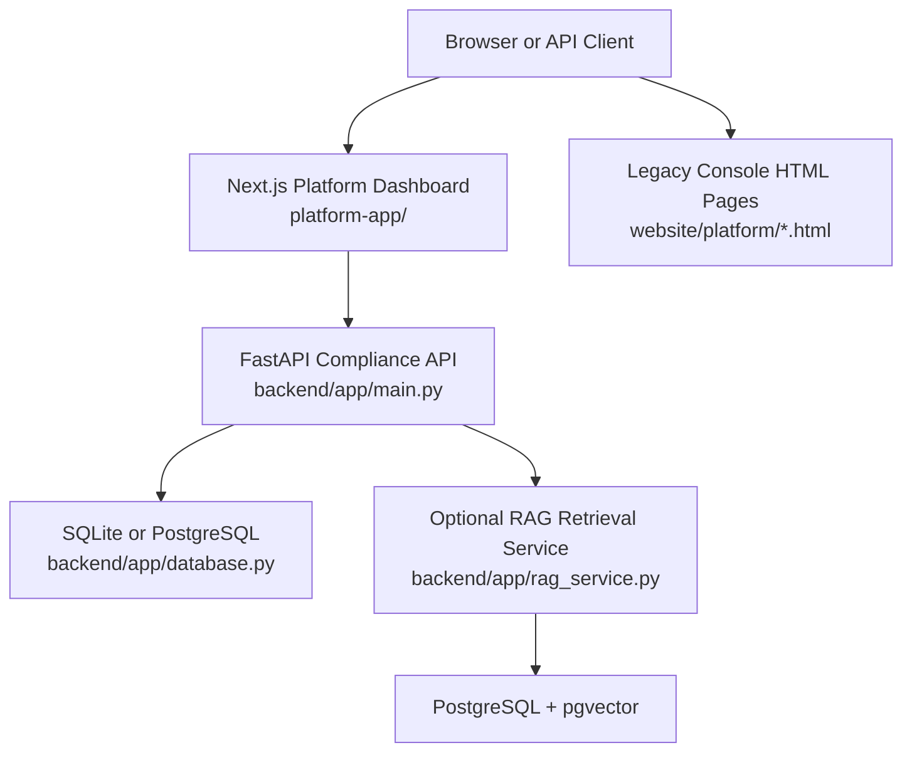
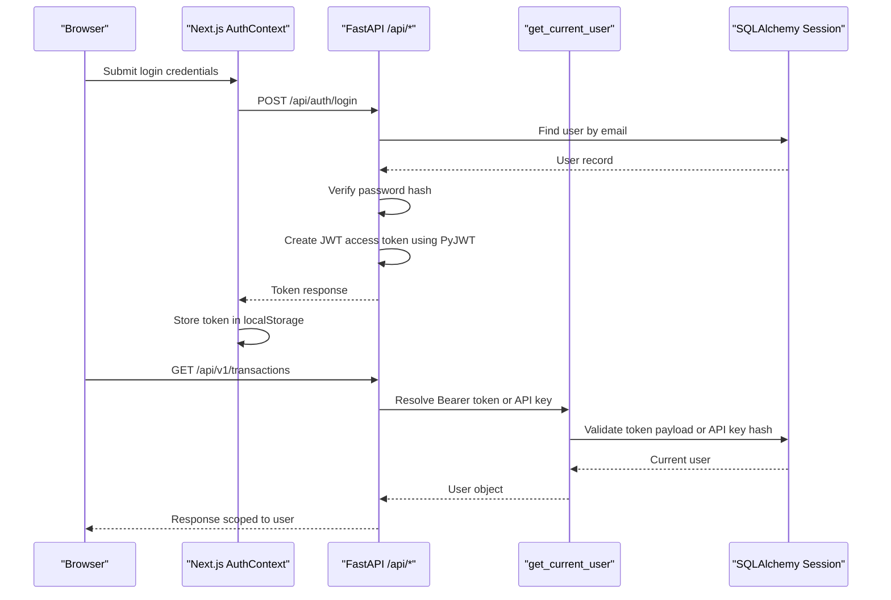
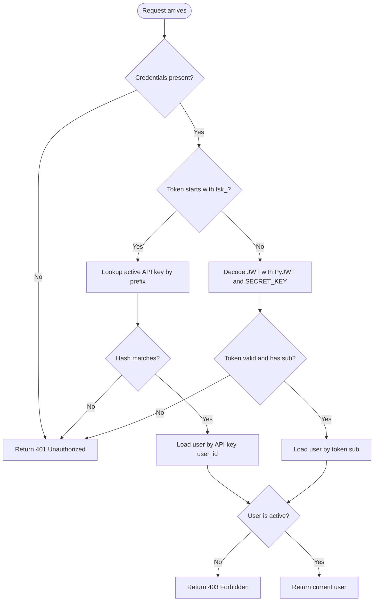
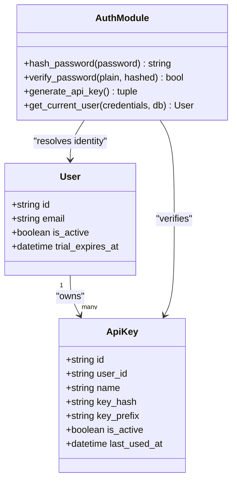
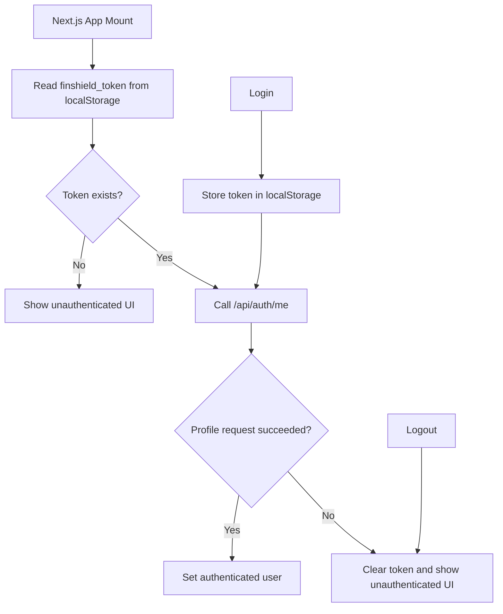
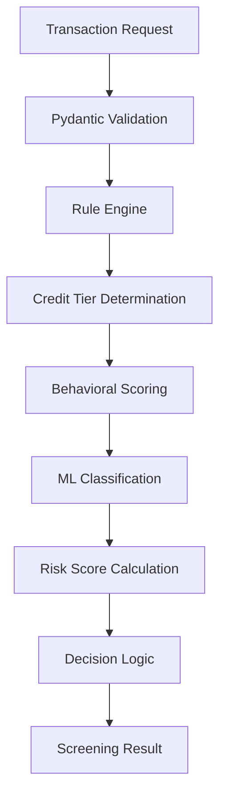
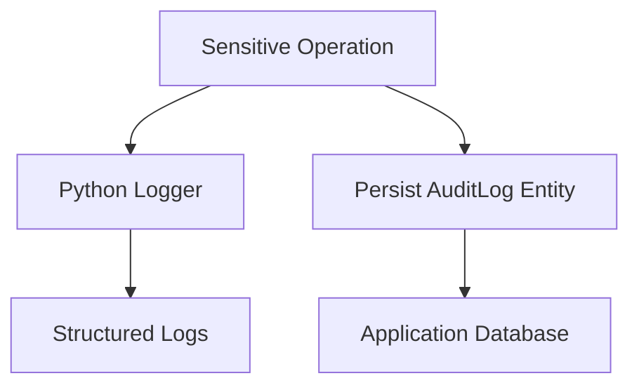
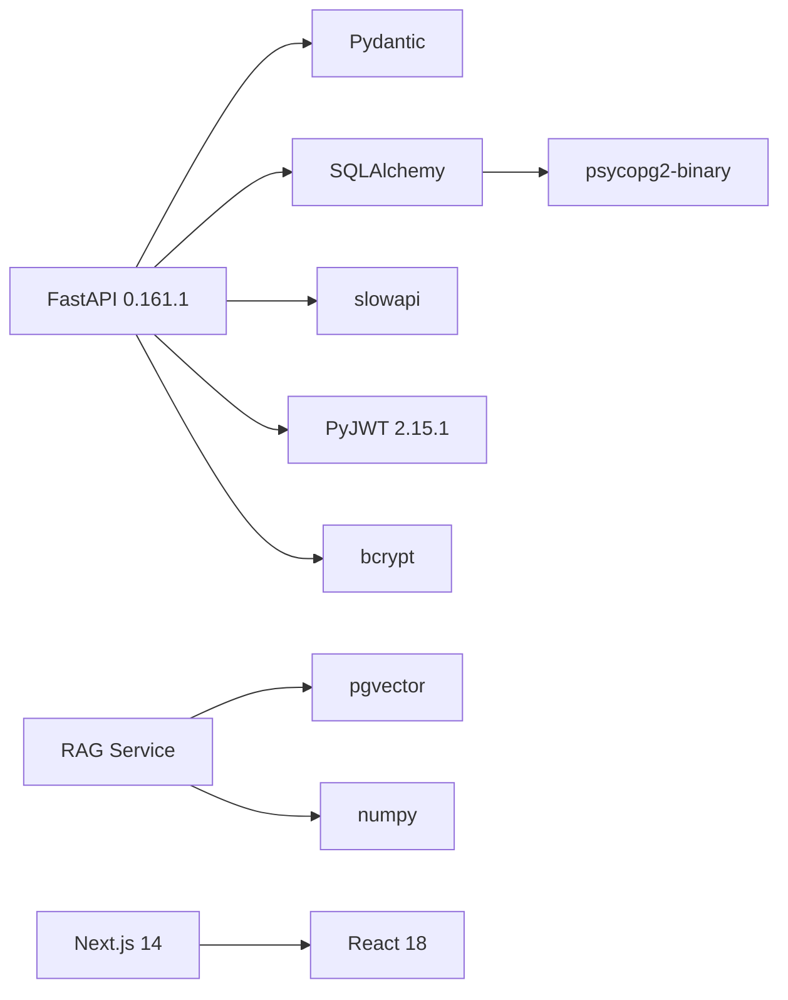

# Security Considerations

<cite>
**Referenced Files in This Document**
- [auth.py](file://backend/app/auth.py)
- [main.py](file://backend/app/main.py)
- [database.py](file://backend/app/database.py)
- [db_models.py](file://backend/app/db_models.py)
- [models.py](file://backend/app/models.py)
- [compliance_engine.py](file://backend/app/compliance_engine.py)
- [rag_service.py](file://backend/app/rag_service.py)
- [seed_rag_data.py](file://backend/app/seed_rag_data.py)
- [requirements.txt](file://backend/requirements.txt)
- [ci.yml](file://.github/workflows/ci.yml)
- [AuthContext.tsx](file://platform-app/src/contexts/AuthContext.tsx)
- [api.ts](file://platform-app/src/lib/api.ts)
- [docker-compose.yml](file://docker-compose.yml)
- [next.config.js](file://platform-app/next.config.js)
- [nginx.conf](file://website/nginx.conf)
</cite>

## Update Summary
**Changes Made**
- Updated dependency versions reflecting security vulnerability remediation (FastAPI 0.161.1, PyJWT 2.15.1)
- Enhanced CI/CD security scanning with pip-audit, npm audit, and gitleaks integration
- Strengthened JWT secret validation for production environments
- Updated security posture documentation to reflect hardened deployment practices
- Added comprehensive security testing and penetration testing guidelines

## Table of Contents
1. [Introduction](#introduction)
2. [Project Structure](#project-structure)
3. [Core Components](#core-components)
4. [Architecture Overview](#architecture-overview)
5. [Detailed Component Analysis](#detailed-component-analysis)
6. [Dependency Analysis](#dependency-analysis)
7. [Performance Considerations](#performance-considerations)
8. [Troubleshooting Guide](#troubleshooting-guide)
9. [Compliance and Regulatory Mapping](#compliance-and-regulatory-mapping)
10. [Security Testing and Penetration Testing](#security-testing-and-penetration-testing)
11. [Security Best Practices](#security-best-practices)
12. [Conclusion](#conclusion)

## Introduction
This document describes the security posture of FinShield as implemented in the shipped codebase. It focuses on authentication, authorization, API key handling, session behavior, input validation, audit logging, data protection, transport configuration, and operational security. It also maps current capabilities to financial compliance expectations and identifies gaps that require additional controls before production use.

FinShield consists of:
- A FastAPI backend providing transaction screening, case management, API keys, and user accounts.
- A Next.js 14 platform dashboard for users.
- A legacy static website under `website/` that is not part of the main Docker Compose stack.

The shipped stack uses FastAPI 0.161.1, Pydantic, SQLAlchemy with SQLite by default, PostgreSQL only when configured, bcrypt for password hashing, PyJWT 2.15.1 for JWTs, slowapi for rate limiting, and pgvector for optional RAG retrieval.

**Updated** Dependency stack has been updated from python-jose to PyJWT 2.15.1, FastAPI upgraded to 0.161.1, and other critical security patches applied based on vulnerability remediation.

## Project Structure
The relevant deployables are:
- `backend/`: FastAPI application, models, database configuration, authentication, compliance engine, and optional RAG service.
- `platform-app/`: Next.js 14 App Router dashboard with shared layout components, authentication context, and a centralized API client.
- `website/`: Static marketing site plus legacy console HTML pages; superseded by `platform-app/`.
- `docker-compose.yml`: Defines three services — PostgreSQL with pgvector, backend, and frontend.

**Diagram sources**
- [main.py:83-89](file://backend/app/main.py#L83-L89)
- [database.py:11-24](file://backend/app/database.py#L11-L24)
- [rag_service.py:148-155](file://backend/app/rag_service.py#L148-L155)
- [docker-compose.yml:3-61](file://docker-compose.yml#L3-L61)

**Section sources**
- [docker-compose.yml:1-78](file://docker-compose.yml#L1-L78)
- [requirements.txt:1-16](file://backend/requirements.txt#L1-L16)

## Core Components
FinShield's security-relevant core components are:
- Authentication and token handling in `backend/app/auth.py`.
- API routes, middleware, CORS, rate limiting, exception handling, and audit logging in `backend/app/main.py`.
- ORM entities for users, API keys, transactions, cases, audit logs, and related entities in `backend/app/db_models.py`.
- Request/response schemas and enums in `backend/app/models.py`.
- Compliance rule engine in `backend/app/compliance_engine.py`.
- Optional RAG retrieval over pgvector in `backend/app/rag_service.py`.
- Frontend authentication state and token storage in `platform-app/src/contexts/AuthContext.tsx` and `platform-app/src/lib/api.ts`.

Key responsibilities:
- Password hashing and JWT creation/validation using PyJWT.
- Dual authentication paths: JWT bearer tokens and hashed API keys.
- Per-user resource isolation through `current_user`.
- Pydantic-based request validation.
- Structured logging and audit log persistence.
- Rate limiting via slowapi.
- CORS configuration.

**Section sources**
- [auth.py:21-126](file://backend/app/auth.py#L21-L126)
- [main.py:83-155](file://backend/app/main.py#L83-L155)
- [db_models.py:22-152](file://backend/app/db_models.py#L22-L152)
- [models.py:15-152](file://backend/app/models.py#L15-L152)
- [compliance_engine.py:30-162](file://backend/app/compliance_engine.py#L30-L162)
- [rag_service.py:145-155](file://backend/app/rag_service.py#L145-L155)
- [AuthContext.tsx:18-100](file://platform-app/src/contexts/AuthContext.tsx#L18-L100)
- [api.ts:357-408](file://platform-app/src/lib/api.ts#L357-L408)

## Architecture Overview
The security architecture centers on FastAPI endpoints protected by a dependency that resolves either a JWT bearer token or an API key. The frontend stores the JWT in browser local storage and attaches it as an Authorization header. All sensitive operations are tied to the authenticated user.

**Diagram sources**
- [AuthContext.tsx:42-68](file://platform-app/src/contexts/AuthContext.tsx#L42-L68)
- [api.ts:357-408](file://platform-app/src/lib/api.ts#L357-L408)
- [main.py:184-200](file://backend/app/main.py#L184-L200)
- [auth.py:63-117](file://backend/app/auth.py#L63-L117)

## Detailed Component Analysis

### Authentication System
FinShield supports two authentication mechanisms:
1. **JWT bearer tokens**: Created after successful login or registration. Tokens contain a subject (`sub`) claim representing the user ID and an expiration time. Uses PyJWT 2.15.1 for secure token generation and validation.
2. **API keys**: Generated with a `fsk_live_` prefix, hashed with bcrypt, and stored alongside a displayable prefix. During authentication, the backend matches the prefix and verifies the full key against the stored hash.

Important behaviors:
- `get_current_user` raises `401 Unauthorized` when no credentials are present.
- Invalid or expired JWTs return `401 Unauthorized`.
- Disabled accounts return `403 Forbidden`.
- API key authentication updates `last_used_at` on successful match.
- The JWT secret is read from `JWT_SECRET_KEY`; in non-test environments, missing secrets cause runtime errors rather than fallback values.

**Updated** JWT secret validation has been strengthened - non-test environments now require explicit JWT_SECRET_KEY configuration, preventing accidental use of generated fallback secrets in production.

**Diagram sources**
- [auth.py:63-117](file://backend/app/auth.py#L63-L117)

**Section sources**
- [auth.py:21-126](file://backend/app/auth.py#L21-L126)
- [main.py:184-200](file://backend/app/main.py#L184-L200)

### Password Hashing and Secret Management
Passwords are hashed using bcrypt before storage. Verification compares plaintext input against the stored hash. The JWT algorithm is HS256, and the secret comes from environment configuration using PyJWT.

Security considerations:
- bcrypt is appropriate for password hashing.
- The JWT secret must be externally managed in production; non-test environments enforce this requirement.
- No explicit token revocation mechanism exists beyond disabling users or revoking API keys.
- No refresh-token flow is implemented; sessions rely on the short-lived JWT and frontend token storage.

**Updated** Production environments now enforce JWT_SECRET_KEY presence, eliminating the previous fallback mechanism that could lead to inconsistent token validation across process restarts.

**Section sources**
- [auth.py:36-60](file://backend/app/auth.py#L36-L60)
- [auth.py:21-28](file://backend/app/auth.py#L21-L28)

### API Key Management
API keys are created per user, hashed with bcrypt, and stored with a truncated prefix for display. Only the full key is returned once during creation. Listing returns metadata without the secret. Revocation deactivates the key.

**Diagram sources**
- [db_models.py:22-73](file://backend/app/db_models.py#L22-L73)
- [auth.py:120-126](file://backend/app/auth.py#L120-L126)
- [auth.py:80-96](file://backend/app/auth.py#L80-L96)

**Section sources**
- [main.py:350-427](file://backend/app/main.py#L350-L427)
- [auth.py:80-126](file://backend/app/auth.py#L80-L126)
- [db_models.py:59-73](file://backend/app/db_models.py#L59-L73)

### Session Handling and Frontend Token Storage
The Next.js dashboard stores the JWT in `localStorage` under `finshield_token`. On app mount, it attempts to fetch the current profile; on failure, it clears the token. Login and signup store the token and load the profile. Logout clears the token and redirects to `/login`.

Security implications:
- Storing JWTs in `localStorage` exposes them to XSS-based theft.
- There is no secure cookie flag, `HttpOnly`, `Secure`, or `SameSite` configuration because the token is not set as a cookie.
- There is no automatic token refresh; expired tokens result in logout.

**Diagram sources**
- [AuthContext.tsx:22-40](file://platform-app/src/contexts/AuthContext.tsx#L22-L40)
- [AuthContext.tsx:42-74](file://platform-app/src/contexts/AuthContext.tsx#L42-L74)
- [api.ts:357-370](file://platform-app/src/lib/api.ts#L357-L370)

**Section sources**
- [AuthContext.tsx:18-100](file://platform-app/src/contexts/AuthContext.tsx#L18-L100)
- [api.ts:357-408](file://platform-app/src/lib/api.ts#L357-L408)

### Authorization Patterns and Role-Based Access Control
Current authorization is primarily **user-scoped ownership checks**:
- Endpoints requiring authentication use `Depends(get_current_user)`.
- Transaction, case, and API key endpoints filter by `current_user.id`.
- There is no role field on the `User` model and no role-based access control implementation.
- Admin or operator roles are not enforced in the shipped code.

This means any authenticated user can access their own resources but cannot access another user's data through normal API routes.

**Section sources**
- [main.py:434-717](file://backend/app/main.py#L434-L717)
- [db_models.py:22-73](file://backend/app/db_models.py#L22-L73)

### Permission Enforcement and Rule Engine
The compliance engine enforces hard rules such as sanctions matching, PEP checks, amount thresholds, and high-risk geography. Rule actions can force blocked, flagged, reviewed, or escalated outcomes. The decision layer gives precedence to triggered rule actions over aggregate risk scores.

Security relevance:
- Hard controls like sanctions and high-risk geography can override risk scoring to block transactions.
- Rule definitions include both editable parameters and non-editable metadata.
- User-configurable rule overrides are passed into the engine, so permission boundaries around rule configuration are important.

**Diagram sources**
- [compliance_engine.py:89-162](file://backend/app/compliance_engine.py#L89-L162)
- [compliance_engine.py:164-240](file://backend/app/compliance_engine.py#L164-L240)
- [compliance_engine.py:339-380](file://backend/app/compliance_engine.py#L339-L380)

**Section sources**
- [compliance_engine.py:30-380](file://backend/app/compliance_engine.py#L30-L380)
- [models.py:15-152](file://backend/app/models.py#L15-L152)

### Data Protection Measures

#### Input Validation
All incoming requests are validated through Pydantic models. For example, `TransactionRequest` validates amount positivity, currency length, transaction type enumeration, and required fields. Registration and login payloads are also modeled.

Strengths:
- Type safety and schema enforcement reduce malformed input risks.
- Enumerated types constrain allowed values.

Gaps:
- Some fields accept arbitrary strings without strict sanitization.
- Metadata fields allow dictionaries, which should be carefully constrained in production.

**Section sources**
- [models.py:67-83](file://backend/app/models.py#L67-L83)
- [main.py:188-198](file://backend/app/main.py#L188-L198)

#### SQL Injection Prevention
The backend uses SQLAlchemy ORM queries rather than raw SQL for most operations. This reduces direct SQL injection risk. However, some dynamic query construction and JSON column usage require careful review.

Recommendations:
- Avoid raw SQL where possible.
- Validate and sanitize all dynamic filters.
- Use parameterized queries consistently.

**Section sources**
- [main.py:434-717](file://backend/app/main.py#L434-L717)
- [database.py:17-24](file://backend/app/database.py#L17-L24)

#### XSS Protection
XSS exposure depends on how rendered content is handled:
- The backend returns structured JSON responses.
- The frontend stores JWTs in `localStorage`, increasing XSS impact if malicious scripts execute.
- Case comments, notes, narratives, and other text fields could be rendered unsafely if not escaped.

Recommendations:
- Escape user-supplied content before rendering.
- Prefer React's built-in escaping and avoid `dangerouslySetInnerHTML`.
- Implement a Content Security Policy.

**Section sources**
- [api.ts:357-370](file://platform-app/src/lib/api.ts#L357-L370)
- [db_models.py:212-237](file://backend/app/db_models.py#L212-L237)

#### CSRF Mitigation
CSRF protection is not explicitly implemented:
- The frontend uses `fetch` with JSON bodies and does not rely on cookies for authentication.
- JWTs are sent via the `Authorization` header, which is generally less vulnerable to CSRF than cookie-based sessions.
- However, cross-site request forgery protections should still be considered for any state-changing endpoints, especially if cookies or browser-native auth flows are introduced.

**Section sources**
- [api.ts:372-408](file://platform-app/src/lib/api.ts#L372-L408)
- [main.py:91-99](file://backend/app/main.py#L91-L99)

### Audit Trail Implementation
Audit logging is implemented through:
- Python `logging` for request lifecycle, exceptions, rate limits, and business events.
- An `AuditLog` ORM entity recording user actions, resource references, details, IP address, and timestamps.
- Audit entries created during registration and login.

Limitations:
- Not every sensitive operation creates an audit log entry.
- The audit log is stored in the same database as application data, which requires separate retention and integrity controls in production.
- IP address capture is available in the model but not consistently populated across all endpoints.

**Diagram sources**
- [main.py:75-80](file://backend/app/main.py#L75-L80)
- [main.py:203-205](file://backend/app/main.py#L203-L205)
- [main.py:247-250](file://backend/app/main.py#L247-L250)
- [db_models.py:141-152](file://backend/app/db_models.py#L141-L152)

**Section sources**
- [main.py:75-155](file://backend/app/main.py#L75-L155)
- [main.py:203-205](file://backend/app/main.py#L203-L205)
- [main.py:247-250](file://backend/app/main.py#L247-L250)
- [db_models.py:141-152](file://backend/app/db_models.py#L141-L152)

### Security Headers, HTTPS/TLS, and Secure Cookie Handling
Current observations:
- CORS is configured via FastAPI's `CORSMiddleware`, allowing configurable origins and credentials.
- No custom security headers (such as `Strict-Transport-Security`, `Content-Security-Policy`, `X-Frame-Options`, `X-Content-Type-Options`) are added in the backend.
- HTTPS/TLS termination is not configured inside the FastAPI application; it should be handled by a reverse proxy or container orchestration layer.
- Cookies are not used for authentication; tokens are stored in `localStorage`, so secure cookie flags do not apply directly.

Recommendations:
- Enforce TLS at the ingress or reverse proxy.
- Add security headers globally.
- Restrict CORS to trusted origins and methods.
- If switching to cookie-based sessions, use `HttpOnly`, `Secure`, and `SameSite=Strict/Lax`.

**Section sources**
- [main.py:91-99](file://backend/app/main.py#L91-L99)
- [api.ts:357-370](file://platform-app/src/lib/api.ts#L357-L370)

### RAG Retrieval and External Dependency Risks
The RAG service connects to PostgreSQL with pgvector and optionally uses sentence-transformers. Embeddings are generated either deterministically with numpy or via a transformer model.

Security considerations:
- RAG is optional and skipped if dependencies or configuration are missing.
- The RAG database URL is externalized.
- Sanctions matching uses similarity thresholds, which introduces false-positive and false-negative risks.
- RAG enrichment can influence decisions, such as reinforcing escalation when sanctions matches are found.

**Section sources**
- [rag_service.py:15-44](file://backend/app/rag_service.py#L15-L44)
- [rag_service.py:148-155](file://backend/app/rag_service.py#L148-L155)
- [rag_service.py:361-412](file://backend/app/rag_service.py#L361-L412)
- [main.py:167-179](file://backend/app/main.py#L167-L179)

## Dependency Analysis
The backend depends on:
- FastAPI 0.161.1 and Uvicorn for the HTTP server.
- Pydantic for request/response validation.
- SQLAlchemy and psycopg2-binary for database access.
- PyJWT 2.15.1 and bcrypt for authentication.
- slowapi for rate limiting.
- pgvector and numpy for optional RAG functionality.

The frontend depends on Next.js 14, React 18, and Tailwind CSS.

**Updated** Dependency stack has been updated to address 21 known vulnerabilities identified by pip-audit, including migration from python-jose to PyJWT 2.15.1 and FastAPI upgrade to 0.161.1.

**Diagram sources**
- [requirements.txt:1-16](file://backend/requirements.txt#L1-L16)
- [package.json:11-25](file://platform-app/package.json#L11-L25)

**Section sources**
- [requirements.txt:1-16](file://backend/requirements.txt#L1-L16)
- [package.json:1-28](file://platform-app/package.json#L1-L28)

## Performance Considerations
From a security-performance perspective:
- bcrypt is intentionally slow and protects passwords but increases login and key-generation cost.
- Rate limiting helps mitigate brute-force and abuse.
- JWT decoding and database lookups occur on every protected request.
- RAG retrieval adds latency and should remain optional and resilient to failures.

[No sources needed since this section provides general guidance]

## Troubleshooting Guide
Common security-related issues and diagnostics:
- **Authentication failures**: Check whether credentials are missing, invalid, or belong to a disabled account.
- **Expired tokens**: The frontend clears tokens when `/api/auth/me` fails; verify JWT secret configuration and token lifetime.
- **Rate limiting**: Requests exceeding slowapi limits receive `429 Too Many Requests`.
- **Validation errors**: Pydantic validation errors return `422 Unprocessable Entity` with error details.
- **Database connectivity**: SQLite is default; PostgreSQL is required for RAG and when `DATABASE_URL` points to PostgreSQL.
- **RAG initialization failures**: The backend logs warnings and continues without RAG enrichment.
- **JWT secret configuration**: Non-test environments require explicit JWT_SECRET_KEY; missing secrets cause startup failures.

Operational tips:
- Inspect backend logs for HTTP exceptions, validation errors, and unhandled exceptions.
- Confirm CORS settings match the frontend origin.
- Verify environment variables for JWT secrets, database URLs, and debug flags.

**Updated** Added troubleshooting guidance for JWT secret configuration requirements in non-test environments.

**Section sources**
- [main.py:110-144](file://backend/app/main.py#L110-L144)
- [main.py:167-179](file://backend/app/main.py#L167-L179)
- [database.py:11-24](file://backend/app/database.py#L11-L24)
- [auth.py:21-28](file://backend/app/auth.py#L21-L28)

## Compliance and Regulatory Mapping
FinShield implements several features aligned with financial compliance workflows:
- Transaction screening with rule-based controls.
- Case management for suspicious activity investigation.
- Audit logging for user actions.
- Filing-related entities for SAR/STR tracking.
- RAG retrieval referencing compliance policies, sanctions lists, and precedents.

However, the following compliance requirements need explicit implementation or verification:
- **GDPR/CCPA**: No visible data deletion, export, consent, or privacy preference endpoints in the analyzed files.
- **Data minimization and retention**: Audit logs and transaction data persist indefinitely by default.
- **Encryption at rest and in transit**: Not implemented in the application layer; must be provided by infrastructure.
- **Access controls**: No RBAC; only user-scoped filtering.
- **Regulatory reporting**: Filing entities exist, but submission workflows and regulator integration are not shown in the analyzed routes.

**Section sources**
- [db_models.py:141-272](file://backend/app/db_models.py#L141-L272)
- [main.py:434-717](file://backend/app/main.py#L434-L717)

## Security Testing and Penetration Testing
Recommended testing approach:
- **Authentication testing**: Validate JWT issuance, expiration, invalid token handling, API key creation, verification, and revocation.
- **Authorization testing**: Confirm users cannot access other users' transactions, cases, or API keys.
- **Input validation testing**: Test boundary values, malformed JSON, enum violations, and oversized payloads.
- **Rate limiting testing**: Verify throttling on login, registration, and screening endpoints.
- **CORS testing**: Ensure only trusted origins can make credentialed requests.
- **XSS testing**: Inject script-like content into text fields and verify safe rendering.
- **CSRF testing**: Evaluate state-changing endpoints if cookies or browser-native auth are introduced.
- **RAG testing**: Validate similarity thresholds, sanctions false positives, and graceful degradation when RAG is unavailable.
- **Secrets testing**: Ensure JWT secrets are not hardcoded and are rotated securely.

Penetration testing considerations:
- Treat the backend as a production-grade API even if running locally.
- Test both JWT and API key authentication paths.
- Validate idempotency behavior for transaction screening.
- Assess data exposure in exported CSV and detailed transaction responses.
- Review audit log completeness for sensitive operations.

**Updated** Enhanced security testing approach includes CI/CD integration with automated vulnerability scanning.

**Section sources**
- [auth.py:63-126](file://backend/app/auth.py#L63-L126)
- [main.py:184-717](file://backend/app/main.py#L184-L717)
- [compliance_engine.py:89-162](file://backend/app/compliance_engine.py#L89-L162)

## Security Best Practices

### Development
- Use strong, externally managed JWT secrets.
- Enable strict CORS origins and disable development defaults in production.
- Keep Pydantic models minimal and validate all inputs.
- Avoid returning sensitive fields such as payment method details in responses.
- Centralize logging and avoid logging secrets, tokens, or full API keys.

### Deployment
- Terminate TLS at a reverse proxy or ingress controller.
- Run the backend behind a hardened web server or API gateway.
- Separate databases for application data and RAG data.
- Rotate JWT secrets and API keys regularly.
- Back up audit logs separately and enforce retention policies.

### Ongoing Maintenance
- Monitor failed authentication attempts and rate limit triggers.
- Review audit logs for unusual activity.
- Update dependencies regularly, including FastAPI, Pydantic, SQLAlchemy, bcrypt, and PyJWT.
- Reassess RAG thresholds and sanctions list accuracy.
- Implement role-based access control as organizational needs grow.

### CI/CD Security Integration
**New** Enhanced CI/CD pipeline includes comprehensive security scanning:

- **pip-audit**: Automated Python dependency vulnerability scanning
- **npm audit**: Node.js dependency vulnerability detection  
- **gitleaks**: Secret detection in codebase and git history
- **Automated blocking**: Security scans fail the build on critical vulnerabilities

**Section sources**
- [ci.yml:80-111](file://.github/workflows/ci.yml#L80-L111)

## Conclusion
FinShield's current security implementation provides a solid foundation: bcrypt password hashing, JWT bearer tokens using PyJWT 2.15.1, hashed API keys, Pydantic input validation, user-scoped authorization, structured logging, audit log entities, and rate limiting. The recent vulnerability remediation has strengthened the security posture with updated dependencies and enhanced CI/CD security scanning.

However, it lacks explicit role-based access control, comprehensive CSRF protection, secure cookie handling, global security headers, and complete compliance coverage for data privacy and regulatory reporting. Production deployments must add transport encryption, secrets management, robust auditing, access controls, and compliance-specific workflows while treating the optional RAG component as a controlled, monitored extension rather than a primary enforcement mechanism.

**Updated** The security posture has been significantly improved with the remediation of 21 known vulnerabilities, migration to PyJWT 2.15.1, FastAPI upgrade to 0.161.1, and comprehensive CI/CD security scanning integration. These changes provide a more secure foundation for production deployment while maintaining the existing architectural patterns and security controls.