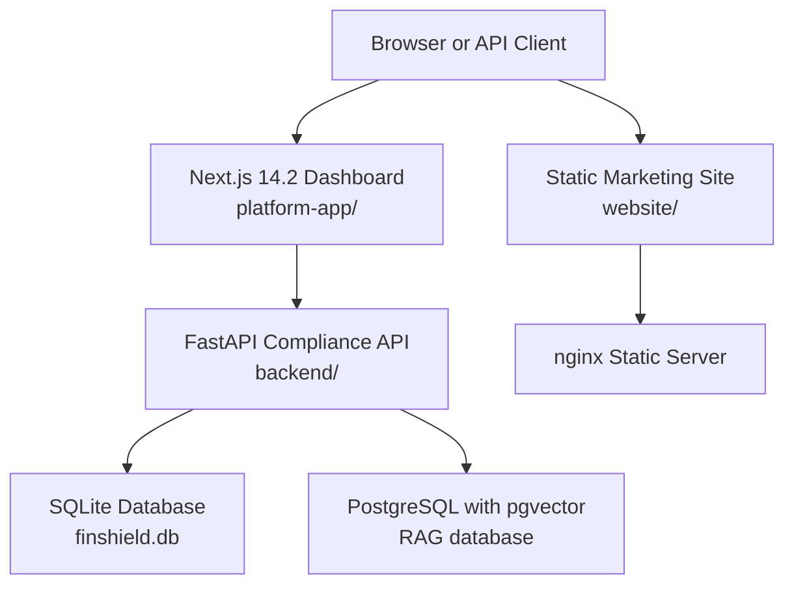
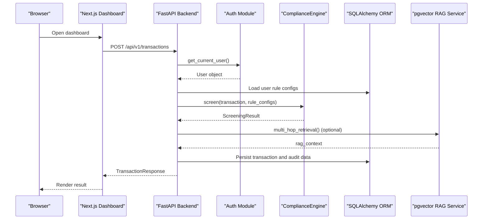
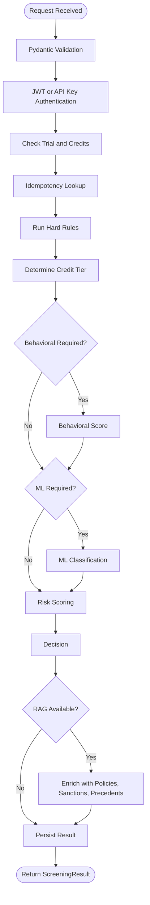
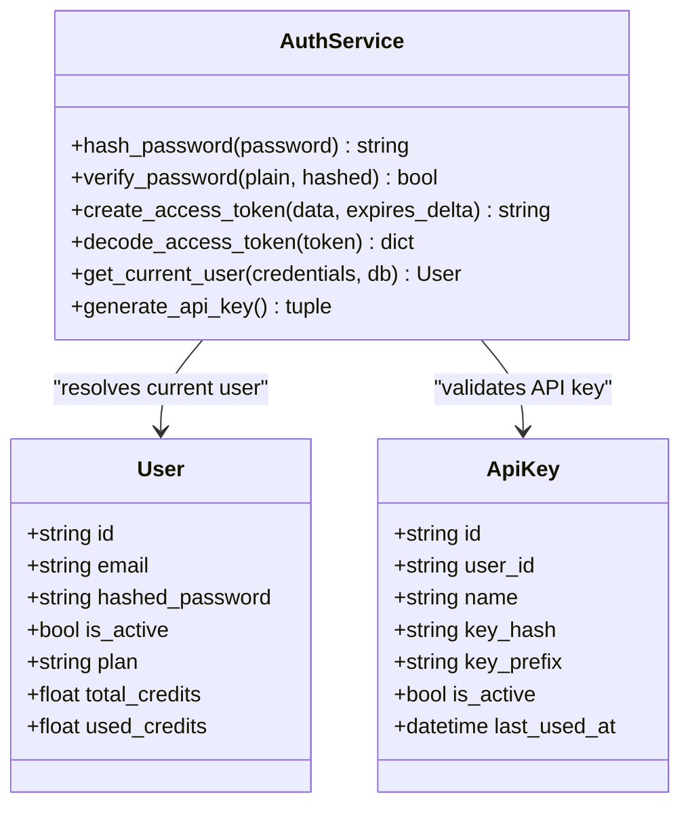
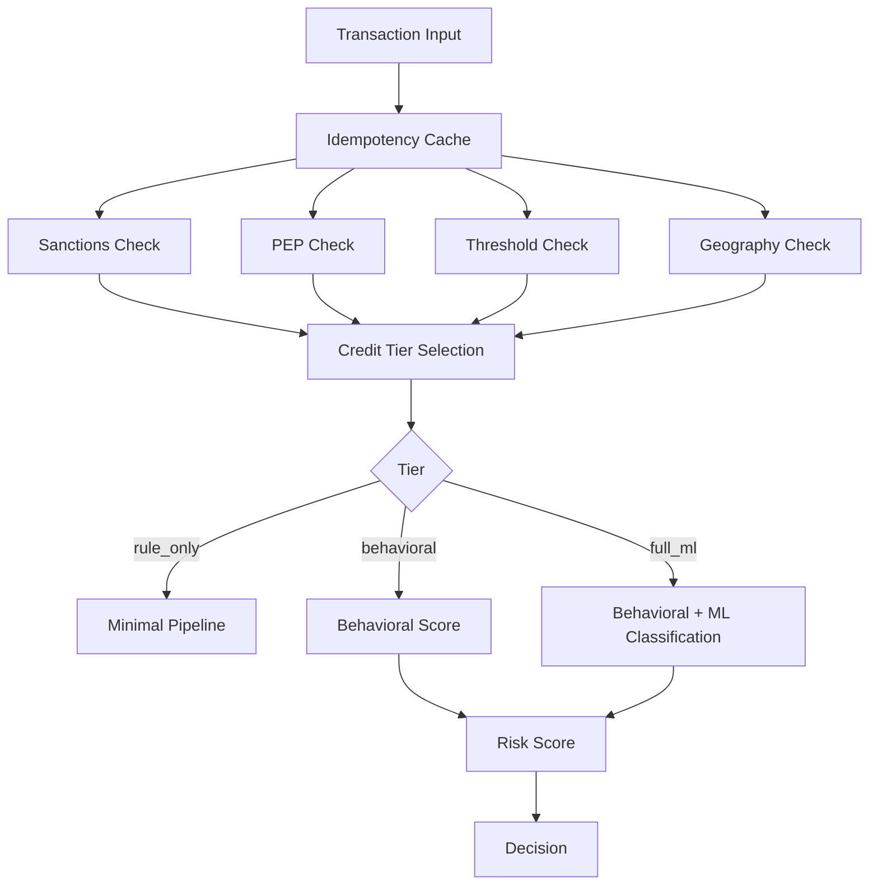
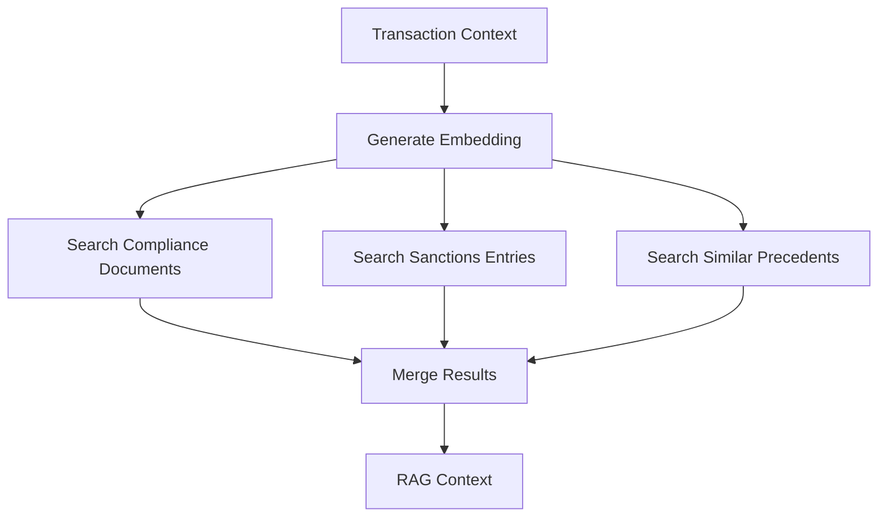
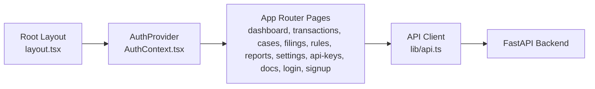
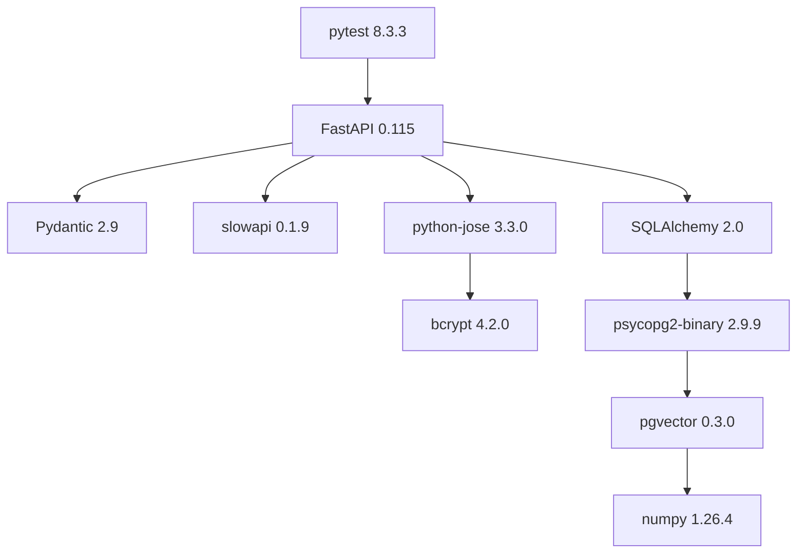
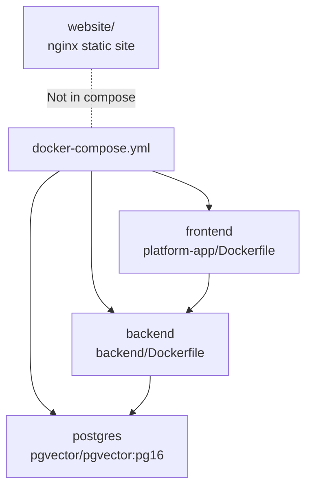

# Technology Stack

<cite>
**Referenced Files in This Document**
- [backend/requirements.txt](file://backend/requirements.txt)
- [docker-compose.yml](file://docker-compose.yml)
- [backend/app/main.py](file://backend/app/main.py)
- [backend/app/database.py](file://backend/app/database.py)
- [backend/app/auth.py](file://backend/app/auth.py)
- [backend/app/compliance_engine.py](file://backend/app/compliance_engine.py)
- [backend/app/models.py](file://backend/app/models.py)
- [backend/app/db_models.py](file://backend/app/db_models.py)
- [backend/app/rag_service.py](file://backend/app/rag_service.py)
- [backend/app/seed_rag_data.py](file://backend/app/seed_rag_data.py)
- [platform-app/package.json](file://platform-app/package.json)
- [platform-app/src/app/layout.tsx](file://platform-app/src/app/layout.tsx)
- [platform-app/src/components/PlatformLayout.tsx](file://platform-app/src/components/PlatformLayout.tsx)
- [platform-app/src/contexts/AuthContext.tsx](file://platform-app/src/contexts/AuthContext.tsx)
- [platform-app/src/lib/api.ts](file://platform-app/src/lib/api.ts)
- [website/nginx.conf](file://website/nginx.conf)
</cite>

## Table of Contents
1. [Introduction](#introduction)
2. [Project Structure](#project-structure)
3. [Core Components](#core-components)
4. [Architecture Overview](#architecture-overview)
5. [Detailed Component Analysis](#detailed-component-analysis)
6. [Dependency Analysis](#dependency-analysis)
7. [Version Compatibility Matrix](#version-compatibility-matrix)
8. [Rationale for Technology Choices](#rationale-for-technology-choices)
9. [Containerization Approach](#containerization-approach)
10. [Roadmap and Implemented Boundaries](#roadmap-and-implemented-boundaries)
11. [Performance Considerations](#performance-considerations)
12. [Troubleshooting Guide](#troubleshooting-guide)
13. [Conclusion](#conclusion)

## Introduction
This document describes FinShield AI’s technology stack across its three real deployables:

- **Backend**: FastAPI 0.115 transaction compliance API with SQLAlchemy 2.0 ORM, Pydantic 2.9 validation, JWT authentication, bcrypt password hashing, slowapi rate limiting, numpy-based RAG embeddings, and pytest testing.
- **Frontend**: Next.js 14.2 App Router dashboard under `src/`, using React 18.3, TypeScript 5.6, and Tailwind CSS 3.4.
- **Legacy Website**: Static marketing site plus legacy platform console served by nginx.

The shipped implementation is intentionally conservative: rule-based compliance logic runs deterministically, RAG retrieval uses pgvector with a deterministic hashing embedding strategy by default, and the frontend calls the backend through a typed API client.

## Project Structure
FinShield AI has three independent deployables rather than one monolith:

| Deployable | Purpose | Primary Runtime | Persistence / Serving |
|---|---|---|---|
| `backend/` | Transaction screening, auth, cases, rules, credits, notifications, filings, search, and optional RAG enrichment | Python + FastAPI + Uvicorn | SQLite by default; PostgreSQL with pgvector when `RAG_DATABASE_URL` is configured |
| `platform-app/` | Next.js App Router dashboard for users and compliance operators | Node.js + Next.js 14.2 | Calls backend at `/api/*`; no local database |
| `website/` | Static marketing site and legacy HTML console | nginx static server | Serves HTML/CSS/JS from `/usr/share/nginx/html` |

**Diagram sources**
- [docker-compose.yml:4-61](file://docker-compose.yml#L4-L61)
- [backend/app/database.py:11-21](file://backend/app/database.py#L11-L21)
- [website/nginx.conf:1-35](file://website/nginx.conf#L1-L35)

**Section sources**
- [docker-compose.yml:1-72](file://docker-compose.yml#L1-L72)
- [backend/app/database.py:1-45](file://backend/app/database.py#L1-L45)
- [website/nginx.conf:1-35](file://website/nginx.conf#L1-L35)

## Core Components
The backend is the central business layer. It exposes authenticated REST endpoints, persists user and transaction state, runs a seven-stage compliance pipeline, and optionally enriches results with vector-based retrieval.

| Layer | Responsibility | Key Files |
|---|---|---|
| Web framework | FastAPI application, CORS, rate limiting, exception handling, middleware | `backend/app/main.py` |
| Data validation | Pydantic request/response models and enums | `backend/app/models.py` |
| Persistence | SQLAlchemy engine, session factory, base model | `backend/app/database.py` |
| Domain entities | User, ApiKey, Transaction, Case, AuditLog, RuleConfig, etc. | `backend/app/db_models.py` |
| Authentication | JWT tokens, bcrypt passwords, bearer/API key resolution | `backend/app/auth.py` |
| Business logic | Seven-stage compliance engine | `backend/app/compliance_engine.py` |
| Optional RAG | pgvector semantic retrieval over policies, sanctions, precedents | `backend/app/rag_service.py`, `backend/app/seed_rag_data.py` |
| Frontend client | Typed API client, token management, auth context | `platform-app/src/lib/api.ts`, `platform-app/src/contexts/AuthContext.tsx` |
| Legacy site | nginx configuration for static assets and health endpoint | `website/nginx.conf` |

**Section sources**
- [backend/app/main.py:1-152](file://backend/app/main.py#L1-L152)
- [backend/app/models.py:1-152](file://backend/app/models.py#L1-L152)
- [backend/app/database.py:1-45](file://backend/app/database.py#L1-L45)
- [backend/app/db_models.py:1-353](file://backend/app/db_models.py#L1-L353)
- [backend/app/auth.py:1-122](file://backend/app/auth.py#L1-L122)
- [backend/app/compliance_engine.py:1-381](file://backend/app/compliance_engine.py#L1-L381)
- [backend/app/rag_service.py:1-413](file://backend/app/rag_service.py#L1-L413)
- [backend/app/seed_rag_data.py:1-198](file://backend/app/seed_rag_data.py#L1-L198)
- [platform-app/src/lib/api.ts:1-631](file://platform-app/src/lib/api.ts#L1-L631)
- [platform-app/src/contexts/AuthContext.tsx:1-107](file://platform-app/src/contexts/AuthContext.tsx#L1-L107)
- [website/nginx.conf:1-35](file://website/nginx.conf#L1-L35)

## Architecture Overview
FinShield AI follows a layered API architecture:

1. The browser or external client calls the Next.js dashboard or the FastAPI API directly.
2. The frontend communicates with FastAPI through `/api/*`.
3. FastAPI validates requests with Pydantic, authenticates via JWT or API key, and delegates to the compliance engine.
4. Results are persisted through SQLAlchemy ORM.
5. If PostgreSQL is configured, RAG enrichment can add policy, sanctions, and precedent context.

**Diagram sources**
- [backend/app/main.py:434-570](file://backend/app/main.py#L434-L570)
- [backend/app/auth.py:59-113](file://backend/app/auth.py#L59-L113)
- [backend/app/compliance_engine.py:89-162](file://backend/app/compliance_engine.py#L89-L162)
- [backend/app/rag_service.py:361-412](file://backend/app/rag_service.py#L361-L412)

## Detailed Component Analysis

### Backend Stack
The backend is a production-oriented FastAPI application. It includes:

- Application lifecycle, CORS, rate limiting, logging, and exception handlers.
- Authentication routes for registration, login, profile updates, and password changes.
- API key management for programmatic access.
- Transaction screening, listing, detail, deletion, and CSV export.
- Case creation and retrieval.
- Optional RAG enrichment that does not block screening if unavailable.

**Diagram sources**
- [backend/app/main.py:434-570](file://backend/app/main.py#L434-L570)
- [backend/app/compliance_engine.py:89-162](file://backend/app/compliance_engine.py#L89-L162)

**Section sources**
- [backend/app/main.py:1-152](file://backend/app/main.py#L1-L152)
- [backend/app/main.py:176-570](file://backend/app/main.py#L176-L570)
- [backend/app/compliance_engine.py:1-381](file://backend/app/compliance_engine.py#L1-L381)

### Authentication and Authorization
Authentication supports two paths:

- **JWT bearer tokens**: created after login, decoded with HS256, and used for interactive dashboard sessions.
- **API keys**: prefixed with `fsk_`, hashed with bcrypt, and validated against stored hashes.

Passwords are never stored in plaintext. Tokens include an expiration, and disabled accounts are rejected.

**Diagram sources**
- [backend/app/auth.py:30-122](file://backend/app/auth.py#L30-L122)
- [backend/app/db_models.py:22-73](file://backend/app/db_models.py#L22-L73)

**Section sources**
- [backend/app/auth.py:1-122](file://backend/app/auth.py#L1-L122)
- [backend/app/db_models.py:22-73](file://backend/app/db_models.py#L22-L73)

### Compliance Engine
The compliance engine implements a deterministic seven-stage pipeline:

1. Idempotency check
2. Input validation
3. Hard rule evaluation
4. Behavioral scoring
5. ML classification
6. Risk scoring
7. Decision

Rule actions (`block`, `escalate`, `flag`, `review`) override aggregate risk decisions. Users can enable/disable rules and supply custom parameters such as wire thresholds and high-risk country lists.

**Diagram sources**
- [backend/app/compliance_engine.py:89-162](file://backend/app/compliance_engine.py#L89-L162)
- [backend/app/compliance_engine.py:164-240](file://backend/app/compliance_engine.py#L164-L240)
- [backend/app/compliance_engine.py:339-380](file://backend/app/compliance_engine.py#L339-L380)

**Section sources**
- [backend/app/compliance_engine.py:1-381](file://backend/app/compliance_engine.py#L1-L381)
- [backend/app/models.py:15-152](file://backend/app/models.py#L15-L152)

### RAG Retrieval Service
The RAG service is optional and requires PostgreSQL with the pgvector extension. Its default embedding strategy is deterministic hashing using numpy, producing 384-dimensional vectors. If `sentence-transformers` is installed and enabled via environment configuration, it can be used instead.

The service indexes:

- Compliance documents
- Sanctions entries
- Precedent decisions

It then performs similarity searches and returns policies, sanctions matches, and similar precedents. Strong sanctions matches can reinforce escalation but do not silently auto-approve transactions.

**Diagram sources**
- [backend/app/rag_service.py:76-85](file://backend/app/rag_service.py#L76-L85)
- [backend/app/rag_service.py:256-412](file://backend/app/rag_service.py#L256-L412)

**Section sources**
- [backend/app/rag_service.py:1-413](file://backend/app/rag_service.py#L1-L413)
- [backend/app/seed_rag_data.py:1-198](file://backend/app/seed_rag_data.py#L1-L198)
- [backend/app/database.py:11-21](file://backend/app/database.py#L11-L21)

### Frontend Stack
The dashboard is a Next.js 14.2 App Router application under `src/`. It provides:

- Shared layout components: `PlatformLayout`, `Sidebar`, `Topbar`.
- Authentication context: `AuthContext.tsx`.
- Backend integration: `lib/api.ts`.
- Route folders for dashboard, transactions, cases, filings, rules, reports, settings, api-keys, docs, login, and signup.

The frontend stores the JWT in localStorage and attaches it as a Bearer token for all `/api/*` requests.

**Diagram sources**
- [platform-app/src/app/layout.tsx:1-26](file://platform-app/src/app/layout.tsx#L1-L26)
- [platform-app/src/components/PlatformLayout.tsx:1-20](file://platform-app/src/components/PlatformLayout.tsx#L1-L20)
- [platform-app/src/contexts/AuthContext.tsx:1-107](file://platform-app/src/contexts/AuthContext.tsx#L1-L107)
- [platform-app/src/lib/api.ts:357-448](file://platform-app/src/lib/api.ts#L357-L448)

**Section sources**
- [platform-app/package.json:1-28](file://platform-app/package.json#L1-L28)
- [platform-app/src/app/layout.tsx:1-26](file://platform-app/src/app/layout.tsx#L1-L26)
- [platform-app/src/components/PlatformLayout.tsx:1-20](file://platform-app/src/components/PlatformLayout.tsx#L1-L20)
- [platform-app/src/contexts/AuthContext.tsx:1-107](file://platform-app/src/contexts/AuthContext.tsx#L1-L107)
- [platform-app/src/lib/api.ts:1-631](file://platform-app/src/lib/api.ts#L1-L631)

### Legacy Website Stack
The `website/` directory is a static site served by nginx. It contains:

- Static HTML pages under `pages/` and `index.html`.
- Legacy platform console files under `platform/`.
- CSS and JavaScript assets.
- An nginx configuration enabling gzip compression, security headers, static asset caching, SPA fallback behavior, and a simple health endpoint.

This is separate from the modern Next.js dashboard and should be treated as legacy.

**Section sources**
- [website/nginx.conf:1-35](file://website/nginx.conf#L1-L35)

## Dependency Analysis
The backend dependencies come from `backend/requirements.txt`. The most important relationships are:

- FastAPI depends on Pydantic for request/response validation.
- SQLAlchemy manages ORM persistence.
- python-jose handles JWT encoding/decoding.
- bcrypt handles password hashing.
- slowapi provides rate limiting.
- psycopg2-binary and pgvector support PostgreSQL vector operations.
- numpy powers the default deterministic embedding strategy.
- pytest and pytest-asyncio support testing.

**Diagram sources**
- [backend/requirements.txt:1-16](file://backend/requirements.txt#L1-L16)

**Section sources**
- [backend/requirements.txt:1-16](file://backend/requirements.txt#L1-L16)

## Version Compatibility Matrix
The following table summarizes the implemented versions found in the repository.

| Category | Technology | Shipped Version | Notes |
|---|---|---:|---|
| Backend Framework | FastAPI | 0.115.0 | Async web framework |
| Backend Server | Uvicorn | 0.30.6 | ASGI server |
| Data Validation | Pydantic | 2.9.2 | Request/response schemas |
| ORM | SQLAlchemy | 2.0.35 | Declarative models and sessions |
| Database Driver | psycopg2-binary | 2.9.9 | PostgreSQL connectivity |
| Vector Extension | pgvector | 0.3.0 | Cosine similarity and vector columns |
| Authentication | python-jose | 3.3.0 | JWT encode/decode |
| Password Hashing | bcrypt | 4.2.0 | Secure password storage |
| Rate Limiting | slowapi | 0.1.9 | IP-based limits |
| Numerical Library | numpy | 1.26.4 | Default RAG embeddings |
| Testing | pytest | 8.3.3 | Test runner |
| Async Testing | pytest-asyncio | 0.24.0 | Async test support |
| HTTP Client | httpx | 0.27.2 | Used by tests |
| Environment | python-dotenv | 1.0.1 | Configuration loading |
| File Uploads | python-multipart | 0.0.12 | Form parsing |
| Frontend Framework | next | ^14.2.15 | App Router dashboard |
| Frontend UI | react | ^18.3.1 | React runtime |
| Frontend DOM | react-dom | ^18.3.1 | DOM rendering |
| Frontend Styling | tailwindcss | ^3.4.13 | Utility-first CSS |
| Frontend Types | typescript | ^5.6.3 | Type safety |
| Infrastructure | postgres image | pgvector/pgvector:pg16 | PostgreSQL with vector extension |

**Section sources**
- [backend/requirements.txt:1-16](file://backend/requirements.txt#L1-L16)
- [platform-app/package.json:1-28](file://platform-app/package.json#L1-L28)
- [docker-compose.yml:4-5](file://docker-compose.yml#L4-L5)

## Rationale for Technology Choices
The chosen stack balances regulatory-grade correctness with operational simplicity.

| Choice | Rationale |
|---|---|
| FastAPI 0.115 | Provides async performance, automatic OpenAPI documentation, and strong type-driven request validation. |
| SQLAlchemy 2.0 | Offers a mature ORM with declarative models, explicit sessions, and clear separation between schema and query logic. |
| Pydantic 2.9 | Centralizes validation for both incoming requests and outgoing responses, reducing serialization bugs. |
| python-jose + bcrypt | Separates short-lived session identity (JWT) from long-term credential storage (bcrypt). |
| slowapi | Adds lightweight per-IP rate limiting without introducing another distributed dependency. |
| numpy | Enables deterministic embeddings without requiring GPU or heavy ML runtimes by default. |
| pgvector | Keeps vector search inside PostgreSQL, avoiding a separate vector database for the shipped version. |
| Next.js 14.2 App Router | Provides a modern, component-based dashboard with route-based organization under `src/`. |
| TypeScript | Improves frontend reliability by matching backend contract types. |
| Tailwind CSS 3.4 | Supports rapid UI development with utility classes while keeping styles localized. |
| nginx | Simple, reliable static serving for the legacy website. |

[No sources needed since this section provides general guidance]

## Containerization Approach
The repository defines three primary services in `docker-compose.yml`:

| Service | Dockerfile | Port | Purpose |
|---|---|---:|---|
| `postgres` | Official `pgvector/pgvector:pg16` image | 5432 | PostgreSQL with pgvector extension |
| `backend` | `backend/Dockerfile` | 8091 | FastAPI compliance API |
| `frontend` | `platform-app/Dockerfile` | 3000 | Next.js dashboard |

Important details:

- The backend defaults to SQLite (`finshield.db`) unless `DATABASE_URL` is set.
- RAG retrieval requires `RAG_DATABASE_URL` pointing to PostgreSQL.
- The compose file sets `DATABASE_URL=sqlite:///./finshield.db` and `RAG_DATABASE_URL=postgresql://...@postgres:5432/finshield`.
- The frontend builds from `platform-app/Dockerfile` and connects to the backend through `API_URL`.
- The `website/` directory is not part of the compose stack; it has its own Dockerfile and nginx configuration.

**Diagram sources**
- [docker-compose.yml:4-61](file://docker-compose.yml#L4-L61)

**Section sources**
- [docker-compose.yml:1-72](file://docker-compose.yml#L1-L72)
- [backend/app/database.py:11-21](file://backend/app/database.py#L11-L21)

## Roadmap and Implemented Boundaries
The following technologies are explicitly roadmap items and are **not** part of the shipped stack:

- Celery/Redis
- LangChain
- DSPy
- LoRA/PEFT/BitsAndBytes
- vLLM
- RAGAS
- HashiCorp Vault
- OpenTelemetry
- Prometheus
- Kubernetes/Helm

The shipped implementation replaces several aspirational pieces with simpler, verifiable alternatives:

| Roadmap Item | Shipped Alternative |
|---|---|
| Celery/Redis workers | In-process FastAPI request handling with synchronous persistence |
| LangChain DSPy pipelines | Deterministic rule engine in `compliance_engine.py` |
| LoRA/PEFT/BitsAndBytes/vLLM | Simulated ML classification path with configurable credit tiers |
| Dedicated RAGAS evaluation | Manual seed data and deterministic embeddings |
| HashiCorp Vault | Environment variables for secrets |
| OpenTelemetry/Prometheus | Standard Python logging and process-time headers |
| Kubernetes/Helm | docker-compose for local and container orchestration |

The codebase also contains placeholder domain models such as `CircuitBreaker`, `WebhookEvent`, `AccountBaseline`, `Filing`, `CaseNote`, and `CaseComment`. These indicate future capabilities but must not be interpreted as fully implemented features unless their usage is confirmed in the active API layer.

**Section sources**
- [backend/app/db_models.py:240-353](file://backend/app/db_models.py#L240-L353)
- [backend/app/compliance_engine.py:296-304](file://backend/app/compliance_engine.py#L296-L304)

## Performance Considerations
- The compliance engine measures stage latency and records pipeline stages for explainability.
- Rate limiting protects authentication and screening endpoints.
- SQLite is suitable for development and small deployments but may become a bottleneck under high concurrency.
- PostgreSQL with pgvector is required for RAG retrieval and offers better scalability for vector similarity queries.
- The default RAG embedding strategy avoids heavy ML inference by using deterministic hashing with numpy.
- The frontend caches the JWT in localStorage and reuses it for subsequent requests.

[No sources needed since this section provides general guidance]

## Troubleshooting Guide
Common issues and their likely causes:

| Symptom | Likely Cause | Resolution |
|---|---|---|
| RAG retrieval fails at startup | `RAG_DATABASE_URL` missing, points to SQLite, or pgvector extension is unavailable | Configure PostgreSQL with pgvector and set `RAG_DATABASE_URL` |
| Screening still works but no RAG context | RAG service skipped due to missing dependencies or database URL | Verify `_RAG_AVAILABLE` initialization and PostgreSQL connectivity |
| Authentication returns 401 | Invalid JWT, expired token, disabled account, or invalid API key | Re-login, refresh token, or verify API key prefix and hash |
| Tests use unexpected database | `APP_ENV` not set to `test` | Set `APP_ENV=test` so `database.py` selects `test_finshield.db` |
| Frontend cannot reach backend | `API_URL` or proxy configuration mismatch | Ensure Next.js forwards `/api/*` to the backend port |
| Legacy site not served correctly | Missing nginx configuration or wrong root path | Use `website/nginx.conf` and serve static files under `/usr/share/nginx/html` |

**Section sources**
- [backend/app/main.py:133-150](file://backend/app/main.py#L133-L150)
- [backend/app/database.py:11-21](file://backend/app/database.py#L11-L21)
- [backend/app/auth.py:59-113](file://backend/app/auth.py#L59-L113)
- [website/nginx.conf:1-35](file://website/nginx.conf#L1-L35)

## Conclusion
FinShield AI’s shipped technology stack is deliberately focused and auditable. The backend relies on FastAPI, SQLAlchemy, Pydantic, JWT, bcrypt, slowapi, numpy, and pytest. The frontend is a Next.js 14.2 App Router dashboard built with React, TypeScript, and Tailwind CSS. The legacy website is served statically by nginx.

The system prioritizes deterministic compliance logic, clear persistence boundaries, and optional vector retrieval over speculative ML infrastructure. Roadmap items such as Celery, Redis, LangChain, DSPy, LoRA/PEFT/BitsAndBytes, vLLM, RAGAS, HashiCorp Vault, OpenTelemetry, Prometheus, and Kubernetes/Helm represent future evolution rather than current behavior.