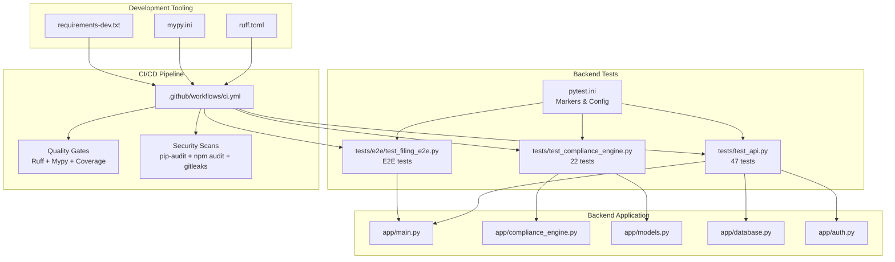
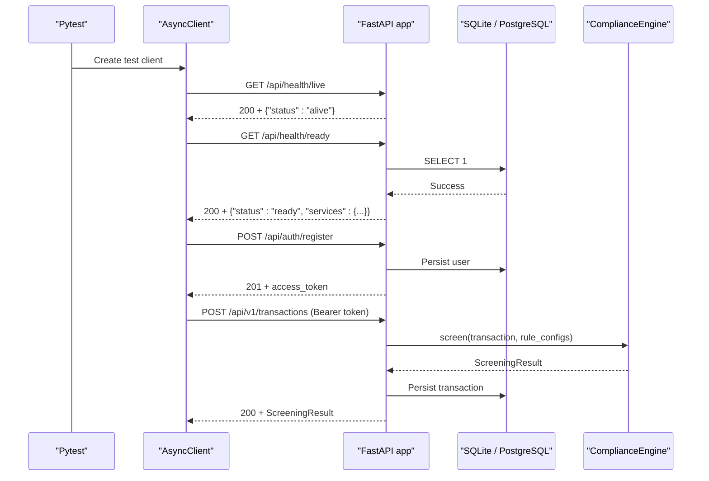
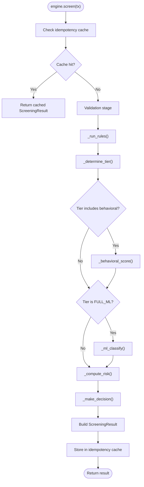
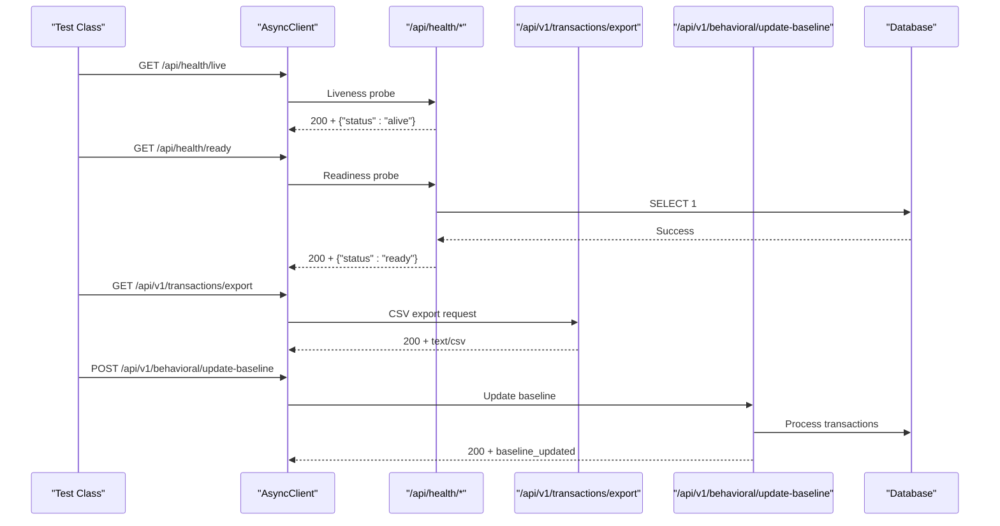
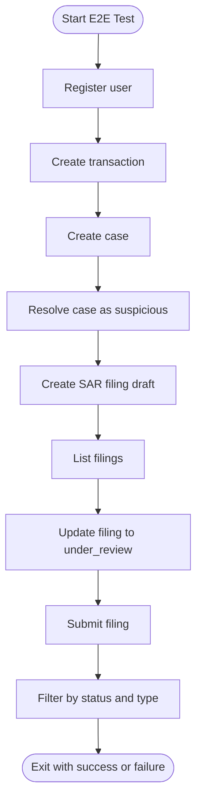
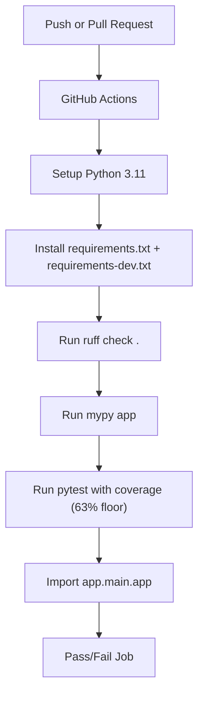
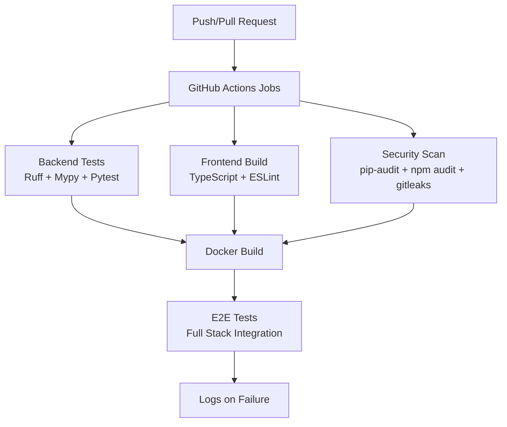
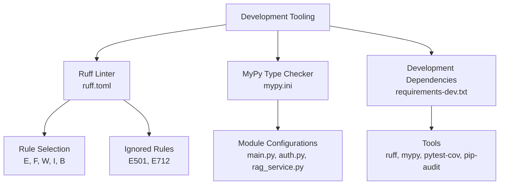
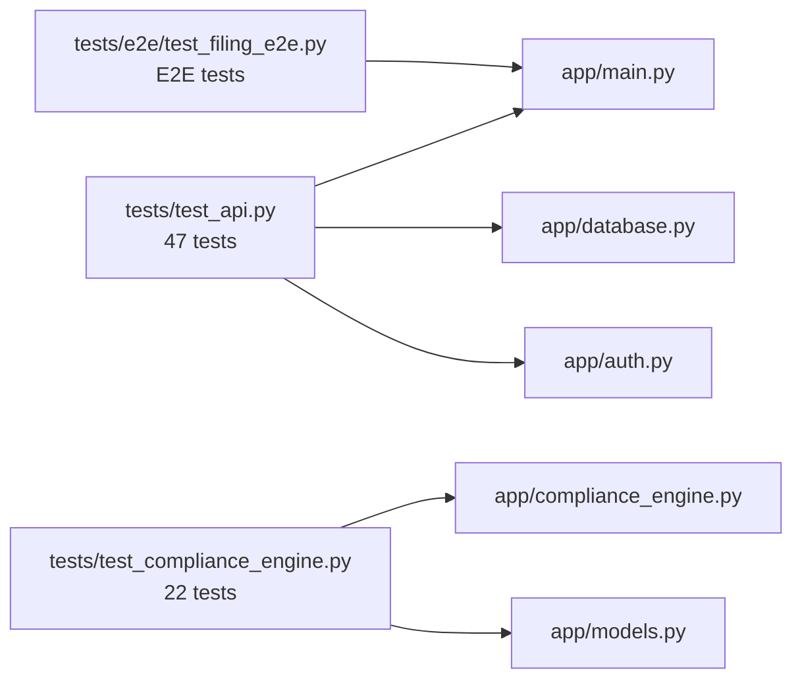
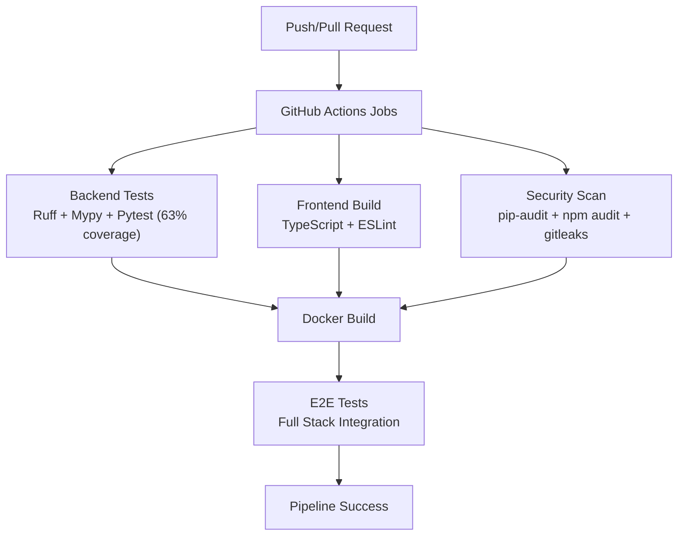

# Testing Strategy

<cite>
**Referenced Files in This Document**   
- [pytest.ini](file://backend/pytest.ini)
- [requirements.txt](file://backend/requirements.txt)
- [requirements-dev.txt](file://backend/requirements-dev.txt)
- [ruff.toml](file://backend/ruff.toml)
- [mypy.ini](file://backend/mypy.ini)
- [test_api.py](file://backend/tests/test_api.py)
- [test_compliance_engine.py](file://backend/tests/test_compliance_engine.py)
- [test_filing_e2e.py](file://backend/tests/e2e/test_filing_e2e.py)
- [ci.yml](file://.github/workflows/ci.yml)
- [main.py](file://backend/app/main.py)
- [compliance_engine.py](file://backend/app/compliance_engine.py)
- [models.py](file://backend/app/models.py)
- [database.py](file://backend/app/database.py)
- [auth.py](file://backend/app/auth.py)
</cite>

## Update Summary
**Changes Made**   
- Added comprehensive CI/CD pipeline with quality gates including ruff linting, mypy type checking, coverage enforcement (63% floor), pip-audit for Python dependencies, npm audit for frontend packages, and gitleaks for secret detection
- Updated test organization with E2E tests moved to backend/tests/e2e/test_filing_e2e.py with proper pytest marker registration
- Added development tooling configuration with requirements-dev.txt, ruff.toml, and mypy.ini files
- Enhanced CI workflow with separate jobs for backend tests, frontend build, security scanning, Docker builds, and E2E testing
- Updated pytest configuration with e2e marker exclusion by default and postgres marker support

## Table of Contents
1. [Introduction](#introduction)
2. [Project Structure](#project-structure)
3. [Core Components](#core-components)
4. [Architecture Overview](#architecture-overview)
5. [Detailed Component Analysis](#detailed-component-analysis)
6. [CI/CD Pipeline and Quality Gates](#cicd-pipeline-and-quality-gates)
7. [Development Tooling Configuration](#development-tooling-configuration)
8. [Dependency Analysis](#dependency-analysis)
9. [Performance Considerations](#performance-considerations)
10. [Troubleshooting Guide](#troubleshooting-guide)
11. [Conclusion](#conclusion)
12. [Appendices](#appendices)

## Introduction
This document describes FinShield's comprehensive testing strategy for the backend FastAPI compliance service, enhanced with modern CI/CD quality gates and improved test organization. It focuses on:
- Unit testing of the compliance engine with pytest.
- API integration tests validating authentication, transaction screening, cases, credits, API keys, rules, billing, and comprehensive health monitoring endpoints.
- End-to-end filing workflow tests organized under `backend/tests/e2e/` with proper pytest markers.
- Test data management, fixture organization, and external dependency handling.
- Pytest configuration with marker-based test execution.
- Comprehensive CI/CD pipeline with quality gates including linting, type checking, coverage enforcement, and security scanning.

The shipped backend stack uses FastAPI, SQLAlchemy, SQLite by default (with a separate test database), JWT-based authentication, bcrypt password hashing, and an in-process compliance engine. The RAG retrieval path requires PostgreSQL with pgvector, but is optional at runtime; tests do not depend on it.

**Updated** The testing infrastructure now includes a robust CI/CD pipeline with multiple quality gates and improved test organization with dedicated E2E test structure.

## Project Structure
FinShield's testing surface lives under `backend/`:
- `backend/tests/` contains pytest-driven integration and unit tests.
- `backend/tests/e2e/` contains end-to-end filing workflow tests with proper pytest marker registration.
- `backend/pytest.ini` configures asyncio support and test markers.
- `.github/workflows/ci.yml` runs comprehensive CI/CD pipeline with quality gates.

**Diagram sources**
- [test_api.py:1-628](file://backend/tests/test_api.py#L1-L628)
- [test_compliance_engine.py:1-224](file://backend/tests/test_compliance_engine.py#L1-L224)
- [test_filing_e2e.py:1-167](file://backend/tests/e2e/test_filing_e2e.py#L1-L167)
- [pytest.ini:1-8](file://backend/pytest.ini#L1-L8)
- [ci.yml:1-174](file://.github/workflows/ci.yml#L1-L174)
- [ruff.toml:1-17](file://backend/ruff.toml#L1-L17)
- [mypy.ini:1-22](file://backend/mypy.ini#L1-L22)
- [requirements-dev.txt:1-5](file://backend/requirements-dev.txt#L1-L5)

**Section sources**
- [pytest.ini:1-8](file://backend/pytest.ini#L1-L8)
- [ci.yml:1-174](file://.github/workflows/ci.yml#L1-L174)
- [test_api.py:1-628](file://backend/tests/test_api.py#L1-L628)
- [test_compliance_engine.py:1-224](file://backend/tests/test_compliance_engine.py#L1-L224)
- [test_filing_e2e.py:1-167](file://backend/tests/e2e/test_filing_e2e.py#L1-L167)

## Core Components
FinShield's testing strategy covers three layers with enhanced CI/CD quality gates and improved test organization:

| Layer | Primary File | Purpose | Key Behaviors Validated |
|---|---|---|---|
| Compliance engine unit tests | `backend/tests/test_compliance_engine.py` | Validate rule evaluation, credit tiers, pipeline stages, decisions, idempotency, and result structure | Rule triggers, tier selection, stage inclusion/exclusion, status mapping, latency bounds |
| API integration tests | `backend/tests/test_api.py` | Validate HTTP endpoints through FastAPI's test client including comprehensive health monitoring | Auth flow, transaction screening, cases, credits, API keys, stats, rules, billing, root endpoint, **health probes (liveness/readiness)**, **regression tests** |
| End-to-end filing tests | `backend/tests/e2e/test_filing_e2e.py` | Validate complete SAR/STR filing workflow against a live server with pytest marker registration | Registration, transaction creation, case creation/resolution, filing draft/update/submit, filtering |

**Updated** The E2E tests are now properly organized under `backend/tests/e2e/` with pytest marker registration (`@pytest.mark.e2e`) and excluded from default test runs via pytest configuration.

**Section sources**
- [test_compliance_engine.py:1-224](file://backend/tests/test_compliance_engine.py#L1-L224)
- [test_api.py:1-628](file://backend/tests/test_api.py#L1-L628)
- [test_filing_e2e.py:1-167](file://backend/tests/e2e/test_filing_e2e.py#L1-L167)

## Architecture Overview
The tests exercise the application through two mechanisms:
- In-process FastAPI test client using `httpx.AsyncClient` with `ASGITransport`.
- Out-of-process HTTP calls against a running server for the E2E filing test.

**Updated** The sequence diagram now includes health probe endpoints that validate liveness and readiness before proceeding with authenticated operations.

**Diagram sources**
- [test_api.py:28-61](file://backend/tests/test_api.py#L28-L61)
- [test_api.py:601-628](file://backend/tests/test_api.py#L601-L628)
- [main.py:2830-2927](file://backend/app/main.py#L2830-L2927)
- [main.py:434-570](file://backend/app/main.py#L434-L570)
- [compliance_engine.py:89-162](file://backend/app/compliance_engine.py#L89-L162)
- [database.py:17-24](file://backend/app/database.py#L17-L24)

## Detailed Component Analysis

### Compliance Engine Unit Testing
The compliance engine unit tests validate the core business logic without involving the HTTP layer. They focus on:
- Rule evaluation across sanctions, PEP, threshold, and geography rules.
- Credit tier determination based on amount, country risk, and rule outcomes.
- Pipeline stage composition depending on the selected tier.
- Decision mapping from triggered rule actions and risk score.
- Idempotency behavior via in-memory cache keyed by `idempotency_key`.
- Structural guarantees such as latency fields and rule metadata.

**Diagram sources**
- [compliance_engine.py:89-162](file://backend/app/compliance_engine.py#L89-L162)
- [compliance_engine.py:165-240](file://backend/app/compliance_engine.py#L165-L240)
- [compliance_engine.py:280-380](file://backend/app/compliance_engine.py#L280-L380)

Key testing patterns:
- A helper function builds `TransactionRequest` objects with sensible defaults and overrides.
- Assertions check both high-level outcomes (`status`, `credit_tier`) and internal details (`rule_results`, `pipeline_stages`).
- Edge cases include clean transactions, sanctioned senders, high-risk countries, small vs large amounts, and different idempotency keys.

**Section sources**
- [test_compliance_engine.py:16-31](file://backend/tests/test_compliance_engine.py#L16-L31)
- [test_compliance_engine.py:38-80](file://backend/tests/test_compliance_engine.py#L38-L80)
- [test_compliance_engine.py:87-109](file://backend/tests/test_compliance_engine.py#L87-L109)
- [test_compliance_engine.py:115-138](file://backend/tests/test_compliance_engine.py#L115-L138)
- [test_compliance_engine.py:144-169](file://backend/tests/test_compliance_engine.py#L144-L169)
- [test_compliance_engine.py:176-200](file://backend/tests/test_compliance_engine.py#L176-L200)
- [test_compliance_engine.py:207-224](file://backend/tests/test_compliance_engine.py#L207-L224)
- [compliance_engine.py:30-162](file://backend/app/compliance_engine.py#L30-L162)

### API Integration Testing Patterns
The API tests are integration tests rather than pure unit tests. They import the real FastAPI application, create tables, and drive endpoints through an async test client.

Important aspects:
- Environment setup: `APP_ENV=test` is set before importing the application so the database layer selects the test SQLite file.
- Session-scoped authenticated client: One user is registered once per session, and subsequent tests reuse the bearer token.
- Per-test clients: Some tests create fresh clients to verify unauthenticated or API-key-authenticated paths.
- Response schema validation: Tests assert status codes, JSON fields, enums, and business invariants such as credit consumption and rule results.
- Authentication flows:
  - Register/login with JWT.
  - Access protected endpoints only with valid tokens.
  - Reject invalid or missing tokens.
  - Authenticate programmatic access via generated API keys.
- Transaction screening:
  - Clean transactions return approved or compliant statuses.
  - Sanctioned senders and high-risk countries produce blocked outcomes.
  - Invalid payloads return validation errors.
- Cases:
  - Creation requires an existing transaction.
  - Retrieval returns expected identifiers and statuses.
- Credits:
  - Initial balance is asserted.
  - Repeated screening reduces remaining credits.
- Rules:
  - Listing rules validates presence of all rule types.
  - Disabling a rule prevents it from firing.
  - Custom thresholds override defaults.
- Billing:
  - Plan listing and subscription endpoints are validated.
  - Invalid plan IDs and enterprise restrictions are tested.

**Updated** The API tests now include comprehensive health monitoring validation through dedicated test classes:

#### Health Probe Testing (TestS04HealthProbes)
The `TestS04HealthProbes` class validates three critical health endpoints:
- **Liveness probe** (`GET /api/health/live`): Returns 200 with `{"status": "alive"}` when the process is up, with no dependency checks.
- **Readiness probe** (`GET /api/health/ready`): Probes primary database connectivity and returns 200 with `{"status": "ready", "services": {"database": "healthy"}}` when healthy, or 503 when dependencies fail.
- **Main health endpoint** (`GET /api/health`): Reflects real database state and provides comprehensive service health information.

#### Regression Testing (TestS05Regression)
The `TestS05Regression` class addresses latent production bugs:
- **Route shadowing fix**: Validates that `GET /api/v1/transactions/export` returns CSV content type instead of being captured by the `/api/v1/transactions/{tx_id}` route pattern.
- **NameError fix**: Ensures `POST /api/v1/behavioral/update-baseline` works correctly with multiple transactions without raising `NameError` on `math.sqrt`.

**Diagram sources**
- [test_api.py:601-628](file://backend/tests/test_api.py#L601-L628)
- [test_api.py:566-599](file://backend/tests/test_api.py#L566-L599)
- [main.py:2830-2927](file://backend/app/main.py#L2830-L2927)

Authentication and authorization behaviors validated:
- Unauthenticated access to protected endpoints returns 401.
- JWT bearer tokens authenticate requests.
- API keys prefixed with the expected live prefix authenticate programmatic access.
- Invalid API keys are rejected.

Response schema validation examples:
- Health endpoint returns service name, version, services map, and uptime.
- Liveness probe returns simple alive status.
- Readiness probe returns detailed service health with database connectivity status.
- Transaction response wraps a `ScreeningResult` with status, risk score, credit tier, rule results, and pipeline stages.
- Case responses include case identifiers and lifecycle fields.
- Stats responses include transaction counts and credit information.

**Section sources**
- [test_api.py:1-20](file://backend/tests/test_api.py#L1-L20)
- [test_api.py:28-61](file://backend/tests/test_api.py#L28-L61)
- [test_api.py:68-89](file://backend/tests/test_api.py#L68-L89)
- [test_api.py:95-165](file://backend/tests/test_api.py#L95-L165)
- [test_api.py:171-289](file://backend/tests/test_api.py#L171-L289)
- [test_api.py:295-350](file://backend/tests/test_api.py#L295-L350)
- [test_api.py:356-379](file://backend/tests/test_api.py#L356-L379)
- [test_api.py:385-408](file://backend/tests/test_api.py#L385-L408)
- [test_api.py:414-438](file://backend/tests/test_api.py#L414-L438)
- [test_api.py:444-484](file://backend/tests/test_api.py#L444-L484)
- [test_api.py:486-498](file://backend/tests/test_api.py#L486-L498)
- [test_api.py:504-546](file://backend/tests/test_api.py#L504-L546)
- [test_api.py:552-560](file://backend/tests/test_api.py#L552-L560)
- [test_api.py:566-628](file://backend/tests/test_api.py#L566-L628)
- [main.py:54-152](file://backend/app/main.py#L54-L152)
- [main.py:2830-2927](file://backend/app/main.py#L2830-L2927)
- [main.py:434-570](file://backend/app/main.py#L434-L570)
- [models.py:67-127](file://backend/app/models.py#L67-L127)
- [auth.py:59-122](file://backend/app/auth.py#L59-L122)

### End-to-End Filing Workflow Tests
The filing E2E tests are now properly organized under `backend/tests/e2e/` and use pytest markers for selective execution. They assume a running backend at `E2E_BASE_URL` (default: `http://localhost:8091`) and validate the complete SAR/STR filing workflow:
1. Register a user.
2. Screen a transaction.
3. Create a case linked to the transaction.
4. Resolve the case as suspicious.
5. Create a SAR filing draft.
6. List filings and assert count.
7. Update filing status to under review.
8. Submit the filing with a reference number.
9. Verify filtering by status and filing type.

**Diagram sources**
- [test_filing_e2e.py:16-149](file://backend/tests/e2e/test_filing_e2e.py#L16-L149)

Execution characteristics:
- Uses synchronous `httpx` against a live server.
- Prints step-by-step progress and error messages.
- Exits with code 0 on success and non-zero on exception or assertion failure.
- Marked with `@pytest.mark.e2e` for selective execution.
- Excluded from default test runs via pytest configuration.

**Section sources**
- [test_filing_e2e.py:1-167](file://backend/tests/e2e/test_filing_e2e.py#L1-L167)

### Test Data Management Strategies
The repository uses practical, production-oriented test data strategies:

| Area | Strategy | Notes |
|---|---|---|
| Database isolation | Separate test database file when `APP_ENV=test` | Prevents tests from mutating the development SQLite file |
| User data | Unique email addresses generated per registration call | Avoids duplicate-email conflicts during parallel or repeated runs |
| Session-scoped auth | One registration per test session | Reduces overhead while keeping most tests authenticated |
| Transaction data | Inline payloads in tests | Keeps tests self-contained and readable |
| Idempotency | Explicit `idempotency_key` values in tests | Validates deduplication behavior |
| External dependencies | No mocking of database or auth; rely on real SQLite and in-process FastAPI | Tests are integration tests rather than isolated unit tests |
| Health probes | Real database connectivity checks | Validates actual service health rather than hardcoded responses |
| E2E environment | Separate `E2E_BASE_URL` environment variable | Allows flexible deployment target configuration |

**Updated** E2E tests now use environment-based configuration with `E2E_BASE_URL` for flexible deployment targeting and proper pytest marker registration.

**Section sources**
- [database.py:11-15](file://backend/app/database.py#L11-L15)
- [test_api.py:35-61](file://backend/tests/test_api.py#L35-L61)
- [test_api.py:601-628](file://backend/tests/test_api.py#L601-L628)
- [test_api.py:486-498](file://backend/tests/test_api.py#L486-L498)
- [test_filing_e2e.py:13](file://backend/tests/e2e/test_filing_e2e.py#L13)

### Fixture Organization
The API tests define fixtures directly in the test module:
- `anyio_loop`: Provides an event loop context for session-scoped async fixtures.
- `client`: Creates an unauthenticated async test client.
- `session_auth_client`: Registers one user once per session and attaches the bearer token.
- `auth_client`: Reuses the session-scoped authenticated client for each test.

This approach keeps fixtures simple and localized. For larger test suites, consider moving shared fixtures into a `conftest.py` file under `backend/tests/`.

**Section sources**
- [test_api.py:22-61](file://backend/tests/test_api.py#L22-L61)

### Mocking Approaches for External Dependencies
Current tests do not mock:
- Database interactions.
- Authentication providers.
- Rate limiting.
- Optional RAG retrieval.

Instead, they:
- Use the real FastAPI application.
- Use SQLite for persistence.
- Disable rate limiting in test mode.
- Treat RAG as optional and skip it if unavailable.

If future tests need to isolate external services, recommended approaches include:
- Mocking slow or nondeterministic components such as ML inference or external APIs.
- Using test doubles for payment providers, email services, or third-party sanction lists.
- Keeping current integration tests as contract tests and adding lightweight unit tests around mocked dependencies.

**Section sources**
- [main.py:72-78](file://backend/app/main.py#L72-L78)
- [main.py:38-43](file://backend/app/main.py#L38-L43)
- [test_api.py:1-20](file://backend/tests/test_api.py#L1-L20)

### Pytest Configuration and Execution
Configuration:
- `backend/pytest.ini` enables automatic asyncio mode so async test functions work without explicit decorators.
- Test paths configured to run from `tests` directory.
- Default options exclude E2E tests with `-m "not e2e"` for faster local development.
- Markers defined for `e2e` and `postgres` test categories.

Dependencies:
- `pytest`, `pytest-asyncio`, and `httpx` are declared in `backend/requirements.txt`.
- Development tools (`ruff`, `mypy`, `pytest-cov`, `pip-audit`) declared in `backend/requirements-dev.txt`.

CI execution:
- The GitHub Actions job installs both regular and development dependencies.
- Sets `APP_ENV=test`.
- Runs `pytest tests/ -v --tb=short --cov=app --cov-report=term-missing --cov-fail-under=63`.
- Verifies that the application imports successfully.

**Diagram sources**
- [ci.yml:14-48](file://.github/workflows/ci.yml#L14-L48)
- [requirements.txt:4-6](file://backend/requirements.txt#L4-L6)
- [requirements-dev.txt:1-5](file://backend/requirements-dev.txt#L1-L5)
- [pytest.ini:1-8](file://backend/pytest.ini#L1-L8)

**Section sources**
- [pytest.ini:1-8](file://backend/pytest.ini#L1-L8)
- [requirements.txt:1-16](file://backend/requirements.txt#L1-L16)
- [requirements-dev.txt:1-5](file://backend/requirements-dev.txt#L1-L5)
- [ci.yml:14-48](file://.github/workflows/ci.yml#L14-L48)

## CI/CD Pipeline and Quality Gates
FinShield's CI/CD pipeline implements comprehensive quality gates across multiple dimensions:

### Backend Test Pipeline
The backend-tests job performs sequential quality checks:
1. **Dependency Installation**: Installs both runtime and development dependencies.
2. **Code Linting**: Runs `ruff check .` with configured rules.
3. **Type Checking**: Executes `mypy app` with project-specific configurations.
4. **Test Execution**: Runs pytest with coverage reporting and 63% coverage floor.

### Frontend Build Pipeline
The frontend-build job ensures TypeScript and JavaScript quality:
1. **Dependency Installation**: Uses `npm ci` for deterministic builds.
2. **TypeScript Type Checking**: Runs `npx tsc --noEmit`.
3. **ESLint Linting**: Executes `npm run lint`.
4. **Production Build**: Runs `npm run build`.

### Security Scan Pipeline
The security-scan job performs comprehensive vulnerability assessment:
1. **Python Dependency Audit**: Uses `pip-audit` to scan `requirements.txt`.
2. **Node.js Dependency Audit**: Runs `npm audit --audit-level=high`.
3. **Secret Detection**: Uses `gitleaks` to detect hardcoded secrets in the codebase.

### Docker Build Pipeline
The docker-build job creates container images:
1. **Backend Image**: Builds `finshield-backend` from `backend/Dockerfile`.
2. **Platform Image**: Builds `finshield-platform` from `platform-app/Dockerfile`.
3. **Website Image**: Builds `finshield-website` from `./website`.
4. **Compose Validation**: Validates docker-compose configuration with generated secrets.

### E2E Test Pipeline
The e2e job runs full-stack integration tests:
1. **Stack Deployment**: Starts full stack with `docker compose up -d --build --wait`.
2. **E2E Test Execution**: Runs `pytest tests/e2e -m e2e -v` against deployed stack.
3. **Cleanup**: Stops stack and removes volumes on completion.

**Diagram sources**
- [ci.yml:14-174](file://.github/workflows/ci.yml#L14-L174)

**Section sources**
- [ci.yml:14-48](file://.github/workflows/ci.yml#L14-L48)
- [ci.yml:50-79](file://.github/workflows/ci.yml#L50-L79)
- [ci.yml:80-112](file://.github/workflows/ci.yml#L80-L112)
- [ci.yml:113-136](file://.github/workflows/ci.yml#L113-L136)
- [ci.yml:137-174](file://.github/workflows/ci.yml#L137-L174)

## Development Tooling Configuration
FinShield includes comprehensive development tooling for code quality and consistency:

### Ruff Linter Configuration
The `ruff.toml` file configures Python linting with:
- Target Python version 3.11.
- Line length of 120 characters.
- Selected rule sets: E (pycodestyle), F (pyflakes), W (pycodestyle warnings), I (isort), B (bugbear).
- Ignored rules for SQLAlchemy compatibility and line length flexibility.
- Flake8-bugbear extensions for FastAPI decorator handling.
- Per-file ignores for environment loading patterns.

### MyPy Type Checking Configuration
The `mypy.ini` file configures static type checking with:
- Python version 3.11.
- Missing imports ignored for third-party libraries.
- Module-specific error disabling for legacy ORM patterns.
- Special handling for main.py, auth.py, rag_service.py, and seed_rag_data.py modules.

### Development Dependencies
The `requirements-dev.txt` file includes:
- `ruff==0.6.9` for code linting.
- `mypy==1.11.2` for type checking.
- `pytest-cov==5.0.0` for coverage reporting.
- `pip-audit==2.7.3` for dependency vulnerability scanning.

**Diagram sources**
- [ruff.toml:1-17](file://backend/ruff.toml#L1-L17)
- [mypy.ini:1-22](file://backend/mypy.ini#L1-L22)
- [requirements-dev.txt:1-5](file://backend/requirements-dev.txt#L1-L5)

**Section sources**
- [ruff.toml:1-17](file://backend/ruff.toml#L1-L17)
- [mypy.ini:1-22](file://backend/mypy.ini#L1-L22)
- [requirements-dev.txt:1-5](file://backend/requirements-dev.txt#L1-L5)

## Dependency Analysis
The tests depend on the application modules they validate:

**Updated** The dependency graph now reflects the expanded test coverage with 47 API tests, 22 compliance engine tests, and properly organized E2E tests.

**Diagram sources**
- [test_api.py:10-19](file://backend/tests/test_api.py#L10-L19)
- [test_compliance_engine.py:5-13](file://backend/tests/test_compliance_engine.py#L5-L13)
- [test_filing_e2e.py:1-10](file://backend/tests/e2e/test_filing_e2e.py#L1-L10)

Coupling and cohesion observations:
- API tests are tightly coupled to endpoint contracts and response schemas.
- Engine tests are more cohesive around business logic and less dependent on HTTP concerns.
- The E2E test depends on the deployed server URL and assumes the filing endpoints exist.
- Health probe tests provide strong coupling to service health endpoints, ensuring operational reliability.
- E2E tests are properly isolated with pytest markers and environment-based configuration.

Potential risks:
- Shared session-scoped state can make tests order-dependent.
- The E2E test is environment-sensitive and cannot run inside the standard pytest job without a running server.
- Randomness in the compliance engine may affect ML-related assertions unless tests account for ranges rather than exact values.
- Health probe tests depend on actual database connectivity, which may cause failures in environments without proper database setup.
- CI/CD pipeline failures can occur due to strict quality gates requiring immediate attention.

**Section sources**
- [test_api.py:1-628](file://backend/tests/test_api.py#L1-L628)
- [test_compliance_engine.py:1-224](file://backend/tests/test_compliance_engine.py#L1-L224)
- [test_filing_e2e.py:1-167](file://backend/tests/e2e/test_filing_e2e.py#L1-L167)

## Performance Considerations
- The compliance engine measures total latency and per-rule latency, which tests assert are non-negative.
- The API tests use a session-scoped authenticated client to reduce repeated registration overhead.
- Rate limiting is disabled in test mode, preventing flaky failures under load.
- The E2E test prints progress and exits quickly on failure, making it suitable for manual or pre-deployment verification.
- Health probe tests perform real database connectivity checks, which adds minimal overhead but ensures accurate health reporting.
- CI/CD pipeline includes performance considerations with caching for Python and Node.js dependencies.

Recommendations:
- Add timing assertions for critical paths where performance regression matters.
- Consider separating slow E2E tests into a dedicated job that runs after successful unit/integration tests.
- Avoid unnecessary repeated registrations by keeping session-scoped fixtures but ensuring test isolation for stateful resources like transactions and cases.
- Monitor health probe test execution time to ensure they don't become a bottleneck in CI pipelines.
- Optimize CI/CD pipeline execution time by leveraging dependency caching effectively.

**Section sources**
- [compliance_engine.py:144-162](file://backend/app/compliance_engine.py#L144-L162)
- [main.py:72-78](file://backend/app/main.py#L72-L78)
- [test_api.py:22-61](file://backend/tests/test_api.py#L22-L61)
- [test_api.py:601-628](file://backend/tests/test_api.py#L601-L628)
- [test_filing_e2e.py:16-149](file://backend/tests/e2e/test_filing_e2e.py#L16-L149)
- [ci.yml:26-36](file://.github/workflows/ci.yml#L26-L36)

## Troubleshooting Guide
Common issues and resolutions:

| Symptom | Likely Cause | Resolution |
|---|---|---|
| Tests fail because the wrong database is used | `APP_ENV` not set to `test` | Ensure `APP_ENV=test` before running tests |
| Tests mutate development database | Missing test database isolation | Confirm `APP_ENV=test` and that `test_finshield.db` is used |
| Async tests raise event loop errors | Missing asyncio configuration | Keep `asyncio_mode = auto` in `pytest.ini` |
| API tests fail due to rate limiting | Rate limiter enabled in test environment | Confirm rate limiter is disabled when `APP_ENV=test` |
| E2E filing test fails immediately | Backend not running at expected URL | Start the backend and adjust `E2E_BASE_URL` if needed |
| RAG-related failures in non-PostgreSQL environments | RAG requires PostgreSQL with pgvector | RAG is optional; ensure tests do not require it or run against PostgreSQL when needed |
| Health probe tests fail | Database connectivity issues | Verify database is accessible and credentials are correct |
| Route shadowing test fails | Endpoint registration order issue | Ensure `/api/v1/transactions/export` is registered before `/api/v1/transactions/{tx_id}` |
| Baseline update NameError | Missing math import scope | Ensure `import math` is at module level, not function-local |
| CI/CD pipeline fails on linting | Code style violations | Run `ruff check .` locally and fix reported issues |
| Type checking fails | Type annotation issues | Run `mypy app` locally and address type errors |
| Coverage falls below 63% | Insufficient test coverage | Add more test cases to meet coverage threshold |
| E2E tests not running | Wrong pytest marker usage | Use `pytest tests/e2e -m e2e` to run E2E tests specifically |
| Security scan fails | Vulnerable dependencies found | Update dependencies or add exceptions as appropriate |

**Updated** Added troubleshooting guidance for CI/CD pipeline issues, development tooling problems, and E2E test execution.

**Section sources**
- [database.py:11-15](file://backend/app/database.py#L11-L15)
- [pytest.ini:1-8](file://backend/pytest.ini#L1-L8)
- [main.py:72-78](file://backend/app/main.py#L72-L78)
- [test_filing_e2e.py:13](file://backend/tests/e2e/test_filing_e2e.py#L13)
- [test_api.py:601-628](file://backend/tests/test_api.py#L601-L628)
- [test_api.py:566-599](file://backend/tests/test_api.py#L566-L599)
- [main.py:38-43](file://backend/app/main.py#L38-L43)
- [ci.yml:38-48](file://.github/workflows/ci.yml#L38-L48)
- [ci.yml:93-111](file://.github/workflows/ci.yml#L93-L111)

## Conclusion
FinShield's backend testing strategy combines focused unit tests for the compliance engine with integration tests for the FastAPI endpoints and a properly organized end-to-end filing workflow test. The testing infrastructure has been significantly enhanced with:
- Real endpoint behavior through FastAPI's async test client.
- Clear separation between engine logic and HTTP concerns.
- Practical data management using unique emails and session-scoped authentication.
- Comprehensive health monitoring with real dependency probing.
- Regression testing to prevent latent production bugs.
- Robust CI/CD pipeline with multiple quality gates.
- Improved test organization with dedicated E2E test structure.
- Development tooling for consistent code quality.

**Updated** The testing infrastructure now includes a comprehensive CI/CD pipeline with quality gates (ruff linting, mypy type checking, 63% coverage enforcement, security scanning), improved test organization with E2E tests properly marked and organized, and development tooling for consistent code quality across the team.

For maintainability, keep tests close to the features they validate, prefer deterministic assertions over fragile exact matches, introduce mocks only when external dependencies introduce instability or unacceptable cost, and leverage the CI/CD pipeline for automated quality assurance.

## Appendices

### Best Practices for Writing Maintainable Tests
- Name tests descriptively and group related behavior into classes.
- Prefer small, single-purpose tests over large multi-step tests.
- Use fixtures for shared setup such as authenticated clients.
- Assert both status codes and response schema fields.
- Keep test data minimal and unique.
- Avoid coupling tests to implementation details unless necessary.
- Mark long-running or environment-dependent tests separately.
- Include health probe tests to validate service operability.
- Add regression tests for known production issues to prevent recurrence.
- Organize E2E tests with proper pytest markers and environment configuration.
- Follow ruff linting rules and mypy type checking requirements.
- Maintain coverage above the 63% threshold enforced by CI/CD.

[No sources needed since this section provides general guidance]

### Continuous Integration Testing Workflow
The CI workflow implements a comprehensive quality gate system:
- Triggers on push to `main` and `develop`, and on pull requests to `main`.
- Runs backend tests with ruff linting, mypy type checking, and pytest with 63% coverage floor.
- Performs frontend TypeScript type checking, ESLint, and production build.
- Executes security scans with pip-audit, npm audit, and gitleaks.
- Builds Docker images for all components.
- Runs E2E tests against full stack deployment.

**Updated** The CI workflow now includes comprehensive quality gates with separate jobs for backend tests, frontend build, security scanning, Docker builds, and E2E testing, providing robust automated quality assurance.

**Diagram sources**
- [ci.yml:1-174](file://.github/workflows/ci.yml#L1-L174)

**Section sources**
- [ci.yml:1-174](file://.github/workflows/ci.yml#L1-L174)