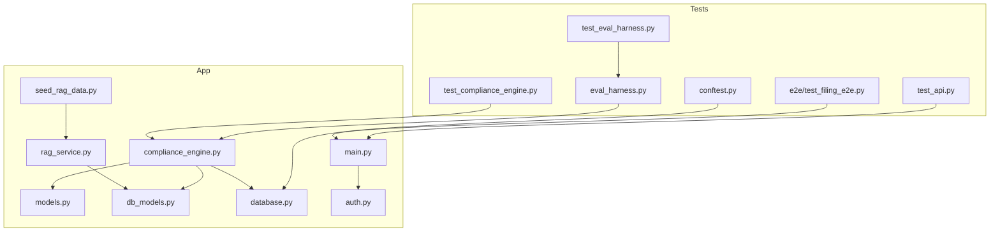
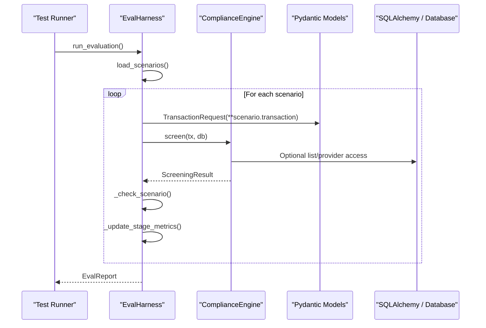
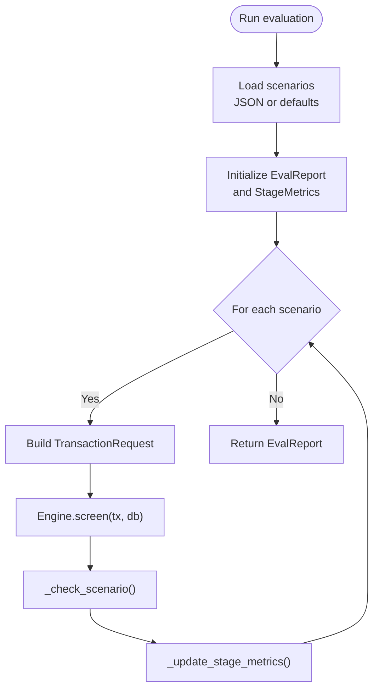
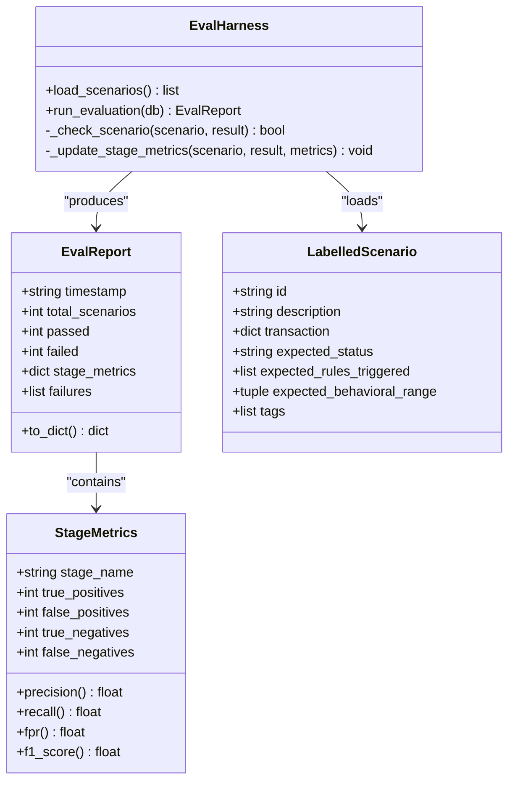
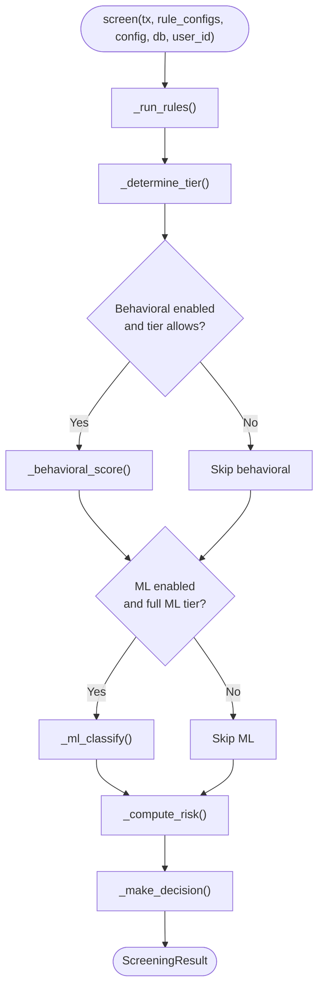
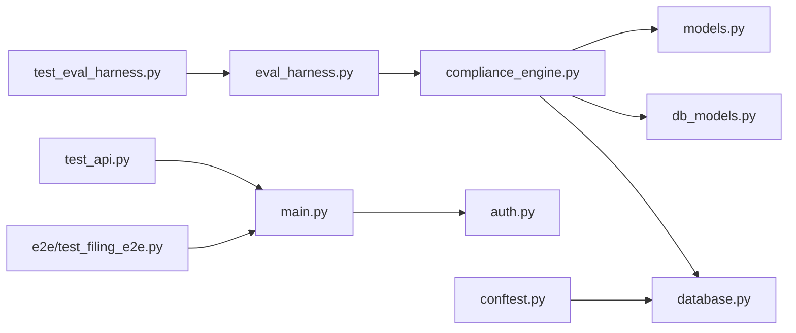

# Evaluation Harness and Testing Framework

<cite>
**Referenced Files in This Document**   
- [eval_harness.py](file://backend/tests/eval_harness.py)
- [test_eval_harness.py](file://backend/tests/test_eval_harness.py)
- [conftest.py](file://backend/tests/conftest.py)
- [compliance_engine.py](file://backend/app/compliance_engine.py)
- [models.py](file://backend/app/models.py)
- [db_models.py](file://backend/app/db_models.py)
- [database.py](file://backend/app/database.py)
- [rag_service.py](file://backend/app/rag_service.py)
- [seed_rag_data.py](file://backend/app/seed_rag_data.py)
- [auth.py](file://backend/app/auth.py)
- [main.py](file://backend/app/main.py)
- [test_compliance_engine.py](file://backend/tests/test_compliance_engine.py)
- [test_api.py](file://backend/tests/test_api.py)
- [test_filing_e2e.py](file://backend/tests/e2e/test_filing_e2e.py)
- [docker-compose.yml](file://docker-compose.yml)
</cite>

## Table of Contents
1. [Introduction](#introduction)
2. [Project Structure](#project-structure)
3. [Core Components](#core-components)
4. [Architecture Overview](#architecture-overview)
5. [Detailed Component Analysis](#detailed-component-analysis)
6. [Dependency Analysis](#dependency-analysis)
7. [Performance Considerations](#performance-considerations)
8. [Troubleshooting Guide](#troubleshooting-guide)
9. [Conclusion](#conclusion)

## Introduction
This document explains the evaluation harness and testing framework for FinShield AI’s compliance pipeline. It focuses on how labelled scenarios are executed against the core engine, how metrics are computed, and how unit, integration, and end-to-end tests validate behaviour. It also clarifies the runtime environment: SQLite by default under test, PostgreSQL with pgvector when configured, and the optional RAG retrieval service.

The shipped stack is FastAPI, Uvicorn, Pydantic 2.9, SQLAlchemy 2.0, psycopg2-binary plus pgvector, python-jose plus bcrypt, slowapi, numpy, and pytest. Celery/Redis, LangChain, DSPy, LoRA/PEFT/BitsAndBytes, vLLM, RAGAS, HashiCorp Vault, OpenTelemetry, Prometheus, and Kubernetes/Helm are roadmap-only and not part of the current implementation.

## Project Structure
The evaluation and testing surface lives under `backend/tests/`. The most relevant pieces are:

- `tests/eval_harness.py`: Labelled scenario loader, metric calculators, and the `EvalHarness` orchestrator.
- `tests/test_eval_harness.py`: Unit tests for `StageMetrics`, scenario loading, report serialization, and selected scenario assertions.
- `tests/test_compliance_engine.py`: Unit tests for the 7-stage compliance pipeline.
- `tests/test_api.py`: Integration tests for authentication, transaction screening, cases, credits, API keys, rules, health probes, and idempotency.
- `tests/e2e/test_filing_e2e.py`: End-to-end SAR/STR filing workflow against a running backend.
- `tests/conftest.py`: Test environment setup that forces `APP_ENV=test` and creates the test schema.

**Diagram sources**
- [eval_harness.py:1-320](file://backend/tests/eval_harness.py#L1-L320)
- [test_eval_harness.py:1-134](file://backend/tests/test_eval_harness.py#L1-L134)
- [test_compliance_engine.py:1-211](file://backend/tests/test_compliance_engine.py#L1-L211)
- [test_api.py:1-672](file://backend/tests/test_api.py#L1-L672)
- [test_filing_e2e.py:1-167](file://backend/tests/e2e/test_filing_e2e.py#L1-L167)
- [conftest.py:1-20](file://backend/tests/conftest.py#L1-L20)
- [compliance_engine.py:1-529](file://backend/app/compliance_engine.py#L1-L529)
- [models.py:1-153](file://backend/app/models.py#L1-L153)
- [db_models.py:1-472](file://backend/app/db_models.py#L1-L472)
- [database.py:1-75](file://backend/app/database.py#L1-L75)
- [rag_service.py:1-375](file://backend/app/rag_service.py#L1-L375)
- [seed_rag_data.py:1-200](file://backend/app/seed_rag_data.py#L1-L200)
- [auth.py:1-257](file://backend/app/auth.py#L1-L257)
- [main.py:1-152](file://backend/app/main.py#L1-L152)

**Section sources**
- [eval_harness.py:1-320](file://backend/tests/eval_harness.py#L1-L320)
- [test_eval_harness.py:1-134](file://backend/tests/test_eval_harness.py#L1-L134)
- [test_compliance_engine.py:1-211](file://backend/tests/test_compliance_engine.py#L1-L211)
- [test_api.py:1-672](file://backend/tests/test_api.py#L1-L672)
- [test_filing_e2e.py:1-167](file://backend/tests/e2e/test_filing_e2e.py#L1-L167)
- [conftest.py:1-20](file://backend/tests/conftest.py#L1-L20)

## Core Components
The evaluation harness is built around three concepts:

- `LabelledScenario`: A test input with expected status, triggered rules, optional behavioural range, and tags.
- `StageMetrics`: Precision, recall, false positive rate, F1 score, and confusion counts per stage.
- `EvalReport`: Aggregated pass/fail counts, accuracy, per-stage metrics, and truncated failure details.

`EvalHarness` loads scenarios from JSON or falls back to defaults, runs each through `ComplianceEngine.screen()`, compares outcomes, updates stage metrics, and returns an `EvalReport`.

Key responsibilities:
- Scenario loading and fallback defaults.
- Transaction construction via `TransactionRequest`.
- Pipeline execution via `ComplianceEngine`.
- Status, rule, and behavioural-range validation.
- Per-stage TP/FP/TN/FN accounting for sanctions, PEP, threshold, geography, and overall.

**Section sources**
- [eval_harness.py:15-97](file://backend/tests/eval_harness.py#L15-L97)
- [eval_harness.py:100-236](file://backend/tests/eval_harness.py#L100-L236)
- [eval_harness.py:238-320](file://backend/tests/eval_harness.py#L238-L320)
- [models.py:66-120](file://backend/app/models.py#L66-L120)
- [compliance_engine.py:90-164](file://backend/app/compliance_engine.py#L90-L164)

## Architecture Overview
At runtime, the evaluation harness sits outside the HTTP layer and calls the compliance engine directly. Tests may exercise the same engine through unit tests, integration tests through FastAPI, or end-to-end tests against a live process.

**Diagram sources**
- [eval_harness.py:185-236](file://backend/tests/eval_harness.py#L185-L236)
- [compliance_engine.py:90-164](file://backend/app/compliance_engine.py#L90-L164)
- [models.py:66-120](file://backend/app/models.py#L66-L120)
- [database.py:47-75](file://backend/app/database.py#L47-L75)

## Detailed Component Analysis

### Evaluation Harness
`EvalHarness` is the central orchestrator. It:
- Loads scenarios from a JSON file if present; otherwise uses built-in defaults covering clean transactions, sanctioned senders, high-risk countries, and threshold exceedance.
- Creates `TransactionRequest` objects and invokes `ComplianceEngine.screen()`.
- Compares the returned `ScreeningResult.status` and triggered rules against expectations.
- Optionally validates `behavioral_score` against an expected range.
- Updates per-stage metrics based on scenario tags and actual rule results.
- Produces an `EvalReport` with summary statistics and up to ten recorded failures.

**Diagram sources**
- [eval_harness.py:185-236](file://backend/tests/eval_harness.py#L185-L236)
- [eval_harness.py:238-320](file://backend/tests/eval_harness.py#L238-L320)

**Section sources**
- [eval_harness.py:100-236](file://backend/tests/eval_harness.py#L100-L236)
- [eval_harness.py:238-320](file://backend/tests/eval_harness.py#L238-L320)

### Stage Metrics and Reports
`StageMetrics` computes precision, recall, false positive rate, and F1 score while guarding against zero-division. `EvalReport.to_dict()` serializes timestamps, totals, accuracy, rounded stage metrics, and the first ten failures.

Tests verify:
- Correct precision, recall, FPR, and F1 calculations.
- Zero-division safety.
- Default scenario loading.
- Report structure and field presence.
- Selected scenario outcomes such as approved clean transactions, blocked sanctioned senders, and blocked high-risk country transactions.

**Diagram sources**
- [eval_harness.py:15-97](file://backend/tests/eval_harness.py#L15-L97)
- [eval_harness.py:100-236](file://backend/tests/eval_harness.py#L100-L236)

**Section sources**
- [eval_harness.py:15-97](file://backend/tests/eval_harness.py#L15-L97)
- [test_eval_harness.py:8-50](file://backend/tests/test_eval_harness.py#L8-L50)
- [test_eval_harness.py:53-84](file://backend/tests/test_eval_harness.py#L53-L84)

### Compliance Engine Integration
The harness depends on `ComplianceEngine.screen()`, which implements the seven-stage pipeline: idempotency check, validation, hard-rule engine, behavioral analysis, ML classification, risk scoring, and decision. Rule definitions include sanctions, PEP, threshold, and geography checks. When a database session is provided, the engine prefers DB-backed lists; otherwise it falls back to hardcoded sets.

Important implications for evaluation:
- Sanctions and PEP matching can use either DB-backed providers or hardcoded fallbacks.
- Threshold and geography rules respect user-configurable parameters.
- Decision logic enforces mandatory rule actions before falling back to score-based bands.
- Behavioral and ML stages are conditional on configuration and credit tier.

**Diagram sources**
- [compliance_engine.py:90-164](file://backend/app/compliance_engine.py#L90-L164)
- [compliance_engine.py:167-334](file://backend/app/compliance_engine.py#L167-L334)
- [compliance_engine.py:375-529](file://backend/app/compliance_engine.py#L375-L529)

**Section sources**
- [compliance_engine.py:33-164](file://backend/app/compliance_engine.py#L33-L164)
- [compliance_engine.py:167-334](file://backend/app/compliance_engine.py#L167-L334)
- [compliance_engine.py:375-529](file://backend/app/compliance_engine.py#L375-L529)
- [test_compliance_engine.py:38-80](file://backend/tests/test_compliance_engine.py#L38-L80)
- [test_compliance_engine.py:87-137](file://backend/tests/test_compliance_engine.py#L87-L137)
- [test_compliance_engine.py:144-211](file://backend/tests/test_compliance_engine.py#L144-L211)

### Data Models and Persistence
The evaluation harness constructs requests using Pydantic models, while the compliance engine produces structured results. Persistence models define the database schema used by Alembic migrations and by the RAG service.

Key model areas:
- Request/response schemas: `TransactionRequest`, `RuleResult`, `ScreeningResult`.
- Database entities: users, transactions, cases, filings, settings, feature flags, and RAG corpora.
- Vector dimension constant shared between RAG embeddings and pgvector columns.

**Section sources**
- [models.py:15-120](file://backend/app/models.py#L15-L120)
- [db_models.py:77-108](file://backend/app/db_models.py#L77-L108)
- [db_models.py:379-472](file://backend/app/db_models.py#L379-L472)

### Database Configuration and Test Schema
Database selection is environment-driven:
- Under `APP_ENV=test`, SQLite is used unless `TEST_DATABASE_URL` points at PostgreSQL.
- Outside test mode, a PostgreSQL URL is required.
- `create_test_schema()` builds the schema for tests: SQLite uses `Base.metadata.create_all`; PostgreSQL runs Alembic migrations.

This matters for evaluation because passing a `Session` enables DB-backed sanctions and PEP checks. Without a session, the engine falls back to hardcoded lists.

**Section sources**
- [database.py:1-75](file://backend/app/database.py#L1-L75)
- [conftest.py:1-20](file://backend/tests/conftest.py#L1-L20)

### RAG Retrieval Service and Seed Data
RAG retrieval is optional and requires PostgreSQL with pgvector:
- `main.py` initializes `RAGRetrievalService` only when `RAG_DATABASE_URL` starts with `postgresql` and dependencies are available.
- `rag_service.py` supports deterministic hashing embeddings by default and optional sentence-transformers embeddings when explicitly enabled.
- `seed_rag_data.py` populates compliance documents, sanctions entries, and precedent decisions into the RAG database.

Evaluation does not require RAG, but tests for health readiness distinguish healthy, disabled, and unavailable RAG states.

**Section sources**
- [main.py:43-48](file://backend/app/main.py#L43-L48)
- [main.py:123-138](file://backend/app/main.py#L123-L138)
- [rag_service.py:1-54](file://backend/app/rag_service.py#L1-L54)
- [rag_service.py:110-118](file://backend/app/rag_service.py#L110-L118)
- [seed_rag_data.py:11-25](file://backend/app/seed_rag_data.py#L11-L25)
- [test_api.py:74-82](file://backend/tests/test_api.py#L74-L82)
- [test_api.py:653-671](file://backend/tests/test_api.py#L653-L671)

### Authentication and Authorization
Authentication supports JWT bearer tokens and API keys with the `fsk_` prefix. Authorization includes role-based permissions and permission decorators. Tests cover registration, login, authenticated endpoints, API key usage, and invalid key rejection.

**Section sources**
- [auth.py:21-28](file://backend/app/auth.py#L21-L28)
- [auth.py:63-117](file://backend/app/auth.py#L63-L117)
- [auth.py:120-125](file://backend/app/auth.py#L120-L125)
- [auth.py:128-257](file://backend/app/auth.py#L128-L257)
- [test_api.py:93-163](file://backend/tests/test_api.py#L93-L163)
- [test_api.py:267-287](file://backend/tests/test_api.py#L267-L287)

### Application Entry Point and Router Registration
`main.py` configures CORS, exception handlers, request logging middleware, lifespan startup, and router registration. It also conditionally initializes the RAG service and logs startup information.

**Section sources**
- [main.py:56-72](file://backend/app/main.py#L56-L72)
- [main.py:75-119](file://backend/app/main.py#L75-L119)
- [main.py:123-152](file://backend/app/main.py#L123-L152)

### End-to-End Filing Workflow
The E2E test drives a complete SAR filing flow: register, create transaction, create case, resolve case, create filing, update status, submit filing, and filter listings. It asserts status transitions and response fields.

**Section sources**
- [test_filing_e2e.py:16-149](file://backend/tests/e2e/test_filing_e2e.py#L16-L149)
- [test_filing_e2e.py:152-167](file://backend/tests/e2e/test_filing_e2e.py#L152-L167)

## Dependency Analysis
The evaluation harness has minimal external coupling beyond the compliance engine and Pydantic models. Tests add layers:

- Unit tests depend on `ComplianceEngine` and models.
- Integration tests depend on the FastAPI application and its routers.
- E2E tests depend on a running backend process.
- All tests rely on `conftest.py` for environment setup and schema creation.

**Diagram sources**
- [test_eval_harness.py:1-134](file://backend/tests/test_eval_harness.py#L1-L134)
- [eval_harness.py:1-320](file://backend/tests/eval_harness.py#L1-L320)
- [compliance_engine.py:1-529](file://backend/app/compliance_engine.py#L1-L529)
- [models.py:1-153](file://backend/app/models.py#L1-L153)
- [db_models.py:1-472](file://backend/app/db_models.py#L1-L472)
- [database.py:1-75](file://backend/app/database.py#L1-L75)
- [test_api.py:1-672](file://backend/tests/test_api.py#L1-L672)
- [main.py:1-152](file://backend/app/main.py#L1-L152)
- [auth.py:1-257](file://backend/app/auth.py#L1-L257)
- [test_filing_e2e.py:1-167](file://backend/tests/e2e/test_filing_e2e.py#L1-L167)
- [conftest.py:1-20](file://backend/tests/conftest.py#L1-L20)

**Section sources**
- [test_eval_harness.py:1-134](file://backend/tests/test_eval_harness.py#L1-L134)
- [eval_harness.py:1-320](file://backend/tests/eval_harness.py#L1-L320)
- [test_api.py:1-672](file://backend/tests/test_api.py#L1-L672)
- [test_filing_e2e.py:1-167](file://backend/tests/e2e/test_filing_e2e.py#L1-L167)
- [conftest.py:1-20](file://backend/tests/conftest.py#L1-L20)

## Performance Considerations
- The evaluation harness runs synchronously over scenarios; large scenario sets should be batched or parallelized externally if needed.
- `StageMetrics` properties avoid division-by-zero and return zero when denominators are empty, preventing crashes during sparse datasets.
- `ComplianceEngine._run_rules` measures per-rule latency and total rule-engine latency, enabling targeted performance diagnostics.
- RAG embedding computation is deterministic by default and avoids heavy ML imports unless explicitly enabled.
- Health readiness distinguishes database and RAG service availability, helping isolate slow or failing dependencies.

[No sources needed since this section provides general guidance]

## Troubleshooting Guide
Common issues and resolutions:

- **SQLite vs PostgreSQL**: Under test, SQLite is default. If tests expect PostgreSQL features (pgvector), set `TEST_DATABASE_URL` to a PostgreSQL connection. Otherwise, RAG-dependent tests will fail.
- **Missing RAG service**: If `RAG_DATABASE_URL` is not set or dependencies are missing, RAG is skipped. Health readiness reports RAG as disabled or unavailable accordingly.
- **Schema not created**: In test mode, `conftest.py` calls `create_test_schema()`. If running outside pytest, ensure Alembic migrations have been applied for PostgreSQL.
- **Authentication failures**: Ensure `JWT_SECRET_KEY` is set in non-test environments. API keys must start with `fsk_` and be stored hashed.
- **Rule behavior changes**: Disabling or customizing rules affects screening outcomes. Tests assert both enabled and disabled rule behavior, including custom thresholds.
- **Idempotency**: Replaying the same `idempotency_key` should return the original result without errors.

**Section sources**
- [database.py:17-27](file://backend/app/database.py#L17-L27)
- [database.py:56-75](file://backend/app/database.py#L56-L75)
- [main.py:123-138](file://backend/app/main.py#L123-L138)
- [auth.py:21-28](file://backend/app/auth.py#L21-L28)
- [auth.py:63-117](file://backend/app/auth.py#L63-L117)
- [test_api.py:455-481](file://backend/tests/test_api.py#L455-L481)
- [test_api.py:484-496](file://backend/tests/test_api.py#L484-L496)
- [test_api.py:653-671](file://backend/tests/test_api.py#L653-L671)

## Conclusion
The evaluation harness provides a focused, deterministic way to validate the compliance pipeline against labelled scenarios. It integrates cleanly with the core engine, supports per-stage metrics, and is backed by comprehensive unit, integration, and end-to-end tests. The repository’s test suite covers authentication, transaction screening, rule configuration, idempotency, health probes, and regulatory filing workflows. With SQLite as the default test database and PostgreSQL/pgvector as the production path, the harness remains portable across environments while preserving the critical compliance guarantees enforced by the engine’s rule actions and decision logic.

[No sources needed since this section summarizes without analyzing specific files]